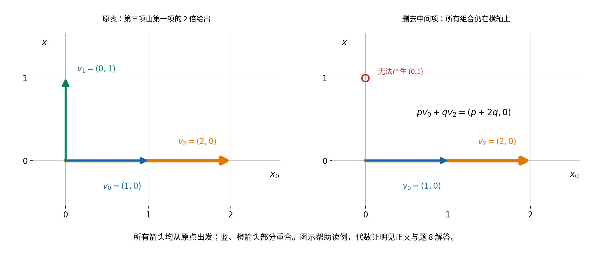

## 基础单元 有限表的线性无关、表示唯一性与冗余项 {#fli-unit}

**位置与目标。** 本单元主归第84章15Axx基础线性代数中15A03的有限实坐标线性无关与冗余项局部。我们研究一张有限向量表的系数能否由组合结果唯一确定，以及何时可删除某一项而不改变生成集合。这里不建立基、维数、交换引理或消元算法；也不证明“项数超过坐标数就相关”，不能把有限索引计数界直接当作该线性结论。

**精确先修。** 使用[经典量词否定](#lcq-scope-negation)、[逐点判等](#fc-equality)、[函数单射](#bij-injective)、[$V_n$与空表](#frc-model)、[向量加减](#frc-operations)、[加法规律](#frc-additive-laws)、[标量结合与零负号](#frc-scalar-laws)、[非零向量的标量消去](#frc-cancellation)，以及[有限线性组合](#flc-definition)、[系数相加](#flc-coefficients)、[缩放](#flc-scaling)、[同步拼接](#flc-concatenation)。生成集合使用[成员定义](#fsp-generated-set)、[单位系数取项](#fsp-contains-entries)和[最小性](#fsp-minimality)。删除索引使用[有限表拼接](#rfs-concatenation)、[后继比较](#ord-successor-comparison)、[自然三分律](#ord-trichotomy)、[同加保持与反映比较](#ord-addition-order)、[自然加法消去](#ord-cancellation)、[有条件自然减法](#sub-definition)、[自然加法结合](#b1-addition-associative)与[交换](#b1-addition-commutative)。实数除法只用[非零分母与乘回](#cutdiv-definition)，另用[实数加法差](#cutgroup-negation-subtraction)、[实数乘法结合](#cutsigned-associative)及[交换与单位](#cutsigned-signs)。

**约定与顺序。** $v:I_m\to V_n$始终是一张表，$m$为项数，$n$为坐标数，允许重复项及零长度。$C(a,v)$表示系数表$a:I_m\to\mathbb R$的组合。本单元先定义无关与相关，再证明表示唯一性；删除指定项时先核索引，最后才讨论冗余和生成集合。八题完整答案另列。

### 1. 零组合不够，还要看系数是不是全零 {#fli-definition}

等式$C(a,v)=0_n$称为$v$的一份**零关系**。$a=0_m$总能给出零关系，这是FLC已证的零系数公式，称为**平凡零关系**。

定义$v$**线性无关**，如果

$$
\forall a\in V_m,\qquad C(a,v)=0_n\Longrightarrow a=0_m.
$$

也就是说，得到零组合的系数只能全部为零。定义$v$**线性相关**，如果存在$a\in V_m$及$r\in I_m$，满足

$$
C(a,v)=0_n,\qquad a_r\ne0.
$$

这样的一份零关系称为非平凡零关系。非平凡只要求至少一个系数非零，不要求所有系数非零。

**FLI1（否定关系与空边界）。** 线性无关和线性相关互为否定。按经典量词否定，无关定义的否定是存在$a\in V_m$，使$C(a,v)=0_n$却$a\ne0_m$。由于$a,0_m$同域同目标，逐点判等与量词否定给

$$
a\ne0_m\quad\Longleftrightarrow\quad
\text{存在 }r\in I_m\text{ 使 }a_r\ne0.
$$

所以恰为相关定义。这里一份组合$C(a,v)$是向量，一份零关系是等式，而无关性是整张表的性质，不是同一种对象。

若$m=0$，$V_0$只有空系数表$0_0$，任何系数表本来都等于它，所以空向量表线性无关。其生成集合是$\{0_n\}$，无关并不表示能生成所有$V_n$。

若$n=0$而$m>0$，每个$v_k$都等于$0_0$。此时$0\in I_m$，取FSP已构造的单位系数表$e^{(0)}$，它在位置0取实数1，因而不是$0_m$；单位系数取项给$C(e^{(0)},v)=v_0=0_0$，所以表相关。不能把“每项都没有坐标”误解成“没有向量项”。

### 2. 系数差与生成集合内的唯一表示 {#fli-uniqueness}

先给一个会反复使用的公式。对$a,b\in V_m$，系数表的差满足$a-b=a+(-1)b$。FLC系数相加、缩放和FRC负号给

$$
\begin{aligned}
C(a-b,v)
&=C(a+(-1)b,v)\\
&=C(a,v)+C((-1)b,v)\\
&=C(a,v)+(-1)C(b,v)\\
&=C(a,v)-C(b,v).
\end{aligned}
$$

每一步都调用已定义的同长系数运算或$V_n$运算，不是仅凭相似记号猜等式。

**FLI2。** 以下三个条件等价：

1. 表$v$线性无关；
2. 函数$\Phi_v:V_m\to V_n$、$\Phi_v(a)=C(a,v)$是单射；
3. 对每个$x\in\operatorname{span}(v)$，恰有一份$a\in V_m$满足$x=C(a,v)$。

**从1到2。** 若$C(a,v)=C(b,v)$，差公式给$C(a-b,v)=0_n$。无关性使$a-b=0_m$，所以每个$k\in I_m$都有$a_k-b_k=0$。在实数加法群中两边加$b_k$，得$a_k=b_k$；同域同目标逐点相等给$a=b$，故$\Phi_v$单射。$m=0$时两系数本就是同一空表，论证仍成立。

**从2到3。** 任取$x\in\operatorname{span}(v)$，按生成集合定义已有至少一份$a$给出$x$。若另有$b$也给出$x$，则$\Phi_v(a)=\Phi_v(b)$，单射给$a=b$。所以是恰有一份。

**从3到1。** $0_n\in\operatorname{span}(v)$，且零系数表给出它。任取零关系$C(a,v)=0_n$，条件3在这个输出处的唯一性强制$a=0_m$，因此$v$无关。三条件互相推出。

唯一性只针对$x\in\operatorname{span}(v)$。例如单项表$v_0=(1,0)\in V_2$无关：若$c(1,0)=0_2$，第0坐标给$c=0$。但$(0,1)$没有任何系数表示，因为每个$c(1,0)$的第1坐标都为0。不能把“有表示时唯一”说成“$V_n$中每个向量都有表示”。

**含零项和重复项。** 若某$v_r=0_n$，单位系数$e^{(r)}$在$r$处为1，且组合恰为$v_r=0_n$，所以给非平凡关系。若$r\ne s$却$v_r=v_s$，取$a=e^{(r)}-e^{(s)}$。其第$r$坐标为$1-0=1$，所以非零；差公式与取项公式给

$$
C(a,v)=v_r-v_s=0_n.
$$

所以含重复项的表相关。这里必须保留表的位置：两项表$((1,0),(1,0))$相关，而只列一次的表$((1,0))$无关，二者值集却相同。因此不能先将表换成值集，再讨论本单元的无关性。

### 3. 删除一个指定项，先把新表写清楚 {#fli-deletion}

下面始终假设选定$r\in I_m$。若$m=0$，没有可选的$r$，删除讨论不启动。

由$r<m$和后继比较得$r+1\le m$，所以自然差

$$
s=m-(r+1)
$$

有定义且满足$m=(r+1)+s$。定义前缀$p:I_r\to V_n$与后缀$q:I_s\to V_n$：

$$
p_k=v_k\quad(k<r),\qquad q_t=v_{(r+1)+t}\quad(t<s).
$$

前缀输入$k<r<m$合法。后缀输入由$t<s$同加$r+1$得到$(r+1)+t<(r+1)+s=m$，所以也合法。

**FLI3（删除表与三段组合公式）。** 定义删除第$r$项后的表为

$$
u=p\Vert q:I_{r+s}\to V_n.
$$

具体规则是$u_k=v_k$（$k<r$），$u_{r+t}=v_{(r+1)+t}$（$t<s$）。前段落在$I_{r+s}$内；后段$r+t<r+s$且$r\le r+t$，所以不与前段相交。若$r+t=r+t'$，自然加法消去给$t=t'$，输出读法唯一。任给$k<r+s$，若$k\not<r$，全序给$r\le k$，此时取唯一自然差$t=k-r$，从$r+t=k<r+s$反映比较得$t<s$。所以规则覆盖全部输入且给唯一$V_n$输出。

新旧长度关系也明确为

$$
(r+s)+1=r+(s+1)=r+(1+s)=(r+1)+s=m,
$$

其中用的是自然加法结合与交换。我们使用合法自然数$r+s$作为新长度，不必在空长度上谈前驱。

对原系数表$a:I_m\to\mathbb R$，同样定义$a^-:I_r\to\mathbb R$、$a^+:I_s\to\mathbb R$，

$$
a^-_k=a_k,\qquad a^+_t=a_{(r+1)+t},
\qquad b=a^-\Vert a^+:I_{r+s}\to\mathbb R.
$$

令一项表$h:I_1\to V_n$、$d:I_1\to\mathbb R$满足$h_0=v_r,d_0=a_r$。原$v$是$(p\Vert h)\Vert q$，其域为$I_{(r+1)+s}=I_m$：前$r$项保持，第$r$项来自$h_0$，后缀第$t$项来自$v_{(r+1)+t}$。原$a$同样是$(a^-\Vert d)\Vert a^+$。这里不只是说它们有相同长度，还在全部输入处核了同值。

两次FLC5和一项组合公式给

$$
C(a,v)=\bigl(C(a^-,p)+a_rv_r\bigr)+C(a^+,q),
$$

而删除表的拼接给

$$
C(b,u)=C(a^-,p)+C(a^+,q).
$$

$r=0$时前缀为空；若$r+1=m$，则$s=0$，后缀为空；$m=1,r=0$时两者都为空，删除表长度0。上述公式都按空组合为零解释，不读取空表中不存在的项。

### 4. 指定项冗余，当且仅当它能带非零系数进入零关系 {#fli-redundancy}

沿用$r<m$及删除表$u$。如果$v_r\in\operatorname{span}(u)$，称第$r$项对这张表**冗余**：该项可以由其余项按删除后的明确顺序组合出来。

**FLI4。** 以下等价：存在$a\in V_m$满足$C(a,v)=0_n$且$a_r\ne0$；第$r$项冗余。

**从零关系到冗余。** 取这样一份$a$，按FLI3构造删除系数$b$。记

$$
A=C(a^-,p),\qquad B=a_rv_r,\qquad D=C(a^+,q),
\qquad E=A+D=C(b,u).
$$

原零关系是$(A+B)+D=0_n$。只对三个已经得到的向量用二元规律：

$$
(A+B)+D=A+(B+D)=A+(D+B)=(A+D)+B=E+B.
$$

依次是结合、交换$B,D$、结合，所以$E+B=0_n$。$B$是$E$的相反向量，由相反向量唯一性得$B=-E$，即$a_rv_r=-E$。

此时才使用$a_r\ne0$。令$d=a_r^{-1}=1/a_r$，它是合法实数并满足$da_r=1$。规定

$$
c=(-1)d,\qquad\text{也记 }c=-1/a_r.
$$

这里$-1/a_r$准确指$(-1)(a_r^{-1})$，其合法性来自非零分母；没有除以一个向量。将$a_rv_r=-E$两边乘实标量$d$。左边由FRC结合与实数乘回为

$$
d(a_rv_r)=(da_r)v_r=1v_r=v_r.
$$

右边先把$-E$写成$(-1)E$，再逐步得到

$$
d(-E)=d((-1)E)=(d(-1))E=((-1)d)E=cE.
$$

中间用标量结合及实数$d,-1$的交换。因此$v_r=cE=cC(b,u)$。FLC缩放给

$$
v_r=C(cb,u),\qquad (cb)_k=cb_k\quad(k<r+s).
$$

$cb$是实际合法的新系数表，故见证$v_r\in\operatorname{span}(u)$。即使新长度为0，这个表也可为空，结论按空组合解释。

**从冗余到零关系。** 反过来，设$v_r=C(b,u)$，其中$b:I_{r+s}\to\mathbb R$。把$b$按同一切点分成$\gamma:I_r\to\mathbb R$与$\delta:I_s\to\mathbb R$，令$\gamma_k=b_k$、$\delta_t=b_{r+t}$；索引合法性由拼接检查给出。记$A=C(\gamma,p),D=C(\delta,q)$，FLC5给$v_r=A+D$。

构造原长度的系数表$a$：前缀为$-\gamma$，第$r$处为1，后缀为$-\delta$，即

$$
a_k=-\gamma_k\ (k<r),\quad a_r=1,\quad
 a_{(r+1)+t}=-\delta_t\ (t<s).
$$

三段覆盖$I_m$且互不冲突，故合法。FLI3和FLC负缩放给

$$
C(a,v)=(-A+v_r)+(-D)=(-A+(A+D))+(-D).
$$

按结合律，$-A+(A+D)=((-A)+A)+D=0_n+D=D$，再加$-D$得到$0_n$。所以$C(a,v)=0_n$，且$a_r=1\ne0$。反向成立，FLI4得证。

### 5. 冗余恰好允许保持生成集合地删除 {#fli-span-deletion}

**FLI5。** 对选定的$r\in I_m$及其删除表$u$，

$$
v_r\in\operatorname{span}(u)
\quad\Longleftrightarrow\quad
\operatorname{span}(u)=\operatorname{span}(v).
$$

首先，每个$u_k$按前后规则都是$v$的一项，所以FSP取项结论使它属于子空间$\operatorname{span}(v)$。FSP最小性给$\operatorname{span}(u)\subseteq\operatorname{span}(v)$，不需冗余假设。

若$v_r\in\operatorname{span}(u)$，其余原项也在该子空间内：原索引$j<r$时$v_j=u_j$；原索引$j>r$时，由后继比较$r+1\le j$，取$t=j-(r+1)$，则$j=(r+1)+t<m=(r+1)+s$，反映比较给$t<s$，所以$v_j=u_{r+t}$。这些删除表项均由FSP4属于$\operatorname{span}(u)$。加上假设提供的第$r$项，原表所有项都在该子空间中；再由最小性得$\operatorname{span}(v)\subseteq\operatorname{span}(u)$，两向包含给相等。

反过来，若生成集合相等，FSP4给$v_r\in\operatorname{span}(v)$，便有$v_r\in\operatorname{span}(u)$。等价完成。

由一份非平凡零关系至少有一个非零系数，可以选到某个$r$应用FLI4、FLI5，所以相关表至少有一个可删冗余项。这不表示每项都可删，某一关系中系数为零的位置不能据此除法求解。

若$v$无关，则对**每个实际存在的$r\in I_m$**，删后的生成集合必与原集合不同。否则FLI5给冗余，FLI4构造第$r$系数非零的零关系，与无关矛盾。$m=0$时没有任何$r$，此说法不要求执行一次删除。

### 6. 无关表删去一项后仍无关 {#fli-deletion-independent}

**FLI6。** 若$v$无关且$r\in I_m$，则删除表$u:I_{r+s}\to V_n$无关。

任取$u$的零关系$C(b,u)=0_n$。按删除表切点把系数拆成$\gamma_k=b_k$（$k<r$）和$\delta_t=b_{r+t}$（$t<s$）。在原位置$r$插入系数0，定义原长$a$为前缀$\gamma$、中间一项0、后缀$\delta$。FLI3的三段公式与乘零给

$$
\begin{aligned}
C(a,v)
&=\bigl(C(\gamma,p)+0v_r\bigr)+C(\delta,q)\\
&=C(\gamma,p)+C(\delta,q)\\
&=C(b,u)=0_n.
\end{aligned}
$$

$v$无关使$a=0_m$。对$k<r$，$b_k=a_k=0$；对$t<s$，$b_{r+t}=a_{(r+1)+t}=0$，两段覆盖删除表全部域，所以$b=0_{r+s}$。任意零关系都平凡，$u$无关。若删除后长度为0，这个结论也与空表无关一致。

FLI5和FLI6讨论的是不同问题：无关表删除已有项会减小生成集合，但剩余表仍然无关。不能把“仍无关”误说成“仍生成相同集合”。

**看一个可删与不可删的对照。** 对表$((1,0),(0,1),(2,0))$，第三项等于第一项的2倍，因此可由其余两项产生；若删掉中间项，剩余两项的任何组合却都形如$(p+2q,0)$，不能产生$(0,1)$。图中蓝、橙箭头确实从同一原点出发并部分重合，没有为排版平移向量。题8将把这些断言逐坐标核算；图不替代一般的FLI4、FLI5证明。

### 7. 八道练习 {#fli-exercises}

#### 题1：零关系与两种空边界 {#fli-q01}

写线性无关和相关的精确量词，证明二者互为否定。说明全零系数为何不是相关见证；证明$m=0$时表无关、$n=0$且$m>0$时表相关，并区分两类零记录。 [完整解答](#fli-a01)

#### 题2：直接坐标判断与重复项 {#fli-q02}

证明$v_0=(1,0),v_1=(1,1)$构成的表无关。若一般表某项为零，构造非平凡零关系；若有两个不同位置的项相同，再构造非平凡零关系。比较单项表$((1,0))$与两项表$((1,0),(1,0))$，解释为什么不能先把表换成值集。 [完整解答](#fli-a02)

#### 题3：唯一性究竟在哪个集合上 {#fli-q03}

先证明系数差公式，再完整证明FLI2三条件等价。给一个无关表却不能表示$V_n$所有向量的例子，并说明存在性与唯一性分别来自哪里。 [完整解答](#fli-a03)

#### 题4：删除位置1时的新索引 {#fli-q04}

给任意$v:I_4\to V_n$，删除$r=1$。写$s$、前后缀类型、删除表全部输出以及系数删除规则。再核一般$r<m$时$s=m-(r+1)$为何合法、后缀和删除表为何合法，以及$(r+s)+1=m$；说明$r=0$、$r+1=m$、$m=1$与$m=0$各有什么边界。 [完整解答](#fli-a04)

#### 题5：只除以已确认非零的系数 {#fli-q05}

取$v_0=(1,0),v_1=(3,2),v_2=(0,1)$。核$a=(-6,2,-4)$是非平凡零关系，指定$r=1$，写删除表与删除系数，按$(-1)(a_r^{-1})$构造表示$v_1$的新系数。再由该表示反向构造$r$处系数为1的零关系并核算。 [完整解答](#fli-a05)

#### 题6：指定项冗余的两个方向 {#fli-q06}

对一般$r<m$，完整证明“$v_r$属于删除表的生成集合”能构造$r$处系数非零的零关系，前后系数分段写清。再用最小性两向证明FLI5，并解释为什么不能省略指定位置条件。 [完整解答](#fli-a06)

#### 题7：插入零系数证明删后无关 {#fli-q07}

完整证明FLI6，给原长系数表的显式前后规则。对非零单项表说明它为何无关，删除唯一项后为何仍无关，却不再生成相同集合；检查空系数表并不表示能生成全部$V_n$。 [完整解答](#fli-a07)

#### 题8：相关不等于每一项都冗余 {#fli-q08}

取$v=((1,0),(0,1),(2,0))$。核$(-2,0,1)$给非平凡零关系；说明第三项可删而保持生成集合，但中间项不可删而保持生成集合，后一结论须给实际无法产生的向量。为什么不能用这份关系在中间位置作除法？说明本单元结论与尚未证明的项数、维数结论的界限。 [完整解答](#fli-a08)

### 8. 来源与范围 {#fli-sources}

实际核读Robert A. Beezer《A First Course in Linear Algebra》固定版本的[“Linear Independence”](https://raw.githubusercontent.com/rbeezer/fcla/347f27fe909b54b26970bcc0fcbf69c7e853c766/src/section-LI.xml)第1—40行、[“Linear Independence and Spanning Sets”](https://raw.githubusercontent.com/rbeezer/fcla/347f27fe909b54b26970bcc0fcbf69c7e853c766/src/section-LISS.xml)第578—622行和[“Linear Dependence and Spans”](https://raw.githubusercontent.com/rbeezer/fcla/347f27fe909b54b26970bcc0fcbf69c7e853c766/src/section-LDS.xml)第1—99行。定义、相减系数证明唯一性的思路，以及非零系数隔离一项的思路均有这些来源依据。

源文以复数、集合或抽象空间叙述，唯一表示段置于基的框架。本书限定实数、零起有限表，把唯一存在的范围限定为$\operatorname{span}(v)$，并补明确删除索引、两空段、乘回和完整系数表构造。上述差异及原创八题、完整解答不应误说成源文已经提供；未复制或翻译其数值题解。

[固定版COPYING](https://raw.githubusercontent.com/rbeezer/fcla/347f27fe909b54b26970bcc0fcbf69c7e853c766/COPYING.txt)许可为GFDL 1.2或以后，无不变节及封面文字。实际取得和阅读身份见制作记录`research/production/finite_coordinate_independence_sources.json`。本单元不推出基、维数、交换引理、任意项重排或矩阵算法，也不将有限索引单射界当作线性相关性证明。
