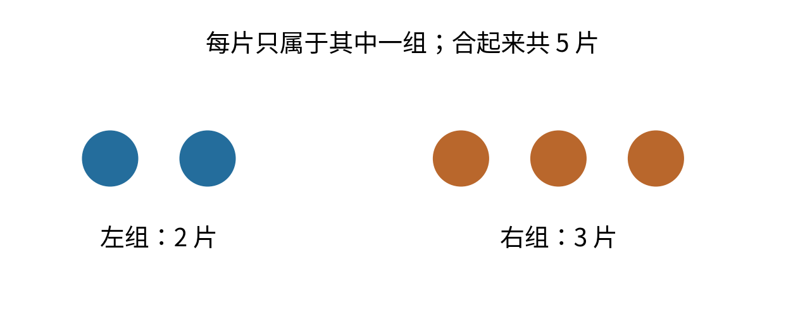
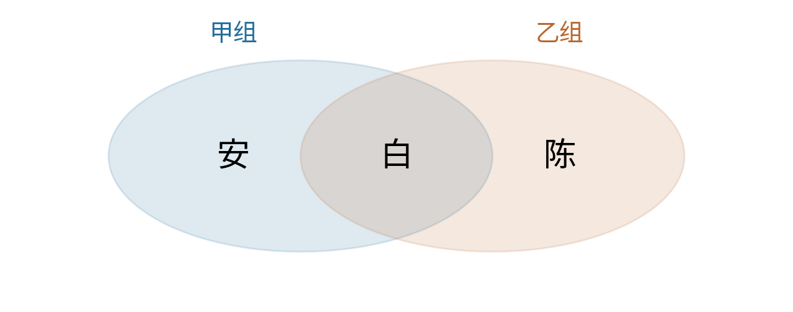
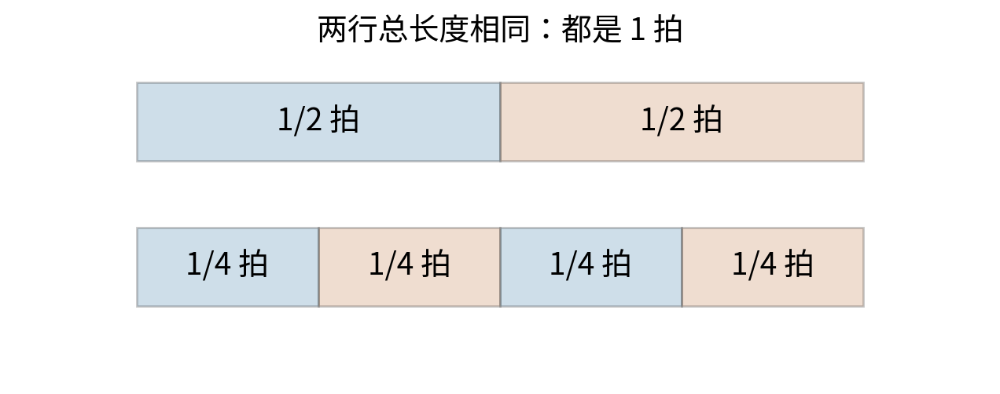
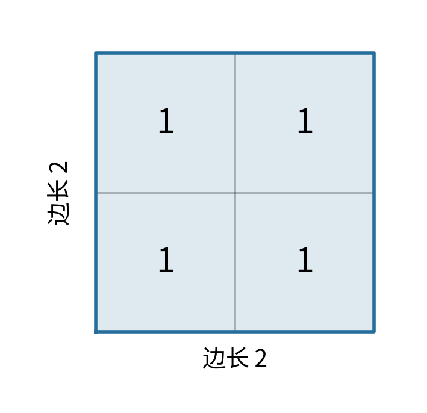

# 全书目录：63部分、534章、6006节


本目录列出全书的编写范围，含 63 个部分、534 个章节、6006 个节项；不表示这些内容已全部写成教材。503 个通用文献类型节项直接列在各部分开头，其后按原有 534 个中级类别列章，并列出 5503 个专门主题节项。不为通用条目虚构章节。

本目录按 MSC2020 分类顺序编排，保留全部代码及归属；现按作者要求作为逐章编写目录。部分采用已有中文类名；经作者同意，第1章使用“绪论：一般与综合专题”，对应原名 General and miscellaneous specific topics（00Axx）。其余中级类别及节项保留附件原文标题，不冒称已完成中文翻译。标题仅保留分类名称，去除交叉检索提示并恢复换行断词及经原页核验的数学排版，不含大段原文或新增教材内容。

分类依据：Mathematical Reviews 与 zbMATH 编制的 MSC2020，用户提供的 224 页附件。本目录属于分类定位索引，不构成对原始 PDF 或其他来源正文的开放授权；不随目录重发原始 PDF。

## 第1部分 数学总论与综合主题（MSC 00-XX）

- 第1节 Introductory exposition (textbooks, tutorial papers, etc.) pertaining to mathematics in general（00-01）

- 第2节 Research exposition (monographs, survey articles) pertaining to mathematics in general（00-02）

### 第1章 绪论：一般与综合专题（00Axx）

- 第3节 Mathematics in general（00A05）

- 第4节 Mathematics for nonmathematicians (engineering, social sciences, etc.)（00A06）

- 第5节 Problem books（00A07）

- 第6节 Recreational mathematics（00A08）

- 第7节 Popularization of mathematics（00A09）

- 第8节 Bibliographies for mathematics in general（00A15）

- 第9节 External book reviews（00A17）

- 第10节 Dictionaries and other general reference works（00A20）

- 第11节 Formularies（00A22）

- 第12节 Lists of open problems（00A27）

- 第13节 Philosophy of mathematics（00A30）

- 第14节 Methodology of mathematics（00A35）

- 第15节 Mathematics and literature（00A64）

- 第16节 Mathematics and music（00A65）

- 第17节 Mathematics and visual arts（00A66）

- 第18节 Mathematics and architecture（00A67）

- 第19节 General applied mathematics（00A69）

- 第20节 General theory of mathematical modeling（00A71）

- 第21节 General theory of simulation（00A72）

- 第22节 Physics（00A79）

- 第23节 None of the above, but in this section（00A99）

### 第2章 Conference proceedings and collections of articles（00Bxx）

- 第24节 Collections of abstracts of lectures（00B05）

- 第25节 Collections of articles of general interest（00B10）

- 第26节 Collections of articles of miscellaneous specific interest（00B15）

- 第27节 Proceedings of conferences of general interest（00B20）

- 第28节 Proceedings of conferences of miscellaneous specific interest（00B25）

- 第29节 Festschriften（00B30）

- 第30节 Collections of translated articles of general interest（00B50）

- 第31节 Collections of translated articles of miscellaneous specific interest（00B55）

- 第32节 Collections of reprinted articles（00B60）

- 第33节 None of the above, but in this section（00B99）

## 第2部分 数学史与人物传记（MSC 01-XX）

- 第34节 General reference works (handbooks, dictionaries, bibliographies, etc.) pertaining to history and biography（01-00）

- 第35节 Introductory exposition (textbooks, tutorial papers, etc.) pertaining to history and biography（01-01）

- 第36节 Research exposition (monographs, survey articles) pertaining to history and biography（01-02）

- 第37节 Proceedings, conferences, collections, etc. pertaining to history and biography（01-06）

- 第38节 Research data for problems pertaining to history and biography（01-11）

### 第3章 History of mathematics and mathematicians（01Axx）

- 第39节 General histories, source books（01A05）

- 第40节 Ethnomathematics (general)（01A07）

- 第41节 History of mathematics in Paleolithic and Neolithic times（01A10）

- 第42节 History of mathematics of the indigenous cultures of Africa, Asia, and Oceania（01A11）

- 第43节 History of mathematics of the indigenous cultures of the Americas（01A12）

- 第44节 History of mathematics of the indigenous cultures of Europe (pre-Greek, etc.)（01A15）

- 第45节 History of Egyptian mathematics（01A16）

- 第46节 History of Babylonian mathematics（01A17）

- 第47节 History of Greek and Roman mathematics（01A20）

- 第48节 History of Chinese mathematics（01A25）

- 第49节 History of Japanese mathematics（01A27）

- 第50节 History of East and Southeast Asian mathematics (non-Chinese, non-Japanese)（01A29）

- 第51节 History of mathematics in the Golden Age of Islam（01A30）

- 第52节 History of Indian mathematics（01A32）

- 第53节 History of mathematics in Late Antiquity and medieval Europe（01A35）

- 第54节 History of mathematics in the 15th and 16th centuries, Renaissance（01A40）

- 第55节 History of mathematics in the 17th century（01A45）

- 第56节 History of mathematics in the 18th century（01A50）

- 第57节 History of mathematics in the 19th century（01A55）

- 第58节 History of mathematics in the 20th century（01A60）

- 第59节 History of mathematics in the 21st century（01A61）

- 第60节 Development of contemporary mathematics（01A65）

- 第61节 Future perspectives in mathematics（01A67）

- 第62节 Biographies, obituaries, personalia, bibliographies（01A70）

- 第63节 Schools of mathematics（01A72）

- 第64节 History of mathematics at specific universities（01A73）

- 第65节 History of mathematics at institutions and academies (non-university)（01A74）

- 第66节 Collected or selected works; reprintings or translations of classics（01A75）

- 第67节 Sociology (and profession) of mathematics（01A80）

- 第68节 Historiography（01A85）

- 第69节 Bibliographic studies（01A90）

- 第70节 None of the above, but in this section（01A99）

## 第3部分 数理逻辑与数学基础（MSC 03-XX）

- 第71节 General reference works (handbooks, dictionaries, bibliographies, etc.) pertaining to mathematical logic and foundations（03-00）

- 第72节 Introductory exposition (textbooks, tutorial papers, etc.) pertaining to mathematical logic and foundations（03-01）

- 第73节 Research exposition (monographs, survey articles) pertaining to mathematical logic and foundations（03-02）

- 第74节 History of mathematical logic and foundations（03-03）

- 第75节 Software, source code, etc. for problems pertaining to mathematical logic and foundations（03-04）

- 第76节 Proceedings, conferences, collections, etc. pertaining to mathematical logic and foundations（03-06）

- 第77节 Computational methods for problems pertaining to mathematical logic and foundations（03-08）

- 第78节 Research data for problems pertaining to mathematical logic and foundations（03-11）

### 第4章 Philosophical aspects of logic and foundations（03Axx）

- 第79节 Philosophical and critical aspects of logic and foundations（03A05）

- 第80节 Logic in the philosophy of science（03A10）

- 第81节 None of the above, but in this section（03A99）

### 第5章 General logic（03Bxx）

- 第82节 Classical propositional logic（03B05）

- 第83节 Classical first-order logic（03B10）

- 第84节 Higher-order logic（03B16）

- 第85节 Subsystems of classical logic (including intuitionistic logic)（03B20）

- 第86节 Abstract deductive systems（03B22）

- 第87节 Decidability of theories and sets of sentences（03B25）

- 第88节 Foundations of classical theories (including reverse mathematics)（03B30）

- 第89节 Mechanization of proofs and logical operations（03B35）

- 第90节 Type theory（03B38）

- 第91节 Combinatory logic and lambda calculus（03B40）

- 第92节 Logics of knowledge and belief (including belief change)（03B42）

- 第93节 Temporal logic（03B44）

- 第94节 Modal logic (including the logic of norms)（03B45）

- 第95节 Substructural logics (including relevance, entailment, linear logic, Lambek calculus, BCK and BCI logics)（03B47）

- 第96节 Probability and inductive logic（03B48）

- 第97节 Many-valued logic（03B50）

- 第98节 Fuzzy logic; logic of vagueness（03B52）

- 第99节 Paraconsistent logics（03B53）

- 第100节 Intermediate logics（03B55）

- 第101节 Other nonclassical logic（03B60）

- 第102节 Combined logics（03B62）

- 第103节 Logic of natural languages（03B65）

- 第104节 Logic in computer science（03B70）

- 第105节 Other applications of logic（03B80）

- 第106节 None of the above, but in this section（03B99）

### 第6章 Model theory（03Cxx）

- 第107节 Equational classes, universal algebra in model theory（03C05）

- 第108节 Basic properties of first-order languages and structures（03C07）

- 第109节 Quantifier elimination, model completeness, and related topics（03C10）

- 第110节 Model theory of finite structures（03C13）

- 第111节 Model theory of denumerable and separable structures（03C15）

- 第112节 Ultraproducts and related constructions（03C20）

- 第113节 Model-theoretic forcing（03C25）

- 第114节 Other model constructions（03C30）

- 第115节 Categoricity and completeness of theories（03C35）

- 第116节 Interpolation, preservation, definability（03C40）

- 第117节 Classification theory, stability, and related concepts in model theory（03C45）

- 第118节 Abstract elementary classes and related topics（03C48）

- 第119节 Models with special properties (saturated, rigid, etc.)（03C50）

- 第120节 Properties of classes of models（03C52）

- 第121节 Set-theoretic model theory（03C55）

- 第122节 Computable structure theory, computable model theory（03C57）

- 第123节 Model-theoretic algebra（03C60）

- 第124节 Models of arithmetic and set theory（03C62）

- 第125节 Model theory of ordered structures; o-minimality（03C64）

- 第126节 Models of other mathematical theories（03C65）

- 第127节 Continuous model theory, model theory of metric structures（03C66）

- 第128节 Other classical first-order model theory（03C68）

- 第129节 Logic on admissible sets（03C70）

- 第130节 Other infinitary logic（03C75）

- 第131节 Logic with extra quantifiers and operators（03C80）

- 第132节 Second- and higher-order model theory（03C85）

- 第133节 Nonclassical models (Boolean-valued, sheaf, etc.)（03C90）

- 第134节 Abstract model theory（03C95）

- 第135节 Applications of model theory（03C98）

- 第136节 None of the above, but in this section（03C99）

### 第7章 Computability and recursion theory（03Dxx）

- 第137节 Thue and Post systems, etc.（03D03）

- 第138节 Automata and formal grammars in connection with logical questions（03D05）

- 第139节 Turing machines and related notions（03D10）

- 第140节 Complexity of computation (including implicit computational complexity)（03D15）

- 第141节 Recursive functions and relations, subrecursive hierarchies（03D20）

- 第142节 Recursively (computably) enumerable sets and degrees（03D25）

- 第143节 Other Turing degree structures（03D28）

- 第144节 Other degrees and reducibilities in computability and recursion theory（03D30）

- 第145节 Algorithmic randomness and dimension（03D32）

- 第146节 Undecidability and degrees of sets of sentences（03D35）

- 第147节 Word problems, etc. in computability and recursion theory（03D40）

- 第148节 Theory of numerations, effectively presented structures（03D45）

- 第149节 Recursive equivalence types of sets and structures, isols（03D50）

- 第150节 Hierarchies of computability and definability（03D55）

- 第151节 Computability and recursion theory on ordinals, admissible sets, etc.（03D60）

- 第152节 Higher-type and set recursion theory（03D65）

- 第153节 Inductive definability（03D70）

- 第154节 Abstract and axiomatic computability and recursion theory（03D75）

- 第155节 Computation over the reals, computable analysis（03D78）

- 第156节 Applications of computability and recursion theory（03D80）

- 第157节 None of the above, but in this section（03D99）

### 第8章 Set theory（03Exx）

- 第158节 Partition relations（03E02）

- 第159节 Ordered sets and their cofinalities; pcf theory（03E04）

- 第160节 Other combinatorial set theory（03E05）

- 第161节 Ordinal and cardinal numbers（03E10）

- 第162节 Descriptive set theory（03E15）

- 第163节 Cardinal characteristics of the continuum（03E17）

- 第164节 Other classical set theory (including functions, relations, and set algebra)（03E20）

- 第165节 Axiom of choice and related propositions（03E25）

- 第166节 Axiomatics of classical set theory and its fragments（03E30）

- 第167节 Consistency and independence results（03E35）

- 第168节 Other aspects of forcing and Boolean-valued models（03E40）

- 第169节 Inner models, including constructibility, ordinal definability, and core models（03E45）

- 第170节 Other notions of set-theoretic definability（03E47）

- 第171节 Continuum hypothesis and Martin’s axiom（03E50）

- 第172节 Large cardinals（03E55）

- 第173节 Generic absoluteness and forcing axioms（03E57）

- 第174节 Determinacy principles（03E60）

- 第175节 Other set-theoretic hypotheses and axioms（03E65）

- 第176节 Nonclassical and second-order set theories（03E70）

- 第177节 Theory of fuzzy sets, etc.（03E72）

- 第178节 Applications of set theory（03E75）

- 第179节 None of the above, but in this section（03E99）

### 第9章 Proof theory and constructive mathematics（03Fxx）

- 第180节 Proof theory in general (including proof-theoretic semantics)（03F03）

- 第181节 Cut-elimination and normal-form theorems（03F05）

- 第182节 Structure of proofs（03F07）

- 第183节 Functionals in proof theory（03F10）

- 第184节 Recursive ordinals and ordinal notations（03F15）

- 第185节 Complexity of proofs（03F20）

- 第186节 Relative consistency and interpretations（03F25）

- 第187节 First-order arithmetic and fragments（03F30）

- 第188节 Second- and higher-order arithmetic and fragments（03F35）

- 第189节 Gödel numberings and issues of incompleteness（03F40）

- 第190节 Provability logics and related algebras (e.g., diagonalizable algebras)（03F45）

- 第191节 Metamathematics of constructive systems（03F50）

- 第192节 Proof-theoretic aspects of linear logic and other substructural logics（03F52）

- 第193节 Intuitionistic mathematics（03F55）

- 第194节 Constructive and recursive analysis（03F60）

- 第195节 Other constructive mathematics（03F65）

- 第196节 None of the above, but in this section（03F99）

### 第10章 Algebraic logic（03Gxx）

- 第197节 Logical aspects of Boolean algebras（03G05）

- 第198节 Logical aspects of lattices and related structures（03G10）

- 第199节 Quantum logic（03G12）

- 第200节 Cylindric and polyadic algebras; relation algebras（03G15）

- 第201节 Logical aspects of Lukasiewicz and Post algebras（03G20）

- 第202节 Other algebras related to logic（03G25）

- 第203节 Abstract algebraic logic（03G27）

- 第204节 Categorical logic, topoi（03G30）

- 第205节 None of the above, but in this section（03G99）

### 第11章 Nonstandard models（03Hxx）

- 第206节 Nonstandard models in mathematics（03H05）

- 第207节 Other applications of nonstandard models (economics, physics, etc.)（03H10）

- 第208节 Nonstandard models of arithmetic（03H15）

- 第209节 None of the above, but in this section（03H99）

## 第4部分 组合数学（MSC 05-XX）

- 第210节 General reference works (handbooks, dictionaries, bibliographies, etc.) pertaining to combinatorics（05-00）

- 第211节 Introductory exposition (textbooks, tutorial papers, etc.) pertaining to combinatorics（05-01）

- 第212节 Research exposition (monographs, survey articles) pertaining to combinatorics（05-02）

- 第213节 History of combinatorics（05-03）

- 第214节 Software, source code, etc. for problems pertaining to combinatorics（05-04）

- 第215节 Proceedings, conferences, collections, etc. pertaining to combinatorics（05-06）

- 第216节 Computational methods for problems pertaining to combinatorics（05-08）

- 第217节 Research data for problems pertaining to combinatorics（05-11）

### 第12章 Enumerative combinatorics（05Axx）

- 第218节 Permutations, words, matrices（05A05）

- 第219节 Factorials, binomial coefficients, combinatorial functions（05A10）

- 第220节 Exact enumeration problems, generating functions（05A15）

- 第221节 Asymptotic enumeration（05A16）

- 第222节 Combinatorial aspects of partitions of integers（05A17）

- 第223节 Partitions of sets（05A18）

- 第224节 Combinatorial identities, bijective combinatorics（05A19）

- 第225节 Combinatorial inequalities（05A20）

- 第226节 $q$-calculus and related topics（05A30）

- 第227节 Umbral calculus（05A40）

- 第228节 None of the above, but in this section（05A99）

### 第13章 Designs and configurations（05Bxx）

- 第229节 Combinatorial aspects of block designs（05B05）

- 第230节 Triple systems（05B07）

- 第231节 Combinatorial aspects of difference sets (number-theoretic, group-theoretic, etc.)（05B10）

- 第232节 Orthogonal arrays, Latin squares, Room squares（05B15）

- 第233节 Combinatorial aspects of matrices (incidence, Hadamard, etc.)（05B20）

- 第234节 Combinatorial aspects of finite geometries（05B25）

- 第235节 Other designs, configurations（05B30）

- 第236节 Combinatorial aspects of matroids and geometric lattices（05B35）

- 第237节 Combinatorial aspects of packing and covering（05B40）

- 第238节 Combinatorial aspects of tessellation and tiling problems（05B45）

- 第239节 Polyominoes（05B50）

- 第240节 None of the above, but in this section（05B99）

### 第14章 Graph theory（05Cxx）

- 第241节 Trees（05C05）

- 第242节 Vertex degrees（05C07）

- 第243节 Graphical indices (Wiener index, Zagreb index, Randić index, etc.)（05C09）

- 第244节 Planar graphs; geometric and topological aspects of graph theory（05C10）

- 第245节 Distance in graphs（05C12）

- 第246节 Coloring of graphs and hypergraphs（05C15）

- 第247节 Perfect graphs（05C17）

- 第248节 Directed graphs (digraphs), tournaments（05C20）

- 第249节 Flows in graphs（05C21）

- 第250节 Signed and weighted graphs（05C22）

- 第251节 Graphs and abstract algebra (groups, rings, fields, etc.)（05C25）

- 第252节 Enumeration in graph theory（05C30）

- 第253节 Graph polynomials（05C31）

- 第254节 Extremal problems in graph theory（05C35）

- 第255节 Paths and cycles（05C38）

- 第256节 Connectivity（05C40）

- 第257节 Density (toughness, etc.)（05C42）

- 第258节 Eulerian and Hamiltonian graphs（05C45）

- 第259节 Expander graphs（05C48）

- 第260节 Graphs and linear algebra (matrices, eigenvalues, etc.)（05C50）

- 第261节 Graph designs and isomorphic decomposition（05C51）

- 第262节 Generalized Ramsey theory（05C55）

- 第263节 Games on graphs (graph-theoretic aspects)（05C57）

- 第264节 Isomorphism problems in graph theory (reconstruction conjecture, etc.) and homomorphisms (subgraph embedding, etc.)（05C60）

- 第265节 Graph representations (geometric and intersection representations, etc.)（05C62）

- 第266节 Infinite graphs（05C63）

- 第267节 Hypergraphs（05C65）

- 第268节 Vertex subsets with special properties (dominating sets, independent sets, cliques, etc.)（05C69）

- 第269节 Edge subsets with special properties (factorization, matching, partitioning, covering and packing, etc.)（05C70）

- 第270节 Fractional graph theory, fuzzy graph theory（05C72）

- 第271节 Structural characterization of families of graphs（05C75）

- 第272节 Graph operations (line graphs, products, etc.)（05C76）

- 第273节 Graph labelling (graceful graphs, bandwidth, etc.)（05C78）

- 第274节 Random graphs (graph-theoretic aspects)（05C80）

- 第275节 Random walks on graphs（05C81）

- 第276节 Small world graphs, complex networks (graph-theoretic aspects)（05C82）

- 第277节 Graph minors（05C83）

- 第278节 Graph algorithms (graph-theoretic aspects)（05C85）

- 第279节 Applications of graph theory（05C90）

- 第280节 Chemical graph theory（05C92）

- 第281节 None of the above, but in this section（05C99）

### 第15章 Extremal combinatorics（05Dxx）

- 第282节 Extremal set theory（05D05）

- 第283节 Ramsey theory（05D10）

- 第284节 Transversal (matching) theory（05D15）

- 第285节 Probabilistic methods in extremal combinatorics, including polynomial methods (combinatorial Nullstellensatz, etc.)（05D40）

- 第286节 None of the above, but in this section（05D99）

### 第16章 Algebraic combinatorics（05Exx）

- 第287节 Symmetric functions and generalizations（05E05）

- 第288节 Combinatorial aspects of representation theory（05E10）

- 第289节 Combinatorial aspects of algebraic geometry（05E14）

- 第290节 Combinatorial aspects of groups and algebras（05E16）

- 第291节 Group actions on combinatorial structures（05E18）

- 第292节 Association schemes, strongly regular graphs（05E30）

- 第293节 Combinatorial aspects of commutative algebra（05E40）

- 第294节 Combinatorial aspects of simplicial complexes（05E45）

- 第295节 None of the above, but in this section（05E99）

## 第5部分 序、格与有序代数结构（MSC 06-XX）

- 第296节 General reference works (handbooks, dictionaries, bibliographies, etc.) pertaining to ordered structures（06-00）

- 第297节 Introductory exposition (textbooks, tutorial papers, etc.) pertaining to ordered structures（06-01）

- 第298节 Research exposition (monographs, survey articles) pertaining to ordered structures（06-02）

- 第299节 History of ordered structures（06-03）

- 第300节 Software, source code, etc. for problems pertaining to ordered structures（06-04）

- 第301节 Proceedings, conferences, collections, etc. pertaining to ordered structures（06-06）

- 第302节 Computational methods for problems pertaining to ordered structures（06-08）

- 第303节 Research data for problems pertaining to ordered structures（06-11）

### 第17章 Ordered sets（06Axx）

- 第304节 Total orders（06A05）

- 第305节 Partial orders, general（06A06）

- 第306节 Combinatorics of partially ordered sets（06A07）

- 第307节 Algebraic aspects of posets（06A11）

- 第308节 Semilattices（06A12）

- 第309节 Galois correspondences, closure operators (in relation to ordered sets)（06A15）

- 第310节 Generalizations of ordered sets（06A75）

- 第311节 None of the above, but in this section（06A99）

### 第18章 Lattices（06Bxx）

- 第312节 Structure theory of lattices（06B05）

- 第313节 Lattice ideals, congruence relations（06B10）

- 第314节 Representation theory of lattices（06B15）

- 第315节 Varieties of lattices（06B20）

- 第316节 Complete lattices, completions（06B23）

- 第317节 Free lattices, projective lattices, word problems（06B25）

- 第318节 Topological lattices（06B30）

- 第319节 Continuous lattices and posets, applications（06B35）

- 第320节 Generalizations of lattices（06B75）

- 第321节 None of the above, but in this section（06B99）

### 第19章 Modular lattices, complemented lattices（06Cxx）

- 第322节 Modular lattices, Desarguesian lattices（06C05）

- 第323节 Semimodular lattices, geometric lattices（06C10）

- 第324节 Complemented lattices, orthocomplemented lattices and posets（06C15）

- 第325节 Complemented modular lattices, continuous geometries（06C20）

- 第326节 None of the above, but in this section（06C99）

### 第20章 Distributive lattices（06Dxx）

- 第327节 Structure and representation theory of distributive lattices（06D05）

- 第328节 Complete distributivity（06D10）

- 第329节 Pseudocomplemented lattices（06D15）

- 第330节 Heyting algebras (lattice-theoretic aspects)（06D20）

- 第331节 Frames, locales（06D22）

- 第332节 Post algebras (lattice-theoretic aspects)（06D25）

- 第333节 De Morgan algebras, Lukasiewicz algebras (lattice-theoretic aspects)（06D30）

- 第334节 MV-algebras（06D35）

- 第335节 Lattices and duality（06D50）

- 第336节 Fuzzy lattices (soft algebras) and related topics（06D72）

- 第337节 Other generalizations of distributive lattices（06D75）

- 第338节 None of the above, but in this section（06D99）

### 第21章 Boolean algebras (Boolean rings)（06Exx）

- 第339节 Structure theory of Boolean algebras（06E05）

- 第340节 Chain conditions, complete algebras（06E10）

- 第341节 Stone spaces (Boolean spaces) and related structures（06E15）

- 第342节 Ring-theoretic properties of Boolean algebras（06E20）

- 第343节 Boolean algebras with additional operations (diagonalizable algebras, etc.)（06E25）

- 第344节 Boolean functions（06E30）

- 第345节 Generalizations of Boolean algebras（06E75）

- 第346节 None of the above, but in this section（06E99）

### 第22章 Ordered structures（06Fxx）

- 第347节 Ordered semigroups and monoids（06F05）

- 第348节 Quantales（06F07）

- 第349节 Noether lattices（06F10）

- 第350节 Ordered groups（06F15）

- 第351节 Ordered abelian groups, Riesz groups, ordered linear spaces（06F20）

- 第352节 Ordered rings, algebras, modules（06F25）

- 第353节 Ordered topological structures（06F30）

- 第354节 BCK-algebras, BCI-algebras（06F35）

- 第355节 None of the above, but in this section（06F99）

## 第6部分 一般代数系统（MSC 08-XX）

- 第356节 General reference works (handbooks, dictionaries, bibliographies, etc.) pertaining to general algebraic systems（08-00）

- 第357节 Introductory exposition (textbooks, tutorial papers, etc.) pertaining to general algebraic systems（08-01）

- 第358节 Research exposition (monographs, survey articles) pertaining to general algebraic systems（08-02）

- 第359节 History of general algebraic systems（08-03）

- 第360节 Software, source code, etc. for problems pertaining to general algebraic systems（08-04）

- 第361节 Proceedings, conferences, collections, etc. pertaining to general algebraic systems（08-06）

- 第362节 Computational methods for problems pertaining to general algebraic systems（08-08）

- 第363节 Research data for problems pertaining to general algebraic systems（08-11）

### 第23章 Algebraic structures（08Axx）

- 第364节 Relational systems, laws of composition（08A02）

- 第365节 Structure theory of algebraic structures（08A05）

- 第366节 Subalgebras, congruence relations（08A30）

- 第367节 Automorphisms and endomorphisms of algebraic structures（08A35）

- 第368节 Operations and polynomials in algebraic structures, primal algebras（08A40）

- 第369节 Equational compactness（08A45）

- 第370节 Word problems (aspects of algebraic structures)（08A50）

- 第371节 Partial algebras（08A55）

- 第372节 Unary algebras（08A60）

- 第373节 Finitary algebras（08A62）

- 第374节 Infinitary algebras（08A65）

- 第375节 Heterogeneous algebras（08A68）

- 第376节 Applications of universal algebra in computer science（08A70）

- 第377节 Fuzzy algebraic structures（08A72）

- 第378节 None of the above, but in this section（08A99）

### 第24章 Varieties（08Bxx）

- 第379节 Equational logic, Mal’tsev conditions（08B05）

- 第380节 Congruence modularity, congruence distributivity（08B10）

- 第381节 Lattices of varieties（08B15）

- 第382节 Free algebras（08B20）

- 第383节 Products, amalgamated products, and other kinds of limits and colimits（08B25）

- 第384节 Subdirect products and subdirect irreducibility（08B26）

- 第385节 Injectives, projectives（08B30）

- 第386节 None of the above, but in this section（08B99）

### 第25章 Other classes of algebras（08Cxx）

- 第387节 Categories of algebras（08C05）

- 第388节 Axiomatic model classes（08C10）

- 第389节 Quasivarieties（08C15）

- 第390节 Natural dualities for classes of algebras（08C20）

- 第391节 None of the above, but in this section（08C99）

## 第7部分 数论（MSC 11-XX）

- 第392节 General reference works (handbooks, dictionaries, bibliographies, etc.) pertaining to number theory（11-00）

- 第393节 Introductory exposition (textbooks, tutorial papers, etc.) pertaining to number theory（11-01）

- 第394节 Research exposition (monographs, survey articles) pertaining to number theory（11-02）

- 第395节 History of number theory（11-03）

- 第396节 Software, source code, etc. for problems pertaining to number theory（11-04）

- 第397节 Proceedings, conferences, collections, etc. pertaining to number theory（11-06）

- 第398节 Research data for problems pertaining to number theory（11-11）

### 第26章 Elementary number theory（11Axx）

- 第399节 Multiplicative structure; Euclidean algorithm; greatest common divisors（11A05）

- 第400节 Congruences; primitive roots; residue systems（11A07）

- 第401节 Power residues, reciprocity（11A15）

- 第402节 Arithmetic functions; related numbers; inversion formulas（11A25）

- 第403节 Primes（11A41）

- 第404节 Factorization; primality（11A51）

- 第405节 Continued fractions（11A55）

- 第406节 Radix representation; digital problems（11A63）

- 第407节 Other number representations（11A67）

- 第408节 None of the above, but in this section（11A99）

### 第27章 Sequences and sets（11Bxx）

- 第409节 Density, gaps, topology（11B05）

- 第410节 Additive bases, including sumsets（11B13）

- 第411节 Arithmetic progressions（11B25）

- 第412节 Arithmetic combinatorics; higher degree uniformity（11B30）

- 第413节 Representation functions（11B34）

- 第414节 Recurrences（11B37）

- 第415节 Fibonacci and Lucas numbers and polynomials and generalizations（11B39）

- 第416节 Sequences (mod $m$)（11B50）

- 第417节 Farey sequences; the sequences $1^k,2^k,\ldots$（11B57）

- 第418节 Binomial coefficients; factorials; $q$-identities（11B65）

- 第419节 Bernoulli and Euler numbers and polynomials（11B68）

- 第420节 Bell and Stirling numbers（11B73）

- 第421节 Other combinatorial number theory（11B75）

- 第422节 Special sequences and polynomials（11B83）

- 第423节 Automata sequences（11B85）

- 第424节 None of the above, but in this section（11B99）

### 第28章 Polynomials and matrices（11Cxx）

- 第425节 Polynomials in number theory（11C08）

- 第426节 Matrices, determinants in number theory（11C20）

- 第427节 None of the above, but in this section（11C99）

### 第29章 Diophantine equations（11Dxx）

- 第428节 Linear Diophantine equations（11D04）

- 第429节 The Frobenius problem（11D07）

- 第430节 Quadratic and bilinear Diophantine equations（11D09）

- 第431节 Cubic and quartic Diophantine equations（11D25）

- 第432节 Higher degree equations; Fermat’s equation（11D41）

- 第433节 Counting solutions of Diophantine equations（11D45）

- 第434节 Multiplicative and norm form equations（11D57）

- 第435节 Thue-Mahler equations（11D59）

- 第436节 Exponential Diophantine equations（11D61）

- 第437节 Rational numbers as sums of fractions（11D68）

- 第438节 Diophantine equations in many variables（11D72）

- 第439节 Diophantine inequalities（11D75）

- 第440节 Congruences in many variables（11D79）

- 第441节 Representation problems（11D85）

- 第442节 $p$-adic and power series fields（11D88）

- 第443节 None of the above, but in this section（11D99）

### 第30章 Forms and linear algebraic groups（11Exx）

- 第444节 Quadratic forms over general fields（11E04）

- 第445节 Quadratic forms over local rings and fields（11E08）

- 第446节 Forms over real fields（11E10）

- 第447节 Quadratic forms over global rings and fields（11E12）

- 第448节 General binary quadratic forms（11E16）

- 第449节 General ternary and quaternary quadratic forms; forms of more than two variables（11E20）

- 第450节 Sums of squares and representations by other particular quadratic forms（11E25）

- 第451节 Bilinear and Hermitian forms（11E39）

- 第452节 Class numbers of quadratic and Hermitian forms（11E41）

- 第453节 Analytic theory (Epstein zeta functions; relations with automorphic forms and functions)（11E45）

- 第454节 Classical groups（11E57）

- 第455节 $K$-theory of quadratic and Hermitian forms（11E70）

- 第456节 Galois cohomology of linear algebraic groups（11E72）

- 第457节 Forms of degree higher than two（11E76）

- 第458节 Algebraic theory of quadratic forms; Witt groups and rings（11E81）

- 第459节 Quadratic spaces; Clifford algebras（11E88）

- 第460节 $p$-adic theory（11E95）

- 第461节 None of the above, but in this section（11E99）

### 第31章 Discontinuous groups and automorphic forms（11Fxx）

- 第462节 Modular and automorphic functions（11F03）

- 第463节 Structure of modular groups and generalizations; arithmetic groups（11F06）

- 第464节 Holomorphic modular forms of integral weight（11F11）

- 第465节 Automorphic forms, one variable（11F12）

- 第466节 Dedekind eta function, Dedekind sums（11F20）

- 第467节 Relationship to Lie algebras and finite simple groups（11F22）

- 第468节 Relations with algebraic geometry and topology（11F23）

- 第469节 Hecke-Petersson operators, differential operators (one variable)（11F25）

- 第470节 Theta series; Weil representation; theta correspondences（11F27）

- 第471节 Fourier coefficients of automorphic forms（11F30）

- 第472节 Modular correspondences, etc.（11F32）

- 第473节 Congruences for modular and $p$-adic modular forms（11F33）

- 第474节 Forms of half-integer weight; nonholomorphic modular forms（11F37）

- 第475节 Automorphic forms on GL(2); Hilbert and Hilbert-Siegel modular groups and their modular and automorphic forms; Hilbert modular surfaces（11F41）

- 第476节 Siegel modular groups; Siegel and Hilbert-Siegel modular and automorphic forms（11F46）

- 第477节 Jacobi forms（11F50）

- 第478节 Modular forms associated to Drinfel’d modules（11F52）

- 第479节 Other groups and their modular and automorphic forms (several variables)（11F55）

- 第480节 Hecke-Petersson operators, differential operators (several variables)（11F60）

- 第481节 Langlands $L$-functions; one variable Dirichlet series and functional equations（11F66）

- 第482节 Special values of automorphic $L$-series, periods of automorphic forms, cohomology, modular symbols（11F67）

- 第483节 Dirichlet series in several complex variables associated to automorphic forms; Weyl group multiple Dirichlet series（11F68）

- 第484节 Representation-theoretic methods; automorphic representations over local and global fields（11F70）

- 第485节 Spectral theory; trace formulas (e.g., that of Selberg)（11F72）

- 第486节 Cohomology of arithmetic groups（11F75）

- 第487节 Automorphic forms and their relations with perfectoid spaces（11F77）

- 第488节 Galois representations（11F80）

- 第489节 $p$-adic theory, local fields（11F85）

- 第490节 None of the above, but in this section（11F99）

### 第32章 Arithmetic algebraic geometry (Diophantine geometry)（11Gxx）

- 第491节 Elliptic curves over global fields（11G05）

- 第492节 Elliptic curves over local fields（11G07）

- 第493节 Drinfel’d modules; higher-dimensional motives, etc.（11G09）

- 第494节 Abelian varieties of dimension $>1$（11G10）

- 第495节 Complex multiplication and moduli of abelian varieties（11G15）

- 第496节 Elliptic and modular units（11G16）

- 第497节 Arithmetic aspects of modular and Shimura varieties（11G18）

- 第498节 Curves over finite and local fields（11G20）

- 第499节 Varieties over finite and local fields（11G25）

- 第500节 Curves of arbitrary genus or genus $\ne 1$ over global fields（11G30）

- 第501节 Arithmetic aspects of dessins d’enfants, Belyĭ theory（11G32）

- 第502节 Varieties over global fields（11G35）

- 第503节 $L$-functions of varieties over global fields; Birch-Swinnerton-Dyer conjecture（11G40）

- 第504节 Arithmetic mirror symmetry（11G42）

- 第505节 Geometric class field theory（11G45）

- 第506节 Heights（11G50）

- 第507节 Polylogarithms and relations with $K$-theory（11G55）

- 第508节 None of the above, but in this section（11G99）

### 第33章 Geometry of numbers（11Hxx）

- 第509节 Lattices and convex bodies (number-theoretic aspects)（11H06）

- 第510节 Nonconvex bodies（11H16）

- 第511节 Lattice packing and covering (number-theoretic aspects)（11H31）

- 第512节 Products of linear forms（11H46）

- 第513节 Minima of forms（11H50）

- 第514节 Quadratic forms (reduction theory, extreme forms, etc.)（11H55）

- 第515节 Automorphism groups of lattices（11H56）

- 第516节 Mean value and transfer theorems（11H60）

- 第517节 Relations with coding theory（11H71）

- 第518节 None of the above, but in this section（11H99）

### 第34章 Diophantine approximation, transcendental number theory（11Jxx）

- 第519节 Homogeneous approximation to one number（11J04）

- 第520节 Markov and Lagrange spectra and generalizations（11J06）

- 第521节 Simultaneous homogeneous approximation, linear forms（11J13）

- 第522节 Approximation by numbers from a fixed field（11J17）

- 第523节 Inhomogeneous linear forms（11J20）

- 第524节 Diophantine inequalities（11J25）

- 第525节 Small fractional parts of polynomials and generalizations（11J54）

- 第526节 Approximation in non-Archimedean valuations（11J61）

- 第527节 Approximation to algebraic numbers（11J68）

- 第528节 Continued fractions and generalizations（11J70）

- 第529节 Distribution modulo one（11J71）

- 第530节 Irrationality; linear independence over a field（11J72）

- 第531节 Transcendence (general theory)（11J81）

- 第532节 Measures of irrationality and of transcendence（11J82）

- 第533节 Metric theory（11J83）

- 第534节 Algebraic independence; Gel’fond’s method（11J85）

- 第535节 Linear forms in logarithms; Baker’s method（11J86）

- 第536节 Schmidt Subspace Theorem and applications（11J87）

- 第537节 Transcendence theory of elliptic and abelian functions（11J89）

- 第538节 Transcendence theory of other special functions（11J91）

- 第539节 Transcendence theory of Drinfel’d and $t$-modules（11J93）

- 第540节 Results involving abelian varieties（11J95）

- 第541节 Number-theoretic analogues of methods in Nevanlinna theory (work of Vojta et al.)（11J97）

- 第542节 None of the above, but in this section（11J99）

### 第35章 Probabilistic theory: distribution modulo 1; metric theory of algorithms（11Kxx）

- 第543节 General theory of distribution modulo 1（11K06）

- 第544节 Normal numbers, radix expansions, Pisot numbers, Salem numbers, good lattice points, etc.（11K16）

- 第545节 Special sequences（11K31）

- 第546节 Well-distributed sequences and other variations（11K36）

- 第547节 Irregularities of distribution, discrepancy（11K38）

- 第548节 Continuous, $p$-adic and abstract analogues（11K41）

- 第549节 Pseudo-random numbers; Monte Carlo methods（11K45）

- 第550节 Metric theory of continued fractions（11K50）

- 第551节 Metric theory of other algorithms and expansions; measure and Hausdorff dimension（11K55）

- 第552节 Diophantine approximation in probabilistic number theory（11K60）

- 第553节 Arithmetic functions in probabilistic number theory（11K65）

- 第554节 Harmonic analysis and almost periodicity in probabilistic number theory（11K70）

- 第555节 None of the above, but in this section（11K99）

### 第36章 Exponential sums and character sums（11Lxx）

- 第556节 Trigonometric and exponential sums (general theory)（11L03）

- 第557节 Gauss and Kloosterman sums; generalizations（11L05）

- 第558节 Estimates on exponential sums（11L07）

- 第559节 Jacobsthal and Brewer sums; other complete character sums（11L10）

- 第560节 Weyl sums（11L15）

- 第561节 Sums over primes（11L20）

- 第562节 Sums over arbitrary intervals（11L26）

- 第563节 Estimates on character sums（11L40）

- 第564节 None of the above, but in this section（11L99）

### 第37章 Zeta and $L$-functions: analytic theory（11Mxx）

- 第565节 $\zeta(s)$ and $L(s,\chi)$（11M06）

- 第566节 Real zeros of $L(s,\chi)$; results on $L(1,\chi)$（11M20）

- 第567节 Nonreal zeros of $\zeta(s)$ and $L(s,\chi)$; Riemann and other hypotheses（11M26）

- 第568节 Multiple Dirichlet series and zeta functions and multizeta values（11M32）

- 第569节 Hurwitz and Lerch zeta functions（11M35）

- 第570节 Selberg zeta functions and regularized determinants; applications to spectral theory, Dirichlet series, Eisenstein series, etc. (explicit formulas)（11M36）

- 第571节 Zeta and $L$-functions in characteristic $p$（11M38）

- 第572节 Other Dirichlet series and zeta functions（11M41）

- 第573节 Tauberian theorems（11M45）

- 第574节 Relations with random matrices（11M50）

- 第575节 Relations with noncommutative geometry（11M55）

- 第576节 None of the above, but in this section（11M99）

### 第38章 Multiplicative number theory（11Nxx）

- 第577节 Distribution of primes（11N05）

- 第578节 Primes in congruence classes（11N13）

- 第579节 Distribution of integers with specified multiplicative constraints（11N25）

- 第580节 Turán theory（11N30）

- 第581节 Primes represented by polynomials; other multiplicative structures of polynomial values（11N32）

- 第582节 Sieves（11N35）

- 第583节 Applications of sieve methods（11N36）

- 第584节 Asymptotic results on arithmetic functions（11N37）

- 第585节 Asymptotic results on counting functions for algebraic and topological structures（11N45）

- 第586节 Rate of growth of arithmetic functions（11N56）

- 第587节 Distribution functions associated with additive and positive multiplicative functions（11N60）

- 第588节 Other results on the distribution of values or the characterization of arithmetic functions（11N64）

- 第589节 Distribution of integers in special residue classes（11N69）

- 第590节 Applications of automorphic functions and forms to multiplicative problems（11N75）

- 第591节 Generalized primes and integers（11N80）

- 第592节 None of the above, but in this section（11N99）

### 第39章 Additive number theory; partitions（11Pxx）

- 第593节 Waring’s problem and variants（11P05）

- 第594节 Lattice points in specified regions（11P21）

- 第595节 Goldbach-type theorems; other additive questions involving primes（11P32）

- 第596节 Applications of the Hardy-Littlewood method（11P55）

- 第597节 Inverse problems of additive number theory, including sumsets（11P70）

- 第598节 Elementary theory of partitions（11P81）

- 第599节 Analytic theory of partitions（11P82）

- 第600节 Partitions; congruences and congruential restrictions（11P83）

- 第601节 Partition identities; identities of Rogers-Ramanujan type（11P84）

- 第602节 None of the above, but in this section（11P99）

### 第40章 Algebraic number theory: global fields（11Rxx）

- 第603节 Algebraic numbers; rings of algebraic integers（11R04）

- 第604节 PV-numbers and generalizations; other special algebraic numbers; Mahler measure（11R06）

- 第605节 Polynomials (irreducibility, etc.)（11R09）

- 第606节 Quadratic extensions（11R11）

- 第607节 Cubic and quartic extensions（11R16）

- 第608节 Cyclotomic extensions（11R18）

- 第609节 Other abelian and metabelian extensions（11R20）

- 第610节 Other number fields（11R21）

- 第611节 Iwasawa theory（11R23）

- 第612节 Units and factorization（11R27）

- 第613节 Class numbers, class groups, discriminants（11R29）

- 第614节 Galois theory（11R32）

- 第615节 Integral representations related to algebraic numbers; Galois module structure of rings of integers（11R33）

- 第616节 Galois cohomology（11R34）

- 第617节 Class field theory（11R37）

- 第618节 Langlands-Weil conjectures, nonabelian class field theory（11R39）

- 第619节 Zeta functions and $L$-functions of number fields（11R42）

- 第620节 Distribution of prime ideals（11R44）

- 第621节 Density theorems（11R45）

- 第622节 Other analytic theory（11R47）

- 第623节 Quaternion and other division algebras: arithmetic, zeta functions（11R52）

- 第624节 Other algebras and orders, and their zeta and $L$-functions（11R54）

- 第625节 Adèle rings and groups（11R56）

- 第626节 Arithmetic theory of algebraic function fields（11R58）

- 第627节 Zeta functions and $L$-functions of function fields（11R59）

- 第628节 Cyclotomic function fields (class groups, Bernoulli objects, etc.)（11R60）

- 第629节 Class groups and Picard groups of orders（11R65）

- 第630节 $K$-theory of global fields（11R70）

- 第631节 Totally real fields（11R80）

- 第632节 None of the above, but in this section（11R99）

### 第41章 Algebraic number theory: local fields（11Sxx）

- 第633节 Polynomials（11S05）

- 第634节 Ramification and extension theory（11S15）

- 第635节 Galois theory（11S20）

- 第636节 Integral representations（11S23）

- 第637节 Galois cohomology（11S25）

- 第638节 Class field theory; $p$-adic formal groups（11S31）

- 第639节 Langlands-Weil conjectures, nonabelian class field theory（11S37）

- 第640节 Zeta functions and $L$-functions（11S40）

- 第641节 Algebras and orders, and their zeta functions（11S45）

- 第642节 $K$-theory of local fields（11S70）

- 第643节 Other analytic theory (analogues of beta and gamma functions, $p$-adic integration, etc.)（11S80）

- 第644节 Non-Archimedean dynamical systems（11S82）

- 第645节 Other nonanalytic theory（11S85）

- 第646节 Prehomogeneous vector spaces（11S90）

- 第647节 None of the above, but in this section（11S99）

### 第42章 Finite fields and commutative rings (number-theoretic aspects)（11Txx）

- 第648节 Polynomials over finite fields（11T06）

- 第649节 Cyclotomy（11T22）

- 第650节 Exponential sums（11T23）

- 第651节 Other character sums and Gauss sums（11T24）

- 第652节 Structure theory for finite fields and commutative rings (number-theoretic aspects)（11T30）

- 第653节 Arithmetic theory of polynomial rings over finite fields（11T55）

- 第654节 Finite upper half-planes（11T60）

- 第655节 Algebraic coding theory; cryptography (number-theoretic aspects)（11T71）

- 第656节 None of the above, but in this section（11T99）

### 第43章 Connections of number theory and logic（11Uxx）

- 第657节 Decidability (number-theoretic aspects)（11U05）

- 第658节 Ultraproducts (number-theoretic aspects)（11U07）

- 第659节 Model theory (number-theoretic aspects)（11U09）

- 第660节 Nonstandard arithmetic (number-theoretic aspects)（11U10）

- 第661节 None of the above, but in this section（11U99）

### 第44章 Computational number theory（11Yxx）

- 第662节 Factorization（11Y05）

- 第663节 Primality（11Y11）

- 第664节 Number-theoretic algorithms; complexity（11Y16）

- 第665节 Analytic computations（11Y35）

- 第666节 Algebraic number theory computations（11Y40）

- 第667节 Computer solution of Diophantine equations（11Y50）

- 第668节 Calculation of integer sequences（11Y55）

- 第669节 Evaluation of number-theoretic constants（11Y60）

- 第670节 Continued fraction calculations (number-theoretic aspects)（11Y65）

- 第671节 Values of arithmetic functions; tables（11Y70）

- 第672节 None of the above, but in this section（11Y99）

### 第45章 Miscellaneous applications of number theory（11Zxx）

- 第673节 Miscellaneous applications of number theory（11Z05）

- 第674节 None of the above, but in this section（11Z99）

## 第8部分 域论与多项式（MSC 12-XX）

- 第675节 General reference works (handbooks, dictionaries, bibliographies, etc.) pertaining to field theory（12-00）

- 第676节 Introductory exposition (textbooks, tutorial papers, etc.) pertaining to field theory（12-01）

- 第677节 Research exposition (monographs, survey articles) pertaining to field theory（12-02）

- 第678节 History of field theory（12-03）

- 第679节 Software, source code, etc. for problems pertaining to field theory（12-04）

- 第680节 Proceedings, conferences, collections, etc. pertaining to field theory（12-06）

- 第681节 Computational methods for problems pertaining to field theory（12-08）

- 第682节 Research data for problems pertaining to field theory（12-11）

### 第46章 Real and complex fields（12Dxx）

- 第683节 Polynomials in real and complex fields: factorization（12D05）

- 第684节 Polynomials in real and complex fields: location of zeros (algebraic theorems)（12D10）

- 第685节 Fields related with sums of squares (formally real fields, Pythagorean fields, etc.)（12D15）

- 第686节 None of the above, but in this section（12D99）

### 第47章 General field theory（12Exx）

- 第687节 Polynomials in general fields (irreducibility, etc.)（12E05）

- 第688节 Special polynomials in general fields（12E10）

- 第689节 Equations in general fields（12E12）

- 第690节 Skew fields, division rings（12E15）

- 第691节 Finite fields (field-theoretic aspects)（12E20）

- 第692节 Hilbertian fields; Hilbert’s irreducibility theorem（12E25）

- 第693节 Field arithmetic（12E30）

- 第694节 None of the above, but in this section（12E99）

### 第48章 Field extensions（12Fxx）

- 第695节 Algebraic field extensions（12F05）

- 第696节 Separable extensions, Galois theory（12F10）

- 第697节 Inverse Galois theory（12F12）

- 第698节 Inseparable field extensions（12F15）

- 第699节 Transcendental field extensions（12F20）

- 第700节 None of the above, but in this section（12F99）

### 第49章 Homological methods (field theory)（12Gxx）

- 第701节 Galois cohomology（12G05）

- 第702节 Cohomological dimension of fields（12G10）

- 第703节 None of the above, but in this section（12G99）

### 第50章 Differential and difference algebra（12Hxx）

- 第704节 Differential algebra（12H05）

- 第705节 Difference algebra（12H10）

- 第706节 Abstract differential equations（12H20）

- 第707节 $p$-adic differential equations（12H25）

- 第708节 None of the above, but in this section（12H99）

### 第51章 Topological fields（12Jxx）

- 第709节 Normed fields（12J05）

- 第710节 Valued fields（12J10）

- 第711节 Formally $p$-adic fields（12J12）

- 第712节 Ordered fields（12J15）

- 第713节 Topological semifields（12J17）

- 第714节 General valuation theory for fields（12J20）

- 第715节 Non-Archimedean valued fields（12J25）

- 第716节 Krasner-Tate algebras（12J27）

- 第717节 None of the above, but in this section（12J99）

### 第52章 Generalizations of fields（12Kxx）

- 第718节 Near-fields（12K05）

- 第719节 Semifields（12K10）

- 第720节 None of the above, but in this section（12K99）

### 第53章 Connections between field theory and logic（12Lxx）

- 第721节 Decidability and field theory（12L05）

- 第722节 Ultraproducts and field theory（12L10）

- 第723节 Model theory of fields（12L12）

- 第724节 Nonstandard arithmetic and field theory（12L15）

- 第725节 None of the above, but in this section（12L99）

## 第9部分 交换代数（MSC 13-XX）

- 第726节 General reference works (handbooks, dictionaries, bibliographies, etc.) pertaining to commutative algebra（13-00）

- 第727节 Introductory exposition (textbooks, tutorial papers, etc.) pertaining to commutative algebra（13-01）

- 第728节 Research exposition (monographs, survey articles) pertaining to commutative algebra（13-02）

- 第729节 History of commutative algebra（13-03）

- 第730节 Software, source code, etc. for problems pertaining to commutative algebra（13-04）

- 第731节 Proceedings, conferences, collections, etc. pertaining to commutative algebra（13-06）

- 第732节 Research data for problems pertaining to commutative algebra（13-11）

### 第54章 General commutative ring theory（13Axx）

- 第733节 Graded rings（13A02）

- 第734节 Divisibility and factorizations in commutative rings（13A05）

- 第735节 Ideals and multiplicative ideal theory in commutative rings（13A15）

- 第736节 Valuations and their generalizations for commutative rings（13A18）

- 第737节 Associated graded rings of ideals (Rees ring, form ring), analytic spread and related topics（13A30）

- 第738节 Characteristic $p$ methods (Frobenius endomorphism) and reduction to characteristic $p$; tight closure（13A35）

- 第739节 Actions of groups on commutative rings; invariant theory（13A50）

- 第740节 General commutative ring theory and combinatorics (zero-divisor graphs, annihilating-ideal graphs, etc.)（13A70）

- 第741节 None of the above, but in this section（13A99）

### 第55章 Commutative ring extensions and related topics（13Bxx）

- 第742节 Extension theory of commutative rings（13B02）

- 第743节 Galois theory and commutative ring extensions（13B05）

- 第744节 Morphisms of commutative rings（13B10）

- 第745节 Integral dependence in commutative rings; going up, going down（13B21）

- 第746节 Integral closure of commutative rings and ideals（13B22）

- 第747节 Polynomials over commutative rings（13B25）

- 第748节 Rings of fractions and localization for commutative rings（13B30）

- 第749节 Completion of commutative rings（13B35）

- 第750节 Étale and flat extensions; Henselization; Artin approximation（13B40）

- 第751节 None of the above, but in this section（13B99）

### 第56章 Theory of modules and ideals in commutative rings（13Cxx）

- 第752节 Structure, classification theorems for modules and ideals in commutative rings（13C05）

- 第753节 Projective and free modules and ideals in commutative rings（13C10）

- 第754节 Injective and flat modules and ideals in commutative rings（13C11）

- 第755节 Torsion modules and ideals in commutative rings（13C12）

- 第756节 Other special types of modules and ideals in commutative rings（13C13）

- 第757节 Cohen-Macaulay modules（13C14）

- 第758节 Dimension theory, depth, related commutative rings (catenary, etc.)（13C15）

- 第759节 Class groups（13C20）

- 第760节 Linkage, complete intersections and determinantal ideals（13C40）

- 第761节 Module categories and commutative rings（13C60）

- 第762节 Theory of modules and ideals in commutative rings described by combinatorial properties（13C70）

- 第763节 None of the above, but in this section（13C99）

### 第57章 Homological methods in commutative ring theory（13Dxx）

- 第764节 Syzygies, resolutions, complexes and commutative rings（13D02）

- 第765节 (Co)homology of commutative rings and algebras (e.g., Hochschild, André-Quillen, cyclic, dihedral, etc.)（13D03）

- 第766节 Homological dimension and commutative rings（13D05）

- 第767节 Homological functors on modules of commutative rings (Tor, Ext, etc.)（13D07）

- 第768节 Derived categories and commutative rings（13D09）

- 第769节 Deformations and infinitesimal methods in commutative ring theory（13D10）

- 第770节 Grothendieck groups, $K$-theory and commutative rings（13D15）

- 第771节 Homological conjectures (intersection theorems) in commutative ring theory（13D22）

- 第772节 Torsion theory for commutative rings（13D30）

- 第773节 Hilbert-Samuel and Hilbert-Kunz functions; Poincaré series（13D40）

- 第774节 Local cohomology and commutative rings（13D45）

- 第775节 None of the above, but in this section（13D99）

### 第58章 Chain conditions, finiteness conditions in commutative ring theory（13Exx）

- 第776节 Commutative Noetherian rings and modules（13E05）

- 第777节 Commutative Artinian rings and modules, finite-dimensional algebras（13E10）

- 第778节 Commutative rings and modules of finite generation or presentation; number of generators（13E15）

- 第779节 None of the above, but in this section（13E99）

### 第59章 Arithmetic rings and other special commutative rings（13Fxx）

- 第780节 Dedekind, Prüfer, Krull and Mori rings and their generalizations（13F05）

- 第781节 Euclidean rings and generalizations（13F07）

- 第782节 Principal ideal rings（13F10）

- 第783节 Commutative rings defined by factorization properties (e.g., atomic, factorial, half-factorial)（13F15）

- 第784节 Polynomial rings and ideals; rings of integer-valued polynomials（13F20）

- 第785节 Formal power series rings（13F25）

- 第786节 Valuation rings（13F30）

- 第787节 Witt vectors and related rings（13F35）

- 第788节 Excellent rings（13F40）

- 第789节 Seminormal rings（13F45）

- 第790节 Rings with straightening laws, Hodge algebras（13F50）

- 第791节 Commutative rings defined by monomial ideals; Stanley-Reisner face rings; simplicial complexes（13F55）

- 第792节 Cluster algebras（13F60）

- 第793节 Commutative rings defined by binomial ideals, toric rings, etc.（13F65）

- 第794节 Other commutative rings defined by combinatorial properties（13F70）

- 第795节 None of the above, but in this section（13F99）

### 第60章 Integral domains（13Gxx）

- 第796节 Integral domains（13G05）

- 第797节 None of the above, but in this section（13G99）

### 第61章 Local rings and semilocal rings（13Hxx）

- 第798节 Regular local rings（13H05）

- 第799节 Special types (Cohen-Macaulay, Gorenstein, Buchsbaum, etc.)（13H10）

- 第800节 Multiplicity theory and related topics（13H15）

- 第801节 None of the above, but in this section（13H99）

### 第62章 Topological rings and modules（13Jxx）

- 第802节 Power series rings（13J05）

- 第803节 Analytical algebras and rings（13J07）

- 第804节 Complete rings, completion（13J10）

- 第805节 Henselian rings（13J15）

- 第806节 Global topological rings（13J20）

- 第807节 Ordered rings（13J25）

- 第808节 Real algebra（13J30）

- 第809节 None of the above, but in this section（13J99）

### 第63章 Applications of logic to commutative algebra（13Lxx）

- 第810节 Applications of logic to commutative algebra（13L05）

- 第811节 None of the above, but in this section（13L99）

### 第64章 Finite commutative rings（13Mxx）

- 第812节 Structure of finite commutative rings（13M05）

- 第813节 Polynomials and finite commutative rings（13M10）

- 第814节 None of the above, but in this section（13M99）

### 第65章 Differential algebra（13Nxx）

- 第815节 Modules of differentials（13N05）

- 第816节 Commutative rings of differential operators and their modules（13N10）

- 第817节 Derivations and commutative rings（13N15）

- 第818节 None of the above, but in this section（13N99）

### 第66章 Computational aspects and applications of commutative rings（13Pxx）

- 第819节 Polynomials, factorization in commutative rings（13P05）

- 第820节 Gröbner bases; other bases for ideals and modules (e.g., Janet and border bases)（13P10）

- 第821节 Solving polynomial systems; resultants（13P15）

- 第822节 Computational homological algebra（13P20）

- 第823节 Applications of commutative algebra (e.g., to statistics, control theory, optimization, etc.)（13P25）

- 第824节 None of the above, but in this section（13P99）

## 第10部分 代数几何（MSC 14-XX）

- 第825节 General reference works (handbooks, dictionaries, bibliographies, etc.) pertaining to algebraic geometry（14-00）

- 第826节 Introductory exposition (textbooks, tutorial papers, etc.) pertaining to algebraic geometry（14-01）

- 第827节 Research exposition (monographs, survey articles) pertaining to algebraic geometry（14-02）

- 第828节 History of algebraic geometry（14-03）

- 第829节 Software, source code, etc. for problems pertaining to algebraic geometry（14-04）

- 第830节 Proceedings, conferences, collections, etc. pertaining to algebraic geometry（14-06）

- 第831节 Research data for problems pertaining to algebraic geometry（14-11）

### 第67章 Foundations of algebraic geometry（14Axx）

- 第832节 Relevant commutative algebra（14A05）

- 第833节 Varieties and morphisms（14A10）

- 第834节 Schemes and morphisms（14A15）

- 第835节 Generalizations (algebraic spaces, stacks)（14A20）

- 第836节 Logarithmic algebraic geometry, log schemes（14A21）

- 第837节 Noncommutative algebraic geometry（14A22）

- 第838节 Geometry over the field with one element（14A23）

- 第839节 Elementary questions in algebraic geometry（14A25）

- 第840节 Fundamental constructions in algebraic geometry involving higher and derived categories (homotopical algebraic geometry, derived algebraic geometry, etc.)（14A30）

- 第841节 None of the above, but in this section（14A99）

### 第68章 Local theory in algebraic geometry（14Bxx）

- 第842节 Singularities in algebraic geometry（14B05）

- 第843节 Deformations of singularities（14B07）

- 第844节 Infinitesimal methods in algebraic geometry（14B10）

- 第845节 Local deformation theory, Artin approximation, etc.（14B12）

- 第846节 Local cohomology and algebraic geometry（14B15）

- 第847节 Formal neighborhoods in algebraic geometry（14B20）

- 第848节 Local structure of morphisms in algebraic geometry: étale, flat, etc.（14B25）

- 第849节 None of the above, but in this section（14B99）

### 第69章 Cycles and subschemes（14Cxx）

- 第850节 Parametrization (Chow and Hilbert schemes)（14C05）

- 第851节 (Equivariant) Chow groups and rings; motives（14C15）

- 第852节 Intersection theory, characteristic classes, intersection multiplicities in algebraic geometry（14C17）

- 第853节 Divisors, linear systems, invertible sheaves（14C20）

- 第854节 Pencils, nets, webs in algebraic geometry（14C21）

- 第855节 Picard groups（14C22）

- 第856节 Algebraic cycles（14C25）

- 第857节 Transcendental methods, Hodge theory (algebro-geometric aspects)（14C30）

- 第858节 Torelli problem（14C34）

- 第859节 Applications of methods of algebraic $K$-theory in algebraic geometry（14C35）

- 第860节 Riemann-Roch theorems（14C40）

- 第861节 None of the above, but in this section（14C99）

### 第70章 Families, fibrations in algebraic geometry（14Dxx）

- 第862节 Structure of families (Picard-Lefschetz, monodromy, etc.)（14D05）

- 第863节 Fibrations, degenerations in algebraic geometry（14D06）

- 第864节 Variation of Hodge structures (algebro-geometric aspects)（14D07）

- 第865节 Arithmetic ground fields (finite, local, global) and families or fibrations（14D10）

- 第866节 Formal methods and deformations in algebraic geometry（14D15）

- 第867节 Algebraic moduli problems, moduli of vector bundles（14D20）

- 第868节 Applications of vector bundles and moduli spaces in mathematical physics (twistor theory, instantons, quantum field theory)（14D21）

- 第869节 Fine and coarse moduli spaces（14D22）

- 第870节 Stacks and moduli problems（14D23）

- 第871节 Geometric Langlands program (algebro-geometric aspects)（14D24）

- 第872节 None of the above, but in this section（14D99）

### 第71章 Birational geometry（14Exx）

- 第873节 Rational and birational maps（14E05）

- 第874节 Birational automorphisms, Cremona group and generalizations（14E07）

- 第875节 Rationality questions in algebraic geometry（14E08）

- 第876节 Global theory and resolution of singularities (algebro-geometric aspects)（14E15）

- 第877节 McKay correspondence（14E16）

- 第878节 Arcs and motivic integration（14E18）

- 第879节 Coverings in algebraic geometry（14E20）

- 第880节 Ramification problems in algebraic geometry（14E22）

- 第881节 Embeddings in algebraic geometry（14E25）

- 第882节 Minimal model program (Mori theory, extremal rays)（14E30）

- 第883节 None of the above, but in this section（14E99）

### 第72章 (Co)homology theory in algebraic geometry（14Fxx）

- 第884节 Sheaves in algebraic geometry（14F06）

- 第885节 Derived categories of sheaves, dg categories, and related constructions in algebraic geometry（14F08）

- 第886节 Differentials and other special sheaves; D-modules; Bernstein-Sato ideals and polynomials（14F10）

- 第887节 Vanishing theorems in algebraic geometry（14F17）

- 第888节 Multiplier ideals（14F18）

- 第889节 Étale and other Grothendieck topologies and (co)homologies（14F20）

- 第890节 Brauer groups of schemes（14F22）

- 第891节 Classical real and complex (co)homology in algebraic geometry（14F25）

- 第892节 $p$-adic cohomology, crystalline cohomology（14F30）

- 第893节 Homotopy theory and fundamental groups in algebraic geometry（14F35）

- 第894节 de Rham cohomology and algebraic geometry（14F40）

- 第895节 Motivic cohomology; motivic homotopy theory（14F42）

- 第896节 Other algebro-geometric (co)homologies (e.g., intersection, equivariant, Lawson, Deligne (co)homologies)（14F43）

- 第897节 Topological properties in algebraic geometry（14F45）

- 第898节 None of the above, but in this section（14F99）

### 第73章 Arithmetic problems in algebraic geometry; Diophantine geometry（14Gxx）

- 第899节 Rational points（14G05）

- 第900节 Zeta functions and related questions in algebraic geometry (e.g., Birch-Swinnerton-Dyer conjecture)（14G10）

- 第901节 Hasse principle, weak and strong approximation, Brauer-Manin obstruction（14G12）

- 第902节 Finite ground fields in algebraic geometry（14G15）

- 第903节 Positive characteristic ground fields in algebraic geometry（14G17）

- 第904节 Local ground fields in algebraic geometry（14G20）

- 第905节 Rigid analytic geometry（14G22）

- 第906节 Global ground fields in algebraic geometry（14G25）

- 第907节 Other nonalgebraically closed ground fields in algebraic geometry（14G27）

- 第908节 Universal profinite groups (relationship to moduli spaces, projective and moduli towers, Galois theory)（14G32）

- 第909节 Modular and Shimura varieties（14G35）

- 第910节 Arithmetic varieties and schemes; Arakelov theory; heights（14G40）

- 第911节 Perfectoid spaces and mixed characteristic（14G45）

- 第912节 Applications to coding theory and cryptography of arithmetic geometry（14G50）

- 第913节 None of the above, but in this section（14G99）

### 第74章 Curves in algebraic geometry（14Hxx）

- 第914节 Algebraic functions and function fields in algebraic geometry（14H05）

- 第915节 Families, moduli of curves (algebraic)（14H10）

- 第916节 Families, moduli of curves (analytic)（14H15）

- 第917节 Singularities of curves, local rings（14H20）

- 第918节 Arithmetic ground fields for curves（14H25）

- 第919节 Coverings of curves, fundamental group（14H30）

- 第920节 Automorphisms of curves（14H37）

- 第921节 Jacobians, Prym varieties（14H40）

- 第922节 Theta functions and curves; Schottky problem（14H42）

- 第923节 Special algebraic curves and curves of low genus（14H45）

- 第924节 Plane and space curves（14H50）

- 第925节 Special divisors on curves (gonality, Brill-Noether theory)（14H51）

- 第926节 Elliptic curves（14H52）

- 第927节 Riemann surfaces; Weierstrass points; gap sequences（14H55）

- 第928节 Dessins d’enfants theory（14H57）

- 第929节 Vector bundles on curves and their moduli（14H60）

- 第930节 Relationships between algebraic curves and integrable systems（14H70）

- 第931节 Relationships between algebraic curves and physics（14H81）

- 第932节 None of the above, but in this section（14H99）

### 第75章 Surfaces and higher-dimensional varieties（14Jxx）

- 第933节 Families, moduli, classification: algebraic theory（14J10）

- 第934节 Moduli, classification: analytic theory; relations with modular forms（14J15）

- 第935节 Singularities of surfaces or higher-dimensional varieties（14J17）

- 第936节 Arithmetic ground fields for surfaces or higher-dimensional varieties（14J20）

- 第937节 Special surfaces（14J25）

- 第938节 Rational and ruled surfaces（14J26）

- 第939节 Elliptic surfaces, elliptic or Calabi-Yau fibrations（14J27）

- 第940节 $K3$ surfaces and Enriques surfaces（14J28）

- 第941节 Surfaces of general type（14J29）

- 第942节 3-folds（14J30）

- 第943节 Calabi-Yau manifolds (algebro-geometric aspects)（14J32）

- 第944节 Mirror symmetry (algebro-geometric aspects)（14J33）

- 第945节 4-folds（14J35）

- 第946节 $n$-folds ($n>4$)（14J40）

- 第947节 Holomorphic symplectic varieties, hyper-Kähler varieties（14J42）

- 第948节 Fano varieties（14J45）

- 第949节 Automorphisms of surfaces and higher-dimensional varieties（14J50）

- 第950节 Vector bundles on surfaces and higher-dimensional varieties, and their moduli（14J60）

- 第951节 Hypersurfaces and algebraic geometry（14J70）

- 第952节 Topology of surfaces (Donaldson polynomials, Seiberg-Witten invariants)（14J80）

- 第953节 Relationships between surfaces, higher-dimensional varieties, and physics（14J81）

- 第954节 None of the above, but in this section（14J99）

### 第76章 Abelian varieties and schemes（14Kxx）

- 第955节 Isogeny（14K02）

- 第956节 Algebraic theory of abelian varieties（14K05）

- 第957节 Algebraic moduli of abelian varieties, classification（14K10）

- 第958节 Subvarieties of abelian varieties（14K12）

- 第959节 Arithmetic ground fields for abelian varieties（14K15）

- 第960节 Analytic theory of abelian varieties; abelian integrals and differentials（14K20）

- 第961节 Complex multiplication and abelian varieties（14K22）

- 第962节 Theta functions and abelian varieties（14K25）

- 第963节 Picard schemes, higher Jacobians（14K30）

- 第964节 None of the above, but in this section（14K99）

### 第77章 Algebraic groups（14Lxx）

- 第965节 Formal groups, $p$-divisible groups（14L05）

- 第966节 Group varieties（14L10）

- 第967节 Group schemes（14L15）

- 第968节 Affine algebraic groups, hyperalgebra constructions（14L17）

- 第969节 Geometric invariant theory（14L24）

- 第970节 Group actions on varieties or schemes (quotients)（14L30）

- 第971节 Classical groups (algebro-geometric aspects)（14L35）

- 第972节 Other algebraic groups (geometric aspects)（14L40）

- 第973节 None of the above, but in this section（14L99）

### 第78章 Special varieties（14Mxx）

- 第974节 Varieties defined by ring conditions (factorial, Cohen-Macaulay, seminormal)（14M05）

- 第975节 Linkage（14M06）

- 第976节 Low codimension problems in algebraic geometry（14M07）

- 第977节 Complete intersections（14M10）

- 第978节 Determinantal varieties（14M12）

- 第979节 Grassmannians, Schubert varieties, flag manifolds（14M15）

- 第980节 Homogeneous spaces and generalizations（14M17）

- 第981节 Rational and unirational varieties（14M20）

- 第982节 Rationally connected varieties（14M22）

- 第983节 Toric varieties, Newton polyhedra, Okounkov bodies（14M25）

- 第984节 Compactifications; symmetric and spherical varieties（14M27）

- 第985节 Supervarieties（14M30）

- 第986节 Character varieties（14M35）

- 第987节 None of the above, but in this section（14M99）

### 第79章 Projective and enumerative algebraic geometry（14Nxx）

- 第988节 Projective techniques in algebraic geometry（14N05）

- 第989节 Secant varieties, tensor rank, varieties of sums of powers（14N07）

- 第990节 Enumerative problems (combinatorial problems) in algebraic geometry（14N10）

- 第991节 Classical problems, Schubert calculus（14N15）

- 第992节 Configurations and arrangements of linear subspaces（14N20）

- 第993节 Varieties of low degree（14N25）

- 第994节 Adjunction problems（14N30）

- 第995节 Gromov-Witten invariants, quantum cohomology, Gopakumar-Vafa invariants, Donaldson-Thomas invariants (algebro-geometric aspects)（14N35）

- 第996节 None of the above, but in this section（14N99）

### 第80章 Real algebraic and real-analytic geometry（14Pxx）

- 第997节 Real algebraic sets（14P05）

- 第998节 Semialgebraic sets and related spaces（14P10）

- 第999节 Real-analytic and semi-analytic sets（14P15）

- 第1000节 Nash functions and manifolds（14P20）

- 第1001节 Topology of real algebraic varieties（14P25）

- 第1002节 None of the above, but in this section（14P99）

### 第81章 Computational aspects in algebraic geometry（14Qxx）

- 第1003节 Computational aspects of algebraic curves（14Q05）

- 第1004节 Computational aspects of algebraic surfaces（14Q10）

- 第1005节 Computational aspects of higher-dimensional varieties（14Q15）

- 第1006节 Effectivity, complexity and computational aspects of algebraic geometry（14Q20）

- 第1007节 Computational algebraic geometry over arithmetic ground fields（14Q25）

- 第1008节 Computational real algebraic geometry（14Q30）

- 第1009节 Geometric aspects of numerical algebraic geometry（14Q65）

- 第1010节 None of the above, but in this section（14Q99）

### 第82章 Affine geometry（14Rxx）

- 第1011节 Classification of affine varieties（14R05）

- 第1012节 Affine spaces (automorphisms, embeddings, exotic structures, cancellation problem)（14R10）

- 第1013节 Jacobian problem（14R15）

- 第1014节 Group actions on affine varieties（14R20）

- 第1015节 Affine fibrations（14R25）

- 第1016节 None of the above, but in this section（14R99）

### 第83章 Tropical geometry（14Txx）

- 第1017节 Foundations of tropical geometry and relations with algebra（14T10）

- 第1018节 Combinatorial aspects of tropical varieties（14T15）

- 第1019节 Geometric aspects of tropical varieties（14T20）

- 第1020节 Arithmetic aspects of tropical varieties（14T25）

- 第1021节 Applications of tropical geometry（14T90）

- 第1022节 None of the above, but in this section（14T99）

## 第11部分 线性与多重线性代数、矩阵理论（MSC 15-XX）

- 第1023节 General reference works (handbooks, dictionaries, bibliographies, etc.) pertaining to linear algebra（15-00）

- 第1024节 Introductory exposition (textbooks, tutorial papers, etc.) pertaining to linear algebra（15-01）

- 第1025节 Research exposition (monographs, survey articles) pertaining to linear algebra（15-02）

- 第1026节 History of linear algebra（15-03）

- 第1027节 Software, source code, etc. for problems pertaining to linear algebra（15-04）

- 第1028节 Proceedings, conferences, collections, etc. pertaining to linear algebra（15-06）

- 第1029节 Research data for problems pertaining to linear algebra（15-11）

### 第84章 Basic linear algebra（15Axx）

- 第1030节 Vector spaces, linear dependence, rank, lineability（15A03）

- 第1031节 Linear transformations, semilinear transformations（15A04）

- 第1032节 Linear equations (linear algebraic aspects)（15A06）

- 第1033节 Theory of matrix inversion and generalized inverses（15A09）

- 第1034节 Applications of generalized inverses（15A10）

- 第1035节 Conditioning of matrices（15A12）

- 第1036节 Determinants, permanents, traces, other special matrix functions（15A15）

- 第1037节 Matrix exponential and similar functions of matrices（15A16）

- 第1038节 Eigenvalues, singular values, and eigenvectors（15A18）

- 第1039节 Diagonalization, Jordan forms（15A20）

- 第1040节 Canonical forms, reductions, classification（15A21）

- 第1041节 Matrix pencils（15A22）

- 第1042节 Factorization of matrices（15A23）

- 第1043节 Matrix equations and identities（15A24）

- 第1044节 Commutativity of matrices（15A27）

- 第1045节 Inverse problems in linear algebra（15A29）

- 第1046节 Algebraic systems of matrices（15A30）

- 第1047节 Linear inequalities of matrices（15A39）

- 第1048节 Inequalities involving eigenvalues and eigenvectors（15A42）

- 第1049节 Miscellaneous inequalities involving matrices（15A45）

- 第1050节 Matrices over function rings in one or more variables（15A54）

- 第1051节 Norms of matrices, numerical range, applications of functional analysis to matrix theory（15A60）

- 第1052节 Quadratic and bilinear forms, inner products（15A63）

- 第1053节 Clifford algebras, spinors（15A66）

- 第1054节 Applications of Clifford algebras to physics, etc.（15A67）

- 第1055节 Multilinear algebra, tensor calculus（15A69）

- 第1056节 Vector and tensor algebra, theory of invariants（15A72）

- 第1057节 Exterior algebra, Grassmann algebras（15A75）

- 第1058节 Other algebras built from modules（15A78）

- 第1059节 Max-plus and related algebras（15A80）

- 第1060节 Matrix completion problems（15A83）

- 第1061节 Linear preserver problems（15A86）

- 第1062节 None of the above, but in this section（15A99）

### 第85章 Special matrices（15Bxx）

- 第1063节 Toeplitz, Cauchy, and related matrices（15B05）

- 第1064节 Orthogonal matrices（15B10）

- 第1065节 Fuzzy matrices（15B15）

- 第1066节 Matrix Lie algebras（15B30）

- 第1067节 Matrices over special rings (quaternions, finite fields, etc.)（15B33）

- 第1068节 Boolean and Hadamard matrices（15B34）

- 第1069节 Sign pattern matrices（15B35）

- 第1070节 Matrices of integers（15B36）

- 第1071节 Positive matrices and their generalizations; cones of matrices（15B48）

- 第1072节 Stochastic matrices（15B51）

- 第1073节 Random matrices (algebraic aspects)（15B52）

- 第1074节 Hermitian, skew-Hermitian, and related matrices（15B57）

- 第1075节 None of the above, but in this section（15B99）

## 第12部分 结合环与结合代数（MSC 16-XX）

- 第1076节 General reference works (handbooks, dictionaries, bibliographies, etc.) pertaining to associative rings and algebras（16-00）

- 第1077节 Introductory exposition (textbooks, tutorial papers, etc.) pertaining to associative rings and algebras（16-01）

- 第1078节 Research exposition (monographs, survey articles) pertaining to associative rings and algebras（16-02）

- 第1079节 History of associative rings and algebras（16-03）

- 第1080节 Software, source code, etc. for problems pertaining to associative rings and algebras（16-04）

- 第1081节 Proceedings, conferences, collections, etc. pertaining to associative rings and algebras（16-06）

- 第1082节 Research data for problems pertaining to associative rings and algebras（16-11）

### 第86章 General and miscellaneous（16Bxx）

- 第1083节 Category-theoretic methods and results in associative algebras (except as in 16D90)（16B50）

- 第1084节 Applications of logic in associative algebras（16B70）

- 第1085节 None of the above, but in this section（16B99）

### 第87章 Modules, bimodules and ideals in associative algebras（16Dxx）

- 第1086节 General module theory in associative algebras（16D10）

- 第1087节 Bimodules in associative algebras（16D20）

- 第1088节 Ideals in associative algebras（16D25）

- 第1089节 Infinite-dimensional simple rings (except as in 16Kxx)（16D30）

- 第1090节 Free, projective, and flat modules and ideals in associative algebras（16D40）

- 第1091节 Injective modules, self-injective associative rings（16D50）

- 第1092节 Simple and semisimple modules, primitive rings and ideals in associative algebras（16D60）

- 第1093节 Structure and classification for modules, bimodules and ideals (except as in 16Gxx), direct sum decomposition and cancellation in associative algebras)（16D70）

- 第1094节 Other classes of modules and ideals in associative algebras（16D80）

- 第1095节 Module categories in associative algebras（16D90）

- 第1096节 None of the above, but in this section（16D99）

### 第88章 Homological methods in associative algebras（16Exx）

- 第1097节 Syzygies, resolutions, complexes in associative algebras（16E05）

- 第1098节 Homological dimension in associative algebras（16E10）

- 第1099节 Grothendieck groups, $K$-theory, etc.（16E20）

- 第1100节 Homological functors on modules (Tor, Ext, etc.) in associative algebras（16E30）

- 第1101节 Derived categories and associative algebras（16E35）

- 第1102节 (Co)homology of rings and associative algebras (e.g., Hochschild, cyclic, dihedral, etc.)（16E40）

- 第1103节 Differential graded algebras and applications (associative algebraic aspects)（16E45）

- 第1104节 von Neumann regular rings and generalizations (associative algebraic aspects)（16E50）

- 第1105节 Semihereditary and hereditary rings, free ideal rings, Sylvester rings, etc.（16E60）

- 第1106节 Homological conditions on associative rings (generalizations of regular, Gorenstein, Cohen-Macaulay rings, etc.)（16E65）

- 第1107节 None of the above, but in this section（16E99）

### 第89章 Representation theory of associative rings and algebras（16Gxx）

- 第1108节 Representations of associative Artinian rings（16G10）

- 第1109节 Representations of quivers and partially ordered sets（16G20）

- 第1110节 Representations of orders, lattices, algebras over commutative rings（16G30）

- 第1111节 Cohen-Macaulay modules in associative algebras（16G50）

- 第1112节 Representation type (finite, tame, wild, etc.) of associative algebras（16G60）

- 第1113节 Auslander-Reiten sequences (almost split sequences) and Auslander-Reiten quivers（16G70）

- 第1114节 None of the above, but in this section（16G99）

### 第90章 Associative algebras and orders（16Hxx）

- 第1115节 Separable algebras (e.g., quaternion algebras, Azumaya algebras, etc.)（16H05）

- 第1116节 Orders in separable algebras（16H10）

- 第1117节 Commutative orders（16H15）

- 第1118节 Lattices over orders（16H20）

- 第1119节 None of the above, but in this section（16H99）

### 第91章 Division rings and semisimple Artin rings（16Kxx）

- 第1120节 Finite-dimensional division rings（16K20）

- 第1121节 Infinite-dimensional and general division rings（16K40）

- 第1122节 Brauer groups (algebraic aspects)（16K50）

- 第1123节 None of the above, but in this section（16K99）

### 第92章 Local rings and generalizations（16Lxx）

- 第1124节 Noncommutative local and semilocal rings, perfect rings（16L30）

- 第1125节 Quasi-Frobenius rings（16L60）

- 第1126节 None of the above, but in this section（16L99）

### 第93章 Radicals and radical properties of associative rings（16Nxx）

- 第1127节 Jacobson radical, quasimultiplication（16N20）

- 第1128节 Nil and nilpotent radicals, sets, ideals, associative rings（16N40）

- 第1129节 Prime and semiprime associative rings（16N60）

- 第1130节 General radicals and associative rings（16N80）

- 第1131节 None of the above, but in this section（16N99）

### 第94章 Chain conditions, growth conditions, and other forms of finiteness for associative rings and algebras（16Pxx）

- 第1132节 Finite rings and finite-dimensional associative algebras（16P10）

- 第1133节 Artinian rings and modules (associative rings and algebras)（16P20）

- 第1134节 Noetherian rings and modules (associative rings and algebras)（16P40）

- 第1135节 Localization and associative Noetherian rings（16P50）

- 第1136节 Chain conditions on annihilators and summands: Goldie-type conditions（16P60）

- 第1137节 Chain conditions on other classes of submodules, ideals, subrings, etc.; coherence (associative rings and algebras)（16P70）

- 第1138节 Growth rate, Gelfand-Kirillov dimension（16P90）

- 第1139节 None of the above, but in this section（16P99）

### 第95章 Rings with polynomial identity（16Rxx）

- 第1140节 $T$ -ideals, identities, varieties of associative rings and algebras（16R10）

- 第1141节 Semiprime p.i. rings, rings embeddable in matrices over commutative rings（16R20）

- 第1142节 Trace rings and invariant theory (associative rings and algebras)（16R30）

- 第1143节 Identities other than those of matrices over commutative rings（16R40）

- 第1144节 Other kinds of identities (generalized polynomial, rational, involution)（16R50）

- 第1145节 Functional identities (associative rings and algebras)（16R60）

- 第1146节 None of the above, but in this section（16R99）

### 第96章 Associative rings and algebras arising under various constructions（16Sxx）

- 第1147节 Associative rings determined by universal properties (free algebras, coproducts, adjunction of inverses, etc.)（16S10）

- 第1148节 Finite generation, finite presentability, normal forms (diamond lemma, term-rewriting)（16S15）

- 第1149节 Centralizing and normalizing extensions（16S20）

- 第1150节 Universal enveloping algebras of Lie algebras（16S30）

- 第1151节 Rings of differential operators (associative algebraic aspects)（16S32）

- 第1152节 Group rings（16S34）

- 第1153节 Twisted and skew group rings, crossed products（16S35）

- 第1154节 Ordinary and skew polynomial rings and semigroup rings（16S36）

- 第1155节 Quadratic and Koszul algebras（16S37）

- 第1156节 Rings arising from noncommutative algebraic geometry（16S38）

- 第1157节 Smash products of general Hopf actions（16S40）

- 第1158节 Endomorphism rings; matrix rings（16S50）

- 第1159节 Associative rings of functions, subdirect products, sheaves of rings（16S60）

- 第1160节 Extensions of associative rings by ideals（16S70）

- 第1161节 Deformations of associative rings（16S80）

- 第1162节 Associative rings of fractions and localizations（16S85）

- 第1163节 Leavitt path algebras（16S88）

- 第1164节 Torsion theories; radicals on module categories (associative algebraic aspects)（16S90）

- 第1165节 None of the above, but in this section（16S99）

### 第97章 Hopf algebras, quantum groups and related topics（16Txx）

- 第1166节 Hopf algebras and their applications（16T05）

- 第1167节 Bialgebras（16T10）

- 第1168节 Coalgebras and comodules; corings（16T15）

- 第1169节 Ring-theoretic aspects of quantum groups（16T20）

- 第1170节 Yang-Baxter equations（16T25）

- 第1171节 Connections of Hopf algebras with combinatorics（16T30）

- 第1172节 None of the above, but in this section（16T99）

### 第98章 Conditions on elements（16Uxx）

- 第1173节 Integral domains (associative rings and algebras)（16U10）

- 第1174节 Ore rings, multiplicative sets, Ore localization（16U20）

- 第1175节 Divisibility, noncommutative UFDs（16U30）

- 第1176节 Idempotent elements (associative rings and algebras)（16U40）

- 第1177节 Units, groups of units (associative rings and algebras)（16U60）

- 第1178节 Center, normalizer (invariant elements) (associative rings and algebras)（16U70）

- 第1179节 Generalizations of commutativity (associative rings and algebras)（16U80）

- 第1180节 Generalized inverses (associative rings and algebras)（16U90）

- 第1181节 None of the above, but in this section（16U99）

### 第99章 Associative rings and algebras with additional structure（16Wxx）

- 第1182节 Rings with involution; Lie, Jordan and other nonassociative structures（16W10）

- 第1183节 Automorphisms and endomorphisms（16W20）

- 第1184节 Actions of groups and semigroups; invariant theory (associative rings and algebras)（16W22）

- 第1185节 Derivations, actions of Lie algebras（16W25）

- 第1186节 Graded rings and modules (associative rings and algebras)（16W50）

- 第1187节 “Super” (or “skew”) structure（16W55）

- 第1188节 Valuations, completions, formal power series and related constructions (associative rings and algebras)（16W60）

- 第1189节 Filtered associative rings; filtrational and graded techniques（16W70）

- 第1190节 Topological and ordered rings and modules（16W80）

- 第1191节 None of the above, but in this section（16W99）

### 第100章 Generalizations（16Yxx）

- 第1192节 Hyperrings（16Y20）

- 第1193节 Near-rings（16Y30）

- 第1194节 Semirings（16Y60）

- 第1195节 $\Gamma$ and fuzzy structures（16Y80）

- 第1196节 None of the above, but in this section（16Y99）

### 第101章 Computational aspects of associative rings（16Zxx）

- 第1197节 Computational aspects of associative rings (general theory)（16Z05）

- 第1198节 Gröbner-Shirshov bases（16Z10）

- 第1199节 None of the above, but in this section（16Z99）

## 第13部分 非结合环与非结合代数（MSC 17-XX）

- 第1200节 General reference works (handbooks, dictionaries, bibliographies, etc.) pertaining to nonassociative rings and algebras（17-00）

- 第1201节 Introductory exposition (textbooks, tutorial papers, etc.) pertaining to nonassociative rings and algebras（17-01）

- 第1202节 Research exposition (monographs, survey articles) pertaining to nonassociative rings and algebras（17-02）

- 第1203节 History of nonassociative rings and algebras（17-03）

- 第1204节 Software, source code, etc. for problems pertaining to nonassociative rings and algebras（17-04）

- 第1205节 Proceedings, conferences, collections, etc. pertaining to nonassociative rings and algebras（17-06）

- 第1206节 Computational methods for problems pertaining to nonassociative rings and algebras（17-08）

- 第1207节 Research data for problems pertaining to nonassociative rings and algebras（17-11）

### 第102章 General nonassociative rings（17Axx）

- 第1208节 General theory of nonassociative rings and algebras（17A01）

- 第1209节 Power-associative rings（17A05）

- 第1210节 Noncommutative Jordan algebras（17A15）

- 第1211节 Flexible algebras（17A20）

- 第1212节 Nonassociative algebras satisfying other identities（17A30）

- 第1213节 Leibniz algebras（17A32）

- 第1214节 Nonassociative division algebras（17A35）

- 第1215节 Automorphisms, derivations, other operators (nonassociative rings and algebras)（17A36）

- 第1216节 Ternary compositions（17A40）

- 第1217节 Other $n$-ary compositions ($n\ge 3$)（17A42）

- 第1218节 Quadratic algebras (but not quadratic Jordan algebras)（17A45）

- 第1219节 Free nonassociative algebras（17A50）

- 第1220节 Structure theory for nonassociative algebras（17A60）

- 第1221节 Gröbner-Shirshov bases in nonassociative algebras（17A61）

- 第1222节 Radical theory (nonassociative rings and algebras)（17A65）

- 第1223节 Superalgebras（17A70）

- 第1224节 Composition algebras（17A75）

- 第1225节 Valued algebras（17A80）

- 第1226节 None of the above, but in this section（17A99）

### 第103章 Lie algebras and Lie superalgebras（17Bxx）

- 第1227节 Identities, free Lie (super)algebras（17B01）

- 第1228节 Structure theory for Lie algebras and superalgebras（17B05）

- 第1229节 Coadjoint orbits; nilpotent varieties（17B08）

- 第1230节 Representations of Lie algebras and Lie superalgebras, algebraic theory (weights)（17B10）

- 第1231节 Representations of Lie algebras and Lie superalgebras, analytic theory（17B15）

- 第1232节 Simple, semisimple, reductive (super)algebras（17B20）

- 第1233节 Root systems（17B22）

- 第1234节 Exceptional (super)algebras（17B25）

- 第1235节 Solvable, nilpotent (super)algebras（17B30）

- 第1236节 Universal enveloping (super)algebras（17B35）

- 第1237节 Quantum groups (quantized enveloping algebras) and related deformations（17B37）

- 第1238节 Yang-Baxter equations and Rota-Baxter operators（17B38）

- 第1239节 Automorphisms, derivations, other operators for Lie algebras and super algebras（17B40）

- 第1240节 Lie algebras of linear algebraic groups（17B45）

- 第1241节 Modular Lie (super)algebras（17B50）

- 第1242节 Homological methods in Lie (super)algebras（17B55）

- 第1243节 Cohomology of Lie (super)algebras（17B56）

- 第1244节 Lie (super)algebras associated with other structures (associative, Jordan, etc.)（17B60）

- 第1245节 Hom-Lie and related algebras（17B61）

- 第1246节 Lie bialgebras; Lie coalgebras（17B62）

- 第1247节 Poisson algebras（17B63）

- 第1248节 Infinite-dimensional Lie (super)algebras（17B65）

- 第1249节 Lie algebras of vector fields and related (super) algebras（17B66）

- 第1250节 Kac-Moody (super)algebras; extended affine Lie algebras; toroidal Lie algebras（17B67）

- 第1251节 Virasoro and related algebras（17B68）

- 第1252节 Vertex operators; vertex operator algebras and related structures（17B69）

- 第1253节 Graded Lie (super)algebras（17B70）

- 第1254节 Color Lie (super)algebras（17B75）

- 第1255节 Applications of Lie algebras and superalgebras to integrable systems（17B80）

- 第1256节 Applications of Lie (super)algebras to physics, etc.（17B81）

- 第1257节 None of the above, but in this section（17B99）

### 第104章 Jordan algebras (algebras, triples and pairs)（17Cxx）

- 第1258节 Identities and free Jordan structures（17C05）

- 第1259节 Structure theory for Jordan algebras（17C10）

- 第1260节 Radicals in Jordan algebras（17C17）

- 第1261节 Simple, semisimple Jordan algebras（17C20）

- 第1262节 Idempotents, Peirce decompositions（17C27）

- 第1263节 Associated groups, automorphisms of Jordan algebras（17C30）

- 第1264节 Associated manifolds of Jordan algebras（17C36）

- 第1265节 Associated geometries of Jordan algebras（17C37）

- 第1266节 Exceptional Jordan structures（17C40）

- 第1267节 Jordan structures associated with other structures（17C50）

- 第1268节 Finite-dimensional structures of Jordan algebras（17C55）

- 第1269节 Division algebras and Jordan algebras（17C60）

- 第1270节 Jordan structures on Banach spaces and algebras（17C65）

- 第1271节 Super structures（17C70）

- 第1272节 Applications of Jordan algebras to physics, etc.（17C90）

- 第1273节 None of the above, but in this section（17C99）

### 第105章 Other nonassociative rings and algebras（17Dxx）

- 第1274节 Alternative rings（17D05）

- 第1275节 Mal’tsev rings and algebras（17D10）

- 第1276节 Right alternative rings（17D15）

- 第1277节 $(\gamma,\delta)$-rings, including $(1,-1)$-rings（17D20）

- 第1278节 Lie-admissible algebras（17D25）

- 第1279节 (non-Lie) Hom algebras and topics（17D30）

- 第1280节 Genetic algebras（17D92）

- 第1281节 None of the above, but in this section（17D99）

## 第14部分 范畴论与同调代数（MSC 18-XX）

- 第1282节 General reference works (handbooks, dictionaries, bibliographies, etc.) pertaining to category theory（18-00）

- 第1283节 Introductory exposition (textbooks, tutorial papers, etc.) pertaining to category theory（18-01）

- 第1284节 Research exposition (monographs, survey articles) pertaining to category theory（18-02）

- 第1285节 History of category theory（18-03）

- 第1286节 Software, source code, etc. for problems pertaining to category theory（18-04）

- 第1287节 Proceedings, conferences, collections, etc. pertaining to category theory（18-06）

- 第1288节 Computational methods for problems pertaining to category theory（18-08）

- 第1289节 Research data for problems pertaining to category theory（18-11）

### 第106章 General theory of categories and functors（18Axx）

- 第1290节 Definitions and generalizations in theory of categories（18A05）

- 第1291节 Graphs, diagram schemes, precategories（18A10）

- 第1292节 Foundations, relations to logic and deductive systems（18A15）

- 第1293节 Epimorphisms, monomorphisms, special classes of morphisms, null morphisms（18A20）

- 第1294节 Special properties of functors (faithful, full, etc.)（18A22）

- 第1295节 Natural morphisms, dinatural morphisms（18A23）

- 第1296节 Functor categories, comma categories（18A25）

- 第1297节 Limits and colimits (products, sums, directed limits, pushouts, fiber products, equalizers, kernels, ends and coends, etc.)（18A30）

- 第1298节 Factorization systems, substructures, quotient structures, congruences, amalgams（18A32）

- 第1299节 Categories admitting limits (complete categories), functors preserving limits, completions（18A35）

- 第1300节 Adjoint functors (universal constructions, reflective subcategories, Kan extensions, etc.)（18A40）

- 第1301节 Graded categories (general)（18A50）

- 第1302节 None of the above, but in this section（18A99）

### 第107章 Special categories（18Bxx）

- 第1303节 Categories of sets, characterizations（18B05）

- 第1304节 Categories of spans/cospans, relations, or partial maps（18B10）

- 第1305节 Embedding theorems, universal categories（18B15）

- 第1306节 Categories of machines, automata（18B20）

- 第1307节 Topoi（18B25）

- 第1308节 Preorders, orders, domains and lattices (viewed as categories)（18B35）

- 第1309节 Groupoids, semigroupoids, semigroups, groups (viewed as categories)（18B40）

- 第1310节 Extensive, distributive, and adhesive categories（18B50）

- 第1311节 None of the above, but in this section（18B99）

### 第108章 Categories and theories（18Cxx）

- 第1312节 Equational categories（18C05）

- 第1313节 Theories (e.g., algebraic theories), structure, and semantics（18C10）

- 第1314节 Monads (= standard construction, triple or triad), algebras for monads, homology and derived functors for monads（18C15）

- 第1315节 Eilenberg-Moore and Kleisli constructions for monads（18C20）

- 第1316节 Sketches and generalizations（18C30）

- 第1317节 Accessible and locally presentable categories（18C35）

- 第1318节 Structured objects in a category (group objects, etc.)（18C40）

- 第1319节 Categorical semantics of formal languages（18C50）

- 第1320节 None of the above, but in this section（18C99）

### 第109章 Categorical structures（18Dxx）

- 第1321节 Closed categories (closed monoidal and Cartesian closed categories, etc.)（18D15）

- 第1322节 Enriched categories (over closed or monoidal categories)（18D20）

- 第1323节 Actions of a monoidal category, tensorial strength（18D25）

- 第1324节 Fibered categories（18D30）

- 第1325节 Internal categories and groupoids（18D40）

- 第1326节 Profunctors (= correspondences, distributors, modules)（18D60）

- 第1327节 Proarrow equipments, Yoneda structures, KZ doctrines (lax idempotent monads)（18D65）

- 第1328节 Formal category theory（18D70）

- 第1329节 None of the above, but in this section（18D99）

### 第110章 Categorical algebra（18Exx）

- 第1330节 Preadditive, additive categories（18E05）

- 第1331节 Regular categories, Barr-exact categories（18E08）

- 第1332节 Abelian categories, Grothendieck categories（18E10）

- 第1333节 Protomodular categories, semi-abelian categories, Mal’tsev categories（18E13）

- 第1334节 Categorical embedding theorems（18E20）

- 第1335节 Localization of categories, calculus of fractions（18E35）

- 第1336节 Torsion theories, radicals（18E40）

- 第1337节 Definable subcategories and connections with model theory（18E45）

- 第1338节 Categorical Galois theory（18E50）

- 第1339节 None of the above, but in this section（18E99）

### 第111章 Categories in geometry and topology（18Fxx）

- 第1340节 Local categories and functors（18F05）

- 第1341节 Grothendieck topologies and Grothendieck topoi（18F10）

- 第1342节 Abstract manifolds and fiber bundles (category-theoretic aspects)（18F15）

- 第1343节 Presheaves and sheaves, stacks, descent conditions (category-theoretic aspects)（18F20）

- 第1344节 Algebraic $K$-theory and $L$-theory (category-theoretic aspects)（18F25）

- 第1345节 Grothendieck groups (category-theoretic aspects)（18F30）

- 第1346节 Synthetic differential geometry, tangent categories, differential categories（18F40）

- 第1347节 Goodwillie calculus and functor calculus（18F50）

- 第1348节 Categories of topological spaces and continuous mappings（18F60）

- 第1349节 Frames and locales, pointfree topology, Stone duality（18F70）

- 第1350节 Quantales（18F75）

- 第1351节 None of the above, but in this section（18F99）

### 第112章 Homological algebra in category theory, derived categories and functors（18Gxx）

- 第1352节 Projectives and injectives (category-theoretic aspects)（18G05）

- 第1353节 Resolutions; derived functors (category-theoretic aspects)（18G10）

- 第1354节 Ext and Tor, generalizations, Künneth formula (category-theoretic aspects)（18G15）

- 第1355节 Homological dimension (category-theoretic aspects)（18G20）

- 第1356节 Relative homological algebra, projective classes (category-theoretic aspects)（18G25）

- 第1357节 Simplicial modules and Dold-Kan correspondence（18G31）

- 第1358节 Chain complexes (category-theoretic aspects), dg categories（18G35）

- 第1359节 Spectral sequences, hypercohomology（18G40）

- 第1360节 2-groups, crossed modules, crossed complexes（18G45）

- 第1361节 Nonabelian homological algebra (category-theoretic aspects)（18G50）

- 第1362节 Stable module categories（18G65）

- 第1363节 $A_{\infty}$-categories, relations with homological mirror symmetry（18G70）

- 第1364节 Derived categories, triangulated categories（18G80）

- 第1365节 Graph complexes and graph homology（18G85）

- 第1366节 Other (co)homology theories (category-theoretic aspects)（18G90）

- 第1367节 None of the above, but in this section（18G99）

### 第113章 Monoidal categories and operads（18Mxx）

- 第1368节 Monoidal categories, symmetric monoidal categories（18M05）

- 第1369节 Traced monoidal categories, compact closed categories, star-autonomous categories（18M10）

- 第1370节 Braided monoidal categories and ribbon categories（18M15）

- 第1371节 Fusion categories, modular tensor categories, modular functors（18M20）

- 第1372节 Tannakian categories（18M25）

- 第1373节 String diagrams and graphical calculi（18M30）

- 第1374节 Categories of networks and processes, compositionality（18M35）

- 第1375节 Dagger categories, categorical quantum mechanics（18M40）

- 第1376节 Categorical aspects of linear logic（18M45）

- 第1377节 Bimonoidal, skew-monoidal, duoidal categories（18M50）

- 第1378节 Operads (general)（18M60）

- 第1379节 Non-symmetric operads, multicategories, generalized multicategories（18M65）

- 第1380节 Algebraic operads, cooperads, and Koszul duality（18M70）

- 第1381节 Topological and simplicial operads（18M75）

- 第1382节 Species, Hopf monoids, operads in combinatorics（18M80）

- 第1383节 Polycategories/dioperads, properads, PROPs, cyclic operads, modular operads（18M85）

- 第1384节 Globular operads（18M90）

- 第1385节 None of the above, but in this section（18M99）

### 第114章 Higher categories and homotopical algebra（18Nxx）

- 第1386节 2-categories, bicategories, double categories（18N10）

- 第1387节 2-dimensional monad theory（18N15）

- 第1388节 Tricategories, weak $n$-categories, coherence, semi-strictification（18N20）

- 第1389节 Categorification（18N25）

- 第1390节 Strict omega-categories, computads, polygraphs（18N30）

- 第1391节 Homotopical algebra, Quillen model categories, derivators（18N40）

- 第1392节 Categories of fibrations, relations to $K$-theory, relations to type theory（18N45）

- 第1393节 Simplicial sets, simplicial objects（18N50）

- 第1394节 Localizations (e.g., simplicial localization, Bousfield localization)（18N55）

- 第1395节 $(\infty,1)$-categories (quasi-categories, Segal spaces, etc.); $\infty$-topoi, stable $\infty$-categories（18N60）

- 第1396节 $(\infty,n)$-categories and $(\infty,\infty)$-categories（18N65）

- 第1397节 $\infty$-operads and higher algebra（18N70）

- 第1398节 None of the above, but in this section（18N99）

## 第15部分 K理论（MSC 19-XX）

- 第1399节 General reference works (handbooks, dictionaries, bibliographies, etc.) pertaining to $K$-theory（19-00）

- 第1400节 Introductory exposition (textbooks, tutorial papers, etc.) pertaining to $K$-theory（19-01）

- 第1401节 Research exposition (monographs, survey articles) pertaining to $K$-theory（19-02）

- 第1402节 History of $K$-theory（19-03）

- 第1403节 Software, source code, etc. for problems pertaining to $K$-theory（19-04）

- 第1404节 Proceedings, conferences, collections, etc. pertaining to $K$-theory（19-06）

- 第1405节 Computational methods for problems pertaining to $K$-theory（19-08）

- 第1406节 Research data for problems pertaining to $K$-theory（19-11）

### 第115章 Grothendieck groups and $K_0$（19Axx）

- 第1407节 Stability for projective modules（19A13）

- 第1408节 Efficient generation of modules（19A15）

- 第1409节 Frobenius induction, Burnside and representation rings（19A22）

- 第1410节 $K_0$ of group rings and orders（19A31）

- 第1411节 $K_0$ of other rings（19A49）

- 第1412节 None of the above, but in this section（19A99）

### 第116章 Whitehead groups and $K_1$（19Bxx）

- 第1413节 Stable range conditions（19B10）

- 第1414节 Stability for linear groups（19B14）

- 第1415节 $K_1$ of group rings and orders（19B28）

- 第1416节 Congruence subgroup problems（19B37）

- 第1417节 None of the above, but in this section（19B99）

### 第117章 Steinberg groups and $K_2$（19Cxx）

- 第1418节 Central extensions and Schur multipliers（19C09）

- 第1419节 Symbols, presentations and stability of $K_2$（19C20）

- 第1420节 $K_2$ and the Brauer group（19C30）

- 第1421节 Excision for $K_2$（19C40）

- 第1422节 None of the above, but in this section（19C99）

### 第118章 Higher algebraic $K$-theory（19Dxx）

- 第1423节 $Q$- and plus-constructions（19D06）

- 第1424节 Algebraic $K$-theory of spaces（19D10）

- 第1425节 Symmetric monoidal categories（19D23）

- 第1426节 Karoubi-Villamayor-Gersten $K$-theory（19D25）

- 第1427节 Negative $K$-theory, NK and Nil（19D35）

- 第1428节 Higher symbols, Milnor $K$-theory（19D45）

- 第1429节 Computations of higher $K$-theory of rings（19D50）

- 第1430节 $K$-theory and homology; cyclic homology and cohomology（19D55）

- 第1431节 None of the above, but in this section（19D99）

### 第119章 $K$-theory in geometry（19Exx）

- 第1432节 $K$-theory of schemes（19E08）

- 第1433节 Algebraic cycles and motivic cohomology ($K$-theoretic aspects)（19E15）

- 第1434节 Relations of $K$-theory with cohomology theories（19E20）

- 第1435节 None of the above, but in this section（19E99）

### 第120章 $K$-theory in number theory（19Fxx）

- 第1436节 Generalized class field theory ($K$-theoretic aspects)（19F05）

- 第1437节 Symbols and arithmetic ($K$-theoretic aspects)（19F15）

- 第1438节 Étale cohomology, higher regulators, zeta and $L$-functions ($K$-theoretic aspects)（19F27）

- 第1439节 None of the above, but in this section（19F99）

### 第121章 $K$-theory of forms（19Gxx）

- 第1440节 Stability for quadratic modules（19G05）

- 第1441节 Witt groups of rings（19G12）

- 第1442节 $L$-theory of group rings（19G24）

- 第1443节 Hermitian $K$-theory, relations with $K$-theory of rings（19G38）

- 第1444节 None of the above, but in this section（19G99）

### 第122章 Obstructions from topology（19Jxx）

- 第1445节 Finiteness and other obstructions in $K_0$（19J05）

- 第1446节 Whitehead (and related) torsion（19J10）

- 第1447节 Surgery obstructions ($K$-theoretic aspects)（19J25）

- 第1448节 Obstructions to group actions ($K$-theoretic aspects)（19J35）

- 第1449节 None of the above, but in this section（19J99）

### 第123章 $K$-theory and operator algebras（19Kxx）

- 第1450节 $K_0$ as an ordered group, traces（19K14）

- 第1451节 Ext and $K$-homology（19K33）

- 第1452节 Kasparov theory ($KK$-theory)（19K35）

- 第1453节 Index theory（19K56）

- 第1454节 None of the above, but in this section（19K99）

### 第124章 Topological $K$-theory（19Lxx）

- 第1455节 Riemann-Roch theorems, Chern characters（19L10）

- 第1456节 $J$-homomorphism, Adams operations（19L20）

- 第1457节 Connective $K$-theory, cobordism（19L41）

- 第1458节 Equivariant $K$-theory（19L47）

- 第1459节 Twisted $K$-theory; differential $K$-theory（19L50）

- 第1460节 Geometric applications of topological $K$-theory（19L64）

- 第1461节 None of the above, but in this section（19L99）

### 第125章 Miscellaneous applications of $K$-theory（19Mxx）

- 第1462节 Miscellaneous applications of $K$-theory（19M05）

- 第1463节 None of the above, but in this section（19M99）

## 第16部分 群论及其推广（MSC 20-XX）

- 第1464节 General reference works (handbooks, dictionaries, bibliographies, etc.) pertaining to group theory（20-00）

- 第1465节 Introductory exposition (textbooks, tutorial papers, etc.) pertaining to group theory（20-01）

- 第1466节 Research exposition (monographs, survey articles) pertaining to group theory（20-02）

- 第1467节 History of group theory（20-03）

- 第1468节 Software, source code, etc. for problems pertaining to group theory（20-04）

- 第1469节 Proceedings, conferences, collections, etc. pertaining to group theory（20-06）

- 第1470节 Computational methods for problems pertaining to group theory（20-08）

- 第1471节 Research data for problems pertaining to group theory（20-11）

### 第126章 Foundations（20Axx）

- 第1472节 Axiomatics and elementary properties of groups（20A05）

- 第1473节 Metamathematical considerations in group theory（20A10）

- 第1474节 Applications of logic to group theory（20A15）

- 第1475节 None of the above, but in this section（20A99）

### 第127章 Permutation groups（20Bxx）

- 第1476节 General theory for finite permutation groups（20B05）

- 第1477节 General theory for infinite permutation groups（20B07）

- 第1478节 Characterization theorems for permutation groups（20B10）

- 第1479节 Primitive groups（20B15）

- 第1480节 Multiply transitive finite groups（20B20）

- 第1481节 Multiply transitive infinite groups（20B22）

- 第1482节 Finite automorphism groups of algebraic, geometric, or combinatorial structures（20B25）

- 第1483节 Infinite automorphism groups（20B27）

- 第1484节 Symmetric groups（20B30）

- 第1485节 Subgroups of symmetric groups（20B35）

- 第1486节 None of the above, but in this section（20B99）

### 第128章 Representation theory of groups（20Cxx）

- 第1487节 Group rings of finite groups and their modules (group-theoretic aspects)（20C05）

- 第1488节 Group rings of infinite groups and their modules (group-theoretic aspects)（20C07）

- 第1489节 Hecke algebras and their representations（20C08）

- 第1490节 Integral representations of finite groups（20C10）

- 第1491节 $p$-adic representations of finite groups（20C11）

- 第1492节 Integral representations of infinite groups（20C12）

- 第1493节 Ordinary representations and characters（20C15）

- 第1494节 Modular representations and characters（20C20）

- 第1495节 Projective representations and multipliers（20C25）

- 第1496节 Representations of finite symmetric groups（20C30）

- 第1497节 Representations of infinite symmetric groups（20C32）

- 第1498节 Representations of finite groups of Lie type（20C33）

- 第1499节 Representations of sporadic groups（20C34）

- 第1500节 Applications of group representations to physics and other areas of science（20C35）

- 第1501节 None of the above, but in this section（20C99）

### 第129章 Abstract finite groups（20Dxx）

- 第1502节 Finite simple groups and their classification（20D05）

- 第1503节 Simple groups: alternating groups and groups of Lie type（20D06）

- 第1504节 Simple groups: sporadic groups（20D08）

- 第1505节 Finite solvable groups, theory of formations, Schunck classes, Fitting classes, $\pi$-length, ranks（20D10）

- 第1506节 Finite nilpotent groups, $p$-groups（20D15）

- 第1507节 Sylow subgroups, Sylow properties, $\pi$-groups, $\pi$-structure（20D20）

- 第1508节 Special subgroups (Frattini, Fitting, etc.)（20D25）

- 第1509节 Series and lattices of subgroups（20D30）

- 第1510节 Subnormal subgroups of abstract finite groups（20D35）

- 第1511节 Products of subgroups of abstract finite groups（20D40）

- 第1512节 Automorphisms of abstract finite groups（20D45）

- 第1513节 Arithmetic and combinatorial problems involving abstract finite groups（20D60）

- 第1514节 None of the above, but in this section（20D99）

### 第130章 Structure and classification of infinite or finite groups（20Exx）

- 第1515节 Free nonabelian groups（20E05）

- 第1516节 Free products of groups, free products with amalgamation, Higman-Neumann-Neumann extensions, and generalizations（20E06）

- 第1517节 Subgroup theorems; subgroup growth（20E07）

- 第1518节 Groups acting on trees（20E08）

- 第1519节 Quasivarieties and varieties of groups（20E10）

- 第1520节 Chains and lattices of subgroups, subnormal subgroups（20E15）

- 第1521节 Limits, profinite groups（20E18）

- 第1522节 Extensions, wreath products, and other compositions of groups（20E22）

- 第1523节 Local properties of groups（20E25）

- 第1524节 Residual properties and generalizations; residually finite groups（20E26）

- 第1525节 Maximal subgroups（20E28）

- 第1526节 Simple groups（20E32）

- 第1527节 General structure theorems for groups（20E34）

- 第1528节 Automorphisms of infinite groups（20E36）

- 第1529节 Groups with a $BN$ -pair; buildings（20E42）

- 第1530节 Conjugacy classes for groups（20E45）

- 第1531节 None of the above, but in this section（20E99）

### 第131章 Special aspects of infinite or finite groups（20Fxx）

- 第1532节 Generators, relations, and presentations of groups（20F05）

- 第1533节 Cancellation theory of groups; application of van Kampen diagrams（20F06）

- 第1534节 Word problems, other decision problems, connections with logic and automata (group-theoretic aspects)（20F10）

- 第1535节 Groups of finite Morley rank（20F11）

- 第1536节 Commutator calculus（20F12）

- 第1537节 Derived series, central series, and generalizations for groups（20F14）

- 第1538节 Solvable groups, supersolvable groups（20F16）

- 第1539节 Formations of groups, Fitting classes（20F17）

- 第1540节 Nilpotent groups（20F18）

- 第1541节 Generalizations of solvable and nilpotent groups（20F19）

- 第1542节 Other classes of groups defined by subgroup chains（20F22）

- 第1543节 FC-groups and their generalizations（20F24）

- 第1544节 Automorphism groups of groups（20F28）

- 第1545节 Representations of groups as automorphism groups of algebraic systems（20F29）

- 第1546节 Fundamental groups and their automorphisms (group-theoretic aspects)（20F34）

- 第1547节 Braid groups; Artin groups（20F36）

- 第1548节 Other groups related to topology or analysis（20F38）

- 第1549节 Associated Lie structures for groups（20F40）

- 第1550节 Engel conditions（20F45）

- 第1551节 Periodic groups; locally finite groups（20F50）

- 第1552节 Reflection and Coxeter groups (group-theoretic aspects)（20F55）

- 第1553节 Ordered groups (group-theoretic aspects)（20F60）

- 第1554节 Geometric group theory（20F65）

- 第1555节 Hyperbolic groups and nonpositively curved groups（20F67）

- 第1556节 Asymptotic properties of groups（20F69）

- 第1557节 Algebraic geometry over groups; equations over groups（20F70）

- 第1558节 None of the above, but in this section（20F99）

### 第132章 Linear algebraic groups and related topics（20Gxx）

- 第1559节 Representation theory for linear algebraic groups（20G05）

- 第1560节 Structure theory for linear algebraic groups（20G07）

- 第1561节 Cohomology theory for linear algebraic groups（20G10）

- 第1562节 Linear algebraic groups over arbitrary fields（20G15）

- 第1563节 Linear algebraic groups over the reals, the complexes, the quaternions（20G20）

- 第1564节 Linear algebraic groups over local fields and their integers（20G25）

- 第1565节 Linear algebraic groups over global fields and their integers（20G30）

- 第1566节 Linear algebraic groups over adèles and other rings and schemes（20G35）

- 第1567节 Linear algebraic groups over finite fields（20G40）

- 第1568节 Exceptional groups（20G41）

- 第1569节 Quantum groups (quantized function algebras) and their representations（20G42）

- 第1570节 Schur and $q$-Schur algebras（20G43）

- 第1571节 Kac-Moody groups（20G44）

- 第1572节 Applications of linear algebraic groups to the sciences（20G45）

- 第1573节 None of the above, but in this section（20G99）

### 第133章 Other groups of matrices（20Hxx）

- 第1574节 Unimodular groups, congruence subgroups (group-theoretic aspects)（20H05）

- 第1575节 Fuchsian groups and their generalizations (group-theoretic aspects)（20H10）

- 第1576节 Other geometric groups, including crystallographic groups（20H15）

- 第1577节 Other matrix groups over fields（20H20）

- 第1578节 Other matrix groups over rings（20H25）

- 第1579节 Other matrix groups over finite fields（20H30）

- 第1580节 None of the above, but in this section（20H99）

### 第134章 Connections of group theory with homological algebra and category theory（20Jxx）

- 第1581节 Homological methods in group theory（20J05）

- 第1582节 Cohomology of groups（20J06）

- 第1583节 Category of groups（20J15）

- 第1584节 None of the above, but in this section（20J99）

### 第135章 Abelian groups（20Kxx）

- 第1585节 Finite abelian groups（20K01）

- 第1586节 Torsion groups, primary groups and generalized primary groups（20K10）

- 第1587节 Torsion-free groups, finite rank（20K15）

- 第1588节 Torsion-free groups, infinite rank（20K20）

- 第1589节 Mixed groups（20K21）

- 第1590节 Direct sums, direct products, etc. for abelian groups（20K25）

- 第1591节 Subgroups of abelian groups（20K27）

- 第1592节 Automorphisms, homomorphisms, endomorphisms, etc. for abelian groups（20K30）

- 第1593节 Extensions of abelian groups（20K35）

- 第1594节 Homological and categorical methods for abelian groups（20K40）

- 第1595节 Topological methods for abelian groups（20K45）

- 第1596节 None of the above, but in this section（20K99）

### 第136章 Groupoids (i.e. small categories in which all morphisms are isomorphisms)（20Lxx）

- 第1597节 Groupoids (i.e. small categories in which all morphisms are isomorphisms)（20L05）

- 第1598节 None of the above, but in this section（20L99）

### 第137章 Semigroups（20Mxx）

- 第1599节 Free semigroups, generators and relations, word problems（20M05）

- 第1600节 Varieties and pseudovarieties of semigroups（20M07）

- 第1601节 General structure theory for semigroups（20M10）

- 第1602节 Radical theory for semigroups（20M11）

- 第1603节 Ideal theory for semigroups（20M12）

- 第1604节 Arithmetic theory of semigroups（20M13）

- 第1605节 Commutative semigroups（20M14）

- 第1606节 Mappings of semigroups（20M15）

- 第1607节 Regular semigroups（20M17）

- 第1608节 Inverse semigroups（20M18）

- 第1609节 Orthodox semigroups（20M19）

- 第1610节 Semigroups of transformations, relations, partitions, etc.（20M20）

- 第1611节 Semigroup rings, multiplicative semigroups of rings（20M25）

- 第1612节 Representation of semigroups; actions of semigroups on sets（20M30）

- 第1613节 Algebraic monoids（20M32）

- 第1614节 Semigroups in automata theory, linguistics, etc.（20M35）

- 第1615节 Connections of semigroups with homological algebra and category theory（20M50）

- 第1616节 Generalizations of semigroups（20M75）

- 第1617节 None of the above, but in this section（20M99）

### 第138章 Other generalizations of groups（20Nxx）

- 第1618节 Sets with a single binary operation (groupoids)（20N02）

- 第1619节 Loops, quasigroups（20N05）

- 第1620节 Ternary systems (heaps, semiheaps, heapoids, etc.)（20N10）

- 第1621节 $n$-ary systems ($n\ge 3$)（20N15）

- 第1622节 Hypergroups（20N20）

- 第1623节 Fuzzy groups（20N25）

- 第1624节 None of the above, but in this section（20N99）

### 第139章 Probabilistic methods in group theory（20Pxx）

- 第1625节 Probabilistic methods in group theory（20P05）

- 第1626节 None of the above, but in this section（20P99）

## 第17部分 拓扑群与李群（MSC 22-XX）

- 第1627节 General reference works (handbooks, dictionaries, bibliographies, etc.) pertaining to topological groups（22-00）

- 第1628节 Introductory exposition (textbooks, tutorial papers, etc.) pertaining to topological groups（22-01）

- 第1629节 Research exposition (monographs, survey articles) pertaining to topological groups（22-02）

- 第1630节 History of topological groups（22-03）

- 第1631节 Software, source code, etc. for problems pertaining to topological groups（22-04）

- 第1632节 Proceedings, conferences, collections, etc. pertaining to topological groups（22-06）

- 第1633节 Computational methods for problems pertaining to topological groups（22-08）

- 第1634节 Research data for problems pertaining to topological groups（22-11）

### 第140章 Topological and differentiable algebraic systems（22Axx）

- 第1635节 Structure of general topological groups（22A05）

- 第1636节 Analysis on general topological groups（22A10）

- 第1637节 Structure of topological semigroups（22A15）

- 第1638节 Analysis on topological semigroups（22A20）

- 第1639节 Topological groupoids (including differentiable and Lie groupoids)（22A22）

- 第1640节 Representations of general topological groups and semigroups（22A25）

- 第1641节 Topological semilattices, lattices and applications（22A26）

- 第1642节 Other topological algebraic systems and their representations（22A30）

- 第1643节 None of the above, but in this section（22A99）

### 第141章 Locally compact abelian groups (LCA groups)（22Bxx）

- 第1644节 General properties and structure of LCA groups（22B05）

- 第1645节 Structure of group algebras of LCA groups（22B10）

- 第1646节 None of the above, but in this section（22B99）

### 第142章 Compact groups（22Cxx）

- 第1647节 Compact groups（22C05）

- 第1648节 None of the above, but in this section（22C99）

### 第143章 Locally compact groups and their algebras（22Dxx）

- 第1649节 General properties and structure of locally compact groups（22D05）

- 第1650节 Unitary representations of locally compact groups（22D10）

- 第1651节 Other representations of locally compact groups（22D12）

- 第1652节 Group algebras of locally compact groups（22D15）

- 第1653节 Representations of group algebras（22D20）

- 第1654节 $C^{*}$-algebras and $W^{*}$-algebras in relation to group representations（22D25）

- 第1655节 Induced representations for locally compact groups（22D30）

- 第1656节 Duality theorems for locally compact groups（22D35）

- 第1657节 Ergodic theory on groups（22D40）

- 第1658节 Automorphism groups of locally compact groups（22D45）

- 第1659节 Rigidity in locally compact groups（22D50）

- 第1660节 Kazhdan’s property (T), the Haagerup property, and generalizations（22D55）

- 第1661节 None of the above, but in this section（22D99）

### 第144章 Lie groups（22Exx）

- 第1662节 Local Lie groups（22E05）

- 第1663节 General properties and structure of complex Lie groups（22E10）

- 第1664节 General properties and structure of real Lie groups（22E15）

- 第1665节 General properties and structure of other Lie groups（22E20）

- 第1666节 Nilpotent and solvable Lie groups（22E25）

- 第1667节 Representations of nilpotent and solvable Lie groups (special orbital integrals, non-type I representations, etc.)（22E27）

- 第1668节 Analysis on real and complex Lie groups（22E30）

- 第1669节 Analysis on $p$-adic Lie groups（22E35）

- 第1670节 Discrete subgroups of Lie groups（22E40）

- 第1671节 Continuous cohomology of Lie groups（22E41）

- 第1672节 Structure and representation of the Lorentz group（22E43）

- 第1673节 Representations of Lie and linear algebraic groups over real fields: analytic methods（22E45）

- 第1674节 Semisimple Lie groups and their representations（22E46）

- 第1675节 Representations of Lie and real algebraic groups: algebraic methods (Verma modules, etc.)（22E47）

- 第1676节 Representations of Lie and linear algebraic groups over local fields（22E50）

- 第1677节 Representations of Lie and linear algebraic groups over global fields and adèle rings（22E55）

- 第1678节 Geometric Langlands program: representation-theoretic aspects（22E57）

- 第1679节 Lie algebras of Lie groups（22E60）

- 第1680节 Infinite-dimensional Lie groups and their Lie algebras: general properties（22E65）

- 第1681节 Analysis on and representations of infinite-dimensional Lie groups（22E66）

- 第1682节 Loop groups and related constructions, group-theoretic treatment（22E67）

- 第1683节 Applications of Lie groups to the sciences; explicit representations（22E70）

- 第1684节 None of the above, but in this section（22E99）

### 第145章 Noncompact transformation groups（22Fxx）

- 第1685节 General theory of group and pseudogroup actions（22F05）

- 第1686节 Measurable group actions（22F10）

- 第1687节 Homogeneous spaces（22F30）

- 第1688节 Groups as automorphisms of other structures（22F50）

- 第1689节 None of the above, but in this section（22F99）

## 第18部分 实函数（MSC 26-XX）

- 第1690节 General reference works (handbooks, dictionaries, bibliographies, etc.) pertaining to real functions（26-00）

- 第1691节 Introductory exposition (textbooks, tutorial papers, etc.) pertaining to real functions（26-01）

- 第1692节 Research exposition (monographs, survey articles) pertaining to real functions（26-02）

- 第1693节 History of real functions（26-03）

- 第1694节 Software, source code, etc. for problems pertaining to real functions（26-04）

- 第1695节 Proceedings, conferences, collections, etc. pertaining to real functions（26-06）

- 第1696节 Computational methods for problems pertaining to real functions（26-08）

- 第1697节 Research data for problems pertaining to real functions（26-11）

### 第146章 Functions of one variable（26Axx）

- 第1698节 Foundations: limits and generalizations, elementary topology of the line（26A03）

- 第1699节 One-variable calculus（26A06）

- 第1700节 Elementary functions（26A09）

- 第1701节 Rate of growth of functions, orders of infinity, slowly varying functions（26A12）

- 第1702节 Continuity and related questions (modulus of continuity, semicontinuity, discontinuities, etc.) for real functions in one variable（26A15）

- 第1703节 Lipschitz (Hölder) classes（26A16）

- 第1704节 Iteration of real functions in one variable（26A18）

- 第1705节 Classification of real functions; Baire classification of sets and functions（26A21）

- 第1706节 Differentiation (real functions of one variable): general theory, generalized derivatives, mean value theorems（26A24）

- 第1707节 Nondifferentiability (nondifferentiable functions, points of nondifferentiability), discontinuous derivatives（26A27）

- 第1708节 Singular functions, Cantor functions, functions with other special properties（26A30）

- 第1709节 Fractional derivatives and integrals（26A33）

- 第1710节 Antidifferentiation（26A36）

- 第1711节 Denjoy and Perron integrals, other special integrals（26A39）

- 第1712节 Integrals of Riemann, Stieltjes and Lebesgue type（26A42）

- 第1713节 Functions of bounded variation, generalizations（26A45）

- 第1714节 Absolutely continuous real functions in one variable（26A46）

- 第1715节 Monotonic functions, generalizations（26A48）

- 第1716节 Convexity of real functions in one variable, generalizations（26A51）

- 第1717节 None of the above, but in this section（26A99）

### 第147章 Functions of several variables（26Bxx）

- 第1718节 Continuity and differentiation questions（26B05）

- 第1719节 Implicit function theorems, Jacobians, transformations with several variables（26B10）

- 第1720节 Calculus of vector functions（26B12）

- 第1721节 Integration of real functions of several variables: length, area, volume（26B15）

- 第1722节 Integral formulas of real functions of several variables (Stokes, Gauss, Green, etc.)（26B20）

- 第1723节 Convexity of real functions of several variables, generalizations（26B25）

- 第1724节 Absolutely continuous real functions of several variables, functions of bounded variation（26B30）

- 第1725节 Special properties of functions of several variables, Hölder conditions, etc.（26B35）

- 第1726节 Representation and superposition of functions（26B40）

- 第1727节 None of the above, but in this section（26B99）

### 第148章 Polynomials, rational functions in real analysis（26Cxx）

- 第1728节 Real polynomials: analytic properties, etc.（26C05）

- 第1729节 Real polynomials: location of zeros（26C10）

- 第1730节 Real rational functions（26C15）

- 第1731节 None of the above, but in this section（26C99）

### 第149章 Inequalities in real analysis（26Dxx）

- 第1732节 Inequalities for trigonometric functions and polynomials（26D05）

- 第1733节 Inequalities involving other types of functions（26D07）

- 第1734节 Inequalities involving derivatives and differential and integral operators（26D10）

- 第1735节 Inequalities for sums, series and integrals（26D15）

- 第1736节 Other analytical inequalities（26D20）

- 第1737节 None of the above, but in this section（26D99）

### 第150章 Miscellaneous topics in real functions（26Exx）

- 第1738节 Real-analytic functions（26E05）

- 第1739节 $C^{\infty}$-functions, quasi-analytic functions（26E10）

- 第1740节 Calculus of functions on infinite-dimensional spaces（26E15）

- 第1741节 Calculus of functions taking values in infinite-dimensional spaces（26E20）

- 第1742节 Set-valued functions（26E25）

- 第1743节 Non-Archimedean analysis（26E30）

- 第1744节 Nonstandard analysis（26E35）

- 第1745节 Constructive real analysis（26E40）

- 第1746节 Fuzzy real analysis（26E50）

- 第1747节 Means（26E60）

- 第1748节 Real analysis on time scales or measure chains（26E70）

- 第1749节 None of the above, but in this section（26E99）

## 第19部分 测度与积分（MSC 28-XX）

- 第1750节 General reference works (handbooks, dictionaries, bibliographies, etc.) pertaining to measure and integration（28-00）

- 第1751节 Introductory exposition (textbooks, tutorial papers, etc.) pertaining to measure and integration（28-01）

- 第1752节 Research exposition (monographs, survey articles) pertaining to measure and integration（28-02）

- 第1753节 History of measure and integration（28-03）

- 第1754节 Software, source code, etc. for problems pertaining to measure and integration（28-04）

- 第1755节 Proceedings, conferences, collections, etc. pertaining to measure and integration（28-06）

- 第1756节 Computational methods for problems pertaining to measure and integration（28-08）

- 第1757节 Research data for problems pertaining to measure and integration（28-11）

### 第151章 Classical measure theory（28Axx）

- 第1758节 Classes of sets (Borel fields, $\sigma$-rings, etc.), measurable sets, Suslin sets, analytic sets（28A05）

- 第1759节 Real- or complex-valued set functions（28A10）

- 第1760节 Contents, measures, outer measures, capacities（28A12）

- 第1761节 Abstract differentiation theory, differentiation of set functions（28A15）

- 第1762节 Measurable and nonmeasurable functions, sequences of measurable functions, modes of convergence（28A20）

- 第1763节 Integration with respect to measures and other set functions（28A25）

- 第1764节 Spaces of measures, convergence of measures（28A33）

- 第1765节 Measures and integrals in product spaces（28A35）

- 第1766节 Integration and disintegration of measures（28A50）

- 第1767节 Lifting theory（28A51）

- 第1768节 Measures on Boolean rings, measure algebras（28A60）

- 第1769节 Length, area, volume, other geometric measure theory（28A75）

- 第1770节 Hausdorff and packing measures（28A78）

- 第1771节 Fractals（28A80）

- 第1772节 None of the above, but in this section（28A99）

### 第152章 Set functions, measures and integrals with values in abstract spaces（28Bxx）

- 第1773节 Vector-valued set functions, measures and integrals（28B05）

- 第1774节 Group- or semigroup-valued set functions, measures and integrals（28B10）

- 第1775节 Set functions, measures and integrals with values in ordered spaces（28B15）

- 第1776节 Set-valued set functions and measures; integration of set-valued functions; measurable selections（28B20）

- 第1777节 None of the above, but in this section（28B99）

### 第153章 Set functions and measures on spaces with additional structure（28Cxx）

- 第1778节 Integration theory via linear functionals (Radon measures, Daniell integrals, etc.), representing set functions and measures（28C05）

- 第1779节 Set functions and measures on topological groups or semigroups, Haar measures, invariant measures（28C10）

- 第1780节 Set functions and measures on topological spaces (regularity of measures, etc.)（28C15）

- 第1781节 Set functions and measures and integrals in infinite-dimensional spaces (Wiener measure, Gaussian measure, etc.)（28C20）

- 第1782节 None of the above, but in this section（28C99）

### 第154章 Measure-theoretic ergodic theory（28Dxx）

- 第1783节 Measure-preserving transformations（28D05）

- 第1784节 One-parameter continuous families of measure-preserving transformations（28D10）

- 第1785节 General groups of measure-preserving transformations（28D15）

- 第1786节 Entropy and other invariants（28D20）

- 第1787节 None of the above, but in this section（28D99）

### 第155章 Miscellaneous topics in measure theory（28Exx）

- 第1788节 Nonstandard measure theory（28E05）

- 第1789节 Fuzzy measure theory（28E10）

- 第1790节 Other connections with logic and set theory（28E15）

- 第1791节 None of the above, but in this section（28E99）

## 第20部分 单复变函数（MSC 30-XX）

- 第1792节 General reference works (handbooks, dictionaries, bibliographies, etc.) pertaining to functions of a complex variable（30-00）

- 第1793节 Introductory exposition (textbooks, tutorial papers, etc.) pertaining to functions of a complex variable（30-01）

- 第1794节 Research exposition (monographs, survey articles) pertaining to functions of a complex variable（30-02）

- 第1795节 History of functions of a complex variable（30-03）

- 第1796节 Software, source code, etc. for problems pertaining to functions of a complex variable（30-04）

- 第1797节 Proceedings, conferences, collections, etc. pertaining to functions of a complex variable（30-06）

- 第1798节 Computational methods for problems pertaining to functions of a complex variable（30-08）

- 第1799节 Research data for problems pertaining to functions of a complex variable（30-11）

### 第156章 General properties of functions of one complex variable（30Axx）

- 第1800节 Monogenic and polygenic functions of one complex variable（30A05）

- 第1801节 Inequalities in the complex plane（30A10）

- 第1802节 None of the above, but in this section（30A99）

### 第157章 Series expansions of functions of one complex variable（30Bxx）

- 第1803节 Power series (including lacunary series) in one complex variable（30B10）

- 第1804节 Random power series in one complex variable（30B20）

- 第1805节 Boundary behavior of power series in one complex variable; over-convergence（30B30）

- 第1806节 Analytic continuation of functions of one complex variable（30B40）

- 第1807节 Dirichlet series, exponential series and other series in one complex variable（30B50）

- 第1808节 Completeness problems, closure of a system of functions of one complex variable（30B60）

- 第1809节 Continued fractions; complex-analytic aspects（30B70）

- 第1810节 None of the above, but in this section（30B99）

### 第158章 Geometric function theory（30Cxx）

- 第1811节 Polynomials and rational functions of one complex variable（30C10）

- 第1812节 Zeros of polynomials, rational functions, and other analytic functions of one complex variable (e.g., zeros of functions with bounded Dirichlet integral)（30C15）

- 第1813节 Conformal mappings of special domains（30C20）

- 第1814节 Covering theorems in conformal mapping theory（30C25）

- 第1815节 Schwarz-Christoffel-type mappings（30C30）

- 第1816节 General theory of conformal mappings（30C35）

- 第1817节 Kernel functions in one complex variable and applications（30C40）

- 第1818节 Special classes of univalent and multivalent functions of one complex variable (starlike, convex, bounded rotation, etc.)（30C45）

- 第1819节 Coefficient problems for univalent and multivalent functions of one complex variable（30C50）

- 第1820节 General theory of univalent and multivalent functions of one complex variable（30C55）

- 第1821节 Quasiconformal mappings in the complex plane（30C62）

- 第1822节 Quasiconformal mappings in $\mathbb{R}^{n}$, other generalizations（30C65）

- 第1823节 Extremal problems for conformal and quasiconformal mappings, variational methods（30C70）

- 第1824节 Extremal problems for conformal and quasiconformal mappings, other methods（30C75）

- 第1825节 Maximum principle, Schwarz’s lemma, Lindelöf principle, analogues and generalizations; subordination（30C80）

- 第1826节 Capacity and harmonic measure in the complex plane（30C85）

- 第1827节 None of the above, but in this section（30C99）

### 第159章 Entire and meromorphic functions of one complex variable, and related topics（30Dxx）

- 第1828节 Functional equations in the complex plane, iteration and composition of analytic functions of one complex variable（30D05）

- 第1829节 Representations of entire functions of one complex variable by series and integrals（30D10）

- 第1830节 Special classes of entire functions of one complex variable and growth estimates（30D15）

- 第1831节 Entire functions of one complex variable (general theory)（30D20）

- 第1832节 Meromorphic functions of one complex variable (general theory)（30D30）

- 第1833节 Value distribution of meromorphic functions of one complex variable, Nevanlinna theory（30D35）

- 第1834节 Cluster sets, prime ends, boundary behavior（30D40）

- 第1835节 Normal functions of one complex variable, normal families（30D45）

- 第1836节 Quasi-analytic and other classes of functions of one complex variable（30D60）

- 第1837节 None of the above, but in this section（30D99）

### 第160章 Miscellaneous topics of analysis in the complex plane（30Exx）

- 第1838节 Moment problems and interpolation problems in the complex plane（30E05）

- 第1839节 Approximation in the complex plane（30E10）

- 第1840节 Asymptotic representations in the complex plane（30E15）

- 第1841节 Integration, integrals of Cauchy type, integral representations of analytic functions in the complex plane（30E20）

- 第1842节 Boundary value problems in the complex plane（30E25）

- 第1843节 None of the above, but in this section（30E99）

### 第161章 Riemann surfaces（30Fxx）

- 第1844节 Compact Riemann surfaces and uniformization（30F10）

- 第1845节 Harmonic functions on Riemann surfaces（30F15）

- 第1846节 Classification theory of Riemann surfaces（30F20）

- 第1847节 Ideal boundary theory for Riemann surfaces（30F25）

- 第1848节 Differentials on Riemann surfaces（30F30）

- 第1849节 Fuchsian groups and automorphic functions (aspects of compact Riemann surfaces and uniformization)（30F35）

- 第1850节 Kleinian groups (aspects of compact Riemann surfaces and uniformization)（30F40）

- 第1851节 Conformal metrics (hyperbolic, Poincaré, distance functions)（30F45）

- 第1852节 Klein surfaces（30F50）

- 第1853节 Teichmüller theory for Riemann surfaces（30F60）

- 第1854节 None of the above, but in this section（30F99）

### 第162章 Generalized function theory（30Gxx）

- 第1855节 Non-Archimedean function theory（30G06）

- 第1856节 Finely holomorphic functions and topological function theory（30G12）

- 第1857节 Generalizations of Bers and Vekua type (pseudoanalytic, $p$-analytic, etc.)（30G20）

- 第1858节 Discrete analytic functions（30G25）

- 第1859节 Other generalizations of analytic functions (including abstract-valued functions)（30G30）

- 第1860节 Functions of hypercomplex variables and generalized variables（30G35）

- 第1861节 None of the above, but in this section（30G99）

### 第163章 Spaces and algebras of analytic functions of one complex variable（30Hxx）

- 第1862节 Spaces of bounded analytic functions of one complex variable（30H05）

- 第1863节 Hardy spaces（30H10）

- 第1864节 Nevanlinna spaces and Smirnov spaces（30H15）

- 第1865节 Bergman spaces and Fock spaces（30H20）

- 第1866节 Besov spaces and $Q_p$-spaces（30H25）

- 第1867节 Bloch spaces（30H30）

- 第1868节 BMO-spaces（30H35）

- 第1869节 Zygmund spaces（30H40）

- 第1870节 de Branges-Rovnyak spaces（30H45）

- 第1871节 Algebras of analytic functions of one complex variable（30H50）

- 第1872节 Corona theorems（30H80）

- 第1873节 None of the above, but in this section（30H99）

### 第164章 Function theory on the disc（30Jxx）

- 第1874节 Inner functions of one complex variable（30J05）

- 第1875节 Blaschke products（30J10）

- 第1876节 Singular inner functions of one complex variable（30J15）

- 第1877节 None of the above, but in this section（30J99）

### 第165章 Universal holomorphic functions of one complex variable（30Kxx）

- 第1878节 Universal Taylor series in one complex variable（30K05）

- 第1879节 Universal Dirichlet series in one complex variable（30K10）

- 第1880节 Universal functions of one complex variable（30K15）

- 第1881节 Compositional universality（30K20）

- 第1882节 None of the above, but in this section（30K99）

### 第166章 Analysis on metric spaces（30Lxx）

- 第1883节 Geometric embeddings of metric spaces（30L05）

- 第1884节 Quasiconformal mappings in metric spaces（30L10）

- 第1885节 Inequalities in metric spaces（30L15）

- 第1886节 None of the above, but in this section（30L99）

## 第21部分 位势论（MSC 31-XX）

- 第1887节 General reference works (handbooks, dictionaries, bibliographies, etc.) pertaining to potential theory（31-00）

- 第1888节 Introductory exposition (textbooks, tutorial papers, etc.) pertaining to potential theory（31-01）

- 第1889节 Research exposition (monographs, survey articles) pertaining to potential theory（31-02）

- 第1890节 History of potential theory（31-03）

- 第1891节 Software, source code, etc. for problems pertaining to potential theory（31-04）

- 第1892节 Proceedings, conferences, collections, etc. pertaining to potential theory（31-06）

- 第1893节 Computational methods for problems pertaining to potential theory（31-08）

- 第1894节 Research data for problems pertaining to potential theory（31-11）

### 第167章 Two-dimensional potential theory（31Axx）

- 第1895节 Harmonic, subharmonic, superharmonic functions in two dimensions（31A05）

- 第1896节 Integral representations, integral operators, integral equations methods in two dimensions（31A10）

- 第1897节 Potentials and capacity, harmonic measure, extremal length and related notions in two dimensions（31A15）

- 第1898节 Boundary behavior (theorems of Fatou type, etc.) of harmonic functions in two dimensions（31A20）

- 第1899节 Boundary value and inverse problems for harmonic functions in two dimensions（31A25）

- 第1900节 Biharmonic, polyharmonic functions and equations, Poisson’s equation in two dimensions（31A30）

- 第1901节 Connections of harmonic functions with differential equations in two dimensions（31A35）

- 第1902节 None of the above, but in this section（31A99）

### 第168章 Higher-dimensional potential theory（31Bxx）

- 第1903节 Harmonic, subharmonic, superharmonic functions in higher dimensions（31B05）

- 第1904节 Integral representations, integral operators, integral equations methods in higher dimensions（31B10）

- 第1905节 Potentials and capacities, extremal length and related notions in higher dimensions（31B15）

- 第1906节 Boundary value and inverse problems for harmonic functions in higher dimensions（31B20）

- 第1907节 Boundary behavior of harmonic functions in higher dimensions（31B25）

- 第1908节 Biharmonic and polyharmonic equations and functions in higher dimensions（31B30）

- 第1909节 Connections of harmonic functions with differential equations in higher dimensions（31B35）

- 第1910节 None of the above, but in this section（31B99）

### 第169章 Generalizations of potential theory（31Cxx）

- 第1911节 Harmonic, subharmonic, superharmonic functions on other spaces（31C05）

- 第1912节 Pluriharmonic and plurisubharmonic functions（31C10）

- 第1913节 Potential theory on Riemannian manifolds and other spaces（31C12）

- 第1914节 Potentials and capacities on other spaces（31C15）

- 第1915节 Discrete potential theory（31C20）

- 第1916节 Dirichlet forms（31C25）

- 第1917节 Martin boundary theory（31C35）

- 第1918节 Fine potential theory; fine properties of sets and functions（31C40）

- 第1919节 Other generalizations (nonlinear potential theory, etc.)（31C45）

- 第1920节 None of the above, but in this section（31C99）

### 第170章 Axiomatic potential theory（31Dxx）

- 第1921节 Axiomatic potential theory（31D05）

- 第1922节 None of the above, but in this section（31D99）

### 第171章 Potential theory on fractals and metric spaces（31Exx）

- 第1923节 Potential theory on fractals and metric spaces（31E05）

- 第1924节 None of the above, but in this section（31E99）

## 第22部分 多复变函数与解析空间（MSC 32-XX）

- 第1925节 General reference works (handbooks, dictionaries, bibliographies, etc.) pertaining to several complex variables and analytic spaces（32-00）

- 第1926节 Introductory exposition (textbooks, tutorial papers, etc.) pertaining to several complex variables and analytic spaces（32-01）

- 第1927节 Research exposition (monographs, survey articles) pertaining to several complex variables and analytic spaces（32-02）

- 第1928节 History of several complex variables and analytic spaces（32-03）

- 第1929节 Software, source code, etc. for problems pertaining to several complex variables and analytic spaces（32-04）

- 第1930节 Proceedings, conferences, collections, etc. pertaining to several complex variables and analytic spaces（32-06）

- 第1931节 Computational methods for problems pertaining to several complex variables and analytic spaces（32-08）

- 第1932节 Research data for problems pertaining to several complex variables and analytic spaces（32-11）

### 第172章 Holomorphic functions of several complex variables（32Axx）

- 第1933节 Power series, series of functions of several complex variables（32A05）

- 第1934节 Polynomials and rational functions of several complex variables（32A08）

- 第1935节 Holomorphic functions of several complex variables（32A10）

- 第1936节 Multifunctions of several complex variables（32A12）

- 第1937节 Entire functions of several complex variables（32A15）

- 第1938节 Special families of functions of several complex variables（32A17）

- 第1939节 Bloch functions, normal functions of several complex variables（32A18）

- 第1940节 Normal families of holomorphic functions, mappings of several complex variables, and related topics (taut manifolds etc.)（32A19）

- 第1941节 Meromorphic functions of several complex variables（32A20）

- 第1942节 Nevanlinna theory; growth estimates; other inequalities of several complex variables（32A22）

- 第1943节 Integral representations; canonical kernels (Szegő, Bergman, etc.)（32A25）

- 第1944节 Integral representations, constructed kernels (e.g., Cauchy, Fantappiè-type kernels)（32A26）

- 第1945节 Residues for several complex variables（32A27）

- 第1946节 Other generalizations of function theory of one complex variable（32A30）

- 第1947节 $H^p$-spaces, Nevanlinna spaces of functions in several complex variables（32A35）

- 第1948节 Bergman spaces of functions in several complex variables（32A36）

- 第1949节 Other spaces of holomorphic functions of several complex variables (e.g., bounded mean oscillation (BMOA), vanishing mean oscillation (VMOA))（32A37）

- 第1950节 Algebras of holomorphic functions of several complex variables（32A38）

- 第1951节 Boundary behavior of holomorphic functions of several complex variables（32A40）

- 第1952节 Hyperfunctions（32A45）

- 第1953节 Harmonic analysis of several complex variables（32A50）

- 第1954节 Singular integrals of functions in several complex variables（32A55）

- 第1955节 Zero sets of holomorphic functions of several complex variables（32A60）

- 第1956节 Banach algebra techniques applied to functions of several complex variables（32A65）

- 第1957节 Functional analysis techniques applied to functions of several complex variables（32A70）

- 第1958节 None of the above, but in this section（32A99）

### 第173章 Local analytic geometry（32Bxx）

- 第1959节 Analytic algebras and generalizations, preparation theorems（32B05）

- 第1960节 Germs of analytic sets, local parametrization（32B10）

- 第1961节 Analytic subsets of affine space（32B15）

- 第1962节 Semi-analytic sets, subanalytic sets, and generalizations（32B20）

- 第1963节 Triangulation and topological properties of semi-analytic andsubanalytic sets, and related questions（32B25）

- 第1964节 None of the above, but in this section（32B99）

### 第174章 Analytic spaces（32Cxx）

- 第1965节 Real-analytic manifolds, real-analytic spaces（32C05）

- 第1966节 Real-analytic sets, complex Nash functions（32C07）

- 第1967节 Embedding of real-analytic manifolds（32C09）

- 第1968节 Complex supergeometry（32C11）

- 第1969节 Complex spaces（32C15）

- 第1970节 Topology of analytic spaces（32C18）

- 第1971节 Normal analytic spaces（32C20）

- 第1972节 Embedding of analytic spaces（32C22）

- 第1973节 Analytic subsets and submanifolds（32C25）

- 第1974节 Integration on analytic sets and spaces, currents（32C30）

- 第1975节 Analytic sheaves and cohomology groups（32C35）

- 第1976节 Local cohomology of analytic spaces（32C36）

- 第1977节 Duality theorems for analytic spaces（32C37）

- 第1978节 Sheaves of differential operators and their modules, $D$-modules（32C38）

- 第1979节 The Levi problem in complex spaces; generalizations（32C55）

- 第1980节 Applications of analytic spaces to physics and other areas of science（32C81）

- 第1981节 None of the above, but in this section（32C99）

### 第175章 Analytic continuation（32Dxx）

- 第1982节 Domains of holomorphy（32D05）

- 第1983节 Envelopes of holomorphy（32D10）

- 第1984节 Continuation of analytic objects in several complex variables（32D15）

- 第1985节 Removable singularities in several complex variables（32D20）

- 第1986节 Riemann domains（32D26）

- 第1987节 None of the above, but in this section（32D99）

### 第176章 Holomorphic convexity（32Exx）

- 第1988节 Holomorphically convex complex spaces, reduction theory（32E05）

- 第1989节 Stein spaces（32E10）

- 第1990节 Polynomial convexity, rational convexity, meromorphic convexity in several complex variables（32E20）

- 第1991节 Holomorphic, polynomial and rational approximation, and interpolation in several complex variables; Runge pairs（32E30）

- 第1992节 Global boundary behavior of holomorphic functions of several complex variables（32E35）

- 第1993节 The Levi problem（32E40）

- 第1994节 None of the above, but in this section（32E99）

### 第177章 Geometric convexity in several complex variables（32Fxx）

- 第1995节 $q$-convexity, $q$-concavity（32F10）

- 第1996节 Other notions of convexity in relation to several complex variables（32F17）

- 第1997节 Finite-type conditions for the boundary of a domain（32F18）

- 第1998节 Topological consequences of geometric convexity（32F27）

- 第1999节 Analytical consequences of geometric convexity (vanishing theorems, etc.)（32F32）

- 第2000节 Invariant metrics and pseudodistances in several complex variables（32F45）

- 第2001节 None of the above, but in this section（32F99）

### 第178章 Deformations of analytic structures（32Gxx）

- 第2002节 Deformations of complex structures（32G05）

- 第2003节 Deformations of special (e.g., CR) structures（32G07）

- 第2004节 Deformations of fiber bundles（32G08）

- 第2005节 Deformations of submanifolds and subspaces（32G10）

- 第2006节 Complex-analytic moduli problems（32G13）

- 第2007节 Moduli of Riemann surfaces, Teichmüller theory (complex-analytic aspects in several variables)（32G15）

- 第2008节 Period matrices, variation of Hodge structure; degenerations（32G20）

- 第2009节 Moduli and deformations for ordinary differential equations (e.g., Knizhnik-Zamolodchikov equation)（32G34）

- 第2010节 Applications of deformations of analytic structures to the sciences（32G81）

- 第2011节 None of the above, but in this section（32G99）

### 第179章 Holomorphic mappings and correspondences（32Hxx）

- 第2012节 Holomorphic mappings, (holomorphic) embeddings and related questions in several complex variables（32H02）

- 第2013节 Meromorphic mappings in several complex variables（32H04）

- 第2014节 Boundary uniqueness of mappings in several complex variables（32H12）

- 第2015节 Picard-type theorems and generalizations for several complex variables（32H25）

- 第2016节 Value distribution theory in higher dimensions（32H30）

- 第2017节 Proper holomorphic mappings, finiteness theorems（32H35）

- 第2018节 Boundary regularity of mappings in several complex variables（32H40）

- 第2019节 Iteration of holomorphic maps, fixed points of holomorphic maps and related problems for several complex variables（32H50）

- 第2020节 None of the above, but in this section（32H99）

### 第180章 Compact analytic spaces（32Jxx）

- 第2021节 Compactification of analytic spaces（32J05）

- 第2022节 Algebraic dependence theorems（32J10）

- 第2023节 Compact complex surfaces（32J15）

- 第2024节 Compact complex 3-folds（32J17）

- 第2025节 Compact complex $n$-folds（32J18）

- 第2026节 Transcendental methods of algebraic geometry (complex-analytic aspects)（32J25）

- 第2027节 Compact Kähler manifolds: generalizations, classification（32J27）

- 第2028节 Applications of compact analytic spaces to the sciences（32J81）

- 第2029节 None of the above, but in this section（32J99）

### 第181章 Generalizations of analytic spaces（32Kxx）

- 第2030节 Banach analytic manifolds and spaces（32K05）

- 第2031节 Formal and graded complex spaces（32K07）

- 第2032节 Holomorphic maps with infinite-dimensional arguments or values（32K12）

- 第2033节 Differentiable functions on analytic spaces, differentiable spaces（32K15）

- 第2034节 None of the above, but in this section（32K99）

### 第182章 Holomorphic fiber spaces（32Lxx）

- 第2035节 Holomorphic bundles and generalizations（32L05）

- 第2036节 Sheaves and cohomology of sections of holomorphic vector bundles, general results（32L10）

- 第2037节 Bundle convexity（32L15）

- 第2038节 Vanishing theorems（32L20）

- 第2039节 Twistor theory, double fibrations (complex-analytic aspects)（32L25）

- 第2040节 Applications of holomorphic fiber spaces to the sciences（32L81）

- 第2041节 None of the above, but in this section（32L99）

### 第183章 Complex spaces with a group of automorphisms（32Mxx）

- 第2042节 Complex Lie groups, group actions on complex spaces（32M05）

- 第2043节 Homogeneous complex manifolds（32M10）

- 第2044节 Almost homogeneous manifolds and spaces（32M12）

- 第2045节 Hermitian symmetric spaces, bounded symmetric domains, Jordan algebras (complex-analytic aspects)（32M15）

- 第2046节 Automorphism groups of $\mathbb{C}^{n}$ and affine manifolds（32M17）

- 第2047节 Automorphism groups of other complex spaces（32M18）

- 第2048节 Complex vector fields, holomorphic foliations, $\mathbb{C}$-actions（32M25）

- 第2049节 None of the above, but in this section（32M99）

### 第184章 Automorphic functions（32Nxx）

- 第2050节 General theory of automorphic functions of several complex variables（32N05）

- 第2051节 Automorphic forms in several complex variables（32N10）

- 第2052节 Automorphic functions in symmetric domains（32N15）

- 第2053节 None of the above, but in this section（32N99）

### 第185章 Non-Archimedean analysis（32Pxx）

- 第2054节 Non-Archimedean analysis（32P05）

- 第2055节 None of the above, but in this section（32P99）

### 第186章 Complex manifolds（32Qxx）

- 第2056节 Special domains (Reinhardt, Hartogs, circular, tube, etc.) in $\mathbb{C}^{n}$ and complex manifolds（32Q02）

- 第2057节 Negative curvature complex manifolds（32Q05）

- 第2058节 Positive curvature complex manifolds（32Q10）

- 第2059节 Kähler manifolds（32Q15）

- 第2060节 Kähler-Einstein manifolds（32Q20）

- 第2061节 Calabi-Yau theory (complex-analytic aspects)（32Q25）

- 第2062节 Notions of stability for complex manifolds（32Q26）

- 第2063节 Stein manifolds（32Q28）

- 第2064节 Uniformization of complex manifolds（32Q30）

- 第2065节 Complex manifolds as subdomains of Euclidean space（32Q35）

- 第2066节 Embedding theorems for complex manifolds（32Q40）

- 第2067节 Hyperbolic and Kobayashi hyperbolic manifolds（32Q45）

- 第2068节 Topological aspects of complex manifolds（32Q55）

- 第2069节 Oka principle and Oka manifolds（32Q56）

- 第2070节 Classification theorems for complex manifolds（32Q57）

- 第2071节 Almost complex manifolds（32Q60）

- 第2072节 Pseudoholomorphic curves（32Q65）

- 第2073节 None of the above, but in this section（32Q99）

### 第187章 Complex singularities（32Sxx）

- 第2074节 Local complex singularities（32S05）

- 第2075节 Invariants of analytic local rings（32S10）

- 第2076节 Equisingularity (topological and analytic)（32S15）

- 第2077节 Global theory of complex singularities; cohomological properties（32S20）

- 第2078节 Relations with arrangements of hyperplanes（32S22）

- 第2079节 Complex surface and hypersurface singularities（32S25）

- 第2080节 Deformations of complex singularities; vanishing cycles（32S30）

- 第2081节 Mixed Hodge theory of singular varieties (complex-analytic aspects)（32S35）

- 第2082节 Monodromy; relations with differential equations and $D$-modules (complex-analytic aspects)（32S40）

- 第2083节 Modifications; resolution of singularities (complex-analytic aspects)（32S45）

- 第2084节 Topological aspects of complex singularities: Lefschetz theorems, topological classification, invariants（32S50）

- 第2085节 Milnor fibration; relations with knot theory（32S55）

- 第2086节 Stratifications; constructible sheaves; intersection cohomology (complex-analytic aspects)（32S60）

- 第2087节 Singularities of holomorphic vector fields and foliations（32S65）

- 第2088节 Other operations on complex singularities（32S70）

- 第2089节 None of the above, but in this section（32S99）

### 第188章 Pseudoconvex domains（32Txx）

- 第2090节 Domains of holomorphy（32T05）

- 第2091节 Strongly pseudoconvex domains（32T15）

- 第2092节 Worm domains（32T20）

- 第2093节 Finite-type domains（32T25）

- 第2094节 Geometric and analytic invariants on weakly pseudoconvex boundaries（32T27）

- 第2095节 Exhaustion functions（32T35）

- 第2096节 Peak functions（32T40）

- 第2097节 None of the above, but in this section（32T99）

### 第189章 Pluripotential theory（32Uxx）

- 第2098节 Plurisubharmonic functions and generalizations（32U05）

- 第2099节 Plurisubharmonic exhaustion functions（32U10）

- 第2100节 General pluripotential theory（32U15）

- 第2101节 Capacity theory and generalizations（32U20）

- 第2102节 Lelong numbers（32U25）

- 第2103节 Removable sets in pluripotential theory（32U30）

- 第2104节 Plurisubharmonic extremal functions, pluricomplex Green functions（32U35）

- 第2105节 Currents（32U40）

- 第2106节 None of the above, but in this section（32U99）

### 第190章 CR manifolds（32Vxx）

- 第2107节 CR structures, CR operators, and generalizations（32V05）

- 第2108节 CR functions（32V10）

- 第2109节 CR manifolds as boundaries of domains（32V15）

- 第2110节 Analysis on CR manifolds（32V20）

- 第2111节 Extension of functions and other analytic objects from CR manifolds（32V25）

- 第2112节 Embeddings of CR manifolds（32V30）

- 第2113节 Finite-type conditions on CR manifolds（32V35）

- 第2114节 Real submanifolds in complex manifolds（32V40）

- 第2115节 None of the above, but in this section（32V99）

### 第191章 Differential operators in several variables（32Wxx）

- 第2116节 $\bar{\partial}$ and $\bar{\partial}$-Neumann operators（32W05）

- 第2117节 $\bar{\partial}_b$ and $\bar{\partial}_b$-Neumann operators（32W10）

- 第2118节 Complex Monge-Ampère operators（32W20）

- 第2119节 Pseudodifferential operators in several complex variables（32W25）

- 第2120节 Heat kernels in several complex variables（32W30）

- 第2121节 Other partial differential equations of complex analysis in several variables（32W50）

- 第2122节 None of the above, but in this section（32W99）

## 第23部分 特殊函数（MSC 33-XX）

- 第2123节 General reference works (handbooks, dictionaries, bibliographies, etc.) pertaining to special functions（33-00）

- 第2124节 Introductory exposition (textbooks, tutorial papers, etc.) pertaining to special functions（33-01）

- 第2125节 Research exposition (monographs, survey articles) pertaining to special functions（33-02）

- 第2126节 History of special functions（33-03）

- 第2127节 Software, source code, etc. for problems pertaining to special functions（33-04）

- 第2128节 Proceedings, conferences, collections, etc. pertaining to special functions（33-06）

- 第2129节 Research data for problems pertaining to special functions（33-11）

### 第192章 Elementary classical functions（33Bxx）

- 第2130节 Exponential and trigonometric functions（33B10）

- 第2131节 Gamma, beta and polygamma functions（33B15）

- 第2132节 Incomplete beta and gamma functions (error functions, probability integral, Fresnel integrals)（33B20）

- 第2133节 Higher logarithm functions（33B30）

- 第2134节 None of the above, but in this section（33B99）

### 第193章 Hypergeometric functions（33Cxx）

- 第2135节 Classical hypergeometric functions, ${}_2F_1$（33C05）

- 第2136节 Bessel and Airy functions, cylinder functions, ${}_0F_1$（33C10）

- 第2137节 Confluent hypergeometric functions, Whittaker functions, ${}_1F_1$（33C15）

- 第2138节 Generalized hypergeometric series, ${}_pF_q$（33C20）

- 第2139节 Orthogonal polynomials and functions of hypergeometric type (Jacobi, Laguerre, Hermite, Askey scheme, etc.)（33C45）

- 第2140节 Other special orthogonal polynomials and functions（33C47）

- 第2141节 Orthogonal polynomials and functions in several variables expressible in terms of special functions in one variable（33C50）

- 第2142节 Orthogonal polynomials and functions associated with root systems（33C52）

- 第2143节 Spherical harmonics（33C55）

- 第2144节 Hypergeometric integrals and functions defined by them ($E$, $G$, $H$ and $I$ functions)（33C60）

- 第2145节 Appell, Horn and Lauricella functions（33C65）

- 第2146节 Hypergeometric functions associated with root systems（33C67）

- 第2147节 Other hypergeometric functions and integrals in several variables（33C70）

- 第2148节 Elliptic integrals as hypergeometric functions（33C75）

- 第2149节 Connections of hypergeometric functions with groups and algebras, and related topics（33C80）

- 第2150节 Applications of hypergeometric functions（33C90）

- 第2151节 None of the above, but in this section（33C99）

### 第194章 Basic hypergeometric functions（33Dxx）

- 第2152节 $q$-gamma functions, $q$-beta functions and integrals（33D05）

- 第2153节 Basic hypergeometric functions in one variable, ${}_r\phi_s$（33D15）

- 第2154节 Basic orthogonal polynomials and functions (Askey-Wilson polynomials, etc.)（33D45）

- 第2155节 Orthogonal polynomials and functions in several variables expressible in terms of basic hypergeometric functions in one variable（33D50）

- 第2156节 Basic orthogonal polynomials and functions associated with root systems (Macdonald polynomials, etc.)（33D52）

- 第2157节 Basic hypergeometric integrals and functions defined by them（33D60）

- 第2158节 Bibasic functions and multiple bases（33D65）

- 第2159节 Basic hypergeometric functions associated with root systems（33D67）

- 第2160节 Other basic hypergeometric functions and integrals in several variables（33D70）

- 第2161节 Connections of basic hypergeometric functions with quantum groups, Chevalley groups, $p$-adic groups, Hecke algebras, and related topics（33D80）

- 第2162节 Applications of basic hypergeometric functions（33D90）

- 第2163节 None of the above, but in this section（33D99）

### 第195章 Other special functions（33Exx）

- 第2164节 Elliptic functions and integrals（33E05）

- 第2165节 Lamé, Mathieu, and spheroidal wave functions（33E10）

- 第2166节 Mittag-Leffler functions and generalizations（33E12）

- 第2167节 Other wave functions（33E15）

- 第2168节 Painlevé-type functions（33E17）

- 第2169节 Other functions defined by series and integrals（33E20）

- 第2170节 Other functions coming from differential, difference and integral equations（33E30）

- 第2171节 Special functions in characteristic $p$ (gamma functions, etc.)（33E50）

- 第2172节 None of the above, but in this section（33E99）

### 第196章 Computational aspects of special functions（33Fxx）

- 第2173节 Numerical approximation and evaluation of special functions（33F05）

- 第2174节 Symbolic computation of special functions (Gosper and Zeilberger algorithms, etc.)（33F10）

- 第2175节 None of the above, but in this section（33F99）

## 第24部分 常微分方程（MSC 34-XX）

- 第2176节 General reference works (handbooks, dictionaries, bibliographies, etc.) pertaining to ordinary differential equations（34-00）

- 第2177节 Introductory exposition (textbooks, tutorial papers, etc.) pertaining to ordinary differential equations（34-01）

- 第2178节 Research exposition (monographs, survey articles) pertaining to ordinary differential equations（34-02）

- 第2179节 History of ordinary differential equations（34-03）

- 第2180节 Software, source code, etc. for problems pertaining to ordinary differential equations（34-04）

- 第2181节 Proceedings, conferences, collections, etc. pertaining to ordinary differential equations（34-06）

- 第2182节 Research data for problems pertaining to ordinary differential equations（34-11）

### 第197章 General theory for ordinary differential equations（34Axx）

- 第2183节 Explicit solutions, first integrals of ordinary differential equations（34A05）

- 第2184节 Generalized ordinary differential equations (measure-differential equations, set-valued differential equations, etc.)（34A06）

- 第2185节 Fuzzy ordinary differential equations（34A07）

- 第2186节 Fractional ordinary differential equations（34A08）

- 第2187节 Implicit ordinary differential equations, differential-algebraic equations（34A09）

- 第2188节 Initial value problems, existence, uniqueness, continuous dependence and continuation of solutions to ordinary differential equations（34A12）

- 第2189节 Analytical theory of ordinary differential equations: series, transformations, transforms, operational calculus, etc.（34A25）

- 第2190节 Geometric methods in ordinary differential equations（34A26）

- 第2191节 Linear ordinary differential equations and systems（34A30）

- 第2192节 Ordinary lattice differential equations（34A33）

- 第2193节 Nonlinear ordinary differential equations and systems（34A34）

- 第2194节 Ordinary differential equations of infinite order（34A35）

- 第2195节 Discontinuous ordinary differential equations（34A36）

- 第2196节 Ordinary differential equations with impulses（34A37）

- 第2197节 Hybrid systems of ordinary differential equations（34A38）

- 第2198节 Differential inequalities involving functions of a single real variable（34A40）

- 第2199节 Theoretical approximation of solutions to ordinary differential equations（34A45）

- 第2200节 Inverse problems involving ordinary differential equations（34A55）

- 第2201节 Ordinary differential inclusions（34A60）

- 第2202节 None of the above, but in this section（34A99）

### 第198章 Boundary value problems for ordinary differential equations（34Bxx）

- 第2203节 Linear boundary value problems for ordinary differential equations（34B05）

- 第2204节 Linear boundary value problems for ordinary differential equations with nonlinear dependence on the spectral parameter（34B07）

- 第2205节 Parameter dependent boundary value problems for ordinary differential equations（34B08）

- 第2206节 Boundary eigenvalue problems for ordinary differential equations（34B09）

- 第2207节 Nonlocal and multipoint boundary value problems for ordinary differential equations（34B10）

- 第2208节 Nonlinear boundary value problems for ordinary differential equations（34B15）

- 第2209节 Singular nonlinear boundary value problems for ordinary differential equations（34B16）

- 第2210节 Positive solutions to nonlinear boundary value problems for ordinary differential equations（34B18）

- 第2211节 Weyl theory and its generalizations for ordinary differential equations（34B20）

- 第2212节 Sturm-Liouville theory（34B24）

- 第2213节 Green’s functions for ordinary differential equations（34B27）

- 第2214节 Special ordinary differential equations (Mathieu, Hill, Bessel, etc.)（34B30）

- 第2215节 Boundary value problems with impulses for ordinary differential equations（34B37）

- 第2216节 Boundary value problems on infinite intervals for ordinary differential equations（34B40）

- 第2217节 Boundary value problems on graphs and networks for ordinary differential equations（34B45）

- 第2218节 Applications of boundary value problems involving ordinary differential equations（34B60）

- 第2219节 None of the above, but in this section（34B99）

### 第199章 Qualitative theory for ordinary differential equations（34Cxx）

- 第2220节 Topological structure of integral curves, singular points, limit cycles of ordinary differential equations（34C05）

- 第2221节 Theory of limit cycles of polynomial and analytic vector fields (existence, uniqueness, bounds, Hilbert’s 16th problem and ramifications) for ordinary differential equations（34C07）

- 第2222节 Ordinary differential equations and connections with real algebraic geometry (fewnomials, desingularization, zeros of abelian integrals, etc.)（34C08）

- 第2223节 Oscillation theory, zeros, disconjugacy and comparison theory for ordinary differential equations（34C10）

- 第2224节 Growth and boundedness of solutions to ordinary differential equations（34C11）

- 第2225节 Monotone systems involving ordinary differential equations（34C12）

- 第2226节 Symmetries, invariants of ordinary differential equations（34C14）

- 第2227节 Nonlinear oscillations and coupled oscillators for ordinary differential equations（34C15）

- 第2228节 Transformation and reduction of ordinary differential equations and systems, normal forms（34C20）

- 第2229节 Bifurcation theory for ordinary differential equations（34C23）

- 第2230节 Periodic solutions to ordinary differential equations（34C25）

- 第2231节 Relaxation oscillations for ordinary differential equations（34C26）

- 第2232节 Almost and pseudo-almost periodic solutions to ordinary differential equations（34C27）

- 第2233节 Complex behavior and chaotic systems of ordinary differential equations（34C28）

- 第2234节 Averaging method for ordinary differential equations（34C29）

- 第2235节 Homoclinic and heteroclinic solutions to ordinary differential equations（34C37）

- 第2236节 Ordinary differential equations and systems on manifolds（34C40）

- 第2237节 Equivalence and asymptotic equivalence of ordinary differential equations（34C41）

- 第2238节 Invariant manifolds for ordinary differential equations（34C45）

- 第2239节 Multifrequency systems of ordinary differential equations（34C46）

- 第2240节 Hysteresis for ordinary differential equations（34C55）

- 第2241节 Qualitative investigation and simulation of ordinary differential equation models（34C60）

- 第2242节 None of the above, but in this section（34C99）

### 第200章 Stability theory for ordinary differential equations（34Dxx）

- 第2243节 Asymptotic properties of solutions to ordinary differential equations（34D05）

- 第2244节 Synchronization of solutions to ordinary differential equations（34D06）

- 第2245节 Characteristic and Lyapunov exponents of ordinary differential equations（34D08）

- 第2246节 Dichotomy, trichotomy of solutions to ordinary differential equations（34D09）

- 第2247节 Perturbations of ordinary differential equations（34D10）

- 第2248节 Singular perturbations of ordinary differential equations（34D15）

- 第2249节 Stability of solutions to ordinary differential equations（34D20）

- 第2250节 Global stability of solutions to ordinary differential equations（34D23）

- 第2251节 Structural stability and analogous concepts of solutions to ordinary differential equations（34D30）

- 第2252节 Stability of manifolds of solutions to ordinary differential equations（34D35）

- 第2253节 Attractors of solutions to ordinary differential equations（34D45）

- 第2254节 None of the above, but in this section（34D99）

### 第201章 Asymptotic theory for ordinary differential equations（34Exx）

- 第2255节 Asymptotic expansions of solutions to ordinary differential equations（34E05）

- 第2256节 Perturbations, asymptotics of solutions to ordinary differential equations（34E10）

- 第2257节 Multiple scale methods for ordinary differential equations（34E13）

- 第2258节 Singular perturbations for ordinary differential equations（34E15）

- 第2259节 Canard solutions to ordinary differential equations（34E17）

- 第2260节 Methods of nonstandard analysis for ordinary differential equations（34E18）

- 第2261节 Singular perturbations, turning point theory, WKB methods for ordinary differential equations（34E20）

- 第2262节 None of the above, but in this section（34E99）

### 第202章 Ordinary differential equations and systems with randomness（34Fxx）

- 第2263节 Ordinary differential equations and systems with randomness（34F05）

- 第2264节 Bifurcation of solutions to ordinary differential equations involving randomness（34F10）

- 第2265节 Resonance phenomena for ordinary differential equations involving randomness（34F15）

- 第2266节 None of the above, but in this section（34F99）

### 第203章 Differential equations in abstract spaces（34Gxx）

- 第2267节 Linear differential equations in abstract spaces（34G10）

- 第2268节 Nonlinear differential equations in abstract spaces（34G20）

- 第2269节 Evolution inclusions（34G25）

- 第2270节 None of the above, but in this section（34G99）

### 第204章 Control problems involving ordinary differential equations（34Hxx）

- 第2271节 Control problems involving ordinary differential equations（34H05）

- 第2272节 Chaos control for problems involving ordinary differential equations（34H10）

- 第2273节 Stabilization of solutions to ordinary differential equations（34H15）

- 第2274节 Bifurcation control of ordinary differential equations（34H20）

- 第2275节 None of the above, but in this section（34H99）

### 第205章 Functional-differential equations (including equations with delayed, advanced or state-dependent argument)（34Kxx）

- 第2276节 Symmetries, invariants of functional-differential equations（34K04）

- 第2277节 General theory of functional-differential equations（34K05）

- 第2278节 Linear functional-differential equations（34K06）

- 第2279节 Theoretical approximation of solutions to functional-differential equations（34K07）

- 第2280节 Spectral theory of functional-differential operators（34K08）

- 第2281节 Functional-differential inclusions（34K09）

- 第2282节 Boundary value problems for functional-differential equations（34K10）

- 第2283节 Oscillation theory of functional-differential equations（34K11）

- 第2284节 Growth, boundedness, comparison of solutions to functional-differential equations（34K12）

- 第2285节 Periodic solutions to functional-differential equations（34K13）

- 第2286节 Almost and pseudo-almost periodic solutions to functional-differential equations（34K14）

- 第2287节 Heteroclinic and homoclinic orbits of functional-differential equations（34K16）

- 第2288节 Transformation and reduction of functional-differential equations and systems, normal forms（34K17）

- 第2289节 Bifurcation theory of functional-differential equations（34K18）

- 第2290节 Invariant manifolds of functional-differential equations（34K19）

- 第2291节 Stability theory of functional-differential equations（34K20）

- 第2292节 Stationary solutions of functional-differential equations（34K21）

- 第2293节 Complex (chaotic) behavior of solutions to functional-differential equations（34K23）

- 第2294节 Synchronization of functional-differential equations（34K24）

- 第2295节 Asymptotic theory of functional-differential equations（34K25）

- 第2296节 Singular perturbations of functional-differential equations（34K26）

- 第2297节 Perturbations of functional-differential equations（34K27）

- 第2298节 Inverse problems for functional-differential equations（34K29）

- 第2299节 Functional-differential equations in abstract spaces（34K30）

- 第2300节 Lattice functional-differential equations（34K31）

- 第2301节 Implicit functional-differential equations（34K32）

- 第2302节 Averaging for functional-differential equations（34K33）

- 第2303节 Hybrid systems of functional-differential equations（34K34）

- 第2304节 Control problems for functional-differential equations（34K35）

- 第2305节 Fuzzy functional-differential equations（34K36）

- 第2306节 Functional-differential equations with fractional derivatives（34K37）

- 第2307节 Functional-differential inequalities（34K38）

- 第2308节 Discontinuous functional-differential equations（34K39）

- 第2309节 Neutral functional-differential equations（34K40）

- 第2310节 Functional-differential equations in the complex domain（34K41）

- 第2311节 Functional-differential equations on time scales or measure chains（34K42）

- 第2312节 Functional-differential equations with state-dependent arguments（34K43）

- 第2313节 Functional-differential equations with impulses（34K45）

- 第2314节 Stochastic functional-differential equations（34K50）

- 第2315节 Qualitative investigation and simulation of models involving functional-differential equations（34K60）

- 第2316节 None of the above, but in this section（34K99）

### 第206章 Ordinary differential operators（34Lxx）

- 第2317节 General spectral theory of ordinary differential operators（34L05）

- 第2318节 Eigenfunctions, eigenfunction expansions, completeness of eigenfunctions of ordinary differential operators（34L10）

- 第2319节 Eigenvalues, estimation of eigenvalues, upper and lower bounds of ordinary differential operators（34L15）

- 第2320节 Numerical approximation of eigenvalues and of other parts of the spectrum of ordinary differential operators（34L16）

- 第2321节 Asymptotic distribution of eigenvalues, asymptotic theory of eigenfunctions for ordinary differential operators（34L20）

- 第2322节 Scattering theory, inverse scattering involving ordinary differential operators（34L25）

- 第2323节 Nonlinear ordinary differential operators（34L30）

- 第2324节 Particular ordinary differential operators (Dirac, one-dimensional Schrödinger, etc.)（34L40）

- 第2325节 None of the above, but in this section（34L99）

### 第207章 Ordinary differential equations in the complex domain（34Mxx）

- 第2326节 Linear ordinary differential equations and systems in the complex domain（34M03）

- 第2327节 Nonlinear ordinary differential equations and systems in the complex domain（34M04）

- 第2328节 Entire and meromorphic solutions to ordinary differential equations in the complex domain（34M05）

- 第2329节 Oscillation, growth of solutions to ordinary differential equations in the complex domain（34M10）

- 第2330节 Algebraic aspects (differential-algebraic, hypertranscendence, group-theoretical) of ordinary differential equations in the complex domain（34M15）

- 第2331节 Formal solutions and transform techniques for ordinary differential equations in the complex domain（34M25）

- 第2332节 Asymptotics and summation methods for ordinary differential equations in the complex domain（34M30）

- 第2333节 Singularities, monodromy and local behavior of solutions to ordinary differential equations in the complex domain, normal forms（34M35）

- 第2334节 Stokes phenomena and connection problems (linear and nonlinear) for ordinary differential equations in the complex domain（34M40）

- 第2335节 Ordinary differential equations on complex manifolds（34M45）

- 第2336节 Spectral theory for ordinary differential operators in the complex domain（34M46）

- 第2337节 Inverse problems (Riemann-Hilbert, inverse differential Galois, etc.) for ordinary differential equations in the complex domain（34M50）

- 第2338节 Painlevé and other special ordinary differential equations in the complex domain; classification, hierarchies（34M55）

- 第2339节 Isomonodromic deformations for ordinary differential equations in the complex domain（34M56）

- 第2340节 Singular perturbation problems for ordinary differential equations in the complex domain (complex WKB, turning points, steepest descent)（34M60）

- 第2341节 Topological structure of trajectories of ordinary differential equations in the complex domain（34M65）

- 第2342节 None of the above, but in this section（34M99）

### 第208章 Dynamic equations on time scales or measure chains（34Nxx）

- 第2343节 Dynamic equations on time scales or measure chains（34N05）

- 第2344节 None of the above, but in this section（34N99）

## 第25部分 偏微分方程（MSC 35-XX）

- 第2345节 General reference works (handbooks, dictionaries, bibliographies, etc.) pertaining to partial differential equations（35-00）

- 第2346节 Introductory exposition (textbooks, tutorial papers, etc.) pertaining to partial differential equations（35-01）

- 第2347节 Research exposition (monographs, survey articles) pertaining to partial differential equations（35-02）

- 第2348节 History of partial differential equations（35-03）

- 第2349节 Software, source code, etc. for problems pertaining to partial differential equations（35-04）

- 第2350节 Proceedings, conferences, collections, etc. pertaining to partial differential equations（35-06）

- 第2351节 Research data for problems pertaining to partial differential equations（35-11）

### 第209章 General topics in partial differential equations（35Axx）

- 第2352节 Existence problems for PDEs: global existence, local existence, non-existence（35A01）

- 第2353节 Uniqueness problems for PDEs: global uniqueness, local uniqueness, non-uniqueness（35A02）

- 第2354节 Fundamental solutions to PDEs（35A08）

- 第2355节 Classical solutions to PDEs（35A09）

- 第2356节 Cauchy-Kovalevskaya theorems（35A10）

- 第2357节 Variational methods applied to PDEs（35A15）

- 第2358节 Topological and monotonicity methods applied to PDEs（35A16）

- 第2359节 Parametrices in context of PDEs（35A17）

- 第2360节 Wave front sets in context of PDEs（35A18）

- 第2361节 Analyticity in context of PDEs（35A20）

- 第2362节 Singularity in context of PDEs（35A21）

- 第2363节 Transform methods (e.g., integral transforms) applied to PDEs（35A22）

- 第2364节 Inequalities applied to PDEs involving derivatives, differential and integral operators, or integrals（35A23）

- 第2365节 Methods of ordinary differential equations applied to PDEs（35A24）

- 第2366节 Other special methods applied to PDEs（35A25）

- 第2367节 Microlocal methods and methods of sheaf theory and homological algebra applied to PDEs（35A27）

- 第2368节 Geometric theory, characteristics, transformations in context of PDEs（35A30）

- 第2369节 Theoretical approximation in context of PDEs（35A35）

- 第2370节 None of the above, but in this section（35A99）

### 第210章 Qualitative properties of solutions to partial differential equations（35Bxx）

- 第2371节 Oscillation, zeros of solutions, mean value theorems, etc. in context of PDEs（35B05）

- 第2372节 Symmetries, invariants, etc. in context of PDEs（35B06）

- 第2373节 Axially symmetric solutions to PDEs（35B07）

- 第2374节 Entire solutions to PDEs（35B08）

- 第2375节 Positive solutions to PDEs（35B09）

- 第2376节 Periodic solutions to PDEs（35B10）

- 第2377节 Almost and pseudo-almost periodic solutions to PDEs（35B15）

- 第2378节 Perturbations in context of PDEs（35B20）

- 第2379节 Singular perturbations in context of PDEs（35B25）

- 第2380节 Homogenization in context of PDEs; PDEs in media with periodic structure（35B27）

- 第2381节 Dependence of solutions to PDEs on initial and/or boundary data and/or on parameters of PDEs（35B30）

- 第2382节 Bifurcations in context of PDEs（35B32）

- 第2383节 Critical exponents in context of PDEs（35B33）

- 第2384节 Resonance in context of PDEs（35B34）

- 第2385节 Stability in context of PDEs（35B35）

- 第2386节 Pattern formations in context of PDEs（35B36）

- 第2387节 Critical points of functionals in context of PDEs (e.g., energy functionals)（35B38）

- 第2388节 Asymptotic behavior of solutions to PDEs（35B40）

- 第2389节 Attractors（35B41）

- 第2390节 Inertial manifolds（35B42）

- 第2391节 Blow-up in context of PDEs（35B44）

- 第2392节 A priori estimates in context of PDEs（35B45）

- 第2393节 Maximum principles in context of PDEs（35B50）

- 第2394节 Comparison principles in context of PDEs（35B51）

- 第2395节 Liouville theorems and Phragmén-Lindelöf theorems in context of PDEs（35B53）

- 第2396节 Continuation and prolongation of solutions to PDEs（35B60）

- 第2397节 Smoothness and regularity of solutions to PDEs（35B65）

- 第2398节 None of the above, but in this section（35B99）

### 第211章 Representations of solutions to partial differential equations（35Cxx）

- 第2399节 Solutions to PDEs in closed form（35C05）

- 第2400节 Self-similar solutions to PDEs（35C06）

- 第2401节 Traveling wave solutions（35C07）

- 第2402节 Soliton solutions（35C08）

- 第2403节 Trigonometric solutions to PDEs（35C09）

- 第2404节 Series solutions to PDEs（35C10）

- 第2405节 Polynomial solutions to PDEs（35C11）

- 第2406节 Integral representations of solutions to PDEs（35C15）

- 第2407节 Asymptotic expansions of solutions to PDEs（35C20）

- 第2408节 None of the above, but in this section（35C99）

### 第212章 Generalized solutions to partial differential equations（35Dxx）

- 第2409节 Weak solutions to PDEs（35D30）

- 第2410节 Strong solutions to PDEs（35D35）

- 第2411节 Viscosity solutions to PDEs（35D40）

- 第2412节 None of the above, but in this section（35D99）

### 第213章 Partial differential equations and systems of partial differential equations with constant coefficients（35Exx）

- 第2413节 Fundamental solutions to PDEs and systems of PDEs with constant coefficients（35E05）

- 第2414节 Convexity properties of solutions to PDEs with constant coefficients（35E10）

- 第2415节 Initial value problems for PDEs and systems of PDEs with constant coefficients（35E15）

- 第2416节 General theory of PDEs and systems of PDEs with constant coefficients（35E20）

- 第2417节 None of the above, but in this section（35E99）

### 第214章 General first-order partial differential equations and systems of first-order partial differential equations（35Fxx）

- 第2418节 Linear first-order PDEs（35F05）

- 第2419节 Initial value problems for linear first-order PDEs（35F10）

- 第2420节 Boundary value problems for linear first-order PDEs（35F15）

- 第2421节 Initial-boundary value problems for linear first-order PDEs（35F16）

- 第2422节 Nonlinear first-order PDEs（35F20）

- 第2423节 Hamilton-Jacobi equations（35F21）

- 第2424节 Initial value problems for nonlinear first-order PDEs（35F25）

- 第2425节 Boundary value problems for nonlinear first-order PDEs（35F30）

- 第2426节 Initial-boundary value problems for nonlinear first-order PDEs（35F31）

- 第2427节 Systems of linear first-order PDEs（35F35）

- 第2428节 Initial value problems for systems of linear first-order PDEs（35F40）

- 第2429节 Boundary value problems for systems of linear first-order PDEs（35F45）

- 第2430节 Initial-boundary value problems for systems of linear first-order PDEs（35F46）

- 第2431节 Systems of nonlinear first-order PDEs（35F50）

- 第2432节 Initial value problems for systems of nonlinear first-order PDEs（35F55）

- 第2433节 Boundary value problems for systems of nonlinear first-order PDEs（35F60）

- 第2434节 Initial-boundary value problems for systems of nonlinear first-order PDEs（35F61）

- 第2435节 None of the above, but in this section（35F99）

### 第215章 General higher-order partial differential equations and systems of higher-order partial differential equations（35Gxx）

- 第2436节 Linear higher-order PDEs（35G05）

- 第2437节 Initial value problems for linear higher-order PDEs（35G10）

- 第2438节 Boundary value problems for linear higher-order PDEs（35G15）

- 第2439节 Initial-boundary value problems for linear higher-order PDEs（35G16）

- 第2440节 Nonlinear higher-order PDEs（35G20）

- 第2441节 Initial value problems for nonlinear higher-order PDEs（35G25）

- 第2442节 Boundary value problems for nonlinear higher-order PDEs（35G30）

- 第2443节 Initial-boundary value problems for nonlinear higher-order PDEs（35G31）

- 第2444节 Systems of linear higher-order PDEs（35G35）

- 第2445节 Initial value problems for systems of linear higher-order PDEs（35G40）

- 第2446节 Boundary value problems for systems of linear higher-order PDEs（35G45）

- 第2447节 Initial-boundary value problems for systems of linear higher-order PDEs（35G46）

- 第2448节 Systems of nonlinear higher-order PDEs（35G50）

- 第2449节 Initial value problems for systems of nonlinear higher-order PDEs（35G55）

- 第2450节 Boundary value problems for systems of nonlinear higher-order PDEs（35G60）

- 第2451节 Initial-boundary value problems for systems of nonlinear higher-order PDEs（35G61）

- 第2452节 None of the above, but in this section（35G99）

### 第216章 Close-to-elliptic equations（35Hxx）

- 第2453节 Hypoelliptic equations（35H10）

- 第2454节 Subelliptic equations（35H20）

- 第2455节 Quasielliptic equations（35H30）

- 第2456节 None of the above, but in this section（35H99）

### 第217章 Elliptic equations and elliptic systems（35Jxx）

- 第2457节 Laplace operator, Helmholtz equation (reduced wave equation), Poisson equation（35J05）

- 第2458节 Green’s functions for elliptic equations（35J08）

- 第2459节 Schrödinger operator, Schrödinger equation（35J10）

- 第2460节 Second-order elliptic equations（35J15）

- 第2461节 Variational methods for second-order elliptic equations（35J20）

- 第2462节 Boundary value problems for second-order elliptic equations（35J25）

- 第2463节 Higher-order elliptic equations（35J30）

- 第2464节 Variational methods for higher-order elliptic equations（35J35）

- 第2465节 Boundary value problems for higher-order elliptic equations（35J40）

- 第2466节 First-order elliptic systems（35J46）

- 第2467节 Second-order elliptic systems（35J47）

- 第2468节 Higher-order elliptic systems（35J48）

- 第2469节 Variational methods for elliptic systems（35J50）

- 第2470节 Boundary value problems for first-order elliptic systems（35J56）

- 第2471节 Boundary value problems for second-order elliptic systems（35J57）

- 第2472节 Boundary value problems for higher-order elliptic systems（35J58）

- 第2473节 Nonlinear elliptic equations（35J60）

- 第2474节 Semilinear elliptic equations（35J61）

- 第2475节 Quasilinear elliptic equations（35J62）

- 第2476节 Nonlinear boundary value problems for linear elliptic equations（35J65）

- 第2477节 Nonlinear boundary value problems for nonlinear elliptic equations（35J66）

- 第2478节 Boundary values of solutions to elliptic equations and elliptic systems（35J67）

- 第2479节 Degenerate elliptic equations（35J70）

- 第2480节 Singular elliptic equations（35J75）

- 第2481节 Unilateral problems for linear elliptic equations and variational inequalities with linear elliptic operators（35J86）

- 第2482节 Unilateral problems for nonlinear elliptic equations and variational inequalities with nonlinear elliptic operators（35J87）

- 第2483节 Unilateral problems for elliptic systems and systems of variational inequalities with elliptic operators（35J88）

- 第2484节 Semilinear elliptic equations with Laplacian, bi-Laplacian or poly-Laplacian（35J91）

- 第2485节 Quasilinear elliptic equations with $p$-Laplacian（35J92）

- 第2486节 Quasilinear elliptic equations with mean curvature operator（35J93）

- 第2487节 Elliptic equations with infinity-Laplacian（35J94）

- 第2488节 Monge-Ampère equations（35J96）

- 第2489节 None of the above, but in this section（35J99）

### 第218章 Parabolic equations and parabolic systems（35Kxx）

- 第2490节 Heat equation（35K05）

- 第2491节 Heat kernel（35K08）

- 第2492节 Second-order parabolic equations（35K10）

- 第2493节 Initial value problems for second-order parabolic equations（35K15）

- 第2494节 Initial-boundary value problems for second-order parabolic equations（35K20）

- 第2495节 Higher-order parabolic equations（35K25）

- 第2496节 Initial value problems for higher-order parabolic equations（35K30）

- 第2497节 Initial-boundary value problems for higher-order parabolic equations（35K35）

- 第2498节 Second-order parabolic systems（35K40）

- 第2499节 Higher-order parabolic systems（35K41）

- 第2500节 Initial value problems for second-order parabolic systems（35K45）

- 第2501节 Initial value problems for higher-order parabolic systems（35K46）

- 第2502节 Initial-boundary value problems for second-order parabolic systems（35K51）

- 第2503节 Initial-boundary value problems for higher-order parabolic systems（35K52）

- 第2504节 Nonlinear parabolic equations（35K55）

- 第2505节 Reaction-diffusion equations（35K57）

- 第2506节 Semilinear parabolic equations（35K58）

- 第2507节 Quasilinear parabolic equations（35K59）

- 第2508节 Nonlinear initial, boundary and initial-boundary value problems for linear parabolic equations（35K60）

- 第2509节 Nonlinear initial, boundary and initial-boundary value problems for nonlinear parabolic equations（35K61）

- 第2510节 Degenerate parabolic equations（35K65）

- 第2511节 Singular parabolic equations（35K67）

- 第2512节 Ultraparabolic equations, pseudoparabolic equations, etc.（35K70）

- 第2513节 Unilateral problems for linear parabolic equations and variational inequalities with linear parabolic operators（35K85）

- 第2514节 Unilateral problems for nonlinear parabolic equations and variational inequalities with nonlinear parabolic operators（35K86）

- 第2515节 Unilateral problems for parabolic systems and systems of variational inequalities with parabolic operators（35K87）

- 第2516节 Abstract parabolic equations（35K90）

- 第2517节 Semilinear parabolic equations with Laplacian, bi-Laplacian or poly-Laplacian（35K91）

- 第2518节 Quasilinear parabolic equations with $p$-Laplacian（35K92）

- 第2519节 Quasilinear parabolic equations with mean curvature operator（35K93）

- 第2520节 Parabolic Monge-Ampère equations（35K96）

- 第2521节 None of the above, but in this section（35K99）

### 第219章 Hyperbolic equations and hyperbolic systems（35Lxx）

- 第2522节 First-order hyperbolic equations（35L02）

- 第2523节 Initial value problems for first-order hyperbolic equations（35L03）

- 第2524节 Initial-boundary value problems for first-order hyperbolic equations（35L04）

- 第2525节 Wave equation（35L05）

- 第2526节 Second-order hyperbolic equations（35L10）

- 第2527节 Initial value problems for second-order hyperbolic equations（35L15）

- 第2528节 Initial-boundary value problems for second-order hyperbolic equations（35L20）

- 第2529节 Higher-order hyperbolic equations（35L25）

- 第2530节 Initial value problems for higher-order hyperbolic equations（35L30）

- 第2531节 Initial-boundary value problems for higher-order hyperbolic equations（35L35）

- 第2532节 First-order hyperbolic systems（35L40）

- 第2533节 Initial value problems for first-order hyperbolic systems（35L45）

- 第2534节 Initial-boundary value problems for first-order hyperbolic systems（35L50）

- 第2535节 Second-order hyperbolic systems（35L51）

- 第2536节 Initial value problems for second-order hyperbolic systems（35L52）

- 第2537节 Initial-boundary value problems for second-order hyperbolic systems（35L53）

- 第2538节 Higher-order hyperbolic systems（35L55）

- 第2539节 Initial value problems for higher-order hyperbolic systems（35L56）

- 第2540节 Initial-boundary value problems for higher-order hyperbolic systems（35L57）

- 第2541节 First-order nonlinear hyperbolic equations（35L60）

- 第2542节 Hyperbolic conservation laws（35L65）

- 第2543节 Shocks and singularities for hyperbolic equations（35L67）

- 第2544节 Second-order nonlinear hyperbolic equations（35L70）

- 第2545节 Second-order semilinear hyperbolic equations（35L71）

- 第2546节 Second-order quasilinear hyperbolic equations（35L72）

- 第2547节 Higher-order nonlinear hyperbolic equations（35L75）

- 第2548节 Higher-order semilinear hyperbolic equations（35L76）

- 第2549节 Higher-order quasilinear hyperbolic equations（35L77）

- 第2550节 Degenerate hyperbolic equations（35L80）

- 第2551节 Singular hyperbolic equations（35L81）

- 第2552节 Pseudohyperbolic equations（35L82）

- 第2553节 Unilateral problems for linear hyperbolic equations and variational inequalities with linear hyperbolic operators（35L85）

- 第2554节 Unilateral problems for nonlinear hyperbolic equations and variational inequalities with nonlinear hyperbolic operators（35L86）

- 第2555节 Unilateral problems for hyperbolic systems and systems of variational inequalities with hyperbolic operators（35L87）

- 第2556节 Abstract hyperbolic equations（35L90）

- 第2557节 None of the above, but in this section（35L99）

### 第220章 Partial differential equations of mixed type and mixed-type systems of partial differential equations（35Mxx）

- 第2558节 PDEs of mixed type（35M10）

- 第2559节 Initial value problems for PDEs of mixed type（35M11）

- 第2560节 Boundary value problems for PDEs of mixed type（35M12）

- 第2561节 Initial-boundary value problems for PDEs of mixed type（35M13）

- 第2562节 Mixed-type systems of PDEs（35M30）

- 第2563节 Initial value problems for mixed-type systems of PDEs（35M31）

- 第2564节 Boundary value problems for mixed-type systems of PDEs（35M32）

- 第2565节 Initial-boundary value problems for mixed-type systems of PDEs（35M33）

- 第2566节 Unilateral problems for linear PDEs of mixed type and variational inequalities with partial differential operators of mixed type（35M85）

- 第2567节 Unilateral problems for nonlinear PDEs of mixed type and variational inequalities with nonlinear partial differential operators of mixed type（35M86）

- 第2568节 Unilateral problems for mixed-type systems of PDEs and systems of variational inequalities with partial differential operators of mixed type（35M87）

- 第2569节 None of the above, but in this section（35M99）

### 第221章 Overdetermined problems for partial differential equations and systems of partial differential equations（35Nxx）

- 第2570节 Overdetermined systems of PDEs with constant coefficients（35N05）

- 第2571节 Overdetermined systems of PDEs with variable coefficients（35N10）

- 第2572节 $\bar{\partial}$-Neumann problems and formal complexes in context of PDEs（35N15）

- 第2573节 Overdetermined initial value problems for PDEs and systems of PDEs（35N20）

- 第2574节 Overdetermined boundary value problems for PDEs and systems of PDEs（35N25）

- 第2575节 Overdetermined initial-boundary value problems for PDEs and systems of PDEs（35N30）

- 第2576节 None of the above, but in this section（35N99）

### 第222章 Spectral theory and eigenvalue problems for partial differential equations（35Pxx）

- 第2577节 General topics in linear spectral theory for PDEs（35P05）

- 第2578节 Completeness of eigenfunctions and eigenfunction expansions in context of PDEs（35P10）

- 第2579节 Estimates of eigenvalues in context of PDEs（35P15）

- 第2580节 Asymptotic distributions of eigenvalues in context of PDEs（35P20）

- 第2581节 Scattering theory for PDEs（35P25）

- 第2582节 Nonlinear eigenvalue problems and nonlinear spectral theory for PDEs（35P30）

- 第2583节 None of the above, but in this section（35P99）

### 第223章 Partial differential equations of mathematical physics and other areas of application（35Qxx）

- 第2584节 Euler-Poisson-Darboux equations（35Q05）

- 第2585节 Fuchsian PDEs（35Q07）

- 第2586节 Riemann-Hilbert problems in context of PDEs（35Q15）

- 第2587节 Boltzmann equations（35Q20）

- 第2588节 Navier-Stokes equations（35Q30）

- 第2589节 Euler equations（35Q31）

- 第2590节 PDEs in connection with fluid mechanics（35Q35）

- 第2591节 PDEs in connection with quantum mechanics（35Q40）

- 第2592节 Time-dependent Schrödinger equations and Dirac equations（35Q41）

- 第2593节 Transport equations（35Q49）

- 第2594节 Soliton equations（35Q51）

- 第2595节 KdV equations (Korteweg-de Vries equations)（35Q53）

- 第2596节 NLS equations (nonlinear Schrödinger equations)（35Q55）

- 第2597节 Ginzburg-Landau equations（35Q56）

- 第2598节 PDEs in connection with optics and electromagnetic theory（35Q60）

- 第2599节 Maxwell equations（35Q61）

- 第2600节 PDEs in connection with statistics（35Q62）

- 第2601节 PDEs in connection with computer science（35Q68）

- 第2602节 PDEs in connection with mechanics of particles and systems of particles（35Q70）

- 第2603节 PDEs in connection with mechanics of deformable solids（35Q74）

- 第2604节 PDEs in connection with relativity and gravitational theory（35Q75）

- 第2605节 Einstein equations（35Q76）

- 第2606节 PDEs in connection with classical thermodynamics and heat transfer（35Q79）

- 第2607节 PDEs in connection with semiconductor devices（35Q81）

- 第2608节 PDEs in connection with statistical mechanics（35Q82）

- 第2609节 Vlasov equations（35Q83）

- 第2610节 Fokker-Planck equations（35Q84）

- 第2611节 PDEs in connection with astronomy and astrophysics（35Q85）

- 第2612节 PDEs in connection with geophysics（35Q86）

- 第2613节 PDEs in connection with mean field game theory（35Q89）

- 第2614节 PDEs in connection with mathematical programming（35Q90）

- 第2615节 PDEs in connection with game theory, economics, social and behavioral sciences（35Q91）

- 第2616节 PDEs in connection with biology, chemistry and other natural sciences（35Q92）

- 第2617节 PDEs in connection with control and optimization（35Q93）

- 第2618节 PDEs in connection with information and communication（35Q94）

- 第2619节 None of the above, but in this section（35Q99）

### 第224章 Miscellaneous topics in partial differential equations（35Rxx）

- 第2620节 PDEs on manifolds（35R01）

- 第2621节 PDEs on graphs and networks (ramified or polygonal spaces)（35R02）

- 第2622节 PDEs on Heisenberg groups, Lie groups, Carnot groups, etc.（35R03）

- 第2623节 PDEs with low regular coefficients and/or low regular data（35R05）

- 第2624节 PDEs with measure（35R06）

- 第2625节 PDEs on time scales（35R07）

- 第2626节 Integro-partial differential equations（35R09）

- 第2627节 Partial functional-differential equations（35R10）

- 第2628节 Fractional partial differential equations（35R11）

- 第2629节 Impulsive partial differential equations（35R12）

- 第2630节 Fuzzy partial differential equations（35R13）

- 第2631节 PDEs on infinite-dimensional (e.g., function) spaces (= PDEs in infinitely many variables)（35R15）

- 第2632节 Operator partial differential equations (= PDEs on finite-dimensional spaces for abstract space valued functions)（35R20）

- 第2633节 Ill-posed problems for PDEs（35R25）

- 第2634节 Inverse problems for PDEs（35R30）

- 第2635节 Free boundary problems for PDEs（35R35）

- 第2636节 Moving boundary problems for PDEs（35R37）

- 第2637节 Partial differential inequalities and systems of partial differential inequalities（35R45）

- 第2638节 PDEs of infinite order（35R50）

- 第2639节 PDEs with randomness, stochastic partial differential equations（35R60）

- 第2640节 PDEs with multivalued right-hand sides（35R70）

- 第2641节 None of the above, but in this section（35R99）

### 第225章 Pseudodifferential operators and other generalizations of partial differential operators（35Sxx）

- 第2642节 Pseudodifferential operators as generalizations of partial differential operators（35S05）

- 第2643节 Initial value problems for PDEs with pseudodifferential operators（35S10）

- 第2644节 Boundary value problems for PDEs with pseudodifferential operators（35S15）

- 第2645节 Initial-boundary value problems for PDEs with pseudodifferential operators（35S16）

- 第2646节 Fourier integral operators applied to PDEs（35S30）

- 第2647节 Topological aspects for pseudodifferential operators in context of PDEs: intersection cohomology, stratified sets, etc.（35S35）

- 第2648节 Paradifferential operators as generalizations of partial differential operators in context of PDEs（35S50）

- 第2649节 None of the above, but in this section（35S99）

## 第26部分 动力系统与遍历论（MSC 37-XX）

- 第2650节 General reference works (handbooks, dictionaries, bibliographies, etc.) pertaining to dynamical systems and ergodic theory（37-00）

- 第2651节 Introductory exposition (textbooks, tutorial papers, etc.) pertaining to dynamical systems and ergodic theory（37-01）

- 第2652节 Research exposition (monographs, survey articles) pertaining to dynamical systems and ergodic theory（37-02）

- 第2653节 History of dynamical systems and ergodic theory（37-03）

- 第2654节 Software, source code, etc. for problems pertaining to dynamical systems and ergodic theory（37-04）

- 第2655节 Proceedings, conferences, collections, etc. pertaining to dynamical systems and ergodic theory（37-06）

- 第2656节 Research data for problems pertaining to dynamical systems and ergodic theory（37-11）

### 第226章 Ergodic theory（37Axx）

- 第2657节 Dynamical aspects of measure-preserving transformations（37A05）

- 第2658节 Dynamical systems involving one-parameter continuous families of measure-preserving transformations（37A10）

- 第2659节 General groups of measure-preserving transformations and dynamical systems（37A15）

- 第2660节 Homogeneous flows（37A17）

- 第2661节 Algebraic ergodic theory, cocycles, orbit equivalence, ergodic equivalence relations（37A20）

- 第2662节 Ergodicity, mixing, rates of mixing（37A25）

- 第2663节 Ergodic theorems, spectral theory, Markov operators（37A30）

- 第2664节 Entropy and other invariants, isomorphism, classification in ergodic theory（37A35）

- 第2665节 Nonsingular (and infinite-measure preserving) transformations（37A40）

- 第2666节 Relations between ergodic theory and number theory（37A44）

- 第2667节 Relations between ergodic theory and harmonic analysis（37A46）

- 第2668节 Dynamical systems and their relations with probability theory and stochastic processes（37A50）

- 第2669节 Dynamical systems and the theory of $C^{*}$-algebras（37A55）

- 第2670节 Dynamical aspects of statistical mechanics（37A60）

- 第2671节 None of the above, but in this section（37A99）

### 第227章 Topological dynamics（37Bxx）

- 第2672节 Dynamics in general topological spaces（37B02）

- 第2673节 Dynamical systems involving transformations and group actions with special properties (minimality, distality, proximality, expansivity, etc.)（37B05）

- 第2674节 Symbolic dynamics（37B10）

- 第2675节 Dynamical aspects of cellular automata（37B15）

- 第2676节 Notions of recurrence and recurrent behavior in topological dynamical systems（37B20）

- 第2677节 Stability of topological dynamical systems（37B25）

- 第2678节 Index theory for dynamical systems, Morse-Conley indices（37B30）

- 第2679节 Gradient-like behavior; isolated (locally maximal) invariant sets; attractors, repellers for topological dynamical systems（37B35）

- 第2680节 Topological entropy（37B40）

- 第2681节 Continua theory in dynamics（37B45）

- 第2682节 Multidimensional shifts of finite type（37B51）

- 第2683节 Tiling dynamics（37B52）

- 第2684节 Topological dynamics of nonautonomous systems（37B55）

- 第2685节 Approximate trajectories, pseudotrajectories, shadowing and related notions for topological dynamical systems（37B65）

- 第2686节 None of the above, but in this section（37B99）

### 第228章 Smooth dynamical systems: general theory（37Cxx）

- 第2687节 Dynamical systems involving smooth mappings and diffeomorphisms（37C05）

- 第2688节 Dynamics induced by flows and semiflows（37C10）

- 第2689节 Topological and differentiable equivalence, conjugacy, moduli, classification of dynamical systems（37C15）

- 第2690节 Generic properties, structural stability of dynamical systems（37C20）

- 第2691节 Fixed points and periodic points of dynamical systems; fixed-point index theory; local dynamics（37C25）

- 第2692节 Periodic orbits of vector fields and flows（37C27）

- 第2693节 Homoclinic and heteroclinic orbits for dynamical systems（37C29）

- 第2694节 Functional analytic techniques in dynamical systems; zeta functions, (Ruelle-Frobenius) transfer operators, etc.（37C30）

- 第2695节 Orbit growth in dynamical systems（37C35）

- 第2696节 Smooth ergodic theory, invariant measures for smooth dynamical systems（37C40）

- 第2697节 Dimension theory of smooth dynamical systems（37C45）

- 第2698节 Approximate trajectories (pseudotrajectories, shadowing, etc.) in smooth dynamics（37C50）

- 第2699节 Periodic and quasi-periodic flows and diffeomorphisms（37C55）

- 第2700节 Nonautonomous smooth dynamical systems（37C60）

- 第2701节 Monotone flows as dynamical systems（37C65）

- 第2702节 Attractors and repellers of smooth dynamical systems and their topological structure（37C70）

- 第2703节 Stability theory for smooth dynamical systems（37C75）

- 第2704节 Symmetries and invariants of dynamical systems（37C79）

- 第2705节 Equivariant dynamical systems（37C81）

- 第2706节 Dynamical systems with singularities (billiards, etc.)（37C83）

- 第2707节 Dynamics induced by group actions other than $\mathbb{Z}$ and $\mathbb{R}$, and $\mathbb{C}$（37C85）

- 第2708节 Foliations generated by dynamical systems（37C86）

- 第2709节 None of the above, but in this section（37C99）

### 第229章 Dynamical systems with hyperbolic behavior（37Dxx）

- 第2710节 Dynamical systems with hyperbolic orbits and sets（37D05）

- 第2711节 Invariant manifold theory for dynamical systems（37D10）

- 第2712节 Morse-Smale systems（37D15）

- 第2713节 Uniformly hyperbolic systems (expanding, Anosov, Axiom A, etc.)（37D20）

- 第2714节 Nonuniformly hyperbolic systems (Lyapunov exponents, Pesin theory, etc.)（37D25）

- 第2715节 Partially hyperbolic systems and dominated splittings（37D30）

- 第2716节 Thermodynamic formalism, variational principles, equilibrium states for dynamical systems（37D35）

- 第2717节 Dynamical systems of geometric origin and hyperbolicity (geodesic and horocycle flows, etc.)（37D40）

- 第2718节 Strange attractors, chaotic dynamics of systems with hyperbolic behavior（37D45）

- 第2719节 None of the above, but in this section（37D99）

### 第230章 Low-dimensional dynamical systems（37Exx）

- 第2720节 Dynamical systems involving maps of the interval（37E05）

- 第2721节 Dynamical systems involving maps of the circle（37E10）

- 第2722节 Combinatorial dynamics (types of periodic orbits)（37E15）

- 第2723节 Universality and renormalization of dynamical systems（37E20）

- 第2724节 Dynamical systems involving maps of trees and graphs（37E25）

- 第2725节 Dynamical systems involving homeomorphisms and diffeomorphisms of planes and surfaces（37E30）

- 第2726节 Flows on surfaces（37E35）

- 第2727节 Dynamical aspects of twist maps（37E40）

- 第2728节 Rotation numbers and vectors（37E45）

- 第2729节 None of the above, but in this section（37E99）

### 第231章 Dynamical systems over complex numbers（37Fxx）

- 第2730节 Dynamical systems involving relations and correspondences in one complex variable（37F05）

- 第2731节 Dynamics of complex polynomials, rational maps, entire and meromorphic functions; Fatou and Julia sets（37F10）

- 第2732节 Critical orbits for holomorphic dynamical systems（37F12）

- 第2733节 Expanding holomorphic maps; hyperbolicity; structural stability of holomorphic dynamical systems（37F15）

- 第2734节 Combinatorics and topology in relation with holomorphic dynamical systems（37F20）

- 第2735节 Renormalization of holomorphic dynamical systems（37F25）

- 第2736节 Quasiconformal methods in holomorphic dynamics; quasiconformal dynamics（37F31）

- 第2737节 Fuchsian and Kleinian groups as dynamical systems（37F32）

- 第2738节 Teichmüller theory; moduli spaces of holomorphic dynamical systems（37F34）

- 第2739节 Conformal densities and Hausdorff dimension for holomorphic dynamical systems（37F35）

- 第2740节 Geometric limits in holomorphic dynamics（37F40）

- 第2741节 Holomorphic families of dynamical systems; holomorphic motions; semigroups of holomorphic maps（37F44）

- 第2742节 Bifurcations; parameter spaces in holomorphic dynamics; the Mandelbrot and Multibrot sets（37F46）

- 第2743节 Small divisors, rotation domains and linearization in holomorphic dynamics（37F50）

- 第2744节 Dynamical aspects of holomorphic foliations and vector fields（37F75）

- 第2745节 Higher-dimensional holomorphic and meromorphic dynamics（37F80）

- 第2746节 None of the above, but in this section（37F99）

### 第232章 Local and nonlocal bifurcation theory for dynamical systems（37Gxx）

- 第2747节 Normal forms for dynamical systems（37G05）

- 第2748节 Bifurcations of singular points in dynamical systems（37G10）

- 第2749节 Bifurcations of limit cycles and periodic orbits in dynamical systems（37G15）

- 第2750节 Hyperbolic singular points with homoclinic trajectories in dynamical systems（37G20）

- 第2751节 Bifurcations connected with nontransversal intersection in dynamical systems（37G25）

- 第2752节 Infinite nonwandering sets arising in bifurcations of dynamical systems（37G30）

- 第2753节 Dynamical aspects of attractors and their bifurcations（37G35）

- 第2754节 Dynamical aspects of symmetries, equivariant bifurcation theory（37G40）

- 第2755节 None of the above, but in this section（37G99）

### 第233章 Random dynamical systems（37Hxx）

- 第2756节 General theory of random and stochastic dynamical systems（37H05）

- 第2757节 Generation, random and stochastic difference and differential equations（37H10）

- 第2758节 Random iteration（37H12）

- 第2759节 Random dynamical systems aspects of multiplicative ergodic theory, Lyapunov exponents（37H15）

- 第2760节 Bifurcation theory for random and stochastic dynamical systems（37H20）

- 第2761节 Stability theory for random and stochastic dynamical systems（37H30）

- 第2762节 None of the above, but in this section（37H99）

### 第234章 Dynamical aspects of finite-dimensional Hamiltonian and Lagrangian systems（37Jxx）

- 第2763节 General theory of finite-dimensional Hamiltonian and Lagrangian systems, Hamiltonian and Lagrangian structures, symmetries, invariants（37J06）

- 第2764节 Symplectic and canonical mappings（37J11）

- 第2765节 Fixed points and periodic points of finite-dimensional Hamiltonian and Lagrangian systems（37J12）

- 第2766节 Bifurcation problems for finite-dimensional Hamiltonian and Lagrangian systems（37J20）

- 第2767节 Stability problems for finite-dimensional Hamiltonian and Lagrangian systems（37J25）

- 第2768节 Obstructions to integrability for finite-dimensional Hamiltonian and Lagrangian systems (nonintegrability criteria)（37J30）

- 第2769节 Completely integrable finite-dimensional Hamiltonian systems, integration methods, integrability tests（37J35）

- 第2770节 Relations of finite-dimensional Hamiltonian and Lagrangian systems with Lie algebras and other algebraic structures（37J37）

- 第2771节 Relations of finite-dimensional Hamiltonian and Lagrangian systems with algebraic geometry, complex analysis, special functions（37J38）

- 第2772节 Relations of finite-dimensional Hamiltonian and Lagrangian systems with topology, geometry and differential geometry (symplectic geometry, Poisson geometry, etc.)（37J39）

- 第2773节 Perturbations of finite-dimensional Hamiltonian systems, normal forms, small divisors, KAM theory, Arnol’d diffusion（37J40）

- 第2774节 Periodic, homoclinic and heteroclinic orbits of finite-dimensional Hamiltonian systems（37J46）

- 第2775节 Action-minimizing orbits and measures for finite-dimensional Hamiltonian and Lagrangian systems; variational principles; degree-theoretic methods（37J51）

- 第2776节 Contact systems（37J55）

- 第2777节 Nonholonomic dynamical systems（37J60）

- 第2778节 Nonautonomous Hamiltonian dynamical systems (Painlevé equations, etc.)（37J65）

- 第2779节 Completely integrable discrete dynamical systems（37J70）

- 第2780节 None of the above, but in this section（37J99）

### 第235章 Dynamical system aspects of infinite-dimensional Hamiltonian and Lagrangian systems（37Kxx）

- 第2781节 General theory of infinite-dimensional Hamiltonian and Lagrangian systems, Hamiltonian and Lagrangian structures, symmetries, conservation laws（37K06）

- 第2782节 Completely integrable infinite-dimensional Hamiltonian and Lagrangian systems, integration methods, integrability tests, integrable hierarchies (KdV, KP, Toda, etc.)（37K10）

- 第2783节 Inverse spectral and scattering methods for infinite-dimensional Hamiltonian and Lagrangian systems（37K15）

- 第2784节 Relations of infinite-dimensional Hamiltonian and Lagrangian dynamical systems with algebraic geometry, complex analysis, and special functions（37K20）

- 第2785节 Relations of infinite-dimensional Hamiltonian and Lagrangian dynamical systems with topology, geometry and differential geometry（37K25）

- 第2786节 Relations of infinite-dimensional Hamiltonian and Lagrangian dynamical systems with infinite-dimensional Lie algebras and other algebraic structures（37K30）

- 第2787节 Lie-Bäcklund and other transformations for infinite-dimensional Hamiltonian and Lagrangian systems（37K35）

- 第2788节 Soliton theory, asymptotic behavior of solutions of infinite-dimensional Hamiltonian systems（37K40）

- 第2789节 Stability problems for infinite-dimensional Hamiltonian and Lagrangian systems（37K45）

- 第2790节 Bifurcation problems for infinite-dimensional Hamiltonian and Lagrangian systems（37K50）

- 第2791节 Perturbations, KAM theory for infinite-dimensional Hamiltonian and Lagrangian systems（37K55）

- 第2792节 Variational principles and methods for infinite-dimensional Hamiltonian and Lagrangian systems（37K58）

- 第2793节 Lattice dynamics; integrable lattice equations（37K60）

- 第2794节 Hamiltonian systems on groups of diffeomorphisms and on manifolds of mappings and metrics（37K65）

- 第2795节 None of the above, but in this section（37K99）

### 第236章 Infinite-dimensional dissipative dynamical systems（37Lxx）

- 第2796节 General theory of infinite-dimensional dissipative dynamical systems, nonlinear semigroups, evolution equations（37L05）

- 第2797节 Normal forms, center manifold theory, bifurcation theory for infinite-dimensional dissipative dynamical systems（37L10）

- 第2798节 Stability problems for infinite-dimensional dissipative dynamical systems（37L15）

- 第2799节 Symmetries of infinite-dimensional dissipative dynamical systems（37L20）

- 第2800节 Inertial manifolds and other invariant attracting sets of infinite-dimensional dissipative dynamical systems（37L25）

- 第2801节 Attractors and their dimensions, Lyapunov exponents for infinite-dimensional dissipative dynamical systems（37L30）

- 第2802节 Invariant measures for infinite-dimensional dissipative dynamical systems（37L40）

- 第2803节 Hyperbolicity, Lyapunov functions for infinite-dimensional dissipative dynamical systems（37L45）

- 第2804节 Noncompact semigroups, dispersive equations, perturbations of infinite-dimensional dissipative dynamical systems（37L50）

- 第2805节 Infinite-dimensional random dynamical systems; stochastic equations（37L55）

- 第2806节 Lattice dynamics and infinite-dimensional dissipative dynamical systems（37L60）

- 第2807节 Special approximation methods (nonlinear Galerkin, etc.) for infinite-dimensional dissipative dynamical systems（37L65）

- 第2808节 None of the above, but in this section（37L99）

### 第237章 Approximation methods and numerical treatment of dynamical systems（37Mxx）

- 第2809节 Simulation of dynamical systems（37M05）

- 第2810节 Time series analysis of dynamical systems（37M10）

- 第2811节 Discretization methods and integrators (symplectic, variational, geometric, etc.) for dynamical systems（37M15）

- 第2812节 Computational methods for bifurcation problems in dynamical systems（37M20）

- 第2813节 Computational methods for invariant manifolds of dynamical systems（37M21）

- 第2814节 Computational methods for attractors of dynamical systems（37M22）

- 第2815节 Computational methods for ergodic theory (approximation of invariant measures, computation of Lyapunov exponents, entropy, etc.)（37M25）

- 第2816节 None of the above, but in this section（37M99）

### 第238章 Applications of dynamical systems（37Nxx）

- 第2817节 Dynamical systems in classical and celestial mechanics（37N05）

- 第2818节 Dynamical systems in fluid mechanics, oceanography and meteorology（37N10）

- 第2819节 Dynamical systems in solid mechanics（37N15）

- 第2820节 Dynamical systems in other branches of physics (quantum mechanics, general relativity, laser physics)（37N20）

- 第2821节 Dynamical systems in biology（37N25）

- 第2822节 Dynamical systems in numerical analysis（37N30）

- 第2823节 Dynamical systems in control（37N35）

- 第2824节 Dynamical systems in optimization and economics（37N40）

- 第2825节 None of the above, but in this section（37N99）

### 第239章 Arithmetic and non-Archimedean dynamical systems（37Pxx）

- 第2826节 Arithmetic and non-Archimedean dynamical systems involving polynomial and rational maps（37P05）

- 第2827节 Arithmetic and non-Archimedean dynamical systems involving analytic and meromorphic maps（37P10）

- 第2828节 Dynamical systems over global ground fields（37P15）

- 第2829节 Dynamical systems over non-Archimedean local ground fields（37P20）

- 第2830节 Dynamical systems over finite ground fields（37P25）

- 第2831节 Height functions; Green functions; invariant measures in arithmetic and non-Archimedean dynamical systems（37P30）

- 第2832节 Arithmetic properties of periodic points（37P35）

- 第2833节 Non-Archimedean Fatou and Julia sets（37P40）

- 第2834节 Families and moduli spaces in arithmetic and non-Archimedean dynamical systems（37P45）

- 第2835节 Dynamical systems on Berkovich spaces（37P50）

- 第2836节 Arithmetic dynamics on general algebraic varieties（37P55）

- 第2837节 None of the above, but in this section（37P99）

## 第27部分 差分方程与函数方程（MSC 39-XX）

- 第2838节 General reference works (handbooks, dictionaries, bibliographies, etc.) pertaining to difference and functional equations（39-00）

- 第2839节 Introductory exposition (textbooks, tutorial papers, etc.) pertaining to difference and functional equations（39-01）

- 第2840节 Research exposition (monographs, survey articles) pertaining to difference and functional equations（39-02）

- 第2841节 History of difference and functional equations（39-03）

- 第2842节 Software, source code, etc. for problems pertaining to difference and functional equations（39-04）

- 第2843节 Proceedings, conferences, collections, etc. pertaining to difference and functional equations（39-06）

- 第2844节 Computational methods for problems pertaining to difference and functional equations（39-08）

- 第2845节 Research data for problems pertaining to difference and functional equations（39-11）

### 第240章 Difference equations（39Axx）

- 第2846节 General theory of difference equations（39A05）

- 第2847节 Linear difference equations（39A06）

- 第2848节 Additive difference equations（39A10）

- 第2849节 Discrete version of topics in analysis（39A12）

- 第2850节 Difference equations, scaling ($q$-differences)（39A13）

- 第2851节 Partial difference equations（39A14）

- 第2852节 Multiplicative and other generalized difference equations（39A20）

- 第2853节 Oscillation theory for difference equations（39A21）

- 第2854节 Growth, boundedness, comparison of solutions to difference equations（39A22）

- 第2855节 Periodic solutions of difference equations（39A23）

- 第2856节 Almost periodic solutions of difference equations（39A24）

- 第2857节 Fuzzy difference equations（39A26）

- 第2858节 Boundary value problems for difference equations（39A27）

- 第2859节 Bifurcation theory for difference equations（39A28）

- 第2860节 Stability theory for difference equations（39A30）

- 第2861节 Chaotic behavior of solutions of difference equations（39A33）

- 第2862节 Integrable difference and lattice equations; integrability tests（39A36）

- 第2863节 Difference equations in the complex domain（39A45）

- 第2864节 Stochastic difference equations（39A50）

- 第2865节 Applications of difference equations（39A60）

- 第2866节 Difference operators（39A70）

- 第2867节 None of the above, but in this section（39A99）

### 第241章 Functional equations and inequalities（39Bxx）

- 第2868节 General theory of functional equations and inequalities（39B05）

- 第2869节 Iteration theory, iterative and composite equations（39B12）

- 第2870节 Functional equations for real functions（39B22）

- 第2871节 Functional equations for complex functions（39B32）

- 第2872节 Matrix and operator functional equations（39B42）

- 第2873节 Functional equations for functions with more general domains and/or ranges（39B52）

- 第2874节 Orthogonal additivity and other conditional functional equations（39B55）

- 第2875节 Functional inequalities, including subadditivity, convexity, etc.（39B62）

- 第2876节 Systems of functional equations and inequalities（39B72）

- 第2877节 Stability, separation, extension, and related topics for functional equations（39B82）

- 第2878节 None of the above, but in this section（39B99）

## 第28部分 序列、级数与可和性（MSC 40-XX）

- 第2879节 General reference works (handbooks, dictionaries, bibliographies, etc.) pertaining to sequences, series, summability（40-00）

- 第2880节 Introductory exposition (textbooks, tutorial papers, etc.) pertaining to sequences, series, summability（40-01）

- 第2881节 Research exposition (monographs, survey articles) pertaining to sequences, series, summability（40-02）

- 第2882节 History of sequences, series, summability（40-03）

- 第2883节 Software, source code, etc. for problems pertaining to sequences, series, summability（40-04）

- 第2884节 Proceedings, conferences, collections, etc. pertaining to sequences, series, summability（40-06）

- 第2885节 Computational methods for problems pertaining to sequences, series, summability（40-08）

- 第2886节 Research data for problems pertaining to sequences, series, summability（40-11）

### 第242章 Convergence and divergence of infinite limiting processes（40Axx）

- 第2887节 Convergence and divergence of series and sequences（40A05）

- 第2888节 Convergence and divergence of integrals（40A10）

- 第2889节 Convergence and divergence of continued fractions（40A15）

- 第2890节 Convergence and divergence of infinite products（40A20）

- 第2891节 Approximation to limiting values (summation of series, etc.)（40A25）

- 第2892节 Convergence and divergence of series and sequences of functions（40A30）

- 第2893节 Ideal and statistical convergence（40A35）

- 第2894节 None of the above, but in this section（40A99）

### 第243章 Multiple sequences and series（40Bxx）

- 第2895节 Multiple sequences and series（40B05）

- 第2896节 None of the above, but in this section（40B99）

### 第244章 General summability methods（40Cxx）

- 第2897节 Matrix methods for summability（40C05）

- 第2898节 Integral methods for summability（40C10）

- 第2899节 Function-theoretic methods (including power series methods and semicontinuous methods) for summability（40C15）

- 第2900节 None of the above, but in this section（40C99）

### 第245章 Direct theorems on summability（40Dxx）

- 第2901节 General theorems on summability（40D05）

- 第2902节 Structure of summability fields（40D09）

- 第2903节 Tauberian constants and oscillation limits in summability theory（40D10）

- 第2904节 Convergence factors and summability factors（40D15）

- 第2905节 Summability and bounded fields of methods（40D20）

- 第2906节 Inclusion and equivalence theorems in summability theory（40D25）

- 第2907节 None of the above, but in this section（40D99）

### 第246章 Inversion theorems（40Exx）

- 第2908节 Tauberian theorems（40E05）

- 第2909节 Growth estimates（40E10）

- 第2910节 Lacunary inversion theorems（40E15）

- 第2911节 Tauberian constants（40E20）

- 第2912节 None of the above, but in this section（40E99）

### 第247章 Absolute and strong summability（40Fxx）

- 第2913节 Absolute and strong summability（40F05）

- 第2914节 None of the above, but in this section（40F99）

### 第248章 Special methods of summability（40Gxx）

- 第2915节 Cesàro, Euler, Nörlund and Hausdorff methods（40G05）

- 第2916节 Abel, Borel and power series methods（40G10）

- 第2917节 Summability methods using statistical convergence（40G15）

- 第2918节 None of the above, but in this section（40G99）

### 第249章 Functional analytic methods in summability（40Hxx）

- 第2919节 Functional analytic methods in summability（40H05）

- 第2920节 None of the above, but in this section（40H99）

### 第250章 Summability in abstract structures（40Jxx）

- 第2921节 Summability in abstract structures（40J05）

- 第2922节 None of the above, but in this section（40J99）

## 第29部分 逼近与展开（MSC 41-XX）

- 第2923节 General reference works (handbooks, dictionaries, bibliographies, etc.) pertaining to approximations and expansions（41-00）

- 第2924节 Introductory exposition (textbooks, tutorial papers, etc.) pertaining to approximations and expansions（41-01）

- 第2925节 Research exposition (monographs, survey articles) pertaining to approximations and expansions（41-02）

- 第2926节 History of approximations and expansions（41-03）

- 第2927节 Software, source code, etc. for problems pertaining to approximations and expansions（41-04）

- 第2928节 Proceedings, conferences, collections, etc. pertaining to approximations and expansions（41-06）

- 第2929节 Research data for problems pertaining to approximations and expansions（41-11）

### 第251章 Approximations and expansions（41Axx）

- 第2930节 Interpolation in approximation theory（41A05）

- 第2931节 Approximation by polynomials（41A10）

- 第2932节 Spline approximation（41A15）

- 第2933节 Inequalities in approximation (Bernstein, Jackson, Nikol’skiĭ-type inequalities)（41A17）

- 第2934节 Approximation by rational functions（41A20）

- 第2935节 Padé approximation（41A21）

- 第2936节 Rate of convergence, degree of approximation（41A25）

- 第2937节 Inverse theorems in approximation theory（41A27）

- 第2938节 Simultaneous approximation（41A28）

- 第2939节 Approximation with constraints（41A29）

- 第2940节 Approximation by other special function classes（41A30）

- 第2941节 Approximation by operators (in particular, by integral operators)（41A35）

- 第2942节 Approximation by positive operators（41A36）

- 第2943节 Saturation in approximation theory（41A40）

- 第2944节 Best constants in approximation theory（41A44）

- 第2945节 Approximation by arbitrary linear expressions（41A45）

- 第2946节 Approximation by arbitrary nonlinear expressions; widths and entropy（41A46）

- 第2947节 Best approximation, Chebyshev systems（41A50）

- 第2948节 Uniqueness of best approximation（41A52）

- 第2949节 Approximate quadratures（41A55）

- 第2950节 Series expansions (e.g., Taylor, Lidstone series, but not Fourier series)（41A58）

- 第2951节 Asymptotic approximations, asymptotic expansions (steepest descent, etc.)（41A60）

- 第2952节 Multidimensional problems（41A63）

- 第2953节 Abstract approximation theory (approximation in normed linear spaces and other abstract spaces)（41A65）

- 第2954节 Remainders in approximation formulas（41A80）

- 第2955节 Weighted approximation（41A81）

- 第2956节 None of the above, but in this section（41A99）

## 第30部分 欧氏空间上的调和分析（MSC 42-XX）

- 第2957节 General reference works (handbooks, dictionaries, bibliographies, etc.) pertaining to harmonic analysis on Euclidean spaces（42-00）

- 第2958节 Introductory exposition (textbooks, tutorial papers, etc.) pertaining to harmonic analysis on Euclidean spaces（42-01）

- 第2959节 Research exposition (monographs, survey articles) pertaining to harmonic analysis on Euclidean spaces（42-02）

- 第2960节 History of harmonic analysis on Euclidean spaces（42-03）

- 第2961节 Software, source code, etc. for problems pertaining to harmonic analysis on Euclidean spaces（42-04）

- 第2962节 Proceedings, conferences, collections, etc. pertaining to harmonic analysis on Euclidean spaces（42-06）

- 第2963节 Computational methods for problems pertaining to harmonic analysis on Euclidean spaces（42-08）

- 第2964节 Research data for problems pertaining to harmonic analysis on Euclidean spaces（42-11）

### 第252章 Harmonic analysis in one variable（42Axx）

- 第2965节 Trigonometric polynomials, inequalities, extremal problems（42A05）

- 第2966节 Trigonometric approximation（42A10）

- 第2967节 Trigonometric interpolation（42A15）

- 第2968节 Fourier coefficients, Fourier series of functions with special properties, special Fourier series（42A16）

- 第2969节 Convergence and absolute convergence of Fourier and trigonometric series（42A20）

- 第2970节 Summability and absolute summability of Fourier and trigonometric series（42A24）

- 第2971节 Trigonometric series of special types (positive coefficients, monotonic coefficients, etc.)（42A32）

- 第2972节 Fourier and Fourier-Stieltjes transforms and other transforms of Fourier type（42A38）

- 第2973节 Multipliers in one variable harmonic analysis（42A45）

- 第2974节 Conjugate functions, conjugate series, singular integrals（42A50）

- 第2975节 Lacunary series of trigonometric and other functions; Riesz products（42A55）

- 第2976节 Probabilistic methods for one variable harmonic analysis（42A61）

- 第2977节 Uniqueness of trigonometric expansions, uniqueness of Fourier expansions, Riemann theory, localization（42A63）

- 第2978节 Completeness of sets of functions in one variable harmonic analysis（42A65）

- 第2979节 Trigonometric moment problems in one variable harmonic analysis（42A70）

- 第2980节 Classical almost periodic functions, mean periodic functions（42A75）

- 第2981节 Positive definite functions in one variable harmonic analysis（42A82）

- 第2982节 Convolution, factorization for one variable harmonic analysis（42A85）

- 第2983节 None of the above, but in this section（42A99）

### 第253章 Harmonic analysis in several variables（42Bxx）

- 第2984节 Fourier series and coefficients in several variables（42B05）

- 第2985节 Summability in several variables（42B08）

- 第2986节 Fourier and Fourier-Stieltjes transforms and other transforms of Fourier type（42B10）

- 第2987节 Multipliers for harmonic analysis in several variables（42B15）

- 第2988节 Singular and oscillatory integrals (Calderón-Zygmund, etc.)（42B20）

- 第2989节 Maximal functions, Littlewood-Paley theory（42B25）

- 第2990节 $H^p$-spaces（42B30）

- 第2991节 Function spaces arising in harmonic analysis（42B35）

- 第2992节 Harmonic analysis and PDEs（42B37）

- 第2993节 None of the above, but in this section（42B99）

### 第254章 Nontrigonometric harmonic analysis（42Cxx）

- 第2994节 Orthogonal functions and polynomials, general theory of nontrigonometric harmonic analysis（42C05）

- 第2995节 Fourier series in special orthogonal functions (Legendre polynomials, Walsh functions, etc.)（42C10）

- 第2996节 General harmonic expansions, frames（42C15）

- 第2997节 Other transformations of harmonic type（42C20）

- 第2998节 Uniqueness and localization for orthogonal series（42C25）

- 第2999节 Completeness of sets of functions in nontrigonometric harmonic analysis（42C30）

- 第3000节 Nontrigonometric harmonic analysis involving wavelets and other special systems（42C40）

- 第3001节 None of the above, but in this section（42C99）

## 第31部分 抽象调和分析（MSC 43-XX）

- 第3002节 General reference works (handbooks, dictionaries, bibliographies, etc.) pertaining to abstract harmonic analysis（43-00）

- 第3003节 Introductory exposition (textbooks, tutorial papers, etc.) pertaining to abstract harmonic analysis（43-01）

- 第3004节 Research exposition (monographs, survey articles) pertaining to abstract harmonic analysis（43-02）

- 第3005节 History of abstract harmonic analysis（43-03）

- 第3006节 Software, source code, etc. for problems pertaining to abstract harmonic analysis（43-04）

- 第3007节 Proceedings, conferences, collections, etc. pertaining to abstract harmonic analysis（43-06）

- 第3008节 Computational methods for problems pertaining to abstract harmonic analysis（43-08）

- 第3009节 Research data for problems pertaining to abstract harmonic analysis（43-11）

### 第255章 Abstract harmonic analysis（43Axx）

- 第3010节 Measures on groups and semigroups, etc.（43A05）

- 第3011节 Means on groups, semigroups, etc.; amenable groups（43A07）

- 第3012节 Measure algebras on groups, semigroups, etc.（43A10）

- 第3013节 $L^p$-spaces and other function spaces on groups, semigroups, etc.（43A15）

- 第3014节 Analysis on ordered groups, $H^p$-theory（43A17）

- 第3015节 $L^1$-algebras on groups, semigroups, etc.（43A20）

- 第3016节 Homomorphisms and multipliers of function spaces on groups, semigroups, etc.（43A22）

- 第3017节 Fourier and Fourier-Stieltjes transforms on locally compact and other abelian groups（43A25）

- 第3018节 Fourier and Fourier-Stieltjes transforms on nonabelian groups and on semigroups, etc.（43A30）

- 第3019节 Other transforms and operators of Fourier type（43A32）

- 第3020节 Positive definite functions on groups, semigroups, etc.（43A35）

- 第3021节 Character groups and dual objects（43A40）

- 第3022节 Spectral synthesis on groups, semigroups, etc.（43A45）

- 第3023节 Special sets (thin sets, Kronecker sets, Helson sets, Ditkin sets, Sidon sets, etc.)（43A46）

- 第3024节 Convergence of Fourier series and of inverse transforms（43A50）

- 第3025节 Summability methods on groups, semigroups, etc.（43A55）

- 第3026节 Almost periodic functions on groups and semigroups and their generalizations (recurrent functions, distal functions, etc.); almost automorphic functions（43A60）

- 第3027节 Harmonic analysis on hypergroups（43A62）

- 第3028节 Representations of groups, semigroups, etc. (aspects of abstract harmonic analysis)（43A65）

- 第3029节 Analysis on specific locally compact and other abelian groups（43A70）

- 第3030节 Harmonic analysis on specific compact groups（43A75）

- 第3031节 Harmonic analysis on general compact groups（43A77）

- 第3032节 Analysis on other specific Lie groups（43A80）

- 第3033节 Harmonic analysis on homogeneous spaces（43A85）

- 第3034节 Harmonic analysis and spherical functions（43A90）

- 第3035节 Categorical methods for abstract harmonic analysis（43A95）

- 第3036节 None of the above, but in this section（43A99）

## 第32部分 积分变换与算子演算（MSC 44-XX）

- 第3037节 General reference works (handbooks, dictionaries, bibliographies, etc.) pertaining to integral transforms（44-00）

- 第3038节 Introductory exposition (textbooks, tutorial papers, etc.) pertaining to integral transforms（44-01）

- 第3039节 Research exposition (monographs, survey articles) pertaining to integral transforms（44-02）

- 第3040节 History of integral transforms（44-03）

- 第3041节 Software, source code, etc. for problems pertaining to integral transforms（44-04）

- 第3042节 Proceedings, conferences, collections, etc. pertaining to integral transforms（44-06）

- 第3043节 Research data for problems pertaining to integral transforms（44-11）

### 第256章 Integral transforms, operational calculus（44Axx）

- 第3044节 General integral transforms（44A05）

- 第3045节 Laplace transform（44A10）

- 第3046节 Radon transform（44A12）

- 第3047节 Special integral transforms (Legendre, Hilbert, etc.)（44A15）

- 第3048节 Integral transforms of special functions（44A20）

- 第3049节 Multiple integral transforms（44A30）

- 第3050节 Convolution as an integral transform（44A35）

- 第3051节 Calculus of Mikusiński and other operational calculi（44A40）

- 第3052节 Classical operational calculus（44A45）

- 第3053节 Discrete operational calculus（44A55）

- 第3054节 Moment problems（44A60）

- 第3055节 None of the above, but in this section（44A99）

## 第33部分 积分方程（MSC 45-XX）

- 第3056节 General reference works (handbooks, dictionaries, bibliographies, etc.) pertaining to integral equations（45-00）

- 第3057节 Introductory exposition (textbooks, tutorial papers, etc.) pertaining to integral equations（45-01）

- 第3058节 Research exposition (monographs, survey articles) pertaining to integral equations（45-02）

- 第3059节 History of integral equations（45-03）

- 第3060节 Software, source code, etc. for problems pertaining to integral equations（45-04）

- 第3061节 Proceedings, conferences, collections, etc. pertaining to integral equations（45-06）

- 第3062节 Research data for problems pertaining to integral equations（45-11）

### 第257章 Linear integral equations（45Axx）

- 第3063节 Linear integral equations（45A05）

- 第3064节 None of the above, but in this section（45A99）

### 第258章 Fredholm integral equations（45Bxx）

- 第3065节 Fredholm integral equations（45B05）

- 第3066节 None of the above, but in this section（45B99）

### 第259章 Eigenvalue problems for integral equations（45Cxx）

- 第3067节 Eigenvalue problems for integral equations（45C05）

- 第3068节 None of the above, but in this section（45C99）

### 第260章 Volterra integral equations（45Dxx）

- 第3069节 Volterra integral equations（45D05）

- 第3070节 None of the above, but in this section（45D99）

### 第261章 Singular integral equations（45Exx）

- 第3071节 Integral equations with kernels of Cauchy type（45E05）

- 第3072节 Integral equations of the convolution type (Abel, Picard, Toeplitz and Wiener-Hopf type)（45E10）

- 第3073节 None of the above, but in this section（45E99）

### 第262章 Systems of linear integral equations（45Fxx）

- 第3074节 Systems of nonsingular linear integral equations（45F05）

- 第3075节 Dual, triple, etc., integral and series equations（45F10）

- 第3076节 Systems of singular linear integral equations（45F15）

- 第3077节 None of the above, but in this section（45F99）

### 第263章 Nonlinear integral equations（45Gxx）

- 第3078节 Singular nonlinear integral equations（45G05）

- 第3079节 Other nonlinear integral equations（45G10）

- 第3080节 Systems of nonlinear integral equations（45G15）

- 第3081节 None of the above, but in this section（45G99）

### 第264章 Integral equations with miscellaneous special kernels（45Hxx）

- 第3082节 Integral equations with miscellaneous special kernels（45H05）

- 第3083节 None of the above, but in this section（45H99）

### 第265章 Integro-ordinary differential equations（45Jxx）

- 第3084节 Integro-ordinary differential equations（45J05）

- 第3085节 None of the above, but in this section（45J99）

### 第266章 Integro-partial differential equations（45Kxx）

- 第3086节 Integro-partial differential equations（45K05）

- 第3087节 None of the above, but in this section（45K99）

### 第267章 Theoretical approximation of solutions to integral equations（45Lxx）

- 第3088节 Theoretical approximation of solutions to integral equations（45L05）

- 第3089节 None of the above, but in this section（45L99）

### 第268章 Qualitative behavior of solutions to integral equations（45Mxx）

- 第3090节 Asymptotics of solutions to integral equations（45M05）

- 第3091节 Stability theory for integral equations（45M10）

- 第3092节 Periodic solutions of integral equations（45M15）

- 第3093节 Positive solutions of integral equations（45M20）

- 第3094节 None of the above, but in this section（45M99）

### 第269章 Abstract integral equations, integral equations in abstract spaces（45Nxx）

- 第3095节 Abstract integral equations, integral equations in abstract spaces（45N05）

- 第3096节 None of the above, but in this section（45N99）

### 第270章 Integral operators（45Pxx）

- 第3097节 Integral operators（45P05）

- 第3098节 None of the above, but in this section（45P99）

### 第271章 Inverse problems for integral equations（45Qxx）

- 第3099节 Inverse problems for integral equations（45Q05）

- 第3100节 None of the above, but in this section（45Q99）

### 第272章 Random integral equations（45Rxx）

- 第3101节 Random integral equations（45R05）

- 第3102节 None of the above, but in this section（45R99）

## 第34部分 泛函分析（MSC 46-XX）

- 第3103节 General reference works (handbooks, dictionaries, bibliographies, etc.) pertaining to functional analysis（46-00）

- 第3104节 Introductory exposition (textbooks, tutorial papers, etc.) pertaining to functional analysis（46-01）

- 第3105节 Research exposition (monographs, survey articles) pertaining to functional analysis（46-02）

- 第3106节 History of functional analysis（46-03）

- 第3107节 Software, source code, etc. for problems pertaining to functional analysis（46-04）

- 第3108节 Proceedings, conferences, collections, etc. pertaining to functional analysis（46-06）

- 第3109节 Computational methods for problems pertaining to functional analysis（46-08）

- 第3110节 Research data for problems pertaining to functional analysis（46-11）

### 第273章 Topological linear spaces and related structures（46Axx）

- 第3111节 General theory of locally convex spaces（46A03）

- 第3112节 Locally convex Fréchet spaces and (DF)-spaces（46A04）

- 第3113节 Barrelled spaces, bornological spaces（46A08）

- 第3114节 Spaces determined by compactness or summability properties (nuclear spaces, Schwartz spaces, Montel spaces, etc.)（46A11）

- 第3115节 Spaces defined by inductive or projective limits (LB, LF, etc.)（46A13）

- 第3116节 Not locally convex spaces (metrizable topological linear spaces, locally bounded spaces, quasi-Banach spaces, etc.)（46A16）

- 第3117节 Bornologies and related structures; Mackey convergence, etc.（46A17）

- 第3118节 Other “topological” linear spaces (convergence spaces, ranked spaces, spaces with a metric taking values in an ordered structure more general than $\mathbb{R}$, etc.)（46A19）

- 第3119节 Duality theory for topological vector spaces（46A20）

- 第3120节 Theorems of Hahn-Banach type; extension and lifting of functionals and operators（46A22）

- 第3121节 Reflexivity and semi-reflexivity（46A25）

- 第3122节 Open mapping and closed graph theorems; completeness (including $B$-, $B_r$-completeness)（46A30）

- 第3123节 Spaces of linear operators; topological tensor products; approximation properties（46A32）

- 第3124节 Summability and bases in topological vector spaces（46A35）

- 第3125节 Ordered topological linear spaces, vector lattices（46A40）

- 第3126节 Sequence spaces (including Köthe sequence spaces)（46A45）

- 第3127节 Compactness in topological linear spaces; angelic spaces, etc.（46A50）

- 第3128节 Convex sets in topological linear spaces; Choquet theory（46A55）

- 第3129节 Graded Fréchet spaces and tame operators（46A61）

- 第3130节 Topological invariants ($(\mathrm{DN})$, $(\Omega)$, etc.) for locally convex spaces（46A63）

- 第3131节 Saks spaces and their duals (strict topologies, mixed topologies, two-norm spaces, co-Saks spaces, etc.)（46A70）

- 第3132节 Modular spaces（46A80）

- 第3133节 None of the above, but in this section（46A99）

### 第274章 Normed linear spaces and Banach spaces; Banach lattices（46Bxx）

- 第3134节 Isomorphic theory (including renorming) of Banach spaces（46B03）

- 第3135节 Isometric theory of Banach spaces（46B04）

- 第3136节 Asymptotic theory of Banach spaces（46B06）

- 第3137节 Local theory of Banach spaces（46B07）

- 第3138节 Ultraproduct techniques in Banach space theory（46B08）

- 第3139节 Probabilistic methods in Banach space theory（46B09）

- 第3140节 Duality and reflexivity in normed linear and Banach spaces（46B10）

- 第3141节 Summability and bases; functional analytic aspects of frames in Banach and Hilbert spaces（46B15）

- 第3142节 Geometry and structure of normed linear spaces（46B20）

- 第3143节 Radon-Nikodým, Kreĭn-Milman and related properties（46B22）

- 第3144节 Classical Banach spaces in the general theory（46B25）

- 第3145节 Nonseparable Banach spaces（46B26）

- 第3146节 Spaces of operators; tensor products; approximation properties（46B28）

- 第3147节 Ordered normed spaces（46B40）

- 第3148节 Banach lattices（46B42）

- 第3149节 Banach sequence spaces（46B45）

- 第3150节 Compactness in Banach (or normed) spaces（46B50）

- 第3151节 Interpolation between normed linear spaces（46B70）

- 第3152节 Nonlinear classification of Banach spaces; nonlinear quotients（46B80）

- 第3153节 Embeddings of discrete metric spaces into Banach spaces; applications in topology and computer science（46B85）

- 第3154节 Lineability in functional analysis（46B87）

- 第3155节 None of the above, but in this section（46B99）

### 第275章 Inner product spaces and their generalizations, Hilbert spaces（46Cxx）

- 第3156节 Hilbert and pre-Hilbert spaces: geometry and topology (including spaces with semidefinite inner product)（46C05）

- 第3157节 Hilbert subspaces (= operator ranges); complementation (Aronszajn, de Branges, etc.)（46C07）

- 第3158节 Characterizations of Hilbert spaces（46C15）

- 第3159节 Spaces with indefinite inner product (Kreĭn spaces, Pontryagin spaces, etc.)（46C20）

- 第3160节 Generalizations of inner products (semi-inner products, partial inner products, etc.)（46C50）

- 第3161节 None of the above, but in this section（46C99）

### 第276章 Linear function spaces and their duals（46Exx）

- 第3162节 Lattices of continuous, differentiable or analytic functions（46E05）

- 第3163节 Topological linear spaces of continuous, differentiable or analytic functions（46E10）

- 第3164节 Banach spaces of continuous, differentiable or analytic functions（46E15）

- 第3165节 Hilbert spaces of continuous, differentiable or analytic functions（46E20）

- 第3166节 Hilbert spaces with reproducing kernels (= (proper) functional Hilbert spaces, including de Branges-Rovnyak and other structured spaces)（46E22）

- 第3167节 Rings and algebras of continuous, differentiable or analytic functions（46E25）

- 第3168节 Spaces of measures（46E27）

- 第3169节 Spaces of measurable functions ($L^p$-spaces, Orlicz spaces, Köthe function spaces, Lorentz spaces, rearrangement invariant spaces, ideal spaces, etc.)（46E30）

- 第3170节 Sobolev spaces and other spaces of “smooth” functions, embedding theorems, trace theorems（46E35）

- 第3171节 Sobolev (and similar kinds of) spaces of functions on metric spaces; analysis on metric spaces（46E36）

- 第3172节 Sobolev (and similar kinds of) spaces of functions of discrete variables（46E39）

- 第3173节 Spaces of vector- and operator-valued functions（46E40）

- 第3174节 Spaces of differentiable or holomorphic functions on infinite-dimensional spaces（46E50）

- 第3175节 None of the above, but in this section（46E99）

### 第277章 Distributions, generalized functions, distribution spaces（46Fxx）

- 第3176节 Topological linear spaces of test functions, distributions and ultradistributions（46F05）

- 第3177节 Operations with distributions and generalized functions（46F10）

- 第3178节 Integral transforms in distribution spaces（46F12）

- 第3179节 Hyperfunctions, analytic functionals（46F15）

- 第3180节 Distributions and ultradistributions as boundary values of analytic functions（46F20）

- 第3181节 Distributions on infinite-dimensional spaces（46F25）

- 第3182节 Generalized functions for nonlinear analysis (Rosinger, Colombeau, nonstandard, etc.)（46F30）

- 第3183节 None of the above, but in this section（46F99）

### 第278章 Measures, integration, derivative, holomorphy (all involving infinite-dimensional spaces)（46Gxx）

- 第3184节 Derivatives of functions in infinite-dimensional spaces（46G05）

- 第3185节 Vector-valued measures and integration（46G10）

- 第3186节 Measures and integration on abstract linear spaces（46G12）

- 第3187节 Functional analytic lifting theory（46G15）

- 第3188节 Infinite-dimensional holomorphy（46G20）

- 第3189节 (Spaces of) multilinear mappings, polynomials（46G25）

- 第3190节 None of the above, but in this section（46G99）

### 第279章 Topological algebras, normed rings and algebras, Banach algebras（46Hxx）

- 第3191节 General theory of topological algebras（46H05）

- 第3192节 Ideals and subalgebras（46H10）

- 第3193节 Representations of topological algebras（46H15）

- 第3194节 Structure, classification of topological algebras（46H20）

- 第3195节 Normed modules and Banach modules, topological modules (if not placed in 13-XX or 16-XX)（46H25）

- 第3196节 Functional calculus in topological algebras（46H30）

- 第3197节 Topological algebras of operators（46H35）

- 第3198节 Automatic continuity（46H40）

- 第3199节 Nonassociative topological algebras（46H70）

- 第3200节 None of the above, but in this section（46H99）

### 第280章 Commutative Banach algebras and commutative topological algebras（46Jxx）

- 第3201节 General theory of commutative topological algebras（46J05）

- 第3202节 Banach algebras of continuous functions, function algebras（46J10）

- 第3203节 Banach algebras of differentiable or analytic functions, $H^p$-spaces（46J15）

- 第3204节 Ideals, maximal ideals, boundaries（46J20）

- 第3205节 Representations of commutative topological algebras（46J25）

- 第3206节 Subalgebras of commutative topological algebras（46J30）

- 第3207节 Structure and classification of commutative topological algebras（46J40）

- 第3208节 Radical Banach algebras（46J45）

- 第3209节 None of the above, but in this section（46J99）

### 第281章 Topological (rings and) algebras with an involution（46Kxx）

- 第3210节 General theory of topological algebras with involution（46K05）

- 第3211节 Representations of topological algebras with involution（46K10）

- 第3212节 Hilbert algebras（46K15）

- 第3213节 Nonselfadjoint (sub)algebras in algebras with involution（46K50）

- 第3214节 Nonassociative topological algebras with an involution（46K70）

- 第3215节 None of the above, but in this section（46K99）

### 第282章 Selfadjoint operator algebras ($C^{*}$-algebras, von Neumann ($W^{*}$-) algebras, etc.)（46Lxx）

- 第3216节 General theory of $C^{*}$-algebras（46L05）

- 第3217节 Tensor products of $C^{*}$-algebras（46L06）

- 第3218节 Operator spaces and completely bounded maps（46L07）

- 第3219节 $C^{*}$-modules（46L08）

- 第3220节 Free products of $C^{*}$-algebras（46L09）

- 第3221节 General theory of von Neumann algebras（46L10）

- 第3222节 States of selfadjoint operator algebras（46L30）

- 第3223节 Classifications of $C^{*}$-algebras（46L35）

- 第3224节 Classification of factors（46L36）

- 第3225节 Subfactors and their classification（46L37）

- 第3226节 Automorphisms of selfadjoint operator algebras（46L40）

- 第3227节 Decomposition theory for $C^{*}$-algebras（46L45）

- 第3228节 Noncommutative measure and integration（46L51）

- 第3229节 Noncommutative function spaces（46L52）

- 第3230节 Noncommutative probability and statistics（46L53）

- 第3231节 Free probability and free operator algebras（46L54）

- 第3232节 Noncommutative dynamical systems（46L55）

- 第3233节 Derivations, dissipations and positive semigroups in $C^{*}$-algebras（46L57）

- 第3234节 Applications of selfadjoint operator algebras to physics（46L60）

- 第3235节 Quantizations, deformations for selfadjoint operator algebras（46L65）

- 第3236节 Quantum groups (operator algebraic aspects)（46L67）

- 第3237节 Nonassociative selfadjoint operator algebras（46L70）

- 第3238节 $K$-theory and operator algebras (including cyclic theory)（46L80）

- 第3239节 Noncommutative topology（46L85）

- 第3240节 Noncommutative differential geometry（46L87）

- 第3241节 Other “noncommutative” mathematics based on $C^{*}$-algebra theory（46L89）

- 第3242节 None of the above, but in this section（46L99）

### 第283章 Methods of category theory in functional analysis（46Mxx）

- 第3243节 Tensor products in functional analysis（46M05）

- 第3244节 Ultraproducts in functional analysis（46M07）

- 第3245节 Projective and injective objects in functional analysis（46M10）

- 第3246节 Categories, functors in functional analysis（46M15）

- 第3247节 Homological methods in functional analysis (exact sequences, right inverses, lifting, etc.)（46M18）

- 第3248节 Methods of algebraic topology in functional analysis (cohomology, sheaf and bundle theory, etc.)（46M20）

- 第3249节 Abstract interpolation of topological vector spaces（46M35）

- 第3250节 Inductive and projective limits in functional analysis（46M40）

- 第3251节 None of the above, but in this section（46M99）

### 第284章 Miscellaneous applications of functional analysis（46Nxx）

- 第3252节 Applications of functional analysis in optimization, convex analysis, mathematical programming, economics（46N10）

- 第3253节 Applications of functional analysis to differential and integral equations（46N20）

- 第3254节 Applications of functional analysis in probability theory and statistics（46N30）

- 第3255节 Applications of functional analysis in numerical analysis（46N40）

- 第3256节 Applications of functional analysis in quantum physics（46N50）

- 第3257节 Applications of functional analysis in statistical physics（46N55）

- 第3258节 Applications of functional analysis in biology and other sciences（46N60）

- 第3259节 None of the above, but in this section（46N99）

### 第285章 Other (nonclassical) types of functional analysis（46Sxx）

- 第3260节 Quaternionic functional analysis（46S05）

- 第3261节 Functional analysis over fields other than $\mathbb{R}$ or $\mathbb{C}$ or the quaternions; non-Archimedean functional analysis（46S10）

- 第3262节 Nonstandard functional analysis（46S20）

- 第3263节 Constructive functional analysis（46S30）

- 第3264节 Fuzzy functional analysis（46S40）

- 第3265节 Functional analysis in probabilistic metric linear spaces（46S50）

- 第3266节 Functional analysis on superspaces (supermanifolds) or graded spaces（46S60）

- 第3267节 None of the above, but in this section（46S99）

### 第286章 Nonlinear functional analysis（46Txx）

- 第3268节 Infinite-dimensional manifolds（46T05）

- 第3269节 Manifolds of mappings（46T10）

- 第3270节 Measure (Gaussian, cylindrical, etc.) and integrals (Feynman, path, Fresnel, etc.) on manifolds（46T12）

- 第3271节 Continuous and differentiable maps in nonlinear functional analysis（46T20）

- 第3272节 Holomorphic maps in nonlinear functional analysis（46T25）

- 第3273节 Distributions and generalized functions on nonlinear spaces（46T30）

- 第3274节 None of the above, but in this section（46T99）

## 第35部分 算子理论（MSC 47-XX）

- 第3275节 General reference works (handbooks, dictionaries, bibliographies, etc.) pertaining to operator theory（47-00）

- 第3276节 Introductory exposition (textbooks, tutorial papers, etc.) pertaining to operator theory（47-01）

- 第3277节 Research exposition (monographs, survey articles) pertaining to operator theory（47-02）

- 第3278节 History of operator theory（47-03）

- 第3279节 Software, source code, etc. for problems pertaining to operator theory（47-04）

- 第3280节 Proceedings, conferences, collections, etc. pertaining to operator theory（47-06）

- 第3281节 Computational methods for problems pertaining to operator theory（47-08）

- 第3282节 Research data for problems pertaining to operator theory（47-11）

### 第287章 General theory of linear operators（47Axx）

- 第3283节 General (adjoints, conjugates, products, inverses, domains, ranges, etc.)（47A05）

- 第3284节 Linear relations (multivalued linear operators)（47A06）

- 第3285节 Forms (bilinear, sesquilinear, multilinear)（47A07）

- 第3286节 Operator matrices（47A08）

- 第3287节 Spectrum, resolvent（47A10）

- 第3288节 Local spectral properties of linear operators（47A11）

- 第3289节 Numerical range, numerical radius（47A12）

- 第3290节 Several-variable operator theory (spectral, Fredholm, etc.)（47A13）

- 第3291节 Invariant subspaces of linear operators（47A15）

- 第3292节 Cyclic vectors, hypercyclic and chaotic operators（47A16）

- 第3293节 Dilations, extensions, compressions of linear operators（47A20）

- 第3294节 Spectral sets of linear operators（47A25）

- 第3295节 Norms (inequalities, more than one norm, etc.) of linear operators（47A30）

- 第3296节 Ergodic theory of linear operators（47A35）

- 第3297节 Scattering theory of linear operators（47A40）

- 第3298节 Canonical models for contractions and nonselfadjoint linear operators（47A45）

- 第3299节 Chains (nests) of projections or of invariant subspaces, integrals along chains, etc.（47A46）

- 第3300节 Operator colligations (= nodes), vessels, linear systems, characteristic functions, realizations, etc.（47A48）

- 第3301节 Equations and inequalities involving linear operators, with vector unknowns（47A50）

- 第3302节 Linear operators and ill-posed problems, regularization（47A52）

- 第3303节 (Semi-) Fredholm operators; index theories（47A53）

- 第3304节 Perturbation theory of linear operators（47A55）

- 第3305节 Functions whose values are linear operators (operator- and matrix-valued functions, etc., including analytic and meromorphic ones)（47A56）

- 第3306节 Linear operator methods in interpolation, moment and extension problems（47A57）

- 第3307节 Linear operator approximation theory（47A58）

- 第3308节 Functional calculus for linear operators（47A60）

- 第3309节 Equations involving linear operators, with operator unknowns（47A62）

- 第3310节 Linear operator inequalities（47A63）

- 第3311节 Operator means involving linear operators, shorted linear operators, etc.（47A64）

- 第3312节 Structure theory of linear operators（47A65）

- 第3313节 Quasitriangular and nonquasitriangular, quasidiagonal and nonquasidiagonal linear operators（47A66）

- 第3314节 Representation theory of linear operators（47A67）

- 第3315节 Factorization theory (including Wiener-Hopf and spectral factorizations) of linear operators（47A68）

- 第3316节 (Generalized) eigenfunction expansions of linear operators; rigged Hilbert spaces（47A70）

- 第3317节 Eigenvalue problems for linear operators（47A75）

- 第3318节 Tensor products of linear operators（47A80）

- 第3319节 None of the above, but in this section（47A99）

### 第288章 Special classes of linear operators（47Bxx）

- 第3320节 Operators on Banach spaces（47B01）

- 第3321节 Operators on Hilbert spaces (general)（47B02）

- 第3322节 Riesz operators; eigenvalue distributions; approximation numbers, $s$-numbers, Kolmogorov numbers, entropy numbers, etc. of operators（47B06）

- 第3323节 Linear operators defined by compactness properties（47B07）

- 第3324节 Linear operators belonging to operator ideals (nuclear, $p$-summing, in the Schatten-von Neumann classes, etc.)（47B10）

- 第3325节 Sectorial operators（47B12）

- 第3326节 Cowen-Douglas operators（47B13）

- 第3327节 Hermitian and normal operators (spectral measures, functional calculus, etc.)（47B15）

- 第3328节 Subnormal operators, hyponormal operators, etc.（47B20）

- 第3329节 Linear symmetric and selfadjoint operators (unbounded)（47B25）

- 第3330节 Nonselfadjoint operators（47B28）

- 第3331节 Linear operators in reproducing-kernel Hilbert spaces (including de Branges, de Branges-Rovnyak, and other structured spaces)（47B32）

- 第3332节 Linear composition operators（47B33）

- 第3333节 Kernel operators（47B34）

- 第3334节 Toeplitz operators, Hankel operators, Wiener-Hopf operators（47B35）

- 第3335节 Jacobi (tridiagonal) operators (matrices) and generalizations（47B36）

- 第3336节 Linear operators on special spaces (weighted shifts, operators on sequence spaces, etc.)（47B37）

- 第3337节 Linear operators on function spaces (general)（47B38）

- 第3338节 Linear difference operators（47B39）

- 第3339节 Spectral operators, decomposable operators, well-bounded operators, etc.（47B40）

- 第3340节 Linear accretive operators, dissipative operators, etc.（47B44）

- 第3341节 Commutators, derivations, elementary operators, etc.（47B47）

- 第3342节 Linear operators on Banach algebras（47B48）

- 第3343节 Transformers, preservers (linear operators on spaces of linear operators)（47B49）

- 第3344节 Linear operators on spaces with an indefinite metric（47B50）

- 第3345节 Linear operators on ordered spaces（47B60）

- 第3346节 Positive linear operators and order-bounded operators（47B65）

- 第3347节 Random linear operators（47B80）

- 第3348节 Operator theory and harmonic analysis（47B90）

- 第3349节 Operators on complex function spaces（47B91）

- 第3350节 Operators on real function spaces（47B92）

- 第3351节 Operators arising in mathematical physics（47B93）

- 第3352节 None of the above, but in this section（47B99）

### 第289章 Individual linear operators as elements of algebraic systems（47Cxx）

- 第3353节 Linear operators in algebras（47C05）

- 第3354节 Linear operators in ${}^{*}$-algebras（47C10）

- 第3355节 Linear operators in $C^{*}$- or von Neumann algebras（47C15）

- 第3356节 None of the above, but in this section（47C99）

### 第290章 Groups and semigroups of linear operators, their generalizations and applications（47Dxx）

- 第3357节 Groups and semigroups of linear operators（47D03）

- 第3358节 One-parameter semigroups and linear evolution equations（47D06）

- 第3359节 Markov semigroups and applications to diffusion processes（47D07）

- 第3360节 Schrödinger and Feynman-Kac semigroups（47D08）

- 第3361节 Operator sine and cosine functions and higher-order Cauchy problems（47D09）

- 第3362节 $C$-semigroups, regularized semigroups（47D60）

- 第3363节 Integrated semigroups（47D62）

- 第3364节 None of the above, but in this section（47D99）

### 第291章 Ordinary differential operators（47Exx）

- 第3365节 General theory of ordinary differential operators（47E05）

- 第3366节 Functional-differential and differential-difference operators（47E07）

- 第3367节 None of the above, but in this section（47E99）

### 第292章 Partial differential operators（47Fxx）

- 第3368节 General theory of partial differential operators（47F05）

- 第3369节 Elliptic operators and their generalizations（47F10）

- 第3370节 None of the above, but in this section（47F99）

### 第293章 Integral, integro-differential, and pseudodifferential operators（47Gxx）

- 第3371节 Integral operators（47G10）

- 第3372节 Integro-differential operators（47G20）

- 第3373节 Pseudodifferential operators（47G30）

- 第3374节 Potential operators（47G40）

- 第3375节 None of the above, but in this section（47G99）

### 第294章 Nonlinear operators and their properties（47Hxx）

- 第3376节 Set-valued operators（47H04）

- 第3377节 Monotone operators and generalizations（47H05）

- 第3378节 Nonlinear accretive operators, dissipative operators, etc.（47H06）

- 第3379节 Monotone and positive operators on ordered Banach spaces or other ordered topological vector spaces（47H07）

- 第3380节 Measures of noncompactness and condensing mappings, $K$-set contractions, etc.（47H08）

- 第3381节 Contraction-type mappings, nonexpansive mappings, $A$-proper mappings, etc.（47H09）

- 第3382节 Fixed-point theorems（47H10）

- 第3383节 Degree theory for nonlinear operators（47H11）

- 第3384节 Perturbations of nonlinear operators（47H14）

- 第3385节 Semigroups of nonlinear operators（47H20）

- 第3386节 Nonlinear ergodic theorems（47H25）

- 第3387节 Particular nonlinear operators (superposition, Hammerstein, Nemytskiĭ, Uryson, etc.)（47H30）

- 第3388节 Random nonlinear operators（47H40）

- 第3389节 Multilinear and polynomial operators（47H60）

- 第3390节 None of the above, but in this section（47H99）

### 第295章 Equations and inequalities involving nonlinear operators（47Jxx）

- 第3391节 Equations involving nonlinear operators (general)（47J05）

- 第3392节 Nonlinear ill-posed problems（47J06）

- 第3393节 Abstract inverse mapping and implicit function theorems involving nonlinear operators（47J07）

- 第3394节 Nonlinear spectral theory, nonlinear eigenvalue problems（47J10）

- 第3395节 Abstract bifurcation theory involving nonlinear operators（47J15）

- 第3396节 Variational and other types of inequalities involving nonlinear operators (general)（47J20）

- 第3397节 Variational and other types of inclusions（47J22）

- 第3398节 Iterative procedures involving nonlinear operators（47J25）

- 第3399节 Fixed-point iterations（47J26）

- 第3400节 Variational methods involving nonlinear operators（47J30）

- 第3401节 Nonlinear evolution equations（47J35）

- 第3402节 Equations with nonlinear hysteresis operators（47J40）

- 第3403节 None of the above, but in this section（47J99）

### 第296章 Linear spaces and algebras of operators（47Lxx）

- 第3404节 Linear spaces of operators（47L05）

- 第3405节 Convex sets and cones of operators（47L07）

- 第3406节 Algebras of operators on Banach spaces and other topological linear spaces（47L10）

- 第3407节 Operator algebras with symbol structure（47L15）

- 第3408节 Operator ideals（47L20）

- 第3409节 Ideals of polynomials and of multilinear mappings in operator theory（47L22）

- 第3410节 Operator spaces (= matricially normed spaces)（47L25）

- 第3411节 Abstract operator algebras on Hilbert spaces（47L30）

- 第3412节 Nest algebras, CSL algebras（47L35）

- 第3413节 Limit algebras, subalgebras of $C^{*}$-algebras（47L40）

- 第3414节 Dual algebras; weakly closed singly generated operator algebras（47L45）

- 第3415节 Dual spaces of operator algebras（47L50）

- 第3416节 Representations of (nonselfadjoint) operator algebras（47L55）

- 第3417节 Algebras of unbounded operators; partial algebras of operators（47L60）

- 第3418节 Crossed product algebras (analytic crossed products)（47L65）

- 第3419节 Nonassociative nonselfadjoint operator algebras（47L70）

- 第3420节 Other nonselfadjoint operator algebras（47L75）

- 第3421节 Algebras of specific types of operators (Toeplitz, integral, pseudodifferential, etc.)（47L80）

- 第3422节 Applications of operator algebras to the sciences（47L90）

- 第3423节 None of the above, but in this section（47L99）

### 第297章 Miscellaneous applications of operator theory（47Nxx）

- 第3424节 Applications of operator theory in optimization, convex analysis, mathematical programming, economics（47N10）

- 第3425节 Applications of operator theory to differential and integral equations（47N20）

- 第3426节 Applications of operator theory in probability theory and statistics（47N30）

- 第3427节 Applications of operator theory in numerical analysis（47N40）

- 第3428节 Applications of operator theory in the physical sciences（47N50）

- 第3429节 Applications of operator theory in chemistry and life sciences（47N60）

- 第3430节 Applications of operator theory in systems, signals, circuits, and control theory（47N70）

- 第3431节 None of the above, but in this section（47N99）

### 第298章 Other (nonclassical) types of operator theory（47Sxx）

- 第3432节 Quaternionic operator theory（47S05）

- 第3433节 Operator theory over fields other than $\mathbb{R}$, $\mathbb{C}$ or the quaternions; non-Archimedean operator theory（47S10）

- 第3434节 Nonstandard operator theory（47S20）

- 第3435节 Constructive operator theory（47S30）

- 第3436节 Fuzzy operator theory（47S40）

- 第3437节 Operator theory in probabilistic metric linear spaces（47S50）

- 第3438节 None of the above, but in this section（47S99）

## 第36部分 变分法、最优控制与优化（MSC 49-XX）

- 第3439节 General reference works (handbooks, dictionaries, bibliographies, etc.) pertaining to calculus of variations and optimal control（49-00）

- 第3440节 Introductory exposition (textbooks, tutorial papers, etc.) pertaining to calculus of variations and optimal control（49-01）

- 第3441节 Research exposition (monographs, survey articles) pertaining to calculus of variations and optimal control（49-02）

- 第3442节 History of calculus of variations and optimal control（49-03）

- 第3443节 Software, source code, etc. for problems pertaining to calculus of variations and optimal control（49-04）

- 第3444节 Proceedings, conferences, collections, etc. pertaining to calculus of variations and optimal control（49-06）

- 第3445节 Research data for problems pertaining to calculus of variations and optimal control（49-11）

### 第299章 Existence theories in calculus of variations and optimal control（49Jxx）

- 第3446节 Existence theories for free problems in one independent variable（49J05）

- 第3447节 Existence theories for free problems in two or more independent variables（49J10）

- 第3448节 Existence theories for optimal control problems involving ordinary differential equations（49J15）

- 第3449节 Existence theories for optimal control problems involving partial differential equations（49J20）

- 第3450节 Existence theories for optimal control problems involving relations other than differential equations（49J21）

- 第3451节 Existence theories for problems in abstract spaces（49J27）

- 第3452节 Existence of optimal solutions belonging to restricted classes (Lipschitz controls, bang-bang controls, etc.)（49J30）

- 第3453节 Existence of solutions for minimax problems（49J35）

- 第3454节 Variational inequalities（49J40）

- 第3455节 Methods involving semicontinuity and convergence; relaxation（49J45）

- 第3456节 Fréchet and Gateaux differentiability in optimization（49J50）

- 第3457节 Nonsmooth analysis（49J52）

- 第3458节 Set-valued and variational analysis（49J53）

- 第3459节 Existence of optimal solutions to problems involving randomness（49J55）

- 第3460节 None of the above, but in this section（49J99）

### 第300章 Optimality conditions（49Kxx）

- 第3461节 Optimality conditions for free problems in one independent variable（49K05）

- 第3462节 Optimality conditions for free problems in two or more independent variables（49K10）

- 第3463节 Optimality conditions for problems involving ordinary differential equations（49K15）

- 第3464节 Optimality conditions for problems involving partial differential equations（49K20）

- 第3465节 Optimality conditions for problems involving relations other than differential equations（49K21）

- 第3466节 Optimality conditions for problems in abstract spaces（49K27）

- 第3467节 Optimality conditions for solutions belonging to restricted classes (Lipschitz controls, bang-bang controls, etc.)（49K30）

- 第3468节 Optimality conditions for minimax problems（49K35）

- 第3469节 Sensitivity, stability, well-posedness（49K40）

- 第3470节 Optimality conditions for problems involving randomness（49K45）

- 第3471节 None of the above, but in this section（49K99）

### 第301章 Hamilton-Jacobi theories（49Lxx）

- 第3472节 Hamilton-Jacobi equations in optimal control and differential games（49L12）

- 第3473节 Dynamic programming in optimal control and differential games（49L20）

- 第3474节 Viscosity solutions to Hamilton-Jacobi equations in optimal control and differential games（49L25）

- 第3475节 None of the above, but in this section（49L99）

### 第302章 Numerical methods in optimal control（49Mxx）

- 第3476节 Numerical methods based on necessary conditions（49M05）

- 第3477节 Newton-type methods（49M15）

- 第3478节 Numerical methods of relaxation type（49M20）

- 第3479节 Discrete approximations in optimal control（49M25）

- 第3480节 Decomposition methods（49M27）

- 第3481节 Numerical methods involving duality（49M29）

- 第3482节 Numerical methods based on nonlinear programming（49M37）

- 第3483节 PDE constrained optimization (numerical aspects)（49M41）

- 第3484节 None of the above, but in this section（49M99）

### 第303章 Miscellaneous topics in calculus of variations and optimal control（49Nxx）

- 第3485节 Linear optimal control problems（49N05）

- 第3486节 Linear-quadratic optimal control problems（49N10）

- 第3487节 Duality theory (optimization)（49N15）

- 第3488节 Periodic optimal control problems（49N20）

- 第3489节 Impulsive optimal control problems（49N25）

- 第3490节 Problems with incomplete information (optimization)（49N30）

- 第3491节 Optimal feedback synthesis（49N35）

- 第3492节 Inverse problems in optimal control（49N45）

- 第3493节 Regularity of solutions in optimal control（49N60）

- 第3494节 Differential games and control（49N70）

- 第3495节 Pursuit and evasion games（49N75）

- 第3496节 Mean field games and control（49N80）

- 第3497节 Applications of optimal control and differential games（49N90）

- 第3498节 None of the above, but in this section（49N99）

### 第304章 Manifolds and measure-geometric topics（49Qxx）

- 第3499节 Minimal surfaces and optimization（49Q05）

- 第3500节 Optimization of shapes other than minimal surfaces（49Q10）

- 第3501节 Sensitivity analysis for optimization problems on manifolds（49Q12）

- 第3502节 Geometric measure and integration theory, integral and normal currents in optimization（49Q15）

- 第3503节 Variational problems in a geometric measure-theoretic setting（49Q20）

- 第3504节 Optimal transportation（49Q22）

- 第3505节 None of the above, but in this section（49Q99）

### 第305章 Variational methods for eigenvalues of operators（49Rxx）

- 第3506节 Variational methods for eigenvalues of operators（49R05）

- 第3507节 None of the above, but in this section（49R99）

### 第306章 Variational principles of physics（49Sxx）

- 第3508节 Variational principles of physics（49S05）

- 第3509节 None of the above, but in this section（49S99）

## 第37部分 几何学（MSC 51-XX）

- 第3510节 General reference works (handbooks, dictionaries, bibliographies, etc.) pertaining to geometry（51-00）

- 第3511节 Introductory exposition (textbooks, tutorial papers, etc.) pertaining to geometry（51-01）

- 第3512节 Research exposition (monographs, survey articles) pertaining to geometry（51-02）

- 第3513节 History of geometry（51-03）

- 第3514节 Software, source code, etc. for problems pertaining to geometry（51-04）

- 第3515节 Proceedings, conferences, collections, etc. pertaining to geometry（51-06）

- 第3516节 Computational methods for problems pertaining to geometry（51-08）

- 第3517节 Research data for problems pertaining to geometry（51-11）

### 第307章 Linear incidence geometry（51Axx）

- 第3518节 General theory of linear incidence geometry and projective geometries（51A05）

- 第3519节 Homomorphism, automorphism and dualities in linear incidence geometry（51A10）

- 第3520节 Linear incidence geometric structures with parallelism（51A15）

- 第3521节 Configuration theorems in linear incidence geometry（51A20）

- 第3522节 Algebraization in linear incidence geometry（51A25）

- 第3523节 Desarguesian and Pappian geometries（51A30）

- 第3524节 Non-Desarguesian affine and projective planes（51A35）

- 第3525节 Translation planes and spreads in linear incidence geometry（51A40）

- 第3526节 Incidence structures embeddable into projective geometries（51A45）

- 第3527节 Polar geometry, symplectic spaces, orthogonal spaces（51A50）

- 第3528节 None of the above, but in this section（51A99）

### 第308章 Nonlinear incidence geometry（51Bxx）

- 第3529节 General theory of nonlinear incidence geometry（51B05）

- 第3530节 Möbius geometries（51B10）

- 第3531节 Laguerre geometries（51B15）

- 第3532节 Minkowski geometries in nonlinear incidence geometry（51B20）

- 第3533节 Lie geometries in nonlinear incidence geometry（51B25）

- 第3534节 None of the above, but in this section（51B99）

### 第309章 Ring geometry (Hjelmslev, Barbilian, etc.)（51Cxx）

- 第3535节 Ring geometry (Hjelmslev, Barbilian, etc.)（51C05）

- 第3536节 None of the above, but in this section（51C99）

### 第310章 Geometric closure systems（51Dxx）

- 第3537节 Abstract (Maeda) geometries（51D05）

- 第3538节 Abstract geometries with exchange axiom（51D10）

- 第3539节 Abstract geometries with parallelism（51D15）

- 第3540节 Combinatorial geometries and geometric closure systems（51D20）

- 第3541节 Lattices of subspaces and geometric closure systems（51D25）

- 第3542节 Continuous geometries, geometric closure systems and related topics（51D30）

- 第3543节 None of the above, but in this section（51D99）

### 第311章 Finite geometry and special incidence structures（51Exx）

- 第3544节 General block designs in finite geometry（51E05）

- 第3545节 Steiner systems in finite geometry（51E10）

- 第3546节 Generalized quadrangles and generalized polygons in finite geometry（51E12）

- 第3547节 Finite partial geometries (general), nets, partial spreads（51E14）

- 第3548节 Finite affine and projective planes (geometric aspects)（51E15）

- 第3549节 Combinatorial structures in finite projective spaces（51E20）

- 第3550节 Blocking sets, ovals, $k$-arcs（51E21）

- 第3551节 Linear codes and caps in Galois spaces（51E22）

- 第3552节 Spreads and packing problems in finite geometry（51E23）

- 第3553节 Buildings and the geometry of diagrams（51E24）

- 第3554节 Other finite nonlinear geometries（51E25）

- 第3555节 Other finite linear geometries（51E26）

- 第3556节 Other finite incidence structures (geometric aspects)（51E30）

- 第3557节 None of the above, but in this section（51E99）

### 第312章 Metric geometry（51Fxx）

- 第3558节 Absolute planes in metric geometry（51F05）

- 第3559节 Absolute spaces in metric geometry（51F10）

- 第3560节 Reflection groups, reflection geometries（51F15）

- 第3561节 Congruence and orthogonality in metric geometry（51F20）

- 第3562节 Orthogonal and unitary groups in metric geometry（51F25）

- 第3563节 Lipschitz and coarse geometry of metric spaces（51F30）

- 第3564节 None of the above, but in this section（51F99）

### 第313章 Ordered geometries (ordered incidence structures, etc.)（51Gxx）

- 第3565节 Ordered geometries (ordered incidence structures, etc.)（51G05）

- 第3566节 None of the above, but in this section（51G99）

### 第314章 Topological geometry（51Hxx）

- 第3567节 General theory of topological geometry（51H05）

- 第3568节 Topological linear incidence structures（51H10）

- 第3569节 Topological nonlinear incidence structures（51H15）

- 第3570节 Topological geometries on manifolds（51H20）

- 第3571节 Geometries with differentiable structure（51H25）

- 第3572节 Geometries with algebraic manifold structure（51H30）

- 第3573节 None of the above, but in this section（51H99）

### 第315章 Incidence groups（51Jxx）

- 第3574节 General theory of incidence groups（51J05）

- 第3575节 Projective incidence groups（51J10）

- 第3576节 Kinematic spaces（51J15）

- 第3577节 Representation by near-fields and near-algebras（51J20）

- 第3578节 None of the above, but in this section（51J99）

### 第316章 Distance geometry（51Kxx）

- 第3579节 General theory of distance geometry（51K05）

- 第3580节 Synthetic differential geometry（51K10）

- 第3581节 None of the above, but in this section（51K99）

### 第317章 Geometric order structures（51Lxx）

- 第3582节 Geometry of orders of nondifferentiable curves（51L05）

- 第3583节 Directly differentiable curves in geometric order structures（51L10）

- 第3584节 $n$-vertex theorems via direct methods（51L15）

- 第3585节 Geometry of orders of surfaces（51L20）

- 第3586节 None of the above, but in this section（51L99）

### 第318章 Real and complex geometry（51Mxx）

- 第3587节 Elementary problems in Euclidean geometries（51M04）

- 第3588节 Euclidean geometries (general) and generalizations（51M05）

- 第3589节 Elementary problems in hyperbolic and elliptic geometries（51M09）

- 第3590节 Hyperbolic and elliptic geometries (general) and generalizations（51M10）

- 第3591节 Geometric constructions in real or complex geometry（51M15）

- 第3592节 Inequalities and extremum problems in real or complex geometry（51M16）

- 第3593节 Polyhedra and polytopes; regular figures, division of spaces（51M20）

- 第3594节 Length, area and volume in real or complex geometry（51M25）

- 第3595节 Line geometries and their generalizations（51M30）

- 第3596节 Synthetic treatment of fundamental manifolds in projective geometries (Grassmannians, Veronesians and their generalizations)（51M35）

- 第3597节 None of the above, but in this section（51M99）

### 第319章 Analytic and descriptive geometry（51Nxx）

- 第3598节 Descriptive geometry（51N05）

- 第3599节 Affine analytic geometry（51N10）

- 第3600节 Projective analytic geometry（51N15）

- 第3601节 Euclidean analytic geometry（51N20）

- 第3602节 Analytic geometry with other transformation groups（51N25）

- 第3603节 Geometry of classical groups（51N30）

- 第3604节 Questions of classical algebraic geometry（51N35）

- 第3605节 None of the above, but in this section（51N99）

### 第320章 Classical or axiomatic geometry and physics（51Pxx）

- 第3606节 Classical or axiomatic geometry and physics（51P05）

- 第3607节 None of the above, but in this section（51P99）

## 第38部分 凸几何与离散几何（MSC 52-XX）

- 第3608节 General reference works (handbooks, dictionaries, bibliographies, etc.) pertaining to convex and discrete geometry（52-00）

- 第3609节 Introductory exposition (textbooks, tutorial papers, etc.) pertaining to convex and discrete geometry（52-01）

- 第3610节 Research exposition (monographs, survey articles) pertaining to convex and discrete geometry（52-02）

- 第3611节 History of convex and discrete geometry（52-03）

- 第3612节 Software, source code, etc. for problems pertaining to convex and discrete geometry（52-04）

- 第3613节 Proceedings, conferences, collections, etc. pertaining to convex and discrete geometry（52-06）

- 第3614节 Computational methods for problems pertaining to convex and discrete geometry（52-08）

- 第3615节 Research data for problems pertaining to convex and discrete geometry（52-11）

### 第321章 General convexity（52Axx）

- 第3616节 Axiomatic and generalized convexity（52A01）

- 第3617节 Convex sets without dimension restrictions (aspects of convex geometry)（52A05）

- 第3618节 Convex sets in topological vector spaces (aspects of convex geometry)（52A07）

- 第3619节 Convex sets in 2 dimensions (including convex curves)（52A10）

- 第3620节 Convex sets in 3 dimensions (including convex surfaces)（52A15）

- 第3621节 Convex sets in $n$ dimensions (including convex hypersurfaces)（52A20）

- 第3622节 Convexity and finite-dimensional Banach spaces (including special norms, zonoids, etc.) (aspects of convex geometry)（52A21）

- 第3623节 Random convex sets and integral geometry (aspects of convex geometry)（52A22）

- 第3624节 Asymptotic theory of convex bodies（52A23）

- 第3625节 Approximation by convex sets（52A27）

- 第3626节 Variants of convex sets (star-shaped, (m, n)-convex, etc.)（52A30）

- 第3627节 Helly-type theorems and geometric transversal theory（52A35）

- 第3628节 Other problems of combinatorial convexity（52A37）

- 第3629节 Length, area, volume and convex sets (aspects of convex geometry)（52A38）

- 第3630节 Mixed volumes and related topics in convex geometry（52A39）

- 第3631节 Inequalities and extremum problems involving convexity in convex geometry（52A40）

- 第3632节 Convex functions and convex programs in convex geometry（52A41）

- 第3633节 Spherical and hyperbolic convexity（52A55）

- 第3634节 None of the above, but in this section（52A99）

### 第322章 Polytopes and polyhedra（52Bxx）

- 第3635节 Combinatorial properties of polytopes and polyhedra (number of faces, shortest paths, etc.)（52B05）

- 第3636节 Three-dimensional polytopes（52B10）

- 第3637节 $n$-dimensional polytopes（52B11）

- 第3638节 Special polytopes (linear programming, centrally symmetric, etc.)（52B12）

- 第3639节 Symmetry properties of polytopes（52B15）

- 第3640节 Lattice polytopes in convex geometry (including relations with commutative algebra and algebraic geometry)（52B20）

- 第3641节 Shellability for polytopes and polyhedra（52B22）

- 第3642节 Gale and other diagrams（52B35）

- 第3643节 Matroids in convex geometry (realizations in the context of convex polytopes, convexity in combinatorial structures, etc.)（52B40）

- 第3644节 Dissections and valuations (Hilbert’s third problem, etc.)（52B45）

- 第3645节 Computational aspects related to convexity（52B55）

- 第3646节 Isoperimetric problems for polytopes（52B60）

- 第3647节 Polyhedral manifolds（52B70）

- 第3648节 None of the above, but in this section（52B99）

### 第323章 Discrete geometry（52Cxx）

- 第3649节 Lattices and convex bodies in 2 dimensions (aspects of discrete geometry)（52C05）

- 第3650节 Lattices and convex bodies in $n$ dimensions (aspects of discrete geometry)（52C07）

- 第3651节 Erdős problems and related topics of discrete geometry（52C10）

- 第3652节 Packing and covering in 2 dimensions (aspects of discrete geometry)（52C15）

- 第3653节 Packing and covering in $n$ dimensions (aspects of discrete geometry)（52C17）

- 第3654节 Tilings in 2 dimensions (aspects of discrete geometry)（52C20）

- 第3655节 Tilings in $n$ dimensions (aspects of discrete geometry)（52C22）

- 第3656节 Quasicrystals and aperiodic tilings in discrete geometry（52C23）

- 第3657节 Rigidity and flexibility of structures (aspects of discrete geometry)（52C25）

- 第3658节 Circle packings and discrete conformal geometry（52C26）

- 第3659节 Planar arrangements of lines and pseudolines (aspects of discrete geometry)（52C30）

- 第3660节 Arrangements of points, flats, hyperplanes (aspects of discrete geometry)（52C35）

- 第3661节 Oriented matroids in discrete geometry（52C40）

- 第3662节 Combinatorial complexity of geometric structures（52C45）

- 第3663节 None of the above, but in this section（52C99）

## 第39部分 微分几何（MSC 53-XX）

- 第3664节 General reference works (handbooks, dictionaries, bibliographies, etc.) pertaining to differential geometry（53-00）

- 第3665节 Introductory exposition (textbooks, tutorial papers, etc.) pertaining to differential geometry（53-01）

- 第3666节 Research exposition (monographs, survey articles) pertaining to differential geometry（53-02）

- 第3667节 History of differential geometry（53-03）

- 第3668节 Software, source code, etc. for problems pertaining to differential geometry（53-04）

- 第3669节 Proceedings, conferences, collections, etc. pertaining to differential geometry（53-06）

- 第3670节 Computational methods for problems pertaining to differential geometry（53-08）

- 第3671节 Research data for problems pertaining to differential geometry（53-11）

### 第324章 Classical differential geometry（53Axx）

- 第3672节 Curves in Euclidean and related spaces（53A04）

- 第3673节 Surfaces in Euclidean and related spaces（53A05）

- 第3674节 Higher-dimensional and -codimensional surfaces in Euclidean and related $n$-spaces（53A07）

- 第3675节 Minimal surfaces in differential geometry, surfaces with prescribed mean curvature（53A10）

- 第3676节 Affine differential geometry（53A15）

- 第3677节 Differential geometric aspects in kinematics（53A17）

- 第3678节 Projective differential geometry（53A20）

- 第3679节 Differential line geometry（53A25）

- 第3680节 Differential geometry of submanifolds of Möbius space（53A31）

- 第3681节 Non-Euclidean differential geometry（53A35）

- 第3682节 Other special differential geometries（53A40）

- 第3683节 Differential geometric aspects in vector and tensor analysis（53A45）

- 第3684节 Differential invariants (local theory), geometric objects（53A55）

- 第3685节 Differential geometry of webs（53A60）

- 第3686节 Discrete differential geometry（53A70）

- 第3687节 None of the above, but in this section（53A99）

### 第325章 Local differential geometry（53Bxx）

- 第3688节 Linear and affine connections（53B05）

- 第3689节 Projective connections（53B10）

- 第3690节 Differential geometric aspects of statistical manifolds and information geometry（53B12）

- 第3691节 Other connections（53B15）

- 第3692节 Local Riemannian geometry（53B20）

- 第3693节 Methods of local Riemannian geometry（53B21）

- 第3694节 Local submanifolds（53B25）

- 第3695节 Local differential geometry of Lorentz metrics, indefinite metrics（53B30）

- 第3696节 Local differential geometry of Hermitian and Kählerian structures（53B35）

- 第3697节 Local differential geometry of Finsler spaces and generalizations (areal metrics)（53B40）

- 第3698节 Applications of local differential geometry to the sciences（53B50）

- 第3699节 None of the above, but in this section（53B99）

### 第326章 Global differential geometry（53Cxx）

- 第3700节 Connections (general theory)（53C05）

- 第3701节 Special connections and metrics on vector bundles (Hermite-Einstein, Yang-Mills)（53C07）

- 第3702节 Differential geometric aspects of gerbes and differential characters（53C08）

- 第3703节 $G$-structures（53C10）

- 第3704节 Foliations (differential geometric aspects)（53C12）

- 第3705节 General geometric structures on manifolds (almost complex, almost product structures, etc.)（53C15）

- 第3706节 Sub-Riemannian geometry（53C17）

- 第3707节 Conformal structures on manifolds（53C18）

- 第3708节 Global Riemannian geometry, including pinching（53C20）

- 第3709节 Methods of global Riemannian geometry, including PDE methods; curvature restrictions（53C21）

- 第3710节 Geodesics in global differential geometry（53C22）

- 第3711节 Global geometric and topological methods (à la Gromov); differential geometric analysis on metric spaces（53C23）

- 第3712节 Rigidity results（53C24）

- 第3713节 Special Riemannian manifolds (Einstein, Sasakian, etc.)（53C25）

- 第3714节 Hyper-Kähler and quaternionic Kähler geometry, “special” geometry（53C26）

- 第3715节 Spin and $\operatorname{Spin}^{c}$ geometry（53C27）

- 第3716节 Twistor methods in differential geometry（53C28）

- 第3717节 Issues of holonomy in differential geometry（53C29）

- 第3718节 Differential geometry of homogeneous manifolds（53C30）

- 第3719节 Differential geometry of symmetric spaces（53C35）

- 第3720节 Calibrations and calibrated geometries（53C38）

- 第3721节 Global submanifolds（53C40）

- 第3722节 Differential geometry of immersions (minimal, prescribed curvature, tight, etc.)（53C42）

- 第3723节 Differential geometric aspects of harmonic maps（53C43）

- 第3724节 Global surface theory (convex surfaces à la A. D. Aleksandrov)（53C45）

- 第3725节 Global differential geometry of Lorentz manifolds, manifolds with indefinite metrics（53C50）

- 第3726节 Global differential geometry of Hermitian and Kählerian manifolds（53C55）

- 第3727节 Other complex differential geometry（53C56）

- 第3728节 Global differential geometry of Finsler spaces and generalizations (areal metrics)（53C60）

- 第3729节 Integral geometry（53C65）

- 第3730节 Direct methods ($G$-spaces of Busemann, etc.)（53C70）

- 第3731节 Geometric orders, order geometry（53C75）

- 第3732节 Applications of global differential geometry to the sciences（53C80）

- 第3733节 None of the above, but in this section（53C99）

### 第327章 Symplectic geometry, contact geometry（53Dxx）

- 第3734节 Symplectic manifolds (general theory)（53D05）

- 第3735节 Contact manifolds (general theory)（53D10）

- 第3736节 Lagrangian submanifolds; Maslov index（53D12）

- 第3737节 Almost contact and almost symplectic manifolds（53D15）

- 第3738节 Poisson manifolds; Poisson groupoids and algebroids（53D17）

- 第3739节 Generalized geometries (à la Hitchin)（53D18）

- 第3740节 Momentum maps; symplectic reduction（53D20）

- 第3741节 Canonical transformations in symplectic and contact geometry（53D22）

- 第3742节 Geodesic flows in symplectic geometry and contact geometry（53D25）

- 第3743节 Symplectic structures of moduli spaces（53D30）

- 第3744节 Global theory of symplectic and contact manifolds（53D35）

- 第3745节 Symplectic aspects of mirror symmetry, homological mirror symmetry, and Fukaya category（53D37）

- 第3746节 Symplectic aspects of Floer homology and cohomology（53D40）

- 第3747节 Symplectic field theory; contact homology（53D42）

- 第3748节 Gromov-Witten invariants, quantum cohomology, Frobenius manifolds（53D45）

- 第3749节 Geometric quantization（53D50）

- 第3750节 Deformation quantization, star products（53D55）

- 第3751节 None of the above, but in this section（53D99）

### 第328章 Geometric evolution equations（53Exx）

- 第3752节 Flows related to mean curvature（53E10）

- 第3753节 Ricci flows（53E20）

- 第3754节 Flows related to complex manifolds (e.g., Kähler-Ricci flows, Chern-Ricci flows)（53E30）

- 第3755节 Higher-order geometric flows（53E40）

- 第3756节 Flows related to symplectic and contact structures（53E50）

- 第3757节 None of the above, but in this section（53E99）

### 第329章 Applications of differential geometry to sciences and engineering（53Zxx）

- 第3758节 Applications of differential geometry to physics（53Z05）

- 第3759节 Applications of differential geometry to biology（53Z10）

- 第3760节 Applications of differential geometry to chemistry（53Z15）

- 第3761节 Applications of differential geometry to engineering（53Z30）

- 第3762节 Applications of differential geometry to data and computer science（53Z50）

- 第3763节 None of the above, but in this section（53Z99）

## 第40部分 一般拓扑学（MSC 54-XX）

- 第3764节 General reference works (handbooks, dictionaries, bibliographies, etc.) pertaining to general topology（54-00）

- 第3765节 Introductory exposition (textbooks, tutorial papers, etc.) pertaining to general topology（54-01）

- 第3766节 Research exposition (monographs, survey articles) pertaining to general topology（54-02）

- 第3767节 History of general topology（54-03）

- 第3768节 Software, source code, etc. for problems pertaining to general topology（54-04）

- 第3769节 Proceedings, conferences, collections, etc. pertaining to general topology（54-06）

- 第3770节 Computational methods for problems pertaining to general topology（54-08）

- 第3771节 Research data for problems pertaining to general topology（54-11）

### 第330章 Generalities in topology（54Axx）

- 第3772节 Topological spaces and generalizations (closure spaces, etc.)（54A05）

- 第3773节 Several topologies on one set (change of topology, comparison of topologies, lattices of topologies)（54A10）

- 第3774节 Syntopogeneous structures（54A15）

- 第3775节 Convergence in general topology (sequences, filters, limits, convergence spaces, nets, etc.)（54A20）

- 第3776节 Cardinality properties (cardinal functions and inequalities, discrete subsets)（54A25）

- 第3777节 Consistency and independence results in general topology（54A35）

- 第3778节 Fuzzy topology（54A40）

- 第3779节 None of the above, but in this section（54A99）

### 第331章 Basic constructions in general topology（54Bxx）

- 第3780节 Subspaces in general topology（54B05）

- 第3781节 Product spaces in general topology（54B10）

- 第3782节 Quotient spaces, decompositions in general topology（54B15）

- 第3783节 Adjunction spaces and similar constructions in general topology（54B17）

- 第3784节 Hyperspaces in general topology（54B20）

- 第3785节 Categorical methods in general topology（54B30）

- 第3786节 Spectra in general topology（54B35）

- 第3787节 Presheaves and sheaves in general topology（54B40）

- 第3788节 None of the above, but in this section（54B99）

### 第332章 Maps and general types of topological spaces defined by maps（54Cxx）

- 第3789节 Continuous maps（54C05）

- 第3790节 Weak and generalized continuity（54C08）

- 第3791节 Special maps on topological spaces (open, closed, perfect, etc.)（54C10）

- 第3792节 Retraction（54C15）

- 第3793节 Extension of maps（54C20）

- 第3794节 Embedding（54C25）

- 第3795节 Real-valued functions in general topology（54C30）

- 第3796节 Function spaces in general topology（54C35）

- 第3797节 Algebraic properties of function spaces in general topology（54C40）

- 第3798节 $C$- and $C^{*}$-embedding（54C45）

- 第3799节 Topology of special sets defined by functions（54C50）

- 第3800节 Absolute neighborhood extensor, absolute extensor, absolute neighborhood retract (ANR), absolute retract spaces (general properties)（54C55）

- 第3801节 Shape theory in general topology（54C56）

- 第3802节 Set-valued maps in general topology（54C60）

- 第3803节 Selections in general topology（54C65）

- 第3804节 Entropy in general topology（54C70）

- 第3805节 None of the above, but in this section（54C99）

### 第333章 Fairly general properties of topological spaces（54Dxx）

- 第3806节 Connected and locally connected spaces (general aspects)（54D05）

- 第3807节 Lower separation axioms ($T_0$–$T_3$, etc.)（54D10）

- 第3808节 Higher separation axioms (completely regular, normal, perfectly or collectionwise normal, etc.)（54D15）

- 第3809节 Noncompact covering properties (paracompact, Lindelöf, etc.)（54D20）

- 第3810节 “$P$ -minimal” and “$P$ -closed” spaces（54D25）

- 第3811节 Compactness（54D30）

- 第3812节 Extensions of spaces (compactifications, supercompactifications, completions, etc.)（54D35）

- 第3813节 Remainders in general topology（54D40）

- 第3814节 Local compactness, $\sigma$-compactness（54D45）

- 第3815节 $k$-spaces（54D50）

- 第3816节 Sequential spaces（54D55）

- 第3817节 Realcompactness and realcompactification（54D60）

- 第3818节 Separability of topological spaces（54D65）

- 第3819节 Base properties of topological spaces（54D70）

- 第3820节 Special constructions of topological spaces (spaces of ultrafilters, etc.)（54D80）

- 第3821节 None of the above, but in this section（54D99）

### 第334章 Topological spaces with richer structures（54Exx）

- 第3822节 Proximity structures and generalizations（54E05）

- 第3823节 Uniform structures and generalizations（54E15）

- 第3824节 Nearness spaces（54E17）

- 第3825节 $p$-spaces, $M$-spaces, $\sigma$-spaces, etc.（54E18）

- 第3826节 Stratifiable spaces, cosmic spaces, etc.（54E20）

- 第3827节 Semimetric spaces（54E25）

- 第3828节 Moore spaces（54E30）

- 第3829节 Metric spaces, metrizability（54E35）

- 第3830节 Special maps on metric spaces（54E40）

- 第3831节 Compact (locally compact) metric spaces（54E45）

- 第3832节 Complete metric spaces（54E50）

- 第3833节 Baire category, Baire spaces（54E52）

- 第3834节 Bitopologies（54E55）

- 第3835节 Probabilistic metric spaces（54E70）

- 第3836节 None of the above, but in this section（54E99）

### 第335章 Special properties of topological spaces（54Fxx）

- 第3837节 Linearly ordered topological spaces, generalized ordered spaces, and partially ordered spaces（54F05）

- 第3838节 Continua and generalizations（54F15）

- 第3839节 Hyperspaces of continua（54F16）

- 第3840节 Inverse limits of set-valued functions（54F17）

- 第3841节 Higher-dimensional local connectedness（54F35）

- 第3842节 Dimension theory in general topology（54F45）

- 第3843节 Topological spaces of dimension $\le 1$; curves, dendrites（54F50）

- 第3844节 Unicoherence, multicoherence（54F55）

- 第3845节 Topological characterizations of particular spaces（54F65）

- 第3846节 None of the above, but in this section（54F99）

### 第336章 Peculiar topological spaces（54Gxx）

- 第3847节 Extremally disconnected spaces, $F$ -spaces, etc.（54G05）

- 第3848节 $P$ -spaces（54G10）

- 第3849节 Scattered spaces（54G12）

- 第3850节 Pathological topological spaces（54G15）

- 第3851节 Counterexamples in general topology（54G20）

- 第3852节 None of the above, but in this section（54G99）

### 第337章 Connections of general topology with other structures, applications（54Hxx）

- 第3853节 Descriptive set theory (topological aspects of Borel, analytic, projective, etc. sets)（54H05）

- 第3854节 Topological representations of algebraic systems（54H10）

- 第3855节 Topological groups (topological aspects)（54H11）

- 第3856节 Topological lattices, etc. (topological aspects)（54H12）

- 第3857节 Topological fields, rings, etc. (topological aspects)（54H13）

- 第3858节 Transformation groups and semigroups (topological aspects)（54H15）

- 第3859节 Fixed-point and coincidence theorems (topological aspects)（54H25）

- 第3860节 Applications of general topology to computer science (e.g., digital topology, image processing)（54H30）

- 第3861节 None of the above, but in this section（54H99）

### 第338章 Nonstandard topology（54Jxx）

- 第3862节 Nonstandard topology（54J05）

- 第3863节 None of the above, but in this section（54J99）

## 第41部分 代数拓扑学（MSC 55-XX）

- 第3864节 General reference works (handbooks, dictionaries, bibliographies, etc.) pertaining to algebraic topology（55-00）

- 第3865节 Introductory exposition (textbooks, tutorial papers, etc.) pertaining to algebraic topology（55-01）

- 第3866节 Research exposition (monographs, survey articles) pertaining to algebraic topology（55-02）

- 第3867节 History of algebraic topology（55-03）

- 第3868节 Software, source code, etc. for problems pertaining to algebraic topology（55-04）

- 第3869节 Proceedings, conferences, collections, etc. pertaining to algebraic topology（55-06）

- 第3870节 Computational methods for problems pertaining to algebraic topology（55-08）

- 第3871节 Research data for problems pertaining to algebraic topology（55-11）

### 第339章 Classical topics in algebraic topology（55Mxx）

- 第3872节 Duality in algebraic topology（55M05）

- 第3873节 Dimension theory in algebraic topology（55M10）

- 第3874节 Absolute neighborhood retracts（55M15）

- 第3875节 Fixed points and coincidences in algebraic topology（55M20）

- 第3876节 Degree, winding number（55M25）

- 第3877节 Lyusternik-Shnirel’man category of a space, topological complexity à la Farber, topological robotics (topological aspects)（55M30）

- 第3878节 Finite groups of transformations in algebraic topology (including Smith theory)（55M35）

- 第3879节 None of the above, but in this section（55M99）

### 第340章 Homology and cohomology theories in algebraic topology（55Nxx）

- 第3880节 Čech types（55N05）

- 第3881节 Steenrod-Sitnikov homologies（55N07）

- 第3882节 Singular homology and cohomology theory（55N10）

- 第3883节 Topological $K$-theory（55N15）

- 第3884节 Generalized (extraordinary) homology and cohomology theories in algebraic topology（55N20）

- 第3885节 Bordism and cobordism theories and formal group laws in algebraic topology（55N22）

- 第3886节 Homology with local coefficients, equivariant cohomology（55N25）

- 第3887节 Sheaf cohomology in algebraic topology（55N30）

- 第3888节 Persistent homology and applications, topological data analysis（55N31）

- 第3889节 Orbifold cohomology（55N32）

- 第3890节 Intersection homology and cohomology in algebraic topology（55N33）

- 第3891节 Elliptic cohomology（55N34）

- 第3892节 Other homology theories in algebraic topology（55N35）

- 第3893节 Axioms for homology theory and uniqueness theorems in algebraic topology（55N40）

- 第3894节 Products and intersections in homology and cohomology（55N45）

- 第3895节 Equivariant homology and cohomology in algebraic topology（55N91）

- 第3896节 None of the above, but in this section（55N99）

### 第341章 Homotopy theory（55Pxx）

- 第3897节 Homotopy extension properties, cofibrations in algebraic topology（55P05）

- 第3898节 Homotopy equivalences in algebraic topology（55P10）

- 第3899节 Classification of homotopy type（55P15）

- 第3900节 Eilenberg-Mac Lane spaces（55P20）

- 第3901节 Spanier-Whitehead duality（55P25）

- 第3902节 Eckmann-Hilton duality（55P30）

- 第3903节 Loop spaces（55P35）

- 第3904节 Suspensions（55P40）

- 第3905节 Stable homotopy theory, spectra（55P42）

- 第3906节 Spectra with additional structure ($E_{\infty}$, $A_{\infty}$, ring spectra, etc.)（55P43）

- 第3907节 $H$-spaces and duals（55P45）

- 第3908节 Infinite loop spaces（55P47）

- 第3909节 Loop space machines and operads in algebraic topology（55P48）

- 第3910节 String topology（55P50）

- 第3911节 Shape theory（55P55）

- 第3912节 Proper homotopy theory（55P57）

- 第3913节 Localization and completion in homotopy theory（55P60）

- 第3914节 Rational homotopy theory（55P62）

- 第3915节 Homotopy functors in algebraic topology（55P65）

- 第3916节 Equivariant homotopy theory in algebraic topology（55P91）

- 第3917节 Relations between equivariant and nonequivariant homotopy theory in algebraic topology（55P92）

- 第3918节 None of the above, but in this section（55P99）

### 第342章 Homotopy groups（55Qxx）

- 第3919节 Homotopy groups, general; sets of homotopy classes（55Q05）

- 第3920节 Shape groups（55Q07）

- 第3921节 Stable homotopy groups（55Q10）

- 第3922节 Whitehead products and generalizations（55Q15）

- 第3923节 Homotopy groups of wedges, joins, and simple spaces（55Q20）

- 第3924节 Hopf invariants（55Q25）

- 第3925节 Operations in homotopy groups（55Q35）

- 第3926节 Homotopy groups of spheres（55Q40）

- 第3927节 Stable homotopy of spheres（55Q45）

- 第3928节 $J$-morphism（55Q50）

- 第3929节 $v_n$-periodicity（55Q51）

- 第3930节 Homotopy groups of special spaces（55Q52）

- 第3931节 Cohomotopy groups（55Q55）

- 第3932节 Homotopy groups of special types（55Q70）

- 第3933节 Equivariant homotopy groups（55Q91）

- 第3934节 None of the above, but in this section（55Q99）

### 第343章 Fiber spaces and bundles in algebraic topology（55Rxx）

- 第3935节 Fiber spaces in algebraic topology（55R05）

- 第3936节 Fiber bundles in algebraic topology（55R10）

- 第3937节 Transfer for fiber spaces and bundles in algebraic topology（55R12）

- 第3938节 Classification of fiber spaces or bundles in algebraic topology（55R15）

- 第3939节 Spectral sequences and homology of fiber spaces in algebraic topology（55R20）

- 第3940节 Sphere bundles and vector bundles in algebraic topology（55R25）

- 第3941节 Classifying spaces of groups and $H$-spaces in algebraic topology（55R35）

- 第3942节 Maps between classifying spaces in algebraic topology（55R37）

- 第3943节 Homology of classifying spaces and characteristic classes in algebraic topology（55R40）

- 第3944节 Homology and homotopy of $B\mathrm{O}$ and $B\mathrm{U}$; Bott periodicity（55R45）

- 第3945节 Stable classes of vector space bundles in algebraic topology and relations to $K$-theory（55R50）

- 第3946节 Fiberings with singularities in algebraic topology（55R55）

- 第3947节 Microbundles and block bundles in algebraic topology（55R60）

- 第3948节 Generalizations of fiber spaces and bundles in algebraic topology（55R65）

- 第3949节 Fibrewise topology（55R70）

- 第3950节 Discriminantal varieties and configuration spaces in algebraic topology（55R80）

- 第3951节 Equivariant fiber spaces and bundles in algebraic topology（55R91）

- 第3952节 None of the above, but in this section（55R99）

### 第344章 Operations and obstructions in algebraic topology（55Sxx）

- 第3953节 Primary cohomology operations in algebraic topology（55S05）

- 第3954节 Steenrod algebra（55S10）

- 第3955节 Dyer-Lashof operations（55S12）

- 第3956节 Symmetric products and cyclic products in algebraic topology（55S15）

- 第3957节 Secondary and higher cohomology operations in algebraic topology（55S20）

- 第3958节 $K$-theory operations and generalized cohomology operations in algebraic topology（55S25）

- 第3959节 Massey products（55S30）

- 第3960节 Obstruction theory in algebraic topology（55S35）

- 第3961节 Extension and compression of mappings in algebraic topology（55S36）

- 第3962节 Classification of mappings in algebraic topology（55S37）

- 第3963节 Sectioning fiber spaces and bundles in algebraic topology（55S40）

- 第3964节 Postnikov systems, $k$-invariants（55S45）

- 第3965节 Equivariant operations and obstructions in algebraic topology（55S91）

- 第3966节 None of the above, but in this section（55S99）

### 第345章 Spectral sequences in algebraic topology（55Txx）

- 第3967节 General theory of spectral sequences in algebraic topology（55T05）

- 第3968节 Serre spectral sequences（55T10）

- 第3969节 Adams spectral sequences（55T15）

- 第3970节 Eilenberg-Moore spectral sequences（55T20）

- 第3971节 Generalized cohomology and spectral sequences in algebraic topology（55T25）

- 第3972节 None of the above, but in this section（55T99）

### 第346章 Applied homological algebra and category theory in algebraic topology（55Uxx）

- 第3973节 Abstract complexes in algebraic topology（55U05）

- 第3974节 Simplicial sets and complexes in algebraic topology（55U10）

- 第3975节 Chain complexes in algebraic topology（55U15）

- 第3976节 Universal coefficient theorems, Bockstein operator（55U20）

- 第3977节 Homology of a product, Künneth formula（55U25）

- 第3978节 Duality in applied homological algebra and category theory (aspects of algebraic topology)（55U30）

- 第3979节 Abstract and axiomatic homotopy theory in algebraic topology（55U35）

- 第3980节 Topological categories, foundations of homotopy theory（55U40）

- 第3981节 None of the above, but in this section（55U99）

## 第42部分 流形与胞腔复形（MSC 57-XX）

- 第3982节 General reference works (handbooks, dictionaries, bibliographies, etc.) pertaining to manifolds and cell complexes（57-00）

- 第3983节 Introductory exposition (textbooks, tutorial papers, etc.) pertaining to manifolds and cell complexes（57-01）

- 第3984节 Research exposition (monographs, survey articles) pertaining to manifolds and cell complexes（57-02）

- 第3985节 History of manifolds and cell complexes（57-03）

- 第3986节 Software, source code, etc. for problems pertaining to manifolds and cell complexes（57-04）

- 第3987节 Proceedings, conferences, collections, etc. pertaining to manifolds and cell complexes（57-06）

- 第3988节 Computational methods for problems pertaining to manifolds and cell complexes（57-08）

- 第3989节 Research data for problems pertaining to manifolds and cell complexes（57-11）

### 第347章 Low-dimensional topology in specific dimensions（57Kxx）

- 第3990节 Knot theory（57K10）

- 第3991节 Generalized knots (virtual knots, welded knots, quandles, etc.)（57K12）

- 第3992节 Knot polynomials（57K14）

- 第3993节 Finite-type and quantum invariants, topological quantum field theories (TQFT)（57K16）

- 第3994节 Homology theories in knot theory (Khovanov, Heegaard-Floer, etc.)（57K18）

- 第3995节 2-dimensional topology (including mapping class groups of surfaces, Teichmüller theory, curve complexes, etc.)（57K20）

- 第3996节 General topology of 3-manifolds（57K30）

- 第3997节 Invariants of 3-manifolds (including skein modules, character varieties)（57K31）

- 第3998节 Hyperbolic 3-manifolds（57K32）

- 第3999节 Contact structures in 3 dimensions（57K33）

- 第4000节 Other geometric structures on 3-manifolds（57K35）

- 第4001节 General topology of 4-manifolds（57K40）

- 第4002节 Invariants of 4-manifolds (including Donaldson and Seiberg-Witten invariants)（57K41）

- 第4003节 Symplectic structures in 4 dimensions（57K43）

- 第4004节 Higher-dimensional knots and links（57K45）

- 第4005节 Low-dimensional manifolds of specific dimension 5 or higher（57K50）

- 第4006节 None of the above, but in this section（57K99）

### 第348章 General low-dimensional topology（57Mxx）

- 第4007节 Fundamental group, presentations, free differential calculus（57M05）

- 第4008节 Topological methods in group theory（57M07）

- 第4009节 Covering spaces and low-dimensional topology（57M10）

- 第4010节 Low-dimensional topology of special (e.g., branched) coverings（57M12）

- 第4011节 Relations of low-dimensional topology with graph theory（57M15）

- 第4012节 Wild embeddings（57M30）

- 第4013节 General geometric structures on low-dimensional manifolds（57M50）

- 第4014节 Group actions on manifolds and cell complexes in low dimensions（57M60）

- 第4015节 None of the above, but in this section（57M99）

### 第349章 Topological manifolds（57Nxx）

- 第4016节 Geometric structures on manifolds of high or arbitrary dimension（57N16）

- 第4017节 Topology of topological vector spaces（57N17）

- 第4018节 Topology of infinite-dimensional manifolds（57N20）

- 第4019节 Shapes (aspects of topological manifolds)（57N25）

- 第4020节 Engulfing in topological manifolds（57N30）

- 第4021节 Embeddings and immersions in topological manifolds（57N35）

- 第4022节 Isotopy and pseudo-isotopy（57N37）

- 第4023节 Neighborhoods of submanifolds（57N40）

- 第4024节 Flatness and tameness of topological manifolds（57N45）

- 第4025节 $S^{n-1}\subset E^n$, Schoenflies problem（57N50）

- 第4026节 Microbundles and block bundles（57N55）

- 第4027节 Cellularity in topological manifolds（57N60）

- 第4028节 Algebraic topology of manifolds（57N65）

- 第4029节 Cobordism and concordance in topological manifolds（57N70）

- 第4030节 General position and transversality（57N75）

- 第4031节 Stratifications in topological manifolds（57N80）

- 第4032节 None of the above, but in this section（57N99）

### 第350章 Generalized manifolds（57Pxx）

- 第4033节 Local properties of generalized manifolds（57P05）

- 第4034节 Poincaré duality spaces（57P10）

- 第4035节 None of the above, but in this section（57P99）

### 第351章 PL-topology（57Qxx）

- 第4036节 General topology of complexes（57Q05）

- 第4037节 Simple homotopy type, Whitehead torsion, Reidemeister-Franz torsion, etc.（57Q10）

- 第4038节 Wall finiteness obstruction for CW-complexes（57Q12）

- 第4039节 Triangulating manifolds（57Q15）

- 第4040节 Cobordism in PL-topology（57Q20）

- 第4041节 Comparison of PL-structures: classification, Hauptvermutung（57Q25）

- 第4042节 Engulfing（57Q30）

- 第4043节 Embeddings and immersions in PL-topology（57Q35）

- 第4044节 Isotopy in PL-topology（57Q37）

- 第4045节 Regular neighborhoods in PL-topology（57Q40）

- 第4046节 Microbundles and block bundles（57Q50）

- 第4047节 Approximations in PL-topology（57Q55）

- 第4048节 Cobordism and concordance in PL-topology（57Q60）

- 第4049节 General position and transversality（57Q65）

- 第4050节 Discrete Morse theory and related ideas in manifold topology（57Q70）

- 第4051节 Equivariant PL-topology（57Q91）

- 第4052节 None of the above, but in this section（57Q99）

### 第352章 Differential topology（57Rxx）

- 第4053节 Triangulating（57R05）

- 第4054节 Smoothing in differential topology（57R10）

- 第4055节 Smooth approximations in differential topology（57R12）

- 第4056节 Specialized structures on manifolds (spin manifolds, framed manifolds, etc.)（57R15）

- 第4057节 Symplectic and contact topology in high or arbitrary dimension（57R17）

- 第4058节 Topology and geometry of orbifolds（57R18）

- 第4059节 Algebraic topology on manifolds and differential topology（57R19）

- 第4060节 Characteristic classes and numbers in differential topology（57R20）

- 第4061节 Topology of vector bundles and fiber bundles（57R22）

- 第4062节 Vector fields, frame fields in differential topology（57R25）

- 第4063节 Controllability of vector fields on $C^{\infty}$ and real-analytic manifolds（57R27）

- 第4064节 Foliations in differential topology; geometric theory（57R30）

- 第4065节 Classifying spaces for foliations; Gelfand-Fuks cohomology（57R32）

- 第4066节 Differentiable mappings in differential topology（57R35）

- 第4067节 Embeddings in differential topology（57R40）

- 第4068节 Immersions in differential topology（57R42）

- 第4069节 Singularities of differentiable mappings in differential topology（57R45）

- 第4070节 Differential topological aspects of diffeomorphisms（57R50）

- 第4071节 Isotopy in differential topology（57R52）

- 第4072节 Differentiable structures in differential topology（57R55）

- 第4073节 Topological quantum field theories (aspects of differential topology)（57R56）

- 第4074节 Applications of global analysis to structures on manifolds（57R57）

- 第4075节 Floer homology（57R58）

- 第4076节 Homotopy spheres, Poincaré conjecture（57R60）

- 第4077节 Surgery and handlebodies（57R65）

- 第4078节 Surgery obstructions, Wall groups（57R67）

- 第4079节 Critical points and critical submanifolds in differential topology（57R70）

- 第4080节 O- and SO-cobordism（57R75）

- 第4081节 Complex cobordism (U- and SU-cobordism)（57R77）

- 第4082节 $h$- and $s$-cobordism（57R80）

- 第4083节 Equivariant cobordism（57R85）

- 第4084节 Other types of cobordism（57R90）

- 第4085节 Equivariant algebraic topology of manifolds（57R91）

- 第4086节 Realizing cycles by submanifolds（57R95）

- 第4087节 None of the above, but in this section（57R99）

### 第353章 Topological transformation groups（57Sxx）

- 第4088节 Topological properties of groups of homeomorphisms or diffeomorphisms（57S05）

- 第4089节 Compact groups of homeomorphisms（57S10）

- 第4090节 Toric topology（57S12）

- 第4091节 Compact Lie groups of differentiable transformations（57S15）

- 第4092节 Finite transformation groups（57S17）

- 第4093节 Noncompact Lie groups of transformations（57S20）

- 第4094节 Groups acting on specific manifolds（57S25）

- 第4095节 Discontinuous groups of transformations（57S30）

- 第4096节 None of the above, but in this section（57S99）

### 第354章 Homology and homotopy of topological groups and related structures（57Txx）

- 第4097节 Hopf algebras (aspects of homology and homotopy of topological groups)（57T05）

- 第4098节 Homology and cohomology of Lie groups（57T10）

- 第4099节 Homology and cohomology of homogeneous spaces of Lie groups（57T15）

- 第4100节 Homotopy groups of topological groups and homogeneous spaces（57T20）

- 第4101节 Homology and cohomology of $H$-spaces（57T25）

- 第4102节 Bar and cobar constructions（57T30）

- 第4103节 Applications of Eilenberg-Moore spectral sequences（57T35）

- 第4104节 None of the above, but in this section（57T99）

### 第355章 Relations of manifolds and cell complexes with science and engineering（57Zxx）

- 第4105节 Relations of manifolds and cell complexes with physics（57Z05）

- 第4106节 Relations of manifolds and cell complexes with biology（57Z10）

- 第4107节 Relations of manifolds and cell complexes with chemistry（57Z15）

- 第4108节 Relations of manifolds and cell complexes with engineering（57Z20）

- 第4109节 Relations of manifolds and cell complexes with computer and data science（57Z25）

- 第4110节 None of the above, but in this section（57Z99）

## 第43部分 整体分析与流形上的分析（MSC 58-XX）

- 第4111节 General reference works (handbooks, dictionaries, bibliographies, etc.) pertaining to global analysis（58-00）

- 第4112节 Introductory exposition (textbooks, tutorial papers, etc.) pertaining to global analysis（58-01）

- 第4113节 Research exposition (monographs, survey articles) pertaining to global analysis（58-02）

- 第4114节 History of global analysis（58-03）

- 第4115节 Software, source code, etc. for problems pertaining to global analysis（58-04）

- 第4116节 Proceedings, conferences, collections, etc. pertaining to global analysis（58-06）

- 第4117节 Computational methods for problems pertaining to global analysis（58-08）

- 第4118节 Research data for problems pertaining to global analysis（58-11）

### 第356章 General theory of differentiable manifolds（58Axx）

- 第4119节 Topos-theoretic approach to differentiable manifolds（58A03）

- 第4120节 Differentiable manifolds, foundations（58A05）

- 第4121节 Real-analytic and Nash manifolds（58A07）

- 第4122节 Differential forms in global analysis（58A10）

- 第4123节 de Rham theory in global analysis（58A12）

- 第4124节 Hodge theory in global analysis（58A14）

- 第4125节 Exterior differential systems (Cartan theory)（58A15）

- 第4126节 Pfaffian systems（58A17）

- 第4127节 Jets in global analysis（58A20）

- 第4128节 Currents in global analysis（58A25）

- 第4129节 Vector distributions (subbundles of the tangent bundles)（58A30）

- 第4130节 Natural bundles（58A32）

- 第4131节 Stratified sets（58A35）

- 第4132节 Differential spaces（58A40）

- 第4133节 Supermanifolds and graded manifolds（58A50）

- 第4134节 None of the above, but in this section（58A99）

### 第357章 Infinite-dimensional manifolds（58Bxx）

- 第4135节 Homotopy and topological questions for infinite-dimensional manifolds（58B05）

- 第4136节 Differentiability questions for infinite-dimensional manifolds（58B10）

- 第4137节 Questions of holomorphy and infinite-dimensional manifolds（58B12）

- 第4138节 Fredholm structures on infinite-dimensional manifolds（58B15）

- 第4139节 Riemannian, Finsler and other geometric structures on infinite-dimensional manifolds（58B20）

- 第4140节 Group structures and generalizations on infinite-dimensional manifolds（58B25）

- 第4141节 Geometry of quantum groups（58B32）

- 第4142节 Noncommutative geometry (à la Connes)（58B34）

- 第4143节 None of the above, but in this section（58B99）

### 第358章 Calculus on manifolds; nonlinear operators（58Cxx）

- 第4144节 Real-valued functions on manifolds（58C05）

- 第4145节 Set-valued and function-space-valued mappings on manifolds（58C06）

- 第4146节 Continuity properties of mappings on manifolds（58C07）

- 第4147节 Holomorphic maps on manifolds（58C10）

- 第4148节 Implicit function theorems; global Newton methods on manifolds（58C15）

- 第4149节 Differentiation theory (Gateaux, Fréchet, etc.) on manifolds（58C20）

- 第4150节 Differentiable maps on manifolds（58C25）

- 第4151节 Fixed-point theorems on manifolds（58C30）

- 第4152节 Integration on manifolds; measures on manifolds（58C35）

- 第4153节 Spectral theory; eigenvalue problems on manifolds（58C40）

- 第4154节 Analysis on supermanifolds or graded manifolds（58C50）

- 第4155节 None of the above, but in this section（58C99）

### 第359章 Spaces and manifolds of mappings (including nonlinear versions of 46Exx)（58Dxx）

- 第4156节 Groups of diffeomorphisms and homeomorphisms as manifolds（58D05）

- 第4157节 Groups and semigroups of nonlinear operators（58D07）

- 第4158节 Spaces of embeddings and immersions（58D10）

- 第4159节 Manifolds of mappings（58D15）

- 第4160节 Manifolds of metrics (especially Riemannian)（58D17）

- 第4161节 Group actions and symmetry properties（58D19）

- 第4162节 Measures (Gaussian, cylindrical, etc.) on manifolds of maps（58D20）

- 第4163节 Equations in function spaces; evolution equations（58D25）

- 第4164节 Moduli problems for differential geometric structures（58D27）

- 第4165节 Moduli problems for topological structures（58D29）

- 第4166节 Applications of manifolds of mappings to the sciences（58D30）

- 第4167节 None of the above, but in this section（58D99）

### 第360章 Variational problems in infinite-dimensional spaces（58Exx）

- 第4168节 Abstract critical point theory (Morse theory, Lyusternik-Shnirel’man theory, etc.) in infinite-dimensional spaces（58E05）

- 第4169节 Variational problems in abstract bifurcation theory in infinite-dimensional spaces（58E07）

- 第4170节 Group-invariant bifurcation theory in infinite-dimensional spaces（58E09）

- 第4171节 Variational problems in applications to the theory of geodesics (problems in one independent variable)（58E10）

- 第4172节 Critical metrics（58E11）

- 第4173节 Variational problems concerning minimal surfaces (problems in two independent variables)（58E12）

- 第4174节 Variational problems concerning extremal problems in several variables; Yang-Mills functionals（58E15）

- 第4175节 Multiobjective variational problems, Pareto optimality, applications to economics, etc.（58E17）

- 第4176节 Harmonic maps, etc.（58E20）

- 第4177节 Applications of variational problems to control theory（58E25）

- 第4178节 Variational principles in infinite-dimensional spaces（58E30）

- 第4179节 Variational inequalities (global problems) in infinite-dimensional spaces（58E35）

- 第4180节 Variational aspects of group actions in infinite-dimensional spaces（58E40）

- 第4181节 Applications of variational problems in infinite-dimensional spaces to the sciences（58E50）

- 第4182节 None of the above, but in this section（58E99）

### 第361章 Pseudogroups, differentiable groupoids and general structures on manifolds（58Hxx）

- 第4183节 Pseudogroups and differentiable groupoids（58H05）

- 第4184节 Cohomology of classifying spaces for pseudogroup structures (Spencer, Gelfand-Fuks, etc.)（58H10）

- 第4185节 Deformations of general structures on manifolds（58H15）

- 第4186节 None of the above, but in this section（58H99）

### 第362章 Partial differential equations on manifolds; differential operators（58Jxx）

- 第4187节 Elliptic equations on manifolds, general theory（58J05）

- 第4188节 Differential complexes（58J10）

- 第4189节 Relations of PDEs on manifolds with hyperfunctions（58J15）

- 第4190节 Index theory and related fixed-point theorems on manifolds（58J20）

- 第4191节 Exotic index theories on manifolds（58J22）

- 第4192节 Elliptic genera（58J26）

- 第4193节 Eta-invariants, Chern-Simons invariants（58J28）

- 第4194节 Spectral flows（58J30）

- 第4195节 Boundary value problems on manifolds（58J32）

- 第4196节 Heat and other parabolic equation methods for PDEs on manifolds（58J35）

- 第4197节 Perturbations of PDEs on manifolds; asymptotics（58J37）

- 第4198节 Pseudodifferential and Fourier integral operators on manifolds（58J40）

- 第4199节 Noncommutative global analysis, noncommutative residues（58J42）

- 第4200节 Hyperbolic equations on manifolds（58J45）

- 第4201节 Propagation of singularities; initial value problems on manifolds（58J47）

- 第4202节 Spectral problems; spectral geometry; scattering theory on manifolds（58J50）

- 第4203节 Relations between spectral theory and ergodic theory, e.g., quantum unique ergodicity（58J51）

- 第4204节 Determinants and determinant bundles, analytic torsion（58J52）

- 第4205节 Isospectrality（58J53）

- 第4206节 Bifurcation theory for PDEs on manifolds（58J55）

- 第4207节 Relations of PDEs with special manifold structures (Riemannian, Finsler, etc.)（58J60）

- 第4208节 Diffusion processes and stochastic analysis on manifolds（58J65）

- 第4209节 Invariance and symmetry properties for PDEs on manifolds（58J70）

- 第4210节 Correspondences and other transformation methods (e.g., Lie-Bäcklund) for PDEs on manifolds（58J72）

- 第4211节 Applications of PDEs on manifolds（58J90）

- 第4212节 None of the above, but in this section（58J99）

### 第363章 Theory of singularities and catastrophe theory（58Kxx）

- 第4213节 Critical points of functions and mappings on manifolds（58K05）

- 第4214节 Monodromy on manifolds（58K10）

- 第4215节 Topological properties of mappings on manifolds（58K15）

- 第4216节 Algebraic and analytic properties of mappings on manifolds（58K20）

- 第4217节 Stability theory for manifolds（58K25）

- 第4218节 Global theory of singularities（58K30）

- 第4219节 Catastrophe theory（58K35）

- 第4220节 Classification; finite determinacy of map germs（58K40）

- 第4221节 Singularities of vector fields, topological aspects（58K45）

- 第4222节 Normal forms on manifolds（58K50）

- 第4223节 Asymptotic behavior of solutions to equations on manifolds（58K55）

- 第4224节 Deformation of singularities（58K60）

- 第4225节 Topological invariants on manifolds（58K65）

- 第4226节 Symmetries, equivariance on manifolds（58K70）

- 第4227节 None of the above, but in this section（58K99）

### 第364章 Applications of global analysis to the sciences（58Zxx）

- 第4228节 Applications of global analysis to the sciences（58Z05）

- 第4229节 None of the above, but in this section（58Z99）

## 第44部分 概率论与随机过程（MSC 60-XX）

- 第4230节 General reference works (handbooks, dictionaries, bibliographies, etc.) pertaining to probability theory（60-00）

- 第4231节 Introductory exposition (textbooks, tutorial papers, etc.) pertaining to probability theory（60-01）

- 第4232节 Research exposition (monographs, survey articles) pertaining to probability theory（60-02）

- 第4233节 History of probability theory（60-03）

- 第4234节 Software, source code, etc. for problems pertaining to probability theory（60-04）

- 第4235节 Proceedings, conferences, collections, etc. pertaining to probability theory（60-06）

- 第4236节 Computational methods for problems pertaining to probability theory（60-08）

- 第4237节 Research data for problems pertaining to probability theory（60-11）

### 第365章 Foundations of probability theory（60Axx）

- 第4238节 Axioms; other general questions in probability（60A05）

- 第4239节 Probabilistic measure theory（60A10）

- 第4240节 Fuzzy probability（60A86）

- 第4241节 None of the above, but in this section（60A99）

### 第366章 Probability theory on algebraic and topological structures（60Bxx）

- 第4242节 Probability measures on topological spaces（60B05）

- 第4243节 Convergence of probability measures（60B10）

- 第4244节 Probability theory on linear topological spaces（60B11）

- 第4245节 Limit theorems for vector-valued random variables (infinite-dimensional case)（60B12）

- 第4246节 Probability measures on groups or semigroups, Fourier transforms, factorization（60B15）

- 第4247节 Random matrices (probabilistic aspects)（60B20）

- 第4248节 None of the above, but in this section（60B99）

### 第367章 Combinatorial probability（60Cxx）

- 第4249节 Combinatorial probability（60C05）

- 第4250节 None of the above, but in this section（60C99）

### 第368章 Geometric probability and stochastic geometry（60Dxx）

- 第4251节 Geometric probability and stochastic geometry（60D05）

- 第4252节 None of the above, but in this section（60D99）

### 第369章 Distribution theory（60Exx）

- 第4253节 Probability distributions: general theory（60E05）

- 第4254节 Infinitely divisible distributions; stable distributions（60E07）

- 第4255节 Characteristic functions; other transforms（60E10）

- 第4256节 Inequalities; stochastic orderings（60E15）

- 第4257节 None of the above, but in this section（60E99）

### 第370章 Limit theorems in probability theory（60Fxx）

- 第4258节 Central limit and other weak theorems（60F05）

- 第4259节 Large deviations（60F10）

- 第4260节 Strong limit theorems（60F15）

- 第4261节 Functional limit theorems; invariance principles（60F17）

- 第4262节 Zero-one laws（60F20）

- 第4263节 $L^p$-limit theorems（60F25）

- 第4264节 None of the above, but in this section（60F99）

### 第371章 Stochastic processes（60Gxx）

- 第4265节 Foundations of stochastic processes（60G05）

- 第4266节 General theory of stochastic processes（60G07）

- 第4267节 Exchangeability for stochastic processes（60G09）

- 第4268节 Stationary stochastic processes（60G10）

- 第4269节 General second-order stochastic processes（60G12）

- 第4270节 Gaussian processes（60G15）

- 第4271节 Sample path properties（60G17）

- 第4272节 Self-similar stochastic processes（60G18）

- 第4273节 Generalized stochastic processes（60G20）

- 第4274节 Fractional processes, including fractional Brownian motion（60G22）

- 第4275节 Prediction theory (aspects of stochastic processes)（60G25）

- 第4276节 Continuity and singularity of induced measures（60G30）

- 第4277节 Signal detection and filtering (aspects of stochastic processes)（60G35）

- 第4278节 Stopping times; optimal stopping problems; gambling theory（60G40）

- 第4279节 Martingales with discrete parameter（60G42）

- 第4280节 Martingales with continuous parameter（60G44）

- 第4281节 Martingales and classical analysis（60G46）

- 第4282节 Generalizations of martingales（60G48）

- 第4283节 Sums of independent random variables; random walks（60G50）

- 第4284节 Processes with independent increments; Lévy processes（60G51）

- 第4285节 Stable stochastic processes（60G52）

- 第4286节 Feller processes（60G53）

- 第4287节 Point processes (e.g., Poisson, Cox, Hawkes processes)（60G55）

- 第4288节 Random measures（60G57）

- 第4289节 Random fields（60G60）

- 第4290节 Nonlinear processes (e.g., $G$-Brownian motion, $G$-Lévy processes)（60G65）

- 第4291节 Extreme value theory; extremal stochastic processes（60G70）

- 第4292节 None of the above, but in this section（60G99）

### 第372章 Stochastic analysis（60Hxx）

- 第4293节 Stochastic integrals（60H05）

- 第4294节 Stochastic calculus of variations and the Malliavin calculus（60H07）

- 第4295节 Stochastic ordinary differential equations (aspects of stochastic analysis)（60H10）

- 第4296节 Stochastic partial differential equations (aspects of stochastic analysis)（60H15）

- 第4297节 Singular stochastic partial differential equations（60H17）

- 第4298节 Stochastic integral equations（60H20）

- 第4299节 Random operators and equations (aspects of stochastic analysis)（60H25）

- 第4300节 Applications of stochastic analysis (to PDEs, etc.)（60H30）

- 第4301节 Computational methods for stochastic equations (aspects of stochastic analysis)（60H35）

- 第4302节 White noise theory（60H40）

- 第4303节 Regularization by noise（60H50）

- 第4304节 None of the above, but in this section（60H99）

### 第373章 Markov processes（60Jxx）

- 第4305节 Discrete-time Markov processes on general state spaces（60J05）

- 第4306节 Markov chains (discrete-time Markov processes on discrete state spaces)（60J10）

- 第4307节 Applications of Markov chains and discrete-time Markov processes on general state spaces (social mobility, learning theory, industrial processes, etc.)（60J20）

- 第4308节 Computational methods in Markov chains（60J22）

- 第4309节 Continuous-time Markov processes on general state spaces（60J25）

- 第4310节 Continuous-time Markov processes on discrete state spaces（60J27）

- 第4311节 Applications of continuous-time Markov processes on discrete state spaces（60J28）

- 第4312节 Transition functions, generators and resolvents（60J35）

- 第4313节 Right processes（60J40）

- 第4314节 Probabilistic potential theory（60J45）

- 第4315节 Dirichlet form methods in Markov processes（60J46）

- 第4316节 Boundary theory for Markov processes（60J50）

- 第4317节 Local time and additive functionals（60J55）

- 第4318节 Multiplicative functionals and Markov processes（60J57）

- 第4319节 Diffusion processes（60J60）

- 第4320节 Brownian motion（60J65）

- 第4321节 Stochastic (Schramm-)Loewner evolution (SLE)（60J67）

- 第4322节 Superprocesses（60J68）

- 第4323节 Applications of Brownian motions and diffusion theory (population genetics, absorption problems, etc.)（60J70）

- 第4324节 Jump processes on discrete state spaces（60J74）

- 第4325节 Jump processes on general state spaces（60J76）

- 第4326节 Branching processes (Galton-Watson, birth-and-death, etc.)（60J80）

- 第4327节 Applications of branching processes（60J85）

- 第4328节 Coalescent processes（60J90）

- 第4329节 Applications of coalescent processes（60J95）

- 第4330节 None of the above, but in this section（60J99）

### 第374章 Special processes（60Kxx）

- 第4331节 Renewal theory（60K05）

- 第4332节 Applications of renewal theory (reliability, demand theory, etc.)（60K10）

- 第4333节 Markov renewal processes, semi-Markov processes（60K15）

- 第4334节 Applications of Markov renewal processes (reliability, queueing networks, etc.)（60K20）

- 第4335节 Queueing theory (aspects of probability theory)（60K25）

- 第4336节 Applications of queueing theory (congestion, allocation, storage, traffic, etc.)（60K30）

- 第4337节 Interacting random processes; statistical mechanics type models; percolation theory（60K35）

- 第4338节 Processes in random environments（60K37）

- 第4339节 Other physical applications of random processes（60K40）

- 第4340节 Anomalous diffusion models (subdiffusion, superdiffusion, continuous-time random walks, etc.)（60K50）

- 第4341节 None of the above, but in this section（60K99）

### 第375章 Rough analysis（60Lxx）

- 第4342节 Signatures and data streams（60L10）

- 第4343节 Rough paths（60L20）

- 第4344节 Regularity structures（60L30）

- 第4345节 Paracontrolled distributions and alternative approaches（60L40）

- 第4346节 Rough partial differential equations（60L50）

- 第4347节 Algebraic structures and computation（60L70）

- 第4348节 Applications of rough analysis（60L90）

- 第4349节 None of the above, but in this section（60L99）

## 第45部分 统计学（MSC 62-XX）

- 第4350节 General reference works (handbooks, dictionaries, bibliographies, etc.) pertaining to statistics（62-00）

- 第4351节 Introductory exposition (textbooks, tutorial papers, etc.) pertaining to statistics（62-01）

- 第4352节 Research exposition (monographs, survey articles) pertaining to statistics（62-02）

- 第4353节 History of statistics（62-03）

- 第4354节 Software, source code, etc. for problems pertaining to statistics（62-04）

- 第4355节 Proceedings, conferences, collections, etc. pertaining to statistics（62-06）

- 第4356节 Computational methods for problems pertaining to statistics（62-08）

- 第4357节 Research data for problems pertaining to statistics（62-11）

### 第376章 Foundational topics in statistics（62Axx）

- 第4358节 Foundations and philosophical topics in statistics（62A01）

- 第4359节 Graphical methods in statistics（62A09）

- 第4360节 Fuzzy analysis in statistics（62A86）

- 第4361节 None of the above, but in this section（62A99）

### 第377章 Sufficiency and information（62Bxx）

- 第4362节 Sufficient statistics and fields（62B05）

- 第4363节 Statistical aspects of information-theoretic topics（62B10）

- 第4364节 Information geometry (statistical aspects)（62B11）

- 第4365节 Theory of statistical experiments（62B15）

- 第4366节 Statistical aspects of fuzziness, sufficiency, and information（62B86）

- 第4367节 None of the above, but in this section（62B99）

### 第378章 Statistical decision theory（62Cxx）

- 第4368节 General considerations in statistical decision theory（62C05）

- 第4369节 Complete class results in statistical decision theory（62C07）

- 第4370节 Bayesian problems; characterization of Bayes procedures（62C10）

- 第4371节 Empirical decision procedures; empirical Bayes procedures（62C12）

- 第4372节 Admissibility in statistical decision theory（62C15）

- 第4373节 Minimax procedures in statistical decision theory（62C20）

- 第4374节 Compound decision problems in statistical decision theory（62C25）

- 第4375节 Statistical decision theory and fuzziness（62C86）

- 第4376节 None of the above, but in this section（62C99）

### 第379章 Statistical sampling theory and related topics（62Dxx）

- 第4377节 Sampling theory, sample surveys（62D05）

- 第4378节 Missing data（62D10）

- 第4379节 Causal inference from observational studies（62D20）

- 第4380节 None of the above, but in this section（62D99）

### 第380章 Statistical distribution theory（62Exx）

- 第4381节 Characterization and structure theory of statistical distributions（62E10）

- 第4382节 Exact distribution theory in statistics（62E15）

- 第4383节 Approximations to statistical distributions (nonasymptotic)（62E17）

- 第4384节 Asymptotic distribution theory in statistics（62E20）

- 第4385节 Fuzziness in connection with statistical distributions（62E86）

- 第4386节 None of the above, but in this section（62E99）

### 第381章 Parametric inference（62Fxx）

- 第4387节 Parametric hypothesis testing（62F03）

- 第4388节 Asymptotic properties of parametric tests（62F05）

- 第4389节 Statistical ranking and selection procedures（62F07）

- 第4390节 Point estimation（62F10）

- 第4391节 Asymptotic properties of parametric estimators（62F12）

- 第4392节 Bayesian inference（62F15）

- 第4393节 Parametric tolerance and confidence regions（62F25）

- 第4394节 Parametric inference under constraints（62F30）

- 第4395节 Robustness and adaptive procedures (parametric inference)（62F35）

- 第4396节 Bootstrap, jackknife and other resampling methods（62F40）

- 第4397节 Parametric inference and fuzziness（62F86）

- 第4398节 None of the above, but in this section（62F99）

### 第382章 Nonparametric inference（62Gxx）

- 第4399节 Nonparametric estimation（62G05）

- 第4400节 Density estimation（62G07）

- 第4401节 Nonparametric regression and quantile regression（62G08）

- 第4402节 Nonparametric statistical resampling methods（62G09）

- 第4403节 Nonparametric hypothesis testing（62G10）

- 第4404节 Nonparametric tolerance and confidence regions（62G15）

- 第4405节 Asymptotic properties of nonparametric inference（62G20）

- 第4406节 Order statistics; empirical distribution functions（62G30）

- 第4407节 Statistics of extreme values; tail inference（62G32）

- 第4408节 Nonparametric robustness（62G35）

- 第4409节 Nonparametric inference and fuzziness（62G86）

- 第4410节 None of the above, but in this section（62G99）

### 第383章 Multivariate analysis（62Hxx）

- 第4411节 Characterization and structure theory for multivariate probability distributions; copulas（62H05）

- 第4412节 Multivariate distribution of statistics（62H10）

- 第4413节 Directional data; spatial statistics（62H11）

- 第4414节 Estimation in multivariate analysis（62H12）

- 第4415节 Hypothesis testing in multivariate analysis（62H15）

- 第4416节 Contingency tables（62H17）

- 第4417节 Measures of association (correlation, canonical correlation, etc.)（62H20）

- 第4418节 Probabilistic graphical models（62H22）

- 第4419节 Factor analysis and principal components; correspondence analysis（62H25）

- 第4420节 Classification and discrimination; cluster analysis (statistical aspects)（62H30）

- 第4421节 Image analysis in multivariate analysis（62H35）

- 第4422节 Multivariate analysis and fuzziness（62H86）

- 第4423节 None of the above, but in this section（62H99）

### 第384章 Linear inference, regression（62Jxx）

- 第4424节 General nonlinear regression（62J02）

- 第4425节 Linear regression; mixed models（62J05）

- 第4426节 Ridge regression; shrinkage estimators (Lasso)（62J07）

- 第4427节 Analysis of variance and covariance (ANOVA)（62J10）

- 第4428节 Generalized linear models (logistic models)（62J12）

- 第4429节 Paired and multiple comparisons; multiple testing（62J15）

- 第4430节 Diagnostics, and linear inference and regression（62J20）

- 第4431节 Fuzziness, and linear inference and regression（62J86）

- 第4432节 None of the above, but in this section（62J99）

### 第385章 Design of statistical experiments（62Kxx）

- 第4433节 Optimal statistical designs（62K05）

- 第4434节 Statistical block designs（62K10）

- 第4435节 Factorial statistical designs（62K15）

- 第4436节 Response surface designs（62K20）

- 第4437节 Robust parameter designs（62K25）

- 第4438节 Fuzziness and design of statistical experiments（62K86）

- 第4439节 None of the above, but in this section（62K99）

### 第386章 Sequential statistical methods（62Lxx）

- 第4440节 Sequential statistical design（62L05）

- 第4441节 Sequential statistical analysis（62L10）

- 第4442节 Sequential estimation（62L12）

- 第4443节 Optimal stopping in statistics（62L15）

- 第4444节 Stochastic approximation（62L20）

- 第4445节 Fuzziness and sequential statistical methods（62L86）

- 第4446节 None of the above, but in this section（62L99）

### 第387章 Inference from stochastic processes（62Mxx）

- 第4447节 Markov processes: hypothesis testing（62M02）

- 第4448节 Markov processes: estimation; hidden Markov models（62M05）

- 第4449节 Non-Markovian processes: hypothesis testing（62M07）

- 第4450节 Non-Markovian processes: estimation（62M09）

- 第4451节 Time series, auto-correlation, regression, etc. in statistics (GARCH)（62M10）

- 第4452节 Inference from stochastic processes and spectral analysis（62M15）

- 第4453节 Inference from stochastic processes and prediction（62M20）

- 第4454节 Inference from spatial processes（62M30）

- 第4455节 Random fields; image analysis（62M40）

- 第4456节 Neural nets and related approaches to inference from stochastic processes（62M45）

- 第4457节 Inference from stochastic processes and fuzziness（62M86）

- 第4458节 None of the above, but in this section（62M99）

### 第388章 Survival analysis and censored data（62Nxx）

- 第4459节 Censored data models（62N01）

- 第4460节 Estimation in survival analysis and censored data（62N02）

- 第4461节 Testing in survival analysis and censored data（62N03）

- 第4462节 Reliability and life testing（62N05）

- 第4463节 Fuzziness, and survival analysis and censored data（62N86）

- 第4464节 None of the above, but in this section（62N99）

### 第389章 Applications of statistics（62Pxx）

- 第4465节 Applications of statistics to actuarial sciences and financial mathematics（62P05）

- 第4466节 Applications of statistics to biology and medical sciences; meta analysis（62P10）

- 第4467节 Applications of statistics to environmental and related topics（62P12）

- 第4468节 Applications of statistics to psychology（62P15）

- 第4469节 Applications of statistics to economics（62P20）

- 第4470节 Applications of statistics to social sciences（62P25）

- 第4471节 Applications of statistics in engineering and industry; control charts（62P30）

- 第4472节 Applications of statistics to physics（62P35）

- 第4473节 None of the above, but in this section（62P99）

### 第390章 Statistical tables（62Qxx）

- 第4474节 Statistical tables（62Q05）

- 第4475节 None of the above, but in this section（62Q99）

### 第391章 Statistics on algebraic and topological structures（62Rxx）

- 第4476节 Algebraic statistics（62R01）

- 第4477节 Statistical aspects of big data and data science（62R07）

- 第4478节 Functional data analysis（62R10）

- 第4479节 Statistics on metric spaces（62R20）

- 第4480节 Statistics on manifolds（62R30）

- 第4481节 Topological data analysis（62R40）

- 第4482节 None of the above, but in this section（62R99）

## 第46部分 数值分析（MSC 65-XX）

- 第4483节 General reference works (handbooks, dictionaries, bibliographies, etc.) pertaining to numerical analysis（65-00）

- 第4484节 Introductory exposition (textbooks, tutorial papers, etc.) pertaining to numerical analysis（65-01）

- 第4485节 Research exposition (monographs, survey articles) pertaining to numerical analysis（65-02）

- 第4486节 History of numerical analysis（65-03）

- 第4487节 Software, source code, etc. for problems pertaining to numerical analysis（65-04）

- 第4488节 Proceedings, conferences, collections, etc. pertaining to numerical analysis（65-06）

- 第4489节 Research data for problems pertaining to numerical analysis（65-11）

### 第392章 Tables in numerical analysis（65Axx）

- 第4490节 Tables in numerical analysis（65A05）

- 第4491节 None of the above, but in this section（65A99）

### 第393章 Acceleration of convergence in numerical analysis（65Bxx）

- 第4492节 Extrapolation to the limit, deferred corrections（65B05）

- 第4493节 Numerical summation of series（65B10）

- 第4494节 Euler-Maclaurin formula in numerical analysis（65B15）

- 第4495节 None of the above, but in this section（65B99）

### 第394章 Probabilistic methods, stochastic differential equations（65Cxx）

- 第4496节 Monte Carlo methods（65C05）

- 第4497节 Random number generation in numerical analysis（65C10）

- 第4498节 Probabilistic models, generic numerical methods in probability and statistics（65C20）

- 第4499节 Numerical solutions to stochastic differential and integral equations（65C30）

- 第4500节 Stochastic particle methods（65C35）

- 第4501节 Numerical analysis or methods applied to Markov chains（65C40）

- 第4502节 None of the above, but in this section（65C99）

### 第395章 Numerical approximation and computational geometry (primarily algorithms)（65Dxx）

- 第4503节 Numerical interpolation（65D05）

- 第4504节 Numerical computation using splines（65D07）

- 第4505节 Numerical smoothing, curve fitting（65D10）

- 第4506节 Numerical radial basis function approximation（65D12）

- 第4507节 Algorithms for approximation of functions（65D15）

- 第4508节 Computer-aided design (modeling of curves and surfaces)（65D17）

- 第4509节 Numerical aspects of computer graphics, image analysis, and computational geometry（65D18）

- 第4510节 Computational issues in computer and robotic vision（65D19）

- 第4511节 Computation of special functions and constants, construction of tables（65D20）

- 第4512节 Numerical differentiation（65D25）

- 第4513节 Numerical integration（65D30）

- 第4514节 Numerical quadrature and cubature formulas（65D32）

- 第4515节 Numerical approximation of high-dimensional functions; sparse grids（65D40）

- 第4516节 None of the above, but in this section（65D99）

### 第396章 Numerical methods in complex analysis (potential theory, etc.)（65Exx）

- 第4517节 General theory of numerical methods in complex analysis (potential theory, etc.)（65E05）

- 第4518节 Numerical methods in conformal mappings（65E10）

- 第4519节 None of the above, but in this section（65E99）

### 第397章 Numerical linear algebra（65Fxx）

- 第4520节 Direct numerical methods for linear systems and matrix inversion（65F05）

- 第4521节 Preconditioners for iterative methods（65F08）

- 第4522节 Iterative numerical methods for linear systems（65F10）

- 第4523节 Numerical computation of eigenvalues and eigenvectors of matrices（65F15）

- 第4524节 Numerical solutions to inverse eigenvalue problems（65F18）

- 第4525节 Numerical solutions to overdetermined systems, pseudoinverses（65F20）

- 第4526节 Ill-posedness and regularization problems in numerical linear algebra（65F22）

- 第4527节 Orthogonalization in numerical linear algebra（65F25）

- 第4528节 Numerical computation of matrix norms, conditioning, scaling（65F35）

- 第4529节 Numerical computation of determinants（65F40）

- 第4530节 Numerical methods for matrix equations（65F45）

- 第4531节 Computational methods for sparse matrices（65F50）

- 第4532节 Numerical methods for low-rank matrix approximation; matrix compression（65F55）

- 第4533节 Numerical computation of matrix exponential and similar matrix functions（65F60）

- 第4534节 None of the above, but in this section（65F99）

### 第398章 Error analysis and interval analysis（65Gxx）

- 第4535节 Algorithms with automatic result verification（65G20）

- 第4536节 Interval and finite arithmetic（65G30）

- 第4537节 General methods in interval analysis（65G40）

- 第4538节 Roundoff error（65G50）

- 第4539节 None of the above, but in this section（65G99）

### 第399章 Nonlinear algebraic or transcendental equations（65Hxx）

- 第4540节 Numerical computation of roots of polynomial equations（65H04）

- 第4541节 Numerical computation of solutions to single equations（65H05）

- 第4542节 Numerical computation of solutions to systems of equations（65H10）

- 第4543节 Numerical algebraic geometry（65H14）

- 第4544节 Numerical solution of nonlinear eigenvalue and eigenvector problems（65H17）

- 第4545节 Global methods, including homotopy approaches to the numerical solution of nonlinear equations（65H20）

- 第4546节 None of the above, but in this section（65H99）

### 第400章 Numerical analysis in abstract spaces（65Jxx）

- 第4547节 General theory of numerical analysis in abstract spaces（65J05）

- 第4548节 Numerical solutions to abstract evolution equations（65J08）

- 第4549节 Numerical solutions to equations with linear operators（65J10）

- 第4550节 Numerical solutions to equations with nonlinear operators（65J15）

- 第4551节 Numerical solutions of ill-posed problems in abstract spaces; regularization（65J20）

- 第4552节 Numerical solution to inverse problems in abstract spaces（65J22）

- 第4553节 None of the above, but in this section（65J99）

### 第401章 Numerical methods for mathematical programming, optimization and variational techniques（65Kxx）

- 第4554节 Numerical mathematical programming methods（65K05）

- 第4555节 Numerical optimization and variational techniques（65K10）

- 第4556节 Numerical methods for variational inequalities and related problems（65K15）

- 第4557节 None of the above, but in this section（65K99）

### 第402章 Numerical methods for ordinary differential equations（65Lxx）

- 第4558节 Numerical methods for functional-differential equations（65L03）

- 第4559节 Numerical methods for stiff equations（65L04）

- 第4560节 Numerical methods for initial value problems involving ordinary differential equations（65L05）

- 第4561节 Multistep, Runge-Kutta and extrapolation methods for ordinary differential equations（65L06）

- 第4562节 Numerical investigation of stability of solutions to ordinary differential equations（65L07）

- 第4563节 Numerical solution of ill-posed problems involving ordinary differential equations（65L08）

- 第4564节 Numerical solution of inverse problems involving ordinary differential equations（65L09）

- 第4565节 Numerical solution of boundary value problems involving ordinary differential equations（65L10）

- 第4566节 Numerical solution of singularly perturbed problems involving ordinary differential equations（65L11）

- 第4567节 Finite difference and finite volume methods for ordinary differential equations（65L12）

- 第4568节 Numerical solution of eigenvalue problems involving ordinary differential equations（65L15）

- 第4569节 Stability and convergence of numerical methods for ordinary differential equations（65L20）

- 第4570节 Mesh generation, refinement, and adaptive methods for ordinary differential equations（65L50）

- 第4571节 Finite element, Rayleigh-Ritz, Galerkin and collocation methods for ordinary differential equations（65L60）

- 第4572节 Error bounds for numerical methods for ordinary differential equations（65L70）

- 第4573节 Numerical methods for differential-algebraic equations（65L80）

- 第4574节 None of the above, but in this section（65L99）

### 第403章 Numerical methods for partial differential equations, initial value and time-dependent initial-boundary value problems（65Mxx）

- 第4575节 Finite difference methods for initial value and initial-boundary value problems involving PDEs（65M06）

- 第4576节 Finite volume methods for initial value and initial-boundary value problems involving PDEs（65M08）

- 第4577节 Stability and convergence of numerical methods for initial value and initial-boundary value problems involving PDEs（65M12）

- 第4578节 Error bounds for initial value and initial-boundary value problems involving PDEs（65M15）

- 第4579节 Method of lines for initial value and initial-boundary value problems involving PDEs（65M20）

- 第4580节 Numerical solution of discretized equations for initial value and initial-boundary value problems involving PDEs（65M22）

- 第4581节 Numerical aspects of the method of characteristics for initial value and initial-boundary value problems involving PDEs（65M25）

- 第4582节 Numerical methods for ill-posed problems for initial value and initial-boundary value problems involving PDEs（65M30）

- 第4583节 Numerical methods for inverse problems for initial value and initial-boundary value problems involving PDEs（65M32）

- 第4584节 Boundary element methods for initial value and initial-boundary value problems involving PDEs（65M38）

- 第4585节 Mesh generation, refinement, and adaptive methods for the numerical solution of initial value and initial-boundary value problems involving PDEs（65M50）

- 第4586节 Multigrid methods; domain decomposition for initial value and initial-boundary value problems involving PDEs（65M55）

- 第4587节 Finite element, Rayleigh-Ritz and Galerkin methods for initial value and initial-boundary value problems involving PDEs（65M60）

- 第4588节 Spectral, collocation and related methods for initial value and initial-boundary value problems involving PDEs（65M70）

- 第4589节 Probabilistic methods, particle methods, etc. for initial value and initial-boundary value problems involving PDEs（65M75）

- 第4590节 Fundamental solutions, Green’s function methods, etc. for initial value and initial-boundary value problems involving PDEs（65M80）

- 第4591节 Fictitious domain methods for initial value and initial-boundary value problems involving PDEs（65M85）

- 第4592节 None of the above, but in this section（65M99）

### 第404章 Numerical methods for partial differential equations, boundary value problems（65Nxx）

- 第4593节 Finite difference methods for boundary value problems involving PDEs（65N06）

- 第4594节 Finite volume methods for boundary value problems involving PDEs（65N08）

- 第4595节 Stability and convergence of numerical methods for boundary value problems involving PDEs（65N12）

- 第4596节 Error bounds for boundary value problems involving PDEs（65N15）

- 第4597节 Numerical methods for ill-posed problems for boundary value problems involving PDEs（65N20）

- 第4598节 Numerical methods for inverse problems for boundary value problems involving PDEs（65N21）

- 第4599节 Numerical solution of discretized equations for boundary value problems involving PDEs（65N22）

- 第4600节 Numerical methods for eigenvalue problems for boundary value problems involving PDEs（65N25）

- 第4601节 Finite element, Rayleigh-Ritz and Galerkin methods for boundary value problems involving PDEs（65N30）

- 第4602节 Spectral, collocation and related methods for boundary value problems involving PDEs（65N35）

- 第4603节 Boundary element methods for boundary value problems involving PDEs（65N38）

- 第4604节 Method of lines for boundary value problems involving PDEs（65N40）

- 第4605节 Method of contraction of the boundary for boundary value problems involving PDEs（65N45）

- 第4606节 Mesh generation, refinement, and adaptive methods for boundary value problems involving PDEs（65N50）

- 第4607节 Multigrid methods; domain decomposition for boundary value problems involving PDEs（65N55）

- 第4608节 Probabilistic methods, particle methods, etc. for boundary value problems involving PDEs（65N75）

- 第4609节 Fundamental solutions, Green’s function methods, etc. for boundary value problems involving PDEs（65N80）

- 第4610节 Fictitious domain methods for boundary value problems involving PDEs（65N85）

- 第4611节 None of the above, but in this section（65N99）

### 第405章 Numerical problems in dynamical systems（65Pxx）

- 第4612节 Numerical methods for Hamiltonian systems including symplectic integrators（65P10）

- 第4613节 Numerical chaos（65P20）

- 第4614节 Numerical bifurcation problems（65P30）

- 第4615节 Numerical nonlinear stabilities in dynamical systems（65P40）

- 第4616节 None of the above, but in this section（65P99）

### 第406章 Numerical methods for difference and functional equations, recurrence relations（65Qxx）

- 第4617节 Numerical methods for difference equations（65Q10）

- 第4618节 Numerical methods for functional equations（65Q20）

- 第4619节 Numerical aspects of recurrence relations（65Q30）

- 第4620节 None of the above, but in this section（65Q99）

### 第407章 Numerical methods for integral equations, integral transforms（65Rxx）

- 第4621节 Numerical methods for integral transforms（65R10）

- 第4622节 Numerical methods for eigenvalue problems in integral equations（65R15）

- 第4623节 Numerical methods for integral equations（65R20）

- 第4624节 Numerical methods for ill-posed problems for integral equations（65R30）

- 第4625节 Numerical methods for inverse problems for integral equations（65R32）

- 第4626节 None of the above, but in this section（65R99）

### 第408章 Graphical methods in numerical analysis（65Sxx）

- 第4627节 Graphical methods in numerical analysis（65S05）

- 第4628节 None of the above, but in this section（65S99）

### 第409章 Numerical methods in Fourier analysis（65Txx）

- 第4629节 Numerical methods for trigonometric approximation and interpolation（65T40）

- 第4630节 Numerical methods for discrete and fast Fourier transforms（65T50）

- 第4631节 Numerical methods for wavelets（65T60）

- 第4632节 None of the above, but in this section（65T99）

### 第410章 Computer aspects of numerical algorithms（65Yxx）

- 第4633节 Numerical algorithms for computer arithmetic, etc.（65Y04）

- 第4634节 Parallel numerical computation（65Y05）

- 第4635节 Numerical algorithms for specific classes of architectures（65Y10）

- 第4636节 Packaged methods for numerical algorithms（65Y15）

- 第4637节 Complexity and performance of numerical algorithms（65Y20）

- 第4638节 None of the above, but in this section（65Y99）

### 第411章 Applications to the sciences（65Zxx）

- 第4639节 Applications to the sciences（65Z05）

- 第4640节 None of the above, but in this section（65Z99）

## 第47部分 计算机科学（MSC 68-XX）

- 第4641节 General reference works (handbooks, dictionaries, bibliographies, etc.) pertaining to computer science（68-00）

- 第4642节 Introductory exposition (textbooks, tutorial papers, etc.) pertaining to computer science（68-01）

- 第4643节 Research exposition (monographs, survey articles) pertaining to computer science（68-02）

- 第4644节 History of computer science（68-03）

- 第4645节 Software, source code, etc. for problems pertaining to computer science（68-04）

- 第4646节 Proceedings, conferences, collections, etc. pertaining to computer science（68-06）

- 第4647节 Research data for problems pertaining to computer science（68-11）

### 第412章 Computer system organization（68Mxx）

- 第4648节 General theory of computer systems（68M01）

- 第4649节 Mathematical problems of computer architecture（68M07）

- 第4650节 Network design and communication in computer systems（68M10）

- 第4651节 Internet topics（68M11）

- 第4652节 Network protocols（68M12）

- 第4653节 Distributed systems（68M14）

- 第4654节 Reliability, testing and fault tolerance of networks and computer systems（68M15）

- 第4655节 Wireless sensor networks as related to computer science（68M18）

- 第4656节 Performance evaluation, queueing, and scheduling in the context of computer systems（68M20）

- 第4657节 Computer security（68M25）

- 第4658节 None of the above, but in this section（68M99）

### 第413章 Theory of software（68Nxx）

- 第4659节 General topics in the theory of software（68N01）

- 第4660节 Theory of programming languages（68N15）

- 第4661节 Logic programming（68N17）

- 第4662节 Functional programming and lambda calculus（68N18）

- 第4663节 Other programming paradigms (object-oriented, sequential, concurrent, automatic, etc.)（68N19）

- 第4664节 Theory of compilers and interpreters（68N20）

- 第4665节 Theory of operating systems（68N25）

- 第4666节 Mathematical aspects of software engineering (specification, verification, metrics, requirements, etc.)（68N30）

- 第4667节 None of the above, but in this section（68N99）

### 第414章 Theory of data（68Pxx）

- 第4668节 General topics in the theory of data（68P01）

- 第4669节 Data structures（68P05）

- 第4670节 Searching and sorting（68P10）

- 第4671节 Database theory（68P15）

- 第4672节 Information storage and retrieval of data（68P20）

- 第4673节 Data encryption (aspects in computer science)（68P25）

- 第4674节 Privacy of data（68P27）

- 第4675节 Coding and information theory (compaction, compression, models of communication, encoding schemes, etc.) (aspects in computer science)（68P30）

- 第4676节 None of the above, but in this section（68P99）

### 第415章 Theory of computing（68Qxx）

- 第4677节 General topics in the theory of computing（68Q01）

- 第4678节 Classical models of computation (Turing machines, etc.)（68Q04）

- 第4679节 Networks and circuits as models of computation; circuit complexity（68Q06）

- 第4680节 Biologically inspired models of computation (DNA computing, membrane computing, etc.)（68Q07）

- 第4681节 Other nonclassical models of computation（68Q09）

- 第4682节 Modes of computation (nondeterministic, parallel, interactive, probabilistic, etc.)（68Q10）

- 第4683节 Communication complexity, information complexity（68Q11）

- 第4684节 Quantum algorithms and complexity in the theory of computing（68Q12）

- 第4685节 Complexity classes (hierarchies, relations among complexity classes, etc.)（68Q15）

- 第4686节 Computational difficulty of problems (lower bounds, completeness, difficulty of approximation, etc.)（68Q17）

- 第4687节 Descriptive complexity and finite models（68Q19）

- 第4688节 Analysis of algorithms and problem complexity（68Q25）

- 第4689节 Parameterized complexity, tractability and kernelization（68Q27）

- 第4690节 Algorithmic information theory (Kolmogorov complexity, etc.)（68Q30）

- 第4691节 Computational learning theory（68Q32）

- 第4692节 Grammars and rewriting systems（68Q42）

- 第4693节 Formal languages and automata（68Q45）

- 第4694节 Semantics in the theory of computing（68Q55）

- 第4695节 Specification and verification (program logics, model checking, etc.)（68Q60）

- 第4696节 Abstract data types; algebraic specification（68Q65）

- 第4697节 Algebraic theory of languages and automata（68Q70）

- 第4698节 Cellular automata (computational aspects)（68Q80）

- 第4699节 Models and methods for concurrent and distributed computing (process algebras, bisimulation, transition nets, etc.)（68Q85）

- 第4700节 Probability in computer science (algorithm analysis, random structures, phase transitions, etc.)（68Q87）

- 第4701节 None of the above, but in this section（68Q99）

### 第416章 Discrete mathematics in relation to computer science（68Rxx）

- 第4702节 General topics of discrete mathematics in relation to computer science（68R01）

- 第4703节 Combinatorics in computer science（68R05）

- 第4704节 Computational aspects of satisfiability（68R07）

- 第4705节 Graph theory (including graph drawing) in computer science（68R10）

- 第4706节 Metric embeddings as related to computational problems and algorithms（68R12）

- 第4707节 Combinatorics on words（68R15）

- 第4708节 None of the above, but in this section（68R99）

### 第417章 Artificial intelligence（68Txx）

- 第4709节 General topics in artificial intelligence（68T01）

- 第4710节 Learning and adaptive systems in artificial intelligence（68T05）

- 第4711节 Artificial neural networks and deep learning（68T07）

- 第4712节 Computational aspects of data analysis and big data（68T09）

- 第4713节 Pattern recognition, speech recognition（68T10）

- 第4714节 Problem solving in the context of artificial intelligence (heuristics, search strategies, etc.)（68T20）

- 第4715节 Logic in artificial intelligence（68T27）

- 第4716节 Knowledge representation（68T30）

- 第4717节 Theory of languages and software systems (knowledge-based systems, expert systems, etc.) for artificial intelligence（68T35）

- 第4718节 Reasoning under uncertainty in the context of artificial intelligence（68T37）

- 第4719节 Artificial intelligence for robotics（68T40）

- 第4720节 Agent technology and artificial intelligence（68T42）

- 第4721节 Machine vision and scene understanding（68T45）

- 第4722节 Natural language processing（68T50）

- 第4723节 None of the above, but in this section（68T99）

### 第418章 Computing methodologies and applications（68Uxx）

- 第4724节 General topics in computing methodologies（68U01）

- 第4725节 Computational aspects of digital topology（68U03）

- 第4726节 Computer graphics; computational geometry (digital and algorithmic aspects)（68U05）

- 第4727节 Computer science aspects of computer-aided design（68U07）

- 第4728节 Computing methodologies for image processing（68U10）

- 第4729节 Computing methodologies for text processing; mathematical typography（68U15）

- 第4730节 Computing methodologies for information systems (hypertext navigation, interfaces, decision support, etc.)（68U35）

- 第4731节 None of the above, but in this section（68U99）

### 第419章 Computer science support for mathematical research and practice（68Vxx）

- 第4732节 Computer assisted proofs of proofs-by-exhaustion type（68V05）

- 第4733节 Theorem proving (automated and interactive theorem provers, deduction, resolution, etc.)（68V15）

- 第4734节 Formalization of mathematics in connection with theorem provers（68V20）

- 第4735节 Presentation and content markup for mathematics（68V25）

- 第4736节 Mathematical knowledge management（68V30）

- 第4737节 Digital mathematics libraries and repositories（68V35）

- 第4738节 None of the above, but in this section（68V99）

### 第420章 Algorithms in computer science（68Wxx）

- 第4739节 General topics in the theory of algorithms（68W01）

- 第4740节 Nonnumerical algorithms（68W05）

- 第4741节 Parallel algorithms in computer science（68W10）

- 第4742节 Distributed algorithms（68W15）

- 第4743节 Randomized algorithms（68W20）

- 第4744节 Approximation algorithms（68W25）

- 第4745节 Online algorithms; streaming algorithms（68W27）

- 第4746节 Symbolic computation and algebraic computation（68W30）

- 第4747节 Algorithms on strings（68W32）

- 第4748节 Hardware implementations of nonnumerical algorithms (VLSI algorithms, etc.)（68W35）

- 第4749节 Analysis of algorithms（68W40）

- 第4750节 Evolutionary algorithms, genetic algorithms (computational aspects)（68W50）

- 第4751节 None of the above, but in this section（68W99）

## 第48部分 质点与系统力学（MSC 70-XX）

- 第4752节 General reference works (handbooks, dictionaries, bibliographies, etc.) pertaining to mechanics of particles and systems（70-00）

- 第4753节 Introductory exposition (textbooks, tutorial papers, etc.) pertaining to mechanics of particles and systems（70-01）

- 第4754节 Research exposition (monographs, survey articles) pertaining to mechanics of particles and systems（70-02）

- 第4755节 History of mechanics of particles and systems（70-03）

- 第4756节 Software, source code, etc. for problems pertaining to mechanics of particles and systems（70-04）

- 第4757节 Experimental work for problems pertaining to mechanics of particles and systems（70-05）

- 第4758节 Proceedings, conferences, collections, etc. pertaining to mechanics of particles and systems（70-06）

- 第4759节 Computational methods for problems pertaining to mechanics of particles and systems（70-08）

- 第4760节 Mathematical modeling or simulation for problems pertaining to mechanics of particles and systems（70-10）

- 第4761节 Research data for problems pertaining to mechanics of particles and systems（70-11）

### 第421章 Axiomatics, foundations（70Axx）

- 第4762节 Axiomatics, foundations（70A05）

- 第4763节 None of the above, but in this section（70A99）

### 第422章 Kinematics（70Bxx）

- 第4764节 Kinematics of a particle（70B05）

- 第4765节 Kinematics of a rigid body（70B10）

- 第4766节 Kinematics of mechanisms and robots（70B15）

- 第4767节 None of the above, but in this section（70B99）

### 第423章 Statics（70Cxx）

- 第4768节 Statics（70C20）

- 第4769节 None of the above, but in this section（70C99）

### 第424章 Dynamics of a rigid body and of multibody systems（70Exx）

- 第4770节 Motion of the gyroscope（70E05）

- 第4771节 Free motion of a rigid body（70E15）

- 第4772节 Motion of a rigid body with a fixed point（70E17）

- 第4773节 Motion of a rigid body in contact with a solid surface（70E18）

- 第4774节 Perturbation methods for rigid body dynamics（70E20）

- 第4775节 Integrable cases of motion in rigid body dynamics（70E40）

- 第4776节 Higher-dimensional generalizations in rigid body dynamics（70E45）

- 第4777节 Stability problems in rigid body dynamics（70E50）

- 第4778节 Dynamics of multibody systems（70E55）

- 第4779节 Robot dynamics and control of rigid bodies（70E60）

- 第4780节 None of the above, but in this section（70E99）

### 第425章 Dynamics of a system of particles, including celestial mechanics（70Fxx）

- 第4781节 Two-body problems（70F05）

- 第4782节 Three-body problems（70F07）

- 第4783节 $n$-body problems（70F10）

- 第4784节 Celestial mechanics（70F15）

- 第4785节 Collisions in celestial mechanics, regularization（70F16）

- 第4786节 Inverse problems for systems of particles（70F17）

- 第4787节 Holonomic systems related to the dynamics of a system of particles（70F20）

- 第4788节 Nonholonomic systems related to the dynamics of a system of particles（70F25）

- 第4789节 Collision of rigid or pseudo-rigid bodies（70F35）

- 第4790节 Problems involving a system of particles with friction（70F40）

- 第4791节 The dynamics of infinite particle systems（70F45）

- 第4792节 None of the above, but in this section（70F99）

### 第426章 General models, approaches, and methods in mechanics of particles and systems（70Gxx）

- 第4793节 Generalized coordinates; event, impulse-energy, configuration, state, or phase space for problems in mechanics（70G10）

- 第4794节 Topological and differential topological methods for problems in mechanics（70G40）

- 第4795节 Differential geometric methods (tensors, connections, symplectic, Poisson, contact, Riemannian, nonholonomic, etc.) for problems in mechanics（70G45）

- 第4796节 Algebraic geometry methods for problems in mechanics（70G55）

- 第4797节 Dynamical systems methods for problems in mechanics（70G60）

- 第4798节 Symmetries, Lie group and Lie algebra methods for problems in mechanics（70G65）

- 第4799节 Functional analytic methods for problems in mechanics（70G70）

- 第4800节 Variational methods for problems in mechanics（70G75）

- 第4801节 None of the above, but in this section（70G99）

### 第427章 Hamiltonian and Lagrangian mechanics（70Hxx）

- 第4802节 Lagrange’s equations（70H03）

- 第4803节 Hamilton’s equations（70H05）

- 第4804节 Completely integrable systems and methods of integration for problems in Hamiltonian and Lagrangian mechanics（70H06）

- 第4805节 Nonintegrable systems for problems in Hamiltonian and Lagrangian mechanics（70H07）

- 第4806节 Nearly integrable Hamiltonian systems, KAM theory（70H08）

- 第4807节 Perturbation theories for problems in Hamiltonian and Lagrangian mechanics（70H09）

- 第4808节 Adiabatic invariants for problems in Hamiltonian and Lagrangian mechanics（70H11）

- 第4809节 Periodic and almost periodic solutions for problems in Hamiltonian and Lagrangian mechanics（70H12）

- 第4810节 Stability problems for problems in Hamiltonian and Lagrangian mechanics（70H14）

- 第4811节 Canonical and symplectic transformations for problems in Hamiltonian and Lagrangian mechanics（70H15）

- 第4812节 Hamilton-Jacobi equations in mechanics（70H20）

- 第4813节 Hamilton’s principle（70H25）

- 第4814节 Other variational principles in mechanics（70H30）

- 第4815节 Symmetries and conservation laws, reverse symmetries, invariant manifolds and their bifurcations, reduction for problems in Hamiltonian and Lagrangian mechanics（70H33）

- 第4816节 Relativistic dynamics for problems in Hamiltonian and Lagrangian mechanics（70H40）

- 第4817节 Constrained dynamics, Dirac’s theory of constraints（70H45）

- 第4818节 Higher-order theories for problems in Hamiltonian and Lagrangian mechanics（70H50）

- 第4819节 None of the above, but in this section（70H99）

### 第428章 Linear vibration theory（70Jxx）

- 第4820节 Modal analysis in linear vibration theory（70J10）

- 第4821节 Stability for problems in linear vibration theory（70J25）

- 第4822节 Free motions in linear vibration theory（70J30）

- 第4823节 Forced motions in linear vibration theory（70J35）

- 第4824节 Parametric resonances in linear vibration theory（70J40）

- 第4825节 Systems arising from the discretization of structural vibration problems（70J50）

- 第4826节 None of the above, but in this section（70J99）

### 第429章 Nonlinear dynamics in mechanics（70Kxx）

- 第4827节 Phase plane analysis, limit cycles for nonlinear problems in mechanics（70K05）

- 第4828节 Stability for nonlinear problems in mechanics（70K20）

- 第4829节 Free motions for nonlinear problems in mechanics（70K25）

- 第4830节 Parametric resonances for nonlinear problems in mechanics（70K28）

- 第4831节 Nonlinear resonances for nonlinear problems in mechanics（70K30）

- 第4832节 Forced motions for nonlinear problems in mechanics（70K40）

- 第4833节 Equilibria and periodic trajectories for nonlinear problems in mechanics（70K42）

- 第4834节 Quasi-periodic motions and invariant tori for nonlinear problems in mechanics（70K43）

- 第4835节 Homoclinic and heteroclinic trajectories for nonlinear problems in mechanics（70K44）

- 第4836节 Normal forms for nonlinear problems in mechanics（70K45）

- 第4837节 Bifurcations and instability for nonlinear problems in mechanics（70K50）

- 第4838节 Transition to stochasticity (chaotic behavior) for nonlinear problems in mechanics（70K55）

- 第4839节 General perturbation schemes for nonlinear problems in mechanics（70K60）

- 第4840节 Averaging of perturbations for nonlinear problems in mechanics（70K65）

- 第4841节 Systems with slow and fast motions for nonlinear problems in mechanics（70K70）

- 第4842节 Nonlinear modes（70K75）

- 第4843节 None of the above, but in this section（70K99）

### 第430章 Random and stochastic aspects of the mechanics of particles and systems（70Lxx）

- 第4844节 Random vibrations in mechanics of particles and systems（70L05）

- 第4845节 Stochastic geometric mechanics（70L10）

- 第4846节 None of the above, but in this section（70L99）

### 第431章 Orbital mechanics（70Mxx）

- 第4847节 Orbital mechanics（70M20）

- 第4848节 None of the above, but in this section（70M99）

### 第432章 Variable mass, rockets（70Pxx）

- 第4849节 Variable mass, rockets（70P05）

- 第4850节 None of the above, but in this section（70P99）

### 第433章 Control of mechanical systems（70Qxx）

- 第4851节 Control of mechanical systems（70Q05）

- 第4852节 None of the above, but in this section（70Q99）

### 第434章 Classical field theories（70Sxx）

- 第4853节 Lagrangian formalism and Hamiltonian formalism in mechanics of particles and systems（70S05）

- 第4854节 Symmetries and conservation laws in mechanics of particles and systems（70S10）

- 第4855节 Yang-Mills and other gauge theories in mechanics of particles and systems（70S15）

- 第4856节 More general nonquantum field theories in mechanics of particles and systems（70S20）

- 第4857节 None of the above, but in this section（70S99）

## 第49部分 可变形固体力学（MSC 74-XX）

- 第4858节 General reference works (handbooks, dictionaries, bibliographies, etc.) pertaining to mechanics of deformable solids（74-00）

- 第4859节 Introductory exposition (textbooks, tutorial papers, etc.) pertaining to mechanics of deformable solids（74-01）

- 第4860节 Research exposition (monographs, survey articles) pertaining to mechanics of deformable solids（74-02）

- 第4861节 History of mechanics of deformable solids（74-03）

- 第4862节 Software, source code, etc. for problems pertaining to mechanics of deformable solids（74-04）

- 第4863节 Experimental work for problems pertaining to mechanics of deformable solids（74-05）

- 第4864节 Proceedings, conferences, collections, etc. pertaining to mechanics of deformable solids（74-06）

- 第4865节 Mathematical modeling or simulation for problems pertaining to mechanics of deformable solids（74-10）

- 第4866节 Research data for problems pertaining to mechanics of deformable solids（74-11）

### 第435章 Generalities, axiomatics, foundations of continuum mechanics of solids（74Axx）

- 第4867节 Kinematics of deformation（74A05）

- 第4868节 Stress（74A10）

- 第4869节 Thermodynamics in solid mechanics（74A15）

- 第4870节 Theory of constitutive functions in solid mechanics（74A20）

- 第4871节 Molecular, statistical, and kinetic theories in solid mechanics（74A25）

- 第4872节 Nonsimple materials（74A30）

- 第4873节 Polar materials（74A35）

- 第4874节 Random materials and composite materials（74A40）

- 第4875节 Theories of fracture and damage（74A45）

- 第4876节 Structured surfaces and interfaces, coexistent phases（74A50）

- 第4877节 Theories of friction (tribology)（74A55）

- 第4878节 Micromechanical theories（74A60）

- 第4879节 Reactive materials（74A65）

- 第4880节 Peridynamics（74A70）

- 第4881节 None of the above, but in this section（74A99）

### 第436章 Elastic materials（74Bxx）

- 第4882节 Classical linear elasticity（74B05）

- 第4883节 Linear elasticity with initial stresses（74B10）

- 第4884节 Equations linearized about a deformed state (small deformations superposed on large)（74B15）

- 第4885节 Nonlinear elasticity（74B20）

- 第4886节 None of the above, but in this section（74B99）

### 第437章 Plastic materials, materials of stress-rate and internal-variable type（74Cxx）

- 第4887节 Small-strain, rate-independent theories of plasticity (including rigid-plastic and elasto-plastic materials)（74C05）

- 第4888节 Small-strain, rate-dependent theories of plasticity (including theories of viscoplasticity)（74C10）

- 第4889节 Large-strain, rate-independent theories of plasticity (including nonlinear plasticity)（74C15）

- 第4890节 Large-strain, rate-dependent theories of plasticity（74C20）

- 第4891节 None of the above, but in this section（74C99）

### 第438章 Materials of strain-rate type and history type, other materials with memory (including elastic materials with viscous damping, various viscoelastic materials)（74Dxx）

- 第4892节 Linear constitutive equations for materials with memory（74D05）

- 第4893节 Nonlinear constitutive equations for materials with memory（74D10）

- 第4894节 None of the above, but in this section（74D99）

### 第439章 Material properties given special treatment（74Exx）

- 第4895节 Inhomogeneity in solid mechanics（74E05）

- 第4896节 Anisotropy in solid mechanics（74E10）

- 第4897节 Crystalline structure（74E15）

- 第4898节 Granularity（74E20）

- 第4899节 Texture in solid mechanics（74E25）

- 第4900节 Composite and mixture properties（74E30）

- 第4901节 Random structure in solid mechanics（74E35）

- 第4902节 Chemical structure in solid mechanics（74E40）

- 第4903节 None of the above, but in this section（74E99）

### 第440章 Coupling of solid mechanics with other effects（74Fxx）

- 第4904节 Thermal effects in solid mechanics（74F05）

- 第4905节 Fluid-solid interactions (including aero- and hydro-elasticity, porosity, etc.)（74F10）

- 第4906节 Electromagnetic effects in solid mechanics（74F15）

- 第4907节 Mixture effects in solid mechanics（74F20）

- 第4908节 Chemical and reactive effects in solid mechanics（74F25）

- 第4909节 None of the above, but in this section（74F99）

### 第441章 Equilibrium (steady-state) problems in solid mechanics（74Gxx）

- 第4910节 Explicit solutions of equilibrium problems in solid mechanics（74G05）

- 第4911节 Analytic approximation of solutions (perturbation methods, asymptotic methods, series, etc.) of equilibrium problems in solid mechanics（74G10）

- 第4912节 Numerical approximation of solutions of equilibrium problems in solid mechanics（74G15）

- 第4913节 Existence of solutions of equilibrium problems in solid mechanics（74G22）

- 第4914节 Uniqueness of solutions of equilibrium problems in solid mechanics（74G30）

- 第4915节 Multiplicity of solutions of equilibrium problems in solid mechanics（74G35）

- 第4916节 Regularity of solutions of equilibrium problems in solid mechanics（74G40）

- 第4917节 Bounds for solutions of equilibrium problems in solid mechanics（74G45）

- 第4918节 Saint-Venant’s principle（74G50）

- 第4919节 Qualitative behavior of solutions of equilibrium problems in solid mechanics（74G55）

- 第4920节 Bifurcation and buckling（74G60）

- 第4921节 Energy minimization in equilibrium problems in solid mechanics（74G65）

- 第4922节 Stress concentrations, singularities in solid mechanics（74G70）

- 第4923节 Inverse problems in equilibrium solid mechanics（74G75）

- 第4924节 None of the above, but in this section（74G99）

### 第442章 Dynamical problems in solid mechanics（74Hxx）

- 第4925节 Explicit solutions of dynamical problems in solid mechanics（74H05）

- 第4926节 Analytic approximation of solutions (perturbation methods, asymptotic methods, series, etc.) of dynamical problems in solid mechanics（74H10）

- 第4927节 Numerical approximation of solutions of dynamical problems in solid mechanics（74H15）

- 第4928节 Existence of solutions of dynamical problems in solid mechanics（74H20）

- 第4929节 Uniqueness of solutions of dynamical problems in solid mechanics（74H25）

- 第4930节 Regularity of solutions of dynamical problems in solid mechanics（74H30）

- 第4931节 Singularities, blow-up, stress concentrations for dynamical problems in solid mechanics（74H35）

- 第4932节 Long-time behavior of solutions for dynamical problems in solid mechanics（74H40）

- 第4933节 Vibrations in dynamical problems in solid mechanics（74H45）

- 第4934节 Random vibrations in dynamical problems in solid mechanics（74H50）

- 第4935节 Stability of dynamical problems in solid mechanics（74H55）

- 第4936节 Dynamical bifurcation of solutions to dynamical problems in solid mechanics（74H60）

- 第4937节 Chaotic behavior of solutions to dynamical problems in solid mechanics（74H65）

- 第4938节 Inverse problems in dynamical solid mechanics（74H75）

- 第4939节 Energy minimization in dynamical problems in solid mechanics（74H80）

- 第4940节 None of the above, but in this section（74H99）

### 第443章 Waves in solid mechanics（74Jxx）

- 第4941节 Linear waves in solid mechanics（74J05）

- 第4942节 Bulk waves in solid mechanics（74J10）

- 第4943节 Surface waves in solid mechanics（74J15）

- 第4944节 Wave scattering in solid mechanics（74J20）

- 第4945节 Inverse problems for waves in solid mechanics（74J25）

- 第4946节 Nonlinear waves in solid mechanics（74J30）

- 第4947节 Solitary waves in solid mechanics（74J35）

- 第4948节 Shocks and related discontinuities in solid mechanics（74J40）

- 第4949节 None of the above, but in this section（74J99）

### 第444章 Thin bodies, structures（74Kxx）

- 第4950节 Strings（74K05）

- 第4951节 Rods (beams, columns, shafts, arches, rings, etc.)（74K10）

- 第4952节 Membranes（74K15）

- 第4953节 Plates（74K20）

- 第4954节 Shells（74K25）

- 第4955节 Junctions（74K30）

- 第4956节 Thin films（74K35）

- 第4957节 None of the above, but in this section（74K99）

### 第445章 Special subfields of solid mechanics（74Lxx）

- 第4958节 Geophysical solid mechanics（74L05）

- 第4959节 Soil and rock mechanics（74L10）

- 第4960节 Biomechanical solid mechanics（74L15）

- 第4961节 None of the above, but in this section（74L99）

### 第446章 Special kinds of problems in solid mechanics（74Mxx）

- 第4962节 Control, switches and devices (“smart materials”) in solid mechanics（74M05）

- 第4963节 Friction in solid mechanics（74M10）

- 第4964节 Contact in solid mechanics（74M15）

- 第4965节 Impact in solid mechanics（74M20）

- 第4966节 Micromechanics of solids（74M25）

- 第4967节 None of the above, but in this section（74M99）

### 第447章 Phase transformations in solids（74Nxx）

- 第4968节 Crystals in solids（74N05）

- 第4969节 Displacive transformations in solids（74N10）

- 第4970节 Analysis of microstructure in solids（74N15）

- 第4971节 Dynamics of phase boundaries in solids（74N20）

- 第4972节 Transformations involving diffusion in solids（74N25）

- 第4973节 Problems involving hysteresis in solids（74N30）

- 第4974节 None of the above, but in this section（74N99）

### 第448章 Optimization problems in solid mechanics（74Pxx）

- 第4975节 Compliance or weight optimization in solid mechanics（74P05）

- 第4976节 Optimization of other properties in solid mechanics（74P10）

- 第4977节 Topological methods for optimization problems in solid mechanics（74P15）

- 第4978节 Geometrical methods for optimization problems in solid mechanics（74P20）

- 第4979节 None of the above, but in this section（74P99）

### 第449章 Homogenization, determination of effective properties in solid mechanics（74Qxx）

- 第4980节 Homogenization in equilibrium problems of solid mechanics（74Q05）

- 第4981节 Homogenization and oscillations in dynamical problems of solid mechanics（74Q10）

- 第4982节 Effective constitutive equations in solid mechanics（74Q15）

- 第4983节 Bounds on effective properties in solid mechanics（74Q20）

- 第4984节 None of the above, but in this section（74Q99）

### 第450章 Fracture and damage（74Rxx）

- 第4985节 Brittle damage（74R05）

- 第4986节 Brittle fracture（74R10）

- 第4987节 High-velocity fracture（74R15）

- 第4988节 Anelastic fracture and damage（74R20）

- 第4989节 None of the above, but in this section（74R99）

### 第451章 Numerical and other methods in solid mechanics（74Sxx）

- 第4990节 Finite element methods applied to problems in solid mechanics（74S05）

- 第4991节 Finite volume methods applied to problems in solid mechanics（74S10）

- 第4992节 Boundary element methods applied to problems in solid mechanics（74S15）

- 第4993节 Finite difference methods applied to problems in solid mechanics（74S20）

- 第4994节 Isogeometric methods applied to problems in solid mechanics（74S22）

- 第4995节 Spectral and related methods applied to problems in solid mechanics（74S25）

- 第4996节 Applications of fractional calculus in solid mechanics（74S40）

- 第4997节 Applications of graph theory in solid mechanics（74S50）

- 第4998节 Stochastic and other probabilistic methods applied to problems in solid mechanics（74S60）

- 第4999节 Complex-variable methods applied to problems in solid mechanics（74S70）

- 第5000节 None of the above, but in this section（74S99）

## 第50部分 流体力学（MSC 76-XX）

- 第5001节 General reference works (handbooks, dictionaries, bibliographies, etc.) pertaining to fluid mechanics（76-00）

- 第5002节 Introductory exposition (textbooks, tutorial papers, etc.) pertaining to fluid mechanics（76-01）

- 第5003节 Research exposition (monographs, survey articles) pertaining to fluid mechanics（76-02）

- 第5004节 History of fluid mechanics（76-03）

- 第5005节 Software, source code, etc. for problems pertaining to fluid mechanics（76-04）

- 第5006节 Experimental work for problems pertaining to fluid mechanics（76-05）

- 第5007节 Proceedings, conferences, collections, etc. pertaining to fluid mechanics（76-06）

- 第5008节 Mathematical modeling or simulation for problems pertaining to fluid mechanics（76-10）

- 第5009节 Research data for problems pertaining to fluid mechanics（76-11）

### 第452章 Foundations, constitutive equations, rheology, hydrodynamical models of non-fluid phenomena（76Axx）

- 第5010节 Foundations of fluid mechanics（76A02）

- 第5011节 Non-Newtonian fluids（76A05）

- 第5012节 Viscoelastic fluids（76A10）

- 第5013节 Liquid crystals（76A15）

- 第5014节 Thin fluid films（76A20）

- 第5015节 Superfluids (classical aspects)（76A25）

- 第5016节 Traffic and pedestrian flow models（76A30）

- 第5017节 None of the above, but in this section（76A99）

### 第453章 Incompressible inviscid fluids（76Bxx）

- 第5018节 Existence, uniqueness, and regularity theory for incompressible inviscid fluids（76B03）

- 第5019节 Free-surface potential flows for incompressible inviscid fluids（76B07）

- 第5020节 Jets and cavities, cavitation, free-streamline theory, water-entry problems, airfoil and hydrofoil theory, sloshing（76B10）

- 第5021节 Water waves, gravity waves; dispersion and scattering, nonlinear interaction（76B15）

- 第5022节 Ship waves（76B20）

- 第5023节 Solitary waves for incompressible inviscid fluids（76B25）

- 第5024节 Capillarity (surface tension) for incompressible inviscid fluids（76B45）

- 第5025节 Vortex flows for incompressible inviscid fluids（76B47）

- 第5026节 Internal waves for incompressible inviscid fluids（76B55）

- 第5027节 Stratification effects in inviscid fluids（76B70）

- 第5028节 Flow control and optimization for incompressible inviscid fluids（76B75）

- 第5029节 None of the above, but in this section（76B99）

### 第454章 Incompressible viscous fluids（76Dxx）

- 第5030节 Existence, uniqueness, and regularity theory for incompressible viscous fluids（76D03）

- 第5031节 Navier-Stokes equations for incompressible viscous fluids（76D05）

- 第5032节 Statistical solutions of Navier-Stokes and related equations（76D06）

- 第5033节 Stokes and related (Oseen, etc.) flows（76D07）

- 第5034节 Lubrication theory（76D08）

- 第5035节 Viscous-inviscid interaction（76D09）

- 第5036节 Boundary-layer theory, separation and reattachment, higher-order effects（76D10）

- 第5037节 Viscous vortex flows（76D17）

- 第5038节 Wakes and jets（76D25）

- 第5039节 Other free boundary flows; Hele-Shaw flows（76D27）

- 第5040节 Waves for incompressible viscous fluids（76D33）

- 第5041节 Capillarity (surface tension) for incompressible viscous fluids（76D45）

- 第5042节 Stratification effects in viscous fluids（76D50）

- 第5043节 Flow control and optimization for incompressible viscous fluids（76D55）

- 第5044节 None of the above, but in this section（76D99）

### 第455章 Hydrodynamic stability（76Exx）

- 第5045节 Parallel shear flows in hydrodynamic stability（76E05）

- 第5046节 Convection in hydrodynamic stability（76E06）

- 第5047节 Rotation in hydrodynamic stability（76E07）

- 第5048节 Stability and instability of nonparallel flows in hydrodynamic stability（76E09）

- 第5049节 Absolute and convective instability and stability in hydrodynamic stability（76E15）

- 第5050节 Interfacial stability and instability in hydrodynamic stability（76E17）

- 第5051节 Compressibility effects in hydrodynamic stability（76E19）

- 第5052节 Stability and instability of geophysical and astrophysical flows（76E20）

- 第5053节 Stability and instability of magnetohydrodynamic and electrohydrodynamic flows（76E25）

- 第5054节 Nonlinear effects in hydrodynamic stability（76E30）

- 第5055节 None of the above, but in this section（76E99）

### 第456章 Turbulence（76Fxx）

- 第5056节 Fundamentals of turbulence（76F02）

- 第5057节 Isotropic turbulence; homogeneous turbulence（76F05）

- 第5058节 Transition to turbulence（76F06）

- 第5059节 Shear flows and turbulence（76F10）

- 第5060节 Dynamical systems approach to turbulence（76F20）

- 第5061节 Turbulent transport, mixing（76F25）

- 第5062节 Renormalization and other field-theoretical methods for turbulence（76F30）

- 第5063节 Convective turbulence（76F35）

- 第5064节 Turbulent boundary layers（76F40）

- 第5065节 Stratification effects in turbulence（76F45）

- 第5066节 Compressibility effects in turbulence（76F50）

- 第5067节 Statistical turbulence modeling（76F55）

- 第5068节 $k$-$\varepsilon$ modeling in turbulence（76F60）

- 第5069节 Direct numerical and large eddy simulation of turbulence（76F65）

- 第5070节 Control of turbulent flows（76F70）

- 第5071节 Turbulent combustion; reactive turbulence（76F80）

- 第5072节 None of the above, but in this section（76F99）

### 第457章 General aerodynamics and subsonic flows（76Gxx）

- 第5073节 General aerodynamics and subsonic flows（76G25）

- 第5074节 None of the above, but in this section（76G99）

### 第458章 Transonic flows（76Hxx）

- 第5075节 Transonic flows（76H05）

- 第5076节 None of the above, but in this section（76H99）

### 第459章 Supersonic flows（76Jxx）

- 第5077节 Supersonic flows（76J20）

- 第5078节 None of the above, but in this section（76J99）

### 第460章 Hypersonic flows（76Kxx）

- 第5079节 Hypersonic flows（76K05）

- 第5080节 None of the above, but in this section（76K99）

### 第461章 Shock waves and blast waves in fluid mechanics（76Lxx）

- 第5081节 Shock waves and blast waves in fluid mechanics（76L05）

- 第5082节 None of the above, but in this section（76L99）

### 第462章 Basic methods in fluid mechanics（76Mxx）

- 第5083节 Finite element methods applied to problems in fluid mechanics（76M10）

- 第5084节 Finite volume methods applied to problems in fluid mechanics（76M12）

- 第5085节 Boundary element methods applied to problems in fluid mechanics（76M15）

- 第5086节 Finite difference methods applied to problems in fluid mechanics（76M20）

- 第5087节 Inverse problems in fluid mechanics（76M21）

- 第5088节 Spectral methods applied to problems in fluid mechanics（76M22）

- 第5089节 Vortex methods applied to problems in fluid mechanics（76M23）

- 第5090节 Visualization algorithms applied to problems in fluid mechanics（76M27）

- 第5091节 Particle methods and lattice-gas methods（76M28）

- 第5092节 Variational methods applied to problems in fluid mechanics（76M30）

- 第5093节 Stochastic analysis applied to problems in fluid mechanics（76M35）

- 第5094节 Complex variables methods applied to problems in fluid mechanics（76M40）

- 第5095节 Asymptotic methods, singular perturbations applied to problems in fluid mechanics（76M45）

- 第5096节 Homogenization applied to problems in fluid mechanics（76M50）

- 第5097节 Dimensional analysis and similarity applied to problems in fluid mechanics（76M55）

- 第5098节 Symmetry analysis, Lie group and Lie algebra methods applied to problems in fluid mechanics（76M60）

- 第5099节 None of the above, but in this section（76M99）

### 第463章 Compressible fluids and gas dynamics（76Nxx）

- 第5100节 Compressible Navier-Stokes equations（76N06）

- 第5101节 Existence, uniqueness, and regularity theory for compressible fluids and gas dynamics（76N10）

- 第5102节 Gas dynamics (general theory)（76N15）

- 第5103节 Viscous-inviscid interaction for compressible fluids and gas dynamics（76N17）

- 第5104节 Boundary-layer theory for compressible fluids and gas dynamics（76N20）

- 第5105节 Flow control and optimization for compressible fluids and gas dynamics（76N25）

- 第5106节 Waves in compressible fluids（76N30）

- 第5107节 None of the above, but in this section（76N99）

### 第464章 Rarefied gas flows, Boltzmann equation in fluid mechanics（76Pxx）

- 第5108节 Rarefied gas flows, Boltzmann equation in fluid mechanics（76P05）

- 第5109节 None of the above, but in this section（76P99）

### 第465章 Hydro- and aero-acoustics（76Qxx）

- 第5110节 Hydro- and aero-acoustics（76Q05）

- 第5111节 None of the above, but in this section（76Q99）

### 第466章 Diffusion and convection（76Rxx）

- 第5112节 Forced convection（76R05）

- 第5113节 Free convection（76R10）

- 第5114节 Diffusion（76R50）

- 第5115节 None of the above, but in this section（76R99）

### 第467章 Flows in porous media; filtration; seepage（76Sxx）

- 第5116节 Flows in porous media; filtration; seepage（76S05）

- 第5117节 None of the above, but in this section（76S99）

### 第468章 Multiphase and multicomponent flows（76Txx）

- 第5118节 Liquid-liquid two component flows（76T06）

- 第5119节 Liquid-gas two-phase flows, bubbly flows（76T10）

- 第5120节 Dusty-gas two-phase flows（76T15）

- 第5121节 Two gas multicomponent flows（76T17）

- 第5122节 Suspensions（76T20）

- 第5123节 Granular flows（76T25）

- 第5124节 Three or more component flows（76T30）

- 第5125节 None of the above, but in this section（76T99）

### 第469章 Rotating fluids（76Uxx）

- 第5126节 General theory of rotating fluids（76U05）

- 第5127节 Geophysical flows（76U60）

- 第5128节 Rossby waves（76U65）

- 第5129节 None of the above, but in this section（76U99）

### 第470章 Reaction effects in flows（76Vxx）

- 第5130节 Reaction effects in flows（76V05）

- 第5131节 None of the above, but in this section（76V99）

### 第471章 Magnetohydrodynamics and electrohydrodynamics（76Wxx）

- 第5132节 Magnetohydrodynamics and electrohydrodynamics（76W05）

- 第5133节 None of the above, but in this section（76W99）

### 第472章 Ionized gas flow in electromagnetic fields; plasmic flow（76Xxx）

- 第5134节 Ionized gas flow in electromagnetic fields; plasmic flow（76X05）

- 第5135节 None of the above, but in this section（76X99）

### 第473章 Quantum hydrodynamics and relativistic hydrodynamics（76Yxx）

- 第5136节 Quantum hydrodynamics and relativistic hydrodynamics（76Y05）

- 第5137节 None of the above, but in this section（76Y99）

### 第474章 Biological fluid mechanics（76Zxx）

- 第5138节 Physiological flows（76Z05）

- 第5139节 Biopropulsion in water and in air（76Z10）

- 第5140节 None of the above, but in this section（76Z99）

## 第51部分 光学与电磁理论（MSC 78-XX）

- 第5141节 General reference works (handbooks, dictionaries, bibliographies, etc.) pertaining to optics and electromagnetic theory（78-00）

- 第5142节 Introductory exposition (textbooks, tutorial papers, etc.) pertaining to optics and electromagnetic theory（78-01）

- 第5143节 Research exposition (monographs, survey articles) pertaining to optics and electromagnetic theory（78-02）

- 第5144节 History of optics and electromagnetic theory（78-03）

- 第5145节 Software, source code, etc. for problems pertaining to optics and electromagnetic theory（78-04）

- 第5146节 Experimental work for problems pertaining to optics and electromagnetic theory（78-05）

- 第5147节 Proceedings, conferences, collections, etc. pertaining to optics and electromagnetic theory（78-06）

- 第5148节 Mathematical modeling or simulation for problems pertaining to optics and electromagnetic theory（78-10）

- 第5149节 Research data for problems pertaining to optics and electromagnetic theory（78-11）

### 第475章 General topics in optics and electromagnetic theory（78Axx）

- 第5150节 Foundations in optics and electromagnetic theory（78A02）

- 第5151节 Geometric optics（78A05）

- 第5152节 Physical optics（78A10）

- 第5153节 Electron optics（78A15）

- 第5154节 Space charge waves（78A20）

- 第5155节 Electromagnetic theory (general)（78A25）

- 第5156节 Electro- and magnetostatics（78A30）

- 第5157节 Motion of charged particles（78A35）

- 第5158节 Ion traps（78A37）

- 第5159节 Waves and radiation in optics and electromagnetic theory（78A40）

- 第5160节 Diffraction, scattering（78A45）

- 第5161节 Inverse problems (including inverse scattering) in optics and electromagnetic theory（78A46）

- 第5162节 Composite media; random media in optics and electromagnetic theory（78A48）

- 第5163节 Antennas, waveguides in optics and electromagnetic theory（78A50）

- 第5164节 Technical applications of optics and electromagnetic theory（78A55）

- 第5165节 Electrochemistry（78A57）

- 第5166节 Lasers, masers, optical bistability, nonlinear optics（78A60）

- 第5167节 Biological applications of optics and electromagnetic theory（78A70）

- 第5168节 Mathematically heuristic optics and electromagnetic theory (must also be assigned at least one other classification number in Section 78)（78A97）

- 第5169节 None of the above, but in this section（78A99）

### 第476章 Basic methods for problems in optics and electromagnetic theory（78Mxx）

- 第5170节 Method of moments applied to problems in optics and electromagnetic theory（78M05）

- 第5171节 Finite element, Galerkin and related methods applied to problems in optics and electromagnetic theory（78M10）

- 第5172节 Finite volume methods, finite integration techniques applied to problems in optics and electromagnetic theory（78M12）

- 第5173节 Boundary element methods applied to problems in optics and electromagnetic theory（78M15）

- 第5174节 Multipole methods applied to problems in optics and electromagnetic theory（78M16）

- 第5175节 Finite difference methods applied to problems in optics and electromagnetic theory（78M20）

- 第5176节 Spectral, collocation and related methods applied to problems in optics and electromagnetic theory（78M22）

- 第5177节 Variational methods applied to problems in optics and electromagnetic theory（78M30）

- 第5178节 Monte Carlo methods applied to problems in optics and electromagnetic theory（78M31）

- 第5179节 Neural and heuristic methods applied to problems in optics and electromagnetic theory（78M32）

- 第5180节 Model reduction in optics and electromagnetic theory（78M34）

- 第5181节 Asymptotic analysis in optics and electromagnetic theory（78M35）

- 第5182节 Homogenization in optics and electromagnetic theory（78M40）

- 第5183节 Optimization problems in optics and electromagnetic theory（78M50）

- 第5184节 None of the above, but in this section（78M99）

## 第52部分 经典热力学与热传递（MSC 80-XX）

- 第5185节 General reference works (handbooks, dictionaries, bibliographies, etc.) pertaining to classical thermodynamics（80-00）

- 第5186节 Introductory exposition (textbooks, tutorial papers, etc.) pertaining to classical thermodynamics（80-01）

- 第5187节 Research exposition (monographs, survey articles) pertaining to classical thermodynamics（80-02）

- 第5188节 History of classical thermodynamics（80-03）

- 第5189节 Software, source code, etc. for problems pertaining to classical thermodynamics（80-04）

- 第5190节 Experimental work for problems pertaining to classical thermodynamics（80-05）

- 第5191节 Proceedings, conferences, collections, etc. pertaining to classical thermodynamics（80-06）

- 第5192节 Mathematical modeling or simulation for problems pertaining to classical thermodynamics（80-10）

- 第5193节 Research data for problems pertaining to classical thermodynamics（80-11）

### 第477章 Thermodynamics and heat transfer（80Axx）

- 第5194节 Foundations of thermodynamics and heat transfer（80A05）

- 第5195节 Classical and relativistic thermodynamics（80A10）

- 第5196节 Thermodynamics of continua（80A17）

- 第5197节 Diffusive and convective heat and mass transfer, heat flow（80A19）

- 第5198节 Radiative heat transfer（80A21）

- 第5199节 Stefan problems, phase changes, etc.（80A22）

- 第5200节 Inverse problems in thermodynamics and heat transfer（80A23）

- 第5201节 Combustion（80A25）

- 第5202节 Chemical kinetics in thermodynamics and heat transfer（80A30）

- 第5203节 Chemically reacting flows（80A32）

- 第5204节 Chemistry (general) in thermodynamics and heat transfer（80A50）

- 第5205节 None of the above, but in this section（80A99）

### 第478章 Basic methods in thermodynamics and heat transfer（80Mxx）

- 第5206节 Finite element, Galerkin and related methods applied to problems in thermodynamics and heat transfer（80M10）

- 第5207节 Finite volume methods applied to problems in thermodynamics and heat transfer（80M12）

- 第5208节 Boundary element methods applied to problems in thermodynamics and heat transfer（80M15）

- 第5209节 Finite difference methods applied to problems in thermodynamics and heat transfer（80M20）

- 第5210节 Spectral, collocation and related (meshless) methods applied to problems in thermodynamics and heat transfer（80M22）

- 第5211节 Variational methods applied to problems in thermodynamics and heat transfer（80M30）

- 第5212节 Monte Carlo methods applied to problems in thermodynamics and heat transfer（80M31）

- 第5213节 Asymptotic analysis for problems in thermodynamics and heat transfer（80M35）

- 第5214节 Homogenization for problems in thermodynamics and heat transfer（80M40）

- 第5215节 Optimization problems in thermodynamics and heat transfer（80M50）

- 第5216节 Stochastic analysis in thermodynamics and heat transfer（80M60）

- 第5217节 None of the above, but in this section（80M99）

## 第53部分 量子理论（MSC 81-XX）

- 第5218节 General reference works (handbooks, dictionaries, bibliographies, etc.) pertaining to quantum theory（81-00）

- 第5219节 Introductory exposition (textbooks, tutorial papers, etc.) pertaining to quantum theory（81-01）

- 第5220节 Research exposition (monographs, survey articles) pertaining to quantum theory（81-02）

- 第5221节 History of quantum theory（81-03）

- 第5222节 Software, source code, etc. for problems pertaining to quantum theory（81-04）

- 第5223节 Experimental work for problems pertaining to quantum theory（81-05）

- 第5224节 Proceedings, conferences, collections, etc. pertaining to quantum theory（81-06）

- 第5225节 Computational methods for problems pertaining to quantum theory（81-08）

- 第5226节 Mathematical modeling or simulation for problems pertaining to quantum theory（81-10）

- 第5227节 Research data for problems pertaining to quantum theory（81-11）

### 第479章 Foundations, quantum information and its processing, quantum axioms, and philosophy（81Pxx）

- 第5228节 General and philosophical questions in quantum theory（81P05）

- 第5229节 Logical foundations of quantum mechanics; quantum logic (quantum-theoretic aspects)（81P10）

- 第5230节 Contextuality in quantum theory（81P13）

- 第5231节 Quantum measurement theory, state operations, state preparations（81P15）

- 第5232节 Quantum state spaces, operational and probabilistic concepts（81P16）

- 第5233节 Quantum entropies（81P17）

- 第5234节 Quantum state tomography, quantum state discrimination（81P18）

- 第5235节 Stochastic mechanics (including stochastic electrodynamics)（81P20）

- 第5236节 Quantum coherence, entanglement, quantum correlations（81P40）

- 第5237节 Entanglement measures, concurrencies, separability criteria（81P42）

- 第5238节 Quantum discord（81P43）

- 第5239节 Quantum information, communication, networks (quantum-theoretic aspects)（81P45）

- 第5240节 Quantum channels, fidelity（81P47）

- 第5241节 LOCC, teleportation, dense coding, remote state operations, distillation（81P48）

- 第5242节 Quantum state estimation, approximate cloning（81P50）

- 第5243节 Special bases (entangled, mutual unbiased, etc.)（81P55）

- 第5244节 Quantum gates（81P65）

- 第5245节 Quantum computation（81P68）

- 第5246节 Quantum coding (general)（81P70）

- 第5247节 Computational stability and error-correcting codes for quantum computation and communication processing（81P73）

- 第5248节 Quantum cryptography (quantum-theoretic aspects)（81P94）

- 第5249节 None of the above, but in this section（81P99）

### 第480章 General mathematical topics and methods in quantum theory（81Qxx）

- 第5250节 Closed and approximate solutions to the Schrödinger, Dirac, Klein-Gordon and other equations of quantum mechanics（81Q05）

- 第5251节 Selfadjoint operator theory in quantum theory, including spectral analysis（81Q10）

- 第5252节 Nonselfadjoint operator theory in quantum theory including creation and destruction operators（81Q12）

- 第5253节 Perturbation theories for operators and differential equations in quantum theory（81Q15）

- 第5254节 Semiclassical techniques, including WKB and Maslov methods applied to problems in quantum theory（81Q20）

- 第5255节 Feynman integrals and graphs; applications of algebraic topology and algebraic geometry（81Q30）

- 第5256节 Quantum mechanics on special spaces: manifolds, fractals, graphs, lattices（81Q35）

- 第5257节 Quantum dots, waveguides, ratchets, etc.（81Q37）

- 第5258节 Bethe-Salpeter and other integral equations arising in quantum theory（81Q40）

- 第5259节 Quantum chaos（81Q50）

- 第5260节 Supersymmetry and quantum mechanics（81Q60）

- 第5261节 Alternative quantum mechanics (including hidden variables, etc.)（81Q65）

- 第5262节 Differential geometric methods, including holonomy, Berry and Hannay phases, Aharonov-Bohm effect, etc. in quantum theory（81Q70）

- 第5263节 Special quantum systems, such as solvable systems（81Q80）

- 第5264节 Quantum control（81Q93）

- 第5265节 None of the above, but in this section（81Q99）

### 第481章 Groups and algebras in quantum theory（81Rxx）

- 第5266节 Finite-dimensional groups and algebras motivated by physics and their representations（81R05）

- 第5267节 Infinite-dimensional groups and algebras motivated by physics, including Virasoro, Kac-Moody, $W$ -algebras and other current algebras and their representations（81R10）

- 第5268节 Groups and algebras in quantum theory and relations with integrable systems（81R12）

- 第5269节 Operator algebra methods applied to problems in quantum theory（81R15）

- 第5270节 Covariant wave equations in quantum theory, relativistic quantum mechanics（81R20）

- 第5271节 Spinor and twistor methods applied to problems in quantum theory（81R25）

- 第5272节 Coherent states（81R30）

- 第5273节 Symmetry breaking in quantum theory（81R40）

- 第5274节 Quantum groups and related algebraic methods applied to problems in quantum theory（81R50）

- 第5275节 Noncommutative geometry in quantum theory（81R60）

- 第5276节 None of the above, but in this section（81R99）

### 第482章 General quantum mechanics and problems of quantization（81Sxx）

- 第5277节 Commutation relations and statistics as related to quantum mechanics (general)（81S05）

- 第5278节 Uncertainty relations, also entropic（81S07）

- 第5279节 Canonical quantization（81S08）

- 第5280节 Geometry and quantization, symplectic methods（81S10）

- 第5281节 Stochastic quantization（81S20）

- 第5282节 Open systems, reduced dynamics, master equations, decoherence（81S22）

- 第5283节 Quantum stochastic calculus（81S25）

- 第5284节 Phase-space methods including Wigner distributions, etc. applied to problems in quantum mechanics（81S30）

- 第5285节 Path integrals in quantum mechanics（81S40）

- 第5286节 None of the above, but in this section（81S99）

### 第483章 Quantum field theory; related classical field theories（81Txx）

- 第5287节 Axiomatic quantum field theory; operator algebras（81T05）

- 第5288节 Constructive quantum field theory（81T08）

- 第5289节 Model quantum field theories（81T10）

- 第5290节 Higher spin theories（81T11）

- 第5291节 Effective quantum field theories（81T12）

- 第5292节 Yang-Mills and other gauge theories in quantum field theory（81T13）

- 第5293节 Perturbative methods of renormalization applied to problems in quantum field theory（81T15）

- 第5294节 Nonperturbative methods of renormalization applied to problems in quantum field theory（81T16）

- 第5295节 Renormalization group methods applied to problems in quantum field theory（81T17）

- 第5296节 Feynman diagrams（81T18）

- 第5297节 Quantum field theory on curved space or space-time backgrounds（81T20）

- 第5298节 Quantum field theory on lattices（81T25）

- 第5299节 Continuum limits in quantum field theory（81T27）

- 第5300节 Thermal quantum field theory（81T28）

- 第5301节 String and superstring theories; other extended objects (e.g., branes) in quantum field theory（81T30）

- 第5302节 Matrix models and tensor models for quantum field theory（81T32）

- 第5303节 Dimensional compactification in quantum field theory（81T33）

- 第5304节 Correspondence, duality, holography (AdS/CFT, gauge/gravity, etc.)（81T35）

- 第5305节 Two-dimensional field theories, conformal field theories, etc. in quantum mechanics（81T40）

- 第5306节 Topological field theories in quantum mechanics（81T45）

- 第5307节 Anomalies in quantum field theory（81T50）

- 第5308节 Casimir effect in quantum field theory（81T55）

- 第5309节 Supersymmetric field theories in quantum mechanics（81T60）

- 第5310节 Quantization in field theory; cohomological methods（81T70）

- 第5311节 Noncommutative geometry methods in quantum field theory（81T75）

- 第5312节 None of the above, but in this section（81T99）

### 第484章 Quantum scattering theory（81Uxx）

- 第5313节 2-body potential quantum scattering theory（81U05）

- 第5314节 $n$-body potential quantum scattering theory（81U10）

- 第5315节 Exactly and quasi-solvable systems arising in quantum theory（81U15）

- 第5316节 $S$-matrix theory, etc. in quantum theory（81U20）

- 第5317节 Resonances in quantum scattering theory（81U24）

- 第5318节 Tunneling in quantum theory（81U26）

- 第5319节 Dispersion theory, dispersion relations arising in quantum theory（81U30）

- 第5320节 Inelastic and multichannel quantum scattering（81U35）

- 第5321节 Inverse scattering problems in quantum theory（81U40）

- 第5322节 Particle decays（81U90）

- 第5323节 None of the above, but in this section（81U99）

### 第485章 Applications of quantum theory to specific physical systems（81Vxx）

- 第5324节 Strong interaction, including quantum chromodynamics（81V05）

- 第5325节 Electromagnetic interaction; quantum electrodynamics（81V10）

- 第5326节 Weak interaction in quantum theory（81V15）

- 第5327节 Gravitational interaction in quantum theory（81V17）

- 第5328节 Other fundamental interactions in quantum theory（81V19）

- 第5329节 Unified quantum theories（81V22）

- 第5330节 Other elementary particle theory in quantum theory（81V25）

- 第5331节 Anyons（81V27）

- 第5332节 Nuclear physics（81V35）

- 第5333节 Atomic physics（81V45）

- 第5334节 Molecular physics（81V55）

- 第5335节 Mono-, di- and multipole moments (EM and other), gyromagnetic relations（81V60）

- 第5336节 Quantum dots as quasi particles（81V65）

- 第5337节 Many-body theory; quantum Hall effect（81V70）

- 第5338节 Particle exchange symmetries in quantum theory (general)（81V72）

- 第5339节 Bosonic systems in quantum theory（81V73）

- 第5340节 Fermionic systems in quantum theory（81V74）

- 第5341节 Quantum optics（81V80）

- 第5342节 None of the above, but in this section（81V99）

## 第54部分 统计力学与物质结构（MSC 82-XX）

- 第5343节 General reference works (handbooks, dictionaries, bibliographies, etc.) pertaining to statistical mechanics（82-00）

- 第5344节 Introductory exposition (textbooks, tutorial papers, etc.) pertaining to statistical mechanics（82-01）

- 第5345节 Research exposition (monographs, survey articles) pertaining to statistical mechanics（82-02）

- 第5346节 History of statistical mechanics（82-03）

- 第5347节 Software, source code, etc. for problems pertaining to statistical mechanics（82-04）

- 第5348节 Experimental work for problems pertaining to statistical mechanics（82-05）

- 第5349节 Proceedings, conferences, collections, etc. pertaining to statistical mechanics（82-06）

- 第5350节 Mathematical modeling or simulation for problems pertaining to statistical mechanics（82-10）

- 第5351节 Research data for problems pertaining to statistical mechanics（82-11）

### 第486章 Equilibrium statistical mechanics（82Bxx）

- 第5352节 Foundations of equilibrium statistical mechanics（82B03）

- 第5353节 Classical equilibrium statistical mechanics (general)（82B05）

- 第5354节 Quantum equilibrium statistical mechanics (general)（82B10）

- 第5355节 Lattice systems (Ising, dimer, Potts, etc.) and systems on graphs arising in equilibrium statistical mechanics（82B20）

- 第5356节 Continuum models (systems of particles, etc.) arising in equilibrium statistical mechanics（82B21）

- 第5357节 Exactly solvable models; Bethe ansatz（82B23）

- 第5358节 Interface problems; diffusion-limited aggregation arising in equilibrium statistical mechanics（82B24）

- 第5359节 Phase transitions (general) in equilibrium statistical mechanics（82B26）

- 第5360节 Critical phenomena in equilibrium statistical mechanics（82B27）

- 第5361节 Renormalization group methods in equilibrium statistical mechanics（82B28）

- 第5362节 Statistical thermodynamics（82B30）

- 第5363节 Stochastic methods applied to problems in equilibrium statistical mechanics（82B31）

- 第5364节 Irreversible thermodynamics, including Onsager-Machlup theory（82B35）

- 第5365节 Kinetic theory of gases in equilibrium statistical mechanics（82B40）

- 第5366节 Random walks, random surfaces, lattice animals, etc. in equilibrium statistical mechanics（82B41）

- 第5367节 Percolation（82B43）

- 第5368节 Disordered systems (random Ising models, random Schrödinger operators, etc.) in equilibrium statistical mechanics（82B44）

- 第5369节 None of the above, but in this section（82B99）

### 第487章 Time-dependent statistical mechanics (dynamic and nonequilibrium)（82Cxx）

- 第5370节 Foundations of time-dependent statistical mechanics（82C03）

- 第5371节 Classical dynamic and nonequilibrium statistical mechanics (general)（82C05）

- 第5372节 Quantum dynamics and nonequilibrium statistical mechanics (general)（82C10）

- 第5373节 Dynamic lattice systems (kinetic Ising, etc.) and systems on graphs in time-dependent statistical mechanics（82C20）

- 第5374节 Dynamic continuum models (systems of particles, etc.) in time-dependent statistical mechanics（82C21）

- 第5375节 Interacting particle systems in time-dependent statistical mechanics（82C22）

- 第5376节 Exactly solvable dynamic models in time-dependent statistical mechanics（82C23）

- 第5377节 Interface problems; diffusion-limited aggregation in time-dependent statistical mechanics（82C24）

- 第5378节 Dynamic and nonequilibrium phase transitions (general) in statistical mechanics（82C26）

- 第5379节 Dynamic critical phenomena in statistical mechanics（82C27）

- 第5380节 Dynamic renormalization group methods applied to problems in time-dependent statistical mechanics（82C28）

- 第5381节 Stochastic methods (Fokker-Planck, Langevin, etc.) applied to problems in time-dependent statistical mechanics（82C31）

- 第5382节 Neural nets applied to problems in time-dependent statistical mechanics（82C32）

- 第5383节 Irreversible thermodynamics, including Onsager-Machlup theory（82C35）

- 第5384节 Kinetic theory of gases in time-dependent statistical mechanics（82C40）

- 第5385节 Dynamics of random walks, random surfaces, lattice animals, etc. in time-dependent statistical mechanics（82C41）

- 第5386节 Time-dependent percolation in statistical mechanics（82C43）

- 第5387节 Dynamics of disordered systems (random Ising systems, etc.) in time-dependent statistical mechanics（82C44）

- 第5388节 Transport processes in time-dependent statistical mechanics（82C70）

- 第5389节 None of the above, but in this section（82C99）

### 第488章 Applications of statistical mechanics to specific types of physical systems（82Dxx）

- 第5390节 Statistical mechanics in condensed matter (general)（82D03）

- 第5391节 Statistical mechanics of gases（82D05）

- 第5392节 Statistical mechanics of plasmas（82D10）

- 第5393节 Statistical mechanics of liquids（82D15）

- 第5394节 Statistical mechanics of solids（82D20）

- 第5395节 Statistical mechanics of crystals（82D25）

- 第5396节 Statistical mechanics of random media, disordered materials (including liquid crystals and spin glasses)（82D30）

- 第5397节 Statistical mechanics of metals（82D35）

- 第5398节 Statistical mechanics of semiconductors（82D37）

- 第5399节 Statistical mechanics of magnetic materials（82D40）

- 第5400节 Statistical mechanics of ferroelectrics（82D45）

- 第5401节 Statistical mechanics of superfluids（82D50）

- 第5402节 Statistical mechanics of superconductors（82D55）

- 第5403节 Statistical mechanics of polymers（82D60）

- 第5404节 Nuclear reactor theory; neutron transport（82D75）

- 第5405节 Quantum waveguides, quantum wires（82D77）

- 第5406节 Statistical mechanics of nanostructures and nanoparticles（82D80）

- 第5407节 None of the above, but in this section（82D99）

### 第489章 Basic methods in statistical mechanics（82Mxx）

- 第5408节 Finite element, Galerkin and related methods applied to problems in statistical mechanics（82M10）

- 第5409节 Finite volume methods applied to problems in statistical mechanics（82M12）

- 第5410节 Boundary element methods applied to problems in statistical mechanics（82M15）

- 第5411节 Finite difference methods applied to problems in statistical mechanics（82M20）

- 第5412节 Spectral, collocation and related (meshless) methods applied to problems in statistical mechanics（82M22）

- 第5413节 Variational methods applied to problems in statistical mechanics（82M30）

- 第5414节 Monte Carlo methods applied to problems in statistical mechanics（82M31）

- 第5415节 Computational density functional analysis in statistical mechanics（82M36）

- 第5416节 Computational molecular dynamics in statistical mechanics（82M37）

- 第5417节 Stochastic analysis in statistical mechanics（82M60）

- 第5418节 None of the above, but in this section（82M99）

## 第55部分 相对论与引力理论（MSC 83-XX）

- 第5419节 General reference works (handbooks, dictionaries, bibliographies, etc.) pertaining to relativity and gravitational theory（83-00）

- 第5420节 Introductory exposition (textbooks, tutorial papers, etc.) pertaining to relativity and gravitational theory（83-01）

- 第5421节 Research exposition (monographs, survey articles) pertaining to relativity and gravitational theory（83-02）

- 第5422节 History of relativity and gravitational theory（83-03）

- 第5423节 Software, source code, etc. for problems pertaining to relativity and gravitational theory（83-04）

- 第5424节 Experimental work for problems pertaining to relativity and gravitational theory（83-05）

- 第5425节 Proceedings, conferences, collections, etc. pertaining to relativity and gravitational theory（83-06）

- 第5426节 Computational methods for problems pertaining to relativity and gravitational theory（83-08）

- 第5427节 Mathematical modeling or simulation for problems pertaining to relativity and gravitational theory（83-10）

- 第5428节 Research data for problems pertaining to relativity and gravitational theory（83-11）

### 第490章 Special relativity（83Axx）

- 第5429节 Special relativity（83A05）

- 第5430节 None of the above, but in this section（83A99）

### 第491章 Observational and experimental questions in relativity and gravitational theory（83Bxx）

- 第5431节 Observational and experimental questions in relativity and gravitational theory（83B05）

- 第5432节 None of the above, but in this section（83B99）

### 第492章 General relativity（83Cxx）

- 第5433节 Einstein’s equations (general structure, canonical formalism, Cauchy problems)（83C05）

- 第5434节 Equations of motion in general relativity and gravitational theory（83C10）

- 第5435节 Exact solutions to problems in general relativity and gravitational theory（83C15）

- 第5436节 Classes of solutions; algebraically special solutions, metrics with symmetries for problems in general relativity and gravitational theory（83C20）

- 第5437节 Einstein-Maxwell equations（83C22）

- 第5438节 Approximation procedures, weak fields in general relativity and gravitational theory（83C25）

- 第5439节 Lattice gravity, Regge calculus and other discrete methods in general relativity and gravitational theory（83C27）

- 第5440节 Asymptotic procedures (radiation, news functions, $\mathcal{H}$-spaces, etc.) in general relativity and gravitational theory（83C30）

- 第5441节 Gravitational waves（83C35）

- 第5442节 Gravitational energy and conservation laws; groups of motions（83C40）

- 第5443节 Quantization of the gravitational field（83C45）

- 第5444节 Methods of quantum field theory in general relativity and gravitational theory（83C47）

- 第5445节 Electromagnetic fields in general relativity and gravitational theory（83C50）

- 第5446节 Macroscopic interaction of the gravitational field with matter (hydrodynamics, etc.)（83C55）

- 第5447节 Dark matter and dark energy（83C56）

- 第5448节 Black holes（83C57）

- 第5449节 Spinor and twistor methods in general relativity and gravitational theory; Newman-Penrose formalism（83C60）

- 第5450节 Methods of noncommutative geometry in general relativity（83C65）

- 第5451节 Space-time singularities, cosmic censorship, etc.（83C75）

- 第5452节 Analogues of general relativity in lower dimensions（83C80）

- 第5453节 None of the above, but in this section（83C99）

### 第493章 Relativistic gravitational theories other than Einstein’s, including asymmetric field theories（83Dxx）

- 第5454节 Relativistic gravitational theories other than Einstein’s, including asymmetric field theories（83D05）

- 第5455节 None of the above, but in this section（83D99）

### 第494章 Unified, higher-dimensional and super field theories（83Exx）

- 第5456节 Geometrodynamics and the holographic principle（83E05）

- 第5457节 Kaluza-Klein and other higher-dimensional theories（83E15）

- 第5458节 String and superstring theories in gravitational theory（83E30）

- 第5459节 Supergravity（83E50）

- 第5460节 None of the above, but in this section（83E99）

### 第495章 Relativistic cosmology（83Fxx）

- 第5461节 Relativistic cosmology（83F05）

- 第5462节 None of the above, but in this section（83F99）

## 第56部分 天文学与天体物理学（MSC 85-XX）

- 第5463节 General reference works (handbooks, dictionaries, bibliographies, etc.) pertaining to astronomy and astrophysics（85-00）

- 第5464节 Introductory exposition (textbooks, tutorial papers, etc.) pertaining to astronomy and astrophysics（85-01）

- 第5465节 Research exposition (monographs, survey articles) pertaining to astronomy and astrophysics（85-02）

- 第5466节 History of astronomy and astrophysics（85-03）

- 第5467节 Software, source code, etc. for problems pertaining to astronomy and astrophysics（85-04）

- 第5468节 Experimental work for problems pertaining to astronomy and astrophysics（85-05）

- 第5469节 Proceedings, conferences, collections, etc. pertaining to astronomy and astrophysics（85-06）

- 第5470节 Computational methods for problems pertaining to astronomy and astrophysics（85-08）

- 第5471节 Mathematical modeling or simulation for problems pertaining to astronomy and astrophysics（85-10）

- 第5472节 Research data for problems pertaining to astronomy and astrophysics（85-11）

### 第496章 Astronomy and astrophysics（85Axx）

- 第5473节 General questions in astronomy and astrophysics（85A04）

- 第5474节 Galactic and stellar dynamics（85A05）

- 第5475节 Galactic and stellar structure（85A15）

- 第5476节 Planetary atmospheres（85A20）

- 第5477节 Radiative transfer in astronomy and astrophysics（85A25）

- 第5478节 Hydrodynamic and hydromagnetic problems in astronomy and astrophysics（85A30）

- 第5479节 Statistical astronomy（85A35）

- 第5480节 Astrophysical cosmology（85A40）

- 第5481节 None of the above, but in this section（85A99）

## 第57部分 地球物理学（MSC 86-XX）

- 第5482节 General reference works (handbooks, dictionaries, bibliographies, etc.) pertaining to geophysics（86-00）

- 第5483节 Introductory exposition (textbooks, tutorial papers, etc.) pertaining to geophysics（86-01）

- 第5484节 Research exposition (monographs, survey articles) pertaining to geophysics（86-02）

- 第5485节 History of geophysics（86-03）

- 第5486节 Software, source code, etc. for problems pertaining to geophysics（86-04）

- 第5487节 Experimental work for problems pertaining to geophysics（86-05）

- 第5488节 Proceedings, conferences, collections, etc. pertaining to geophysics（86-06）

- 第5489节 Computational methods for problems pertaining to geophysics（86-08）

- 第5490节 Mathematical modeling or simulation for problems pertaining to geophysics（86-10）

- 第5491节 Research data for problems pertaining to geophysics（86-11）

### 第497章 Geophysics（86Axx）

- 第5492节 General questions in geophysics（86A04）

- 第5493节 Hydrology, hydrography, oceanography（86A05）

- 第5494节 Climate science and climate modeling（86A08）

- 第5495节 Meteorology and atmospheric physics（86A10）

- 第5496节 Seismology (including tsunami modeling), earthquakes（86A15）

- 第5497节 Potentials, prospecting（86A20）

- 第5498节 Inverse problems in geophysics（86A22）

- 第5499节 Geo-electricity and geomagnetism（86A25）

- 第5500节 Geodesy, mapping problems（86A30）

- 第5501节 Geostatistics（86A32）

- 第5502节 Glaciology（86A40）

- 第5503节 Geological problems（86A60）

- 第5504节 Vulcanology; magma and lava flow（86A70）

- 第5505节 None of the above, but in this section（86A99）

## 第58部分 运筹学与数学规划（MSC 90-XX）

- 第5506节 General reference works (handbooks, dictionaries, bibliographies, etc.) pertaining to operations research and mathematical programming（90-00）

- 第5507节 Introductory exposition (textbooks, tutorial papers, etc.) pertaining to operations research and mathematical programming（90-01）

- 第5508节 Research exposition (monographs, survey articles) pertaining to operations research and mathematical programming（90-02）

- 第5509节 History of operations research and mathematical programming（90-03）

- 第5510节 Software, source code, etc. for problems pertaining to operations research and mathematical programming（90-04）

- 第5511节 Experimental work for problems pertaining to operations research and mathematical programming（90-05）

- 第5512节 Proceedings, conferences, collections, etc. pertaining to operations research and mathematical programming（90-06）

- 第5513节 Computational methods for problems pertaining to operations research and mathematical programming（90-08）

- 第5514节 Mathematical modeling or simulation for problems pertaining to operations research and mathematical programming（90-10）

- 第5515节 Research data for problems pertaining to operations research and mathematical programming（90-11）

### 第498章 Operations research and management science（90Bxx）

- 第5516节 Inventory, storage, reservoirs（90B05）

- 第5517节 Transportation, logistics and supply chain management（90B06）

- 第5518节 Deterministic network models in operations research（90B10）

- 第5519节 Stochastic network models in operations research（90B15）

- 第5520节 Communication networks in operations research（90B18）

- 第5521节 Traffic problems in operations research（90B20）

- 第5522节 Queues and service in operations research（90B22）

- 第5523节 Reliability, availability, maintenance, inspection in operations research（90B25）

- 第5524节 Production models（90B30）

- 第5525节 Deterministic scheduling theory in operations research（90B35）

- 第5526节 Stochastic scheduling theory in operations research（90B36）

- 第5527节 Search theory（90B40）

- 第5528节 Management decision making, including multiple objectives（90B50）

- 第5529节 Marketing, advertising（90B60）

- 第5530节 Theory of organizations, manpower planning in operations research（90B70）

- 第5531节 Discrete location and assignment（90B80）

- 第5532节 Continuous location（90B85）

- 第5533节 Case-oriented studies in operations research（90B90）

- 第5534节 None of the above, but in this section（90B99）

### 第499章 Mathematical programming（90Cxx）

- 第5535节 Linear programming（90C05）

- 第5536节 Large-scale problems in mathematical programming（90C06）

- 第5537节 Special problems of linear programming (transportation, multi-index, data envelopment analysis, etc.)（90C08）

- 第5538节 Boolean programming（90C09）

- 第5539节 Integer programming（90C10）

- 第5540节 Mixed integer programming（90C11）

- 第5541节 Stochastic programming（90C15）

- 第5542节 Robustness in mathematical programming（90C17）

- 第5543节 Quadratic programming（90C20）

- 第5544节 Semidefinite programming（90C22）

- 第5545节 Polynomial optimization（90C23）

- 第5546节 Tropical optimization (e.g., max-plus optimization)（90C24）

- 第5547节 Convex programming（90C25）

- 第5548节 Nonconvex programming, global optimization（90C26）

- 第5549节 Combinatorial optimization（90C27）

- 第5550节 Multi-objective and goal programming（90C29）

- 第5551节 Nonlinear programming（90C30）

- 第5552节 Sensitivity, stability, parametric optimization（90C31）

- 第5553节 Fractional programming（90C32）

- 第5554节 Complementarity and equilibrium problems and variational inequalities (finite dimensions) (aspects of mathematical programming)（90C33）

- 第5555节 Semi-infinite programming（90C34）

- 第5556节 Programming involving graphs or networks（90C35）

- 第5557节 Dynamic programming（90C39）

- 第5558节 Markov and semi-Markov decision processes（90C40）

- 第5559节 Optimality conditions and duality in mathematical programming（90C46）

- 第5560节 Minimax problems in mathematical programming（90C47）

- 第5561节 Programming in abstract spaces（90C48）

- 第5562节 Extreme-point and pivoting methods（90C49）

- 第5563节 Interior-point methods（90C51）

- 第5564节 Methods of reduced gradient type（90C52）

- 第5565节 Methods of quasi-Newton type（90C53）

- 第5566节 Methods of successive quadratic programming type（90C55）

- 第5567节 Derivative-free methods and methods using generalized derivatives（90C56）

- 第5568节 Polyhedral combinatorics, branch-and-bound, branch-and-cut（90C57）

- 第5569节 Approximation methods and heuristics in mathematical programming（90C59）

- 第5570节 Abstract computational complexity for mathematical programming problems（90C60）

- 第5571节 Fuzzy and other nonstochastic uncertainty mathematical programming（90C70）

- 第5572节 Applications of mathematical programming（90C90）

- 第5573节 None of the above, but in this section（90C99）

## 第59部分 博弈论、经济学、社会与行为科学（MSC 91-XX）

- 第5574节 General reference works (handbooks, dictionaries, bibliographies, etc.) pertaining to game theory, economics, and finance（91-00）

- 第5575节 Introductory exposition (textbooks, tutorial papers, etc.) pertaining to game theory, economics, and finance（91-01）

- 第5576节 Research exposition (monographs, survey articles) pertaining to game theory, economics, and finance（91-02）

- 第5577节 History of game theory, economics, and finance（91-03）

- 第5578节 Software, source code, etc. for problems pertaining to game theory, economics, and finance（91-04）

- 第5579节 Experimental work for problems pertaining to game theory, economics, and finance（91-05）

- 第5580节 Proceedings, conferences, collections, etc. pertaining to game theory, economics, and finance（91-06）

- 第5581节 Computational methods for problems pertaining to game theory, economics, and finance（91-08）

- 第5582节 Mathematical modeling or simulation for problems pertaining to game theory, economics, and finance（91-10）

- 第5583节 Research data for problems pertaining to game theory, economics, and finance（91-11）

### 第500章 Game theory（91Axx）

- 第5584节 2-person games（91A05）

- 第5585节 $n$-person games, $n>2$（91A06）

- 第5586节 Games with infinitely many players（91A07）

- 第5587节 Noncooperative games（91A10）

- 第5588节 Equilibrium refinements（91A11）

- 第5589节 Cooperative games（91A12）

- 第5590节 Potential and congestion games（91A14）

- 第5591节 Stochastic games, stochastic differential games（91A15）

- 第5592节 Mean field games (aspects of game theory)（91A16）

- 第5593节 Games in extensive form（91A18）

- 第5594节 Multistage and repeated games（91A20）

- 第5595节 Evolutionary games（91A22）

- 第5596节 Differential games (aspects of game theory)（91A23）

- 第5597节 Positional games (pursuit and evasion, etc.)（91A24）

- 第5598节 Dynamic games（91A25）

- 第5599节 Rationality and learning in game theory（91A26）

- 第5600节 Games with incomplete information, Bayesian games（91A27）

- 第5601节 Signaling and communication in game theory（91A28）

- 第5602节 Utility theory for games（91A30）

- 第5603节 Decision theory for games（91A35）

- 第5604节 Other game-theoretic models（91A40）

- 第5605节 Games involving graphs（91A43）

- 第5606节 Games involving topology, set theory, or logic（91A44）

- 第5607节 Combinatorial games（91A46）

- 第5608节 Discrete-time games（91A50）

- 第5609节 Games of timing（91A55）

- 第5610节 Probabilistic games; gambling（91A60）

- 第5611节 Hierarchical games (including Stackelberg games)（91A65）

- 第5612节 Algorithmic game theory and complexity（91A68）

- 第5613节 Spaces of games（91A70）

- 第5614节 Applications of game theory（91A80）

- 第5615节 Quantum games（91A81）

- 第5616节 Game theory and fuzziness（91A86）

- 第5617节 Experimental studies（91A90）

- 第5618节 None of the above, but in this section（91A99）

### 第501章 Mathematical economics（91Bxx）

- 第5619节 Fundamental topics (basic mathematics, methodology; applicable to economics in general)（91B02）

- 第5620节 Mechanism design theory（91B03）

- 第5621节 Risk models (general)（91B05）

- 第5622节 Decision theory（91B06）

- 第5623节 Individual preferences（91B08）

- 第5624节 Group preferences（91B10）

- 第5625节 Voting theory（91B12）

- 第5626节 Social choice（91B14）

- 第5627节 Welfare economics（91B15）

- 第5628节 Utility theory（91B16）

- 第5629节 Public goods（91B18）

- 第5630节 Microeconomic theory (price theory and economic markets)（91B24）

- 第5631节 Auctions, bargaining, bidding and selling, and other market models（91B26）

- 第5632节 Resource and cost allocation (including fair division, apportionment, etc.)（91B32）

- 第5633节 Production theory, theory of the firm（91B38）

- 第5634节 Labor markets（91B39）

- 第5635节 Contract theory (moral hazard, adverse selection)（91B41）

- 第5636节 Consumer behavior, demand theory（91B42）

- 第5637节 Principal-agent models（91B43）

- 第5638节 Economics of information（91B44）

- 第5639节 General equilibrium theory（91B50）

- 第5640节 Dynamic stochastic general equilibrium theory（91B51）

- 第5641节 Special types of economic equilibria（91B52）

- 第5642节 Special types of economic markets (including Cournot, Bertrand)（91B54）

- 第5643节 Economic dynamics（91B55）

- 第5644节 Trade models（91B60）

- 第5645节 Economic growth models（91B62）

- 第5646节 Macroeconomic theory (monetary models, models of taxation)（91B64）

- 第5647节 Multisectoral models in economics（91B66）

- 第5648节 Matching models（91B68）

- 第5649节 Heterogeneous agent models（91B69）

- 第5650节 Stochastic models in economics（91B70）

- 第5651节 Spatial models in economics（91B72）

- 第5652节 Economic models of real-world systems (e.g., electricity markets, etc.)（91B74）

- 第5653节 Environmental economics (natural resource models, harvesting, pollution, etc.)（91B76）

- 第5654节 Applications of statistical and quantum mechanics to economics (econophysics)（91B80）

- 第5655节 Statistical methods; economic indices and measures（91B82）

- 第5656节 Economic time series analysis（91B84）

- 第5657节 Mathematical economics and fuzziness（91B86）

- 第5658节 None of the above, but in this section（91B99）

### 第502章 Social and behavioral sciences: general topics（91Cxx）

- 第5659节 Measurement theory in the social and behavioral sciences（91C05）

- 第5660节 One- and multidimensional scaling in the social and behavioral sciences（91C15）

- 第5661节 Clustering in the social and behavioral sciences（91C20）

- 第5662节 None of the above, but in this section（91C99）

### 第503章 Mathematical sociology (including anthropology)（91Dxx）

- 第5663节 Models of societies, social and urban evolution（91D10）

- 第5664节 Social learning（91D15）

- 第5665节 Mathematical geography and demography（91D20）

- 第5666节 Spatial models in sociology（91D25）

- 第5667节 Social networks; opinion dynamics（91D30）

- 第5668节 Manpower systems in sociology（91D35）

- 第5669节 None of the above, but in this section（91D99）

### 第504章 Mathematical psychology（91Exx）

- 第5670节 Cognitive psychology（91E10）

- 第5671节 Psychophysics and psychophysiology; perception（91E30）

- 第5672节 Memory and learning in psychology（91E40）

- 第5673节 Measurement and performance in psychology（91E45）

- 第5674节 None of the above, but in this section（91E99）

### 第505章 Other social and behavioral sciences (mathematical treatment)（91Fxx）

- 第5675节 History, political science（91F10）

- 第5676节 Linguistics（91F20）

- 第5677节 None of the above, but in this section（91F99）

### 第506章 Actuarial science and mathematical finance（91Gxx）

- 第5678节 Actuarial mathematics（91G05）

- 第5679节 Portfolio theory（91G10）

- 第5680节 Financial markets（91G15）

- 第5681节 Derivative securities (option pricing, hedging, etc.)（91G20）

- 第5682节 Interest rates, asset pricing, etc. (stochastic models)（91G30）

- 第5683节 Credit risk（91G40）

- 第5684节 Financial networks (including contagion, systemic risk, regulation)（91G45）

- 第5685节 Corporate finance (dividends, real options, etc.)（91G50）

- 第5686节 Numerical methods (including Monte Carlo methods)（91G60）

- 第5687节 Statistical methods; risk measures（91G70）

- 第5688节 Financial applications of other theories（91G80）

- 第5689节 None of the above, but in this section（91G99）

## 第60部分 生物学及其他自然科学（MSC 92-XX）

- 第5690节 General reference works (handbooks, dictionaries, bibliographies, etc.) pertaining to biology（92-00）

- 第5691节 Introductory exposition (textbooks, tutorial papers, etc.) pertaining to biology（92-01）

- 第5692节 Research exposition (monographs, survey articles) pertaining to biology（92-02）

- 第5693节 History of biology（92-03）

- 第5694节 Software, source code, etc. for problems pertaining to biology（92-04）

- 第5695节 Experimental work for problems pertaining to biology（92-05）

- 第5696节 Proceedings, conferences, collections, etc. pertaining to biology（92-06）

- 第5697节 Computational methods for problems pertaining to biology（92-08）

- 第5698节 Mathematical modeling or simulation for problems pertaining to biology（92-10）

- 第5699节 Research data for problems pertaining to biology（92-11）

### 第507章 Mathematical biology in general（92Bxx）

- 第5700节 General biology and biomathematics（92B05）

- 第5701节 Taxonomy, cladistics, statistics in mathematical biology（92B10）

- 第5702节 General biostatistics（92B15）

- 第5703节 Neural networks for/in biological studies, artificial life and related topics（92B20）

- 第5704节 Biological rhythms and synchronization（92B25）

- 第5705节 None of the above, but in this section（92B99）

### 第508章 Physiological, cellular and medical topics（92Cxx）

- 第5706节 Biophysics（92C05）

- 第5707节 Biomechanics（92C10）

- 第5708节 Developmental biology, pattern formation（92C15）

- 第5709节 Cell movement (chemotaxis, etc.)（92C17）

- 第5710节 Neural biology（92C20）

- 第5711节 Physiology (general)（92C30）

- 第5712节 Pathology, pathophysiology（92C32）

- 第5713节 Physiological flow（92C35）

- 第5714节 Cell biology（92C37）

- 第5715节 Biochemistry, molecular biology（92C40）

- 第5716节 Systems biology, networks（92C42）

- 第5717节 Kinetics in biochemical problems (pharmacokinetics, enzyme kinetics, etc.)（92C45）

- 第5718节 Biosensors (not for medical applications)（92C47）

- 第5719节 Medical applications (general)（92C50）

- 第5720节 Biomedical imaging and signal processing（92C55）

- 第5721节 Medical epidemiology（92C60）

- 第5722节 Microbiology（92C70）

- 第5723节 Biotechnology（92C75）

- 第5724节 Plant biology（92C80）

- 第5725节 None of the above, but in this section（92C99）

### 第509章 Genetics and population dynamics（92Dxx）

- 第5726节 Genetics and epigenetics（92D10）

- 第5727节 Problems related to evolution（92D15）

- 第5728节 Protein sequences, DNA sequences（92D20）

- 第5729节 Population dynamics (general)（92D25）

- 第5730节 Epidemiology（92D30）

- 第5731节 Ecology（92D40）

- 第5732节 Pest management（92D45）

- 第5733节 Animal behavior（92D50）

- 第5734节 None of the above, but in this section（92D99）

### 第510章 Chemistry（92Exx）

- 第5735节 Molecular structure (graph-theoretic methods, methods of differential topology, etc.)（92E10）

- 第5736节 Classical flows, reactions, etc. in chemistry（92E20）

- 第5737节 None of the above, but in this section（92E99）

### 第511章 Other natural sciences (mathematical treatment)（92Fxx）

- 第5738节 Other natural sciences (mathematical treatment)（92F05）

- 第5739节 None of the above, but in this section（92F99）

## 第61部分 系统理论与控制（MSC 93-XX）

- 第5740节 General reference works (handbooks, dictionaries, bibliographies, etc.) pertaining to systems and control theory（93-00）

- 第5741节 Introductory exposition (textbooks, tutorial papers, etc.) pertaining to systems and control theory（93-01）

- 第5742节 Research exposition (monographs, survey articles) pertaining to systems and control theory（93-02）

- 第5743节 History of systems and control theory（93-03）

- 第5744节 Software, source code, etc. for problems pertaining to systems and control theory（93-04）

- 第5745节 Experimental work for problems pertaining to systems and control theory（93-05）

- 第5746节 Proceedings, conferences, collections, etc. pertaining to systems and control theory（93-06）

- 第5747节 Computational methods for problems pertaining to systems and control theory（93-08）

- 第5748节 Mathematical modeling or simulation for problems pertaining to systems and control theory（93-10）

- 第5749节 Research data for problems pertaining to systems and control theory（93-11）

### 第512章 General systems theory（93Axx）

- 第5750节 Axiomatic systems theory（93A05）

- 第5751节 General systems（93A10）

- 第5752节 Hierarchical systems（93A13）

- 第5753节 Decentralized systems（93A14）

- 第5754节 Large-scale systems（93A15）

- 第5755节 Multi-agent systems（93A16）

- 第5756节 None of the above, but in this section（93A99）

### 第513章 Controllability, observability, and system structure（93Bxx）

- 第5757节 Attainable sets, reachability（93B03）

- 第5758节 Controllability（93B05）

- 第5759节 Observability（93B07）

- 第5760节 Canonical structure（93B10）

- 第5761节 System structure simplification（93B11）

- 第5762节 Variable structure systems（93B12）

- 第5763节 Realizations from input-output data（93B15）

- 第5764节 Transformations（93B17）

- 第5765节 Linearizations（93B18）

- 第5766节 Minimal systems representations（93B20）

- 第5767节 Topological methods（93B24）

- 第5768节 Algebraic methods（93B25）

- 第5769节 Geometric methods（93B27）

- 第5770节 Operator-theoretic methods（93B28）

- 第5771节 System identification（93B30）

- 第5772节 Sensitivity (robustness)（93B35）

- 第5773节 $H^{\infty}$-control（93B36）

- 第5774节 Model predictive control（93B45）

- 第5775节 Iterative learning control（93B47）

- 第5776节 Synthesis problems（93B50）

- 第5777节 Design techniques (robust design, computer-aided design, etc.)（93B51）

- 第5778节 Feedback control（93B52）

- 第5779节 Observers（93B53）

- 第5780节 Pole and zero placement problems（93B55）

- 第5781节 Eigenvalue problems（93B60）

- 第5782节 Networked control（93B70）

- 第5783节 None of the above, but in this section（93B99）

### 第514章 Model systems in control theory（93Cxx）

- 第5784节 Linear systems in control theory（93C05）

- 第5785节 Nonlinear systems in control theory（93C10）

- 第5786节 Control/observation systems governed by ordinary differential equations（93C15）

- 第5787节 Control/observation systems governed by partial differential equations（93C20）

- 第5788节 Control/observation systems governed by functional-differential equations（93C23）

- 第5789节 Control/observation systems in abstract spaces（93C25）

- 第5790节 Impulsive control/observation systems（93C27）

- 第5791节 Positive control/observation systems（93C28）

- 第5792节 Boolean control/observation systems（93C29）

- 第5793节 Control/observation systems governed by functional relations other than differential equations (such as hybrid and switching systems)（93C30）

- 第5794节 Multivariable systems, multidimensional control systems（93C35）

- 第5795节 Adaptive control/observation systems（93C40）

- 第5796节 Control/observation systems with incomplete information（93C41）

- 第5797节 Fuzzy control/observation systems（93C42）

- 第5798节 Delay control/observation systems（93C43）

- 第5799节 Discrete-time control/observation systems（93C55）

- 第5800节 Sampled-data control/observation systems（93C57）

- 第5801节 Digital control/observation systems（93C62）

- 第5802节 Discrete event control/observation systems（93C65）

- 第5803节 Time-scale analysis and singular perturbations in control/observation systems（93C70）

- 第5804节 Perturbations in control/observation systems（93C73）

- 第5805节 Frequency-response methods in control theory（93C80）

- 第5806节 Control/observation systems involving computers (process control, etc.)（93C83）

- 第5807节 Automated systems (robots, etc.) in control theory（93C85）

- 第5808节 Application models in control theory（93C95）

- 第5809节 None of the above, but in this section（93C99）

### 第515章 Stability of control systems（93Dxx）

- 第5810节 Lyapunov and other classical stabilities (Lagrange, Poisson, $L^p$, $l^p$, etc.) in control theory（93D05）

- 第5811节 Robust stability（93D09）

- 第5812节 Popov-type stability of feedback systems（93D10）

- 第5813节 Stabilization of systems by feedback（93D15）

- 第5814节 Asymptotic stability in control theory（93D20）

- 第5815节 Adaptive or robust stabilization（93D21）

- 第5816节 Exponential stability（93D23）

- 第5817节 Input-output approaches in control theory（93D25）

- 第5818节 Lyapunov and storage functions（93D30）

- 第5819节 Finite-time stability（93D40）

- 第5820节 Consensus（93D50）

- 第5821节 None of the above, but in this section（93D99）

### 第516章 Stochastic systems and control（93Exx）

- 第5822节 Stochastic systems in control theory (general)（93E03）

- 第5823节 Estimation and detection in stochastic control theory（93E10）

- 第5824节 Filtering in stochastic control theory（93E11）

- 第5825节 Identification in stochastic control theory（93E12）

- 第5826节 Data smoothing in stochastic control theory（93E14）

- 第5827节 Stochastic stability in control theory（93E15）

- 第5828节 Optimal stochastic control（93E20）

- 第5829节 Least squares and related methods for stochastic control systems（93E24）

- 第5830节 Stochastic learning and adaptive control（93E35）

- 第5831节 None of the above, but in this section（93E99）

## 第62部分 信息、通信与电路（MSC 94-XX）

- 第5832节 General reference works (handbooks, dictionaries, bibliographies, etc.) pertaining to information and communication theory（94-00）

- 第5833节 Introductory exposition (textbooks, tutorial papers, etc.) pertaining to information and communication theory（94-01）

- 第5834节 Research exposition (monographs, survey articles) pertaining to information and communication theory（94-02）

- 第5835节 History of information and communication theory（94-03）

- 第5836节 Software, source code, etc. for problems pertaining to information and communication theory（94-04）

- 第5837节 Experimental work for problems pertaining to information and communication theory（94-05）

- 第5838节 Proceedings, conferences, collections, etc. pertaining to information and communication theory（94-06）

- 第5839节 Computational methods for problems pertaining to information and communication theory（94-08）

- 第5840节 Mathematical modeling or simulation for problems pertaining to information and communication theory（94-10）

- 第5841节 Research data for problems pertaining to information and communication theory（94-11）

### 第517章 Communication, information（94Axx）

- 第5842节 Communication theory（94A05）

- 第5843节 Image processing (compression, reconstruction, etc.) in information and communication theory（94A08）

- 第5844节 Application of orthogonal and other special functions（94A11）

- 第5845节 Signal theory (characterization, reconstruction, filtering, etc.)（94A12）

- 第5846节 Detection theory in information and communication theory（94A13）

- 第5847节 Modulation and demodulation in information and communication theory（94A14）

- 第5848节 Information theory (general)（94A15）

- 第5849节 Informational aspects of data analysis and big data（94A16）

- 第5850节 Measures of information, entropy（94A17）

- 第5851节 Sampling theory in information and communication theory（94A20）

- 第5852节 Coding theorems (Shannon theory)（94A24）

- 第5853节 Source coding（94A29）

- 第5854节 Rate-distortion theory in information and communication theory（94A34）

- 第5855节 Channel models (including quantum) in information and communication theory（94A40）

- 第5856节 Prefix, length-variable, comma-free codes（94A45）

- 第5857节 Theory of questionnaires（94A50）

- 第5858节 Shift register sequences and sequences over finite alphabets in information and communication theory（94A55）

- 第5859节 Cryptography（94A60）

- 第5860节 Authentication, digital signatures and secret sharing（94A62）

- 第5861节 None of the above, but in this section（94A99）

### 第518章 Theory of error-correcting codes and error-detecting codes（94Bxx）

- 第5862节 Linear codes (general theory)（94B05）

- 第5863节 Convolutional codes（94B10）

- 第5864节 Combined modulation schemes (including trellis codes) in coding theory（94B12）

- 第5865节 Cyclic codes（94B15）

- 第5866节 Burst-correcting codes（94B20）

- 第5867节 Combinatorial codes（94B25）

- 第5868节 Geometric methods (including applications of algebraic geometry) applied to coding theory（94B27）

- 第5869节 Majority codes（94B30）

- 第5870节 Decoding（94B35）

- 第5871节 Arithmetic codes（94B40）

- 第5872节 Synchronization error-correcting codes（94B50）

- 第5873节 Other types of codes（94B60）

- 第5874节 Bounds on codes（94B65）

- 第5875节 Error probability in coding theory（94B70）

- 第5876节 Applications of the theory of convex sets and geometry of numbers (covering radius, etc.) to coding theory（94B75）

- 第5877节 None of the above, but in this section（94B99）

### 第519章 Circuits, networks（94Cxx）

- 第5878节 Analytic circuit theory（94C05）

- 第5879节 Switching theory, applications of Boolean algebras to circuits and networks（94C11）

- 第5880节 Fault detection; testing in circuits and networks（94C12）

- 第5881节 Applications of graph theory to circuits and networks（94C15）

- 第5882节 Applications of design theory to circuits and networks（94C30）

- 第5883节 Circuits in qualitative investigation and simulation of models（94C60）

- 第5884节 None of the above, but in this section（94C99）

### 第520章 Miscellaneous topics in information and communication theory（94Dxx）

- 第5885节 Fuzzy sets and logic (in connection with information, communication, or circuits theory)（94D05）

- 第5886节 Boolean functions（94D10）

- 第5887节 None of the above, but in this section（94D99）

## 第63部分 数学教育（MSC 97-XX）

- 第5888节 General reference works (handbooks, dictionaries, bibliographies, etc.) pertaining to mathematics education（97-00）

- 第5889节 Introductory exposition (textbooks, tutorial papers, etc.) pertaining to mathematics education（97-01）

- 第5890节 Research exposition (monographs, survey articles) pertaining to mathematics education（97-02）

- 第5891节 History of mathematics education（97-03）

- 第5892节 Proceedings, conferences, collections, etc. pertaining to mathematics education（97-06）

- 第5893节 Research data for problems pertaining to mathematics education（97-11）

### 第521章 History and society (aspects of mathematics education)（97Axx）

- 第5894节 History in mathematics education（97A30）

- 第5895节 Mathematics education and society（97A40）

- 第5896节 None of the above, but in this section（97A99）

### 第522章 Educational policy and systems（97Bxx）

- 第5897节 Mathematics educational research and planning（97B10）

- 第5898节 Educational policy for general education（97B20）

- 第5899节 Educational policy for vocational education（97B30）

- 第5900节 Educational policy for higher education（97B40）

- 第5901节 Mathematics teacher education（97B50）

- 第5902节 Educational policy for adult and further education（97B60）

- 第5903节 Syllabuses, educational standards（97B70）

- 第5904节 None of the above, but in this section（97B99）

### 第523章 Psychology of mathematics education, research in mathematics education（97Cxx）

- 第5905节 Comprehensive works on psychology of mathematics education（97C10）

- 第5906节 Affective behavior and mathematics education（97C20）

- 第5907节 Cognitive processes, learning theories (aspects of mathematics education)（97C30）

- 第5908节 Intelligence and aptitudes (aspects of mathematics education)（97C40）

- 第5909节 Language and verbal communities (aspects of mathematics education)（97C50）

- 第5910节 Sociological aspects of learning (aspects of mathematics education)（97C60）

- 第5911节 Teaching-learning processes in mathematics education（97C70）

- 第5912节 None of the above, but in this section（97C99）

### 第524章 Education and instruction in mathematics（97Dxx）

- 第5913节 Comprehensive works and comparative studies on education and instruction in mathematics（97D10）

- 第5914节 Philosophical and theoretical contributions (didactics of mathematics)（97D20）

- 第5915节 Objectives and goals of mathematics teaching（97D30）

- 第5916节 Mathematics teaching methods and classroom techniques（97D40）

- 第5917节 Teaching mathematical problem solving and heuristic strategies（97D50）

- 第5918节 Student assessment, achievement control, and rating (aspects of mathematics education)（97D60）

- 第5919节 Learning difficulties and student errors (aspects of mathematics education)（97D70）

- 第5920节 Mathematics teaching units and draft lessons（97D80）

- 第5921节 None of the above, but in this section（97D99）

### 第525章 Education of foundations of mathematics（97Exx）

- 第5922节 Comprehensive works on education of foundations of mathematics（97E10）

- 第5923节 Philosophy and mathematics (educational aspects)（97E20）

- 第5924节 Logic (educational aspects)（97E30）

- 第5925节 Language of mathematics (educational aspects)（97E40）

- 第5926节 Reasoning and proving in the mathematics classroom（97E50）

- 第5927节 Sets, relations, set theory (educational aspects)（97E60）

- 第5928节 None of the above, but in this section（97E99）

### 第526章 Education of arithmetic and number theory（97Fxx）

- 第5929节 Comprehensive works on education of arithmetic and number theory（97F10）

- 第5930节 Pre-numerical stage, concept of numbers（97F20）

- 第5931节 Natural numbers (educational aspects)（97F30）

- 第5932节 Integers, rational numbers (educational aspects)（97F40）

- 第5933节 Real numbers, complex numbers (educational aspects)（97F50）

- 第5934节 Number theory (educational aspects)（97F60）

- 第5935节 Measures and units (educational aspects)（97F70）

- 第5936节 Ratio and proportion, percentages (educational aspects)（97F80）

- 第5937节 Real-life mathematics, practical arithmetic (educational aspects)（97F90）

- 第5938节 None of the above, but in this section（97F99）

### 第527章 Geometry education（97Gxx）

- 第5939节 Comprehensive works on geometry education（97G10）

- 第5940节 Informal geometry (educational aspects)（97G20）

- 第5941节 Area and volume (educational aspects)（97G30）

- 第5942节 Plane and solid geometry (educational aspects)（97G40）

- 第5943节 Transformation geometry (educational aspects)（97G50）

- 第5944节 Plane and spherical trigonometry (educational aspects)（97G60）

- 第5945节 Analytic geometry, vector algebra (educational aspects)（97G70）

- 第5946节 Descriptive geometry (educational aspects)（97G80）

- 第5947节 None of the above, but in this section（97G99）

### 第528章 Algebra education（97Hxx）

- 第5948节 Comprehensive works on algebra education（97H10）

- 第5949节 Elementary algebra (educational aspects)（97H20）

- 第5950节 Equations and inequalities (educational aspects)（97H30）

- 第5951节 Groups, rings, fields (educational aspects)（97H40）

- 第5952节 Ordered algebraic structures (educational aspects)（97H50）

- 第5953节 Linear algebra (educational aspects)（97H60）

- 第5954节 None of the above, but in this section（97H99）

### 第529章 Analysis education（97Ixx）

- 第5955节 Comprehensive works on analysis education（97I10）

- 第5956节 Mappings and functions (educational aspects)（97I20）

- 第5957节 Sequences and series (educational aspects)（97I30）

- 第5958节 Differential calculus (educational aspects)（97I40）

- 第5959节 Integral calculus (educational aspects)（97I50）

- 第5960节 Functions of several variables (educational aspects)（97I60）

- 第5961节 Functional equations (educational aspects)（97I70）

- 第5962节 Complex analysis (educational aspects)（97I80）

- 第5963节 None of the above, but in this section（97I99）

### 第530章 Education of combinatorics, graph theory, probability theory, and statistics（97Kxx）

- 第5964节 Comprehensive works on combinatorics, graph theory, and probability (educational aspects)（97K10）

- 第5965节 Combinatorics (educational aspects)（97K20）

- 第5966节 Graph theory (educational aspects)（97K30）

- 第5967节 Descriptive statistics (educational aspects)（97K40）

- 第5968节 Probability theory (educational aspects)（97K50）

- 第5969节 Distributions and stochastic processes (educational aspects)（97K60）

- 第5970节 Foundations and methodology of statistics (educational aspects)（97K70）

- 第5971节 Applied statistics (educational aspects)（97K80）

- 第5972节 None of the above, but in this section（97K99）

### 第531章 Education of mathematical modeling and applications of mathematics（97Mxx）

- 第5973节 Modeling and interdisciplinarity (aspects of mathematics education)（97M10）

- 第5974节 Mathematics in vocational training and career education（97M20）

- 第5975节 Financial and insurance mathematics (aspects of mathematics education)（97M30）

- 第5976节 Operations research, economics (aspects of mathematics education)（97M40）

- 第5977节 Physics, astronomy, technology, engineering (aspects of mathematics education)（97M50）

- 第5978节 Biology, chemistry, medicine (aspects of mathematics education)（97M60）

- 第5979节 Behavioral and social sciences (aspects of mathematics education)（97M70）

- 第5980节 Arts, music, language, architecture (aspects of mathematics education)（97M80）

- 第5981节 None of the above, but in this section（97M99）

### 第532章 Education of numerical mathematics（97Nxx）

- 第5982节 Comprehensive works on education of numerical mathematics（97N10）

- 第5983节 Rounding, estimation, theory of errors (educational aspects)（97N20）

- 第5984节 Numerical algebra (educational aspects)（97N30）

- 第5985节 Numerical analysis (educational aspects)（97N40）

- 第5986节 Interpolation and approximation (educational aspects)（97N50）

- 第5987节 Mathematical programming (educational aspects)（97N60）

- 第5988节 Discrete mathematics (educational aspects)（97N70）

- 第5989节 Mathematical software, computer programs (educational aspects)（97N80）

- 第5990节 None of the above, but in this section（97N99）

### 第533章 Computer science (educational aspects)（97Pxx）

- 第5991节 Comprehensive works on computer science (educational aspects)（97P10）

- 第5992节 Theoretical computer science (educational aspects)（97P20）

- 第5993节 Systems, databases (educational aspects)（97P30）

- 第5994节 Programming languages (educational aspects)（97P40）

- 第5995节 Programming techniques (educational aspects)（97P50）

- 第5996节 Artificial intelligence (educational aspects)（97P80）

- 第5997节 None of the above, but in this section（97P99）

### 第534章 Educational material and media and educational technology in mathematics education（97Uxx）

- 第5998节 Comprehensive works on educational material and media and educational technology in mathematics education（97U10）

- 第5999节 Textbooks, textbook research (aspects of mathematics education)（97U20）

- 第6000节 Teachers’ manuals and planning aids (aspects of mathematics education)（97U30）

- 第6001节 Problem books, competitions, examinations (aspects of mathematics education)（97U40）

- 第6002节 Computer-assisted instruction, e-learning (aspects of mathematics education)（97U50）

- 第6003节 Manipulative materials (aspects of mathematics education)（97U60）

- 第6004节 Technological tools, calculators (aspects of mathematics education)（97U70）

- 第6005节 Audiovisual media (aspects of mathematics education)（97U80）

- 第6006节 None of the above, but in this section（97U99）

# 第1部分 数学总论与综合主题（MSC 00-XX） {#part-00}

本稿供逐章审阅，正文仅包含第一部分开篇和第1章（00Axx）。全书仍以63部分、534章、6006节为编写范围；本次不写第2章。节号沿用完整目录：第1、2节直属部分，第3—23节属于第1章。


本部分从“怎样理解一句数学话、怎样检查一步推导”开始。第1章讨论一般与综合专题；第2章对应会议文集与论文汇编，本次不写。第1节与第2节是直属本部分的文献类型条目，按原分类保留，不并入第1章。

## 第1节 数学总论的入门阐述（00-01） {#sec-00-01}

入门教材要交代概念从哪里来，以及一句结论在什么条件下成立。读者先辨认对象，再学习用符号缩短句子，最后检查推导。文字、实物和图形可以帮助理解；证明仍须明确出发点和每一步依据。

例如，“两组物品合在一起”还不足以说明可以把数量相加：两组有没有共同的物品，是否漏数或重数，都要先说清。这个问题在[第3节](#sec-00A05)具体展开。这里的“入门”表示材料的讲解层次，并不是另一门数学分支。

## 第2节 数学总论的研究性阐述（00-02） {#sec-00-02}

研究专著与综述通常面向已经掌握基础定义和定理的读者。综述整理一个主题的进展，原始论文给出具体论证；综述中的一句结论，不能代替原始结果的全部条件。

阅读时先记录：讨论什么对象、假设什么、结论是什么、证明在哪里。若只读到摘要，就把记录写成“摘要声称”，不能写成“已经核验全部证明”。论文可下载、已有同行评审、结论能否在本书的条件下使用，是三个不同问题。尚未解决的问题必须标明“目前学界尚在研究”。


# 第1章 绪论：一般与综合专题（00Axx） {#chapter-01}

**创作初心与目标**

我想写一本愿意把理由说清楚的数学书。它叫《综合数学》。读者可以从不懂数学开始，也可以带着已有知识回来补基础。年龄和专业不决定能否开始；遇到一个陌生符号时，书应先解释它，遇到一步推导时，书应说明它为什么成立。

我愿意把证明写得很长。为了节省篇幅而省掉条件、把关键步骤叫作“显然”，都不符合这本书的目标。例子帮助理解，反例划清边界；对于目前学界尚在研究的问题，书中只说明已知与未知，不编造答案。

本章先学习阅读数学的基本方法。算术和代数的系统建立属于后续相应内容；本章使用的运算规则会明确列出，不把它们伪装成已经从零证明的结论。第一次阅读可以跟着实物与例题操作，再回来检查形式化的论证。

## 第3节 数学的一般问题（00A05） {#sec-00A05}

### 从物品到数量

桌上摆着两组圆片。左组有两片，右组有三片；每片只在其中一组里。逐个指认合起来的圆片，依次说“一、二、三、四、五”。这时，“五”表示合起来的数量。

数字 $0$ 表示没有，$1$ 表示一个，$2$ 表示两个，之后依次继续。这里先采用日常有限计数：每件物品恰好数一次，既不漏也不重复。“加法”在这个模型中表示把没有共同物品的两组合在一起，再记录总数。符号 $+$ 读作“加”；符号 $=$ 表示两边指同一个数。

先把两组数量写在加号两边。

$$
2+3=5.
$$

【计数结果：左边记录两组的数量，右边记录合并后的数量。本例的依据是逐片计数；它没有证明任意两个数的加法性质。】

{width=82%}

### 定义、前提与证明分别做什么

定义说明一个词或符号在当前讨论中的含义；前提说明允许使用什么事实；证明说明结论如何从这些前提推出。本章把具有确定真假含义的陈述叫作命题；暂时不知道它是真是假，也不妨碍它成为命题。含有未指定字母的式子，需要说明字母的范围及所要求的条件，才知道究竟在断言什么。

本章中，“自然数”采用从 $0$ 开始的数，“整数”还包括负整数。负整数可以先用欠款或反向移动帮助理解；这些模型帮助入门，不代替整数的正式构造。

$$
\mathbb N=\{0,1,2,3,\ldots\},\qquad
\mathbb Z=\{\ldots,-2,-1,0,1,2,\ldots\}.
$$

【符号说明：$\mathbb N$ 表示自然数的集合，$\mathbb Z$ 表示整数的集合；大括号列出集合中的对象，省略号表示按同一规律继续。】

本章把通常的整数加减乘法作为已采用的运算。用到的规则是：交换加数不改和；改变三个加数的分组不改和；加零不改变原数；一个数加上它的相反数等于零；乘法对加法满足分配律。乘法也采用交换律、结合律、乘一不变与乘零得零的规则。实数计算采用同样的规则；每个非零数有乘法逆元（与该数相乘得到一的数），除以这个数定义为乘以它的逆元，因此非零数除以自身等于一。相等关系允许用相等对象相互替换。实数包括整数、分数以及以后研究的其他数；本章的数值例子只用整数和分数，不依赖实数的完备性。

“采用规则”与“证明规则”不同。若要从公理建立数系，必须另行证明上述性质。本章的目标是：在公开列出的规则下，完整检查一个论证，不隐瞒自己的起点。

## 第4节 面向非数学专业读者的数学（00A06） {#sec-00A06}

### 先把问题说成一句完整的话

一个盒子原来装着若干张卡片，再放入三张，盒内共有八张。放入前有几张？假定过程中没有取出、遗失或重复计数的卡片。字母 $x$ 表示放入前的张数，是一个自然数。

把“原来的数量加上三，等于八”写下来。

$$
x+3=8.
$$

【方程含义：$x$ 是待确定的数；一个数代入 $x$ 后使等式成立，就叫作这个方程的解。】

### 逐步求出候选值

想把 $x$ 单独留下，就要去掉左边加上的三。根据[第3节](#sec-00A05)采用的加法规则，等式两边同时加上 $-3$，仍得到相同的数。

$$
(x+3)+(-3)=8+(-3).
$$

【两边同加：$-3$ 是 $3$ 的相反数；对同一个数作同一种加法，结果仍相同。这里没有只改等式的一边。】

先调整左边加法的分组。

$$
x+\bigl(3+(-3)\bigr)=8+(-3).
$$

【结合律：只改变括号的位置，没有改变加数的先后次序，也没有删去任何一项。】

三与它的相反数相加为零。

$$
x+0=8+(-3).
$$

【相反数：$3+(-3)=0$ 是前面采用的规则，因而可以用零替换左边的括号。】

左边加零不变；右边从八减去三得到五。

$$
x=5.
$$

【候选值：若原方程有解，这个解只能是五。到这里还应检查五确实满足原方程及张数的范围。】

### 代回与唯一性

把五代回原来的左边。

$$
5+3=8.
$$

【代回检查：逐个计数或通常的整数加法给出八；与原方程右边相同，且五是自然数，所以五确实是解。】

任意一个解都必须经过前面的同加与化简而等于五；五又确实是解。因此解存在，并且只有一个。这两个结论分别叫作存在性与唯一性。

这不是只适用于考试的写法。用数学处理预算、库存、时间或人口时，都应先说明变量、单位、条件，再写关系式。数学计算正确，不自动保证原来的生活假设正确。本节与工程、经济和社会科学中的定量描述交叉。

## 第5节 习题集（00A07） {#sec-00A07}

一道题至少应说明对象、已知条件和所求内容。“求 $x$”没有说明 $x$ 满足什么关系，不能确定答案。“求方程的解”还应说明在哪一种数中寻找。答案若只给一个数，读者不能知道它是怎样得到的，也不能知道有没有遗漏。

本书的例题在题后展示推导，课后题集中列在本章末尾，答案另放在附录。下面是一个故意不使用省略步骤的例题。

**例题：一包卡片。** 在自然数中解方程 $x+4=9$。

两边同时加上四的相反数。

$$
(x+4)+(-4)=9+(-4).
$$

【消去准备：对两边加上同一个数，可以保证仍然相等；本步两边都加上负四。】

把左边的四与负四放在同一对括号内。

$$
x+\bigl(4+(-4)\bigr)=9+(-4).
$$

【重新分组：依据加法结合律。】

分别计算两边已知的部分。

$$
x+0=5.
$$

【数值计算：四与负四相加为零；九减四为五。】

去掉加零后得到候选值。

$$
x=5.
$$

【必要性：所有满足原方程的自然数都必须等于五。】

再代回原方程。

$$
5+4=9.
$$

【充分性：五代回后成立，并且五是自然数；结合必要性可知解唯一。】

如果题目把自然数改成“严格小于五的自然数”，上面的代回仍是正确计算，但五不在允许范围内，新问题就无解。解答既要检查等式，也要检查范围。

## 第6节 娱乐数学（00A08） {#sec-00A08}

### 一个可以把所有情况查完的问题

三张卡片分别写着一、二、三，各取一次排成一行。要求第一张的数小于第三张的数。符号 $<$ 表示严格小于。满足要求的排列有几种？这里的“排列”指卡片从左到右的顺序；换一个位置就可能得到不同排列。

第一张只能是三张卡片中的一张。把这三种选择分别列出，每次再把剩下两张按两种次序放置。

$$
(1,2,3),\ (1,3,2),\ (2,1,3),\ (2,3,1),\ (3,1,2),\ (3,2,1).
$$

【穷尽性：按第一张分为一、二、三这三类，每类剩下两张只有两种次序；类与类不重复，类内也不重复。因此没有漏项。圆括号里的三个数按位置记录次序。】

依次检查首尾的大小关系，留下下面三项。

$$
(1,2,3),\ (1,3,2),\ (2,1,3).
$$

【条件筛选：这三项的首数分别是一、一、二，尾数分别是三、二、三，均满足首数小于尾数。其余三项不满足。】

因此符合要求的排列有三种。这里不是“试了几种，所以大概如此”，而是证明整个候选范围已经列尽。有限枚举是否能成为证明，关键在于是否证明了不遗漏，而不在于是否使用计算机。

这类问题与组合数学交叉；更大的排列问题会需要计数原理，不能总靠逐项列举。

## 第7节 数学普及（00A09） {#sec-00A09}

用生活语言讲数学时，可以暂时减少符号，但不能删去决定结论的条件。把“若两组物品没有共同成员，总数是两组数量之和”缩成“两个集合合起来总是直接相加”，就丢掉了一个条件。

以三个人为对象。甲组包含安、白，乙组包含白、陈。每组各有两个人，白同时属于两组。集合表示只关心有哪些成员，不把同一个人因出现两次算作两个人。

$$
A=\{\text{安},\text{白}\},\qquad B=\{\text{白},\text{陈}\}.
$$

【对象说明：$A$、$B$ 是两组人的名字，大括号中列出成员。字母只是标签，没有额外的大小或顺序含义。】

合并后只列出每个不同的人一次。符号 $A\cup B$ 表示属于至少一组的人组成的集合。

$$
A\cup B=\{\text{安},\text{白},\text{陈}\}.
$$

【合并结果：白只写一次，所以总共有三个人。这里可以直接逐个点名核验。】

用 $|A|$ 表示有限集合 $A$ 的成员个数，则本例给出下面的不相等关系。符号 $\ne$ 表示“不等于”。

$$
|A\cup B|=3\ne 4=|A|+|B|.
$$

【反例：本例否定“任何两组都能把人数直接相加”的说法；它不否定第3节在没有共同成员时使用的加法模型。】

{width=82%}

## 第8节 数学总论书目（00A15） {#sec-00A15}

书目是供查找材料的记录，不是证明。一个可核对的记录应有作者、题名、版本或年份、出版机构或项目、稳定网址，以及具体使用的位置。本书的出处编号只用于定位资料，不代替定理的条件。

本章采用的等式运算可以在公开的 OpenStax《Elementary Algebra 2e》“Solve Equations Using the Subtraction and Addition Properties of Equality”（模块 m82463）与“Division and Multiplication Properties of Equality”（模块 m82464）对照阅读，见附录的来源记录 [S1]。书中的卡片例题、排列题、图和推导组织在本稿中独立编写，不从该书复制题干或答案。

记下一个网页链接还不够。读者日后核验时，需要知道引用的是哪一版、哪一节；如果网页改版，记录的题名与节名仍有助于定位。关于来源的阅读说明不增加一个数学假设，也不会使一个错误的推理因为“有引用”而正确。

## 第9节 外部书评（00A17） {#sec-00A17}

书评评价一本书的内容与表达，它不等同于逐条核验全书证明。阅读书评时可以分开看：评价涉及什么版本，是否指出具体页码，批评的是陈述、证明还是教学安排，有没有给出可以检查的理由。

例如，某书写“一个正整数与自身相乘，结果总严格大于它”。正整数指一、二、三等，不包括零。平方表示一个数乘以自身，记作 $n^2$，即 $n\cdot n$；点号表示乘法。

先选择满足前提的正整数一。

$$
1^2=1\cdot1=1.
$$

【具体核验：一个一的数量仍是一；结果与原数相等，没有严格大于原数。】

一个符合前提却不符合结论的对象，称为反例。一就是反例，所以这个带“总是”的命题不成立。这里给出了可复查的数学批评；“这本书太难”则是另一种关于阅读体验的评价，二者不能混用。

## 第10节 词典与一般参考工具（00A20） {#sec-00A20}

本节把本章已经使用或即将使用的词集中定位。定义的用法须在同一讨论中保持一致。

| 词 | 本章含义 | 检查位置 |
|---|---|---|
| 变量 | 在说明的范围内代表一个对象的符号 | 第4节的 $x$ |
| 方程 | 要求未知量使等式成立的关系 | 第4节 |
| 解 | 属于规定范围且使方程成立的值 | 第4、5节 |
| 命题 | 具有确定真假含义的陈述 | 第3节 |
| 反例 | 满足前提而使结论失败的对象 | 第7、9节 |
| 唯一 | 在指定范围内只有一个 | 第4节 |
| 恒等式 | 在所声明范围内，对每个允许取值都成立的等式 | 第11节 |

“定义”不能独自保证定义的对象存在。例如，“把满足 $x+1=x$ 的整数叫作特殊整数”给出了一个名称，但没有产生这样的整数。假定这样的整数 $x$ 存在，两边同时加上 $-x$。

$$
(x+1)+(-x)=x+(-x).
$$

【两边同加：相反数对每个整数都有定义，所以这个操作没有排除任何可能的整数解。】

用加法交换律与结合律，把左边的 $x$ 与 $-x$ 放在一起。

$$
\bigl(x+(-x)\bigr)+1=0.
$$

【重新分组并化简右边：右边的一个数与其相反数相加为零；左边只重排相加的次序。】

左边的相反数相加也为零，再使用加零规则。

$$
1=0.
$$

【矛盾：整数中的一与零不同。因此最开始假设的整数不可能存在，这个名称在整数范围中没有实例。】

相同词在不同学科中可能含义不同。阅读词典时要同时看对象范围，不能只凭日常字面意思理解“群”“环”或“域”。

## 第11节 公式汇编（00A22） {#sec-00A22}

### 公式应当和条件一起保存

字母 $a$、$b$ 表示任意实数，$b^2$ 表示 $b$ 乘以自身。本节在第3节采用的运算规则下推导一个恒等式；它是一份怎样阅读公式的示范，不声称已经建立实数理论。

平方先按照定义写成乘积。

$$
(a+b)^2=(a+b)(a+b).
$$

【平方定义：括号内整个和与自身相乘，不能只把各个加数分别平方。相邻括号表示乘法。】

先对右侧第二个括号使用分配律。

$$
(a+b)(a+b)=(a+b)a+(a+b)b.
$$

【第一次分配：整个第一个括号分别乘以第二个括号中的 $a$ 和 $b$。】

再分别展开右侧两个乘积。

$$
(a+b)a+(a+b)b=aa+ba+ab+bb.
$$

【第二次分配：两项各产生两项；一共四项，不能漏掉中间的两项。】

实数乘法满足交换律，因此把 $ba$ 换成 $ab$，并用平方记号缩写首尾两项。

$$
aa+ba+ab+bb=a^2+ab+ab+b^2.
$$

【替换依据：这里只对实数使用乘法交换律；其他运算是否可交换须另行检查。】

把两个相同的 $ab$ 相加，写成二乘以 $ab$。

$$
ab+ab=2ab.
$$

【同类项：左边是一个 $ab$ 再加一个 $ab$，右边表示取两份同样的数。】

代回展开式得到最终公式。

$$
(a+b)^2=a^2+2ab+b^2.
$$

【结论：对任意实数 $a,b$，在前述运算规则下成立。推导没有除法，所以不需要额外假设 $a$ 或 $b$ 非零。】

### 用一个反例检查错误缩写

若漏写中间项而写成 $(a+b)^2=a^2+b^2$，取 $a=1,b=1$。左边等于四，右边等于二，故不能作为对任意实数成立的恒等式。一个反例足以否定全称命题，但一个成功例子不能证明全称命题。

## 第12节 未解问题清单（00A27） {#sec-00A27}

尚未学会解答一道练习，不等于这道题是学界的未解问题。“我目前不知道”描述一个人的认识；“目前学界尚在研究”描述经过文献核验的研究状态。猜想是尚未证明或否定的数学主张，不能把它作为本章已经建立的定理使用。

未解问题记录应列清：准确陈述、对象范围、已知特例、原始来源、最近核验时间以及证明状态。本章不把未经核验的新预印本标题写成已解决结论，也不尝试在绪论中证明前沿难题。需要复数、解析延拓等先修内容的问题，应先完成这些定义，才给出正式陈述。

“目前学界尚在研究”不是停止推理的口号。它要求把能够证明的部分写清，把数值实验能说明和不能说明的内容分开。即使检验了一百万个允许取值，也只覆盖这些取值；若全部对象有无限多个，仍须说明如何覆盖其余对象。

## 第13节 数学哲学（00A30） {#sec-00A30}

数学哲学讨论对象、真理、证明和公理的地位。本节只建立读后文所需的区别，不把不同哲学立场的争论写成一个已经证明的结论。

先看“存在”和“对每个”的区别。假定甲只认识“山”，乙只认识“水”。对甲，能够指出他认识的一个字；对乙，也能够指出他认识的一个字。因此“每人至少认识一个字”成立。但是，找不到这两人都认识的一个字，因为两人的识字清单没有共同成员。

“对每个人，可以选出一个字”和“可以选出一个字，对每个人都适用”，不是同一个要求。第一个说法允许随着人改变所选的字，第二个说法要求固定同一个字。这一反例不需要先学习形式逻辑符号。

另一个区别是“在所采用的规则下推出结论”和“解释为什么选择这些规则”。本章的代数推导属于前者。公理选择及不同基础体系的讨论属于数学基础和哲学的交叉内容，不能在计算过程中悄悄换一套规则。

## 第14节 数学方法论（00A35） {#sec-00A35}

### 哪些变形能够反过来

第4节两边同加 $-3$ 后，还能两边同加 $3$ 回到原式，所以这一操作可逆。“等价”表示两个条件各自都能推出另一个条件；只证明一个方向时不能叫作等价。

下面说明一个常见的失误。设 $x$、$y$ 是实数，允许使用通常的乘法。

$$
x=y.
$$

【讨论起点：这里只是假定两个实数相等，尚未规定它们等于哪个数。】

两边都乘以零。

$$
0x=0y.
$$

【保持相等：相同的数乘以相同的零，结果仍相同。这个方向的推理正确。】

两边都化为零。

$$
0=0.
$$

【信息减少：最后这个等式对任何 $x,y$ 都成立，已经不能反推出它们原来相等。例如 $x=1,y=2$ 时最后一句成立，第一句不成立。】

因此“两边乘以同一个数”可以保持等式成立，却未必保持解的范围不变。要用除法逆向恢复，乘数必须非零。

### 不除以可能为零的量

考虑实数 $x$ 满足下面的方程。

$$
x(x-1)=0.
$$

【符号与范围：$x-1$ 表示 $x$ 减去一；两因子相邻表示相乘。】

先检查可能的除数 $x$ 为零的情况。

$$
0(0-1)=0.
$$

【第一种情况：零确实是一个解。若一开始除以 $x$，就会排除这个值并漏解。】

对于 $x\ne0$ 的情况，两边才可以同时除以 $x$。

$$
\frac{x(x-1)}{x}=\frac{0}{x}.
$$

【除法条件：非零条件已经单独列出；分子和分母的共同因子才能约去。】

约去非零因子后得到较简单的等式。

$$
x-1=0.
$$

【约分结果：非零数除以自身为一；零除以非零数为零。】

两边同时加一。

$$
x=1.
$$

【第二种情况的候选：这一值非零，符合当前情况的前提。】

把一代回原式。

$$
1(1-1)=0.
$$

【验算与完整性：一确实是解；每个实数要么为零，要么非零，两种情况均已处理，所以恰好得到零与一两个解。】

这说明完整证明不只要“算出一个答案”，还要说明为什么没有遗漏。程序验证、形式化证明与本节交叉，但本章没有把有限次程序测试称作对无限范围的证明。

## 第15节 数学与文学（00A64） {#sec-00A64}

数学与文学在语言的组织、节奏和结构上可以交叉。把一个故事中的人物关系画成图，或者分析句子的排列，都能得到数学问题；文学价值本身不能只由一个计数指标决定。

以语言中的“每个”“一个”为例，第13节的两句话只调换了选择顺序，意思却改变了。写数学句子也要防止这种变化。若说“每位读者可以选一本书”，不必所有人选同一本；若说“有一本书被每位读者选中”，则要求共同的一本书存在。

比喻也有范围。例如，把等式叫作“平衡”，可以帮助记住两边要同时操作；但机械天平只能直接表示非负质量，不能完整表示所有负数或抽象对象。直观比喻有启发作用，它的物理细节不自动变成代数公理。

## 第16节 数学与音乐（00A65） {#sec-00A65}

音乐中，节拍与时值提供了理解分数的入口。本节只讨论时间长度，不把乐谱记号、演奏速度和听觉感受混为一谈。

取一拍为单位，把这一拍平均分成两个同样长的时间段。每段的长度记为 $\tfrac12$ 拍，读作“二分之一拍”。分数线下面的二表示把单位等分成两段，上面的一表示取其中一段。两段首尾相接，没有重叠也没有空隙。

$$
\frac12+\frac12=1.
$$

【时值相加：按这次等分的定义，两段合起来恰好恢复完整的一拍。这是同一单位下的长度关系。】

若把一拍平均分成四段，每段为 $\tfrac14$ 拍。先拼接其中两段。

$$
\frac14+\frac14=\frac12.
$$

【分段比较：两小段共同占四等份中的两份，也就是完整一拍的一半。图中各段必须采用同一个时间尺度。】

{width=84%}

这里说明数学与音乐时值的交叉。若节拍速度改变，一拍所占的秒数也会改变；“一拍”与“一秒”不能不加条件地互换。

## 第17节 数学与视觉艺术（00A66） {#sec-00A66}

视觉艺术中的重复、对称和比例可以引出几何问题。本节采用一个明确的平面图形：由四个等大的正方形小格拼成的大正方形，每格边长为一个长度单位。

把一个长度单位长、一个长度单位宽的小正方形的面积定为一个面积单位；对于图中内部不重叠的小格，面积按格数相加。这是本例采用的面积规则，不在这里宣称已建立任意曲面上的面积理论。

先数第一行的两个小格。

$$
1+1=2.
$$

【第一行面积：两个互不重叠的小格，每格面积为一，合起来为二。】

第二行同样为二，再把两行面积相加。

$$
2+2=4.
$$

【总面积：图中恰好两行，每行两格，没有漏数或重复；结果为四个面积单位。】

{width=55%}

这种格点安排能用于图案设计。图形看上去是否对称，可以提出猜想；要证明对称，需要指定变换并检查变换后的图形与原图重合。“看着差不多”不等于几何上的相等。

## 第18节 数学与建筑（00A67） {#sec-00A67}

建筑测量中必须区分长度、面积和体积。本节只用上节的大正方形说明长度与面积的区别，不讨论承重或施工安全。

“周长”表示沿图形边界走一圈的总长度。上节大正方形每边长二个长度单位，四条边首尾相接。先把四条边都写出。

$$
P=2+2+2+2.
$$

【周长记号：$P$ 是本例周长；每个加数代表一条边，不是一个小格的面积。】

先把前两条边与后两条边分别相加。

$$
P=4+4.
$$

【分组计算：每组都是两个二相加，分别得到四。】

最后相加得到周长。

$$
P=8.
$$

【单位检查：结果是八个长度单位。第17节得到的四是面积单位，两者测量的对象不同，不能只比较数字就说谁“大一倍”。】

长度若用米，面积单位就写平方米。建筑模型还包含材料、荷载、连接方式等物理条件；几何尺寸的计算不能独自证明一个结构安全。本节与建筑、测量和工程力学交叉。

## 第19节 一般应用数学（00A69） {#sec-00A69}

应用数学把具体问题写成可分析的关系。用整数代表人数、用实数代表连续长度，都是选择模型的一部分。选择之后，计算要符合数学规则，结论也须回到原问题检查。

例如，十二本完全相同价格的练习本，每本三元，没有折扣、税费或其他收费。设 $C$ 是总价，以元为单位；乘法表示相同价格重复相加。

$$
C=12\times3.
$$

【模型：十二是本数，三是每本价格；总价采用本数乘以单价。乘号 $\times$ 与前面点号表达同一种乘法。】

把十二分成十与二，使用分配律。

$$
C=10\times3+2\times3.
$$

【分组：先算十本，再算两本；两组没有共同的练习本。】

分别计算两部分。

$$
C=30+6.
$$

【已知乘法：十个三是三十，两个三是六。】

把两部分总价相加。

$$
C=36.
$$

【解释结果：总价是三十六元，只在所列收费条件下成立。如果单价或收费规则改变，须先改模型，不能只沿用最后的数。】

## 第20节 数学建模的一般理论（00A71） {#sec-00A71}

### 模型包含哪些假设

一个容器开始有五升水，每经过一分钟净增加二升水。设经过的整分钟数为 $n$，对应水量为 $V_n$，单位是升。下标 $n$ 表示“第 $n$ 分钟时”，不是乘法。假定水量没有其他流失、输入速度符合给定规则、容器不会溢出。讨论只限于这些假设持续成立的时间。

初始时刻写为零分钟。

$$
V_0=5.
$$

【初始条件：尚未开始增加时，容器已有五升水。】

从一个整分钟到下一个整分钟，净增加二升。

$$
V_{n+1}=V_n+2.
$$

【递推关系：$n+1$ 是 $n$ 的下一个自然数。已知当前水量，就可用这条规则算下一分钟的水量。】

算第一分钟时，把 $n=0$ 代入规则。

$$
V_1=5+2=7.
$$

【第一次更新：用初始值五替换 $V_0$，得到七升。】

第二分钟从上一结果再加二。

$$
V_2=7+2=9.
$$

【第二次更新：当前水量已经是七，不能重新从五开始而漏掉第一分钟的增加。】

第三分钟继续使用同一规则。

$$
V_3=9+2=11.
$$

【第三次更新：得到十一升。三个步骤都能分别核对，没有借三个数值结果宣称一个无限范围的定理。】

### 假设失效时怎么办

若容器最多装十升，那么“第三分钟十一升且没有溢出”不可能同时成立。这不是整数加法出了问题，而是模型假设在该时刻不能继续同时成立。要计算实际剩余水量，就必须加入溢出机制；本节没有在缺少机制说明时擅自给出新的物理方程。

数学建模与物理、工程、环境科学等交叉。模型推导的结论是有条件的；检验现实是否符合条件，需要测量或实验。

## 第21节 模拟的一般理论（00A72） {#sec-00A72}

### 公式、算法与输出

模拟是按照给定规则逐步产生模型状态。本节只实现第20节的整数递推，属于一个精确离散示范。它没有随机抽样、浮点近似或微分方程的数值离散误差。

算法先设当前值为五，保存初始状态；再重复“当前值加二，保存新状态”三次。其数学规则完全就是前节的初值和递推式，不能用一段没有公式的代码代替模型。

| 已经过的整分钟数 | 递推得到的水量（升） |
|---|---|
| 0 | 5 |
| 1 | 7 |
| 2 | 9 |
| 3 | 11 |

输出与前节手算一致，说明这次运行完成了指定三步。它不能证明输入速度实际恒定，也不能证明任意长时间都不溢出。附录提供完整代码，采用 Python 整数运算，本例不发生浮点舍入。

### 两种错误要分开

若代码从五开始却每次加三，是程序没有实现所写公式；若代码正确加二，但实际容器已溢出，是模型适用条件出了问题。前者检查实现，后者检查假设。两种检查互相不能代替。

本节与计算机科学、数值分析和相关应用学科交叉。本章不以这次简短运行代替复杂模拟所需的收敛、稳定性与误差分析。

## 第22节 物理学（00A79） {#sec-00A79}

本目录中的“物理学”是数学总论类别下的一个交叉条目，不表示物理学全部归属于这一节。使用物理关系时，必须同时说明测量对象、单位与理想化条件。

一个物体沿直线沿同一方向匀速运动。这里“匀速”指速度保持不变。设速度大小为 $v$，经过时间为 $t$，路程为 $s$；假定讨论期间没有停顿或改变速度。匀速模型使用下面的关系。

$$
s=vt.
$$

【模型关系：路程等于速度大小与时间的乘积。它是本节采用的匀速运动描述，不是对任意运动都适用的数学恒等式。】

例如速度为每秒二米，持续三秒，把数值及单位一起代入。

$$
s=(2\,\mathrm{m/s})(3\,\mathrm{s}).
$$

【单位说明：$\mathrm m$ 表示米，$\mathrm s$ 表示秒；字母 $s$ 是路程变量，直立的单位符号 $\mathrm s$ 是秒，二者作用不同。】

把数值相乘，并用同一秒单位约去分母中的秒。

$$
s=6\,\mathrm m.
$$

【量纲检查：速度的长度除以时间，再乘以时间，得到长度；结果为六米。单位相符是必要检查，但不能独自证明匀速假设符合真实运动。】

## 第23节 本章其他主题（00A99） {#sec-00A99}

“其他主题”是分类中为未落入前述细项的内容保留的位置，不是“其他命题可以免于证明”。一个主题可能跨多个类别：例如，前面的卡片排列既用于讲证明方法，也属于组合数学；恒速关系既涉及数学表达，也涉及物理模型。

本章末尾用一套检查顺序收束：先说对象与范围，再说明符号；把前提与结论分开；每次变形说明依据；不能除以可能为零的量；候选解要代回，完整解要排除遗漏；应用结果要回到单位与模型假设。这个顺序会沿用到后续章节。

### 本章课后题 {#ch01-exercises}

下面的题目均在本章约定下独立编写。答案集中于附录，可先作答再跳转核对。

**[题1。]{#question-01}** 在自然数中解 $x+2=7$。每次只做一个变形，最后说明为什么解存在且唯一。

[参考答案](#answer-01)

**[题2。]{#question-02}** 在严格小于五的自然数中解 $x+4=9$。为什么第5节的答案不能直接照用？

[参考答案](#answer-02)

**[题3。]{#question-03}** 甲组有“安、白”，乙组有“白、陈、丁”。合并后一共有几个人？直接把二与三相加有什么问题？

[参考答案](#answer-03)

**[题4。]{#question-04}** 用卡片一、二、三各一次排成一行，要求第一张的数大于第三张的数。列全满足条件的排列，并说明没有遗漏。

[参考答案](#answer-04)

**[题5。]{#question-05}** “每个自然数的平方都严格大于原数”是否成立？给出一个满足前提的反例。

[参考答案](#answer-05)

**[题6。]{#question-06}** 取 $a=2,b=1$，分别计算 $(a+b)^2$ 与 $a^2+2ab+b^2$。这次检查能否代替第11节的一般推导？

[参考答案](#answer-06)

**[题7。]{#question-07}** 在实数中解 $x(x-2)=0$。写出为什么不能不讨论零就除以 $x$。

[参考答案](#answer-07)

**[题8。]{#question-08}** 甲只读过书《山》，乙只读过书《水》。判断“每人都读过一本书”与“有一本书两人都读过”是否分别成立。

[参考答案](#answer-08)

**[题9。]{#question-09}** 一拍均分成四段，依次演奏三段，再休止一段，是否恰好占一拍？这里需要哪些时间假设？

[参考答案](#answer-09)

**[题10。]{#question-10}** 第17节大正方形的周长与面积分别是多少？“周长是面积的两倍”为什么不是这里合法的量的比较？

[参考答案](#answer-10)

**[题11。]{#question-11}** 六本同价练习本，每本四元，无其他收费。用分配律分步求总价，并标明单位。

[参考答案](#answer-11)

**[题12。]{#question-12}** 按 $V_0=5$、$V_{n+1}=V_n+2$ 再计算一步，求 $V_4$。若容器容量为十升且起初五升，能否把结果解释为第四分钟实际留在容器里的水量？

[参考答案](#answer-12)

**[题13。]{#question-13}** 物体以每秒三米的速度沿直线匀速运动四秒，求路程。若只知道第一秒速度是每秒三米，其余情况未知，能否给出同一结论？

[参考答案](#answer-13)

**[题14。]{#question-14}** 一个程序检查了前一千个自然数，都未发现某个命题的反例。它能否据此宣称该命题对所有自然数成立？第6节的穷举为什么能够成为证明？

[参考答案](#answer-14)


# 附录一 本章课后题参考答案 {#answers}

## 题1 {#answer-01}

[返回题目](#question-01)

原方程为 $x+2=7$，$x$ 只能取自然数。两边同时加上 $-2$。

$$
(x+2)+(-2)=7+(-2).
$$

【两边同加：等式两边原本相等，作同样的加法后仍相等。】

调整左边的分组。

$$
x+\bigl(2+(-2)\bigr)=7+(-2).
$$

【结合律：把二与它的相反数放在一起，其他加数不变。】

计算已知部分。

$$
x+0=5.
$$

【数值依据：二加负二为零；七减二为五。】

去掉加零，得到候选值。

$$
x=5.
$$

【必要性：任何一个原方程的解都必须等于五。】

把五代回。

$$
5+2=7.
$$

【存在与唯一：五是自然数，代回等式成立，所以解存在；前面的必要性排除了其他解，所以唯一。】

## 题2 {#answer-02}

[返回题目](#question-02)

第5节已经证明，任何满足 $x+4=9$ 的数都必须为五。当前允许的自然数只有零、一、二、三、四，五不在范围内。因此无解。不是原来的加减计算失效，而是本题收窄了允许范围。

## 题3 {#answer-03}

[返回题目](#question-03)

合并后逐个列出不同的人。

$$
\{\text{安},\text{白},\text{陈},\text{丁}\}.
$$

【不重复列举：白同时出现在两组，却仍是同一个人。】

逐个计数得到四人。直接把二与三相加，会把白算两次。也可以从重复计数的五人次中减去一次白。

$$
2+3-1=4.
$$

【校正：这里只对这个已知恰好共有一人的例子减一；没有证明所有重叠情形都只减一。】

## 题4 {#answer-04}

[返回题目](#question-04)

按第6节的方法列出全部六种排列，再检查首数大于尾数，保留以下三种。

$$
(2,3,1),\quad(3,1,2),\quad(3,2,1).
$$

【条件核验：三种首尾关系分别为二大于一、三大于二、三大于一。其余三种首数均小于尾数。】

第一张只可能为一、二、三，每一种情况中余下两张只有两个次序；六种正好覆盖全部候选，因此筛选后没有遗漏。答案为三种。

## 题5 {#answer-05}

[返回题目](#question-05)

取自然数一，计算它的平方。

$$
1^2=1.
$$

【反例条件：一属于自然数；结果等于原数，并未严格大于原数。因此命题不成立。】

取零也能构成反例。只需一个符合前提的反例，就足以否定“对每个自然数”的断言。

## 题6 {#answer-06}

[返回题目](#question-06)

先计算左边括号中的和。

$$
(2+1)^2=3^2.
$$

【先算括号：二加一为三，平方作用于整个和。】

再计算平方。

$$
3^2=9.
$$

【平方定义：三乘以三得到九。】

右边分别计算平方与中间乘积。

$$
2^2+2\cdot2\cdot1+1^2=4+4+1.
$$

【逐项代入：第一项为四，中间项为四，末项为一。】

先相加前两项。

$$
4+4+1=8+1.
$$

【加法计算：四加四为八，末项暂时保留。】

再加一。

$$
8+1=9.
$$

【本例一致：左右两边同为九，但这里只检查了 $a=2,b=1$。第11节的推导对任意实数作符号运算，作用范围不同，不能被一个例子代替。】

## 题7 {#answer-07}

[返回题目](#question-07)

先处理 $x=0$。

$$
0(0-2)=0.
$$

【零值情况：代回成立，所以零是解，不能在开始时把它排除。】

再处理 $x\ne0$，两边同除以 $x$。

$$
\frac{x(x-2)}{x}=\frac0x.
$$

【非零条件：只有这一种情况下，两侧的除法才有定义。】

约去非零因子。

$$
x-2=0.
$$

【化简：$x/x=1$；零除以非零数为零。】

两边同加二。

$$
x=2.
$$

【候选：二非零，符合当前分类条件。】

代回原方程。

$$
2(2-2)=0.
$$

【结论：二是解；每个实数非零或为零，两种情况已经穷尽，所以恰有零和二两个解。】

## 题8 {#answer-08}

[返回题目](#question-08)

第一句成立：对甲可指出《山》，对乙可指出《水》。第二句不成立：甲唯一读过的书不是乙读过的书，没有共同书目。第一句允许随着人选择不同的书，第二句要求同一本书适用于两个人。

## 题9 {#answer-09}

[返回题目](#question-09)

每段长四分之一拍，三个演奏段和一个休止段共四段。

$$
\frac14+\frac14+\frac14+\frac14=\frac12+\frac12.
$$

【两两拼接：使用第16节的等分关系，每两段构成半拍。】

再把两个半拍合起来。

$$
\frac12+\frac12=1.
$$

【时间结论：总时值是一拍。要求四段使用同一个单位拍的等分、连续首尾相接，无重叠也无额外间隔。休止仍占时间，不应从总时值中删去。】

## 题10 {#answer-10}

[返回题目](#question-10)

第18节逐边相加得到周长为八个长度单位；第17节逐格计数得到面积为四个面积单位。数字八是四的两倍，但两个数分别测量长度与面积，单位不同，不能据此说周长这个量是面积这个量的两倍。换一个长度单位，长度数值与面积数值的变化方式也不同。

## 题11 {#answer-11}

[返回题目](#question-11)

设总价 $C$ 以元为单位。

$$
C=6\times4.
$$

【模型前提：六本各四元，且没有额外收费，所以价格相加等于六份四元。】

把六分成五与一。

$$
C=(5+1)\times4.
$$

【分组：先取五本，再取一本，覆盖全部六本且没有重叠。】

使用分配律。

$$
C=5\times4+1\times4.
$$

【展开：两组分别乘同一个单价四。】

算出两组价格。

$$
C=20+4.
$$

【分别计算：五个四为二十，一个四为四。】

最后相加。

$$
C=24.
$$

【答案：二十四元。数值与货币单位须同时保留。】

## 题12 {#answer-12}

[返回题目](#question-12)

第20节已算得第三步为十一。继续使用题设递推。

$$
V_4=V_3+2.
$$

【递推代入：把 $n=3$ 放入 $V_{n+1}=V_n+2$。】

替换已知值。

$$
V_4=11+2.
$$

【上一状态：十一来自第20节的第三步，不能从初始五重新计算成第一步。】

完成加法。

$$
V_4=13.
$$

【模型输出：按这一无溢出递推得到十三升。容量十升的容器不可能实际保留十三升，因此不能作题目所问的现实解释。要给出现实水量，须另行说明溢出等机制。】

## 题13 {#answer-13}

[返回题目](#question-13)

采用第22节的匀速直线运动模型，代入速度和时间。

$$
s=(3\,\mathrm{m/s})(4\,\mathrm{s}).
$$

【前提：每秒三米的速度在四秒内持续不变；仅有第一秒的信息不够。】

计算数值与单位。

$$
s=12\,\mathrm m.
$$

【结果：十二米。若其余三秒的速度未知，可能停止，也可能继续运动，题设不足以确定同一路程。】

## 题14 {#answer-14}

[返回题目](#question-14)

不能。一千个自然数只是无限范围中的一部分，剩下的数可能含反例。第6节只讨论三张卡片的排列，已经按第一张和剩下两张的次序证明候选恰好只有六个，再逐个检查；它检查的是全部对象。关键区别是是否穷尽所声称的范围。


# 附录二 插图说明与来源 {#figures}

本审阅稿所用四张插图均由本书配套代码原创绘制，未采用外部教材或论文的插图。生成代码为 `tools/draw_ch01_figures.py`；图片只作概念说明，不替代正文中的论证。

| 文件 | 所在节 | 所说明的对象 |
|---|---|---|
| ch01_disjoint.png | 第3节 | 没有共同成员的两组圆片 |
| ch01_overlap.png | 第7节 | 两组共享一个成员 |
| ch01_rhythm.png | 第16节 | 同一单位时间的二等分与四等分 |
| ch01_square.png | 第17节 | 四个单位格组成的正方形 |

# 附录三 本章参考资料 {#sources}

本章数学说明、例题、练习和答案独立撰写。下列资料用于核对基础规则与证明方法；没有复制或翻译其中的题干、解答、插图或连续正文。公开访问不等于无条件再分发，所列许可是所核验版本的许可。

**[S1]** OpenStax, Rice University，*Elementary Algebra 2e*。核对模块 m82463（等式同加同减）和 m82464（等式乘除及非零限制）。[官方教材项目](https://github.com/openstax/osbooks-prealgebra-bundle)，[同加同减章节](https://github.com/openstax/osbooks-prealgebra-bundle/blob/main/modules/m82463/index.cnxml)，[乘除章节](https://github.com/openstax/osbooks-prealgebra-bundle/blob/main/modules/m82464/index.cnxml)。本次访问的仓库许可及该书元数据为 CC BY-NC-SA 4.0，不能据此声称允许无条件商业转载。

**[S2]** Oscar Levin，*Discrete Mathematics: An Open Introduction*，所核验第四版材料。核对 *Rules of Logic* 中的量词、反例与真值表完整枚举，以及 *Proofs* 中的穷尽情况论证。[项目入口](https://github.com/oscarlevin/discrete-book)，[逻辑章节](https://github.com/oscarlevin/discrete-book/blob/master/source/sec_logic-rules.ptx)。所核验第四版材料声明 CC BY-NC-SA 4.0；不能把第三版的不同许可套到第四版上。

**[S3]** Mathematical Reviews 与 zbMATH，*Mathematics Subject Classification 2020*，用户提供的224页附件。用于核对分类代码与归属，原始PDF不随本书公开分发。

来源访问时间、状态、哈希和许可依据见伴生文件 `research/ch01_source_checks.json`。第一章的分类名称在原MSC标题基础上作中文教学表达；目录除经作者确认的第1章名外，仍保留未审定翻译的原文名称。

# 附录四 第21节模拟代码 {#simulation-code}

对应模型为 $V_0=5$、$V_{n+1}=V_n+2$，$n$ 是非负整数，下标为经过的整分钟数，水量单位为升。代码精确执行这一离散规则，不作浮点近似，不证明模型适用于真实容器。运行 `python tools/ch01_simulation.py` 输出从零到三分钟的四条状态，水量依次为五、七、九、十一。

Python 整数用于精确表示这里的整数状态。循环开始前保存初始值，每次循环只推进一分钟。参数要求非负整数，零步只返回初始状态。完整实现如下。


```python
"""Exact recurrence from chapter 1; no floating-point approximation."""
import json


def simulate(steps=3):
    if not isinstance(steps, int) or isinstance(steps, bool) or steps < 0:
        raise ValueError("steps must be a nonnegative integer")
    volume = 5
    records = [{"minute": 0, "volume_litres": volume}]
    for minute in range(1, steps + 1):
        volume = volume + 2
        records.append({"minute": minute, "volume_litres": volume})
    return records


if __name__ == "__main__":
    print(json.dumps(simulate(), ensure_ascii=False, indent=2))
```
