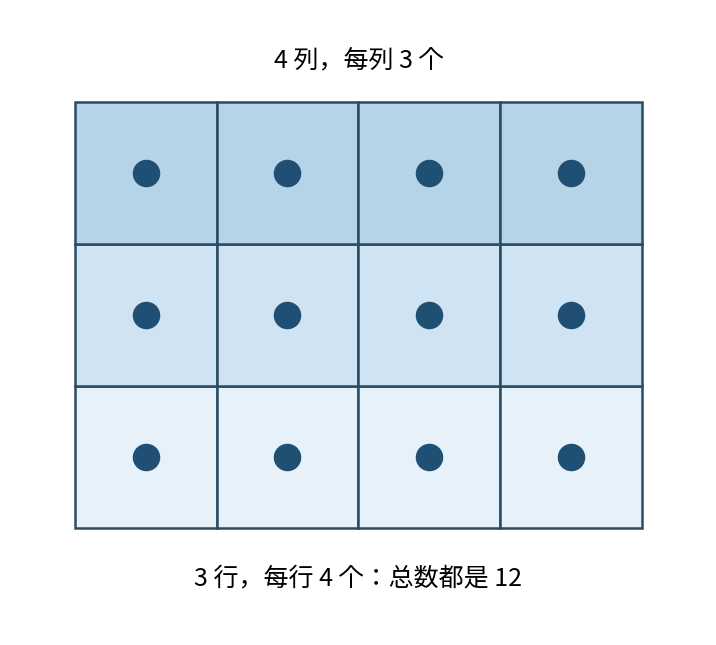
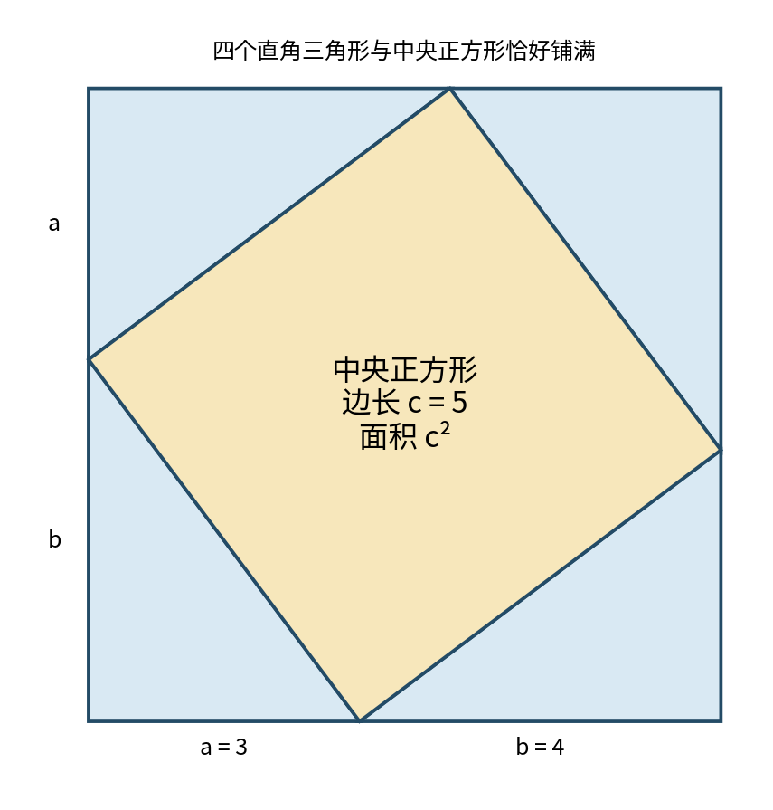
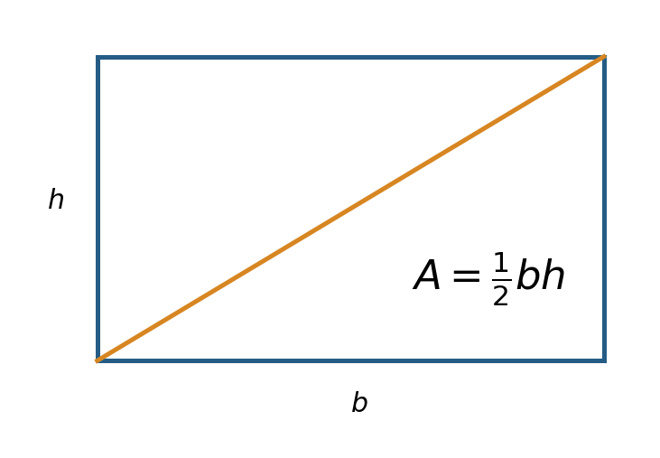
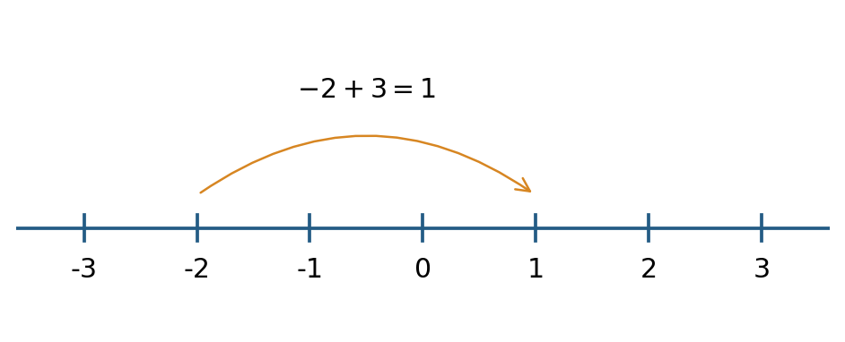
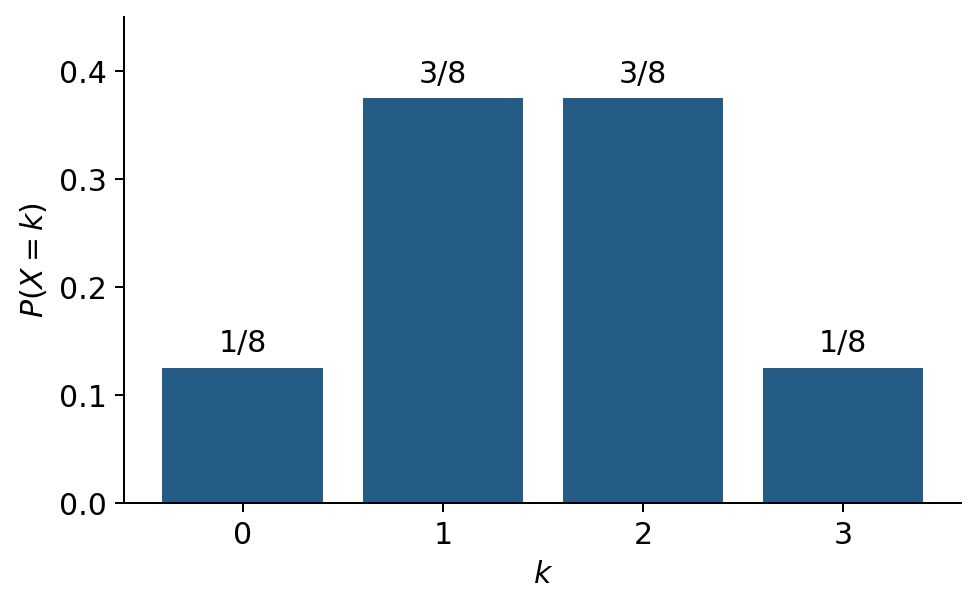
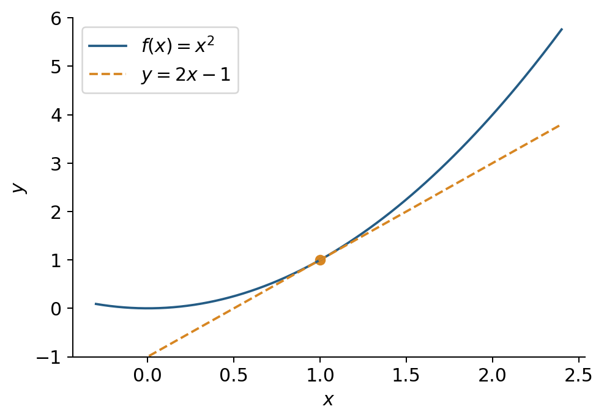
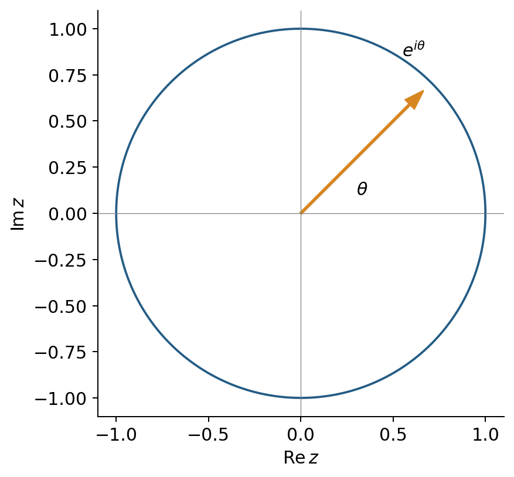
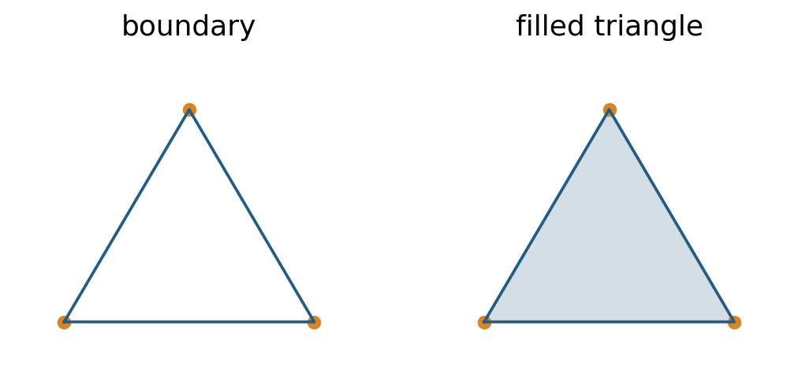
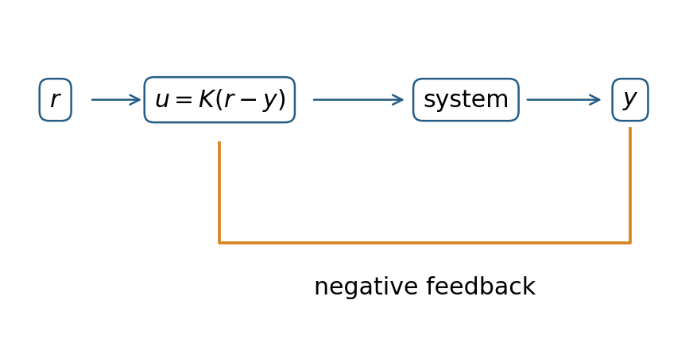

# 数学总目录：63部分、534章、6006节 {#full-math-catalog}


本目录列出全书的编写范围，含 63 个部分、534 个章节、6006 个节项；不表示这些内容已全部写成教材。503 个通用文献类型节项直接列在各部分开头，其后按原有 534 个中级类别列章，并列出 5503 个专门主题节项。不为通用条目虚构章节。

本目录按 MSC2020 分类顺序编排，保留全部代码及归属；它不改变现版 35 章历史正文的阅读顺序。部分采用已有中文类名，中级类别及节项保留附件原文标题，不冒称已完成中文翻译。标题仅保留分类名称，去除交叉检索提示并恢复换行断词及经原页核验的数学排版，不含大段原文或新增教材内容。

分类依据：Mathematical Reviews 与 zbMATH 编制的 MSC2020，用户提供的 224 页附件。本目录属于分类定位索引，不构成对原始 PDF 或其他来源正文的开放授权；不随目录重发原始 PDF。

## 第1部分 数学总论与综合主题（MSC 00-XX）

- 第1节 Introductory exposition (textbooks, tutorial papers, etc.) pertaining to mathematics in general（00-01）

- 第2节 Research exposition (monographs, survey articles) pertaining to mathematics in general（00-02）

### 第1章 General and miscellaneous specific topics（00Axx）

- 第3节 Mathematics in general（00A05）

- 第4节 Mathematics for nonmathematicians (engineering, social sciences, etc.)（00A06）

- 第5节 Problem books（00A07）

- 第6节 Recreational mathematics（00A08）

- 第7节 Popularization of mathematics（00A09）

- 第8节 Bibliographies for mathematics in general（00A15）

- 第9节 External book reviews（00A17）

- 第10节 Dictionaries and other general reference works（00A20）

- 第11节 Formularies（00A22）

- 第12节 Lists of open problems（00A27）

- 第13节 Philosophy of mathematics（00A30）

- 第14节 Methodology of mathematics（00A35）

- 第15节 Mathematics and literature（00A64）

- 第16节 Mathematics and music（00A65）

- 第17节 Mathematics and visual arts（00A66）

- 第18节 Mathematics and architecture（00A67）

- 第19节 General applied mathematics（00A69）

- 第20节 General theory of mathematical modeling（00A71）

- 第21节 General theory of simulation（00A72）

- 第22节 Physics（00A79）

- 第23节 None of the above, but in this section（00A99）

### 第2章 Conference proceedings and collections of articles（00Bxx）

- 第24节 Collections of abstracts of lectures（00B05）

- 第25节 Collections of articles of general interest（00B10）

- 第26节 Collections of articles of miscellaneous specific interest（00B15）

- 第27节 Proceedings of conferences of general interest（00B20）

- 第28节 Proceedings of conferences of miscellaneous specific interest（00B25）

- 第29节 Festschriften（00B30）

- 第30节 Collections of translated articles of general interest（00B50）

- 第31节 Collections of translated articles of miscellaneous specific interest（00B55）

- 第32节 Collections of reprinted articles（00B60）

- 第33节 None of the above, but in this section（00B99）

## 第2部分 数学史与人物传记（MSC 01-XX）

- 第34节 General reference works (handbooks, dictionaries, bibliographies, etc.) pertaining to history and biography（01-00）

- 第35节 Introductory exposition (textbooks, tutorial papers, etc.) pertaining to history and biography（01-01）

- 第36节 Research exposition (monographs, survey articles) pertaining to history and biography（01-02）

- 第37节 Proceedings, conferences, collections, etc. pertaining to history and biography（01-06）

- 第38节 Research data for problems pertaining to history and biography（01-11）

### 第3章 History of mathematics and mathematicians（01Axx）

- 第39节 General histories, source books（01A05）

- 第40节 Ethnomathematics (general)（01A07）

- 第41节 History of mathematics in Paleolithic and Neolithic times（01A10）

- 第42节 History of mathematics of the indigenous cultures of Africa, Asia, and Oceania（01A11）

- 第43节 History of mathematics of the indigenous cultures of the Americas（01A12）

- 第44节 History of mathematics of the indigenous cultures of Europe (pre-Greek, etc.)（01A15）

- 第45节 History of Egyptian mathematics（01A16）

- 第46节 History of Babylonian mathematics（01A17）

- 第47节 History of Greek and Roman mathematics（01A20）

- 第48节 History of Chinese mathematics（01A25）

- 第49节 History of Japanese mathematics（01A27）

- 第50节 History of East and Southeast Asian mathematics (non-Chinese, non-Japanese)（01A29）

- 第51节 History of mathematics in the Golden Age of Islam（01A30）

- 第52节 History of Indian mathematics（01A32）

- 第53节 History of mathematics in Late Antiquity and medieval Europe（01A35）

- 第54节 History of mathematics in the 15th and 16th centuries, Renaissance（01A40）

- 第55节 History of mathematics in the 17th century（01A45）

- 第56节 History of mathematics in the 18th century（01A50）

- 第57节 History of mathematics in the 19th century（01A55）

- 第58节 History of mathematics in the 20th century（01A60）

- 第59节 History of mathematics in the 21st century（01A61）

- 第60节 Development of contemporary mathematics（01A65）

- 第61节 Future perspectives in mathematics（01A67）

- 第62节 Biographies, obituaries, personalia, bibliographies（01A70）

- 第63节 Schools of mathematics（01A72）

- 第64节 History of mathematics at specific universities（01A73）

- 第65节 History of mathematics at institutions and academies (non-university)（01A74）

- 第66节 Collected or selected works; reprintings or translations of classics（01A75）

- 第67节 Sociology (and profession) of mathematics（01A80）

- 第68节 Historiography（01A85）

- 第69节 Bibliographic studies（01A90）

- 第70节 None of the above, but in this section（01A99）

## 第3部分 数理逻辑与数学基础（MSC 03-XX）

- 第71节 General reference works (handbooks, dictionaries, bibliographies, etc.) pertaining to mathematical logic and foundations（03-00）

- 第72节 Introductory exposition (textbooks, tutorial papers, etc.) pertaining to mathematical logic and foundations（03-01）

- 第73节 Research exposition (monographs, survey articles) pertaining to mathematical logic and foundations（03-02）

- 第74节 History of mathematical logic and foundations（03-03）

- 第75节 Software, source code, etc. for problems pertaining to mathematical logic and foundations（03-04）

- 第76节 Proceedings, conferences, collections, etc. pertaining to mathematical logic and foundations（03-06）

- 第77节 Computational methods for problems pertaining to mathematical logic and foundations（03-08）

- 第78节 Research data for problems pertaining to mathematical logic and foundations（03-11）

### 第4章 Philosophical aspects of logic and foundations（03Axx）

- 第79节 Philosophical and critical aspects of logic and foundations（03A05）

- 第80节 Logic in the philosophy of science（03A10）

- 第81节 None of the above, but in this section（03A99）

### 第5章 General logic（03Bxx）

- 第82节 Classical propositional logic（03B05）

- 第83节 Classical first-order logic（03B10）

- 第84节 Higher-order logic（03B16）

- 第85节 Subsystems of classical logic (including intuitionistic logic)（03B20）

- 第86节 Abstract deductive systems（03B22）

- 第87节 Decidability of theories and sets of sentences（03B25）

- 第88节 Foundations of classical theories (including reverse mathematics)（03B30）

- 第89节 Mechanization of proofs and logical operations（03B35）

- 第90节 Type theory（03B38）

- 第91节 Combinatory logic and lambda calculus（03B40）

- 第92节 Logics of knowledge and belief (including belief change)（03B42）

- 第93节 Temporal logic（03B44）

- 第94节 Modal logic (including the logic of norms)（03B45）

- 第95节 Substructural logics (including relevance, entailment, linear logic, Lambek calculus, BCK and BCI logics)（03B47）

- 第96节 Probability and inductive logic（03B48）

- 第97节 Many-valued logic（03B50）

- 第98节 Fuzzy logic; logic of vagueness（03B52）

- 第99节 Paraconsistent logics（03B53）

- 第100节 Intermediate logics（03B55）

- 第101节 Other nonclassical logic（03B60）

- 第102节 Combined logics（03B62）

- 第103节 Logic of natural languages（03B65）

- 第104节 Logic in computer science（03B70）

- 第105节 Other applications of logic（03B80）

- 第106节 None of the above, but in this section（03B99）

### 第6章 Model theory（03Cxx）

- 第107节 Equational classes, universal algebra in model theory（03C05）

- 第108节 Basic properties of first-order languages and structures（03C07）

- 第109节 Quantifier elimination, model completeness, and related topics（03C10）

- 第110节 Model theory of finite structures（03C13）

- 第111节 Model theory of denumerable and separable structures（03C15）

- 第112节 Ultraproducts and related constructions（03C20）

- 第113节 Model-theoretic forcing（03C25）

- 第114节 Other model constructions（03C30）

- 第115节 Categoricity and completeness of theories（03C35）

- 第116节 Interpolation, preservation, definability（03C40）

- 第117节 Classification theory, stability, and related concepts in model theory（03C45）

- 第118节 Abstract elementary classes and related topics（03C48）

- 第119节 Models with special properties (saturated, rigid, etc.)（03C50）

- 第120节 Properties of classes of models（03C52）

- 第121节 Set-theoretic model theory（03C55）

- 第122节 Computable structure theory, computable model theory（03C57）

- 第123节 Model-theoretic algebra（03C60）

- 第124节 Models of arithmetic and set theory（03C62）

- 第125节 Model theory of ordered structures; o-minimality（03C64）

- 第126节 Models of other mathematical theories（03C65）

- 第127节 Continuous model theory, model theory of metric structures（03C66）

- 第128节 Other classical first-order model theory（03C68）

- 第129节 Logic on admissible sets（03C70）

- 第130节 Other infinitary logic（03C75）

- 第131节 Logic with extra quantifiers and operators（03C80）

- 第132节 Second- and higher-order model theory（03C85）

- 第133节 Nonclassical models (Boolean-valued, sheaf, etc.)（03C90）

- 第134节 Abstract model theory（03C95）

- 第135节 Applications of model theory（03C98）

- 第136节 None of the above, but in this section（03C99）

### 第7章 Computability and recursion theory（03Dxx）

- 第137节 Thue and Post systems, etc.（03D03）

- 第138节 Automata and formal grammars in connection with logical questions（03D05）

- 第139节 Turing machines and related notions（03D10）

- 第140节 Complexity of computation (including implicit computational complexity)（03D15）

- 第141节 Recursive functions and relations, subrecursive hierarchies（03D20）

- 第142节 Recursively (computably) enumerable sets and degrees（03D25）

- 第143节 Other Turing degree structures（03D28）

- 第144节 Other degrees and reducibilities in computability and recursion theory（03D30）

- 第145节 Algorithmic randomness and dimension（03D32）

- 第146节 Undecidability and degrees of sets of sentences（03D35）

- 第147节 Word problems, etc. in computability and recursion theory（03D40）

- 第148节 Theory of numerations, effectively presented structures（03D45）

- 第149节 Recursive equivalence types of sets and structures, isols（03D50）

- 第150节 Hierarchies of computability and definability（03D55）

- 第151节 Computability and recursion theory on ordinals, admissible sets, etc.（03D60）

- 第152节 Higher-type and set recursion theory（03D65）

- 第153节 Inductive definability（03D70）

- 第154节 Abstract and axiomatic computability and recursion theory（03D75）

- 第155节 Computation over the reals, computable analysis（03D78）

- 第156节 Applications of computability and recursion theory（03D80）

- 第157节 None of the above, but in this section（03D99）

### 第8章 Set theory（03Exx）

- 第158节 Partition relations（03E02）

- 第159节 Ordered sets and their cofinalities; pcf theory（03E04）

- 第160节 Other combinatorial set theory（03E05）

- 第161节 Ordinal and cardinal numbers（03E10）

- 第162节 Descriptive set theory（03E15）

- 第163节 Cardinal characteristics of the continuum（03E17）

- 第164节 Other classical set theory (including functions, relations, and set algebra)（03E20）

- 第165节 Axiom of choice and related propositions（03E25）

- 第166节 Axiomatics of classical set theory and its fragments（03E30）

- 第167节 Consistency and independence results（03E35）

- 第168节 Other aspects of forcing and Boolean-valued models（03E40）

- 第169节 Inner models, including constructibility, ordinal definability, and core models（03E45）

- 第170节 Other notions of set-theoretic definability（03E47）

- 第171节 Continuum hypothesis and Martin’s axiom（03E50）

- 第172节 Large cardinals（03E55）

- 第173节 Generic absoluteness and forcing axioms（03E57）

- 第174节 Determinacy principles（03E60）

- 第175节 Other set-theoretic hypotheses and axioms（03E65）

- 第176节 Nonclassical and second-order set theories（03E70）

- 第177节 Theory of fuzzy sets, etc.（03E72）

- 第178节 Applications of set theory（03E75）

- 第179节 None of the above, but in this section（03E99）

### 第9章 Proof theory and constructive mathematics（03Fxx）

- 第180节 Proof theory in general (including proof-theoretic semantics)（03F03）

- 第181节 Cut-elimination and normal-form theorems（03F05）

- 第182节 Structure of proofs（03F07）

- 第183节 Functionals in proof theory（03F10）

- 第184节 Recursive ordinals and ordinal notations（03F15）

- 第185节 Complexity of proofs（03F20）

- 第186节 Relative consistency and interpretations（03F25）

- 第187节 First-order arithmetic and fragments（03F30）

- 第188节 Second- and higher-order arithmetic and fragments（03F35）

- 第189节 Gödel numberings and issues of incompleteness（03F40）

- 第190节 Provability logics and related algebras (e.g., diagonalizable algebras)（03F45）

- 第191节 Metamathematics of constructive systems（03F50）

- 第192节 Proof-theoretic aspects of linear logic and other substructural logics（03F52）

- 第193节 Intuitionistic mathematics（03F55）

- 第194节 Constructive and recursive analysis（03F60）

- 第195节 Other constructive mathematics（03F65）

- 第196节 None of the above, but in this section（03F99）

### 第10章 Algebraic logic（03Gxx）

- 第197节 Logical aspects of Boolean algebras（03G05）

- 第198节 Logical aspects of lattices and related structures（03G10）

- 第199节 Quantum logic（03G12）

- 第200节 Cylindric and polyadic algebras; relation algebras（03G15）

- 第201节 Logical aspects of Lukasiewicz and Post algebras（03G20）

- 第202节 Other algebras related to logic（03G25）

- 第203节 Abstract algebraic logic（03G27）

- 第204节 Categorical logic, topoi（03G30）

- 第205节 None of the above, but in this section（03G99）

### 第11章 Nonstandard models（03Hxx）

- 第206节 Nonstandard models in mathematics（03H05）

- 第207节 Other applications of nonstandard models (economics, physics, etc.)（03H10）

- 第208节 Nonstandard models of arithmetic（03H15）

- 第209节 None of the above, but in this section（03H99）

## 第4部分 组合数学（MSC 05-XX）

- 第210节 General reference works (handbooks, dictionaries, bibliographies, etc.) pertaining to combinatorics（05-00）

- 第211节 Introductory exposition (textbooks, tutorial papers, etc.) pertaining to combinatorics（05-01）

- 第212节 Research exposition (monographs, survey articles) pertaining to combinatorics（05-02）

- 第213节 History of combinatorics（05-03）

- 第214节 Software, source code, etc. for problems pertaining to combinatorics（05-04）

- 第215节 Proceedings, conferences, collections, etc. pertaining to combinatorics（05-06）

- 第216节 Computational methods for problems pertaining to combinatorics（05-08）

- 第217节 Research data for problems pertaining to combinatorics（05-11）

### 第12章 Enumerative combinatorics（05Axx）

- 第218节 Permutations, words, matrices（05A05）

- 第219节 Factorials, binomial coefficients, combinatorial functions（05A10）

- 第220节 Exact enumeration problems, generating functions（05A15）

- 第221节 Asymptotic enumeration（05A16）

- 第222节 Combinatorial aspects of partitions of integers（05A17）

- 第223节 Partitions of sets（05A18）

- 第224节 Combinatorial identities, bijective combinatorics（05A19）

- 第225节 Combinatorial inequalities（05A20）

- 第226节 $q$-calculus and related topics（05A30）

- 第227节 Umbral calculus（05A40）

- 第228节 None of the above, but in this section（05A99）

### 第13章 Designs and configurations（05Bxx）

- 第229节 Combinatorial aspects of block designs（05B05）

- 第230节 Triple systems（05B07）

- 第231节 Combinatorial aspects of difference sets (number-theoretic, group-theoretic, etc.)（05B10）

- 第232节 Orthogonal arrays, Latin squares, Room squares（05B15）

- 第233节 Combinatorial aspects of matrices (incidence, Hadamard, etc.)（05B20）

- 第234节 Combinatorial aspects of finite geometries（05B25）

- 第235节 Other designs, configurations（05B30）

- 第236节 Combinatorial aspects of matroids and geometric lattices（05B35）

- 第237节 Combinatorial aspects of packing and covering（05B40）

- 第238节 Combinatorial aspects of tessellation and tiling problems（05B45）

- 第239节 Polyominoes（05B50）

- 第240节 None of the above, but in this section（05B99）

### 第14章 Graph theory（05Cxx）

- 第241节 Trees（05C05）

- 第242节 Vertex degrees（05C07）

- 第243节 Graphical indices (Wiener index, Zagreb index, Randić index, etc.)（05C09）

- 第244节 Planar graphs; geometric and topological aspects of graph theory（05C10）

- 第245节 Distance in graphs（05C12）

- 第246节 Coloring of graphs and hypergraphs（05C15）

- 第247节 Perfect graphs（05C17）

- 第248节 Directed graphs (digraphs), tournaments（05C20）

- 第249节 Flows in graphs（05C21）

- 第250节 Signed and weighted graphs（05C22）

- 第251节 Graphs and abstract algebra (groups, rings, fields, etc.)（05C25）

- 第252节 Enumeration in graph theory（05C30）

- 第253节 Graph polynomials（05C31）

- 第254节 Extremal problems in graph theory（05C35）

- 第255节 Paths and cycles（05C38）

- 第256节 Connectivity（05C40）

- 第257节 Density (toughness, etc.)（05C42）

- 第258节 Eulerian and Hamiltonian graphs（05C45）

- 第259节 Expander graphs（05C48）

- 第260节 Graphs and linear algebra (matrices, eigenvalues, etc.)（05C50）

- 第261节 Graph designs and isomorphic decomposition（05C51）

- 第262节 Generalized Ramsey theory（05C55）

- 第263节 Games on graphs (graph-theoretic aspects)（05C57）

- 第264节 Isomorphism problems in graph theory (reconstruction conjecture, etc.) and homomorphisms (subgraph embedding, etc.)（05C60）

- 第265节 Graph representations (geometric and intersection representations, etc.)（05C62）

- 第266节 Infinite graphs（05C63）

- 第267节 Hypergraphs（05C65）

- 第268节 Vertex subsets with special properties (dominating sets, independent sets, cliques, etc.)（05C69）

- 第269节 Edge subsets with special properties (factorization, matching, partitioning, covering and packing, etc.)（05C70）

- 第270节 Fractional graph theory, fuzzy graph theory（05C72）

- 第271节 Structural characterization of families of graphs（05C75）

- 第272节 Graph operations (line graphs, products, etc.)（05C76）

- 第273节 Graph labelling (graceful graphs, bandwidth, etc.)（05C78）

- 第274节 Random graphs (graph-theoretic aspects)（05C80）

- 第275节 Random walks on graphs（05C81）

- 第276节 Small world graphs, complex networks (graph-theoretic aspects)（05C82）

- 第277节 Graph minors（05C83）

- 第278节 Graph algorithms (graph-theoretic aspects)（05C85）

- 第279节 Applications of graph theory（05C90）

- 第280节 Chemical graph theory（05C92）

- 第281节 None of the above, but in this section（05C99）

### 第15章 Extremal combinatorics（05Dxx）

- 第282节 Extremal set theory（05D05）

- 第283节 Ramsey theory（05D10）

- 第284节 Transversal (matching) theory（05D15）

- 第285节 Probabilistic methods in extremal combinatorics, including polynomial methods (combinatorial Nullstellensatz, etc.)（05D40）

- 第286节 None of the above, but in this section（05D99）

### 第16章 Algebraic combinatorics（05Exx）

- 第287节 Symmetric functions and generalizations（05E05）

- 第288节 Combinatorial aspects of representation theory（05E10）

- 第289节 Combinatorial aspects of algebraic geometry（05E14）

- 第290节 Combinatorial aspects of groups and algebras（05E16）

- 第291节 Group actions on combinatorial structures（05E18）

- 第292节 Association schemes, strongly regular graphs（05E30）

- 第293节 Combinatorial aspects of commutative algebra（05E40）

- 第294节 Combinatorial aspects of simplicial complexes（05E45）

- 第295节 None of the above, but in this section（05E99）

## 第5部分 序、格与有序代数结构（MSC 06-XX）

- 第296节 General reference works (handbooks, dictionaries, bibliographies, etc.) pertaining to ordered structures（06-00）

- 第297节 Introductory exposition (textbooks, tutorial papers, etc.) pertaining to ordered structures（06-01）

- 第298节 Research exposition (monographs, survey articles) pertaining to ordered structures（06-02）

- 第299节 History of ordered structures（06-03）

- 第300节 Software, source code, etc. for problems pertaining to ordered structures（06-04）

- 第301节 Proceedings, conferences, collections, etc. pertaining to ordered structures（06-06）

- 第302节 Computational methods for problems pertaining to ordered structures（06-08）

- 第303节 Research data for problems pertaining to ordered structures（06-11）

### 第17章 Ordered sets（06Axx）

- 第304节 Total orders（06A05）

- 第305节 Partial orders, general（06A06）

- 第306节 Combinatorics of partially ordered sets（06A07）

- 第307节 Algebraic aspects of posets（06A11）

- 第308节 Semilattices（06A12）

- 第309节 Galois correspondences, closure operators (in relation to ordered sets)（06A15）

- 第310节 Generalizations of ordered sets（06A75）

- 第311节 None of the above, but in this section（06A99）

### 第18章 Lattices（06Bxx）

- 第312节 Structure theory of lattices（06B05）

- 第313节 Lattice ideals, congruence relations（06B10）

- 第314节 Representation theory of lattices（06B15）

- 第315节 Varieties of lattices（06B20）

- 第316节 Complete lattices, completions（06B23）

- 第317节 Free lattices, projective lattices, word problems（06B25）

- 第318节 Topological lattices（06B30）

- 第319节 Continuous lattices and posets, applications（06B35）

- 第320节 Generalizations of lattices（06B75）

- 第321节 None of the above, but in this section（06B99）

### 第19章 Modular lattices, complemented lattices（06Cxx）

- 第322节 Modular lattices, Desarguesian lattices（06C05）

- 第323节 Semimodular lattices, geometric lattices（06C10）

- 第324节 Complemented lattices, orthocomplemented lattices and posets（06C15）

- 第325节 Complemented modular lattices, continuous geometries（06C20）

- 第326节 None of the above, but in this section（06C99）

### 第20章 Distributive lattices（06Dxx）

- 第327节 Structure and representation theory of distributive lattices（06D05）

- 第328节 Complete distributivity（06D10）

- 第329节 Pseudocomplemented lattices（06D15）

- 第330节 Heyting algebras (lattice-theoretic aspects)（06D20）

- 第331节 Frames, locales（06D22）

- 第332节 Post algebras (lattice-theoretic aspects)（06D25）

- 第333节 De Morgan algebras, Lukasiewicz algebras (lattice-theoretic aspects)（06D30）

- 第334节 MV-algebras（06D35）

- 第335节 Lattices and duality（06D50）

- 第336节 Fuzzy lattices (soft algebras) and related topics（06D72）

- 第337节 Other generalizations of distributive lattices（06D75）

- 第338节 None of the above, but in this section（06D99）

### 第21章 Boolean algebras (Boolean rings)（06Exx）

- 第339节 Structure theory of Boolean algebras（06E05）

- 第340节 Chain conditions, complete algebras（06E10）

- 第341节 Stone spaces (Boolean spaces) and related structures（06E15）

- 第342节 Ring-theoretic properties of Boolean algebras（06E20）

- 第343节 Boolean algebras with additional operations (diagonalizable algebras, etc.)（06E25）

- 第344节 Boolean functions（06E30）

- 第345节 Generalizations of Boolean algebras（06E75）

- 第346节 None of the above, but in this section（06E99）

### 第22章 Ordered structures（06Fxx）

- 第347节 Ordered semigroups and monoids（06F05）

- 第348节 Quantales（06F07）

- 第349节 Noether lattices（06F10）

- 第350节 Ordered groups（06F15）

- 第351节 Ordered abelian groups, Riesz groups, ordered linear spaces（06F20）

- 第352节 Ordered rings, algebras, modules（06F25）

- 第353节 Ordered topological structures（06F30）

- 第354节 BCK-algebras, BCI-algebras（06F35）

- 第355节 None of the above, but in this section（06F99）

## 第6部分 一般代数系统（MSC 08-XX）

- 第356节 General reference works (handbooks, dictionaries, bibliographies, etc.) pertaining to general algebraic systems（08-00）

- 第357节 Introductory exposition (textbooks, tutorial papers, etc.) pertaining to general algebraic systems（08-01）

- 第358节 Research exposition (monographs, survey articles) pertaining to general algebraic systems（08-02）

- 第359节 History of general algebraic systems（08-03）

- 第360节 Software, source code, etc. for problems pertaining to general algebraic systems（08-04）

- 第361节 Proceedings, conferences, collections, etc. pertaining to general algebraic systems（08-06）

- 第362节 Computational methods for problems pertaining to general algebraic systems（08-08）

- 第363节 Research data for problems pertaining to general algebraic systems（08-11）

### 第23章 Algebraic structures（08Axx）

- 第364节 Relational systems, laws of composition（08A02）

- 第365节 Structure theory of algebraic structures（08A05）

- 第366节 Subalgebras, congruence relations（08A30）

- 第367节 Automorphisms and endomorphisms of algebraic structures（08A35）

- 第368节 Operations and polynomials in algebraic structures, primal algebras（08A40）

- 第369节 Equational compactness（08A45）

- 第370节 Word problems (aspects of algebraic structures)（08A50）

- 第371节 Partial algebras（08A55）

- 第372节 Unary algebras（08A60）

- 第373节 Finitary algebras（08A62）

- 第374节 Infinitary algebras（08A65）

- 第375节 Heterogeneous algebras（08A68）

- 第376节 Applications of universal algebra in computer science（08A70）

- 第377节 Fuzzy algebraic structures（08A72）

- 第378节 None of the above, but in this section（08A99）

### 第24章 Varieties（08Bxx）

- 第379节 Equational logic, Mal’tsev conditions（08B05）

- 第380节 Congruence modularity, congruence distributivity（08B10）

- 第381节 Lattices of varieties（08B15）

- 第382节 Free algebras（08B20）

- 第383节 Products, amalgamated products, and other kinds of limits and colimits（08B25）

- 第384节 Subdirect products and subdirect irreducibility（08B26）

- 第385节 Injectives, projectives（08B30）

- 第386节 None of the above, but in this section（08B99）

### 第25章 Other classes of algebras（08Cxx）

- 第387节 Categories of algebras（08C05）

- 第388节 Axiomatic model classes（08C10）

- 第389节 Quasivarieties（08C15）

- 第390节 Natural dualities for classes of algebras（08C20）

- 第391节 None of the above, but in this section（08C99）

## 第7部分 数论（MSC 11-XX）

- 第392节 General reference works (handbooks, dictionaries, bibliographies, etc.) pertaining to number theory（11-00）

- 第393节 Introductory exposition (textbooks, tutorial papers, etc.) pertaining to number theory（11-01）

- 第394节 Research exposition (monographs, survey articles) pertaining to number theory（11-02）

- 第395节 History of number theory（11-03）

- 第396节 Software, source code, etc. for problems pertaining to number theory（11-04）

- 第397节 Proceedings, conferences, collections, etc. pertaining to number theory（11-06）

- 第398节 Research data for problems pertaining to number theory（11-11）

### 第26章 Elementary number theory（11Axx）

- 第399节 Multiplicative structure; Euclidean algorithm; greatest common divisors（11A05）

- 第400节 Congruences; primitive roots; residue systems（11A07）

- 第401节 Power residues, reciprocity（11A15）

- 第402节 Arithmetic functions; related numbers; inversion formulas（11A25）

- 第403节 Primes（11A41）

- 第404节 Factorization; primality（11A51）

- 第405节 Continued fractions（11A55）

- 第406节 Radix representation; digital problems（11A63）

- 第407节 Other number representations（11A67）

- 第408节 None of the above, but in this section（11A99）

### 第27章 Sequences and sets（11Bxx）

- 第409节 Density, gaps, topology（11B05）

- 第410节 Additive bases, including sumsets（11B13）

- 第411节 Arithmetic progressions（11B25）

- 第412节 Arithmetic combinatorics; higher degree uniformity（11B30）

- 第413节 Representation functions（11B34）

- 第414节 Recurrences（11B37）

- 第415节 Fibonacci and Lucas numbers and polynomials and generalizations（11B39）

- 第416节 Sequences (mod $m$)（11B50）

- 第417节 Farey sequences; the sequences $1^k,2^k,\ldots$（11B57）

- 第418节 Binomial coefficients; factorials; $q$-identities（11B65）

- 第419节 Bernoulli and Euler numbers and polynomials（11B68）

- 第420节 Bell and Stirling numbers（11B73）

- 第421节 Other combinatorial number theory（11B75）

- 第422节 Special sequences and polynomials（11B83）

- 第423节 Automata sequences（11B85）

- 第424节 None of the above, but in this section（11B99）

### 第28章 Polynomials and matrices（11Cxx）

- 第425节 Polynomials in number theory（11C08）

- 第426节 Matrices, determinants in number theory（11C20）

- 第427节 None of the above, but in this section（11C99）

### 第29章 Diophantine equations（11Dxx）

- 第428节 Linear Diophantine equations（11D04）

- 第429节 The Frobenius problem（11D07）

- 第430节 Quadratic and bilinear Diophantine equations（11D09）

- 第431节 Cubic and quartic Diophantine equations（11D25）

- 第432节 Higher degree equations; Fermat’s equation（11D41）

- 第433节 Counting solutions of Diophantine equations（11D45）

- 第434节 Multiplicative and norm form equations（11D57）

- 第435节 Thue-Mahler equations（11D59）

- 第436节 Exponential Diophantine equations（11D61）

- 第437节 Rational numbers as sums of fractions（11D68）

- 第438节 Diophantine equations in many variables（11D72）

- 第439节 Diophantine inequalities（11D75）

- 第440节 Congruences in many variables（11D79）

- 第441节 Representation problems（11D85）

- 第442节 $p$-adic and power series fields（11D88）

- 第443节 None of the above, but in this section（11D99）

### 第30章 Forms and linear algebraic groups（11Exx）

- 第444节 Quadratic forms over general fields（11E04）

- 第445节 Quadratic forms over local rings and fields（11E08）

- 第446节 Forms over real fields（11E10）

- 第447节 Quadratic forms over global rings and fields（11E12）

- 第448节 General binary quadratic forms（11E16）

- 第449节 General ternary and quaternary quadratic forms; forms of more than two variables（11E20）

- 第450节 Sums of squares and representations by other particular quadratic forms（11E25）

- 第451节 Bilinear and Hermitian forms（11E39）

- 第452节 Class numbers of quadratic and Hermitian forms（11E41）

- 第453节 Analytic theory (Epstein zeta functions; relations with automorphic forms and functions)（11E45）

- 第454节 Classical groups（11E57）

- 第455节 $K$-theory of quadratic and Hermitian forms（11E70）

- 第456节 Galois cohomology of linear algebraic groups（11E72）

- 第457节 Forms of degree higher than two（11E76）

- 第458节 Algebraic theory of quadratic forms; Witt groups and rings（11E81）

- 第459节 Quadratic spaces; Clifford algebras（11E88）

- 第460节 $p$-adic theory（11E95）

- 第461节 None of the above, but in this section（11E99）

### 第31章 Discontinuous groups and automorphic forms（11Fxx）

- 第462节 Modular and automorphic functions（11F03）

- 第463节 Structure of modular groups and generalizations; arithmetic groups（11F06）

- 第464节 Holomorphic modular forms of integral weight（11F11）

- 第465节 Automorphic forms, one variable（11F12）

- 第466节 Dedekind eta function, Dedekind sums（11F20）

- 第467节 Relationship to Lie algebras and finite simple groups（11F22）

- 第468节 Relations with algebraic geometry and topology（11F23）

- 第469节 Hecke-Petersson operators, differential operators (one variable)（11F25）

- 第470节 Theta series; Weil representation; theta correspondences（11F27）

- 第471节 Fourier coefficients of automorphic forms（11F30）

- 第472节 Modular correspondences, etc.（11F32）

- 第473节 Congruences for modular and $p$-adic modular forms（11F33）

- 第474节 Forms of half-integer weight; nonholomorphic modular forms（11F37）

- 第475节 Automorphic forms on GL(2); Hilbert and Hilbert-Siegel modular groups and their modular and automorphic forms; Hilbert modular surfaces（11F41）

- 第476节 Siegel modular groups; Siegel and Hilbert-Siegel modular and automorphic forms（11F46）

- 第477节 Jacobi forms（11F50）

- 第478节 Modular forms associated to Drinfel’d modules（11F52）

- 第479节 Other groups and their modular and automorphic forms (several variables)（11F55）

- 第480节 Hecke-Petersson operators, differential operators (several variables)（11F60）

- 第481节 Langlands $L$-functions; one variable Dirichlet series and functional equations（11F66）

- 第482节 Special values of automorphic $L$-series, periods of automorphic forms, cohomology, modular symbols（11F67）

- 第483节 Dirichlet series in several complex variables associated to automorphic forms; Weyl group multiple Dirichlet series（11F68）

- 第484节 Representation-theoretic methods; automorphic representations over local and global fields（11F70）

- 第485节 Spectral theory; trace formulas (e.g., that of Selberg)（11F72）

- 第486节 Cohomology of arithmetic groups（11F75）

- 第487节 Automorphic forms and their relations with perfectoid spaces（11F77）

- 第488节 Galois representations（11F80）

- 第489节 $p$-adic theory, local fields（11F85）

- 第490节 None of the above, but in this section（11F99）

### 第32章 Arithmetic algebraic geometry (Diophantine geometry)（11Gxx）

- 第491节 Elliptic curves over global fields（11G05）

- 第492节 Elliptic curves over local fields（11G07）

- 第493节 Drinfel’d modules; higher-dimensional motives, etc.（11G09）

- 第494节 Abelian varieties of dimension $>1$（11G10）

- 第495节 Complex multiplication and moduli of abelian varieties（11G15）

- 第496节 Elliptic and modular units（11G16）

- 第497节 Arithmetic aspects of modular and Shimura varieties（11G18）

- 第498节 Curves over finite and local fields（11G20）

- 第499节 Varieties over finite and local fields（11G25）

- 第500节 Curves of arbitrary genus or genus $\ne 1$ over global fields（11G30）

- 第501节 Arithmetic aspects of dessins d’enfants, Belyĭ theory（11G32）

- 第502节 Varieties over global fields（11G35）

- 第503节 $L$-functions of varieties over global fields; Birch-Swinnerton-Dyer conjecture（11G40）

- 第504节 Arithmetic mirror symmetry（11G42）

- 第505节 Geometric class field theory（11G45）

- 第506节 Heights（11G50）

- 第507节 Polylogarithms and relations with $K$-theory（11G55）

- 第508节 None of the above, but in this section（11G99）

### 第33章 Geometry of numbers（11Hxx）

- 第509节 Lattices and convex bodies (number-theoretic aspects)（11H06）

- 第510节 Nonconvex bodies（11H16）

- 第511节 Lattice packing and covering (number-theoretic aspects)（11H31）

- 第512节 Products of linear forms（11H46）

- 第513节 Minima of forms（11H50）

- 第514节 Quadratic forms (reduction theory, extreme forms, etc.)（11H55）

- 第515节 Automorphism groups of lattices（11H56）

- 第516节 Mean value and transfer theorems（11H60）

- 第517节 Relations with coding theory（11H71）

- 第518节 None of the above, but in this section（11H99）

### 第34章 Diophantine approximation, transcendental number theory（11Jxx）

- 第519节 Homogeneous approximation to one number（11J04）

- 第520节 Markov and Lagrange spectra and generalizations（11J06）

- 第521节 Simultaneous homogeneous approximation, linear forms（11J13）

- 第522节 Approximation by numbers from a fixed field（11J17）

- 第523节 Inhomogeneous linear forms（11J20）

- 第524节 Diophantine inequalities（11J25）

- 第525节 Small fractional parts of polynomials and generalizations（11J54）

- 第526节 Approximation in non-Archimedean valuations（11J61）

- 第527节 Approximation to algebraic numbers（11J68）

- 第528节 Continued fractions and generalizations（11J70）

- 第529节 Distribution modulo one（11J71）

- 第530节 Irrationality; linear independence over a field（11J72）

- 第531节 Transcendence (general theory)（11J81）

- 第532节 Measures of irrationality and of transcendence（11J82）

- 第533节 Metric theory（11J83）

- 第534节 Algebraic independence; Gel’fond’s method（11J85）

- 第535节 Linear forms in logarithms; Baker’s method（11J86）

- 第536节 Schmidt Subspace Theorem and applications（11J87）

- 第537节 Transcendence theory of elliptic and abelian functions（11J89）

- 第538节 Transcendence theory of other special functions（11J91）

- 第539节 Transcendence theory of Drinfel’d and $t$-modules（11J93）

- 第540节 Results involving abelian varieties（11J95）

- 第541节 Number-theoretic analogues of methods in Nevanlinna theory (work of Vojta et al.)（11J97）

- 第542节 None of the above, but in this section（11J99）

### 第35章 Probabilistic theory: distribution modulo 1; metric theory of algorithms（11Kxx）

- 第543节 General theory of distribution modulo 1（11K06）

- 第544节 Normal numbers, radix expansions, Pisot numbers, Salem numbers, good lattice points, etc.（11K16）

- 第545节 Special sequences（11K31）

- 第546节 Well-distributed sequences and other variations（11K36）

- 第547节 Irregularities of distribution, discrepancy（11K38）

- 第548节 Continuous, $p$-adic and abstract analogues（11K41）

- 第549节 Pseudo-random numbers; Monte Carlo methods（11K45）

- 第550节 Metric theory of continued fractions（11K50）

- 第551节 Metric theory of other algorithms and expansions; measure and Hausdorff dimension（11K55）

- 第552节 Diophantine approximation in probabilistic number theory（11K60）

- 第553节 Arithmetic functions in probabilistic number theory（11K65）

- 第554节 Harmonic analysis and almost periodicity in probabilistic number theory（11K70）

- 第555节 None of the above, but in this section（11K99）

### 第36章 Exponential sums and character sums（11Lxx）

- 第556节 Trigonometric and exponential sums (general theory)（11L03）

- 第557节 Gauss and Kloosterman sums; generalizations（11L05）

- 第558节 Estimates on exponential sums（11L07）

- 第559节 Jacobsthal and Brewer sums; other complete character sums（11L10）

- 第560节 Weyl sums（11L15）

- 第561节 Sums over primes（11L20）

- 第562节 Sums over arbitrary intervals（11L26）

- 第563节 Estimates on character sums（11L40）

- 第564节 None of the above, but in this section（11L99）

### 第37章 Zeta and $L$-functions: analytic theory（11Mxx）

- 第565节 $\zeta(s)$ and $L(s,\chi)$（11M06）

- 第566节 Real zeros of $L(s,\chi)$; results on $L(1,\chi)$（11M20）

- 第567节 Nonreal zeros of $\zeta(s)$ and $L(s,\chi)$; Riemann and other hypotheses（11M26）

- 第568节 Multiple Dirichlet series and zeta functions and multizeta values（11M32）

- 第569节 Hurwitz and Lerch zeta functions（11M35）

- 第570节 Selberg zeta functions and regularized determinants; applications to spectral theory, Dirichlet series, Eisenstein series, etc. (explicit formulas)（11M36）

- 第571节 Zeta and $L$-functions in characteristic $p$（11M38）

- 第572节 Other Dirichlet series and zeta functions（11M41）

- 第573节 Tauberian theorems（11M45）

- 第574节 Relations with random matrices（11M50）

- 第575节 Relations with noncommutative geometry（11M55）

- 第576节 None of the above, but in this section（11M99）

### 第38章 Multiplicative number theory（11Nxx）

- 第577节 Distribution of primes（11N05）

- 第578节 Primes in congruence classes（11N13）

- 第579节 Distribution of integers with specified multiplicative constraints（11N25）

- 第580节 Turán theory（11N30）

- 第581节 Primes represented by polynomials; other multiplicative structures of polynomial values（11N32）

- 第582节 Sieves（11N35）

- 第583节 Applications of sieve methods（11N36）

- 第584节 Asymptotic results on arithmetic functions（11N37）

- 第585节 Asymptotic results on counting functions for algebraic and topological structures（11N45）

- 第586节 Rate of growth of arithmetic functions（11N56）

- 第587节 Distribution functions associated with additive and positive multiplicative functions（11N60）

- 第588节 Other results on the distribution of values or the characterization of arithmetic functions（11N64）

- 第589节 Distribution of integers in special residue classes（11N69）

- 第590节 Applications of automorphic functions and forms to multiplicative problems（11N75）

- 第591节 Generalized primes and integers（11N80）

- 第592节 None of the above, but in this section（11N99）

### 第39章 Additive number theory; partitions（11Pxx）

- 第593节 Waring’s problem and variants（11P05）

- 第594节 Lattice points in specified regions（11P21）

- 第595节 Goldbach-type theorems; other additive questions involving primes（11P32）

- 第596节 Applications of the Hardy-Littlewood method（11P55）

- 第597节 Inverse problems of additive number theory, including sumsets（11P70）

- 第598节 Elementary theory of partitions（11P81）

- 第599节 Analytic theory of partitions（11P82）

- 第600节 Partitions; congruences and congruential restrictions（11P83）

- 第601节 Partition identities; identities of Rogers-Ramanujan type（11P84）

- 第602节 None of the above, but in this section（11P99）

### 第40章 Algebraic number theory: global fields（11Rxx）

- 第603节 Algebraic numbers; rings of algebraic integers（11R04）

- 第604节 PV-numbers and generalizations; other special algebraic numbers; Mahler measure（11R06）

- 第605节 Polynomials (irreducibility, etc.)（11R09）

- 第606节 Quadratic extensions（11R11）

- 第607节 Cubic and quartic extensions（11R16）

- 第608节 Cyclotomic extensions（11R18）

- 第609节 Other abelian and metabelian extensions（11R20）

- 第610节 Other number fields（11R21）

- 第611节 Iwasawa theory（11R23）

- 第612节 Units and factorization（11R27）

- 第613节 Class numbers, class groups, discriminants（11R29）

- 第614节 Galois theory（11R32）

- 第615节 Integral representations related to algebraic numbers; Galois module structure of rings of integers（11R33）

- 第616节 Galois cohomology（11R34）

- 第617节 Class field theory（11R37）

- 第618节 Langlands-Weil conjectures, nonabelian class field theory（11R39）

- 第619节 Zeta functions and $L$-functions of number fields（11R42）

- 第620节 Distribution of prime ideals（11R44）

- 第621节 Density theorems（11R45）

- 第622节 Other analytic theory（11R47）

- 第623节 Quaternion and other division algebras: arithmetic, zeta functions（11R52）

- 第624节 Other algebras and orders, and their zeta and $L$-functions（11R54）

- 第625节 Adèle rings and groups（11R56）

- 第626节 Arithmetic theory of algebraic function fields（11R58）

- 第627节 Zeta functions and $L$-functions of function fields（11R59）

- 第628节 Cyclotomic function fields (class groups, Bernoulli objects, etc.)（11R60）

- 第629节 Class groups and Picard groups of orders（11R65）

- 第630节 $K$-theory of global fields（11R70）

- 第631节 Totally real fields（11R80）

- 第632节 None of the above, but in this section（11R99）

### 第41章 Algebraic number theory: local fields（11Sxx）

- 第633节 Polynomials（11S05）

- 第634节 Ramification and extension theory（11S15）

- 第635节 Galois theory（11S20）

- 第636节 Integral representations（11S23）

- 第637节 Galois cohomology（11S25）

- 第638节 Class field theory; $p$-adic formal groups（11S31）

- 第639节 Langlands-Weil conjectures, nonabelian class field theory（11S37）

- 第640节 Zeta functions and $L$-functions（11S40）

- 第641节 Algebras and orders, and their zeta functions（11S45）

- 第642节 $K$-theory of local fields（11S70）

- 第643节 Other analytic theory (analogues of beta and gamma functions, $p$-adic integration, etc.)（11S80）

- 第644节 Non-Archimedean dynamical systems（11S82）

- 第645节 Other nonanalytic theory（11S85）

- 第646节 Prehomogeneous vector spaces（11S90）

- 第647节 None of the above, but in this section（11S99）

### 第42章 Finite fields and commutative rings (number-theoretic aspects)（11Txx）

- 第648节 Polynomials over finite fields（11T06）

- 第649节 Cyclotomy（11T22）

- 第650节 Exponential sums（11T23）

- 第651节 Other character sums and Gauss sums（11T24）

- 第652节 Structure theory for finite fields and commutative rings (number-theoretic aspects)（11T30）

- 第653节 Arithmetic theory of polynomial rings over finite fields（11T55）

- 第654节 Finite upper half-planes（11T60）

- 第655节 Algebraic coding theory; cryptography (number-theoretic aspects)（11T71）

- 第656节 None of the above, but in this section（11T99）

### 第43章 Connections of number theory and logic（11Uxx）

- 第657节 Decidability (number-theoretic aspects)（11U05）

- 第658节 Ultraproducts (number-theoretic aspects)（11U07）

- 第659节 Model theory (number-theoretic aspects)（11U09）

- 第660节 Nonstandard arithmetic (number-theoretic aspects)（11U10）

- 第661节 None of the above, but in this section（11U99）

### 第44章 Computational number theory（11Yxx）

- 第662节 Factorization（11Y05）

- 第663节 Primality（11Y11）

- 第664节 Number-theoretic algorithms; complexity（11Y16）

- 第665节 Analytic computations（11Y35）

- 第666节 Algebraic number theory computations（11Y40）

- 第667节 Computer solution of Diophantine equations（11Y50）

- 第668节 Calculation of integer sequences（11Y55）

- 第669节 Evaluation of number-theoretic constants（11Y60）

- 第670节 Continued fraction calculations (number-theoretic aspects)（11Y65）

- 第671节 Values of arithmetic functions; tables（11Y70）

- 第672节 None of the above, but in this section（11Y99）

### 第45章 Miscellaneous applications of number theory（11Zxx）

- 第673节 Miscellaneous applications of number theory（11Z05）

- 第674节 None of the above, but in this section（11Z99）

## 第8部分 域论与多项式（MSC 12-XX）

- 第675节 General reference works (handbooks, dictionaries, bibliographies, etc.) pertaining to field theory（12-00）

- 第676节 Introductory exposition (textbooks, tutorial papers, etc.) pertaining to field theory（12-01）

- 第677节 Research exposition (monographs, survey articles) pertaining to field theory（12-02）

- 第678节 History of field theory（12-03）

- 第679节 Software, source code, etc. for problems pertaining to field theory（12-04）

- 第680节 Proceedings, conferences, collections, etc. pertaining to field theory（12-06）

- 第681节 Computational methods for problems pertaining to field theory（12-08）

- 第682节 Research data for problems pertaining to field theory（12-11）

### 第46章 Real and complex fields（12Dxx）

- 第683节 Polynomials in real and complex fields: factorization（12D05）

- 第684节 Polynomials in real and complex fields: location of zeros (algebraic theorems)（12D10）

- 第685节 Fields related with sums of squares (formally real fields, Pythagorean fields, etc.)（12D15）

- 第686节 None of the above, but in this section（12D99）

### 第47章 General field theory（12Exx）

- 第687节 Polynomials in general fields (irreducibility, etc.)（12E05）

- 第688节 Special polynomials in general fields（12E10）

- 第689节 Equations in general fields（12E12）

- 第690节 Skew fields, division rings（12E15）

- 第691节 Finite fields (field-theoretic aspects)（12E20）

- 第692节 Hilbertian fields; Hilbert’s irreducibility theorem（12E25）

- 第693节 Field arithmetic（12E30）

- 第694节 None of the above, but in this section（12E99）

### 第48章 Field extensions（12Fxx）

- 第695节 Algebraic field extensions（12F05）

- 第696节 Separable extensions, Galois theory（12F10）

- 第697节 Inverse Galois theory（12F12）

- 第698节 Inseparable field extensions（12F15）

- 第699节 Transcendental field extensions（12F20）

- 第700节 None of the above, but in this section（12F99）

### 第49章 Homological methods (field theory)（12Gxx）

- 第701节 Galois cohomology（12G05）

- 第702节 Cohomological dimension of fields（12G10）

- 第703节 None of the above, but in this section（12G99）

### 第50章 Differential and difference algebra（12Hxx）

- 第704节 Differential algebra（12H05）

- 第705节 Difference algebra（12H10）

- 第706节 Abstract differential equations（12H20）

- 第707节 $p$-adic differential equations（12H25）

- 第708节 None of the above, but in this section（12H99）

### 第51章 Topological fields（12Jxx）

- 第709节 Normed fields（12J05）

- 第710节 Valued fields（12J10）

- 第711节 Formally $p$-adic fields（12J12）

- 第712节 Ordered fields（12J15）

- 第713节 Topological semifields（12J17）

- 第714节 General valuation theory for fields（12J20）

- 第715节 Non-Archimedean valued fields（12J25）

- 第716节 Krasner-Tate algebras（12J27）

- 第717节 None of the above, but in this section（12J99）

### 第52章 Generalizations of fields（12Kxx）

- 第718节 Near-fields（12K05）

- 第719节 Semifields（12K10）

- 第720节 None of the above, but in this section（12K99）

### 第53章 Connections between field theory and logic（12Lxx）

- 第721节 Decidability and field theory（12L05）

- 第722节 Ultraproducts and field theory（12L10）

- 第723节 Model theory of fields（12L12）

- 第724节 Nonstandard arithmetic and field theory（12L15）

- 第725节 None of the above, but in this section（12L99）

## 第9部分 交换代数（MSC 13-XX）

- 第726节 General reference works (handbooks, dictionaries, bibliographies, etc.) pertaining to commutative algebra（13-00）

- 第727节 Introductory exposition (textbooks, tutorial papers, etc.) pertaining to commutative algebra（13-01）

- 第728节 Research exposition (monographs, survey articles) pertaining to commutative algebra（13-02）

- 第729节 History of commutative algebra（13-03）

- 第730节 Software, source code, etc. for problems pertaining to commutative algebra（13-04）

- 第731节 Proceedings, conferences, collections, etc. pertaining to commutative algebra（13-06）

- 第732节 Research data for problems pertaining to commutative algebra（13-11）

### 第54章 General commutative ring theory（13Axx）

- 第733节 Graded rings（13A02）

- 第734节 Divisibility and factorizations in commutative rings（13A05）

- 第735节 Ideals and multiplicative ideal theory in commutative rings（13A15）

- 第736节 Valuations and their generalizations for commutative rings（13A18）

- 第737节 Associated graded rings of ideals (Rees ring, form ring), analytic spread and related topics（13A30）

- 第738节 Characteristic $p$ methods (Frobenius endomorphism) and reduction to characteristic $p$; tight closure（13A35）

- 第739节 Actions of groups on commutative rings; invariant theory（13A50）

- 第740节 General commutative ring theory and combinatorics (zero-divisor graphs, annihilating-ideal graphs, etc.)（13A70）

- 第741节 None of the above, but in this section（13A99）

### 第55章 Commutative ring extensions and related topics（13Bxx）

- 第742节 Extension theory of commutative rings（13B02）

- 第743节 Galois theory and commutative ring extensions（13B05）

- 第744节 Morphisms of commutative rings（13B10）

- 第745节 Integral dependence in commutative rings; going up, going down（13B21）

- 第746节 Integral closure of commutative rings and ideals（13B22）

- 第747节 Polynomials over commutative rings（13B25）

- 第748节 Rings of fractions and localization for commutative rings（13B30）

- 第749节 Completion of commutative rings（13B35）

- 第750节 Étale and flat extensions; Henselization; Artin approximation（13B40）

- 第751节 None of the above, but in this section（13B99）

### 第56章 Theory of modules and ideals in commutative rings（13Cxx）

- 第752节 Structure, classification theorems for modules and ideals in commutative rings（13C05）

- 第753节 Projective and free modules and ideals in commutative rings（13C10）

- 第754节 Injective and flat modules and ideals in commutative rings（13C11）

- 第755节 Torsion modules and ideals in commutative rings（13C12）

- 第756节 Other special types of modules and ideals in commutative rings（13C13）

- 第757节 Cohen-Macaulay modules（13C14）

- 第758节 Dimension theory, depth, related commutative rings (catenary, etc.)（13C15）

- 第759节 Class groups（13C20）

- 第760节 Linkage, complete intersections and determinantal ideals（13C40）

- 第761节 Module categories and commutative rings（13C60）

- 第762节 Theory of modules and ideals in commutative rings described by combinatorial properties（13C70）

- 第763节 None of the above, but in this section（13C99）

### 第57章 Homological methods in commutative ring theory（13Dxx）

- 第764节 Syzygies, resolutions, complexes and commutative rings（13D02）

- 第765节 (Co)homology of commutative rings and algebras (e.g., Hochschild, André-Quillen, cyclic, dihedral, etc.)（13D03）

- 第766节 Homological dimension and commutative rings（13D05）

- 第767节 Homological functors on modules of commutative rings (Tor, Ext, etc.)（13D07）

- 第768节 Derived categories and commutative rings（13D09）

- 第769节 Deformations and infinitesimal methods in commutative ring theory（13D10）

- 第770节 Grothendieck groups, $K$-theory and commutative rings（13D15）

- 第771节 Homological conjectures (intersection theorems) in commutative ring theory（13D22）

- 第772节 Torsion theory for commutative rings（13D30）

- 第773节 Hilbert-Samuel and Hilbert-Kunz functions; Poincaré series（13D40）

- 第774节 Local cohomology and commutative rings（13D45）

- 第775节 None of the above, but in this section（13D99）

### 第58章 Chain conditions, finiteness conditions in commutative ring theory（13Exx）

- 第776节 Commutative Noetherian rings and modules（13E05）

- 第777节 Commutative Artinian rings and modules, finite-dimensional algebras（13E10）

- 第778节 Commutative rings and modules of finite generation or presentation; number of generators（13E15）

- 第779节 None of the above, but in this section（13E99）

### 第59章 Arithmetic rings and other special commutative rings（13Fxx）

- 第780节 Dedekind, Prüfer, Krull and Mori rings and their generalizations（13F05）

- 第781节 Euclidean rings and generalizations（13F07）

- 第782节 Principal ideal rings（13F10）

- 第783节 Commutative rings defined by factorization properties (e.g., atomic, factorial, half-factorial)（13F15）

- 第784节 Polynomial rings and ideals; rings of integer-valued polynomials（13F20）

- 第785节 Formal power series rings（13F25）

- 第786节 Valuation rings（13F30）

- 第787节 Witt vectors and related rings（13F35）

- 第788节 Excellent rings（13F40）

- 第789节 Seminormal rings（13F45）

- 第790节 Rings with straightening laws, Hodge algebras（13F50）

- 第791节 Commutative rings defined by monomial ideals; Stanley-Reisner face rings; simplicial complexes（13F55）

- 第792节 Cluster algebras（13F60）

- 第793节 Commutative rings defined by binomial ideals, toric rings, etc.（13F65）

- 第794节 Other commutative rings defined by combinatorial properties（13F70）

- 第795节 None of the above, but in this section（13F99）

### 第60章 Integral domains（13Gxx）

- 第796节 Integral domains（13G05）

- 第797节 None of the above, but in this section（13G99）

### 第61章 Local rings and semilocal rings（13Hxx）

- 第798节 Regular local rings（13H05）

- 第799节 Special types (Cohen-Macaulay, Gorenstein, Buchsbaum, etc.)（13H10）

- 第800节 Multiplicity theory and related topics（13H15）

- 第801节 None of the above, but in this section（13H99）

### 第62章 Topological rings and modules（13Jxx）

- 第802节 Power series rings（13J05）

- 第803节 Analytical algebras and rings（13J07）

- 第804节 Complete rings, completion（13J10）

- 第805节 Henselian rings（13J15）

- 第806节 Global topological rings（13J20）

- 第807节 Ordered rings（13J25）

- 第808节 Real algebra（13J30）

- 第809节 None of the above, but in this section（13J99）

### 第63章 Applications of logic to commutative algebra（13Lxx）

- 第810节 Applications of logic to commutative algebra（13L05）

- 第811节 None of the above, but in this section（13L99）

### 第64章 Finite commutative rings（13Mxx）

- 第812节 Structure of finite commutative rings（13M05）

- 第813节 Polynomials and finite commutative rings（13M10）

- 第814节 None of the above, but in this section（13M99）

### 第65章 Differential algebra（13Nxx）

- 第815节 Modules of differentials（13N05）

- 第816节 Commutative rings of differential operators and their modules（13N10）

- 第817节 Derivations and commutative rings（13N15）

- 第818节 None of the above, but in this section（13N99）

### 第66章 Computational aspects and applications of commutative rings（13Pxx）

- 第819节 Polynomials, factorization in commutative rings（13P05）

- 第820节 Gröbner bases; other bases for ideals and modules (e.g., Janet and border bases)（13P10）

- 第821节 Solving polynomial systems; resultants（13P15）

- 第822节 Computational homological algebra（13P20）

- 第823节 Applications of commutative algebra (e.g., to statistics, control theory, optimization, etc.)（13P25）

- 第824节 None of the above, but in this section（13P99）

## 第10部分 代数几何（MSC 14-XX）

- 第825节 General reference works (handbooks, dictionaries, bibliographies, etc.) pertaining to algebraic geometry（14-00）

- 第826节 Introductory exposition (textbooks, tutorial papers, etc.) pertaining to algebraic geometry（14-01）

- 第827节 Research exposition (monographs, survey articles) pertaining to algebraic geometry（14-02）

- 第828节 History of algebraic geometry（14-03）

- 第829节 Software, source code, etc. for problems pertaining to algebraic geometry（14-04）

- 第830节 Proceedings, conferences, collections, etc. pertaining to algebraic geometry（14-06）

- 第831节 Research data for problems pertaining to algebraic geometry（14-11）

### 第67章 Foundations of algebraic geometry（14Axx）

- 第832节 Relevant commutative algebra（14A05）

- 第833节 Varieties and morphisms（14A10）

- 第834节 Schemes and morphisms（14A15）

- 第835节 Generalizations (algebraic spaces, stacks)（14A20）

- 第836节 Logarithmic algebraic geometry, log schemes（14A21）

- 第837节 Noncommutative algebraic geometry（14A22）

- 第838节 Geometry over the field with one element（14A23）

- 第839节 Elementary questions in algebraic geometry（14A25）

- 第840节 Fundamental constructions in algebraic geometry involving higher and derived categories (homotopical algebraic geometry, derived algebraic geometry, etc.)（14A30）

- 第841节 None of the above, but in this section（14A99）

### 第68章 Local theory in algebraic geometry（14Bxx）

- 第842节 Singularities in algebraic geometry（14B05）

- 第843节 Deformations of singularities（14B07）

- 第844节 Infinitesimal methods in algebraic geometry（14B10）

- 第845节 Local deformation theory, Artin approximation, etc.（14B12）

- 第846节 Local cohomology and algebraic geometry（14B15）

- 第847节 Formal neighborhoods in algebraic geometry（14B20）

- 第848节 Local structure of morphisms in algebraic geometry: étale, flat, etc.（14B25）

- 第849节 None of the above, but in this section（14B99）

### 第69章 Cycles and subschemes（14Cxx）

- 第850节 Parametrization (Chow and Hilbert schemes)（14C05）

- 第851节 (Equivariant) Chow groups and rings; motives（14C15）

- 第852节 Intersection theory, characteristic classes, intersection multiplicities in algebraic geometry（14C17）

- 第853节 Divisors, linear systems, invertible sheaves（14C20）

- 第854节 Pencils, nets, webs in algebraic geometry（14C21）

- 第855节 Picard groups（14C22）

- 第856节 Algebraic cycles（14C25）

- 第857节 Transcendental methods, Hodge theory (algebro-geometric aspects)（14C30）

- 第858节 Torelli problem（14C34）

- 第859节 Applications of methods of algebraic $K$-theory in algebraic geometry（14C35）

- 第860节 Riemann-Roch theorems（14C40）

- 第861节 None of the above, but in this section（14C99）

### 第70章 Families, fibrations in algebraic geometry（14Dxx）

- 第862节 Structure of families (Picard-Lefschetz, monodromy, etc.)（14D05）

- 第863节 Fibrations, degenerations in algebraic geometry（14D06）

- 第864节 Variation of Hodge structures (algebro-geometric aspects)（14D07）

- 第865节 Arithmetic ground fields (finite, local, global) and families or fibrations（14D10）

- 第866节 Formal methods and deformations in algebraic geometry（14D15）

- 第867节 Algebraic moduli problems, moduli of vector bundles（14D20）

- 第868节 Applications of vector bundles and moduli spaces in mathematical physics (twistor theory, instantons, quantum field theory)（14D21）

- 第869节 Fine and coarse moduli spaces（14D22）

- 第870节 Stacks and moduli problems（14D23）

- 第871节 Geometric Langlands program (algebro-geometric aspects)（14D24）

- 第872节 None of the above, but in this section（14D99）

### 第71章 Birational geometry（14Exx）

- 第873节 Rational and birational maps（14E05）

- 第874节 Birational automorphisms, Cremona group and generalizations（14E07）

- 第875节 Rationality questions in algebraic geometry（14E08）

- 第876节 Global theory and resolution of singularities (algebro-geometric aspects)（14E15）

- 第877节 McKay correspondence（14E16）

- 第878节 Arcs and motivic integration（14E18）

- 第879节 Coverings in algebraic geometry（14E20）

- 第880节 Ramification problems in algebraic geometry（14E22）

- 第881节 Embeddings in algebraic geometry（14E25）

- 第882节 Minimal model program (Mori theory, extremal rays)（14E30）

- 第883节 None of the above, but in this section（14E99）

### 第72章 (Co)homology theory in algebraic geometry（14Fxx）

- 第884节 Sheaves in algebraic geometry（14F06）

- 第885节 Derived categories of sheaves, dg categories, and related constructions in algebraic geometry（14F08）

- 第886节 Differentials and other special sheaves; D-modules; Bernstein-Sato ideals and polynomials（14F10）

- 第887节 Vanishing theorems in algebraic geometry（14F17）

- 第888节 Multiplier ideals（14F18）

- 第889节 Étale and other Grothendieck topologies and (co)homologies（14F20）

- 第890节 Brauer groups of schemes（14F22）

- 第891节 Classical real and complex (co)homology in algebraic geometry（14F25）

- 第892节 $p$-adic cohomology, crystalline cohomology（14F30）

- 第893节 Homotopy theory and fundamental groups in algebraic geometry（14F35）

- 第894节 de Rham cohomology and algebraic geometry（14F40）

- 第895节 Motivic cohomology; motivic homotopy theory（14F42）

- 第896节 Other algebro-geometric (co)homologies (e.g., intersection, equivariant, Lawson, Deligne (co)homologies)（14F43）

- 第897节 Topological properties in algebraic geometry（14F45）

- 第898节 None of the above, but in this section（14F99）

### 第73章 Arithmetic problems in algebraic geometry; Diophantine geometry（14Gxx）

- 第899节 Rational points（14G05）

- 第900节 Zeta functions and related questions in algebraic geometry (e.g., Birch-Swinnerton-Dyer conjecture)（14G10）

- 第901节 Hasse principle, weak and strong approximation, Brauer-Manin obstruction（14G12）

- 第902节 Finite ground fields in algebraic geometry（14G15）

- 第903节 Positive characteristic ground fields in algebraic geometry（14G17）

- 第904节 Local ground fields in algebraic geometry（14G20）

- 第905节 Rigid analytic geometry（14G22）

- 第906节 Global ground fields in algebraic geometry（14G25）

- 第907节 Other nonalgebraically closed ground fields in algebraic geometry（14G27）

- 第908节 Universal profinite groups (relationship to moduli spaces, projective and moduli towers, Galois theory)（14G32）

- 第909节 Modular and Shimura varieties（14G35）

- 第910节 Arithmetic varieties and schemes; Arakelov theory; heights（14G40）

- 第911节 Perfectoid spaces and mixed characteristic（14G45）

- 第912节 Applications to coding theory and cryptography of arithmetic geometry（14G50）

- 第913节 None of the above, but in this section（14G99）

### 第74章 Curves in algebraic geometry（14Hxx）

- 第914节 Algebraic functions and function fields in algebraic geometry（14H05）

- 第915节 Families, moduli of curves (algebraic)（14H10）

- 第916节 Families, moduli of curves (analytic)（14H15）

- 第917节 Singularities of curves, local rings（14H20）

- 第918节 Arithmetic ground fields for curves（14H25）

- 第919节 Coverings of curves, fundamental group（14H30）

- 第920节 Automorphisms of curves（14H37）

- 第921节 Jacobians, Prym varieties（14H40）

- 第922节 Theta functions and curves; Schottky problem（14H42）

- 第923节 Special algebraic curves and curves of low genus（14H45）

- 第924节 Plane and space curves（14H50）

- 第925节 Special divisors on curves (gonality, Brill-Noether theory)（14H51）

- 第926节 Elliptic curves（14H52）

- 第927节 Riemann surfaces; Weierstrass points; gap sequences（14H55）

- 第928节 Dessins d’enfants theory（14H57）

- 第929节 Vector bundles on curves and their moduli（14H60）

- 第930节 Relationships between algebraic curves and integrable systems（14H70）

- 第931节 Relationships between algebraic curves and physics（14H81）

- 第932节 None of the above, but in this section（14H99）

### 第75章 Surfaces and higher-dimensional varieties（14Jxx）

- 第933节 Families, moduli, classification: algebraic theory（14J10）

- 第934节 Moduli, classification: analytic theory; relations with modular forms（14J15）

- 第935节 Singularities of surfaces or higher-dimensional varieties（14J17）

- 第936节 Arithmetic ground fields for surfaces or higher-dimensional varieties（14J20）

- 第937节 Special surfaces（14J25）

- 第938节 Rational and ruled surfaces（14J26）

- 第939节 Elliptic surfaces, elliptic or Calabi-Yau fibrations（14J27）

- 第940节 $K3$ surfaces and Enriques surfaces（14J28）

- 第941节 Surfaces of general type（14J29）

- 第942节 3-folds（14J30）

- 第943节 Calabi-Yau manifolds (algebro-geometric aspects)（14J32）

- 第944节 Mirror symmetry (algebro-geometric aspects)（14J33）

- 第945节 4-folds（14J35）

- 第946节 $n$-folds ($n>4$)（14J40）

- 第947节 Holomorphic symplectic varieties, hyper-Kähler varieties（14J42）

- 第948节 Fano varieties（14J45）

- 第949节 Automorphisms of surfaces and higher-dimensional varieties（14J50）

- 第950节 Vector bundles on surfaces and higher-dimensional varieties, and their moduli（14J60）

- 第951节 Hypersurfaces and algebraic geometry（14J70）

- 第952节 Topology of surfaces (Donaldson polynomials, Seiberg-Witten invariants)（14J80）

- 第953节 Relationships between surfaces, higher-dimensional varieties, and physics（14J81）

- 第954节 None of the above, but in this section（14J99）

### 第76章 Abelian varieties and schemes（14Kxx）

- 第955节 Isogeny（14K02）

- 第956节 Algebraic theory of abelian varieties（14K05）

- 第957节 Algebraic moduli of abelian varieties, classification（14K10）

- 第958节 Subvarieties of abelian varieties（14K12）

- 第959节 Arithmetic ground fields for abelian varieties（14K15）

- 第960节 Analytic theory of abelian varieties; abelian integrals and differentials（14K20）

- 第961节 Complex multiplication and abelian varieties（14K22）

- 第962节 Theta functions and abelian varieties（14K25）

- 第963节 Picard schemes, higher Jacobians（14K30）

- 第964节 None of the above, but in this section（14K99）

### 第77章 Algebraic groups（14Lxx）

- 第965节 Formal groups, $p$-divisible groups（14L05）

- 第966节 Group varieties（14L10）

- 第967节 Group schemes（14L15）

- 第968节 Affine algebraic groups, hyperalgebra constructions（14L17）

- 第969节 Geometric invariant theory（14L24）

- 第970节 Group actions on varieties or schemes (quotients)（14L30）

- 第971节 Classical groups (algebro-geometric aspects)（14L35）

- 第972节 Other algebraic groups (geometric aspects)（14L40）

- 第973节 None of the above, but in this section（14L99）

### 第78章 Special varieties（14Mxx）

- 第974节 Varieties defined by ring conditions (factorial, Cohen-Macaulay, seminormal)（14M05）

- 第975节 Linkage（14M06）

- 第976节 Low codimension problems in algebraic geometry（14M07）

- 第977节 Complete intersections（14M10）

- 第978节 Determinantal varieties（14M12）

- 第979节 Grassmannians, Schubert varieties, flag manifolds（14M15）

- 第980节 Homogeneous spaces and generalizations（14M17）

- 第981节 Rational and unirational varieties（14M20）

- 第982节 Rationally connected varieties（14M22）

- 第983节 Toric varieties, Newton polyhedra, Okounkov bodies（14M25）

- 第984节 Compactifications; symmetric and spherical varieties（14M27）

- 第985节 Supervarieties（14M30）

- 第986节 Character varieties（14M35）

- 第987节 None of the above, but in this section（14M99）

### 第79章 Projective and enumerative algebraic geometry（14Nxx）

- 第988节 Projective techniques in algebraic geometry（14N05）

- 第989节 Secant varieties, tensor rank, varieties of sums of powers（14N07）

- 第990节 Enumerative problems (combinatorial problems) in algebraic geometry（14N10）

- 第991节 Classical problems, Schubert calculus（14N15）

- 第992节 Configurations and arrangements of linear subspaces（14N20）

- 第993节 Varieties of low degree（14N25）

- 第994节 Adjunction problems（14N30）

- 第995节 Gromov-Witten invariants, quantum cohomology, Gopakumar-Vafa invariants, Donaldson-Thomas invariants (algebro-geometric aspects)（14N35）

- 第996节 None of the above, but in this section（14N99）

### 第80章 Real algebraic and real-analytic geometry（14Pxx）

- 第997节 Real algebraic sets（14P05）

- 第998节 Semialgebraic sets and related spaces（14P10）

- 第999节 Real-analytic and semi-analytic sets（14P15）

- 第1000节 Nash functions and manifolds（14P20）

- 第1001节 Topology of real algebraic varieties（14P25）

- 第1002节 None of the above, but in this section（14P99）

### 第81章 Computational aspects in algebraic geometry（14Qxx）

- 第1003节 Computational aspects of algebraic curves（14Q05）

- 第1004节 Computational aspects of algebraic surfaces（14Q10）

- 第1005节 Computational aspects of higher-dimensional varieties（14Q15）

- 第1006节 Effectivity, complexity and computational aspects of algebraic geometry（14Q20）

- 第1007节 Computational algebraic geometry over arithmetic ground fields（14Q25）

- 第1008节 Computational real algebraic geometry（14Q30）

- 第1009节 Geometric aspects of numerical algebraic geometry（14Q65）

- 第1010节 None of the above, but in this section（14Q99）

### 第82章 Affine geometry（14Rxx）

- 第1011节 Classification of affine varieties（14R05）

- 第1012节 Affine spaces (automorphisms, embeddings, exotic structures, cancellation problem)（14R10）

- 第1013节 Jacobian problem（14R15）

- 第1014节 Group actions on affine varieties（14R20）

- 第1015节 Affine fibrations（14R25）

- 第1016节 None of the above, but in this section（14R99）

### 第83章 Tropical geometry（14Txx）

- 第1017节 Foundations of tropical geometry and relations with algebra（14T10）

- 第1018节 Combinatorial aspects of tropical varieties（14T15）

- 第1019节 Geometric aspects of tropical varieties（14T20）

- 第1020节 Arithmetic aspects of tropical varieties（14T25）

- 第1021节 Applications of tropical geometry（14T90）

- 第1022节 None of the above, but in this section（14T99）

## 第11部分 线性与多重线性代数、矩阵理论（MSC 15-XX）

- 第1023节 General reference works (handbooks, dictionaries, bibliographies, etc.) pertaining to linear algebra（15-00）

- 第1024节 Introductory exposition (textbooks, tutorial papers, etc.) pertaining to linear algebra（15-01）

- 第1025节 Research exposition (monographs, survey articles) pertaining to linear algebra（15-02）

- 第1026节 History of linear algebra（15-03）

- 第1027节 Software, source code, etc. for problems pertaining to linear algebra（15-04）

- 第1028节 Proceedings, conferences, collections, etc. pertaining to linear algebra（15-06）

- 第1029节 Research data for problems pertaining to linear algebra（15-11）

### 第84章 Basic linear algebra（15Axx）

- 第1030节 Vector spaces, linear dependence, rank, lineability（15A03）

- 第1031节 Linear transformations, semilinear transformations（15A04）

- 第1032节 Linear equations (linear algebraic aspects)（15A06）

- 第1033节 Theory of matrix inversion and generalized inverses（15A09）

- 第1034节 Applications of generalized inverses（15A10）

- 第1035节 Conditioning of matrices（15A12）

- 第1036节 Determinants, permanents, traces, other special matrix functions（15A15）

- 第1037节 Matrix exponential and similar functions of matrices（15A16）

- 第1038节 Eigenvalues, singular values, and eigenvectors（15A18）

- 第1039节 Diagonalization, Jordan forms（15A20）

- 第1040节 Canonical forms, reductions, classification（15A21）

- 第1041节 Matrix pencils（15A22）

- 第1042节 Factorization of matrices（15A23）

- 第1043节 Matrix equations and identities（15A24）

- 第1044节 Commutativity of matrices（15A27）

- 第1045节 Inverse problems in linear algebra（15A29）

- 第1046节 Algebraic systems of matrices（15A30）

- 第1047节 Linear inequalities of matrices（15A39）

- 第1048节 Inequalities involving eigenvalues and eigenvectors（15A42）

- 第1049节 Miscellaneous inequalities involving matrices（15A45）

- 第1050节 Matrices over function rings in one or more variables（15A54）

- 第1051节 Norms of matrices, numerical range, applications of functional analysis to matrix theory（15A60）

- 第1052节 Quadratic and bilinear forms, inner products（15A63）

- 第1053节 Clifford algebras, spinors（15A66）

- 第1054节 Applications of Clifford algebras to physics, etc.（15A67）

- 第1055节 Multilinear algebra, tensor calculus（15A69）

- 第1056节 Vector and tensor algebra, theory of invariants（15A72）

- 第1057节 Exterior algebra, Grassmann algebras（15A75）

- 第1058节 Other algebras built from modules（15A78）

- 第1059节 Max-plus and related algebras（15A80）

- 第1060节 Matrix completion problems（15A83）

- 第1061节 Linear preserver problems（15A86）

- 第1062节 None of the above, but in this section（15A99）

### 第85章 Special matrices（15Bxx）

- 第1063节 Toeplitz, Cauchy, and related matrices（15B05）

- 第1064节 Orthogonal matrices（15B10）

- 第1065节 Fuzzy matrices（15B15）

- 第1066节 Matrix Lie algebras（15B30）

- 第1067节 Matrices over special rings (quaternions, finite fields, etc.)（15B33）

- 第1068节 Boolean and Hadamard matrices（15B34）

- 第1069节 Sign pattern matrices（15B35）

- 第1070节 Matrices of integers（15B36）

- 第1071节 Positive matrices and their generalizations; cones of matrices（15B48）

- 第1072节 Stochastic matrices（15B51）

- 第1073节 Random matrices (algebraic aspects)（15B52）

- 第1074节 Hermitian, skew-Hermitian, and related matrices（15B57）

- 第1075节 None of the above, but in this section（15B99）

## 第12部分 结合环与结合代数（MSC 16-XX）

- 第1076节 General reference works (handbooks, dictionaries, bibliographies, etc.) pertaining to associative rings and algebras（16-00）

- 第1077节 Introductory exposition (textbooks, tutorial papers, etc.) pertaining to associative rings and algebras（16-01）

- 第1078节 Research exposition (monographs, survey articles) pertaining to associative rings and algebras（16-02）

- 第1079节 History of associative rings and algebras（16-03）

- 第1080节 Software, source code, etc. for problems pertaining to associative rings and algebras（16-04）

- 第1081节 Proceedings, conferences, collections, etc. pertaining to associative rings and algebras（16-06）

- 第1082节 Research data for problems pertaining to associative rings and algebras（16-11）

### 第86章 General and miscellaneous（16Bxx）

- 第1083节 Category-theoretic methods and results in associative algebras (except as in 16D90)（16B50）

- 第1084节 Applications of logic in associative algebras（16B70）

- 第1085节 None of the above, but in this section（16B99）

### 第87章 Modules, bimodules and ideals in associative algebras（16Dxx）

- 第1086节 General module theory in associative algebras（16D10）

- 第1087节 Bimodules in associative algebras（16D20）

- 第1088节 Ideals in associative algebras（16D25）

- 第1089节 Infinite-dimensional simple rings (except as in 16Kxx)（16D30）

- 第1090节 Free, projective, and flat modules and ideals in associative algebras（16D40）

- 第1091节 Injective modules, self-injective associative rings（16D50）

- 第1092节 Simple and semisimple modules, primitive rings and ideals in associative algebras（16D60）

- 第1093节 Structure and classification for modules, bimodules and ideals (except as in 16Gxx), direct sum decomposition and cancellation in associative algebras)（16D70）

- 第1094节 Other classes of modules and ideals in associative algebras（16D80）

- 第1095节 Module categories in associative algebras（16D90）

- 第1096节 None of the above, but in this section（16D99）

### 第88章 Homological methods in associative algebras（16Exx）

- 第1097节 Syzygies, resolutions, complexes in associative algebras（16E05）

- 第1098节 Homological dimension in associative algebras（16E10）

- 第1099节 Grothendieck groups, $K$-theory, etc.（16E20）

- 第1100节 Homological functors on modules (Tor, Ext, etc.) in associative algebras（16E30）

- 第1101节 Derived categories and associative algebras（16E35）

- 第1102节 (Co)homology of rings and associative algebras (e.g., Hochschild, cyclic, dihedral, etc.)（16E40）

- 第1103节 Differential graded algebras and applications (associative algebraic aspects)（16E45）

- 第1104节 von Neumann regular rings and generalizations (associative algebraic aspects)（16E50）

- 第1105节 Semihereditary and hereditary rings, free ideal rings, Sylvester rings, etc.（16E60）

- 第1106节 Homological conditions on associative rings (generalizations of regular, Gorenstein, Cohen-Macaulay rings, etc.)（16E65）

- 第1107节 None of the above, but in this section（16E99）

### 第89章 Representation theory of associative rings and algebras（16Gxx）

- 第1108节 Representations of associative Artinian rings（16G10）

- 第1109节 Representations of quivers and partially ordered sets（16G20）

- 第1110节 Representations of orders, lattices, algebras over commutative rings（16G30）

- 第1111节 Cohen-Macaulay modules in associative algebras（16G50）

- 第1112节 Representation type (finite, tame, wild, etc.) of associative algebras（16G60）

- 第1113节 Auslander-Reiten sequences (almost split sequences) and Auslander-Reiten quivers（16G70）

- 第1114节 None of the above, but in this section（16G99）

### 第90章 Associative algebras and orders（16Hxx）

- 第1115节 Separable algebras (e.g., quaternion algebras, Azumaya algebras, etc.)（16H05）

- 第1116节 Orders in separable algebras（16H10）

- 第1117节 Commutative orders（16H15）

- 第1118节 Lattices over orders（16H20）

- 第1119节 None of the above, but in this section（16H99）

### 第91章 Division rings and semisimple Artin rings（16Kxx）

- 第1120节 Finite-dimensional division rings（16K20）

- 第1121节 Infinite-dimensional and general division rings（16K40）

- 第1122节 Brauer groups (algebraic aspects)（16K50）

- 第1123节 None of the above, but in this section（16K99）

### 第92章 Local rings and generalizations（16Lxx）

- 第1124节 Noncommutative local and semilocal rings, perfect rings（16L30）

- 第1125节 Quasi-Frobenius rings（16L60）

- 第1126节 None of the above, but in this section（16L99）

### 第93章 Radicals and radical properties of associative rings（16Nxx）

- 第1127节 Jacobson radical, quasimultiplication（16N20）

- 第1128节 Nil and nilpotent radicals, sets, ideals, associative rings（16N40）

- 第1129节 Prime and semiprime associative rings（16N60）

- 第1130节 General radicals and associative rings（16N80）

- 第1131节 None of the above, but in this section（16N99）

### 第94章 Chain conditions, growth conditions, and other forms of finiteness for associative rings and algebras（16Pxx）

- 第1132节 Finite rings and finite-dimensional associative algebras（16P10）

- 第1133节 Artinian rings and modules (associative rings and algebras)（16P20）

- 第1134节 Noetherian rings and modules (associative rings and algebras)（16P40）

- 第1135节 Localization and associative Noetherian rings（16P50）

- 第1136节 Chain conditions on annihilators and summands: Goldie-type conditions（16P60）

- 第1137节 Chain conditions on other classes of submodules, ideals, subrings, etc.; coherence (associative rings and algebras)（16P70）

- 第1138节 Growth rate, Gelfand-Kirillov dimension（16P90）

- 第1139节 None of the above, but in this section（16P99）

### 第95章 Rings with polynomial identity（16Rxx）

- 第1140节 $T$ -ideals, identities, varieties of associative rings and algebras（16R10）

- 第1141节 Semiprime p.i. rings, rings embeddable in matrices over commutative rings（16R20）

- 第1142节 Trace rings and invariant theory (associative rings and algebras)（16R30）

- 第1143节 Identities other than those of matrices over commutative rings（16R40）

- 第1144节 Other kinds of identities (generalized polynomial, rational, involution)（16R50）

- 第1145节 Functional identities (associative rings and algebras)（16R60）

- 第1146节 None of the above, but in this section（16R99）

### 第96章 Associative rings and algebras arising under various constructions（16Sxx）

- 第1147节 Associative rings determined by universal properties (free algebras, coproducts, adjunction of inverses, etc.)（16S10）

- 第1148节 Finite generation, finite presentability, normal forms (diamond lemma, term-rewriting)（16S15）

- 第1149节 Centralizing and normalizing extensions（16S20）

- 第1150节 Universal enveloping algebras of Lie algebras（16S30）

- 第1151节 Rings of differential operators (associative algebraic aspects)（16S32）

- 第1152节 Group rings（16S34）

- 第1153节 Twisted and skew group rings, crossed products（16S35）

- 第1154节 Ordinary and skew polynomial rings and semigroup rings（16S36）

- 第1155节 Quadratic and Koszul algebras（16S37）

- 第1156节 Rings arising from noncommutative algebraic geometry（16S38）

- 第1157节 Smash products of general Hopf actions（16S40）

- 第1158节 Endomorphism rings; matrix rings（16S50）

- 第1159节 Associative rings of functions, subdirect products, sheaves of rings（16S60）

- 第1160节 Extensions of associative rings by ideals（16S70）

- 第1161节 Deformations of associative rings（16S80）

- 第1162节 Associative rings of fractions and localizations（16S85）

- 第1163节 Leavitt path algebras（16S88）

- 第1164节 Torsion theories; radicals on module categories (associative algebraic aspects)（16S90）

- 第1165节 None of the above, but in this section（16S99）

### 第97章 Hopf algebras, quantum groups and related topics（16Txx）

- 第1166节 Hopf algebras and their applications（16T05）

- 第1167节 Bialgebras（16T10）

- 第1168节 Coalgebras and comodules; corings（16T15）

- 第1169节 Ring-theoretic aspects of quantum groups（16T20）

- 第1170节 Yang-Baxter equations（16T25）

- 第1171节 Connections of Hopf algebras with combinatorics（16T30）

- 第1172节 None of the above, but in this section（16T99）

### 第98章 Conditions on elements（16Uxx）

- 第1173节 Integral domains (associative rings and algebras)（16U10）

- 第1174节 Ore rings, multiplicative sets, Ore localization（16U20）

- 第1175节 Divisibility, noncommutative UFDs（16U30）

- 第1176节 Idempotent elements (associative rings and algebras)（16U40）

- 第1177节 Units, groups of units (associative rings and algebras)（16U60）

- 第1178节 Center, normalizer (invariant elements) (associative rings and algebras)（16U70）

- 第1179节 Generalizations of commutativity (associative rings and algebras)（16U80）

- 第1180节 Generalized inverses (associative rings and algebras)（16U90）

- 第1181节 None of the above, but in this section（16U99）

### 第99章 Associative rings and algebras with additional structure（16Wxx）

- 第1182节 Rings with involution; Lie, Jordan and other nonassociative structures（16W10）

- 第1183节 Automorphisms and endomorphisms（16W20）

- 第1184节 Actions of groups and semigroups; invariant theory (associative rings and algebras)（16W22）

- 第1185节 Derivations, actions of Lie algebras（16W25）

- 第1186节 Graded rings and modules (associative rings and algebras)（16W50）

- 第1187节 “Super” (or “skew”) structure（16W55）

- 第1188节 Valuations, completions, formal power series and related constructions (associative rings and algebras)（16W60）

- 第1189节 Filtered associative rings; filtrational and graded techniques（16W70）

- 第1190节 Topological and ordered rings and modules（16W80）

- 第1191节 None of the above, but in this section（16W99）

### 第100章 Generalizations（16Yxx）

- 第1192节 Hyperrings（16Y20）

- 第1193节 Near-rings（16Y30）

- 第1194节 Semirings（16Y60）

- 第1195节 $\Gamma$ and fuzzy structures（16Y80）

- 第1196节 None of the above, but in this section（16Y99）

### 第101章 Computational aspects of associative rings（16Zxx）

- 第1197节 Computational aspects of associative rings (general theory)（16Z05）

- 第1198节 Gröbner-Shirshov bases（16Z10）

- 第1199节 None of the above, but in this section（16Z99）

## 第13部分 非结合环与非结合代数（MSC 17-XX）

- 第1200节 General reference works (handbooks, dictionaries, bibliographies, etc.) pertaining to nonassociative rings and algebras（17-00）

- 第1201节 Introductory exposition (textbooks, tutorial papers, etc.) pertaining to nonassociative rings and algebras（17-01）

- 第1202节 Research exposition (monographs, survey articles) pertaining to nonassociative rings and algebras（17-02）

- 第1203节 History of nonassociative rings and algebras（17-03）

- 第1204节 Software, source code, etc. for problems pertaining to nonassociative rings and algebras（17-04）

- 第1205节 Proceedings, conferences, collections, etc. pertaining to nonassociative rings and algebras（17-06）

- 第1206节 Computational methods for problems pertaining to nonassociative rings and algebras（17-08）

- 第1207节 Research data for problems pertaining to nonassociative rings and algebras（17-11）

### 第102章 General nonassociative rings（17Axx）

- 第1208节 General theory of nonassociative rings and algebras（17A01）

- 第1209节 Power-associative rings（17A05）

- 第1210节 Noncommutative Jordan algebras（17A15）

- 第1211节 Flexible algebras（17A20）

- 第1212节 Nonassociative algebras satisfying other identities（17A30）

- 第1213节 Leibniz algebras（17A32）

- 第1214节 Nonassociative division algebras（17A35）

- 第1215节 Automorphisms, derivations, other operators (nonassociative rings and algebras)（17A36）

- 第1216节 Ternary compositions（17A40）

- 第1217节 Other $n$-ary compositions ($n\ge 3$)（17A42）

- 第1218节 Quadratic algebras (but not quadratic Jordan algebras)（17A45）

- 第1219节 Free nonassociative algebras（17A50）

- 第1220节 Structure theory for nonassociative algebras（17A60）

- 第1221节 Gröbner-Shirshov bases in nonassociative algebras（17A61）

- 第1222节 Radical theory (nonassociative rings and algebras)（17A65）

- 第1223节 Superalgebras（17A70）

- 第1224节 Composition algebras（17A75）

- 第1225节 Valued algebras（17A80）

- 第1226节 None of the above, but in this section（17A99）

### 第103章 Lie algebras and Lie superalgebras（17Bxx）

- 第1227节 Identities, free Lie (super)algebras（17B01）

- 第1228节 Structure theory for Lie algebras and superalgebras（17B05）

- 第1229节 Coadjoint orbits; nilpotent varieties（17B08）

- 第1230节 Representations of Lie algebras and Lie superalgebras, algebraic theory (weights)（17B10）

- 第1231节 Representations of Lie algebras and Lie superalgebras, analytic theory（17B15）

- 第1232节 Simple, semisimple, reductive (super)algebras（17B20）

- 第1233节 Root systems（17B22）

- 第1234节 Exceptional (super)algebras（17B25）

- 第1235节 Solvable, nilpotent (super)algebras（17B30）

- 第1236节 Universal enveloping (super)algebras（17B35）

- 第1237节 Quantum groups (quantized enveloping algebras) and related deformations（17B37）

- 第1238节 Yang-Baxter equations and Rota-Baxter operators（17B38）

- 第1239节 Automorphisms, derivations, other operators for Lie algebras and super algebras（17B40）

- 第1240节 Lie algebras of linear algebraic groups（17B45）

- 第1241节 Modular Lie (super)algebras（17B50）

- 第1242节 Homological methods in Lie (super)algebras（17B55）

- 第1243节 Cohomology of Lie (super)algebras（17B56）

- 第1244节 Lie (super)algebras associated with other structures (associative, Jordan, etc.)（17B60）

- 第1245节 Hom-Lie and related algebras（17B61）

- 第1246节 Lie bialgebras; Lie coalgebras（17B62）

- 第1247节 Poisson algebras（17B63）

- 第1248节 Infinite-dimensional Lie (super)algebras（17B65）

- 第1249节 Lie algebras of vector fields and related (super) algebras（17B66）

- 第1250节 Kac-Moody (super)algebras; extended affine Lie algebras; toroidal Lie algebras（17B67）

- 第1251节 Virasoro and related algebras（17B68）

- 第1252节 Vertex operators; vertex operator algebras and related structures（17B69）

- 第1253节 Graded Lie (super)algebras（17B70）

- 第1254节 Color Lie (super)algebras（17B75）

- 第1255节 Applications of Lie algebras and superalgebras to integrable systems（17B80）

- 第1256节 Applications of Lie (super)algebras to physics, etc.（17B81）

- 第1257节 None of the above, but in this section（17B99）

### 第104章 Jordan algebras (algebras, triples and pairs)（17Cxx）

- 第1258节 Identities and free Jordan structures（17C05）

- 第1259节 Structure theory for Jordan algebras（17C10）

- 第1260节 Radicals in Jordan algebras（17C17）

- 第1261节 Simple, semisimple Jordan algebras（17C20）

- 第1262节 Idempotents, Peirce decompositions（17C27）

- 第1263节 Associated groups, automorphisms of Jordan algebras（17C30）

- 第1264节 Associated manifolds of Jordan algebras（17C36）

- 第1265节 Associated geometries of Jordan algebras（17C37）

- 第1266节 Exceptional Jordan structures（17C40）

- 第1267节 Jordan structures associated with other structures（17C50）

- 第1268节 Finite-dimensional structures of Jordan algebras（17C55）

- 第1269节 Division algebras and Jordan algebras（17C60）

- 第1270节 Jordan structures on Banach spaces and algebras（17C65）

- 第1271节 Super structures（17C70）

- 第1272节 Applications of Jordan algebras to physics, etc.（17C90）

- 第1273节 None of the above, but in this section（17C99）

### 第105章 Other nonassociative rings and algebras（17Dxx）

- 第1274节 Alternative rings（17D05）

- 第1275节 Mal’tsev rings and algebras（17D10）

- 第1276节 Right alternative rings（17D15）

- 第1277节 $(\gamma,\delta)$-rings, including $(1,-1)$-rings（17D20）

- 第1278节 Lie-admissible algebras（17D25）

- 第1279节 (non-Lie) Hom algebras and topics（17D30）

- 第1280节 Genetic algebras（17D92）

- 第1281节 None of the above, but in this section（17D99）

## 第14部分 范畴论与同调代数（MSC 18-XX）

- 第1282节 General reference works (handbooks, dictionaries, bibliographies, etc.) pertaining to category theory（18-00）

- 第1283节 Introductory exposition (textbooks, tutorial papers, etc.) pertaining to category theory（18-01）

- 第1284节 Research exposition (monographs, survey articles) pertaining to category theory（18-02）

- 第1285节 History of category theory（18-03）

- 第1286节 Software, source code, etc. for problems pertaining to category theory（18-04）

- 第1287节 Proceedings, conferences, collections, etc. pertaining to category theory（18-06）

- 第1288节 Computational methods for problems pertaining to category theory（18-08）

- 第1289节 Research data for problems pertaining to category theory（18-11）

### 第106章 General theory of categories and functors（18Axx）

- 第1290节 Definitions and generalizations in theory of categories（18A05）

- 第1291节 Graphs, diagram schemes, precategories（18A10）

- 第1292节 Foundations, relations to logic and deductive systems（18A15）

- 第1293节 Epimorphisms, monomorphisms, special classes of morphisms, null morphisms（18A20）

- 第1294节 Special properties of functors (faithful, full, etc.)（18A22）

- 第1295节 Natural morphisms, dinatural morphisms（18A23）

- 第1296节 Functor categories, comma categories（18A25）

- 第1297节 Limits and colimits (products, sums, directed limits, pushouts, fiber products, equalizers, kernels, ends and coends, etc.)（18A30）

- 第1298节 Factorization systems, substructures, quotient structures, congruences, amalgams（18A32）

- 第1299节 Categories admitting limits (complete categories), functors preserving limits, completions（18A35）

- 第1300节 Adjoint functors (universal constructions, reflective subcategories, Kan extensions, etc.)（18A40）

- 第1301节 Graded categories (general)（18A50）

- 第1302节 None of the above, but in this section（18A99）

### 第107章 Special categories（18Bxx）

- 第1303节 Categories of sets, characterizations（18B05）

- 第1304节 Categories of spans/cospans, relations, or partial maps（18B10）

- 第1305节 Embedding theorems, universal categories（18B15）

- 第1306节 Categories of machines, automata（18B20）

- 第1307节 Topoi（18B25）

- 第1308节 Preorders, orders, domains and lattices (viewed as categories)（18B35）

- 第1309节 Groupoids, semigroupoids, semigroups, groups (viewed as categories)（18B40）

- 第1310节 Extensive, distributive, and adhesive categories（18B50）

- 第1311节 None of the above, but in this section（18B99）

### 第108章 Categories and theories（18Cxx）

- 第1312节 Equational categories（18C05）

- 第1313节 Theories (e.g., algebraic theories), structure, and semantics（18C10）

- 第1314节 Monads (= standard construction, triple or triad), algebras for monads, homology and derived functors for monads（18C15）

- 第1315节 Eilenberg-Moore and Kleisli constructions for monads（18C20）

- 第1316节 Sketches and generalizations（18C30）

- 第1317节 Accessible and locally presentable categories（18C35）

- 第1318节 Structured objects in a category (group objects, etc.)（18C40）

- 第1319节 Categorical semantics of formal languages（18C50）

- 第1320节 None of the above, but in this section（18C99）

### 第109章 Categorical structures（18Dxx）

- 第1321节 Closed categories (closed monoidal and Cartesian closed categories, etc.)（18D15）

- 第1322节 Enriched categories (over closed or monoidal categories)（18D20）

- 第1323节 Actions of a monoidal category, tensorial strength（18D25）

- 第1324节 Fibered categories（18D30）

- 第1325节 Internal categories and groupoids（18D40）

- 第1326节 Profunctors (= correspondences, distributors, modules)（18D60）

- 第1327节 Proarrow equipments, Yoneda structures, KZ doctrines (lax idempotent monads)（18D65）

- 第1328节 Formal category theory（18D70）

- 第1329节 None of the above, but in this section（18D99）

### 第110章 Categorical algebra（18Exx）

- 第1330节 Preadditive, additive categories（18E05）

- 第1331节 Regular categories, Barr-exact categories（18E08）

- 第1332节 Abelian categories, Grothendieck categories（18E10）

- 第1333节 Protomodular categories, semi-abelian categories, Mal’tsev categories（18E13）

- 第1334节 Categorical embedding theorems（18E20）

- 第1335节 Localization of categories, calculus of fractions（18E35）

- 第1336节 Torsion theories, radicals（18E40）

- 第1337节 Definable subcategories and connections with model theory（18E45）

- 第1338节 Categorical Galois theory（18E50）

- 第1339节 None of the above, but in this section（18E99）

### 第111章 Categories in geometry and topology（18Fxx）

- 第1340节 Local categories and functors（18F05）

- 第1341节 Grothendieck topologies and Grothendieck topoi（18F10）

- 第1342节 Abstract manifolds and fiber bundles (category-theoretic aspects)（18F15）

- 第1343节 Presheaves and sheaves, stacks, descent conditions (category-theoretic aspects)（18F20）

- 第1344节 Algebraic $K$-theory and $L$-theory (category-theoretic aspects)（18F25）

- 第1345节 Grothendieck groups (category-theoretic aspects)（18F30）

- 第1346节 Synthetic differential geometry, tangent categories, differential categories（18F40）

- 第1347节 Goodwillie calculus and functor calculus（18F50）

- 第1348节 Categories of topological spaces and continuous mappings（18F60）

- 第1349节 Frames and locales, pointfree topology, Stone duality（18F70）

- 第1350节 Quantales（18F75）

- 第1351节 None of the above, but in this section（18F99）

### 第112章 Homological algebra in category theory, derived categories and functors（18Gxx）

- 第1352节 Projectives and injectives (category-theoretic aspects)（18G05）

- 第1353节 Resolutions; derived functors (category-theoretic aspects)（18G10）

- 第1354节 Ext and Tor, generalizations, Künneth formula (category-theoretic aspects)（18G15）

- 第1355节 Homological dimension (category-theoretic aspects)（18G20）

- 第1356节 Relative homological algebra, projective classes (category-theoretic aspects)（18G25）

- 第1357节 Simplicial modules and Dold-Kan correspondence（18G31）

- 第1358节 Chain complexes (category-theoretic aspects), dg categories（18G35）

- 第1359节 Spectral sequences, hypercohomology（18G40）

- 第1360节 2-groups, crossed modules, crossed complexes（18G45）

- 第1361节 Nonabelian homological algebra (category-theoretic aspects)（18G50）

- 第1362节 Stable module categories（18G65）

- 第1363节 $A_{\infty}$-categories, relations with homological mirror symmetry（18G70）

- 第1364节 Derived categories, triangulated categories（18G80）

- 第1365节 Graph complexes and graph homology（18G85）

- 第1366节 Other (co)homology theories (category-theoretic aspects)（18G90）

- 第1367节 None of the above, but in this section（18G99）

### 第113章 Monoidal categories and operads（18Mxx）

- 第1368节 Monoidal categories, symmetric monoidal categories（18M05）

- 第1369节 Traced monoidal categories, compact closed categories, star-autonomous categories（18M10）

- 第1370节 Braided monoidal categories and ribbon categories（18M15）

- 第1371节 Fusion categories, modular tensor categories, modular functors（18M20）

- 第1372节 Tannakian categories（18M25）

- 第1373节 String diagrams and graphical calculi（18M30）

- 第1374节 Categories of networks and processes, compositionality（18M35）

- 第1375节 Dagger categories, categorical quantum mechanics（18M40）

- 第1376节 Categorical aspects of linear logic（18M45）

- 第1377节 Bimonoidal, skew-monoidal, duoidal categories（18M50）

- 第1378节 Operads (general)（18M60）

- 第1379节 Non-symmetric operads, multicategories, generalized multicategories（18M65）

- 第1380节 Algebraic operads, cooperads, and Koszul duality（18M70）

- 第1381节 Topological and simplicial operads（18M75）

- 第1382节 Species, Hopf monoids, operads in combinatorics（18M80）

- 第1383节 Polycategories/dioperads, properads, PROPs, cyclic operads, modular operads（18M85）

- 第1384节 Globular operads（18M90）

- 第1385节 None of the above, but in this section（18M99）

### 第114章 Higher categories and homotopical algebra（18Nxx）

- 第1386节 2-categories, bicategories, double categories（18N10）

- 第1387节 2-dimensional monad theory（18N15）

- 第1388节 Tricategories, weak $n$-categories, coherence, semi-strictification（18N20）

- 第1389节 Categorification（18N25）

- 第1390节 Strict omega-categories, computads, polygraphs（18N30）

- 第1391节 Homotopical algebra, Quillen model categories, derivators（18N40）

- 第1392节 Categories of fibrations, relations to $K$-theory, relations to type theory（18N45）

- 第1393节 Simplicial sets, simplicial objects（18N50）

- 第1394节 Localizations (e.g., simplicial localization, Bousfield localization)（18N55）

- 第1395节 $(\infty,1)$-categories (quasi-categories, Segal spaces, etc.); $\infty$-topoi, stable $\infty$-categories（18N60）

- 第1396节 $(\infty,n)$-categories and $(\infty,\infty)$-categories（18N65）

- 第1397节 $\infty$-operads and higher algebra（18N70）

- 第1398节 None of the above, but in this section（18N99）

## 第15部分 K理论（MSC 19-XX）

- 第1399节 General reference works (handbooks, dictionaries, bibliographies, etc.) pertaining to $K$-theory（19-00）

- 第1400节 Introductory exposition (textbooks, tutorial papers, etc.) pertaining to $K$-theory（19-01）

- 第1401节 Research exposition (monographs, survey articles) pertaining to $K$-theory（19-02）

- 第1402节 History of $K$-theory（19-03）

- 第1403节 Software, source code, etc. for problems pertaining to $K$-theory（19-04）

- 第1404节 Proceedings, conferences, collections, etc. pertaining to $K$-theory（19-06）

- 第1405节 Computational methods for problems pertaining to $K$-theory（19-08）

- 第1406节 Research data for problems pertaining to $K$-theory（19-11）

### 第115章 Grothendieck groups and $K_0$（19Axx）

- 第1407节 Stability for projective modules（19A13）

- 第1408节 Efficient generation of modules（19A15）

- 第1409节 Frobenius induction, Burnside and representation rings（19A22）

- 第1410节 $K_0$ of group rings and orders（19A31）

- 第1411节 $K_0$ of other rings（19A49）

- 第1412节 None of the above, but in this section（19A99）

### 第116章 Whitehead groups and $K_1$（19Bxx）

- 第1413节 Stable range conditions（19B10）

- 第1414节 Stability for linear groups（19B14）

- 第1415节 $K_1$ of group rings and orders（19B28）

- 第1416节 Congruence subgroup problems（19B37）

- 第1417节 None of the above, but in this section（19B99）

### 第117章 Steinberg groups and $K_2$（19Cxx）

- 第1418节 Central extensions and Schur multipliers（19C09）

- 第1419节 Symbols, presentations and stability of $K_2$（19C20）

- 第1420节 $K_2$ and the Brauer group（19C30）

- 第1421节 Excision for $K_2$（19C40）

- 第1422节 None of the above, but in this section（19C99）

### 第118章 Higher algebraic $K$-theory（19Dxx）

- 第1423节 $Q$- and plus-constructions（19D06）

- 第1424节 Algebraic $K$-theory of spaces（19D10）

- 第1425节 Symmetric monoidal categories（19D23）

- 第1426节 Karoubi-Villamayor-Gersten $K$-theory（19D25）

- 第1427节 Negative $K$-theory, NK and Nil（19D35）

- 第1428节 Higher symbols, Milnor $K$-theory（19D45）

- 第1429节 Computations of higher $K$-theory of rings（19D50）

- 第1430节 $K$-theory and homology; cyclic homology and cohomology（19D55）

- 第1431节 None of the above, but in this section（19D99）

### 第119章 $K$-theory in geometry（19Exx）

- 第1432节 $K$-theory of schemes（19E08）

- 第1433节 Algebraic cycles and motivic cohomology ($K$-theoretic aspects)（19E15）

- 第1434节 Relations of $K$-theory with cohomology theories（19E20）

- 第1435节 None of the above, but in this section（19E99）

### 第120章 $K$-theory in number theory（19Fxx）

- 第1436节 Generalized class field theory ($K$-theoretic aspects)（19F05）

- 第1437节 Symbols and arithmetic ($K$-theoretic aspects)（19F15）

- 第1438节 Étale cohomology, higher regulators, zeta and $L$-functions ($K$-theoretic aspects)（19F27）

- 第1439节 None of the above, but in this section（19F99）

### 第121章 $K$-theory of forms（19Gxx）

- 第1440节 Stability for quadratic modules（19G05）

- 第1441节 Witt groups of rings（19G12）

- 第1442节 $L$-theory of group rings（19G24）

- 第1443节 Hermitian $K$-theory, relations with $K$-theory of rings（19G38）

- 第1444节 None of the above, but in this section（19G99）

### 第122章 Obstructions from topology（19Jxx）

- 第1445节 Finiteness and other obstructions in $K_0$（19J05）

- 第1446节 Whitehead (and related) torsion（19J10）

- 第1447节 Surgery obstructions ($K$-theoretic aspects)（19J25）

- 第1448节 Obstructions to group actions ($K$-theoretic aspects)（19J35）

- 第1449节 None of the above, but in this section（19J99）

### 第123章 $K$-theory and operator algebras（19Kxx）

- 第1450节 $K_0$ as an ordered group, traces（19K14）

- 第1451节 Ext and $K$-homology（19K33）

- 第1452节 Kasparov theory ($KK$-theory)（19K35）

- 第1453节 Index theory（19K56）

- 第1454节 None of the above, but in this section（19K99）

### 第124章 Topological $K$-theory（19Lxx）

- 第1455节 Riemann-Roch theorems, Chern characters（19L10）

- 第1456节 $J$-homomorphism, Adams operations（19L20）

- 第1457节 Connective $K$-theory, cobordism（19L41）

- 第1458节 Equivariant $K$-theory（19L47）

- 第1459节 Twisted $K$-theory; differential $K$-theory（19L50）

- 第1460节 Geometric applications of topological $K$-theory（19L64）

- 第1461节 None of the above, but in this section（19L99）

### 第125章 Miscellaneous applications of $K$-theory（19Mxx）

- 第1462节 Miscellaneous applications of $K$-theory（19M05）

- 第1463节 None of the above, but in this section（19M99）

## 第16部分 群论及其推广（MSC 20-XX）

- 第1464节 General reference works (handbooks, dictionaries, bibliographies, etc.) pertaining to group theory（20-00）

- 第1465节 Introductory exposition (textbooks, tutorial papers, etc.) pertaining to group theory（20-01）

- 第1466节 Research exposition (monographs, survey articles) pertaining to group theory（20-02）

- 第1467节 History of group theory（20-03）

- 第1468节 Software, source code, etc. for problems pertaining to group theory（20-04）

- 第1469节 Proceedings, conferences, collections, etc. pertaining to group theory（20-06）

- 第1470节 Computational methods for problems pertaining to group theory（20-08）

- 第1471节 Research data for problems pertaining to group theory（20-11）

### 第126章 Foundations（20Axx）

- 第1472节 Axiomatics and elementary properties of groups（20A05）

- 第1473节 Metamathematical considerations in group theory（20A10）

- 第1474节 Applications of logic to group theory（20A15）

- 第1475节 None of the above, but in this section（20A99）

### 第127章 Permutation groups（20Bxx）

- 第1476节 General theory for finite permutation groups（20B05）

- 第1477节 General theory for infinite permutation groups（20B07）

- 第1478节 Characterization theorems for permutation groups（20B10）

- 第1479节 Primitive groups（20B15）

- 第1480节 Multiply transitive finite groups（20B20）

- 第1481节 Multiply transitive infinite groups（20B22）

- 第1482节 Finite automorphism groups of algebraic, geometric, or combinatorial structures（20B25）

- 第1483节 Infinite automorphism groups（20B27）

- 第1484节 Symmetric groups（20B30）

- 第1485节 Subgroups of symmetric groups（20B35）

- 第1486节 None of the above, but in this section（20B99）

### 第128章 Representation theory of groups（20Cxx）

- 第1487节 Group rings of finite groups and their modules (group-theoretic aspects)（20C05）

- 第1488节 Group rings of infinite groups and their modules (group-theoretic aspects)（20C07）

- 第1489节 Hecke algebras and their representations（20C08）

- 第1490节 Integral representations of finite groups（20C10）

- 第1491节 $p$-adic representations of finite groups（20C11）

- 第1492节 Integral representations of infinite groups（20C12）

- 第1493节 Ordinary representations and characters（20C15）

- 第1494节 Modular representations and characters（20C20）

- 第1495节 Projective representations and multipliers（20C25）

- 第1496节 Representations of finite symmetric groups（20C30）

- 第1497节 Representations of infinite symmetric groups（20C32）

- 第1498节 Representations of finite groups of Lie type（20C33）

- 第1499节 Representations of sporadic groups（20C34）

- 第1500节 Applications of group representations to physics and other areas of science（20C35）

- 第1501节 None of the above, but in this section（20C99）

### 第129章 Abstract finite groups（20Dxx）

- 第1502节 Finite simple groups and their classification（20D05）

- 第1503节 Simple groups: alternating groups and groups of Lie type（20D06）

- 第1504节 Simple groups: sporadic groups（20D08）

- 第1505节 Finite solvable groups, theory of formations, Schunck classes, Fitting classes, $\pi$-length, ranks（20D10）

- 第1506节 Finite nilpotent groups, $p$-groups（20D15）

- 第1507节 Sylow subgroups, Sylow properties, $\pi$-groups, $\pi$-structure（20D20）

- 第1508节 Special subgroups (Frattini, Fitting, etc.)（20D25）

- 第1509节 Series and lattices of subgroups（20D30）

- 第1510节 Subnormal subgroups of abstract finite groups（20D35）

- 第1511节 Products of subgroups of abstract finite groups（20D40）

- 第1512节 Automorphisms of abstract finite groups（20D45）

- 第1513节 Arithmetic and combinatorial problems involving abstract finite groups（20D60）

- 第1514节 None of the above, but in this section（20D99）

### 第130章 Structure and classification of infinite or finite groups（20Exx）

- 第1515节 Free nonabelian groups（20E05）

- 第1516节 Free products of groups, free products with amalgamation, Higman-Neumann-Neumann extensions, and generalizations（20E06）

- 第1517节 Subgroup theorems; subgroup growth（20E07）

- 第1518节 Groups acting on trees（20E08）

- 第1519节 Quasivarieties and varieties of groups（20E10）

- 第1520节 Chains and lattices of subgroups, subnormal subgroups（20E15）

- 第1521节 Limits, profinite groups（20E18）

- 第1522节 Extensions, wreath products, and other compositions of groups（20E22）

- 第1523节 Local properties of groups（20E25）

- 第1524节 Residual properties and generalizations; residually finite groups（20E26）

- 第1525节 Maximal subgroups（20E28）

- 第1526节 Simple groups（20E32）

- 第1527节 General structure theorems for groups（20E34）

- 第1528节 Automorphisms of infinite groups（20E36）

- 第1529节 Groups with a $BN$ -pair; buildings（20E42）

- 第1530节 Conjugacy classes for groups（20E45）

- 第1531节 None of the above, but in this section（20E99）

### 第131章 Special aspects of infinite or finite groups（20Fxx）

- 第1532节 Generators, relations, and presentations of groups（20F05）

- 第1533节 Cancellation theory of groups; application of van Kampen diagrams（20F06）

- 第1534节 Word problems, other decision problems, connections with logic and automata (group-theoretic aspects)（20F10）

- 第1535节 Groups of finite Morley rank（20F11）

- 第1536节 Commutator calculus（20F12）

- 第1537节 Derived series, central series, and generalizations for groups（20F14）

- 第1538节 Solvable groups, supersolvable groups（20F16）

- 第1539节 Formations of groups, Fitting classes（20F17）

- 第1540节 Nilpotent groups（20F18）

- 第1541节 Generalizations of solvable and nilpotent groups（20F19）

- 第1542节 Other classes of groups defined by subgroup chains（20F22）

- 第1543节 FC-groups and their generalizations（20F24）

- 第1544节 Automorphism groups of groups（20F28）

- 第1545节 Representations of groups as automorphism groups of algebraic systems（20F29）

- 第1546节 Fundamental groups and their automorphisms (group-theoretic aspects)（20F34）

- 第1547节 Braid groups; Artin groups（20F36）

- 第1548节 Other groups related to topology or analysis（20F38）

- 第1549节 Associated Lie structures for groups（20F40）

- 第1550节 Engel conditions（20F45）

- 第1551节 Periodic groups; locally finite groups（20F50）

- 第1552节 Reflection and Coxeter groups (group-theoretic aspects)（20F55）

- 第1553节 Ordered groups (group-theoretic aspects)（20F60）

- 第1554节 Geometric group theory（20F65）

- 第1555节 Hyperbolic groups and nonpositively curved groups（20F67）

- 第1556节 Asymptotic properties of groups（20F69）

- 第1557节 Algebraic geometry over groups; equations over groups（20F70）

- 第1558节 None of the above, but in this section（20F99）

### 第132章 Linear algebraic groups and related topics（20Gxx）

- 第1559节 Representation theory for linear algebraic groups（20G05）

- 第1560节 Structure theory for linear algebraic groups（20G07）

- 第1561节 Cohomology theory for linear algebraic groups（20G10）

- 第1562节 Linear algebraic groups over arbitrary fields（20G15）

- 第1563节 Linear algebraic groups over the reals, the complexes, the quaternions（20G20）

- 第1564节 Linear algebraic groups over local fields and their integers（20G25）

- 第1565节 Linear algebraic groups over global fields and their integers（20G30）

- 第1566节 Linear algebraic groups over adèles and other rings and schemes（20G35）

- 第1567节 Linear algebraic groups over finite fields（20G40）

- 第1568节 Exceptional groups（20G41）

- 第1569节 Quantum groups (quantized function algebras) and their representations（20G42）

- 第1570节 Schur and $q$-Schur algebras（20G43）

- 第1571节 Kac-Moody groups（20G44）

- 第1572节 Applications of linear algebraic groups to the sciences（20G45）

- 第1573节 None of the above, but in this section（20G99）

### 第133章 Other groups of matrices（20Hxx）

- 第1574节 Unimodular groups, congruence subgroups (group-theoretic aspects)（20H05）

- 第1575节 Fuchsian groups and their generalizations (group-theoretic aspects)（20H10）

- 第1576节 Other geometric groups, including crystallographic groups（20H15）

- 第1577节 Other matrix groups over fields（20H20）

- 第1578节 Other matrix groups over rings（20H25）

- 第1579节 Other matrix groups over finite fields（20H30）

- 第1580节 None of the above, but in this section（20H99）

### 第134章 Connections of group theory with homological algebra and category theory（20Jxx）

- 第1581节 Homological methods in group theory（20J05）

- 第1582节 Cohomology of groups（20J06）

- 第1583节 Category of groups（20J15）

- 第1584节 None of the above, but in this section（20J99）

### 第135章 Abelian groups（20Kxx）

- 第1585节 Finite abelian groups（20K01）

- 第1586节 Torsion groups, primary groups and generalized primary groups（20K10）

- 第1587节 Torsion-free groups, finite rank（20K15）

- 第1588节 Torsion-free groups, infinite rank（20K20）

- 第1589节 Mixed groups（20K21）

- 第1590节 Direct sums, direct products, etc. for abelian groups（20K25）

- 第1591节 Subgroups of abelian groups（20K27）

- 第1592节 Automorphisms, homomorphisms, endomorphisms, etc. for abelian groups（20K30）

- 第1593节 Extensions of abelian groups（20K35）

- 第1594节 Homological and categorical methods for abelian groups（20K40）

- 第1595节 Topological methods for abelian groups（20K45）

- 第1596节 None of the above, but in this section（20K99）

### 第136章 Groupoids (i.e. small categories in which all morphisms are isomorphisms)（20Lxx）

- 第1597节 Groupoids (i.e. small categories in which all morphisms are isomorphisms)（20L05）

- 第1598节 None of the above, but in this section（20L99）

### 第137章 Semigroups（20Mxx）

- 第1599节 Free semigroups, generators and relations, word problems（20M05）

- 第1600节 Varieties and pseudovarieties of semigroups（20M07）

- 第1601节 General structure theory for semigroups（20M10）

- 第1602节 Radical theory for semigroups（20M11）

- 第1603节 Ideal theory for semigroups（20M12）

- 第1604节 Arithmetic theory of semigroups（20M13）

- 第1605节 Commutative semigroups（20M14）

- 第1606节 Mappings of semigroups（20M15）

- 第1607节 Regular semigroups（20M17）

- 第1608节 Inverse semigroups（20M18）

- 第1609节 Orthodox semigroups（20M19）

- 第1610节 Semigroups of transformations, relations, partitions, etc.（20M20）

- 第1611节 Semigroup rings, multiplicative semigroups of rings（20M25）

- 第1612节 Representation of semigroups; actions of semigroups on sets（20M30）

- 第1613节 Algebraic monoids（20M32）

- 第1614节 Semigroups in automata theory, linguistics, etc.（20M35）

- 第1615节 Connections of semigroups with homological algebra and category theory（20M50）

- 第1616节 Generalizations of semigroups（20M75）

- 第1617节 None of the above, but in this section（20M99）

### 第138章 Other generalizations of groups（20Nxx）

- 第1618节 Sets with a single binary operation (groupoids)（20N02）

- 第1619节 Loops, quasigroups（20N05）

- 第1620节 Ternary systems (heaps, semiheaps, heapoids, etc.)（20N10）

- 第1621节 $n$-ary systems ($n\ge 3$)（20N15）

- 第1622节 Hypergroups（20N20）

- 第1623节 Fuzzy groups（20N25）

- 第1624节 None of the above, but in this section（20N99）

### 第139章 Probabilistic methods in group theory（20Pxx）

- 第1625节 Probabilistic methods in group theory（20P05）

- 第1626节 None of the above, but in this section（20P99）

## 第17部分 拓扑群与李群（MSC 22-XX）

- 第1627节 General reference works (handbooks, dictionaries, bibliographies, etc.) pertaining to topological groups（22-00）

- 第1628节 Introductory exposition (textbooks, tutorial papers, etc.) pertaining to topological groups（22-01）

- 第1629节 Research exposition (monographs, survey articles) pertaining to topological groups（22-02）

- 第1630节 History of topological groups（22-03）

- 第1631节 Software, source code, etc. for problems pertaining to topological groups（22-04）

- 第1632节 Proceedings, conferences, collections, etc. pertaining to topological groups（22-06）

- 第1633节 Computational methods for problems pertaining to topological groups（22-08）

- 第1634节 Research data for problems pertaining to topological groups（22-11）

### 第140章 Topological and differentiable algebraic systems（22Axx）

- 第1635节 Structure of general topological groups（22A05）

- 第1636节 Analysis on general topological groups（22A10）

- 第1637节 Structure of topological semigroups（22A15）

- 第1638节 Analysis on topological semigroups（22A20）

- 第1639节 Topological groupoids (including differentiable and Lie groupoids)（22A22）

- 第1640节 Representations of general topological groups and semigroups（22A25）

- 第1641节 Topological semilattices, lattices and applications（22A26）

- 第1642节 Other topological algebraic systems and their representations（22A30）

- 第1643节 None of the above, but in this section（22A99）

### 第141章 Locally compact abelian groups (LCA groups)（22Bxx）

- 第1644节 General properties and structure of LCA groups（22B05）

- 第1645节 Structure of group algebras of LCA groups（22B10）

- 第1646节 None of the above, but in this section（22B99）

### 第142章 Compact groups（22Cxx）

- 第1647节 Compact groups（22C05）

- 第1648节 None of the above, but in this section（22C99）

### 第143章 Locally compact groups and their algebras（22Dxx）

- 第1649节 General properties and structure of locally compact groups（22D05）

- 第1650节 Unitary representations of locally compact groups（22D10）

- 第1651节 Other representations of locally compact groups（22D12）

- 第1652节 Group algebras of locally compact groups（22D15）

- 第1653节 Representations of group algebras（22D20）

- 第1654节 $C^{*}$-algebras and $W^{*}$-algebras in relation to group representations（22D25）

- 第1655节 Induced representations for locally compact groups（22D30）

- 第1656节 Duality theorems for locally compact groups（22D35）

- 第1657节 Ergodic theory on groups（22D40）

- 第1658节 Automorphism groups of locally compact groups（22D45）

- 第1659节 Rigidity in locally compact groups（22D50）

- 第1660节 Kazhdan’s property (T), the Haagerup property, and generalizations（22D55）

- 第1661节 None of the above, but in this section（22D99）

### 第144章 Lie groups（22Exx）

- 第1662节 Local Lie groups（22E05）

- 第1663节 General properties and structure of complex Lie groups（22E10）

- 第1664节 General properties and structure of real Lie groups（22E15）

- 第1665节 General properties and structure of other Lie groups（22E20）

- 第1666节 Nilpotent and solvable Lie groups（22E25）

- 第1667节 Representations of nilpotent and solvable Lie groups (special orbital integrals, non-type I representations, etc.)（22E27）

- 第1668节 Analysis on real and complex Lie groups（22E30）

- 第1669节 Analysis on $p$-adic Lie groups（22E35）

- 第1670节 Discrete subgroups of Lie groups（22E40）

- 第1671节 Continuous cohomology of Lie groups（22E41）

- 第1672节 Structure and representation of the Lorentz group（22E43）

- 第1673节 Representations of Lie and linear algebraic groups over real fields: analytic methods（22E45）

- 第1674节 Semisimple Lie groups and their representations（22E46）

- 第1675节 Representations of Lie and real algebraic groups: algebraic methods (Verma modules, etc.)（22E47）

- 第1676节 Representations of Lie and linear algebraic groups over local fields（22E50）

- 第1677节 Representations of Lie and linear algebraic groups over global fields and adèle rings（22E55）

- 第1678节 Geometric Langlands program: representation-theoretic aspects（22E57）

- 第1679节 Lie algebras of Lie groups（22E60）

- 第1680节 Infinite-dimensional Lie groups and their Lie algebras: general properties（22E65）

- 第1681节 Analysis on and representations of infinite-dimensional Lie groups（22E66）

- 第1682节 Loop groups and related constructions, group-theoretic treatment（22E67）

- 第1683节 Applications of Lie groups to the sciences; explicit representations（22E70）

- 第1684节 None of the above, but in this section（22E99）

### 第145章 Noncompact transformation groups（22Fxx）

- 第1685节 General theory of group and pseudogroup actions（22F05）

- 第1686节 Measurable group actions（22F10）

- 第1687节 Homogeneous spaces（22F30）

- 第1688节 Groups as automorphisms of other structures（22F50）

- 第1689节 None of the above, but in this section（22F99）

## 第18部分 实函数（MSC 26-XX）

- 第1690节 General reference works (handbooks, dictionaries, bibliographies, etc.) pertaining to real functions（26-00）

- 第1691节 Introductory exposition (textbooks, tutorial papers, etc.) pertaining to real functions（26-01）

- 第1692节 Research exposition (monographs, survey articles) pertaining to real functions（26-02）

- 第1693节 History of real functions（26-03）

- 第1694节 Software, source code, etc. for problems pertaining to real functions（26-04）

- 第1695节 Proceedings, conferences, collections, etc. pertaining to real functions（26-06）

- 第1696节 Computational methods for problems pertaining to real functions（26-08）

- 第1697节 Research data for problems pertaining to real functions（26-11）

### 第146章 Functions of one variable（26Axx）

- 第1698节 Foundations: limits and generalizations, elementary topology of the line（26A03）

- 第1699节 One-variable calculus（26A06）

- 第1700节 Elementary functions（26A09）

- 第1701节 Rate of growth of functions, orders of infinity, slowly varying functions（26A12）

- 第1702节 Continuity and related questions (modulus of continuity, semicontinuity, discontinuities, etc.) for real functions in one variable（26A15）

- 第1703节 Lipschitz (Hölder) classes（26A16）

- 第1704节 Iteration of real functions in one variable（26A18）

- 第1705节 Classification of real functions; Baire classification of sets and functions（26A21）

- 第1706节 Differentiation (real functions of one variable): general theory, generalized derivatives, mean value theorems（26A24）

- 第1707节 Nondifferentiability (nondifferentiable functions, points of nondifferentiability), discontinuous derivatives（26A27）

- 第1708节 Singular functions, Cantor functions, functions with other special properties（26A30）

- 第1709节 Fractional derivatives and integrals（26A33）

- 第1710节 Antidifferentiation（26A36）

- 第1711节 Denjoy and Perron integrals, other special integrals（26A39）

- 第1712节 Integrals of Riemann, Stieltjes and Lebesgue type（26A42）

- 第1713节 Functions of bounded variation, generalizations（26A45）

- 第1714节 Absolutely continuous real functions in one variable（26A46）

- 第1715节 Monotonic functions, generalizations（26A48）

- 第1716节 Convexity of real functions in one variable, generalizations（26A51）

- 第1717节 None of the above, but in this section（26A99）

### 第147章 Functions of several variables（26Bxx）

- 第1718节 Continuity and differentiation questions（26B05）

- 第1719节 Implicit function theorems, Jacobians, transformations with several variables（26B10）

- 第1720节 Calculus of vector functions（26B12）

- 第1721节 Integration of real functions of several variables: length, area, volume（26B15）

- 第1722节 Integral formulas of real functions of several variables (Stokes, Gauss, Green, etc.)（26B20）

- 第1723节 Convexity of real functions of several variables, generalizations（26B25）

- 第1724节 Absolutely continuous real functions of several variables, functions of bounded variation（26B30）

- 第1725节 Special properties of functions of several variables, Hölder conditions, etc.（26B35）

- 第1726节 Representation and superposition of functions（26B40）

- 第1727节 None of the above, but in this section（26B99）

### 第148章 Polynomials, rational functions in real analysis（26Cxx）

- 第1728节 Real polynomials: analytic properties, etc.（26C05）

- 第1729节 Real polynomials: location of zeros（26C10）

- 第1730节 Real rational functions（26C15）

- 第1731节 None of the above, but in this section（26C99）

### 第149章 Inequalities in real analysis（26Dxx）

- 第1732节 Inequalities for trigonometric functions and polynomials（26D05）

- 第1733节 Inequalities involving other types of functions（26D07）

- 第1734节 Inequalities involving derivatives and differential and integral operators（26D10）

- 第1735节 Inequalities for sums, series and integrals（26D15）

- 第1736节 Other analytical inequalities（26D20）

- 第1737节 None of the above, but in this section（26D99）

### 第150章 Miscellaneous topics in real functions（26Exx）

- 第1738节 Real-analytic functions（26E05）

- 第1739节 $C^{\infty}$-functions, quasi-analytic functions（26E10）

- 第1740节 Calculus of functions on infinite-dimensional spaces（26E15）

- 第1741节 Calculus of functions taking values in infinite-dimensional spaces（26E20）

- 第1742节 Set-valued functions（26E25）

- 第1743节 Non-Archimedean analysis（26E30）

- 第1744节 Nonstandard analysis（26E35）

- 第1745节 Constructive real analysis（26E40）

- 第1746节 Fuzzy real analysis（26E50）

- 第1747节 Means（26E60）

- 第1748节 Real analysis on time scales or measure chains（26E70）

- 第1749节 None of the above, but in this section（26E99）

## 第19部分 测度与积分（MSC 28-XX）

- 第1750节 General reference works (handbooks, dictionaries, bibliographies, etc.) pertaining to measure and integration（28-00）

- 第1751节 Introductory exposition (textbooks, tutorial papers, etc.) pertaining to measure and integration（28-01）

- 第1752节 Research exposition (monographs, survey articles) pertaining to measure and integration（28-02）

- 第1753节 History of measure and integration（28-03）

- 第1754节 Software, source code, etc. for problems pertaining to measure and integration（28-04）

- 第1755节 Proceedings, conferences, collections, etc. pertaining to measure and integration（28-06）

- 第1756节 Computational methods for problems pertaining to measure and integration（28-08）

- 第1757节 Research data for problems pertaining to measure and integration（28-11）

### 第151章 Classical measure theory（28Axx）

- 第1758节 Classes of sets (Borel fields, $\sigma$-rings, etc.), measurable sets, Suslin sets, analytic sets（28A05）

- 第1759节 Real- or complex-valued set functions（28A10）

- 第1760节 Contents, measures, outer measures, capacities（28A12）

- 第1761节 Abstract differentiation theory, differentiation of set functions（28A15）

- 第1762节 Measurable and nonmeasurable functions, sequences of measurable functions, modes of convergence（28A20）

- 第1763节 Integration with respect to measures and other set functions（28A25）

- 第1764节 Spaces of measures, convergence of measures（28A33）

- 第1765节 Measures and integrals in product spaces（28A35）

- 第1766节 Integration and disintegration of measures（28A50）

- 第1767节 Lifting theory（28A51）

- 第1768节 Measures on Boolean rings, measure algebras（28A60）

- 第1769节 Length, area, volume, other geometric measure theory（28A75）

- 第1770节 Hausdorff and packing measures（28A78）

- 第1771节 Fractals（28A80）

- 第1772节 None of the above, but in this section（28A99）

### 第152章 Set functions, measures and integrals with values in abstract spaces（28Bxx）

- 第1773节 Vector-valued set functions, measures and integrals（28B05）

- 第1774节 Group- or semigroup-valued set functions, measures and integrals（28B10）

- 第1775节 Set functions, measures and integrals with values in ordered spaces（28B15）

- 第1776节 Set-valued set functions and measures; integration of set-valued functions; measurable selections（28B20）

- 第1777节 None of the above, but in this section（28B99）

### 第153章 Set functions and measures on spaces with additional structure（28Cxx）

- 第1778节 Integration theory via linear functionals (Radon measures, Daniell integrals, etc.), representing set functions and measures（28C05）

- 第1779节 Set functions and measures on topological groups or semigroups, Haar measures, invariant measures（28C10）

- 第1780节 Set functions and measures on topological spaces (regularity of measures, etc.)（28C15）

- 第1781节 Set functions and measures and integrals in infinite-dimensional spaces (Wiener measure, Gaussian measure, etc.)（28C20）

- 第1782节 None of the above, but in this section（28C99）

### 第154章 Measure-theoretic ergodic theory（28Dxx）

- 第1783节 Measure-preserving transformations（28D05）

- 第1784节 One-parameter continuous families of measure-preserving transformations（28D10）

- 第1785节 General groups of measure-preserving transformations（28D15）

- 第1786节 Entropy and other invariants（28D20）

- 第1787节 None of the above, but in this section（28D99）

### 第155章 Miscellaneous topics in measure theory（28Exx）

- 第1788节 Nonstandard measure theory（28E05）

- 第1789节 Fuzzy measure theory（28E10）

- 第1790节 Other connections with logic and set theory（28E15）

- 第1791节 None of the above, but in this section（28E99）

## 第20部分 单复变函数（MSC 30-XX）

- 第1792节 General reference works (handbooks, dictionaries, bibliographies, etc.) pertaining to functions of a complex variable（30-00）

- 第1793节 Introductory exposition (textbooks, tutorial papers, etc.) pertaining to functions of a complex variable（30-01）

- 第1794节 Research exposition (monographs, survey articles) pertaining to functions of a complex variable（30-02）

- 第1795节 History of functions of a complex variable（30-03）

- 第1796节 Software, source code, etc. for problems pertaining to functions of a complex variable（30-04）

- 第1797节 Proceedings, conferences, collections, etc. pertaining to functions of a complex variable（30-06）

- 第1798节 Computational methods for problems pertaining to functions of a complex variable（30-08）

- 第1799节 Research data for problems pertaining to functions of a complex variable（30-11）

### 第156章 General properties of functions of one complex variable（30Axx）

- 第1800节 Monogenic and polygenic functions of one complex variable（30A05）

- 第1801节 Inequalities in the complex plane（30A10）

- 第1802节 None of the above, but in this section（30A99）

### 第157章 Series expansions of functions of one complex variable（30Bxx）

- 第1803节 Power series (including lacunary series) in one complex variable（30B10）

- 第1804节 Random power series in one complex variable（30B20）

- 第1805节 Boundary behavior of power series in one complex variable; over-convergence（30B30）

- 第1806节 Analytic continuation of functions of one complex variable（30B40）

- 第1807节 Dirichlet series, exponential series and other series in one complex variable（30B50）

- 第1808节 Completeness problems, closure of a system of functions of one complex variable（30B60）

- 第1809节 Continued fractions; complex-analytic aspects（30B70）

- 第1810节 None of the above, but in this section（30B99）

### 第158章 Geometric function theory（30Cxx）

- 第1811节 Polynomials and rational functions of one complex variable（30C10）

- 第1812节 Zeros of polynomials, rational functions, and other analytic functions of one complex variable (e.g., zeros of functions with bounded Dirichlet integral)（30C15）

- 第1813节 Conformal mappings of special domains（30C20）

- 第1814节 Covering theorems in conformal mapping theory（30C25）

- 第1815节 Schwarz-Christoffel-type mappings（30C30）

- 第1816节 General theory of conformal mappings（30C35）

- 第1817节 Kernel functions in one complex variable and applications（30C40）

- 第1818节 Special classes of univalent and multivalent functions of one complex variable (starlike, convex, bounded rotation, etc.)（30C45）

- 第1819节 Coefficient problems for univalent and multivalent functions of one complex variable（30C50）

- 第1820节 General theory of univalent and multivalent functions of one complex variable（30C55）

- 第1821节 Quasiconformal mappings in the complex plane（30C62）

- 第1822节 Quasiconformal mappings in $\mathbb{R}^{n}$, other generalizations（30C65）

- 第1823节 Extremal problems for conformal and quasiconformal mappings, variational methods（30C70）

- 第1824节 Extremal problems for conformal and quasiconformal mappings, other methods（30C75）

- 第1825节 Maximum principle, Schwarz’s lemma, Lindelöf principle, analogues and generalizations; subordination（30C80）

- 第1826节 Capacity and harmonic measure in the complex plane（30C85）

- 第1827节 None of the above, but in this section（30C99）

### 第159章 Entire and meromorphic functions of one complex variable, and related topics（30Dxx）

- 第1828节 Functional equations in the complex plane, iteration and composition of analytic functions of one complex variable（30D05）

- 第1829节 Representations of entire functions of one complex variable by series and integrals（30D10）

- 第1830节 Special classes of entire functions of one complex variable and growth estimates（30D15）

- 第1831节 Entire functions of one complex variable (general theory)（30D20）

- 第1832节 Meromorphic functions of one complex variable (general theory)（30D30）

- 第1833节 Value distribution of meromorphic functions of one complex variable, Nevanlinna theory（30D35）

- 第1834节 Cluster sets, prime ends, boundary behavior（30D40）

- 第1835节 Normal functions of one complex variable, normal families（30D45）

- 第1836节 Quasi-analytic and other classes of functions of one complex variable（30D60）

- 第1837节 None of the above, but in this section（30D99）

### 第160章 Miscellaneous topics of analysis in the complex plane（30Exx）

- 第1838节 Moment problems and interpolation problems in the complex plane（30E05）

- 第1839节 Approximation in the complex plane（30E10）

- 第1840节 Asymptotic representations in the complex plane（30E15）

- 第1841节 Integration, integrals of Cauchy type, integral representations of analytic functions in the complex plane（30E20）

- 第1842节 Boundary value problems in the complex plane（30E25）

- 第1843节 None of the above, but in this section（30E99）

### 第161章 Riemann surfaces（30Fxx）

- 第1844节 Compact Riemann surfaces and uniformization（30F10）

- 第1845节 Harmonic functions on Riemann surfaces（30F15）

- 第1846节 Classification theory of Riemann surfaces（30F20）

- 第1847节 Ideal boundary theory for Riemann surfaces（30F25）

- 第1848节 Differentials on Riemann surfaces（30F30）

- 第1849节 Fuchsian groups and automorphic functions (aspects of compact Riemann surfaces and uniformization)（30F35）

- 第1850节 Kleinian groups (aspects of compact Riemann surfaces and uniformization)（30F40）

- 第1851节 Conformal metrics (hyperbolic, Poincaré, distance functions)（30F45）

- 第1852节 Klein surfaces（30F50）

- 第1853节 Teichmüller theory for Riemann surfaces（30F60）

- 第1854节 None of the above, but in this section（30F99）

### 第162章 Generalized function theory（30Gxx）

- 第1855节 Non-Archimedean function theory（30G06）

- 第1856节 Finely holomorphic functions and topological function theory（30G12）

- 第1857节 Generalizations of Bers and Vekua type (pseudoanalytic, $p$-analytic, etc.)（30G20）

- 第1858节 Discrete analytic functions（30G25）

- 第1859节 Other generalizations of analytic functions (including abstract-valued functions)（30G30）

- 第1860节 Functions of hypercomplex variables and generalized variables（30G35）

- 第1861节 None of the above, but in this section（30G99）

### 第163章 Spaces and algebras of analytic functions of one complex variable（30Hxx）

- 第1862节 Spaces of bounded analytic functions of one complex variable（30H05）

- 第1863节 Hardy spaces（30H10）

- 第1864节 Nevanlinna spaces and Smirnov spaces（30H15）

- 第1865节 Bergman spaces and Fock spaces（30H20）

- 第1866节 Besov spaces and $Q_p$-spaces（30H25）

- 第1867节 Bloch spaces（30H30）

- 第1868节 BMO-spaces（30H35）

- 第1869节 Zygmund spaces（30H40）

- 第1870节 de Branges-Rovnyak spaces（30H45）

- 第1871节 Algebras of analytic functions of one complex variable（30H50）

- 第1872节 Corona theorems（30H80）

- 第1873节 None of the above, but in this section（30H99）

### 第164章 Function theory on the disc（30Jxx）

- 第1874节 Inner functions of one complex variable（30J05）

- 第1875节 Blaschke products（30J10）

- 第1876节 Singular inner functions of one complex variable（30J15）

- 第1877节 None of the above, but in this section（30J99）

### 第165章 Universal holomorphic functions of one complex variable（30Kxx）

- 第1878节 Universal Taylor series in one complex variable（30K05）

- 第1879节 Universal Dirichlet series in one complex variable（30K10）

- 第1880节 Universal functions of one complex variable（30K15）

- 第1881节 Compositional universality（30K20）

- 第1882节 None of the above, but in this section（30K99）

### 第166章 Analysis on metric spaces（30Lxx）

- 第1883节 Geometric embeddings of metric spaces（30L05）

- 第1884节 Quasiconformal mappings in metric spaces（30L10）

- 第1885节 Inequalities in metric spaces（30L15）

- 第1886节 None of the above, but in this section（30L99）

## 第21部分 位势论（MSC 31-XX）

- 第1887节 General reference works (handbooks, dictionaries, bibliographies, etc.) pertaining to potential theory（31-00）

- 第1888节 Introductory exposition (textbooks, tutorial papers, etc.) pertaining to potential theory（31-01）

- 第1889节 Research exposition (monographs, survey articles) pertaining to potential theory（31-02）

- 第1890节 History of potential theory（31-03）

- 第1891节 Software, source code, etc. for problems pertaining to potential theory（31-04）

- 第1892节 Proceedings, conferences, collections, etc. pertaining to potential theory（31-06）

- 第1893节 Computational methods for problems pertaining to potential theory（31-08）

- 第1894节 Research data for problems pertaining to potential theory（31-11）

### 第167章 Two-dimensional potential theory（31Axx）

- 第1895节 Harmonic, subharmonic, superharmonic functions in two dimensions（31A05）

- 第1896节 Integral representations, integral operators, integral equations methods in two dimensions（31A10）

- 第1897节 Potentials and capacity, harmonic measure, extremal length and related notions in two dimensions（31A15）

- 第1898节 Boundary behavior (theorems of Fatou type, etc.) of harmonic functions in two dimensions（31A20）

- 第1899节 Boundary value and inverse problems for harmonic functions in two dimensions（31A25）

- 第1900节 Biharmonic, polyharmonic functions and equations, Poisson’s equation in two dimensions（31A30）

- 第1901节 Connections of harmonic functions with differential equations in two dimensions（31A35）

- 第1902节 None of the above, but in this section（31A99）

### 第168章 Higher-dimensional potential theory（31Bxx）

- 第1903节 Harmonic, subharmonic, superharmonic functions in higher dimensions（31B05）

- 第1904节 Integral representations, integral operators, integral equations methods in higher dimensions（31B10）

- 第1905节 Potentials and capacities, extremal length and related notions in higher dimensions（31B15）

- 第1906节 Boundary value and inverse problems for harmonic functions in higher dimensions（31B20）

- 第1907节 Boundary behavior of harmonic functions in higher dimensions（31B25）

- 第1908节 Biharmonic and polyharmonic equations and functions in higher dimensions（31B30）

- 第1909节 Connections of harmonic functions with differential equations in higher dimensions（31B35）

- 第1910节 None of the above, but in this section（31B99）

### 第169章 Generalizations of potential theory（31Cxx）

- 第1911节 Harmonic, subharmonic, superharmonic functions on other spaces（31C05）

- 第1912节 Pluriharmonic and plurisubharmonic functions（31C10）

- 第1913节 Potential theory on Riemannian manifolds and other spaces（31C12）

- 第1914节 Potentials and capacities on other spaces（31C15）

- 第1915节 Discrete potential theory（31C20）

- 第1916节 Dirichlet forms（31C25）

- 第1917节 Martin boundary theory（31C35）

- 第1918节 Fine potential theory; fine properties of sets and functions（31C40）

- 第1919节 Other generalizations (nonlinear potential theory, etc.)（31C45）

- 第1920节 None of the above, but in this section（31C99）

### 第170章 Axiomatic potential theory（31Dxx）

- 第1921节 Axiomatic potential theory（31D05）

- 第1922节 None of the above, but in this section（31D99）

### 第171章 Potential theory on fractals and metric spaces（31Exx）

- 第1923节 Potential theory on fractals and metric spaces（31E05）

- 第1924节 None of the above, but in this section（31E99）

## 第22部分 多复变函数与解析空间（MSC 32-XX）

- 第1925节 General reference works (handbooks, dictionaries, bibliographies, etc.) pertaining to several complex variables and analytic spaces（32-00）

- 第1926节 Introductory exposition (textbooks, tutorial papers, etc.) pertaining to several complex variables and analytic spaces（32-01）

- 第1927节 Research exposition (monographs, survey articles) pertaining to several complex variables and analytic spaces（32-02）

- 第1928节 History of several complex variables and analytic spaces（32-03）

- 第1929节 Software, source code, etc. for problems pertaining to several complex variables and analytic spaces（32-04）

- 第1930节 Proceedings, conferences, collections, etc. pertaining to several complex variables and analytic spaces（32-06）

- 第1931节 Computational methods for problems pertaining to several complex variables and analytic spaces（32-08）

- 第1932节 Research data for problems pertaining to several complex variables and analytic spaces（32-11）

### 第172章 Holomorphic functions of several complex variables（32Axx）

- 第1933节 Power series, series of functions of several complex variables（32A05）

- 第1934节 Polynomials and rational functions of several complex variables（32A08）

- 第1935节 Holomorphic functions of several complex variables（32A10）

- 第1936节 Multifunctions of several complex variables（32A12）

- 第1937节 Entire functions of several complex variables（32A15）

- 第1938节 Special families of functions of several complex variables（32A17）

- 第1939节 Bloch functions, normal functions of several complex variables（32A18）

- 第1940节 Normal families of holomorphic functions, mappings of several complex variables, and related topics (taut manifolds etc.)（32A19）

- 第1941节 Meromorphic functions of several complex variables（32A20）

- 第1942节 Nevanlinna theory; growth estimates; other inequalities of several complex variables（32A22）

- 第1943节 Integral representations; canonical kernels (Szegő, Bergman, etc.)（32A25）

- 第1944节 Integral representations, constructed kernels (e.g., Cauchy, Fantappiè-type kernels)（32A26）

- 第1945节 Residues for several complex variables（32A27）

- 第1946节 Other generalizations of function theory of one complex variable（32A30）

- 第1947节 $H^p$-spaces, Nevanlinna spaces of functions in several complex variables（32A35）

- 第1948节 Bergman spaces of functions in several complex variables（32A36）

- 第1949节 Other spaces of holomorphic functions of several complex variables (e.g., bounded mean oscillation (BMOA), vanishing mean oscillation (VMOA))（32A37）

- 第1950节 Algebras of holomorphic functions of several complex variables（32A38）

- 第1951节 Boundary behavior of holomorphic functions of several complex variables（32A40）

- 第1952节 Hyperfunctions（32A45）

- 第1953节 Harmonic analysis of several complex variables（32A50）

- 第1954节 Singular integrals of functions in several complex variables（32A55）

- 第1955节 Zero sets of holomorphic functions of several complex variables（32A60）

- 第1956节 Banach algebra techniques applied to functions of several complex variables（32A65）

- 第1957节 Functional analysis techniques applied to functions of several complex variables（32A70）

- 第1958节 None of the above, but in this section（32A99）

### 第173章 Local analytic geometry（32Bxx）

- 第1959节 Analytic algebras and generalizations, preparation theorems（32B05）

- 第1960节 Germs of analytic sets, local parametrization（32B10）

- 第1961节 Analytic subsets of affine space（32B15）

- 第1962节 Semi-analytic sets, subanalytic sets, and generalizations（32B20）

- 第1963节 Triangulation and topological properties of semi-analytic andsubanalytic sets, and related questions（32B25）

- 第1964节 None of the above, but in this section（32B99）

### 第174章 Analytic spaces（32Cxx）

- 第1965节 Real-analytic manifolds, real-analytic spaces（32C05）

- 第1966节 Real-analytic sets, complex Nash functions（32C07）

- 第1967节 Embedding of real-analytic manifolds（32C09）

- 第1968节 Complex supergeometry（32C11）

- 第1969节 Complex spaces（32C15）

- 第1970节 Topology of analytic spaces（32C18）

- 第1971节 Normal analytic spaces（32C20）

- 第1972节 Embedding of analytic spaces（32C22）

- 第1973节 Analytic subsets and submanifolds（32C25）

- 第1974节 Integration on analytic sets and spaces, currents（32C30）

- 第1975节 Analytic sheaves and cohomology groups（32C35）

- 第1976节 Local cohomology of analytic spaces（32C36）

- 第1977节 Duality theorems for analytic spaces（32C37）

- 第1978节 Sheaves of differential operators and their modules, $D$-modules（32C38）

- 第1979节 The Levi problem in complex spaces; generalizations（32C55）

- 第1980节 Applications of analytic spaces to physics and other areas of science（32C81）

- 第1981节 None of the above, but in this section（32C99）

### 第175章 Analytic continuation（32Dxx）

- 第1982节 Domains of holomorphy（32D05）

- 第1983节 Envelopes of holomorphy（32D10）

- 第1984节 Continuation of analytic objects in several complex variables（32D15）

- 第1985节 Removable singularities in several complex variables（32D20）

- 第1986节 Riemann domains（32D26）

- 第1987节 None of the above, but in this section（32D99）

### 第176章 Holomorphic convexity（32Exx）

- 第1988节 Holomorphically convex complex spaces, reduction theory（32E05）

- 第1989节 Stein spaces（32E10）

- 第1990节 Polynomial convexity, rational convexity, meromorphic convexity in several complex variables（32E20）

- 第1991节 Holomorphic, polynomial and rational approximation, and interpolation in several complex variables; Runge pairs（32E30）

- 第1992节 Global boundary behavior of holomorphic functions of several complex variables（32E35）

- 第1993节 The Levi problem（32E40）

- 第1994节 None of the above, but in this section（32E99）

### 第177章 Geometric convexity in several complex variables（32Fxx）

- 第1995节 $q$-convexity, $q$-concavity（32F10）

- 第1996节 Other notions of convexity in relation to several complex variables（32F17）

- 第1997节 Finite-type conditions for the boundary of a domain（32F18）

- 第1998节 Topological consequences of geometric convexity（32F27）

- 第1999节 Analytical consequences of geometric convexity (vanishing theorems, etc.)（32F32）

- 第2000节 Invariant metrics and pseudodistances in several complex variables（32F45）

- 第2001节 None of the above, but in this section（32F99）

### 第178章 Deformations of analytic structures（32Gxx）

- 第2002节 Deformations of complex structures（32G05）

- 第2003节 Deformations of special (e.g., CR) structures（32G07）

- 第2004节 Deformations of fiber bundles（32G08）

- 第2005节 Deformations of submanifolds and subspaces（32G10）

- 第2006节 Complex-analytic moduli problems（32G13）

- 第2007节 Moduli of Riemann surfaces, Teichmüller theory (complex-analytic aspects in several variables)（32G15）

- 第2008节 Period matrices, variation of Hodge structure; degenerations（32G20）

- 第2009节 Moduli and deformations for ordinary differential equations (e.g., Knizhnik-Zamolodchikov equation)（32G34）

- 第2010节 Applications of deformations of analytic structures to the sciences（32G81）

- 第2011节 None of the above, but in this section（32G99）

### 第179章 Holomorphic mappings and correspondences（32Hxx）

- 第2012节 Holomorphic mappings, (holomorphic) embeddings and related questions in several complex variables（32H02）

- 第2013节 Meromorphic mappings in several complex variables（32H04）

- 第2014节 Boundary uniqueness of mappings in several complex variables（32H12）

- 第2015节 Picard-type theorems and generalizations for several complex variables（32H25）

- 第2016节 Value distribution theory in higher dimensions（32H30）

- 第2017节 Proper holomorphic mappings, finiteness theorems（32H35）

- 第2018节 Boundary regularity of mappings in several complex variables（32H40）

- 第2019节 Iteration of holomorphic maps, fixed points of holomorphic maps and related problems for several complex variables（32H50）

- 第2020节 None of the above, but in this section（32H99）

### 第180章 Compact analytic spaces（32Jxx）

- 第2021节 Compactification of analytic spaces（32J05）

- 第2022节 Algebraic dependence theorems（32J10）

- 第2023节 Compact complex surfaces（32J15）

- 第2024节 Compact complex 3-folds（32J17）

- 第2025节 Compact complex $n$-folds（32J18）

- 第2026节 Transcendental methods of algebraic geometry (complex-analytic aspects)（32J25）

- 第2027节 Compact Kähler manifolds: generalizations, classification（32J27）

- 第2028节 Applications of compact analytic spaces to the sciences（32J81）

- 第2029节 None of the above, but in this section（32J99）

### 第181章 Generalizations of analytic spaces（32Kxx）

- 第2030节 Banach analytic manifolds and spaces（32K05）

- 第2031节 Formal and graded complex spaces（32K07）

- 第2032节 Holomorphic maps with infinite-dimensional arguments or values（32K12）

- 第2033节 Differentiable functions on analytic spaces, differentiable spaces（32K15）

- 第2034节 None of the above, but in this section（32K99）

### 第182章 Holomorphic fiber spaces（32Lxx）

- 第2035节 Holomorphic bundles and generalizations（32L05）

- 第2036节 Sheaves and cohomology of sections of holomorphic vector bundles, general results（32L10）

- 第2037节 Bundle convexity（32L15）

- 第2038节 Vanishing theorems（32L20）

- 第2039节 Twistor theory, double fibrations (complex-analytic aspects)（32L25）

- 第2040节 Applications of holomorphic fiber spaces to the sciences（32L81）

- 第2041节 None of the above, but in this section（32L99）

### 第183章 Complex spaces with a group of automorphisms（32Mxx）

- 第2042节 Complex Lie groups, group actions on complex spaces（32M05）

- 第2043节 Homogeneous complex manifolds（32M10）

- 第2044节 Almost homogeneous manifolds and spaces（32M12）

- 第2045节 Hermitian symmetric spaces, bounded symmetric domains, Jordan algebras (complex-analytic aspects)（32M15）

- 第2046节 Automorphism groups of $\mathbb{C}^{n}$ and affine manifolds（32M17）

- 第2047节 Automorphism groups of other complex spaces（32M18）

- 第2048节 Complex vector fields, holomorphic foliations, $\mathbb{C}$-actions（32M25）

- 第2049节 None of the above, but in this section（32M99）

### 第184章 Automorphic functions（32Nxx）

- 第2050节 General theory of automorphic functions of several complex variables（32N05）

- 第2051节 Automorphic forms in several complex variables（32N10）

- 第2052节 Automorphic functions in symmetric domains（32N15）

- 第2053节 None of the above, but in this section（32N99）

### 第185章 Non-Archimedean analysis（32Pxx）

- 第2054节 Non-Archimedean analysis（32P05）

- 第2055节 None of the above, but in this section（32P99）

### 第186章 Complex manifolds（32Qxx）

- 第2056节 Special domains (Reinhardt, Hartogs, circular, tube, etc.) in $\mathbb{C}^{n}$ and complex manifolds（32Q02）

- 第2057节 Negative curvature complex manifolds（32Q05）

- 第2058节 Positive curvature complex manifolds（32Q10）

- 第2059节 Kähler manifolds（32Q15）

- 第2060节 Kähler-Einstein manifolds（32Q20）

- 第2061节 Calabi-Yau theory (complex-analytic aspects)（32Q25）

- 第2062节 Notions of stability for complex manifolds（32Q26）

- 第2063节 Stein manifolds（32Q28）

- 第2064节 Uniformization of complex manifolds（32Q30）

- 第2065节 Complex manifolds as subdomains of Euclidean space（32Q35）

- 第2066节 Embedding theorems for complex manifolds（32Q40）

- 第2067节 Hyperbolic and Kobayashi hyperbolic manifolds（32Q45）

- 第2068节 Topological aspects of complex manifolds（32Q55）

- 第2069节 Oka principle and Oka manifolds（32Q56）

- 第2070节 Classification theorems for complex manifolds（32Q57）

- 第2071节 Almost complex manifolds（32Q60）

- 第2072节 Pseudoholomorphic curves（32Q65）

- 第2073节 None of the above, but in this section（32Q99）

### 第187章 Complex singularities（32Sxx）

- 第2074节 Local complex singularities（32S05）

- 第2075节 Invariants of analytic local rings（32S10）

- 第2076节 Equisingularity (topological and analytic)（32S15）

- 第2077节 Global theory of complex singularities; cohomological properties（32S20）

- 第2078节 Relations with arrangements of hyperplanes（32S22）

- 第2079节 Complex surface and hypersurface singularities（32S25）

- 第2080节 Deformations of complex singularities; vanishing cycles（32S30）

- 第2081节 Mixed Hodge theory of singular varieties (complex-analytic aspects)（32S35）

- 第2082节 Monodromy; relations with differential equations and $D$-modules (complex-analytic aspects)（32S40）

- 第2083节 Modifications; resolution of singularities (complex-analytic aspects)（32S45）

- 第2084节 Topological aspects of complex singularities: Lefschetz theorems, topological classification, invariants（32S50）

- 第2085节 Milnor fibration; relations with knot theory（32S55）

- 第2086节 Stratifications; constructible sheaves; intersection cohomology (complex-analytic aspects)（32S60）

- 第2087节 Singularities of holomorphic vector fields and foliations（32S65）

- 第2088节 Other operations on complex singularities（32S70）

- 第2089节 None of the above, but in this section（32S99）

### 第188章 Pseudoconvex domains（32Txx）

- 第2090节 Domains of holomorphy（32T05）

- 第2091节 Strongly pseudoconvex domains（32T15）

- 第2092节 Worm domains（32T20）

- 第2093节 Finite-type domains（32T25）

- 第2094节 Geometric and analytic invariants on weakly pseudoconvex boundaries（32T27）

- 第2095节 Exhaustion functions（32T35）

- 第2096节 Peak functions（32T40）

- 第2097节 None of the above, but in this section（32T99）

### 第189章 Pluripotential theory（32Uxx）

- 第2098节 Plurisubharmonic functions and generalizations（32U05）

- 第2099节 Plurisubharmonic exhaustion functions（32U10）

- 第2100节 General pluripotential theory（32U15）

- 第2101节 Capacity theory and generalizations（32U20）

- 第2102节 Lelong numbers（32U25）

- 第2103节 Removable sets in pluripotential theory（32U30）

- 第2104节 Plurisubharmonic extremal functions, pluricomplex Green functions（32U35）

- 第2105节 Currents（32U40）

- 第2106节 None of the above, but in this section（32U99）

### 第190章 CR manifolds（32Vxx）

- 第2107节 CR structures, CR operators, and generalizations（32V05）

- 第2108节 CR functions（32V10）

- 第2109节 CR manifolds as boundaries of domains（32V15）

- 第2110节 Analysis on CR manifolds（32V20）

- 第2111节 Extension of functions and other analytic objects from CR manifolds（32V25）

- 第2112节 Embeddings of CR manifolds（32V30）

- 第2113节 Finite-type conditions on CR manifolds（32V35）

- 第2114节 Real submanifolds in complex manifolds（32V40）

- 第2115节 None of the above, but in this section（32V99）

### 第191章 Differential operators in several variables（32Wxx）

- 第2116节 $\bar{\partial}$ and $\bar{\partial}$-Neumann operators（32W05）

- 第2117节 $\bar{\partial}_b$ and $\bar{\partial}_b$-Neumann operators（32W10）

- 第2118节 Complex Monge-Ampère operators（32W20）

- 第2119节 Pseudodifferential operators in several complex variables（32W25）

- 第2120节 Heat kernels in several complex variables（32W30）

- 第2121节 Other partial differential equations of complex analysis in several variables（32W50）

- 第2122节 None of the above, but in this section（32W99）

## 第23部分 特殊函数（MSC 33-XX）

- 第2123节 General reference works (handbooks, dictionaries, bibliographies, etc.) pertaining to special functions（33-00）

- 第2124节 Introductory exposition (textbooks, tutorial papers, etc.) pertaining to special functions（33-01）

- 第2125节 Research exposition (monographs, survey articles) pertaining to special functions（33-02）

- 第2126节 History of special functions（33-03）

- 第2127节 Software, source code, etc. for problems pertaining to special functions（33-04）

- 第2128节 Proceedings, conferences, collections, etc. pertaining to special functions（33-06）

- 第2129节 Research data for problems pertaining to special functions（33-11）

### 第192章 Elementary classical functions（33Bxx）

- 第2130节 Exponential and trigonometric functions（33B10）

- 第2131节 Gamma, beta and polygamma functions（33B15）

- 第2132节 Incomplete beta and gamma functions (error functions, probability integral, Fresnel integrals)（33B20）

- 第2133节 Higher logarithm functions（33B30）

- 第2134节 None of the above, but in this section（33B99）

### 第193章 Hypergeometric functions（33Cxx）

- 第2135节 Classical hypergeometric functions, ${}_2F_1$（33C05）

- 第2136节 Bessel and Airy functions, cylinder functions, ${}_0F_1$（33C10）

- 第2137节 Confluent hypergeometric functions, Whittaker functions, ${}_1F_1$（33C15）

- 第2138节 Generalized hypergeometric series, ${}_pF_q$（33C20）

- 第2139节 Orthogonal polynomials and functions of hypergeometric type (Jacobi, Laguerre, Hermite, Askey scheme, etc.)（33C45）

- 第2140节 Other special orthogonal polynomials and functions（33C47）

- 第2141节 Orthogonal polynomials and functions in several variables expressible in terms of special functions in one variable（33C50）

- 第2142节 Orthogonal polynomials and functions associated with root systems（33C52）

- 第2143节 Spherical harmonics（33C55）

- 第2144节 Hypergeometric integrals and functions defined by them ($E$, $G$, $H$ and $I$ functions)（33C60）

- 第2145节 Appell, Horn and Lauricella functions（33C65）

- 第2146节 Hypergeometric functions associated with root systems（33C67）

- 第2147节 Other hypergeometric functions and integrals in several variables（33C70）

- 第2148节 Elliptic integrals as hypergeometric functions（33C75）

- 第2149节 Connections of hypergeometric functions with groups and algebras, and related topics（33C80）

- 第2150节 Applications of hypergeometric functions（33C90）

- 第2151节 None of the above, but in this section（33C99）

### 第194章 Basic hypergeometric functions（33Dxx）

- 第2152节 $q$-gamma functions, $q$-beta functions and integrals（33D05）

- 第2153节 Basic hypergeometric functions in one variable, ${}_r\phi_s$（33D15）

- 第2154节 Basic orthogonal polynomials and functions (Askey-Wilson polynomials, etc.)（33D45）

- 第2155节 Orthogonal polynomials and functions in several variables expressible in terms of basic hypergeometric functions in one variable（33D50）

- 第2156节 Basic orthogonal polynomials and functions associated with root systems (Macdonald polynomials, etc.)（33D52）

- 第2157节 Basic hypergeometric integrals and functions defined by them（33D60）

- 第2158节 Bibasic functions and multiple bases（33D65）

- 第2159节 Basic hypergeometric functions associated with root systems（33D67）

- 第2160节 Other basic hypergeometric functions and integrals in several variables（33D70）

- 第2161节 Connections of basic hypergeometric functions with quantum groups, Chevalley groups, $p$-adic groups, Hecke algebras, and related topics（33D80）

- 第2162节 Applications of basic hypergeometric functions（33D90）

- 第2163节 None of the above, but in this section（33D99）

### 第195章 Other special functions（33Exx）

- 第2164节 Elliptic functions and integrals（33E05）

- 第2165节 Lamé, Mathieu, and spheroidal wave functions（33E10）

- 第2166节 Mittag-Leffler functions and generalizations（33E12）

- 第2167节 Other wave functions（33E15）

- 第2168节 Painlevé-type functions（33E17）

- 第2169节 Other functions defined by series and integrals（33E20）

- 第2170节 Other functions coming from differential, difference and integral equations（33E30）

- 第2171节 Special functions in characteristic $p$ (gamma functions, etc.)（33E50）

- 第2172节 None of the above, but in this section（33E99）

### 第196章 Computational aspects of special functions（33Fxx）

- 第2173节 Numerical approximation and evaluation of special functions（33F05）

- 第2174节 Symbolic computation of special functions (Gosper and Zeilberger algorithms, etc.)（33F10）

- 第2175节 None of the above, but in this section（33F99）

## 第24部分 常微分方程（MSC 34-XX）

- 第2176节 General reference works (handbooks, dictionaries, bibliographies, etc.) pertaining to ordinary differential equations（34-00）

- 第2177节 Introductory exposition (textbooks, tutorial papers, etc.) pertaining to ordinary differential equations（34-01）

- 第2178节 Research exposition (monographs, survey articles) pertaining to ordinary differential equations（34-02）

- 第2179节 History of ordinary differential equations（34-03）

- 第2180节 Software, source code, etc. for problems pertaining to ordinary differential equations（34-04）

- 第2181节 Proceedings, conferences, collections, etc. pertaining to ordinary differential equations（34-06）

- 第2182节 Research data for problems pertaining to ordinary differential equations（34-11）

### 第197章 General theory for ordinary differential equations（34Axx）

- 第2183节 Explicit solutions, first integrals of ordinary differential equations（34A05）

- 第2184节 Generalized ordinary differential equations (measure-differential equations, set-valued differential equations, etc.)（34A06）

- 第2185节 Fuzzy ordinary differential equations（34A07）

- 第2186节 Fractional ordinary differential equations（34A08）

- 第2187节 Implicit ordinary differential equations, differential-algebraic equations（34A09）

- 第2188节 Initial value problems, existence, uniqueness, continuous dependence and continuation of solutions to ordinary differential equations（34A12）

- 第2189节 Analytical theory of ordinary differential equations: series, transformations, transforms, operational calculus, etc.（34A25）

- 第2190节 Geometric methods in ordinary differential equations（34A26）

- 第2191节 Linear ordinary differential equations and systems（34A30）

- 第2192节 Ordinary lattice differential equations（34A33）

- 第2193节 Nonlinear ordinary differential equations and systems（34A34）

- 第2194节 Ordinary differential equations of infinite order（34A35）

- 第2195节 Discontinuous ordinary differential equations（34A36）

- 第2196节 Ordinary differential equations with impulses（34A37）

- 第2197节 Hybrid systems of ordinary differential equations（34A38）

- 第2198节 Differential inequalities involving functions of a single real variable（34A40）

- 第2199节 Theoretical approximation of solutions to ordinary differential equations（34A45）

- 第2200节 Inverse problems involving ordinary differential equations（34A55）

- 第2201节 Ordinary differential inclusions（34A60）

- 第2202节 None of the above, but in this section（34A99）

### 第198章 Boundary value problems for ordinary differential equations（34Bxx）

- 第2203节 Linear boundary value problems for ordinary differential equations（34B05）

- 第2204节 Linear boundary value problems for ordinary differential equations with nonlinear dependence on the spectral parameter（34B07）

- 第2205节 Parameter dependent boundary value problems for ordinary differential equations（34B08）

- 第2206节 Boundary eigenvalue problems for ordinary differential equations（34B09）

- 第2207节 Nonlocal and multipoint boundary value problems for ordinary differential equations（34B10）

- 第2208节 Nonlinear boundary value problems for ordinary differential equations（34B15）

- 第2209节 Singular nonlinear boundary value problems for ordinary differential equations（34B16）

- 第2210节 Positive solutions to nonlinear boundary value problems for ordinary differential equations（34B18）

- 第2211节 Weyl theory and its generalizations for ordinary differential equations（34B20）

- 第2212节 Sturm-Liouville theory（34B24）

- 第2213节 Green’s functions for ordinary differential equations（34B27）

- 第2214节 Special ordinary differential equations (Mathieu, Hill, Bessel, etc.)（34B30）

- 第2215节 Boundary value problems with impulses for ordinary differential equations（34B37）

- 第2216节 Boundary value problems on infinite intervals for ordinary differential equations（34B40）

- 第2217节 Boundary value problems on graphs and networks for ordinary differential equations（34B45）

- 第2218节 Applications of boundary value problems involving ordinary differential equations（34B60）

- 第2219节 None of the above, but in this section（34B99）

### 第199章 Qualitative theory for ordinary differential equations（34Cxx）

- 第2220节 Topological structure of integral curves, singular points, limit cycles of ordinary differential equations（34C05）

- 第2221节 Theory of limit cycles of polynomial and analytic vector fields (existence, uniqueness, bounds, Hilbert’s 16th problem and ramifications) for ordinary differential equations（34C07）

- 第2222节 Ordinary differential equations and connections with real algebraic geometry (fewnomials, desingularization, zeros of abelian integrals, etc.)（34C08）

- 第2223节 Oscillation theory, zeros, disconjugacy and comparison theory for ordinary differential equations（34C10）

- 第2224节 Growth and boundedness of solutions to ordinary differential equations（34C11）

- 第2225节 Monotone systems involving ordinary differential equations（34C12）

- 第2226节 Symmetries, invariants of ordinary differential equations（34C14）

- 第2227节 Nonlinear oscillations and coupled oscillators for ordinary differential equations（34C15）

- 第2228节 Transformation and reduction of ordinary differential equations and systems, normal forms（34C20）

- 第2229节 Bifurcation theory for ordinary differential equations（34C23）

- 第2230节 Periodic solutions to ordinary differential equations（34C25）

- 第2231节 Relaxation oscillations for ordinary differential equations（34C26）

- 第2232节 Almost and pseudo-almost periodic solutions to ordinary differential equations（34C27）

- 第2233节 Complex behavior and chaotic systems of ordinary differential equations（34C28）

- 第2234节 Averaging method for ordinary differential equations（34C29）

- 第2235节 Homoclinic and heteroclinic solutions to ordinary differential equations（34C37）

- 第2236节 Ordinary differential equations and systems on manifolds（34C40）

- 第2237节 Equivalence and asymptotic equivalence of ordinary differential equations（34C41）

- 第2238节 Invariant manifolds for ordinary differential equations（34C45）

- 第2239节 Multifrequency systems of ordinary differential equations（34C46）

- 第2240节 Hysteresis for ordinary differential equations（34C55）

- 第2241节 Qualitative investigation and simulation of ordinary differential equation models（34C60）

- 第2242节 None of the above, but in this section（34C99）

### 第200章 Stability theory for ordinary differential equations（34Dxx）

- 第2243节 Asymptotic properties of solutions to ordinary differential equations（34D05）

- 第2244节 Synchronization of solutions to ordinary differential equations（34D06）

- 第2245节 Characteristic and Lyapunov exponents of ordinary differential equations（34D08）

- 第2246节 Dichotomy, trichotomy of solutions to ordinary differential equations（34D09）

- 第2247节 Perturbations of ordinary differential equations（34D10）

- 第2248节 Singular perturbations of ordinary differential equations（34D15）

- 第2249节 Stability of solutions to ordinary differential equations（34D20）

- 第2250节 Global stability of solutions to ordinary differential equations（34D23）

- 第2251节 Structural stability and analogous concepts of solutions to ordinary differential equations（34D30）

- 第2252节 Stability of manifolds of solutions to ordinary differential equations（34D35）

- 第2253节 Attractors of solutions to ordinary differential equations（34D45）

- 第2254节 None of the above, but in this section（34D99）

### 第201章 Asymptotic theory for ordinary differential equations（34Exx）

- 第2255节 Asymptotic expansions of solutions to ordinary differential equations（34E05）

- 第2256节 Perturbations, asymptotics of solutions to ordinary differential equations（34E10）

- 第2257节 Multiple scale methods for ordinary differential equations（34E13）

- 第2258节 Singular perturbations for ordinary differential equations（34E15）

- 第2259节 Canard solutions to ordinary differential equations（34E17）

- 第2260节 Methods of nonstandard analysis for ordinary differential equations（34E18）

- 第2261节 Singular perturbations, turning point theory, WKB methods for ordinary differential equations（34E20）

- 第2262节 None of the above, but in this section（34E99）

### 第202章 Ordinary differential equations and systems with randomness（34Fxx）

- 第2263节 Ordinary differential equations and systems with randomness（34F05）

- 第2264节 Bifurcation of solutions to ordinary differential equations involving randomness（34F10）

- 第2265节 Resonance phenomena for ordinary differential equations involving randomness（34F15）

- 第2266节 None of the above, but in this section（34F99）

### 第203章 Differential equations in abstract spaces（34Gxx）

- 第2267节 Linear differential equations in abstract spaces（34G10）

- 第2268节 Nonlinear differential equations in abstract spaces（34G20）

- 第2269节 Evolution inclusions（34G25）

- 第2270节 None of the above, but in this section（34G99）

### 第204章 Control problems involving ordinary differential equations（34Hxx）

- 第2271节 Control problems involving ordinary differential equations（34H05）

- 第2272节 Chaos control for problems involving ordinary differential equations（34H10）

- 第2273节 Stabilization of solutions to ordinary differential equations（34H15）

- 第2274节 Bifurcation control of ordinary differential equations（34H20）

- 第2275节 None of the above, but in this section（34H99）

### 第205章 Functional-differential equations (including equations with delayed, advanced or state-dependent argument)（34Kxx）

- 第2276节 Symmetries, invariants of functional-differential equations（34K04）

- 第2277节 General theory of functional-differential equations（34K05）

- 第2278节 Linear functional-differential equations（34K06）

- 第2279节 Theoretical approximation of solutions to functional-differential equations（34K07）

- 第2280节 Spectral theory of functional-differential operators（34K08）

- 第2281节 Functional-differential inclusions（34K09）

- 第2282节 Boundary value problems for functional-differential equations（34K10）

- 第2283节 Oscillation theory of functional-differential equations（34K11）

- 第2284节 Growth, boundedness, comparison of solutions to functional-differential equations（34K12）

- 第2285节 Periodic solutions to functional-differential equations（34K13）

- 第2286节 Almost and pseudo-almost periodic solutions to functional-differential equations（34K14）

- 第2287节 Heteroclinic and homoclinic orbits of functional-differential equations（34K16）

- 第2288节 Transformation and reduction of functional-differential equations and systems, normal forms（34K17）

- 第2289节 Bifurcation theory of functional-differential equations（34K18）

- 第2290节 Invariant manifolds of functional-differential equations（34K19）

- 第2291节 Stability theory of functional-differential equations（34K20）

- 第2292节 Stationary solutions of functional-differential equations（34K21）

- 第2293节 Complex (chaotic) behavior of solutions to functional-differential equations（34K23）

- 第2294节 Synchronization of functional-differential equations（34K24）

- 第2295节 Asymptotic theory of functional-differential equations（34K25）

- 第2296节 Singular perturbations of functional-differential equations（34K26）

- 第2297节 Perturbations of functional-differential equations（34K27）

- 第2298节 Inverse problems for functional-differential equations（34K29）

- 第2299节 Functional-differential equations in abstract spaces（34K30）

- 第2300节 Lattice functional-differential equations（34K31）

- 第2301节 Implicit functional-differential equations（34K32）

- 第2302节 Averaging for functional-differential equations（34K33）

- 第2303节 Hybrid systems of functional-differential equations（34K34）

- 第2304节 Control problems for functional-differential equations（34K35）

- 第2305节 Fuzzy functional-differential equations（34K36）

- 第2306节 Functional-differential equations with fractional derivatives（34K37）

- 第2307节 Functional-differential inequalities（34K38）

- 第2308节 Discontinuous functional-differential equations（34K39）

- 第2309节 Neutral functional-differential equations（34K40）

- 第2310节 Functional-differential equations in the complex domain（34K41）

- 第2311节 Functional-differential equations on time scales or measure chains（34K42）

- 第2312节 Functional-differential equations with state-dependent arguments（34K43）

- 第2313节 Functional-differential equations with impulses（34K45）

- 第2314节 Stochastic functional-differential equations（34K50）

- 第2315节 Qualitative investigation and simulation of models involving functional-differential equations（34K60）

- 第2316节 None of the above, but in this section（34K99）

### 第206章 Ordinary differential operators（34Lxx）

- 第2317节 General spectral theory of ordinary differential operators（34L05）

- 第2318节 Eigenfunctions, eigenfunction expansions, completeness of eigenfunctions of ordinary differential operators（34L10）

- 第2319节 Eigenvalues, estimation of eigenvalues, upper and lower bounds of ordinary differential operators（34L15）

- 第2320节 Numerical approximation of eigenvalues and of other parts of the spectrum of ordinary differential operators（34L16）

- 第2321节 Asymptotic distribution of eigenvalues, asymptotic theory of eigenfunctions for ordinary differential operators（34L20）

- 第2322节 Scattering theory, inverse scattering involving ordinary differential operators（34L25）

- 第2323节 Nonlinear ordinary differential operators（34L30）

- 第2324节 Particular ordinary differential operators (Dirac, one-dimensional Schrödinger, etc.)（34L40）

- 第2325节 None of the above, but in this section（34L99）

### 第207章 Ordinary differential equations in the complex domain（34Mxx）

- 第2326节 Linear ordinary differential equations and systems in the complex domain（34M03）

- 第2327节 Nonlinear ordinary differential equations and systems in the complex domain（34M04）

- 第2328节 Entire and meromorphic solutions to ordinary differential equations in the complex domain（34M05）

- 第2329节 Oscillation, growth of solutions to ordinary differential equations in the complex domain（34M10）

- 第2330节 Algebraic aspects (differential-algebraic, hypertranscendence, group-theoretical) of ordinary differential equations in the complex domain（34M15）

- 第2331节 Formal solutions and transform techniques for ordinary differential equations in the complex domain（34M25）

- 第2332节 Asymptotics and summation methods for ordinary differential equations in the complex domain（34M30）

- 第2333节 Singularities, monodromy and local behavior of solutions to ordinary differential equations in the complex domain, normal forms（34M35）

- 第2334节 Stokes phenomena and connection problems (linear and nonlinear) for ordinary differential equations in the complex domain（34M40）

- 第2335节 Ordinary differential equations on complex manifolds（34M45）

- 第2336节 Spectral theory for ordinary differential operators in the complex domain（34M46）

- 第2337节 Inverse problems (Riemann-Hilbert, inverse differential Galois, etc.) for ordinary differential equations in the complex domain（34M50）

- 第2338节 Painlevé and other special ordinary differential equations in the complex domain; classification, hierarchies（34M55）

- 第2339节 Isomonodromic deformations for ordinary differential equations in the complex domain（34M56）

- 第2340节 Singular perturbation problems for ordinary differential equations in the complex domain (complex WKB, turning points, steepest descent)（34M60）

- 第2341节 Topological structure of trajectories of ordinary differential equations in the complex domain（34M65）

- 第2342节 None of the above, but in this section（34M99）

### 第208章 Dynamic equations on time scales or measure chains（34Nxx）

- 第2343节 Dynamic equations on time scales or measure chains（34N05）

- 第2344节 None of the above, but in this section（34N99）

## 第25部分 偏微分方程（MSC 35-XX）

- 第2345节 General reference works (handbooks, dictionaries, bibliographies, etc.) pertaining to partial differential equations（35-00）

- 第2346节 Introductory exposition (textbooks, tutorial papers, etc.) pertaining to partial differential equations（35-01）

- 第2347节 Research exposition (monographs, survey articles) pertaining to partial differential equations（35-02）

- 第2348节 History of partial differential equations（35-03）

- 第2349节 Software, source code, etc. for problems pertaining to partial differential equations（35-04）

- 第2350节 Proceedings, conferences, collections, etc. pertaining to partial differential equations（35-06）

- 第2351节 Research data for problems pertaining to partial differential equations（35-11）

### 第209章 General topics in partial differential equations（35Axx）

- 第2352节 Existence problems for PDEs: global existence, local existence, non-existence（35A01）

- 第2353节 Uniqueness problems for PDEs: global uniqueness, local uniqueness, non-uniqueness（35A02）

- 第2354节 Fundamental solutions to PDEs（35A08）

- 第2355节 Classical solutions to PDEs（35A09）

- 第2356节 Cauchy-Kovalevskaya theorems（35A10）

- 第2357节 Variational methods applied to PDEs（35A15）

- 第2358节 Topological and monotonicity methods applied to PDEs（35A16）

- 第2359节 Parametrices in context of PDEs（35A17）

- 第2360节 Wave front sets in context of PDEs（35A18）

- 第2361节 Analyticity in context of PDEs（35A20）

- 第2362节 Singularity in context of PDEs（35A21）

- 第2363节 Transform methods (e.g., integral transforms) applied to PDEs（35A22）

- 第2364节 Inequalities applied to PDEs involving derivatives, differential and integral operators, or integrals（35A23）

- 第2365节 Methods of ordinary differential equations applied to PDEs（35A24）

- 第2366节 Other special methods applied to PDEs（35A25）

- 第2367节 Microlocal methods and methods of sheaf theory and homological algebra applied to PDEs（35A27）

- 第2368节 Geometric theory, characteristics, transformations in context of PDEs（35A30）

- 第2369节 Theoretical approximation in context of PDEs（35A35）

- 第2370节 None of the above, but in this section（35A99）

### 第210章 Qualitative properties of solutions to partial differential equations（35Bxx）

- 第2371节 Oscillation, zeros of solutions, mean value theorems, etc. in context of PDEs（35B05）

- 第2372节 Symmetries, invariants, etc. in context of PDEs（35B06）

- 第2373节 Axially symmetric solutions to PDEs（35B07）

- 第2374节 Entire solutions to PDEs（35B08）

- 第2375节 Positive solutions to PDEs（35B09）

- 第2376节 Periodic solutions to PDEs（35B10）

- 第2377节 Almost and pseudo-almost periodic solutions to PDEs（35B15）

- 第2378节 Perturbations in context of PDEs（35B20）

- 第2379节 Singular perturbations in context of PDEs（35B25）

- 第2380节 Homogenization in context of PDEs; PDEs in media with periodic structure（35B27）

- 第2381节 Dependence of solutions to PDEs on initial and/or boundary data and/or on parameters of PDEs（35B30）

- 第2382节 Bifurcations in context of PDEs（35B32）

- 第2383节 Critical exponents in context of PDEs（35B33）

- 第2384节 Resonance in context of PDEs（35B34）

- 第2385节 Stability in context of PDEs（35B35）

- 第2386节 Pattern formations in context of PDEs（35B36）

- 第2387节 Critical points of functionals in context of PDEs (e.g., energy functionals)（35B38）

- 第2388节 Asymptotic behavior of solutions to PDEs（35B40）

- 第2389节 Attractors（35B41）

- 第2390节 Inertial manifolds（35B42）

- 第2391节 Blow-up in context of PDEs（35B44）

- 第2392节 A priori estimates in context of PDEs（35B45）

- 第2393节 Maximum principles in context of PDEs（35B50）

- 第2394节 Comparison principles in context of PDEs（35B51）

- 第2395节 Liouville theorems and Phragmén-Lindelöf theorems in context of PDEs（35B53）

- 第2396节 Continuation and prolongation of solutions to PDEs（35B60）

- 第2397节 Smoothness and regularity of solutions to PDEs（35B65）

- 第2398节 None of the above, but in this section（35B99）

### 第211章 Representations of solutions to partial differential equations（35Cxx）

- 第2399节 Solutions to PDEs in closed form（35C05）

- 第2400节 Self-similar solutions to PDEs（35C06）

- 第2401节 Traveling wave solutions（35C07）

- 第2402节 Soliton solutions（35C08）

- 第2403节 Trigonometric solutions to PDEs（35C09）

- 第2404节 Series solutions to PDEs（35C10）

- 第2405节 Polynomial solutions to PDEs（35C11）

- 第2406节 Integral representations of solutions to PDEs（35C15）

- 第2407节 Asymptotic expansions of solutions to PDEs（35C20）

- 第2408节 None of the above, but in this section（35C99）

### 第212章 Generalized solutions to partial differential equations（35Dxx）

- 第2409节 Weak solutions to PDEs（35D30）

- 第2410节 Strong solutions to PDEs（35D35）

- 第2411节 Viscosity solutions to PDEs（35D40）

- 第2412节 None of the above, but in this section（35D99）

### 第213章 Partial differential equations and systems of partial differential equations with constant coefficients（35Exx）

- 第2413节 Fundamental solutions to PDEs and systems of PDEs with constant coefficients（35E05）

- 第2414节 Convexity properties of solutions to PDEs with constant coefficients（35E10）

- 第2415节 Initial value problems for PDEs and systems of PDEs with constant coefficients（35E15）

- 第2416节 General theory of PDEs and systems of PDEs with constant coefficients（35E20）

- 第2417节 None of the above, but in this section（35E99）

### 第214章 General first-order partial differential equations and systems of first-order partial differential equations（35Fxx）

- 第2418节 Linear first-order PDEs（35F05）

- 第2419节 Initial value problems for linear first-order PDEs（35F10）

- 第2420节 Boundary value problems for linear first-order PDEs（35F15）

- 第2421节 Initial-boundary value problems for linear first-order PDEs（35F16）

- 第2422节 Nonlinear first-order PDEs（35F20）

- 第2423节 Hamilton-Jacobi equations（35F21）

- 第2424节 Initial value problems for nonlinear first-order PDEs（35F25）

- 第2425节 Boundary value problems for nonlinear first-order PDEs（35F30）

- 第2426节 Initial-boundary value problems for nonlinear first-order PDEs（35F31）

- 第2427节 Systems of linear first-order PDEs（35F35）

- 第2428节 Initial value problems for systems of linear first-order PDEs（35F40）

- 第2429节 Boundary value problems for systems of linear first-order PDEs（35F45）

- 第2430节 Initial-boundary value problems for systems of linear first-order PDEs（35F46）

- 第2431节 Systems of nonlinear first-order PDEs（35F50）

- 第2432节 Initial value problems for systems of nonlinear first-order PDEs（35F55）

- 第2433节 Boundary value problems for systems of nonlinear first-order PDEs（35F60）

- 第2434节 Initial-boundary value problems for systems of nonlinear first-order PDEs（35F61）

- 第2435节 None of the above, but in this section（35F99）

### 第215章 General higher-order partial differential equations and systems of higher-order partial differential equations（35Gxx）

- 第2436节 Linear higher-order PDEs（35G05）

- 第2437节 Initial value problems for linear higher-order PDEs（35G10）

- 第2438节 Boundary value problems for linear higher-order PDEs（35G15）

- 第2439节 Initial-boundary value problems for linear higher-order PDEs（35G16）

- 第2440节 Nonlinear higher-order PDEs（35G20）

- 第2441节 Initial value problems for nonlinear higher-order PDEs（35G25）

- 第2442节 Boundary value problems for nonlinear higher-order PDEs（35G30）

- 第2443节 Initial-boundary value problems for nonlinear higher-order PDEs（35G31）

- 第2444节 Systems of linear higher-order PDEs（35G35）

- 第2445节 Initial value problems for systems of linear higher-order PDEs（35G40）

- 第2446节 Boundary value problems for systems of linear higher-order PDEs（35G45）

- 第2447节 Initial-boundary value problems for systems of linear higher-order PDEs（35G46）

- 第2448节 Systems of nonlinear higher-order PDEs（35G50）

- 第2449节 Initial value problems for systems of nonlinear higher-order PDEs（35G55）

- 第2450节 Boundary value problems for systems of nonlinear higher-order PDEs（35G60）

- 第2451节 Initial-boundary value problems for systems of nonlinear higher-order PDEs（35G61）

- 第2452节 None of the above, but in this section（35G99）

### 第216章 Close-to-elliptic equations（35Hxx）

- 第2453节 Hypoelliptic equations（35H10）

- 第2454节 Subelliptic equations（35H20）

- 第2455节 Quasielliptic equations（35H30）

- 第2456节 None of the above, but in this section（35H99）

### 第217章 Elliptic equations and elliptic systems（35Jxx）

- 第2457节 Laplace operator, Helmholtz equation (reduced wave equation), Poisson equation（35J05）

- 第2458节 Green’s functions for elliptic equations（35J08）

- 第2459节 Schrödinger operator, Schrödinger equation（35J10）

- 第2460节 Second-order elliptic equations（35J15）

- 第2461节 Variational methods for second-order elliptic equations（35J20）

- 第2462节 Boundary value problems for second-order elliptic equations（35J25）

- 第2463节 Higher-order elliptic equations（35J30）

- 第2464节 Variational methods for higher-order elliptic equations（35J35）

- 第2465节 Boundary value problems for higher-order elliptic equations（35J40）

- 第2466节 First-order elliptic systems（35J46）

- 第2467节 Second-order elliptic systems（35J47）

- 第2468节 Higher-order elliptic systems（35J48）

- 第2469节 Variational methods for elliptic systems（35J50）

- 第2470节 Boundary value problems for first-order elliptic systems（35J56）

- 第2471节 Boundary value problems for second-order elliptic systems（35J57）

- 第2472节 Boundary value problems for higher-order elliptic systems（35J58）

- 第2473节 Nonlinear elliptic equations（35J60）

- 第2474节 Semilinear elliptic equations（35J61）

- 第2475节 Quasilinear elliptic equations（35J62）

- 第2476节 Nonlinear boundary value problems for linear elliptic equations（35J65）

- 第2477节 Nonlinear boundary value problems for nonlinear elliptic equations（35J66）

- 第2478节 Boundary values of solutions to elliptic equations and elliptic systems（35J67）

- 第2479节 Degenerate elliptic equations（35J70）

- 第2480节 Singular elliptic equations（35J75）

- 第2481节 Unilateral problems for linear elliptic equations and variational inequalities with linear elliptic operators（35J86）

- 第2482节 Unilateral problems for nonlinear elliptic equations and variational inequalities with nonlinear elliptic operators（35J87）

- 第2483节 Unilateral problems for elliptic systems and systems of variational inequalities with elliptic operators（35J88）

- 第2484节 Semilinear elliptic equations with Laplacian, bi-Laplacian or poly-Laplacian（35J91）

- 第2485节 Quasilinear elliptic equations with $p$-Laplacian（35J92）

- 第2486节 Quasilinear elliptic equations with mean curvature operator（35J93）

- 第2487节 Elliptic equations with infinity-Laplacian（35J94）

- 第2488节 Monge-Ampère equations（35J96）

- 第2489节 None of the above, but in this section（35J99）

### 第218章 Parabolic equations and parabolic systems（35Kxx）

- 第2490节 Heat equation（35K05）

- 第2491节 Heat kernel（35K08）

- 第2492节 Second-order parabolic equations（35K10）

- 第2493节 Initial value problems for second-order parabolic equations（35K15）

- 第2494节 Initial-boundary value problems for second-order parabolic equations（35K20）

- 第2495节 Higher-order parabolic equations（35K25）

- 第2496节 Initial value problems for higher-order parabolic equations（35K30）

- 第2497节 Initial-boundary value problems for higher-order parabolic equations（35K35）

- 第2498节 Second-order parabolic systems（35K40）

- 第2499节 Higher-order parabolic systems（35K41）

- 第2500节 Initial value problems for second-order parabolic systems（35K45）

- 第2501节 Initial value problems for higher-order parabolic systems（35K46）

- 第2502节 Initial-boundary value problems for second-order parabolic systems（35K51）

- 第2503节 Initial-boundary value problems for higher-order parabolic systems（35K52）

- 第2504节 Nonlinear parabolic equations（35K55）

- 第2505节 Reaction-diffusion equations（35K57）

- 第2506节 Semilinear parabolic equations（35K58）

- 第2507节 Quasilinear parabolic equations（35K59）

- 第2508节 Nonlinear initial, boundary and initial-boundary value problems for linear parabolic equations（35K60）

- 第2509节 Nonlinear initial, boundary and initial-boundary value problems for nonlinear parabolic equations（35K61）

- 第2510节 Degenerate parabolic equations（35K65）

- 第2511节 Singular parabolic equations（35K67）

- 第2512节 Ultraparabolic equations, pseudoparabolic equations, etc.（35K70）

- 第2513节 Unilateral problems for linear parabolic equations and variational inequalities with linear parabolic operators（35K85）

- 第2514节 Unilateral problems for nonlinear parabolic equations and variational inequalities with nonlinear parabolic operators（35K86）

- 第2515节 Unilateral problems for parabolic systems and systems of variational inequalities with parabolic operators（35K87）

- 第2516节 Abstract parabolic equations（35K90）

- 第2517节 Semilinear parabolic equations with Laplacian, bi-Laplacian or poly-Laplacian（35K91）

- 第2518节 Quasilinear parabolic equations with $p$-Laplacian（35K92）

- 第2519节 Quasilinear parabolic equations with mean curvature operator（35K93）

- 第2520节 Parabolic Monge-Ampère equations（35K96）

- 第2521节 None of the above, but in this section（35K99）

### 第219章 Hyperbolic equations and hyperbolic systems（35Lxx）

- 第2522节 First-order hyperbolic equations（35L02）

- 第2523节 Initial value problems for first-order hyperbolic equations（35L03）

- 第2524节 Initial-boundary value problems for first-order hyperbolic equations（35L04）

- 第2525节 Wave equation（35L05）

- 第2526节 Second-order hyperbolic equations（35L10）

- 第2527节 Initial value problems for second-order hyperbolic equations（35L15）

- 第2528节 Initial-boundary value problems for second-order hyperbolic equations（35L20）

- 第2529节 Higher-order hyperbolic equations（35L25）

- 第2530节 Initial value problems for higher-order hyperbolic equations（35L30）

- 第2531节 Initial-boundary value problems for higher-order hyperbolic equations（35L35）

- 第2532节 First-order hyperbolic systems（35L40）

- 第2533节 Initial value problems for first-order hyperbolic systems（35L45）

- 第2534节 Initial-boundary value problems for first-order hyperbolic systems（35L50）

- 第2535节 Second-order hyperbolic systems（35L51）

- 第2536节 Initial value problems for second-order hyperbolic systems（35L52）

- 第2537节 Initial-boundary value problems for second-order hyperbolic systems（35L53）

- 第2538节 Higher-order hyperbolic systems（35L55）

- 第2539节 Initial value problems for higher-order hyperbolic systems（35L56）

- 第2540节 Initial-boundary value problems for higher-order hyperbolic systems（35L57）

- 第2541节 First-order nonlinear hyperbolic equations（35L60）

- 第2542节 Hyperbolic conservation laws（35L65）

- 第2543节 Shocks and singularities for hyperbolic equations（35L67）

- 第2544节 Second-order nonlinear hyperbolic equations（35L70）

- 第2545节 Second-order semilinear hyperbolic equations（35L71）

- 第2546节 Second-order quasilinear hyperbolic equations（35L72）

- 第2547节 Higher-order nonlinear hyperbolic equations（35L75）

- 第2548节 Higher-order semilinear hyperbolic equations（35L76）

- 第2549节 Higher-order quasilinear hyperbolic equations（35L77）

- 第2550节 Degenerate hyperbolic equations（35L80）

- 第2551节 Singular hyperbolic equations（35L81）

- 第2552节 Pseudohyperbolic equations（35L82）

- 第2553节 Unilateral problems for linear hyperbolic equations and variational inequalities with linear hyperbolic operators（35L85）

- 第2554节 Unilateral problems for nonlinear hyperbolic equations and variational inequalities with nonlinear hyperbolic operators（35L86）

- 第2555节 Unilateral problems for hyperbolic systems and systems of variational inequalities with hyperbolic operators（35L87）

- 第2556节 Abstract hyperbolic equations（35L90）

- 第2557节 None of the above, but in this section（35L99）

### 第220章 Partial differential equations of mixed type and mixed-type systems of partial differential equations（35Mxx）

- 第2558节 PDEs of mixed type（35M10）

- 第2559节 Initial value problems for PDEs of mixed type（35M11）

- 第2560节 Boundary value problems for PDEs of mixed type（35M12）

- 第2561节 Initial-boundary value problems for PDEs of mixed type（35M13）

- 第2562节 Mixed-type systems of PDEs（35M30）

- 第2563节 Initial value problems for mixed-type systems of PDEs（35M31）

- 第2564节 Boundary value problems for mixed-type systems of PDEs（35M32）

- 第2565节 Initial-boundary value problems for mixed-type systems of PDEs（35M33）

- 第2566节 Unilateral problems for linear PDEs of mixed type and variational inequalities with partial differential operators of mixed type（35M85）

- 第2567节 Unilateral problems for nonlinear PDEs of mixed type and variational inequalities with nonlinear partial differential operators of mixed type（35M86）

- 第2568节 Unilateral problems for mixed-type systems of PDEs and systems of variational inequalities with partial differential operators of mixed type（35M87）

- 第2569节 None of the above, but in this section（35M99）

### 第221章 Overdetermined problems for partial differential equations and systems of partial differential equations（35Nxx）

- 第2570节 Overdetermined systems of PDEs with constant coefficients（35N05）

- 第2571节 Overdetermined systems of PDEs with variable coefficients（35N10）

- 第2572节 $\bar{\partial}$-Neumann problems and formal complexes in context of PDEs（35N15）

- 第2573节 Overdetermined initial value problems for PDEs and systems of PDEs（35N20）

- 第2574节 Overdetermined boundary value problems for PDEs and systems of PDEs（35N25）

- 第2575节 Overdetermined initial-boundary value problems for PDEs and systems of PDEs（35N30）

- 第2576节 None of the above, but in this section（35N99）

### 第222章 Spectral theory and eigenvalue problems for partial differential equations（35Pxx）

- 第2577节 General topics in linear spectral theory for PDEs（35P05）

- 第2578节 Completeness of eigenfunctions and eigenfunction expansions in context of PDEs（35P10）

- 第2579节 Estimates of eigenvalues in context of PDEs（35P15）

- 第2580节 Asymptotic distributions of eigenvalues in context of PDEs（35P20）

- 第2581节 Scattering theory for PDEs（35P25）

- 第2582节 Nonlinear eigenvalue problems and nonlinear spectral theory for PDEs（35P30）

- 第2583节 None of the above, but in this section（35P99）

### 第223章 Partial differential equations of mathematical physics and other areas of application（35Qxx）

- 第2584节 Euler-Poisson-Darboux equations（35Q05）

- 第2585节 Fuchsian PDEs（35Q07）

- 第2586节 Riemann-Hilbert problems in context of PDEs（35Q15）

- 第2587节 Boltzmann equations（35Q20）

- 第2588节 Navier-Stokes equations（35Q30）

- 第2589节 Euler equations（35Q31）

- 第2590节 PDEs in connection with fluid mechanics（35Q35）

- 第2591节 PDEs in connection with quantum mechanics（35Q40）

- 第2592节 Time-dependent Schrödinger equations and Dirac equations（35Q41）

- 第2593节 Transport equations（35Q49）

- 第2594节 Soliton equations（35Q51）

- 第2595节 KdV equations (Korteweg-de Vries equations)（35Q53）

- 第2596节 NLS equations (nonlinear Schrödinger equations)（35Q55）

- 第2597节 Ginzburg-Landau equations（35Q56）

- 第2598节 PDEs in connection with optics and electromagnetic theory（35Q60）

- 第2599节 Maxwell equations（35Q61）

- 第2600节 PDEs in connection with statistics（35Q62）

- 第2601节 PDEs in connection with computer science（35Q68）

- 第2602节 PDEs in connection with mechanics of particles and systems of particles（35Q70）

- 第2603节 PDEs in connection with mechanics of deformable solids（35Q74）

- 第2604节 PDEs in connection with relativity and gravitational theory（35Q75）

- 第2605节 Einstein equations（35Q76）

- 第2606节 PDEs in connection with classical thermodynamics and heat transfer（35Q79）

- 第2607节 PDEs in connection with semiconductor devices（35Q81）

- 第2608节 PDEs in connection with statistical mechanics（35Q82）

- 第2609节 Vlasov equations（35Q83）

- 第2610节 Fokker-Planck equations（35Q84）

- 第2611节 PDEs in connection with astronomy and astrophysics（35Q85）

- 第2612节 PDEs in connection with geophysics（35Q86）

- 第2613节 PDEs in connection with mean field game theory（35Q89）

- 第2614节 PDEs in connection with mathematical programming（35Q90）

- 第2615节 PDEs in connection with game theory, economics, social and behavioral sciences（35Q91）

- 第2616节 PDEs in connection with biology, chemistry and other natural sciences（35Q92）

- 第2617节 PDEs in connection with control and optimization（35Q93）

- 第2618节 PDEs in connection with information and communication（35Q94）

- 第2619节 None of the above, but in this section（35Q99）

### 第224章 Miscellaneous topics in partial differential equations（35Rxx）

- 第2620节 PDEs on manifolds（35R01）

- 第2621节 PDEs on graphs and networks (ramified or polygonal spaces)（35R02）

- 第2622节 PDEs on Heisenberg groups, Lie groups, Carnot groups, etc.（35R03）

- 第2623节 PDEs with low regular coefficients and/or low regular data（35R05）

- 第2624节 PDEs with measure（35R06）

- 第2625节 PDEs on time scales（35R07）

- 第2626节 Integro-partial differential equations（35R09）

- 第2627节 Partial functional-differential equations（35R10）

- 第2628节 Fractional partial differential equations（35R11）

- 第2629节 Impulsive partial differential equations（35R12）

- 第2630节 Fuzzy partial differential equations（35R13）

- 第2631节 PDEs on infinite-dimensional (e.g., function) spaces (= PDEs in infinitely many variables)（35R15）

- 第2632节 Operator partial differential equations (= PDEs on finite-dimensional spaces for abstract space valued functions)（35R20）

- 第2633节 Ill-posed problems for PDEs（35R25）

- 第2634节 Inverse problems for PDEs（35R30）

- 第2635节 Free boundary problems for PDEs（35R35）

- 第2636节 Moving boundary problems for PDEs（35R37）

- 第2637节 Partial differential inequalities and systems of partial differential inequalities（35R45）

- 第2638节 PDEs of infinite order（35R50）

- 第2639节 PDEs with randomness, stochastic partial differential equations（35R60）

- 第2640节 PDEs with multivalued right-hand sides（35R70）

- 第2641节 None of the above, but in this section（35R99）

### 第225章 Pseudodifferential operators and other generalizations of partial differential operators（35Sxx）

- 第2642节 Pseudodifferential operators as generalizations of partial differential operators（35S05）

- 第2643节 Initial value problems for PDEs with pseudodifferential operators（35S10）

- 第2644节 Boundary value problems for PDEs with pseudodifferential operators（35S15）

- 第2645节 Initial-boundary value problems for PDEs with pseudodifferential operators（35S16）

- 第2646节 Fourier integral operators applied to PDEs（35S30）

- 第2647节 Topological aspects for pseudodifferential operators in context of PDEs: intersection cohomology, stratified sets, etc.（35S35）

- 第2648节 Paradifferential operators as generalizations of partial differential operators in context of PDEs（35S50）

- 第2649节 None of the above, but in this section（35S99）

## 第26部分 动力系统与遍历论（MSC 37-XX）

- 第2650节 General reference works (handbooks, dictionaries, bibliographies, etc.) pertaining to dynamical systems and ergodic theory（37-00）

- 第2651节 Introductory exposition (textbooks, tutorial papers, etc.) pertaining to dynamical systems and ergodic theory（37-01）

- 第2652节 Research exposition (monographs, survey articles) pertaining to dynamical systems and ergodic theory（37-02）

- 第2653节 History of dynamical systems and ergodic theory（37-03）

- 第2654节 Software, source code, etc. for problems pertaining to dynamical systems and ergodic theory（37-04）

- 第2655节 Proceedings, conferences, collections, etc. pertaining to dynamical systems and ergodic theory（37-06）

- 第2656节 Research data for problems pertaining to dynamical systems and ergodic theory（37-11）

### 第226章 Ergodic theory（37Axx）

- 第2657节 Dynamical aspects of measure-preserving transformations（37A05）

- 第2658节 Dynamical systems involving one-parameter continuous families of measure-preserving transformations（37A10）

- 第2659节 General groups of measure-preserving transformations and dynamical systems（37A15）

- 第2660节 Homogeneous flows（37A17）

- 第2661节 Algebraic ergodic theory, cocycles, orbit equivalence, ergodic equivalence relations（37A20）

- 第2662节 Ergodicity, mixing, rates of mixing（37A25）

- 第2663节 Ergodic theorems, spectral theory, Markov operators（37A30）

- 第2664节 Entropy and other invariants, isomorphism, classification in ergodic theory（37A35）

- 第2665节 Nonsingular (and infinite-measure preserving) transformations（37A40）

- 第2666节 Relations between ergodic theory and number theory（37A44）

- 第2667节 Relations between ergodic theory and harmonic analysis（37A46）

- 第2668节 Dynamical systems and their relations with probability theory and stochastic processes（37A50）

- 第2669节 Dynamical systems and the theory of $C^{*}$-algebras（37A55）

- 第2670节 Dynamical aspects of statistical mechanics（37A60）

- 第2671节 None of the above, but in this section（37A99）

### 第227章 Topological dynamics（37Bxx）

- 第2672节 Dynamics in general topological spaces（37B02）

- 第2673节 Dynamical systems involving transformations and group actions with special properties (minimality, distality, proximality, expansivity, etc.)（37B05）

- 第2674节 Symbolic dynamics（37B10）

- 第2675节 Dynamical aspects of cellular automata（37B15）

- 第2676节 Notions of recurrence and recurrent behavior in topological dynamical systems（37B20）

- 第2677节 Stability of topological dynamical systems（37B25）

- 第2678节 Index theory for dynamical systems, Morse-Conley indices（37B30）

- 第2679节 Gradient-like behavior; isolated (locally maximal) invariant sets; attractors, repellers for topological dynamical systems（37B35）

- 第2680节 Topological entropy（37B40）

- 第2681节 Continua theory in dynamics（37B45）

- 第2682节 Multidimensional shifts of finite type（37B51）

- 第2683节 Tiling dynamics（37B52）

- 第2684节 Topological dynamics of nonautonomous systems（37B55）

- 第2685节 Approximate trajectories, pseudotrajectories, shadowing and related notions for topological dynamical systems（37B65）

- 第2686节 None of the above, but in this section（37B99）

### 第228章 Smooth dynamical systems: general theory（37Cxx）

- 第2687节 Dynamical systems involving smooth mappings and diffeomorphisms（37C05）

- 第2688节 Dynamics induced by flows and semiflows（37C10）

- 第2689节 Topological and differentiable equivalence, conjugacy, moduli, classification of dynamical systems（37C15）

- 第2690节 Generic properties, structural stability of dynamical systems（37C20）

- 第2691节 Fixed points and periodic points of dynamical systems; fixed-point index theory; local dynamics（37C25）

- 第2692节 Periodic orbits of vector fields and flows（37C27）

- 第2693节 Homoclinic and heteroclinic orbits for dynamical systems（37C29）

- 第2694节 Functional analytic techniques in dynamical systems; zeta functions, (Ruelle-Frobenius) transfer operators, etc.（37C30）

- 第2695节 Orbit growth in dynamical systems（37C35）

- 第2696节 Smooth ergodic theory, invariant measures for smooth dynamical systems（37C40）

- 第2697节 Dimension theory of smooth dynamical systems（37C45）

- 第2698节 Approximate trajectories (pseudotrajectories, shadowing, etc.) in smooth dynamics（37C50）

- 第2699节 Periodic and quasi-periodic flows and diffeomorphisms（37C55）

- 第2700节 Nonautonomous smooth dynamical systems（37C60）

- 第2701节 Monotone flows as dynamical systems（37C65）

- 第2702节 Attractors and repellers of smooth dynamical systems and their topological structure（37C70）

- 第2703节 Stability theory for smooth dynamical systems（37C75）

- 第2704节 Symmetries and invariants of dynamical systems（37C79）

- 第2705节 Equivariant dynamical systems（37C81）

- 第2706节 Dynamical systems with singularities (billiards, etc.)（37C83）

- 第2707节 Dynamics induced by group actions other than $\mathbb{Z}$ and $\mathbb{R}$, and $\mathbb{C}$（37C85）

- 第2708节 Foliations generated by dynamical systems（37C86）

- 第2709节 None of the above, but in this section（37C99）

### 第229章 Dynamical systems with hyperbolic behavior（37Dxx）

- 第2710节 Dynamical systems with hyperbolic orbits and sets（37D05）

- 第2711节 Invariant manifold theory for dynamical systems（37D10）

- 第2712节 Morse-Smale systems（37D15）

- 第2713节 Uniformly hyperbolic systems (expanding, Anosov, Axiom A, etc.)（37D20）

- 第2714节 Nonuniformly hyperbolic systems (Lyapunov exponents, Pesin theory, etc.)（37D25）

- 第2715节 Partially hyperbolic systems and dominated splittings（37D30）

- 第2716节 Thermodynamic formalism, variational principles, equilibrium states for dynamical systems（37D35）

- 第2717节 Dynamical systems of geometric origin and hyperbolicity (geodesic and horocycle flows, etc.)（37D40）

- 第2718节 Strange attractors, chaotic dynamics of systems with hyperbolic behavior（37D45）

- 第2719节 None of the above, but in this section（37D99）

### 第230章 Low-dimensional dynamical systems（37Exx）

- 第2720节 Dynamical systems involving maps of the interval（37E05）

- 第2721节 Dynamical systems involving maps of the circle（37E10）

- 第2722节 Combinatorial dynamics (types of periodic orbits)（37E15）

- 第2723节 Universality and renormalization of dynamical systems（37E20）

- 第2724节 Dynamical systems involving maps of trees and graphs（37E25）

- 第2725节 Dynamical systems involving homeomorphisms and diffeomorphisms of planes and surfaces（37E30）

- 第2726节 Flows on surfaces（37E35）

- 第2727节 Dynamical aspects of twist maps（37E40）

- 第2728节 Rotation numbers and vectors（37E45）

- 第2729节 None of the above, but in this section（37E99）

### 第231章 Dynamical systems over complex numbers（37Fxx）

- 第2730节 Dynamical systems involving relations and correspondences in one complex variable（37F05）

- 第2731节 Dynamics of complex polynomials, rational maps, entire and meromorphic functions; Fatou and Julia sets（37F10）

- 第2732节 Critical orbits for holomorphic dynamical systems（37F12）

- 第2733节 Expanding holomorphic maps; hyperbolicity; structural stability of holomorphic dynamical systems（37F15）

- 第2734节 Combinatorics and topology in relation with holomorphic dynamical systems（37F20）

- 第2735节 Renormalization of holomorphic dynamical systems（37F25）

- 第2736节 Quasiconformal methods in holomorphic dynamics; quasiconformal dynamics（37F31）

- 第2737节 Fuchsian and Kleinian groups as dynamical systems（37F32）

- 第2738节 Teichmüller theory; moduli spaces of holomorphic dynamical systems（37F34）

- 第2739节 Conformal densities and Hausdorff dimension for holomorphic dynamical systems（37F35）

- 第2740节 Geometric limits in holomorphic dynamics（37F40）

- 第2741节 Holomorphic families of dynamical systems; holomorphic motions; semigroups of holomorphic maps（37F44）

- 第2742节 Bifurcations; parameter spaces in holomorphic dynamics; the Mandelbrot and Multibrot sets（37F46）

- 第2743节 Small divisors, rotation domains and linearization in holomorphic dynamics（37F50）

- 第2744节 Dynamical aspects of holomorphic foliations and vector fields（37F75）

- 第2745节 Higher-dimensional holomorphic and meromorphic dynamics（37F80）

- 第2746节 None of the above, but in this section（37F99）

### 第232章 Local and nonlocal bifurcation theory for dynamical systems（37Gxx）

- 第2747节 Normal forms for dynamical systems（37G05）

- 第2748节 Bifurcations of singular points in dynamical systems（37G10）

- 第2749节 Bifurcations of limit cycles and periodic orbits in dynamical systems（37G15）

- 第2750节 Hyperbolic singular points with homoclinic trajectories in dynamical systems（37G20）

- 第2751节 Bifurcations connected with nontransversal intersection in dynamical systems（37G25）

- 第2752节 Infinite nonwandering sets arising in bifurcations of dynamical systems（37G30）

- 第2753节 Dynamical aspects of attractors and their bifurcations（37G35）

- 第2754节 Dynamical aspects of symmetries, equivariant bifurcation theory（37G40）

- 第2755节 None of the above, but in this section（37G99）

### 第233章 Random dynamical systems（37Hxx）

- 第2756节 General theory of random and stochastic dynamical systems（37H05）

- 第2757节 Generation, random and stochastic difference and differential equations（37H10）

- 第2758节 Random iteration（37H12）

- 第2759节 Random dynamical systems aspects of multiplicative ergodic theory, Lyapunov exponents（37H15）

- 第2760节 Bifurcation theory for random and stochastic dynamical systems（37H20）

- 第2761节 Stability theory for random and stochastic dynamical systems（37H30）

- 第2762节 None of the above, but in this section（37H99）

### 第234章 Dynamical aspects of finite-dimensional Hamiltonian and Lagrangian systems（37Jxx）

- 第2763节 General theory of finite-dimensional Hamiltonian and Lagrangian systems, Hamiltonian and Lagrangian structures, symmetries, invariants（37J06）

- 第2764节 Symplectic and canonical mappings（37J11）

- 第2765节 Fixed points and periodic points of finite-dimensional Hamiltonian and Lagrangian systems（37J12）

- 第2766节 Bifurcation problems for finite-dimensional Hamiltonian and Lagrangian systems（37J20）

- 第2767节 Stability problems for finite-dimensional Hamiltonian and Lagrangian systems（37J25）

- 第2768节 Obstructions to integrability for finite-dimensional Hamiltonian and Lagrangian systems (nonintegrability criteria)（37J30）

- 第2769节 Completely integrable finite-dimensional Hamiltonian systems, integration methods, integrability tests（37J35）

- 第2770节 Relations of finite-dimensional Hamiltonian and Lagrangian systems with Lie algebras and other algebraic structures（37J37）

- 第2771节 Relations of finite-dimensional Hamiltonian and Lagrangian systems with algebraic geometry, complex analysis, special functions（37J38）

- 第2772节 Relations of finite-dimensional Hamiltonian and Lagrangian systems with topology, geometry and differential geometry (symplectic geometry, Poisson geometry, etc.)（37J39）

- 第2773节 Perturbations of finite-dimensional Hamiltonian systems, normal forms, small divisors, KAM theory, Arnol’d diffusion（37J40）

- 第2774节 Periodic, homoclinic and heteroclinic orbits of finite-dimensional Hamiltonian systems（37J46）

- 第2775节 Action-minimizing orbits and measures for finite-dimensional Hamiltonian and Lagrangian systems; variational principles; degree-theoretic methods（37J51）

- 第2776节 Contact systems（37J55）

- 第2777节 Nonholonomic dynamical systems（37J60）

- 第2778节 Nonautonomous Hamiltonian dynamical systems (Painlevé equations, etc.)（37J65）

- 第2779节 Completely integrable discrete dynamical systems（37J70）

- 第2780节 None of the above, but in this section（37J99）

### 第235章 Dynamical system aspects of infinite-dimensional Hamiltonian and Lagrangian systems（37Kxx）

- 第2781节 General theory of infinite-dimensional Hamiltonian and Lagrangian systems, Hamiltonian and Lagrangian structures, symmetries, conservation laws（37K06）

- 第2782节 Completely integrable infinite-dimensional Hamiltonian and Lagrangian systems, integration methods, integrability tests, integrable hierarchies (KdV, KP, Toda, etc.)（37K10）

- 第2783节 Inverse spectral and scattering methods for infinite-dimensional Hamiltonian and Lagrangian systems（37K15）

- 第2784节 Relations of infinite-dimensional Hamiltonian and Lagrangian dynamical systems with algebraic geometry, complex analysis, and special functions（37K20）

- 第2785节 Relations of infinite-dimensional Hamiltonian and Lagrangian dynamical systems with topology, geometry and differential geometry（37K25）

- 第2786节 Relations of infinite-dimensional Hamiltonian and Lagrangian dynamical systems with infinite-dimensional Lie algebras and other algebraic structures（37K30）

- 第2787节 Lie-Bäcklund and other transformations for infinite-dimensional Hamiltonian and Lagrangian systems（37K35）

- 第2788节 Soliton theory, asymptotic behavior of solutions of infinite-dimensional Hamiltonian systems（37K40）

- 第2789节 Stability problems for infinite-dimensional Hamiltonian and Lagrangian systems（37K45）

- 第2790节 Bifurcation problems for infinite-dimensional Hamiltonian and Lagrangian systems（37K50）

- 第2791节 Perturbations, KAM theory for infinite-dimensional Hamiltonian and Lagrangian systems（37K55）

- 第2792节 Variational principles and methods for infinite-dimensional Hamiltonian and Lagrangian systems（37K58）

- 第2793节 Lattice dynamics; integrable lattice equations（37K60）

- 第2794节 Hamiltonian systems on groups of diffeomorphisms and on manifolds of mappings and metrics（37K65）

- 第2795节 None of the above, but in this section（37K99）

### 第236章 Infinite-dimensional dissipative dynamical systems（37Lxx）

- 第2796节 General theory of infinite-dimensional dissipative dynamical systems, nonlinear semigroups, evolution equations（37L05）

- 第2797节 Normal forms, center manifold theory, bifurcation theory for infinite-dimensional dissipative dynamical systems（37L10）

- 第2798节 Stability problems for infinite-dimensional dissipative dynamical systems（37L15）

- 第2799节 Symmetries of infinite-dimensional dissipative dynamical systems（37L20）

- 第2800节 Inertial manifolds and other invariant attracting sets of infinite-dimensional dissipative dynamical systems（37L25）

- 第2801节 Attractors and their dimensions, Lyapunov exponents for infinite-dimensional dissipative dynamical systems（37L30）

- 第2802节 Invariant measures for infinite-dimensional dissipative dynamical systems（37L40）

- 第2803节 Hyperbolicity, Lyapunov functions for infinite-dimensional dissipative dynamical systems（37L45）

- 第2804节 Noncompact semigroups, dispersive equations, perturbations of infinite-dimensional dissipative dynamical systems（37L50）

- 第2805节 Infinite-dimensional random dynamical systems; stochastic equations（37L55）

- 第2806节 Lattice dynamics and infinite-dimensional dissipative dynamical systems（37L60）

- 第2807节 Special approximation methods (nonlinear Galerkin, etc.) for infinite-dimensional dissipative dynamical systems（37L65）

- 第2808节 None of the above, but in this section（37L99）

### 第237章 Approximation methods and numerical treatment of dynamical systems（37Mxx）

- 第2809节 Simulation of dynamical systems（37M05）

- 第2810节 Time series analysis of dynamical systems（37M10）

- 第2811节 Discretization methods and integrators (symplectic, variational, geometric, etc.) for dynamical systems（37M15）

- 第2812节 Computational methods for bifurcation problems in dynamical systems（37M20）

- 第2813节 Computational methods for invariant manifolds of dynamical systems（37M21）

- 第2814节 Computational methods for attractors of dynamical systems（37M22）

- 第2815节 Computational methods for ergodic theory (approximation of invariant measures, computation of Lyapunov exponents, entropy, etc.)（37M25）

- 第2816节 None of the above, but in this section（37M99）

### 第238章 Applications of dynamical systems（37Nxx）

- 第2817节 Dynamical systems in classical and celestial mechanics（37N05）

- 第2818节 Dynamical systems in fluid mechanics, oceanography and meteorology（37N10）

- 第2819节 Dynamical systems in solid mechanics（37N15）

- 第2820节 Dynamical systems in other branches of physics (quantum mechanics, general relativity, laser physics)（37N20）

- 第2821节 Dynamical systems in biology（37N25）

- 第2822节 Dynamical systems in numerical analysis（37N30）

- 第2823节 Dynamical systems in control（37N35）

- 第2824节 Dynamical systems in optimization and economics（37N40）

- 第2825节 None of the above, but in this section（37N99）

### 第239章 Arithmetic and non-Archimedean dynamical systems（37Pxx）

- 第2826节 Arithmetic and non-Archimedean dynamical systems involving polynomial and rational maps（37P05）

- 第2827节 Arithmetic and non-Archimedean dynamical systems involving analytic and meromorphic maps（37P10）

- 第2828节 Dynamical systems over global ground fields（37P15）

- 第2829节 Dynamical systems over non-Archimedean local ground fields（37P20）

- 第2830节 Dynamical systems over finite ground fields（37P25）

- 第2831节 Height functions; Green functions; invariant measures in arithmetic and non-Archimedean dynamical systems（37P30）

- 第2832节 Arithmetic properties of periodic points（37P35）

- 第2833节 Non-Archimedean Fatou and Julia sets（37P40）

- 第2834节 Families and moduli spaces in arithmetic and non-Archimedean dynamical systems（37P45）

- 第2835节 Dynamical systems on Berkovich spaces（37P50）

- 第2836节 Arithmetic dynamics on general algebraic varieties（37P55）

- 第2837节 None of the above, but in this section（37P99）

## 第27部分 差分方程与函数方程（MSC 39-XX）

- 第2838节 General reference works (handbooks, dictionaries, bibliographies, etc.) pertaining to difference and functional equations（39-00）

- 第2839节 Introductory exposition (textbooks, tutorial papers, etc.) pertaining to difference and functional equations（39-01）

- 第2840节 Research exposition (monographs, survey articles) pertaining to difference and functional equations（39-02）

- 第2841节 History of difference and functional equations（39-03）

- 第2842节 Software, source code, etc. for problems pertaining to difference and functional equations（39-04）

- 第2843节 Proceedings, conferences, collections, etc. pertaining to difference and functional equations（39-06）

- 第2844节 Computational methods for problems pertaining to difference and functional equations（39-08）

- 第2845节 Research data for problems pertaining to difference and functional equations（39-11）

### 第240章 Difference equations（39Axx）

- 第2846节 General theory of difference equations（39A05）

- 第2847节 Linear difference equations（39A06）

- 第2848节 Additive difference equations（39A10）

- 第2849节 Discrete version of topics in analysis（39A12）

- 第2850节 Difference equations, scaling ($q$-differences)（39A13）

- 第2851节 Partial difference equations（39A14）

- 第2852节 Multiplicative and other generalized difference equations（39A20）

- 第2853节 Oscillation theory for difference equations（39A21）

- 第2854节 Growth, boundedness, comparison of solutions to difference equations（39A22）

- 第2855节 Periodic solutions of difference equations（39A23）

- 第2856节 Almost periodic solutions of difference equations（39A24）

- 第2857节 Fuzzy difference equations（39A26）

- 第2858节 Boundary value problems for difference equations（39A27）

- 第2859节 Bifurcation theory for difference equations（39A28）

- 第2860节 Stability theory for difference equations（39A30）

- 第2861节 Chaotic behavior of solutions of difference equations（39A33）

- 第2862节 Integrable difference and lattice equations; integrability tests（39A36）

- 第2863节 Difference equations in the complex domain（39A45）

- 第2864节 Stochastic difference equations（39A50）

- 第2865节 Applications of difference equations（39A60）

- 第2866节 Difference operators（39A70）

- 第2867节 None of the above, but in this section（39A99）

### 第241章 Functional equations and inequalities（39Bxx）

- 第2868节 General theory of functional equations and inequalities（39B05）

- 第2869节 Iteration theory, iterative and composite equations（39B12）

- 第2870节 Functional equations for real functions（39B22）

- 第2871节 Functional equations for complex functions（39B32）

- 第2872节 Matrix and operator functional equations（39B42）

- 第2873节 Functional equations for functions with more general domains and/or ranges（39B52）

- 第2874节 Orthogonal additivity and other conditional functional equations（39B55）

- 第2875节 Functional inequalities, including subadditivity, convexity, etc.（39B62）

- 第2876节 Systems of functional equations and inequalities（39B72）

- 第2877节 Stability, separation, extension, and related topics for functional equations（39B82）

- 第2878节 None of the above, but in this section（39B99）

## 第28部分 序列、级数与可和性（MSC 40-XX）

- 第2879节 General reference works (handbooks, dictionaries, bibliographies, etc.) pertaining to sequences, series, summability（40-00）

- 第2880节 Introductory exposition (textbooks, tutorial papers, etc.) pertaining to sequences, series, summability（40-01）

- 第2881节 Research exposition (monographs, survey articles) pertaining to sequences, series, summability（40-02）

- 第2882节 History of sequences, series, summability（40-03）

- 第2883节 Software, source code, etc. for problems pertaining to sequences, series, summability（40-04）

- 第2884节 Proceedings, conferences, collections, etc. pertaining to sequences, series, summability（40-06）

- 第2885节 Computational methods for problems pertaining to sequences, series, summability（40-08）

- 第2886节 Research data for problems pertaining to sequences, series, summability（40-11）

### 第242章 Convergence and divergence of infinite limiting processes（40Axx）

- 第2887节 Convergence and divergence of series and sequences（40A05）

- 第2888节 Convergence and divergence of integrals（40A10）

- 第2889节 Convergence and divergence of continued fractions（40A15）

- 第2890节 Convergence and divergence of infinite products（40A20）

- 第2891节 Approximation to limiting values (summation of series, etc.)（40A25）

- 第2892节 Convergence and divergence of series and sequences of functions（40A30）

- 第2893节 Ideal and statistical convergence（40A35）

- 第2894节 None of the above, but in this section（40A99）

### 第243章 Multiple sequences and series（40Bxx）

- 第2895节 Multiple sequences and series（40B05）

- 第2896节 None of the above, but in this section（40B99）

### 第244章 General summability methods（40Cxx）

- 第2897节 Matrix methods for summability（40C05）

- 第2898节 Integral methods for summability（40C10）

- 第2899节 Function-theoretic methods (including power series methods and semicontinuous methods) for summability（40C15）

- 第2900节 None of the above, but in this section（40C99）

### 第245章 Direct theorems on summability（40Dxx）

- 第2901节 General theorems on summability（40D05）

- 第2902节 Structure of summability fields（40D09）

- 第2903节 Tauberian constants and oscillation limits in summability theory（40D10）

- 第2904节 Convergence factors and summability factors（40D15）

- 第2905节 Summability and bounded fields of methods（40D20）

- 第2906节 Inclusion and equivalence theorems in summability theory（40D25）

- 第2907节 None of the above, but in this section（40D99）

### 第246章 Inversion theorems（40Exx）

- 第2908节 Tauberian theorems（40E05）

- 第2909节 Growth estimates（40E10）

- 第2910节 Lacunary inversion theorems（40E15）

- 第2911节 Tauberian constants（40E20）

- 第2912节 None of the above, but in this section（40E99）

### 第247章 Absolute and strong summability（40Fxx）

- 第2913节 Absolute and strong summability（40F05）

- 第2914节 None of the above, but in this section（40F99）

### 第248章 Special methods of summability（40Gxx）

- 第2915节 Cesàro, Euler, Nörlund and Hausdorff methods（40G05）

- 第2916节 Abel, Borel and power series methods（40G10）

- 第2917节 Summability methods using statistical convergence（40G15）

- 第2918节 None of the above, but in this section（40G99）

### 第249章 Functional analytic methods in summability（40Hxx）

- 第2919节 Functional analytic methods in summability（40H05）

- 第2920节 None of the above, but in this section（40H99）

### 第250章 Summability in abstract structures（40Jxx）

- 第2921节 Summability in abstract structures（40J05）

- 第2922节 None of the above, but in this section（40J99）

## 第29部分 逼近与展开（MSC 41-XX）

- 第2923节 General reference works (handbooks, dictionaries, bibliographies, etc.) pertaining to approximations and expansions（41-00）

- 第2924节 Introductory exposition (textbooks, tutorial papers, etc.) pertaining to approximations and expansions（41-01）

- 第2925节 Research exposition (monographs, survey articles) pertaining to approximations and expansions（41-02）

- 第2926节 History of approximations and expansions（41-03）

- 第2927节 Software, source code, etc. for problems pertaining to approximations and expansions（41-04）

- 第2928节 Proceedings, conferences, collections, etc. pertaining to approximations and expansions（41-06）

- 第2929节 Research data for problems pertaining to approximations and expansions（41-11）

### 第251章 Approximations and expansions（41Axx）

- 第2930节 Interpolation in approximation theory（41A05）

- 第2931节 Approximation by polynomials（41A10）

- 第2932节 Spline approximation（41A15）

- 第2933节 Inequalities in approximation (Bernstein, Jackson, Nikol’skiĭ-type inequalities)（41A17）

- 第2934节 Approximation by rational functions（41A20）

- 第2935节 Padé approximation（41A21）

- 第2936节 Rate of convergence, degree of approximation（41A25）

- 第2937节 Inverse theorems in approximation theory（41A27）

- 第2938节 Simultaneous approximation（41A28）

- 第2939节 Approximation with constraints（41A29）

- 第2940节 Approximation by other special function classes（41A30）

- 第2941节 Approximation by operators (in particular, by integral operators)（41A35）

- 第2942节 Approximation by positive operators（41A36）

- 第2943节 Saturation in approximation theory（41A40）

- 第2944节 Best constants in approximation theory（41A44）

- 第2945节 Approximation by arbitrary linear expressions（41A45）

- 第2946节 Approximation by arbitrary nonlinear expressions; widths and entropy（41A46）

- 第2947节 Best approximation, Chebyshev systems（41A50）

- 第2948节 Uniqueness of best approximation（41A52）

- 第2949节 Approximate quadratures（41A55）

- 第2950节 Series expansions (e.g., Taylor, Lidstone series, but not Fourier series)（41A58）

- 第2951节 Asymptotic approximations, asymptotic expansions (steepest descent, etc.)（41A60）

- 第2952节 Multidimensional problems（41A63）

- 第2953节 Abstract approximation theory (approximation in normed linear spaces and other abstract spaces)（41A65）

- 第2954节 Remainders in approximation formulas（41A80）

- 第2955节 Weighted approximation（41A81）

- 第2956节 None of the above, but in this section（41A99）

## 第30部分 欧氏空间上的调和分析（MSC 42-XX）

- 第2957节 General reference works (handbooks, dictionaries, bibliographies, etc.) pertaining to harmonic analysis on Euclidean spaces（42-00）

- 第2958节 Introductory exposition (textbooks, tutorial papers, etc.) pertaining to harmonic analysis on Euclidean spaces（42-01）

- 第2959节 Research exposition (monographs, survey articles) pertaining to harmonic analysis on Euclidean spaces（42-02）

- 第2960节 History of harmonic analysis on Euclidean spaces（42-03）

- 第2961节 Software, source code, etc. for problems pertaining to harmonic analysis on Euclidean spaces（42-04）

- 第2962节 Proceedings, conferences, collections, etc. pertaining to harmonic analysis on Euclidean spaces（42-06）

- 第2963节 Computational methods for problems pertaining to harmonic analysis on Euclidean spaces（42-08）

- 第2964节 Research data for problems pertaining to harmonic analysis on Euclidean spaces（42-11）

### 第252章 Harmonic analysis in one variable（42Axx）

- 第2965节 Trigonometric polynomials, inequalities, extremal problems（42A05）

- 第2966节 Trigonometric approximation（42A10）

- 第2967节 Trigonometric interpolation（42A15）

- 第2968节 Fourier coefficients, Fourier series of functions with special properties, special Fourier series（42A16）

- 第2969节 Convergence and absolute convergence of Fourier and trigonometric series（42A20）

- 第2970节 Summability and absolute summability of Fourier and trigonometric series（42A24）

- 第2971节 Trigonometric series of special types (positive coefficients, monotonic coefficients, etc.)（42A32）

- 第2972节 Fourier and Fourier-Stieltjes transforms and other transforms of Fourier type（42A38）

- 第2973节 Multipliers in one variable harmonic analysis（42A45）

- 第2974节 Conjugate functions, conjugate series, singular integrals（42A50）

- 第2975节 Lacunary series of trigonometric and other functions; Riesz products（42A55）

- 第2976节 Probabilistic methods for one variable harmonic analysis（42A61）

- 第2977节 Uniqueness of trigonometric expansions, uniqueness of Fourier expansions, Riemann theory, localization（42A63）

- 第2978节 Completeness of sets of functions in one variable harmonic analysis（42A65）

- 第2979节 Trigonometric moment problems in one variable harmonic analysis（42A70）

- 第2980节 Classical almost periodic functions, mean periodic functions（42A75）

- 第2981节 Positive definite functions in one variable harmonic analysis（42A82）

- 第2982节 Convolution, factorization for one variable harmonic analysis（42A85）

- 第2983节 None of the above, but in this section（42A99）

### 第253章 Harmonic analysis in several variables（42Bxx）

- 第2984节 Fourier series and coefficients in several variables（42B05）

- 第2985节 Summability in several variables（42B08）

- 第2986节 Fourier and Fourier-Stieltjes transforms and other transforms of Fourier type（42B10）

- 第2987节 Multipliers for harmonic analysis in several variables（42B15）

- 第2988节 Singular and oscillatory integrals (Calderón-Zygmund, etc.)（42B20）

- 第2989节 Maximal functions, Littlewood-Paley theory（42B25）

- 第2990节 $H^p$-spaces（42B30）

- 第2991节 Function spaces arising in harmonic analysis（42B35）

- 第2992节 Harmonic analysis and PDEs（42B37）

- 第2993节 None of the above, but in this section（42B99）

### 第254章 Nontrigonometric harmonic analysis（42Cxx）

- 第2994节 Orthogonal functions and polynomials, general theory of nontrigonometric harmonic analysis（42C05）

- 第2995节 Fourier series in special orthogonal functions (Legendre polynomials, Walsh functions, etc.)（42C10）

- 第2996节 General harmonic expansions, frames（42C15）

- 第2997节 Other transformations of harmonic type（42C20）

- 第2998节 Uniqueness and localization for orthogonal series（42C25）

- 第2999节 Completeness of sets of functions in nontrigonometric harmonic analysis（42C30）

- 第3000节 Nontrigonometric harmonic analysis involving wavelets and other special systems（42C40）

- 第3001节 None of the above, but in this section（42C99）

## 第31部分 抽象调和分析（MSC 43-XX）

- 第3002节 General reference works (handbooks, dictionaries, bibliographies, etc.) pertaining to abstract harmonic analysis（43-00）

- 第3003节 Introductory exposition (textbooks, tutorial papers, etc.) pertaining to abstract harmonic analysis（43-01）

- 第3004节 Research exposition (monographs, survey articles) pertaining to abstract harmonic analysis（43-02）

- 第3005节 History of abstract harmonic analysis（43-03）

- 第3006节 Software, source code, etc. for problems pertaining to abstract harmonic analysis（43-04）

- 第3007节 Proceedings, conferences, collections, etc. pertaining to abstract harmonic analysis（43-06）

- 第3008节 Computational methods for problems pertaining to abstract harmonic analysis（43-08）

- 第3009节 Research data for problems pertaining to abstract harmonic analysis（43-11）

### 第255章 Abstract harmonic analysis（43Axx）

- 第3010节 Measures on groups and semigroups, etc.（43A05）

- 第3011节 Means on groups, semigroups, etc.; amenable groups（43A07）

- 第3012节 Measure algebras on groups, semigroups, etc.（43A10）

- 第3013节 $L^p$-spaces and other function spaces on groups, semigroups, etc.（43A15）

- 第3014节 Analysis on ordered groups, $H^p$-theory（43A17）

- 第3015节 $L^1$-algebras on groups, semigroups, etc.（43A20）

- 第3016节 Homomorphisms and multipliers of function spaces on groups, semigroups, etc.（43A22）

- 第3017节 Fourier and Fourier-Stieltjes transforms on locally compact and other abelian groups（43A25）

- 第3018节 Fourier and Fourier-Stieltjes transforms on nonabelian groups and on semigroups, etc.（43A30）

- 第3019节 Other transforms and operators of Fourier type（43A32）

- 第3020节 Positive definite functions on groups, semigroups, etc.（43A35）

- 第3021节 Character groups and dual objects（43A40）

- 第3022节 Spectral synthesis on groups, semigroups, etc.（43A45）

- 第3023节 Special sets (thin sets, Kronecker sets, Helson sets, Ditkin sets, Sidon sets, etc.)（43A46）

- 第3024节 Convergence of Fourier series and of inverse transforms（43A50）

- 第3025节 Summability methods on groups, semigroups, etc.（43A55）

- 第3026节 Almost periodic functions on groups and semigroups and their generalizations (recurrent functions, distal functions, etc.); almost automorphic functions（43A60）

- 第3027节 Harmonic analysis on hypergroups（43A62）

- 第3028节 Representations of groups, semigroups, etc. (aspects of abstract harmonic analysis)（43A65）

- 第3029节 Analysis on specific locally compact and other abelian groups（43A70）

- 第3030节 Harmonic analysis on specific compact groups（43A75）

- 第3031节 Harmonic analysis on general compact groups（43A77）

- 第3032节 Analysis on other specific Lie groups（43A80）

- 第3033节 Harmonic analysis on homogeneous spaces（43A85）

- 第3034节 Harmonic analysis and spherical functions（43A90）

- 第3035节 Categorical methods for abstract harmonic analysis（43A95）

- 第3036节 None of the above, but in this section（43A99）

## 第32部分 积分变换与算子演算（MSC 44-XX）

- 第3037节 General reference works (handbooks, dictionaries, bibliographies, etc.) pertaining to integral transforms（44-00）

- 第3038节 Introductory exposition (textbooks, tutorial papers, etc.) pertaining to integral transforms（44-01）

- 第3039节 Research exposition (monographs, survey articles) pertaining to integral transforms（44-02）

- 第3040节 History of integral transforms（44-03）

- 第3041节 Software, source code, etc. for problems pertaining to integral transforms（44-04）

- 第3042节 Proceedings, conferences, collections, etc. pertaining to integral transforms（44-06）

- 第3043节 Research data for problems pertaining to integral transforms（44-11）

### 第256章 Integral transforms, operational calculus（44Axx）

- 第3044节 General integral transforms（44A05）

- 第3045节 Laplace transform（44A10）

- 第3046节 Radon transform（44A12）

- 第3047节 Special integral transforms (Legendre, Hilbert, etc.)（44A15）

- 第3048节 Integral transforms of special functions（44A20）

- 第3049节 Multiple integral transforms（44A30）

- 第3050节 Convolution as an integral transform（44A35）

- 第3051节 Calculus of Mikusiński and other operational calculi（44A40）

- 第3052节 Classical operational calculus（44A45）

- 第3053节 Discrete operational calculus（44A55）

- 第3054节 Moment problems（44A60）

- 第3055节 None of the above, but in this section（44A99）

## 第33部分 积分方程（MSC 45-XX）

- 第3056节 General reference works (handbooks, dictionaries, bibliographies, etc.) pertaining to integral equations（45-00）

- 第3057节 Introductory exposition (textbooks, tutorial papers, etc.) pertaining to integral equations（45-01）

- 第3058节 Research exposition (monographs, survey articles) pertaining to integral equations（45-02）

- 第3059节 History of integral equations（45-03）

- 第3060节 Software, source code, etc. for problems pertaining to integral equations（45-04）

- 第3061节 Proceedings, conferences, collections, etc. pertaining to integral equations（45-06）

- 第3062节 Research data for problems pertaining to integral equations（45-11）

### 第257章 Linear integral equations（45Axx）

- 第3063节 Linear integral equations（45A05）

- 第3064节 None of the above, but in this section（45A99）

### 第258章 Fredholm integral equations（45Bxx）

- 第3065节 Fredholm integral equations（45B05）

- 第3066节 None of the above, but in this section（45B99）

### 第259章 Eigenvalue problems for integral equations（45Cxx）

- 第3067节 Eigenvalue problems for integral equations（45C05）

- 第3068节 None of the above, but in this section（45C99）

### 第260章 Volterra integral equations（45Dxx）

- 第3069节 Volterra integral equations（45D05）

- 第3070节 None of the above, but in this section（45D99）

### 第261章 Singular integral equations（45Exx）

- 第3071节 Integral equations with kernels of Cauchy type（45E05）

- 第3072节 Integral equations of the convolution type (Abel, Picard, Toeplitz and Wiener-Hopf type)（45E10）

- 第3073节 None of the above, but in this section（45E99）

### 第262章 Systems of linear integral equations（45Fxx）

- 第3074节 Systems of nonsingular linear integral equations（45F05）

- 第3075节 Dual, triple, etc., integral and series equations（45F10）

- 第3076节 Systems of singular linear integral equations（45F15）

- 第3077节 None of the above, but in this section（45F99）

### 第263章 Nonlinear integral equations（45Gxx）

- 第3078节 Singular nonlinear integral equations（45G05）

- 第3079节 Other nonlinear integral equations（45G10）

- 第3080节 Systems of nonlinear integral equations（45G15）

- 第3081节 None of the above, but in this section（45G99）

### 第264章 Integral equations with miscellaneous special kernels（45Hxx）

- 第3082节 Integral equations with miscellaneous special kernels（45H05）

- 第3083节 None of the above, but in this section（45H99）

### 第265章 Integro-ordinary differential equations（45Jxx）

- 第3084节 Integro-ordinary differential equations（45J05）

- 第3085节 None of the above, but in this section（45J99）

### 第266章 Integro-partial differential equations（45Kxx）

- 第3086节 Integro-partial differential equations（45K05）

- 第3087节 None of the above, but in this section（45K99）

### 第267章 Theoretical approximation of solutions to integral equations（45Lxx）

- 第3088节 Theoretical approximation of solutions to integral equations（45L05）

- 第3089节 None of the above, but in this section（45L99）

### 第268章 Qualitative behavior of solutions to integral equations（45Mxx）

- 第3090节 Asymptotics of solutions to integral equations（45M05）

- 第3091节 Stability theory for integral equations（45M10）

- 第3092节 Periodic solutions of integral equations（45M15）

- 第3093节 Positive solutions of integral equations（45M20）

- 第3094节 None of the above, but in this section（45M99）

### 第269章 Abstract integral equations, integral equations in abstract spaces（45Nxx）

- 第3095节 Abstract integral equations, integral equations in abstract spaces（45N05）

- 第3096节 None of the above, but in this section（45N99）

### 第270章 Integral operators（45Pxx）

- 第3097节 Integral operators（45P05）

- 第3098节 None of the above, but in this section（45P99）

### 第271章 Inverse problems for integral equations（45Qxx）

- 第3099节 Inverse problems for integral equations（45Q05）

- 第3100节 None of the above, but in this section（45Q99）

### 第272章 Random integral equations（45Rxx）

- 第3101节 Random integral equations（45R05）

- 第3102节 None of the above, but in this section（45R99）

## 第34部分 泛函分析（MSC 46-XX）

- 第3103节 General reference works (handbooks, dictionaries, bibliographies, etc.) pertaining to functional analysis（46-00）

- 第3104节 Introductory exposition (textbooks, tutorial papers, etc.) pertaining to functional analysis（46-01）

- 第3105节 Research exposition (monographs, survey articles) pertaining to functional analysis（46-02）

- 第3106节 History of functional analysis（46-03）

- 第3107节 Software, source code, etc. for problems pertaining to functional analysis（46-04）

- 第3108节 Proceedings, conferences, collections, etc. pertaining to functional analysis（46-06）

- 第3109节 Computational methods for problems pertaining to functional analysis（46-08）

- 第3110节 Research data for problems pertaining to functional analysis（46-11）

### 第273章 Topological linear spaces and related structures（46Axx）

- 第3111节 General theory of locally convex spaces（46A03）

- 第3112节 Locally convex Fréchet spaces and (DF)-spaces（46A04）

- 第3113节 Barrelled spaces, bornological spaces（46A08）

- 第3114节 Spaces determined by compactness or summability properties (nuclear spaces, Schwartz spaces, Montel spaces, etc.)（46A11）

- 第3115节 Spaces defined by inductive or projective limits (LB, LF, etc.)（46A13）

- 第3116节 Not locally convex spaces (metrizable topological linear spaces, locally bounded spaces, quasi-Banach spaces, etc.)（46A16）

- 第3117节 Bornologies and related structures; Mackey convergence, etc.（46A17）

- 第3118节 Other “topological” linear spaces (convergence spaces, ranked spaces, spaces with a metric taking values in an ordered structure more general than $\mathbb{R}$, etc.)（46A19）

- 第3119节 Duality theory for topological vector spaces（46A20）

- 第3120节 Theorems of Hahn-Banach type; extension and lifting of functionals and operators（46A22）

- 第3121节 Reflexivity and semi-reflexivity（46A25）

- 第3122节 Open mapping and closed graph theorems; completeness (including $B$-, $B_r$-completeness)（46A30）

- 第3123节 Spaces of linear operators; topological tensor products; approximation properties（46A32）

- 第3124节 Summability and bases in topological vector spaces（46A35）

- 第3125节 Ordered topological linear spaces, vector lattices（46A40）

- 第3126节 Sequence spaces (including Köthe sequence spaces)（46A45）

- 第3127节 Compactness in topological linear spaces; angelic spaces, etc.（46A50）

- 第3128节 Convex sets in topological linear spaces; Choquet theory（46A55）

- 第3129节 Graded Fréchet spaces and tame operators（46A61）

- 第3130节 Topological invariants ($(\mathrm{DN})$, $(\Omega)$, etc.) for locally convex spaces（46A63）

- 第3131节 Saks spaces and their duals (strict topologies, mixed topologies, two-norm spaces, co-Saks spaces, etc.)（46A70）

- 第3132节 Modular spaces（46A80）

- 第3133节 None of the above, but in this section（46A99）

### 第274章 Normed linear spaces and Banach spaces; Banach lattices（46Bxx）

- 第3134节 Isomorphic theory (including renorming) of Banach spaces（46B03）

- 第3135节 Isometric theory of Banach spaces（46B04）

- 第3136节 Asymptotic theory of Banach spaces（46B06）

- 第3137节 Local theory of Banach spaces（46B07）

- 第3138节 Ultraproduct techniques in Banach space theory（46B08）

- 第3139节 Probabilistic methods in Banach space theory（46B09）

- 第3140节 Duality and reflexivity in normed linear and Banach spaces（46B10）

- 第3141节 Summability and bases; functional analytic aspects of frames in Banach and Hilbert spaces（46B15）

- 第3142节 Geometry and structure of normed linear spaces（46B20）

- 第3143节 Radon-Nikodým, Kreĭn-Milman and related properties（46B22）

- 第3144节 Classical Banach spaces in the general theory（46B25）

- 第3145节 Nonseparable Banach spaces（46B26）

- 第3146节 Spaces of operators; tensor products; approximation properties（46B28）

- 第3147节 Ordered normed spaces（46B40）

- 第3148节 Banach lattices（46B42）

- 第3149节 Banach sequence spaces（46B45）

- 第3150节 Compactness in Banach (or normed) spaces（46B50）

- 第3151节 Interpolation between normed linear spaces（46B70）

- 第3152节 Nonlinear classification of Banach spaces; nonlinear quotients（46B80）

- 第3153节 Embeddings of discrete metric spaces into Banach spaces; applications in topology and computer science（46B85）

- 第3154节 Lineability in functional analysis（46B87）

- 第3155节 None of the above, but in this section（46B99）

### 第275章 Inner product spaces and their generalizations, Hilbert spaces（46Cxx）

- 第3156节 Hilbert and pre-Hilbert spaces: geometry and topology (including spaces with semidefinite inner product)（46C05）

- 第3157节 Hilbert subspaces (= operator ranges); complementation (Aronszajn, de Branges, etc.)（46C07）

- 第3158节 Characterizations of Hilbert spaces（46C15）

- 第3159节 Spaces with indefinite inner product (Kreĭn spaces, Pontryagin spaces, etc.)（46C20）

- 第3160节 Generalizations of inner products (semi-inner products, partial inner products, etc.)（46C50）

- 第3161节 None of the above, but in this section（46C99）

### 第276章 Linear function spaces and their duals（46Exx）

- 第3162节 Lattices of continuous, differentiable or analytic functions（46E05）

- 第3163节 Topological linear spaces of continuous, differentiable or analytic functions（46E10）

- 第3164节 Banach spaces of continuous, differentiable or analytic functions（46E15）

- 第3165节 Hilbert spaces of continuous, differentiable or analytic functions（46E20）

- 第3166节 Hilbert spaces with reproducing kernels (= (proper) functional Hilbert spaces, including de Branges-Rovnyak and other structured spaces)（46E22）

- 第3167节 Rings and algebras of continuous, differentiable or analytic functions（46E25）

- 第3168节 Spaces of measures（46E27）

- 第3169节 Spaces of measurable functions ($L^p$-spaces, Orlicz spaces, Köthe function spaces, Lorentz spaces, rearrangement invariant spaces, ideal spaces, etc.)（46E30）

- 第3170节 Sobolev spaces and other spaces of “smooth” functions, embedding theorems, trace theorems（46E35）

- 第3171节 Sobolev (and similar kinds of) spaces of functions on metric spaces; analysis on metric spaces（46E36）

- 第3172节 Sobolev (and similar kinds of) spaces of functions of discrete variables（46E39）

- 第3173节 Spaces of vector- and operator-valued functions（46E40）

- 第3174节 Spaces of differentiable or holomorphic functions on infinite-dimensional spaces（46E50）

- 第3175节 None of the above, but in this section（46E99）

### 第277章 Distributions, generalized functions, distribution spaces（46Fxx）

- 第3176节 Topological linear spaces of test functions, distributions and ultradistributions（46F05）

- 第3177节 Operations with distributions and generalized functions（46F10）

- 第3178节 Integral transforms in distribution spaces（46F12）

- 第3179节 Hyperfunctions, analytic functionals（46F15）

- 第3180节 Distributions and ultradistributions as boundary values of analytic functions（46F20）

- 第3181节 Distributions on infinite-dimensional spaces（46F25）

- 第3182节 Generalized functions for nonlinear analysis (Rosinger, Colombeau, nonstandard, etc.)（46F30）

- 第3183节 None of the above, but in this section（46F99）

### 第278章 Measures, integration, derivative, holomorphy (all involving infinite-dimensional spaces)（46Gxx）

- 第3184节 Derivatives of functions in infinite-dimensional spaces（46G05）

- 第3185节 Vector-valued measures and integration（46G10）

- 第3186节 Measures and integration on abstract linear spaces（46G12）

- 第3187节 Functional analytic lifting theory（46G15）

- 第3188节 Infinite-dimensional holomorphy（46G20）

- 第3189节 (Spaces of) multilinear mappings, polynomials（46G25）

- 第3190节 None of the above, but in this section（46G99）

### 第279章 Topological algebras, normed rings and algebras, Banach algebras（46Hxx）

- 第3191节 General theory of topological algebras（46H05）

- 第3192节 Ideals and subalgebras（46H10）

- 第3193节 Representations of topological algebras（46H15）

- 第3194节 Structure, classification of topological algebras（46H20）

- 第3195节 Normed modules and Banach modules, topological modules (if not placed in 13-XX or 16-XX)（46H25）

- 第3196节 Functional calculus in topological algebras（46H30）

- 第3197节 Topological algebras of operators（46H35）

- 第3198节 Automatic continuity（46H40）

- 第3199节 Nonassociative topological algebras（46H70）

- 第3200节 None of the above, but in this section（46H99）

### 第280章 Commutative Banach algebras and commutative topological algebras（46Jxx）

- 第3201节 General theory of commutative topological algebras（46J05）

- 第3202节 Banach algebras of continuous functions, function algebras（46J10）

- 第3203节 Banach algebras of differentiable or analytic functions, $H^p$-spaces（46J15）

- 第3204节 Ideals, maximal ideals, boundaries（46J20）

- 第3205节 Representations of commutative topological algebras（46J25）

- 第3206节 Subalgebras of commutative topological algebras（46J30）

- 第3207节 Structure and classification of commutative topological algebras（46J40）

- 第3208节 Radical Banach algebras（46J45）

- 第3209节 None of the above, but in this section（46J99）

### 第281章 Topological (rings and) algebras with an involution（46Kxx）

- 第3210节 General theory of topological algebras with involution（46K05）

- 第3211节 Representations of topological algebras with involution（46K10）

- 第3212节 Hilbert algebras（46K15）

- 第3213节 Nonselfadjoint (sub)algebras in algebras with involution（46K50）

- 第3214节 Nonassociative topological algebras with an involution（46K70）

- 第3215节 None of the above, but in this section（46K99）

### 第282章 Selfadjoint operator algebras ($C^{*}$-algebras, von Neumann ($W^{*}$-) algebras, etc.)（46Lxx）

- 第3216节 General theory of $C^{*}$-algebras（46L05）

- 第3217节 Tensor products of $C^{*}$-algebras（46L06）

- 第3218节 Operator spaces and completely bounded maps（46L07）

- 第3219节 $C^{*}$-modules（46L08）

- 第3220节 Free products of $C^{*}$-algebras（46L09）

- 第3221节 General theory of von Neumann algebras（46L10）

- 第3222节 States of selfadjoint operator algebras（46L30）

- 第3223节 Classifications of $C^{*}$-algebras（46L35）

- 第3224节 Classification of factors（46L36）

- 第3225节 Subfactors and their classification（46L37）

- 第3226节 Automorphisms of selfadjoint operator algebras（46L40）

- 第3227节 Decomposition theory for $C^{*}$-algebras（46L45）

- 第3228节 Noncommutative measure and integration（46L51）

- 第3229节 Noncommutative function spaces（46L52）

- 第3230节 Noncommutative probability and statistics（46L53）

- 第3231节 Free probability and free operator algebras（46L54）

- 第3232节 Noncommutative dynamical systems（46L55）

- 第3233节 Derivations, dissipations and positive semigroups in $C^{*}$-algebras（46L57）

- 第3234节 Applications of selfadjoint operator algebras to physics（46L60）

- 第3235节 Quantizations, deformations for selfadjoint operator algebras（46L65）

- 第3236节 Quantum groups (operator algebraic aspects)（46L67）

- 第3237节 Nonassociative selfadjoint operator algebras（46L70）

- 第3238节 $K$-theory and operator algebras (including cyclic theory)（46L80）

- 第3239节 Noncommutative topology（46L85）

- 第3240节 Noncommutative differential geometry（46L87）

- 第3241节 Other “noncommutative” mathematics based on $C^{*}$-algebra theory（46L89）

- 第3242节 None of the above, but in this section（46L99）

### 第283章 Methods of category theory in functional analysis（46Mxx）

- 第3243节 Tensor products in functional analysis（46M05）

- 第3244节 Ultraproducts in functional analysis（46M07）

- 第3245节 Projective and injective objects in functional analysis（46M10）

- 第3246节 Categories, functors in functional analysis（46M15）

- 第3247节 Homological methods in functional analysis (exact sequences, right inverses, lifting, etc.)（46M18）

- 第3248节 Methods of algebraic topology in functional analysis (cohomology, sheaf and bundle theory, etc.)（46M20）

- 第3249节 Abstract interpolation of topological vector spaces（46M35）

- 第3250节 Inductive and projective limits in functional analysis（46M40）

- 第3251节 None of the above, but in this section（46M99）

### 第284章 Miscellaneous applications of functional analysis（46Nxx）

- 第3252节 Applications of functional analysis in optimization, convex analysis, mathematical programming, economics（46N10）

- 第3253节 Applications of functional analysis to differential and integral equations（46N20）

- 第3254节 Applications of functional analysis in probability theory and statistics（46N30）

- 第3255节 Applications of functional analysis in numerical analysis（46N40）

- 第3256节 Applications of functional analysis in quantum physics（46N50）

- 第3257节 Applications of functional analysis in statistical physics（46N55）

- 第3258节 Applications of functional analysis in biology and other sciences（46N60）

- 第3259节 None of the above, but in this section（46N99）

### 第285章 Other (nonclassical) types of functional analysis（46Sxx）

- 第3260节 Quaternionic functional analysis（46S05）

- 第3261节 Functional analysis over fields other than $\mathbb{R}$ or $\mathbb{C}$ or the quaternions; non-Archimedean functional analysis（46S10）

- 第3262节 Nonstandard functional analysis（46S20）

- 第3263节 Constructive functional analysis（46S30）

- 第3264节 Fuzzy functional analysis（46S40）

- 第3265节 Functional analysis in probabilistic metric linear spaces（46S50）

- 第3266节 Functional analysis on superspaces (supermanifolds) or graded spaces（46S60）

- 第3267节 None of the above, but in this section（46S99）

### 第286章 Nonlinear functional analysis（46Txx）

- 第3268节 Infinite-dimensional manifolds（46T05）

- 第3269节 Manifolds of mappings（46T10）

- 第3270节 Measure (Gaussian, cylindrical, etc.) and integrals (Feynman, path, Fresnel, etc.) on manifolds（46T12）

- 第3271节 Continuous and differentiable maps in nonlinear functional analysis（46T20）

- 第3272节 Holomorphic maps in nonlinear functional analysis（46T25）

- 第3273节 Distributions and generalized functions on nonlinear spaces（46T30）

- 第3274节 None of the above, but in this section（46T99）

## 第35部分 算子理论（MSC 47-XX）

- 第3275节 General reference works (handbooks, dictionaries, bibliographies, etc.) pertaining to operator theory（47-00）

- 第3276节 Introductory exposition (textbooks, tutorial papers, etc.) pertaining to operator theory（47-01）

- 第3277节 Research exposition (monographs, survey articles) pertaining to operator theory（47-02）

- 第3278节 History of operator theory（47-03）

- 第3279节 Software, source code, etc. for problems pertaining to operator theory（47-04）

- 第3280节 Proceedings, conferences, collections, etc. pertaining to operator theory（47-06）

- 第3281节 Computational methods for problems pertaining to operator theory（47-08）

- 第3282节 Research data for problems pertaining to operator theory（47-11）

### 第287章 General theory of linear operators（47Axx）

- 第3283节 General (adjoints, conjugates, products, inverses, domains, ranges, etc.)（47A05）

- 第3284节 Linear relations (multivalued linear operators)（47A06）

- 第3285节 Forms (bilinear, sesquilinear, multilinear)（47A07）

- 第3286节 Operator matrices（47A08）

- 第3287节 Spectrum, resolvent（47A10）

- 第3288节 Local spectral properties of linear operators（47A11）

- 第3289节 Numerical range, numerical radius（47A12）

- 第3290节 Several-variable operator theory (spectral, Fredholm, etc.)（47A13）

- 第3291节 Invariant subspaces of linear operators（47A15）

- 第3292节 Cyclic vectors, hypercyclic and chaotic operators（47A16）

- 第3293节 Dilations, extensions, compressions of linear operators（47A20）

- 第3294节 Spectral sets of linear operators（47A25）

- 第3295节 Norms (inequalities, more than one norm, etc.) of linear operators（47A30）

- 第3296节 Ergodic theory of linear operators（47A35）

- 第3297节 Scattering theory of linear operators（47A40）

- 第3298节 Canonical models for contractions and nonselfadjoint linear operators（47A45）

- 第3299节 Chains (nests) of projections or of invariant subspaces, integrals along chains, etc.（47A46）

- 第3300节 Operator colligations (= nodes), vessels, linear systems, characteristic functions, realizations, etc.（47A48）

- 第3301节 Equations and inequalities involving linear operators, with vector unknowns（47A50）

- 第3302节 Linear operators and ill-posed problems, regularization（47A52）

- 第3303节 (Semi-) Fredholm operators; index theories（47A53）

- 第3304节 Perturbation theory of linear operators（47A55）

- 第3305节 Functions whose values are linear operators (operator- and matrix-valued functions, etc., including analytic and meromorphic ones)（47A56）

- 第3306节 Linear operator methods in interpolation, moment and extension problems（47A57）

- 第3307节 Linear operator approximation theory（47A58）

- 第3308节 Functional calculus for linear operators（47A60）

- 第3309节 Equations involving linear operators, with operator unknowns（47A62）

- 第3310节 Linear operator inequalities（47A63）

- 第3311节 Operator means involving linear operators, shorted linear operators, etc.（47A64）

- 第3312节 Structure theory of linear operators（47A65）

- 第3313节 Quasitriangular and nonquasitriangular, quasidiagonal and nonquasidiagonal linear operators（47A66）

- 第3314节 Representation theory of linear operators（47A67）

- 第3315节 Factorization theory (including Wiener-Hopf and spectral factorizations) of linear operators（47A68）

- 第3316节 (Generalized) eigenfunction expansions of linear operators; rigged Hilbert spaces（47A70）

- 第3317节 Eigenvalue problems for linear operators（47A75）

- 第3318节 Tensor products of linear operators（47A80）

- 第3319节 None of the above, but in this section（47A99）

### 第288章 Special classes of linear operators（47Bxx）

- 第3320节 Operators on Banach spaces（47B01）

- 第3321节 Operators on Hilbert spaces (general)（47B02）

- 第3322节 Riesz operators; eigenvalue distributions; approximation numbers, $s$-numbers, Kolmogorov numbers, entropy numbers, etc. of operators（47B06）

- 第3323节 Linear operators defined by compactness properties（47B07）

- 第3324节 Linear operators belonging to operator ideals (nuclear, $p$-summing, in the Schatten-von Neumann classes, etc.)（47B10）

- 第3325节 Sectorial operators（47B12）

- 第3326节 Cowen-Douglas operators（47B13）

- 第3327节 Hermitian and normal operators (spectral measures, functional calculus, etc.)（47B15）

- 第3328节 Subnormal operators, hyponormal operators, etc.（47B20）

- 第3329节 Linear symmetric and selfadjoint operators (unbounded)（47B25）

- 第3330节 Nonselfadjoint operators（47B28）

- 第3331节 Linear operators in reproducing-kernel Hilbert spaces (including de Branges, de Branges-Rovnyak, and other structured spaces)（47B32）

- 第3332节 Linear composition operators（47B33）

- 第3333节 Kernel operators（47B34）

- 第3334节 Toeplitz operators, Hankel operators, Wiener-Hopf operators（47B35）

- 第3335节 Jacobi (tridiagonal) operators (matrices) and generalizations（47B36）

- 第3336节 Linear operators on special spaces (weighted shifts, operators on sequence spaces, etc.)（47B37）

- 第3337节 Linear operators on function spaces (general)（47B38）

- 第3338节 Linear difference operators（47B39）

- 第3339节 Spectral operators, decomposable operators, well-bounded operators, etc.（47B40）

- 第3340节 Linear accretive operators, dissipative operators, etc.（47B44）

- 第3341节 Commutators, derivations, elementary operators, etc.（47B47）

- 第3342节 Linear operators on Banach algebras（47B48）

- 第3343节 Transformers, preservers (linear operators on spaces of linear operators)（47B49）

- 第3344节 Linear operators on spaces with an indefinite metric（47B50）

- 第3345节 Linear operators on ordered spaces（47B60）

- 第3346节 Positive linear operators and order-bounded operators（47B65）

- 第3347节 Random linear operators（47B80）

- 第3348节 Operator theory and harmonic analysis（47B90）

- 第3349节 Operators on complex function spaces（47B91）

- 第3350节 Operators on real function spaces（47B92）

- 第3351节 Operators arising in mathematical physics（47B93）

- 第3352节 None of the above, but in this section（47B99）

### 第289章 Individual linear operators as elements of algebraic systems（47Cxx）

- 第3353节 Linear operators in algebras（47C05）

- 第3354节 Linear operators in ${}^{*}$-algebras（47C10）

- 第3355节 Linear operators in $C^{*}$- or von Neumann algebras（47C15）

- 第3356节 None of the above, but in this section（47C99）

### 第290章 Groups and semigroups of linear operators, their generalizations and applications（47Dxx）

- 第3357节 Groups and semigroups of linear operators（47D03）

- 第3358节 One-parameter semigroups and linear evolution equations（47D06）

- 第3359节 Markov semigroups and applications to diffusion processes（47D07）

- 第3360节 Schrödinger and Feynman-Kac semigroups（47D08）

- 第3361节 Operator sine and cosine functions and higher-order Cauchy problems（47D09）

- 第3362节 $C$-semigroups, regularized semigroups（47D60）

- 第3363节 Integrated semigroups（47D62）

- 第3364节 None of the above, but in this section（47D99）

### 第291章 Ordinary differential operators（47Exx）

- 第3365节 General theory of ordinary differential operators（47E05）

- 第3366节 Functional-differential and differential-difference operators（47E07）

- 第3367节 None of the above, but in this section（47E99）

### 第292章 Partial differential operators（47Fxx）

- 第3368节 General theory of partial differential operators（47F05）

- 第3369节 Elliptic operators and their generalizations（47F10）

- 第3370节 None of the above, but in this section（47F99）

### 第293章 Integral, integro-differential, and pseudodifferential operators（47Gxx）

- 第3371节 Integral operators（47G10）

- 第3372节 Integro-differential operators（47G20）

- 第3373节 Pseudodifferential operators（47G30）

- 第3374节 Potential operators（47G40）

- 第3375节 None of the above, but in this section（47G99）

### 第294章 Nonlinear operators and their properties（47Hxx）

- 第3376节 Set-valued operators（47H04）

- 第3377节 Monotone operators and generalizations（47H05）

- 第3378节 Nonlinear accretive operators, dissipative operators, etc.（47H06）

- 第3379节 Monotone and positive operators on ordered Banach spaces or other ordered topological vector spaces（47H07）

- 第3380节 Measures of noncompactness and condensing mappings, $K$-set contractions, etc.（47H08）

- 第3381节 Contraction-type mappings, nonexpansive mappings, $A$-proper mappings, etc.（47H09）

- 第3382节 Fixed-point theorems（47H10）

- 第3383节 Degree theory for nonlinear operators（47H11）

- 第3384节 Perturbations of nonlinear operators（47H14）

- 第3385节 Semigroups of nonlinear operators（47H20）

- 第3386节 Nonlinear ergodic theorems（47H25）

- 第3387节 Particular nonlinear operators (superposition, Hammerstein, Nemytskiĭ, Uryson, etc.)（47H30）

- 第3388节 Random nonlinear operators（47H40）

- 第3389节 Multilinear and polynomial operators（47H60）

- 第3390节 None of the above, but in this section（47H99）

### 第295章 Equations and inequalities involving nonlinear operators（47Jxx）

- 第3391节 Equations involving nonlinear operators (general)（47J05）

- 第3392节 Nonlinear ill-posed problems（47J06）

- 第3393节 Abstract inverse mapping and implicit function theorems involving nonlinear operators（47J07）

- 第3394节 Nonlinear spectral theory, nonlinear eigenvalue problems（47J10）

- 第3395节 Abstract bifurcation theory involving nonlinear operators（47J15）

- 第3396节 Variational and other types of inequalities involving nonlinear operators (general)（47J20）

- 第3397节 Variational and other types of inclusions（47J22）

- 第3398节 Iterative procedures involving nonlinear operators（47J25）

- 第3399节 Fixed-point iterations（47J26）

- 第3400节 Variational methods involving nonlinear operators（47J30）

- 第3401节 Nonlinear evolution equations（47J35）

- 第3402节 Equations with nonlinear hysteresis operators（47J40）

- 第3403节 None of the above, but in this section（47J99）

### 第296章 Linear spaces and algebras of operators（47Lxx）

- 第3404节 Linear spaces of operators（47L05）

- 第3405节 Convex sets and cones of operators（47L07）

- 第3406节 Algebras of operators on Banach spaces and other topological linear spaces（47L10）

- 第3407节 Operator algebras with symbol structure（47L15）

- 第3408节 Operator ideals（47L20）

- 第3409节 Ideals of polynomials and of multilinear mappings in operator theory（47L22）

- 第3410节 Operator spaces (= matricially normed spaces)（47L25）

- 第3411节 Abstract operator algebras on Hilbert spaces（47L30）

- 第3412节 Nest algebras, CSL algebras（47L35）

- 第3413节 Limit algebras, subalgebras of $C^{*}$-algebras（47L40）

- 第3414节 Dual algebras; weakly closed singly generated operator algebras（47L45）

- 第3415节 Dual spaces of operator algebras（47L50）

- 第3416节 Representations of (nonselfadjoint) operator algebras（47L55）

- 第3417节 Algebras of unbounded operators; partial algebras of operators（47L60）

- 第3418节 Crossed product algebras (analytic crossed products)（47L65）

- 第3419节 Nonassociative nonselfadjoint operator algebras（47L70）

- 第3420节 Other nonselfadjoint operator algebras（47L75）

- 第3421节 Algebras of specific types of operators (Toeplitz, integral, pseudodifferential, etc.)（47L80）

- 第3422节 Applications of operator algebras to the sciences（47L90）

- 第3423节 None of the above, but in this section（47L99）

### 第297章 Miscellaneous applications of operator theory（47Nxx）

- 第3424节 Applications of operator theory in optimization, convex analysis, mathematical programming, economics（47N10）

- 第3425节 Applications of operator theory to differential and integral equations（47N20）

- 第3426节 Applications of operator theory in probability theory and statistics（47N30）

- 第3427节 Applications of operator theory in numerical analysis（47N40）

- 第3428节 Applications of operator theory in the physical sciences（47N50）

- 第3429节 Applications of operator theory in chemistry and life sciences（47N60）

- 第3430节 Applications of operator theory in systems, signals, circuits, and control theory（47N70）

- 第3431节 None of the above, but in this section（47N99）

### 第298章 Other (nonclassical) types of operator theory（47Sxx）

- 第3432节 Quaternionic operator theory（47S05）

- 第3433节 Operator theory over fields other than $\mathbb{R}$, $\mathbb{C}$ or the quaternions; non-Archimedean operator theory（47S10）

- 第3434节 Nonstandard operator theory（47S20）

- 第3435节 Constructive operator theory（47S30）

- 第3436节 Fuzzy operator theory（47S40）

- 第3437节 Operator theory in probabilistic metric linear spaces（47S50）

- 第3438节 None of the above, but in this section（47S99）

## 第36部分 变分法、最优控制与优化（MSC 49-XX）

- 第3439节 General reference works (handbooks, dictionaries, bibliographies, etc.) pertaining to calculus of variations and optimal control（49-00）

- 第3440节 Introductory exposition (textbooks, tutorial papers, etc.) pertaining to calculus of variations and optimal control（49-01）

- 第3441节 Research exposition (monographs, survey articles) pertaining to calculus of variations and optimal control（49-02）

- 第3442节 History of calculus of variations and optimal control（49-03）

- 第3443节 Software, source code, etc. for problems pertaining to calculus of variations and optimal control（49-04）

- 第3444节 Proceedings, conferences, collections, etc. pertaining to calculus of variations and optimal control（49-06）

- 第3445节 Research data for problems pertaining to calculus of variations and optimal control（49-11）

### 第299章 Existence theories in calculus of variations and optimal control（49Jxx）

- 第3446节 Existence theories for free problems in one independent variable（49J05）

- 第3447节 Existence theories for free problems in two or more independent variables（49J10）

- 第3448节 Existence theories for optimal control problems involving ordinary differential equations（49J15）

- 第3449节 Existence theories for optimal control problems involving partial differential equations（49J20）

- 第3450节 Existence theories for optimal control problems involving relations other than differential equations（49J21）

- 第3451节 Existence theories for problems in abstract spaces（49J27）

- 第3452节 Existence of optimal solutions belonging to restricted classes (Lipschitz controls, bang-bang controls, etc.)（49J30）

- 第3453节 Existence of solutions for minimax problems（49J35）

- 第3454节 Variational inequalities（49J40）

- 第3455节 Methods involving semicontinuity and convergence; relaxation（49J45）

- 第3456节 Fréchet and Gateaux differentiability in optimization（49J50）

- 第3457节 Nonsmooth analysis（49J52）

- 第3458节 Set-valued and variational analysis（49J53）

- 第3459节 Existence of optimal solutions to problems involving randomness（49J55）

- 第3460节 None of the above, but in this section（49J99）

### 第300章 Optimality conditions（49Kxx）

- 第3461节 Optimality conditions for free problems in one independent variable（49K05）

- 第3462节 Optimality conditions for free problems in two or more independent variables（49K10）

- 第3463节 Optimality conditions for problems involving ordinary differential equations（49K15）

- 第3464节 Optimality conditions for problems involving partial differential equations（49K20）

- 第3465节 Optimality conditions for problems involving relations other than differential equations（49K21）

- 第3466节 Optimality conditions for problems in abstract spaces（49K27）

- 第3467节 Optimality conditions for solutions belonging to restricted classes (Lipschitz controls, bang-bang controls, etc.)（49K30）

- 第3468节 Optimality conditions for minimax problems（49K35）

- 第3469节 Sensitivity, stability, well-posedness（49K40）

- 第3470节 Optimality conditions for problems involving randomness（49K45）

- 第3471节 None of the above, but in this section（49K99）

### 第301章 Hamilton-Jacobi theories（49Lxx）

- 第3472节 Hamilton-Jacobi equations in optimal control and differential games（49L12）

- 第3473节 Dynamic programming in optimal control and differential games（49L20）

- 第3474节 Viscosity solutions to Hamilton-Jacobi equations in optimal control and differential games（49L25）

- 第3475节 None of the above, but in this section（49L99）

### 第302章 Numerical methods in optimal control（49Mxx）

- 第3476节 Numerical methods based on necessary conditions（49M05）

- 第3477节 Newton-type methods（49M15）

- 第3478节 Numerical methods of relaxation type（49M20）

- 第3479节 Discrete approximations in optimal control（49M25）

- 第3480节 Decomposition methods（49M27）

- 第3481节 Numerical methods involving duality（49M29）

- 第3482节 Numerical methods based on nonlinear programming（49M37）

- 第3483节 PDE constrained optimization (numerical aspects)（49M41）

- 第3484节 None of the above, but in this section（49M99）

### 第303章 Miscellaneous topics in calculus of variations and optimal control（49Nxx）

- 第3485节 Linear optimal control problems（49N05）

- 第3486节 Linear-quadratic optimal control problems（49N10）

- 第3487节 Duality theory (optimization)（49N15）

- 第3488节 Periodic optimal control problems（49N20）

- 第3489节 Impulsive optimal control problems（49N25）

- 第3490节 Problems with incomplete information (optimization)（49N30）

- 第3491节 Optimal feedback synthesis（49N35）

- 第3492节 Inverse problems in optimal control（49N45）

- 第3493节 Regularity of solutions in optimal control（49N60）

- 第3494节 Differential games and control（49N70）

- 第3495节 Pursuit and evasion games（49N75）

- 第3496节 Mean field games and control（49N80）

- 第3497节 Applications of optimal control and differential games（49N90）

- 第3498节 None of the above, but in this section（49N99）

### 第304章 Manifolds and measure-geometric topics（49Qxx）

- 第3499节 Minimal surfaces and optimization（49Q05）

- 第3500节 Optimization of shapes other than minimal surfaces（49Q10）

- 第3501节 Sensitivity analysis for optimization problems on manifolds（49Q12）

- 第3502节 Geometric measure and integration theory, integral and normal currents in optimization（49Q15）

- 第3503节 Variational problems in a geometric measure-theoretic setting（49Q20）

- 第3504节 Optimal transportation（49Q22）

- 第3505节 None of the above, but in this section（49Q99）

### 第305章 Variational methods for eigenvalues of operators（49Rxx）

- 第3506节 Variational methods for eigenvalues of operators（49R05）

- 第3507节 None of the above, but in this section（49R99）

### 第306章 Variational principles of physics（49Sxx）

- 第3508节 Variational principles of physics（49S05）

- 第3509节 None of the above, but in this section（49S99）

## 第37部分 几何学（MSC 51-XX）

- 第3510节 General reference works (handbooks, dictionaries, bibliographies, etc.) pertaining to geometry（51-00）

- 第3511节 Introductory exposition (textbooks, tutorial papers, etc.) pertaining to geometry（51-01）

- 第3512节 Research exposition (monographs, survey articles) pertaining to geometry（51-02）

- 第3513节 History of geometry（51-03）

- 第3514节 Software, source code, etc. for problems pertaining to geometry（51-04）

- 第3515节 Proceedings, conferences, collections, etc. pertaining to geometry（51-06）

- 第3516节 Computational methods for problems pertaining to geometry（51-08）

- 第3517节 Research data for problems pertaining to geometry（51-11）

### 第307章 Linear incidence geometry（51Axx）

- 第3518节 General theory of linear incidence geometry and projective geometries（51A05）

- 第3519节 Homomorphism, automorphism and dualities in linear incidence geometry（51A10）

- 第3520节 Linear incidence geometric structures with parallelism（51A15）

- 第3521节 Configuration theorems in linear incidence geometry（51A20）

- 第3522节 Algebraization in linear incidence geometry（51A25）

- 第3523节 Desarguesian and Pappian geometries（51A30）

- 第3524节 Non-Desarguesian affine and projective planes（51A35）

- 第3525节 Translation planes and spreads in linear incidence geometry（51A40）

- 第3526节 Incidence structures embeddable into projective geometries（51A45）

- 第3527节 Polar geometry, symplectic spaces, orthogonal spaces（51A50）

- 第3528节 None of the above, but in this section（51A99）

### 第308章 Nonlinear incidence geometry（51Bxx）

- 第3529节 General theory of nonlinear incidence geometry（51B05）

- 第3530节 Möbius geometries（51B10）

- 第3531节 Laguerre geometries（51B15）

- 第3532节 Minkowski geometries in nonlinear incidence geometry（51B20）

- 第3533节 Lie geometries in nonlinear incidence geometry（51B25）

- 第3534节 None of the above, but in this section（51B99）

### 第309章 Ring geometry (Hjelmslev, Barbilian, etc.)（51Cxx）

- 第3535节 Ring geometry (Hjelmslev, Barbilian, etc.)（51C05）

- 第3536节 None of the above, but in this section（51C99）

### 第310章 Geometric closure systems（51Dxx）

- 第3537节 Abstract (Maeda) geometries（51D05）

- 第3538节 Abstract geometries with exchange axiom（51D10）

- 第3539节 Abstract geometries with parallelism（51D15）

- 第3540节 Combinatorial geometries and geometric closure systems（51D20）

- 第3541节 Lattices of subspaces and geometric closure systems（51D25）

- 第3542节 Continuous geometries, geometric closure systems and related topics（51D30）

- 第3543节 None of the above, but in this section（51D99）

### 第311章 Finite geometry and special incidence structures（51Exx）

- 第3544节 General block designs in finite geometry（51E05）

- 第3545节 Steiner systems in finite geometry（51E10）

- 第3546节 Generalized quadrangles and generalized polygons in finite geometry（51E12）

- 第3547节 Finite partial geometries (general), nets, partial spreads（51E14）

- 第3548节 Finite affine and projective planes (geometric aspects)（51E15）

- 第3549节 Combinatorial structures in finite projective spaces（51E20）

- 第3550节 Blocking sets, ovals, $k$-arcs（51E21）

- 第3551节 Linear codes and caps in Galois spaces（51E22）

- 第3552节 Spreads and packing problems in finite geometry（51E23）

- 第3553节 Buildings and the geometry of diagrams（51E24）

- 第3554节 Other finite nonlinear geometries（51E25）

- 第3555节 Other finite linear geometries（51E26）

- 第3556节 Other finite incidence structures (geometric aspects)（51E30）

- 第3557节 None of the above, but in this section（51E99）

### 第312章 Metric geometry（51Fxx）

- 第3558节 Absolute planes in metric geometry（51F05）

- 第3559节 Absolute spaces in metric geometry（51F10）

- 第3560节 Reflection groups, reflection geometries（51F15）

- 第3561节 Congruence and orthogonality in metric geometry（51F20）

- 第3562节 Orthogonal and unitary groups in metric geometry（51F25）

- 第3563节 Lipschitz and coarse geometry of metric spaces（51F30）

- 第3564节 None of the above, but in this section（51F99）

### 第313章 Ordered geometries (ordered incidence structures, etc.)（51Gxx）

- 第3565节 Ordered geometries (ordered incidence structures, etc.)（51G05）

- 第3566节 None of the above, but in this section（51G99）

### 第314章 Topological geometry（51Hxx）

- 第3567节 General theory of topological geometry（51H05）

- 第3568节 Topological linear incidence structures（51H10）

- 第3569节 Topological nonlinear incidence structures（51H15）

- 第3570节 Topological geometries on manifolds（51H20）

- 第3571节 Geometries with differentiable structure（51H25）

- 第3572节 Geometries with algebraic manifold structure（51H30）

- 第3573节 None of the above, but in this section（51H99）

### 第315章 Incidence groups（51Jxx）

- 第3574节 General theory of incidence groups（51J05）

- 第3575节 Projective incidence groups（51J10）

- 第3576节 Kinematic spaces（51J15）

- 第3577节 Representation by near-fields and near-algebras（51J20）

- 第3578节 None of the above, but in this section（51J99）

### 第316章 Distance geometry（51Kxx）

- 第3579节 General theory of distance geometry（51K05）

- 第3580节 Synthetic differential geometry（51K10）

- 第3581节 None of the above, but in this section（51K99）

### 第317章 Geometric order structures（51Lxx）

- 第3582节 Geometry of orders of nondifferentiable curves（51L05）

- 第3583节 Directly differentiable curves in geometric order structures（51L10）

- 第3584节 $n$-vertex theorems via direct methods（51L15）

- 第3585节 Geometry of orders of surfaces（51L20）

- 第3586节 None of the above, but in this section（51L99）

### 第318章 Real and complex geometry（51Mxx）

- 第3587节 Elementary problems in Euclidean geometries（51M04）

- 第3588节 Euclidean geometries (general) and generalizations（51M05）

- 第3589节 Elementary problems in hyperbolic and elliptic geometries（51M09）

- 第3590节 Hyperbolic and elliptic geometries (general) and generalizations（51M10）

- 第3591节 Geometric constructions in real or complex geometry（51M15）

- 第3592节 Inequalities and extremum problems in real or complex geometry（51M16）

- 第3593节 Polyhedra and polytopes; regular figures, division of spaces（51M20）

- 第3594节 Length, area and volume in real or complex geometry（51M25）

- 第3595节 Line geometries and their generalizations（51M30）

- 第3596节 Synthetic treatment of fundamental manifolds in projective geometries (Grassmannians, Veronesians and their generalizations)（51M35）

- 第3597节 None of the above, but in this section（51M99）

### 第319章 Analytic and descriptive geometry（51Nxx）

- 第3598节 Descriptive geometry（51N05）

- 第3599节 Affine analytic geometry（51N10）

- 第3600节 Projective analytic geometry（51N15）

- 第3601节 Euclidean analytic geometry（51N20）

- 第3602节 Analytic geometry with other transformation groups（51N25）

- 第3603节 Geometry of classical groups（51N30）

- 第3604节 Questions of classical algebraic geometry（51N35）

- 第3605节 None of the above, but in this section（51N99）

### 第320章 Classical or axiomatic geometry and physics（51Pxx）

- 第3606节 Classical or axiomatic geometry and physics（51P05）

- 第3607节 None of the above, but in this section（51P99）

## 第38部分 凸几何与离散几何（MSC 52-XX）

- 第3608节 General reference works (handbooks, dictionaries, bibliographies, etc.) pertaining to convex and discrete geometry（52-00）

- 第3609节 Introductory exposition (textbooks, tutorial papers, etc.) pertaining to convex and discrete geometry（52-01）

- 第3610节 Research exposition (monographs, survey articles) pertaining to convex and discrete geometry（52-02）

- 第3611节 History of convex and discrete geometry（52-03）

- 第3612节 Software, source code, etc. for problems pertaining to convex and discrete geometry（52-04）

- 第3613节 Proceedings, conferences, collections, etc. pertaining to convex and discrete geometry（52-06）

- 第3614节 Computational methods for problems pertaining to convex and discrete geometry（52-08）

- 第3615节 Research data for problems pertaining to convex and discrete geometry（52-11）

### 第321章 General convexity（52Axx）

- 第3616节 Axiomatic and generalized convexity（52A01）

- 第3617节 Convex sets without dimension restrictions (aspects of convex geometry)（52A05）

- 第3618节 Convex sets in topological vector spaces (aspects of convex geometry)（52A07）

- 第3619节 Convex sets in 2 dimensions (including convex curves)（52A10）

- 第3620节 Convex sets in 3 dimensions (including convex surfaces)（52A15）

- 第3621节 Convex sets in $n$ dimensions (including convex hypersurfaces)（52A20）

- 第3622节 Convexity and finite-dimensional Banach spaces (including special norms, zonoids, etc.) (aspects of convex geometry)（52A21）

- 第3623节 Random convex sets and integral geometry (aspects of convex geometry)（52A22）

- 第3624节 Asymptotic theory of convex bodies（52A23）

- 第3625节 Approximation by convex sets（52A27）

- 第3626节 Variants of convex sets (star-shaped, (m, n)-convex, etc.)（52A30）

- 第3627节 Helly-type theorems and geometric transversal theory（52A35）

- 第3628节 Other problems of combinatorial convexity（52A37）

- 第3629节 Length, area, volume and convex sets (aspects of convex geometry)（52A38）

- 第3630节 Mixed volumes and related topics in convex geometry（52A39）

- 第3631节 Inequalities and extremum problems involving convexity in convex geometry（52A40）

- 第3632节 Convex functions and convex programs in convex geometry（52A41）

- 第3633节 Spherical and hyperbolic convexity（52A55）

- 第3634节 None of the above, but in this section（52A99）

### 第322章 Polytopes and polyhedra（52Bxx）

- 第3635节 Combinatorial properties of polytopes and polyhedra (number of faces, shortest paths, etc.)（52B05）

- 第3636节 Three-dimensional polytopes（52B10）

- 第3637节 $n$-dimensional polytopes（52B11）

- 第3638节 Special polytopes (linear programming, centrally symmetric, etc.)（52B12）

- 第3639节 Symmetry properties of polytopes（52B15）

- 第3640节 Lattice polytopes in convex geometry (including relations with commutative algebra and algebraic geometry)（52B20）

- 第3641节 Shellability for polytopes and polyhedra（52B22）

- 第3642节 Gale and other diagrams（52B35）

- 第3643节 Matroids in convex geometry (realizations in the context of convex polytopes, convexity in combinatorial structures, etc.)（52B40）

- 第3644节 Dissections and valuations (Hilbert’s third problem, etc.)（52B45）

- 第3645节 Computational aspects related to convexity（52B55）

- 第3646节 Isoperimetric problems for polytopes（52B60）

- 第3647节 Polyhedral manifolds（52B70）

- 第3648节 None of the above, but in this section（52B99）

### 第323章 Discrete geometry（52Cxx）

- 第3649节 Lattices and convex bodies in 2 dimensions (aspects of discrete geometry)（52C05）

- 第3650节 Lattices and convex bodies in $n$ dimensions (aspects of discrete geometry)（52C07）

- 第3651节 Erdős problems and related topics of discrete geometry（52C10）

- 第3652节 Packing and covering in 2 dimensions (aspects of discrete geometry)（52C15）

- 第3653节 Packing and covering in $n$ dimensions (aspects of discrete geometry)（52C17）

- 第3654节 Tilings in 2 dimensions (aspects of discrete geometry)（52C20）

- 第3655节 Tilings in $n$ dimensions (aspects of discrete geometry)（52C22）

- 第3656节 Quasicrystals and aperiodic tilings in discrete geometry（52C23）

- 第3657节 Rigidity and flexibility of structures (aspects of discrete geometry)（52C25）

- 第3658节 Circle packings and discrete conformal geometry（52C26）

- 第3659节 Planar arrangements of lines and pseudolines (aspects of discrete geometry)（52C30）

- 第3660节 Arrangements of points, flats, hyperplanes (aspects of discrete geometry)（52C35）

- 第3661节 Oriented matroids in discrete geometry（52C40）

- 第3662节 Combinatorial complexity of geometric structures（52C45）

- 第3663节 None of the above, but in this section（52C99）

## 第39部分 微分几何（MSC 53-XX）

- 第3664节 General reference works (handbooks, dictionaries, bibliographies, etc.) pertaining to differential geometry（53-00）

- 第3665节 Introductory exposition (textbooks, tutorial papers, etc.) pertaining to differential geometry（53-01）

- 第3666节 Research exposition (monographs, survey articles) pertaining to differential geometry（53-02）

- 第3667节 History of differential geometry（53-03）

- 第3668节 Software, source code, etc. for problems pertaining to differential geometry（53-04）

- 第3669节 Proceedings, conferences, collections, etc. pertaining to differential geometry（53-06）

- 第3670节 Computational methods for problems pertaining to differential geometry（53-08）

- 第3671节 Research data for problems pertaining to differential geometry（53-11）

### 第324章 Classical differential geometry（53Axx）

- 第3672节 Curves in Euclidean and related spaces（53A04）

- 第3673节 Surfaces in Euclidean and related spaces（53A05）

- 第3674节 Higher-dimensional and -codimensional surfaces in Euclidean and related $n$-spaces（53A07）

- 第3675节 Minimal surfaces in differential geometry, surfaces with prescribed mean curvature（53A10）

- 第3676节 Affine differential geometry（53A15）

- 第3677节 Differential geometric aspects in kinematics（53A17）

- 第3678节 Projective differential geometry（53A20）

- 第3679节 Differential line geometry（53A25）

- 第3680节 Differential geometry of submanifolds of Möbius space（53A31）

- 第3681节 Non-Euclidean differential geometry（53A35）

- 第3682节 Other special differential geometries（53A40）

- 第3683节 Differential geometric aspects in vector and tensor analysis（53A45）

- 第3684节 Differential invariants (local theory), geometric objects（53A55）

- 第3685节 Differential geometry of webs（53A60）

- 第3686节 Discrete differential geometry（53A70）

- 第3687节 None of the above, but in this section（53A99）

### 第325章 Local differential geometry（53Bxx）

- 第3688节 Linear and affine connections（53B05）

- 第3689节 Projective connections（53B10）

- 第3690节 Differential geometric aspects of statistical manifolds and information geometry（53B12）

- 第3691节 Other connections（53B15）

- 第3692节 Local Riemannian geometry（53B20）

- 第3693节 Methods of local Riemannian geometry（53B21）

- 第3694节 Local submanifolds（53B25）

- 第3695节 Local differential geometry of Lorentz metrics, indefinite metrics（53B30）

- 第3696节 Local differential geometry of Hermitian and Kählerian structures（53B35）

- 第3697节 Local differential geometry of Finsler spaces and generalizations (areal metrics)（53B40）

- 第3698节 Applications of local differential geometry to the sciences（53B50）

- 第3699节 None of the above, but in this section（53B99）

### 第326章 Global differential geometry（53Cxx）

- 第3700节 Connections (general theory)（53C05）

- 第3701节 Special connections and metrics on vector bundles (Hermite-Einstein, Yang-Mills)（53C07）

- 第3702节 Differential geometric aspects of gerbes and differential characters（53C08）

- 第3703节 $G$-structures（53C10）

- 第3704节 Foliations (differential geometric aspects)（53C12）

- 第3705节 General geometric structures on manifolds (almost complex, almost product structures, etc.)（53C15）

- 第3706节 Sub-Riemannian geometry（53C17）

- 第3707节 Conformal structures on manifolds（53C18）

- 第3708节 Global Riemannian geometry, including pinching（53C20）

- 第3709节 Methods of global Riemannian geometry, including PDE methods; curvature restrictions（53C21）

- 第3710节 Geodesics in global differential geometry（53C22）

- 第3711节 Global geometric and topological methods (à la Gromov); differential geometric analysis on metric spaces（53C23）

- 第3712节 Rigidity results（53C24）

- 第3713节 Special Riemannian manifolds (Einstein, Sasakian, etc.)（53C25）

- 第3714节 Hyper-Kähler and quaternionic Kähler geometry, “special” geometry（53C26）

- 第3715节 Spin and $\operatorname{Spin}^{c}$ geometry（53C27）

- 第3716节 Twistor methods in differential geometry（53C28）

- 第3717节 Issues of holonomy in differential geometry（53C29）

- 第3718节 Differential geometry of homogeneous manifolds（53C30）

- 第3719节 Differential geometry of symmetric spaces（53C35）

- 第3720节 Calibrations and calibrated geometries（53C38）

- 第3721节 Global submanifolds（53C40）

- 第3722节 Differential geometry of immersions (minimal, prescribed curvature, tight, etc.)（53C42）

- 第3723节 Differential geometric aspects of harmonic maps（53C43）

- 第3724节 Global surface theory (convex surfaces à la A. D. Aleksandrov)（53C45）

- 第3725节 Global differential geometry of Lorentz manifolds, manifolds with indefinite metrics（53C50）

- 第3726节 Global differential geometry of Hermitian and Kählerian manifolds（53C55）

- 第3727节 Other complex differential geometry（53C56）

- 第3728节 Global differential geometry of Finsler spaces and generalizations (areal metrics)（53C60）

- 第3729节 Integral geometry（53C65）

- 第3730节 Direct methods ($G$-spaces of Busemann, etc.)（53C70）

- 第3731节 Geometric orders, order geometry（53C75）

- 第3732节 Applications of global differential geometry to the sciences（53C80）

- 第3733节 None of the above, but in this section（53C99）

### 第327章 Symplectic geometry, contact geometry（53Dxx）

- 第3734节 Symplectic manifolds (general theory)（53D05）

- 第3735节 Contact manifolds (general theory)（53D10）

- 第3736节 Lagrangian submanifolds; Maslov index（53D12）

- 第3737节 Almost contact and almost symplectic manifolds（53D15）

- 第3738节 Poisson manifolds; Poisson groupoids and algebroids（53D17）

- 第3739节 Generalized geometries (à la Hitchin)（53D18）

- 第3740节 Momentum maps; symplectic reduction（53D20）

- 第3741节 Canonical transformations in symplectic and contact geometry（53D22）

- 第3742节 Geodesic flows in symplectic geometry and contact geometry（53D25）

- 第3743节 Symplectic structures of moduli spaces（53D30）

- 第3744节 Global theory of symplectic and contact manifolds（53D35）

- 第3745节 Symplectic aspects of mirror symmetry, homological mirror symmetry, and Fukaya category（53D37）

- 第3746节 Symplectic aspects of Floer homology and cohomology（53D40）

- 第3747节 Symplectic field theory; contact homology（53D42）

- 第3748节 Gromov-Witten invariants, quantum cohomology, Frobenius manifolds（53D45）

- 第3749节 Geometric quantization（53D50）

- 第3750节 Deformation quantization, star products（53D55）

- 第3751节 None of the above, but in this section（53D99）

### 第328章 Geometric evolution equations（53Exx）

- 第3752节 Flows related to mean curvature（53E10）

- 第3753节 Ricci flows（53E20）

- 第3754节 Flows related to complex manifolds (e.g., Kähler-Ricci flows, Chern-Ricci flows)（53E30）

- 第3755节 Higher-order geometric flows（53E40）

- 第3756节 Flows related to symplectic and contact structures（53E50）

- 第3757节 None of the above, but in this section（53E99）

### 第329章 Applications of differential geometry to sciences and engineering（53Zxx）

- 第3758节 Applications of differential geometry to physics（53Z05）

- 第3759节 Applications of differential geometry to biology（53Z10）

- 第3760节 Applications of differential geometry to chemistry（53Z15）

- 第3761节 Applications of differential geometry to engineering（53Z30）

- 第3762节 Applications of differential geometry to data and computer science（53Z50）

- 第3763节 None of the above, but in this section（53Z99）

## 第40部分 一般拓扑学（MSC 54-XX）

- 第3764节 General reference works (handbooks, dictionaries, bibliographies, etc.) pertaining to general topology（54-00）

- 第3765节 Introductory exposition (textbooks, tutorial papers, etc.) pertaining to general topology（54-01）

- 第3766节 Research exposition (monographs, survey articles) pertaining to general topology（54-02）

- 第3767节 History of general topology（54-03）

- 第3768节 Software, source code, etc. for problems pertaining to general topology（54-04）

- 第3769节 Proceedings, conferences, collections, etc. pertaining to general topology（54-06）

- 第3770节 Computational methods for problems pertaining to general topology（54-08）

- 第3771节 Research data for problems pertaining to general topology（54-11）

### 第330章 Generalities in topology（54Axx）

- 第3772节 Topological spaces and generalizations (closure spaces, etc.)（54A05）

- 第3773节 Several topologies on one set (change of topology, comparison of topologies, lattices of topologies)（54A10）

- 第3774节 Syntopogeneous structures（54A15）

- 第3775节 Convergence in general topology (sequences, filters, limits, convergence spaces, nets, etc.)（54A20）

- 第3776节 Cardinality properties (cardinal functions and inequalities, discrete subsets)（54A25）

- 第3777节 Consistency and independence results in general topology（54A35）

- 第3778节 Fuzzy topology（54A40）

- 第3779节 None of the above, but in this section（54A99）

### 第331章 Basic constructions in general topology（54Bxx）

- 第3780节 Subspaces in general topology（54B05）

- 第3781节 Product spaces in general topology（54B10）

- 第3782节 Quotient spaces, decompositions in general topology（54B15）

- 第3783节 Adjunction spaces and similar constructions in general topology（54B17）

- 第3784节 Hyperspaces in general topology（54B20）

- 第3785节 Categorical methods in general topology（54B30）

- 第3786节 Spectra in general topology（54B35）

- 第3787节 Presheaves and sheaves in general topology（54B40）

- 第3788节 None of the above, but in this section（54B99）

### 第332章 Maps and general types of topological spaces defined by maps（54Cxx）

- 第3789节 Continuous maps（54C05）

- 第3790节 Weak and generalized continuity（54C08）

- 第3791节 Special maps on topological spaces (open, closed, perfect, etc.)（54C10）

- 第3792节 Retraction（54C15）

- 第3793节 Extension of maps（54C20）

- 第3794节 Embedding（54C25）

- 第3795节 Real-valued functions in general topology（54C30）

- 第3796节 Function spaces in general topology（54C35）

- 第3797节 Algebraic properties of function spaces in general topology（54C40）

- 第3798节 $C$- and $C^{*}$-embedding（54C45）

- 第3799节 Topology of special sets defined by functions（54C50）

- 第3800节 Absolute neighborhood extensor, absolute extensor, absolute neighborhood retract (ANR), absolute retract spaces (general properties)（54C55）

- 第3801节 Shape theory in general topology（54C56）

- 第3802节 Set-valued maps in general topology（54C60）

- 第3803节 Selections in general topology（54C65）

- 第3804节 Entropy in general topology（54C70）

- 第3805节 None of the above, but in this section（54C99）

### 第333章 Fairly general properties of topological spaces（54Dxx）

- 第3806节 Connected and locally connected spaces (general aspects)（54D05）

- 第3807节 Lower separation axioms ($T_0$–$T_3$, etc.)（54D10）

- 第3808节 Higher separation axioms (completely regular, normal, perfectly or collectionwise normal, etc.)（54D15）

- 第3809节 Noncompact covering properties (paracompact, Lindelöf, etc.)（54D20）

- 第3810节 “$P$ -minimal” and “$P$ -closed” spaces（54D25）

- 第3811节 Compactness（54D30）

- 第3812节 Extensions of spaces (compactifications, supercompactifications, completions, etc.)（54D35）

- 第3813节 Remainders in general topology（54D40）

- 第3814节 Local compactness, $\sigma$-compactness（54D45）

- 第3815节 $k$-spaces（54D50）

- 第3816节 Sequential spaces（54D55）

- 第3817节 Realcompactness and realcompactification（54D60）

- 第3818节 Separability of topological spaces（54D65）

- 第3819节 Base properties of topological spaces（54D70）

- 第3820节 Special constructions of topological spaces (spaces of ultrafilters, etc.)（54D80）

- 第3821节 None of the above, but in this section（54D99）

### 第334章 Topological spaces with richer structures（54Exx）

- 第3822节 Proximity structures and generalizations（54E05）

- 第3823节 Uniform structures and generalizations（54E15）

- 第3824节 Nearness spaces（54E17）

- 第3825节 $p$-spaces, $M$-spaces, $\sigma$-spaces, etc.（54E18）

- 第3826节 Stratifiable spaces, cosmic spaces, etc.（54E20）

- 第3827节 Semimetric spaces（54E25）

- 第3828节 Moore spaces（54E30）

- 第3829节 Metric spaces, metrizability（54E35）

- 第3830节 Special maps on metric spaces（54E40）

- 第3831节 Compact (locally compact) metric spaces（54E45）

- 第3832节 Complete metric spaces（54E50）

- 第3833节 Baire category, Baire spaces（54E52）

- 第3834节 Bitopologies（54E55）

- 第3835节 Probabilistic metric spaces（54E70）

- 第3836节 None of the above, but in this section（54E99）

### 第335章 Special properties of topological spaces（54Fxx）

- 第3837节 Linearly ordered topological spaces, generalized ordered spaces, and partially ordered spaces（54F05）

- 第3838节 Continua and generalizations（54F15）

- 第3839节 Hyperspaces of continua（54F16）

- 第3840节 Inverse limits of set-valued functions（54F17）

- 第3841节 Higher-dimensional local connectedness（54F35）

- 第3842节 Dimension theory in general topology（54F45）

- 第3843节 Topological spaces of dimension $\le 1$; curves, dendrites（54F50）

- 第3844节 Unicoherence, multicoherence（54F55）

- 第3845节 Topological characterizations of particular spaces（54F65）

- 第3846节 None of the above, but in this section（54F99）

### 第336章 Peculiar topological spaces（54Gxx）

- 第3847节 Extremally disconnected spaces, $F$ -spaces, etc.（54G05）

- 第3848节 $P$ -spaces（54G10）

- 第3849节 Scattered spaces（54G12）

- 第3850节 Pathological topological spaces（54G15）

- 第3851节 Counterexamples in general topology（54G20）

- 第3852节 None of the above, but in this section（54G99）

### 第337章 Connections of general topology with other structures, applications（54Hxx）

- 第3853节 Descriptive set theory (topological aspects of Borel, analytic, projective, etc. sets)（54H05）

- 第3854节 Topological representations of algebraic systems（54H10）

- 第3855节 Topological groups (topological aspects)（54H11）

- 第3856节 Topological lattices, etc. (topological aspects)（54H12）

- 第3857节 Topological fields, rings, etc. (topological aspects)（54H13）

- 第3858节 Transformation groups and semigroups (topological aspects)（54H15）

- 第3859节 Fixed-point and coincidence theorems (topological aspects)（54H25）

- 第3860节 Applications of general topology to computer science (e.g., digital topology, image processing)（54H30）

- 第3861节 None of the above, but in this section（54H99）

### 第338章 Nonstandard topology（54Jxx）

- 第3862节 Nonstandard topology（54J05）

- 第3863节 None of the above, but in this section（54J99）

## 第41部分 代数拓扑学（MSC 55-XX）

- 第3864节 General reference works (handbooks, dictionaries, bibliographies, etc.) pertaining to algebraic topology（55-00）

- 第3865节 Introductory exposition (textbooks, tutorial papers, etc.) pertaining to algebraic topology（55-01）

- 第3866节 Research exposition (monographs, survey articles) pertaining to algebraic topology（55-02）

- 第3867节 History of algebraic topology（55-03）

- 第3868节 Software, source code, etc. for problems pertaining to algebraic topology（55-04）

- 第3869节 Proceedings, conferences, collections, etc. pertaining to algebraic topology（55-06）

- 第3870节 Computational methods for problems pertaining to algebraic topology（55-08）

- 第3871节 Research data for problems pertaining to algebraic topology（55-11）

### 第339章 Classical topics in algebraic topology（55Mxx）

- 第3872节 Duality in algebraic topology（55M05）

- 第3873节 Dimension theory in algebraic topology（55M10）

- 第3874节 Absolute neighborhood retracts（55M15）

- 第3875节 Fixed points and coincidences in algebraic topology（55M20）

- 第3876节 Degree, winding number（55M25）

- 第3877节 Lyusternik-Shnirel’man category of a space, topological complexity à la Farber, topological robotics (topological aspects)（55M30）

- 第3878节 Finite groups of transformations in algebraic topology (including Smith theory)（55M35）

- 第3879节 None of the above, but in this section（55M99）

### 第340章 Homology and cohomology theories in algebraic topology（55Nxx）

- 第3880节 Čech types（55N05）

- 第3881节 Steenrod-Sitnikov homologies（55N07）

- 第3882节 Singular homology and cohomology theory（55N10）

- 第3883节 Topological $K$-theory（55N15）

- 第3884节 Generalized (extraordinary) homology and cohomology theories in algebraic topology（55N20）

- 第3885节 Bordism and cobordism theories and formal group laws in algebraic topology（55N22）

- 第3886节 Homology with local coefficients, equivariant cohomology（55N25）

- 第3887节 Sheaf cohomology in algebraic topology（55N30）

- 第3888节 Persistent homology and applications, topological data analysis（55N31）

- 第3889节 Orbifold cohomology（55N32）

- 第3890节 Intersection homology and cohomology in algebraic topology（55N33）

- 第3891节 Elliptic cohomology（55N34）

- 第3892节 Other homology theories in algebraic topology（55N35）

- 第3893节 Axioms for homology theory and uniqueness theorems in algebraic topology（55N40）

- 第3894节 Products and intersections in homology and cohomology（55N45）

- 第3895节 Equivariant homology and cohomology in algebraic topology（55N91）

- 第3896节 None of the above, but in this section（55N99）

### 第341章 Homotopy theory（55Pxx）

- 第3897节 Homotopy extension properties, cofibrations in algebraic topology（55P05）

- 第3898节 Homotopy equivalences in algebraic topology（55P10）

- 第3899节 Classification of homotopy type（55P15）

- 第3900节 Eilenberg-Mac Lane spaces（55P20）

- 第3901节 Spanier-Whitehead duality（55P25）

- 第3902节 Eckmann-Hilton duality（55P30）

- 第3903节 Loop spaces（55P35）

- 第3904节 Suspensions（55P40）

- 第3905节 Stable homotopy theory, spectra（55P42）

- 第3906节 Spectra with additional structure ($E_{\infty}$, $A_{\infty}$, ring spectra, etc.)（55P43）

- 第3907节 $H$-spaces and duals（55P45）

- 第3908节 Infinite loop spaces（55P47）

- 第3909节 Loop space machines and operads in algebraic topology（55P48）

- 第3910节 String topology（55P50）

- 第3911节 Shape theory（55P55）

- 第3912节 Proper homotopy theory（55P57）

- 第3913节 Localization and completion in homotopy theory（55P60）

- 第3914节 Rational homotopy theory（55P62）

- 第3915节 Homotopy functors in algebraic topology（55P65）

- 第3916节 Equivariant homotopy theory in algebraic topology（55P91）

- 第3917节 Relations between equivariant and nonequivariant homotopy theory in algebraic topology（55P92）

- 第3918节 None of the above, but in this section（55P99）

### 第342章 Homotopy groups（55Qxx）

- 第3919节 Homotopy groups, general; sets of homotopy classes（55Q05）

- 第3920节 Shape groups（55Q07）

- 第3921节 Stable homotopy groups（55Q10）

- 第3922节 Whitehead products and generalizations（55Q15）

- 第3923节 Homotopy groups of wedges, joins, and simple spaces（55Q20）

- 第3924节 Hopf invariants（55Q25）

- 第3925节 Operations in homotopy groups（55Q35）

- 第3926节 Homotopy groups of spheres（55Q40）

- 第3927节 Stable homotopy of spheres（55Q45）

- 第3928节 $J$-morphism（55Q50）

- 第3929节 $v_n$-periodicity（55Q51）

- 第3930节 Homotopy groups of special spaces（55Q52）

- 第3931节 Cohomotopy groups（55Q55）

- 第3932节 Homotopy groups of special types（55Q70）

- 第3933节 Equivariant homotopy groups（55Q91）

- 第3934节 None of the above, but in this section（55Q99）

### 第343章 Fiber spaces and bundles in algebraic topology（55Rxx）

- 第3935节 Fiber spaces in algebraic topology（55R05）

- 第3936节 Fiber bundles in algebraic topology（55R10）

- 第3937节 Transfer for fiber spaces and bundles in algebraic topology（55R12）

- 第3938节 Classification of fiber spaces or bundles in algebraic topology（55R15）

- 第3939节 Spectral sequences and homology of fiber spaces in algebraic topology（55R20）

- 第3940节 Sphere bundles and vector bundles in algebraic topology（55R25）

- 第3941节 Classifying spaces of groups and $H$-spaces in algebraic topology（55R35）

- 第3942节 Maps between classifying spaces in algebraic topology（55R37）

- 第3943节 Homology of classifying spaces and characteristic classes in algebraic topology（55R40）

- 第3944节 Homology and homotopy of $B\mathrm{O}$ and $B\mathrm{U}$; Bott periodicity（55R45）

- 第3945节 Stable classes of vector space bundles in algebraic topology and relations to $K$-theory（55R50）

- 第3946节 Fiberings with singularities in algebraic topology（55R55）

- 第3947节 Microbundles and block bundles in algebraic topology（55R60）

- 第3948节 Generalizations of fiber spaces and bundles in algebraic topology（55R65）

- 第3949节 Fibrewise topology（55R70）

- 第3950节 Discriminantal varieties and configuration spaces in algebraic topology（55R80）

- 第3951节 Equivariant fiber spaces and bundles in algebraic topology（55R91）

- 第3952节 None of the above, but in this section（55R99）

### 第344章 Operations and obstructions in algebraic topology（55Sxx）

- 第3953节 Primary cohomology operations in algebraic topology（55S05）

- 第3954节 Steenrod algebra（55S10）

- 第3955节 Dyer-Lashof operations（55S12）

- 第3956节 Symmetric products and cyclic products in algebraic topology（55S15）

- 第3957节 Secondary and higher cohomology operations in algebraic topology（55S20）

- 第3958节 $K$-theory operations and generalized cohomology operations in algebraic topology（55S25）

- 第3959节 Massey products（55S30）

- 第3960节 Obstruction theory in algebraic topology（55S35）

- 第3961节 Extension and compression of mappings in algebraic topology（55S36）

- 第3962节 Classification of mappings in algebraic topology（55S37）

- 第3963节 Sectioning fiber spaces and bundles in algebraic topology（55S40）

- 第3964节 Postnikov systems, $k$-invariants（55S45）

- 第3965节 Equivariant operations and obstructions in algebraic topology（55S91）

- 第3966节 None of the above, but in this section（55S99）

### 第345章 Spectral sequences in algebraic topology（55Txx）

- 第3967节 General theory of spectral sequences in algebraic topology（55T05）

- 第3968节 Serre spectral sequences（55T10）

- 第3969节 Adams spectral sequences（55T15）

- 第3970节 Eilenberg-Moore spectral sequences（55T20）

- 第3971节 Generalized cohomology and spectral sequences in algebraic topology（55T25）

- 第3972节 None of the above, but in this section（55T99）

### 第346章 Applied homological algebra and category theory in algebraic topology（55Uxx）

- 第3973节 Abstract complexes in algebraic topology（55U05）

- 第3974节 Simplicial sets and complexes in algebraic topology（55U10）

- 第3975节 Chain complexes in algebraic topology（55U15）

- 第3976节 Universal coefficient theorems, Bockstein operator（55U20）

- 第3977节 Homology of a product, Künneth formula（55U25）

- 第3978节 Duality in applied homological algebra and category theory (aspects of algebraic topology)（55U30）

- 第3979节 Abstract and axiomatic homotopy theory in algebraic topology（55U35）

- 第3980节 Topological categories, foundations of homotopy theory（55U40）

- 第3981节 None of the above, but in this section（55U99）

## 第42部分 流形与胞腔复形（MSC 57-XX）

- 第3982节 General reference works (handbooks, dictionaries, bibliographies, etc.) pertaining to manifolds and cell complexes（57-00）

- 第3983节 Introductory exposition (textbooks, tutorial papers, etc.) pertaining to manifolds and cell complexes（57-01）

- 第3984节 Research exposition (monographs, survey articles) pertaining to manifolds and cell complexes（57-02）

- 第3985节 History of manifolds and cell complexes（57-03）

- 第3986节 Software, source code, etc. for problems pertaining to manifolds and cell complexes（57-04）

- 第3987节 Proceedings, conferences, collections, etc. pertaining to manifolds and cell complexes（57-06）

- 第3988节 Computational methods for problems pertaining to manifolds and cell complexes（57-08）

- 第3989节 Research data for problems pertaining to manifolds and cell complexes（57-11）

### 第347章 Low-dimensional topology in specific dimensions（57Kxx）

- 第3990节 Knot theory（57K10）

- 第3991节 Generalized knots (virtual knots, welded knots, quandles, etc.)（57K12）

- 第3992节 Knot polynomials（57K14）

- 第3993节 Finite-type and quantum invariants, topological quantum field theories (TQFT)（57K16）

- 第3994节 Homology theories in knot theory (Khovanov, Heegaard-Floer, etc.)（57K18）

- 第3995节 2-dimensional topology (including mapping class groups of surfaces, Teichmüller theory, curve complexes, etc.)（57K20）

- 第3996节 General topology of 3-manifolds（57K30）

- 第3997节 Invariants of 3-manifolds (including skein modules, character varieties)（57K31）

- 第3998节 Hyperbolic 3-manifolds（57K32）

- 第3999节 Contact structures in 3 dimensions（57K33）

- 第4000节 Other geometric structures on 3-manifolds（57K35）

- 第4001节 General topology of 4-manifolds（57K40）

- 第4002节 Invariants of 4-manifolds (including Donaldson and Seiberg-Witten invariants)（57K41）

- 第4003节 Symplectic structures in 4 dimensions（57K43）

- 第4004节 Higher-dimensional knots and links（57K45）

- 第4005节 Low-dimensional manifolds of specific dimension 5 or higher（57K50）

- 第4006节 None of the above, but in this section（57K99）

### 第348章 General low-dimensional topology（57Mxx）

- 第4007节 Fundamental group, presentations, free differential calculus（57M05）

- 第4008节 Topological methods in group theory（57M07）

- 第4009节 Covering spaces and low-dimensional topology（57M10）

- 第4010节 Low-dimensional topology of special (e.g., branched) coverings（57M12）

- 第4011节 Relations of low-dimensional topology with graph theory（57M15）

- 第4012节 Wild embeddings（57M30）

- 第4013节 General geometric structures on low-dimensional manifolds（57M50）

- 第4014节 Group actions on manifolds and cell complexes in low dimensions（57M60）

- 第4015节 None of the above, but in this section（57M99）

### 第349章 Topological manifolds（57Nxx）

- 第4016节 Geometric structures on manifolds of high or arbitrary dimension（57N16）

- 第4017节 Topology of topological vector spaces（57N17）

- 第4018节 Topology of infinite-dimensional manifolds（57N20）

- 第4019节 Shapes (aspects of topological manifolds)（57N25）

- 第4020节 Engulfing in topological manifolds（57N30）

- 第4021节 Embeddings and immersions in topological manifolds（57N35）

- 第4022节 Isotopy and pseudo-isotopy（57N37）

- 第4023节 Neighborhoods of submanifolds（57N40）

- 第4024节 Flatness and tameness of topological manifolds（57N45）

- 第4025节 $S^{n-1}\subset E^n$, Schoenflies problem（57N50）

- 第4026节 Microbundles and block bundles（57N55）

- 第4027节 Cellularity in topological manifolds（57N60）

- 第4028节 Algebraic topology of manifolds（57N65）

- 第4029节 Cobordism and concordance in topological manifolds（57N70）

- 第4030节 General position and transversality（57N75）

- 第4031节 Stratifications in topological manifolds（57N80）

- 第4032节 None of the above, but in this section（57N99）

### 第350章 Generalized manifolds（57Pxx）

- 第4033节 Local properties of generalized manifolds（57P05）

- 第4034节 Poincaré duality spaces（57P10）

- 第4035节 None of the above, but in this section（57P99）

### 第351章 PL-topology（57Qxx）

- 第4036节 General topology of complexes（57Q05）

- 第4037节 Simple homotopy type, Whitehead torsion, Reidemeister-Franz torsion, etc.（57Q10）

- 第4038节 Wall finiteness obstruction for CW-complexes（57Q12）

- 第4039节 Triangulating manifolds（57Q15）

- 第4040节 Cobordism in PL-topology（57Q20）

- 第4041节 Comparison of PL-structures: classification, Hauptvermutung（57Q25）

- 第4042节 Engulfing（57Q30）

- 第4043节 Embeddings and immersions in PL-topology（57Q35）

- 第4044节 Isotopy in PL-topology（57Q37）

- 第4045节 Regular neighborhoods in PL-topology（57Q40）

- 第4046节 Microbundles and block bundles（57Q50）

- 第4047节 Approximations in PL-topology（57Q55）

- 第4048节 Cobordism and concordance in PL-topology（57Q60）

- 第4049节 General position and transversality（57Q65）

- 第4050节 Discrete Morse theory and related ideas in manifold topology（57Q70）

- 第4051节 Equivariant PL-topology（57Q91）

- 第4052节 None of the above, but in this section（57Q99）

### 第352章 Differential topology（57Rxx）

- 第4053节 Triangulating（57R05）

- 第4054节 Smoothing in differential topology（57R10）

- 第4055节 Smooth approximations in differential topology（57R12）

- 第4056节 Specialized structures on manifolds (spin manifolds, framed manifolds, etc.)（57R15）

- 第4057节 Symplectic and contact topology in high or arbitrary dimension（57R17）

- 第4058节 Topology and geometry of orbifolds（57R18）

- 第4059节 Algebraic topology on manifolds and differential topology（57R19）

- 第4060节 Characteristic classes and numbers in differential topology（57R20）

- 第4061节 Topology of vector bundles and fiber bundles（57R22）

- 第4062节 Vector fields, frame fields in differential topology（57R25）

- 第4063节 Controllability of vector fields on $C^{\infty}$ and real-analytic manifolds（57R27）

- 第4064节 Foliations in differential topology; geometric theory（57R30）

- 第4065节 Classifying spaces for foliations; Gelfand-Fuks cohomology（57R32）

- 第4066节 Differentiable mappings in differential topology（57R35）

- 第4067节 Embeddings in differential topology（57R40）

- 第4068节 Immersions in differential topology（57R42）

- 第4069节 Singularities of differentiable mappings in differential topology（57R45）

- 第4070节 Differential topological aspects of diffeomorphisms（57R50）

- 第4071节 Isotopy in differential topology（57R52）

- 第4072节 Differentiable structures in differential topology（57R55）

- 第4073节 Topological quantum field theories (aspects of differential topology)（57R56）

- 第4074节 Applications of global analysis to structures on manifolds（57R57）

- 第4075节 Floer homology（57R58）

- 第4076节 Homotopy spheres, Poincaré conjecture（57R60）

- 第4077节 Surgery and handlebodies（57R65）

- 第4078节 Surgery obstructions, Wall groups（57R67）

- 第4079节 Critical points and critical submanifolds in differential topology（57R70）

- 第4080节 O- and SO-cobordism（57R75）

- 第4081节 Complex cobordism (U- and SU-cobordism)（57R77）

- 第4082节 $h$- and $s$-cobordism（57R80）

- 第4083节 Equivariant cobordism（57R85）

- 第4084节 Other types of cobordism（57R90）

- 第4085节 Equivariant algebraic topology of manifolds（57R91）

- 第4086节 Realizing cycles by submanifolds（57R95）

- 第4087节 None of the above, but in this section（57R99）

### 第353章 Topological transformation groups（57Sxx）

- 第4088节 Topological properties of groups of homeomorphisms or diffeomorphisms（57S05）

- 第4089节 Compact groups of homeomorphisms（57S10）

- 第4090节 Toric topology（57S12）

- 第4091节 Compact Lie groups of differentiable transformations（57S15）

- 第4092节 Finite transformation groups（57S17）

- 第4093节 Noncompact Lie groups of transformations（57S20）

- 第4094节 Groups acting on specific manifolds（57S25）

- 第4095节 Discontinuous groups of transformations（57S30）

- 第4096节 None of the above, but in this section（57S99）

### 第354章 Homology and homotopy of topological groups and related structures（57Txx）

- 第4097节 Hopf algebras (aspects of homology and homotopy of topological groups)（57T05）

- 第4098节 Homology and cohomology of Lie groups（57T10）

- 第4099节 Homology and cohomology of homogeneous spaces of Lie groups（57T15）

- 第4100节 Homotopy groups of topological groups and homogeneous spaces（57T20）

- 第4101节 Homology and cohomology of $H$-spaces（57T25）

- 第4102节 Bar and cobar constructions（57T30）

- 第4103节 Applications of Eilenberg-Moore spectral sequences（57T35）

- 第4104节 None of the above, but in this section（57T99）

### 第355章 Relations of manifolds and cell complexes with science and engineering（57Zxx）

- 第4105节 Relations of manifolds and cell complexes with physics（57Z05）

- 第4106节 Relations of manifolds and cell complexes with biology（57Z10）

- 第4107节 Relations of manifolds and cell complexes with chemistry（57Z15）

- 第4108节 Relations of manifolds and cell complexes with engineering（57Z20）

- 第4109节 Relations of manifolds and cell complexes with computer and data science（57Z25）

- 第4110节 None of the above, but in this section（57Z99）

## 第43部分 整体分析与流形上的分析（MSC 58-XX）

- 第4111节 General reference works (handbooks, dictionaries, bibliographies, etc.) pertaining to global analysis（58-00）

- 第4112节 Introductory exposition (textbooks, tutorial papers, etc.) pertaining to global analysis（58-01）

- 第4113节 Research exposition (monographs, survey articles) pertaining to global analysis（58-02）

- 第4114节 History of global analysis（58-03）

- 第4115节 Software, source code, etc. for problems pertaining to global analysis（58-04）

- 第4116节 Proceedings, conferences, collections, etc. pertaining to global analysis（58-06）

- 第4117节 Computational methods for problems pertaining to global analysis（58-08）

- 第4118节 Research data for problems pertaining to global analysis（58-11）

### 第356章 General theory of differentiable manifolds（58Axx）

- 第4119节 Topos-theoretic approach to differentiable manifolds（58A03）

- 第4120节 Differentiable manifolds, foundations（58A05）

- 第4121节 Real-analytic and Nash manifolds（58A07）

- 第4122节 Differential forms in global analysis（58A10）

- 第4123节 de Rham theory in global analysis（58A12）

- 第4124节 Hodge theory in global analysis（58A14）

- 第4125节 Exterior differential systems (Cartan theory)（58A15）

- 第4126节 Pfaffian systems（58A17）

- 第4127节 Jets in global analysis（58A20）

- 第4128节 Currents in global analysis（58A25）

- 第4129节 Vector distributions (subbundles of the tangent bundles)（58A30）

- 第4130节 Natural bundles（58A32）

- 第4131节 Stratified sets（58A35）

- 第4132节 Differential spaces（58A40）

- 第4133节 Supermanifolds and graded manifolds（58A50）

- 第4134节 None of the above, but in this section（58A99）

### 第357章 Infinite-dimensional manifolds（58Bxx）

- 第4135节 Homotopy and topological questions for infinite-dimensional manifolds（58B05）

- 第4136节 Differentiability questions for infinite-dimensional manifolds（58B10）

- 第4137节 Questions of holomorphy and infinite-dimensional manifolds（58B12）

- 第4138节 Fredholm structures on infinite-dimensional manifolds（58B15）

- 第4139节 Riemannian, Finsler and other geometric structures on infinite-dimensional manifolds（58B20）

- 第4140节 Group structures and generalizations on infinite-dimensional manifolds（58B25）

- 第4141节 Geometry of quantum groups（58B32）

- 第4142节 Noncommutative geometry (à la Connes)（58B34）

- 第4143节 None of the above, but in this section（58B99）

### 第358章 Calculus on manifolds; nonlinear operators（58Cxx）

- 第4144节 Real-valued functions on manifolds（58C05）

- 第4145节 Set-valued and function-space-valued mappings on manifolds（58C06）

- 第4146节 Continuity properties of mappings on manifolds（58C07）

- 第4147节 Holomorphic maps on manifolds（58C10）

- 第4148节 Implicit function theorems; global Newton methods on manifolds（58C15）

- 第4149节 Differentiation theory (Gateaux, Fréchet, etc.) on manifolds（58C20）

- 第4150节 Differentiable maps on manifolds（58C25）

- 第4151节 Fixed-point theorems on manifolds（58C30）

- 第4152节 Integration on manifolds; measures on manifolds（58C35）

- 第4153节 Spectral theory; eigenvalue problems on manifolds（58C40）

- 第4154节 Analysis on supermanifolds or graded manifolds（58C50）

- 第4155节 None of the above, but in this section（58C99）

### 第359章 Spaces and manifolds of mappings (including nonlinear versions of 46Exx)（58Dxx）

- 第4156节 Groups of diffeomorphisms and homeomorphisms as manifolds（58D05）

- 第4157节 Groups and semigroups of nonlinear operators（58D07）

- 第4158节 Spaces of embeddings and immersions（58D10）

- 第4159节 Manifolds of mappings（58D15）

- 第4160节 Manifolds of metrics (especially Riemannian)（58D17）

- 第4161节 Group actions and symmetry properties（58D19）

- 第4162节 Measures (Gaussian, cylindrical, etc.) on manifolds of maps（58D20）

- 第4163节 Equations in function spaces; evolution equations（58D25）

- 第4164节 Moduli problems for differential geometric structures（58D27）

- 第4165节 Moduli problems for topological structures（58D29）

- 第4166节 Applications of manifolds of mappings to the sciences（58D30）

- 第4167节 None of the above, but in this section（58D99）

### 第360章 Variational problems in infinite-dimensional spaces（58Exx）

- 第4168节 Abstract critical point theory (Morse theory, Lyusternik-Shnirel’man theory, etc.) in infinite-dimensional spaces（58E05）

- 第4169节 Variational problems in abstract bifurcation theory in infinite-dimensional spaces（58E07）

- 第4170节 Group-invariant bifurcation theory in infinite-dimensional spaces（58E09）

- 第4171节 Variational problems in applications to the theory of geodesics (problems in one independent variable)（58E10）

- 第4172节 Critical metrics（58E11）

- 第4173节 Variational problems concerning minimal surfaces (problems in two independent variables)（58E12）

- 第4174节 Variational problems concerning extremal problems in several variables; Yang-Mills functionals（58E15）

- 第4175节 Multiobjective variational problems, Pareto optimality, applications to economics, etc.（58E17）

- 第4176节 Harmonic maps, etc.（58E20）

- 第4177节 Applications of variational problems to control theory（58E25）

- 第4178节 Variational principles in infinite-dimensional spaces（58E30）

- 第4179节 Variational inequalities (global problems) in infinite-dimensional spaces（58E35）

- 第4180节 Variational aspects of group actions in infinite-dimensional spaces（58E40）

- 第4181节 Applications of variational problems in infinite-dimensional spaces to the sciences（58E50）

- 第4182节 None of the above, but in this section（58E99）

### 第361章 Pseudogroups, differentiable groupoids and general structures on manifolds（58Hxx）

- 第4183节 Pseudogroups and differentiable groupoids（58H05）

- 第4184节 Cohomology of classifying spaces for pseudogroup structures (Spencer, Gelfand-Fuks, etc.)（58H10）

- 第4185节 Deformations of general structures on manifolds（58H15）

- 第4186节 None of the above, but in this section（58H99）

### 第362章 Partial differential equations on manifolds; differential operators（58Jxx）

- 第4187节 Elliptic equations on manifolds, general theory（58J05）

- 第4188节 Differential complexes（58J10）

- 第4189节 Relations of PDEs on manifolds with hyperfunctions（58J15）

- 第4190节 Index theory and related fixed-point theorems on manifolds（58J20）

- 第4191节 Exotic index theories on manifolds（58J22）

- 第4192节 Elliptic genera（58J26）

- 第4193节 Eta-invariants, Chern-Simons invariants（58J28）

- 第4194节 Spectral flows（58J30）

- 第4195节 Boundary value problems on manifolds（58J32）

- 第4196节 Heat and other parabolic equation methods for PDEs on manifolds（58J35）

- 第4197节 Perturbations of PDEs on manifolds; asymptotics（58J37）

- 第4198节 Pseudodifferential and Fourier integral operators on manifolds（58J40）

- 第4199节 Noncommutative global analysis, noncommutative residues（58J42）

- 第4200节 Hyperbolic equations on manifolds（58J45）

- 第4201节 Propagation of singularities; initial value problems on manifolds（58J47）

- 第4202节 Spectral problems; spectral geometry; scattering theory on manifolds（58J50）

- 第4203节 Relations between spectral theory and ergodic theory, e.g., quantum unique ergodicity（58J51）

- 第4204节 Determinants and determinant bundles, analytic torsion（58J52）

- 第4205节 Isospectrality（58J53）

- 第4206节 Bifurcation theory for PDEs on manifolds（58J55）

- 第4207节 Relations of PDEs with special manifold structures (Riemannian, Finsler, etc.)（58J60）

- 第4208节 Diffusion processes and stochastic analysis on manifolds（58J65）

- 第4209节 Invariance and symmetry properties for PDEs on manifolds（58J70）

- 第4210节 Correspondences and other transformation methods (e.g., Lie-Bäcklund) for PDEs on manifolds（58J72）

- 第4211节 Applications of PDEs on manifolds（58J90）

- 第4212节 None of the above, but in this section（58J99）

### 第363章 Theory of singularities and catastrophe theory（58Kxx）

- 第4213节 Critical points of functions and mappings on manifolds（58K05）

- 第4214节 Monodromy on manifolds（58K10）

- 第4215节 Topological properties of mappings on manifolds（58K15）

- 第4216节 Algebraic and analytic properties of mappings on manifolds（58K20）

- 第4217节 Stability theory for manifolds（58K25）

- 第4218节 Global theory of singularities（58K30）

- 第4219节 Catastrophe theory（58K35）

- 第4220节 Classification; finite determinacy of map germs（58K40）

- 第4221节 Singularities of vector fields, topological aspects（58K45）

- 第4222节 Normal forms on manifolds（58K50）

- 第4223节 Asymptotic behavior of solutions to equations on manifolds（58K55）

- 第4224节 Deformation of singularities（58K60）

- 第4225节 Topological invariants on manifolds（58K65）

- 第4226节 Symmetries, equivariance on manifolds（58K70）

- 第4227节 None of the above, but in this section（58K99）

### 第364章 Applications of global analysis to the sciences（58Zxx）

- 第4228节 Applications of global analysis to the sciences（58Z05）

- 第4229节 None of the above, but in this section（58Z99）

## 第44部分 概率论与随机过程（MSC 60-XX）

- 第4230节 General reference works (handbooks, dictionaries, bibliographies, etc.) pertaining to probability theory（60-00）

- 第4231节 Introductory exposition (textbooks, tutorial papers, etc.) pertaining to probability theory（60-01）

- 第4232节 Research exposition (monographs, survey articles) pertaining to probability theory（60-02）

- 第4233节 History of probability theory（60-03）

- 第4234节 Software, source code, etc. for problems pertaining to probability theory（60-04）

- 第4235节 Proceedings, conferences, collections, etc. pertaining to probability theory（60-06）

- 第4236节 Computational methods for problems pertaining to probability theory（60-08）

- 第4237节 Research data for problems pertaining to probability theory（60-11）

### 第365章 Foundations of probability theory（60Axx）

- 第4238节 Axioms; other general questions in probability（60A05）

- 第4239节 Probabilistic measure theory（60A10）

- 第4240节 Fuzzy probability（60A86）

- 第4241节 None of the above, but in this section（60A99）

### 第366章 Probability theory on algebraic and topological structures（60Bxx）

- 第4242节 Probability measures on topological spaces（60B05）

- 第4243节 Convergence of probability measures（60B10）

- 第4244节 Probability theory on linear topological spaces（60B11）

- 第4245节 Limit theorems for vector-valued random variables (infinite-dimensional case)（60B12）

- 第4246节 Probability measures on groups or semigroups, Fourier transforms, factorization（60B15）

- 第4247节 Random matrices (probabilistic aspects)（60B20）

- 第4248节 None of the above, but in this section（60B99）

### 第367章 Combinatorial probability（60Cxx）

- 第4249节 Combinatorial probability（60C05）

- 第4250节 None of the above, but in this section（60C99）

### 第368章 Geometric probability and stochastic geometry（60Dxx）

- 第4251节 Geometric probability and stochastic geometry（60D05）

- 第4252节 None of the above, but in this section（60D99）

### 第369章 Distribution theory（60Exx）

- 第4253节 Probability distributions: general theory（60E05）

- 第4254节 Infinitely divisible distributions; stable distributions（60E07）

- 第4255节 Characteristic functions; other transforms（60E10）

- 第4256节 Inequalities; stochastic orderings（60E15）

- 第4257节 None of the above, but in this section（60E99）

### 第370章 Limit theorems in probability theory（60Fxx）

- 第4258节 Central limit and other weak theorems（60F05）

- 第4259节 Large deviations（60F10）

- 第4260节 Strong limit theorems（60F15）

- 第4261节 Functional limit theorems; invariance principles（60F17）

- 第4262节 Zero-one laws（60F20）

- 第4263节 $L^p$-limit theorems（60F25）

- 第4264节 None of the above, but in this section（60F99）

### 第371章 Stochastic processes（60Gxx）

- 第4265节 Foundations of stochastic processes（60G05）

- 第4266节 General theory of stochastic processes（60G07）

- 第4267节 Exchangeability for stochastic processes（60G09）

- 第4268节 Stationary stochastic processes（60G10）

- 第4269节 General second-order stochastic processes（60G12）

- 第4270节 Gaussian processes（60G15）

- 第4271节 Sample path properties（60G17）

- 第4272节 Self-similar stochastic processes（60G18）

- 第4273节 Generalized stochastic processes（60G20）

- 第4274节 Fractional processes, including fractional Brownian motion（60G22）

- 第4275节 Prediction theory (aspects of stochastic processes)（60G25）

- 第4276节 Continuity and singularity of induced measures（60G30）

- 第4277节 Signal detection and filtering (aspects of stochastic processes)（60G35）

- 第4278节 Stopping times; optimal stopping problems; gambling theory（60G40）

- 第4279节 Martingales with discrete parameter（60G42）

- 第4280节 Martingales with continuous parameter（60G44）

- 第4281节 Martingales and classical analysis（60G46）

- 第4282节 Generalizations of martingales（60G48）

- 第4283节 Sums of independent random variables; random walks（60G50）

- 第4284节 Processes with independent increments; Lévy processes（60G51）

- 第4285节 Stable stochastic processes（60G52）

- 第4286节 Feller processes（60G53）

- 第4287节 Point processes (e.g., Poisson, Cox, Hawkes processes)（60G55）

- 第4288节 Random measures（60G57）

- 第4289节 Random fields（60G60）

- 第4290节 Nonlinear processes (e.g., $G$-Brownian motion, $G$-Lévy processes)（60G65）

- 第4291节 Extreme value theory; extremal stochastic processes（60G70）

- 第4292节 None of the above, but in this section（60G99）

### 第372章 Stochastic analysis（60Hxx）

- 第4293节 Stochastic integrals（60H05）

- 第4294节 Stochastic calculus of variations and the Malliavin calculus（60H07）

- 第4295节 Stochastic ordinary differential equations (aspects of stochastic analysis)（60H10）

- 第4296节 Stochastic partial differential equations (aspects of stochastic analysis)（60H15）

- 第4297节 Singular stochastic partial differential equations（60H17）

- 第4298节 Stochastic integral equations（60H20）

- 第4299节 Random operators and equations (aspects of stochastic analysis)（60H25）

- 第4300节 Applications of stochastic analysis (to PDEs, etc.)（60H30）

- 第4301节 Computational methods for stochastic equations (aspects of stochastic analysis)（60H35）

- 第4302节 White noise theory（60H40）

- 第4303节 Regularization by noise（60H50）

- 第4304节 None of the above, but in this section（60H99）

### 第373章 Markov processes（60Jxx）

- 第4305节 Discrete-time Markov processes on general state spaces（60J05）

- 第4306节 Markov chains (discrete-time Markov processes on discrete state spaces)（60J10）

- 第4307节 Applications of Markov chains and discrete-time Markov processes on general state spaces (social mobility, learning theory, industrial processes, etc.)（60J20）

- 第4308节 Computational methods in Markov chains（60J22）

- 第4309节 Continuous-time Markov processes on general state spaces（60J25）

- 第4310节 Continuous-time Markov processes on discrete state spaces（60J27）

- 第4311节 Applications of continuous-time Markov processes on discrete state spaces（60J28）

- 第4312节 Transition functions, generators and resolvents（60J35）

- 第4313节 Right processes（60J40）

- 第4314节 Probabilistic potential theory（60J45）

- 第4315节 Dirichlet form methods in Markov processes（60J46）

- 第4316节 Boundary theory for Markov processes（60J50）

- 第4317节 Local time and additive functionals（60J55）

- 第4318节 Multiplicative functionals and Markov processes（60J57）

- 第4319节 Diffusion processes（60J60）

- 第4320节 Brownian motion（60J65）

- 第4321节 Stochastic (Schramm-)Loewner evolution (SLE)（60J67）

- 第4322节 Superprocesses（60J68）

- 第4323节 Applications of Brownian motions and diffusion theory (population genetics, absorption problems, etc.)（60J70）

- 第4324节 Jump processes on discrete state spaces（60J74）

- 第4325节 Jump processes on general state spaces（60J76）

- 第4326节 Branching processes (Galton-Watson, birth-and-death, etc.)（60J80）

- 第4327节 Applications of branching processes（60J85）

- 第4328节 Coalescent processes（60J90）

- 第4329节 Applications of coalescent processes（60J95）

- 第4330节 None of the above, but in this section（60J99）

### 第374章 Special processes（60Kxx）

- 第4331节 Renewal theory（60K05）

- 第4332节 Applications of renewal theory (reliability, demand theory, etc.)（60K10）

- 第4333节 Markov renewal processes, semi-Markov processes（60K15）

- 第4334节 Applications of Markov renewal processes (reliability, queueing networks, etc.)（60K20）

- 第4335节 Queueing theory (aspects of probability theory)（60K25）

- 第4336节 Applications of queueing theory (congestion, allocation, storage, traffic, etc.)（60K30）

- 第4337节 Interacting random processes; statistical mechanics type models; percolation theory（60K35）

- 第4338节 Processes in random environments（60K37）

- 第4339节 Other physical applications of random processes（60K40）

- 第4340节 Anomalous diffusion models (subdiffusion, superdiffusion, continuous-time random walks, etc.)（60K50）

- 第4341节 None of the above, but in this section（60K99）

### 第375章 Rough analysis（60Lxx）

- 第4342节 Signatures and data streams（60L10）

- 第4343节 Rough paths（60L20）

- 第4344节 Regularity structures（60L30）

- 第4345节 Paracontrolled distributions and alternative approaches（60L40）

- 第4346节 Rough partial differential equations（60L50）

- 第4347节 Algebraic structures and computation（60L70）

- 第4348节 Applications of rough analysis（60L90）

- 第4349节 None of the above, but in this section（60L99）

## 第45部分 统计学（MSC 62-XX）

- 第4350节 General reference works (handbooks, dictionaries, bibliographies, etc.) pertaining to statistics（62-00）

- 第4351节 Introductory exposition (textbooks, tutorial papers, etc.) pertaining to statistics（62-01）

- 第4352节 Research exposition (monographs, survey articles) pertaining to statistics（62-02）

- 第4353节 History of statistics（62-03）

- 第4354节 Software, source code, etc. for problems pertaining to statistics（62-04）

- 第4355节 Proceedings, conferences, collections, etc. pertaining to statistics（62-06）

- 第4356节 Computational methods for problems pertaining to statistics（62-08）

- 第4357节 Research data for problems pertaining to statistics（62-11）

### 第376章 Foundational topics in statistics（62Axx）

- 第4358节 Foundations and philosophical topics in statistics（62A01）

- 第4359节 Graphical methods in statistics（62A09）

- 第4360节 Fuzzy analysis in statistics（62A86）

- 第4361节 None of the above, but in this section（62A99）

### 第377章 Sufficiency and information（62Bxx）

- 第4362节 Sufficient statistics and fields（62B05）

- 第4363节 Statistical aspects of information-theoretic topics（62B10）

- 第4364节 Information geometry (statistical aspects)（62B11）

- 第4365节 Theory of statistical experiments（62B15）

- 第4366节 Statistical aspects of fuzziness, sufficiency, and information（62B86）

- 第4367节 None of the above, but in this section（62B99）

### 第378章 Statistical decision theory（62Cxx）

- 第4368节 General considerations in statistical decision theory（62C05）

- 第4369节 Complete class results in statistical decision theory（62C07）

- 第4370节 Bayesian problems; characterization of Bayes procedures（62C10）

- 第4371节 Empirical decision procedures; empirical Bayes procedures（62C12）

- 第4372节 Admissibility in statistical decision theory（62C15）

- 第4373节 Minimax procedures in statistical decision theory（62C20）

- 第4374节 Compound decision problems in statistical decision theory（62C25）

- 第4375节 Statistical decision theory and fuzziness（62C86）

- 第4376节 None of the above, but in this section（62C99）

### 第379章 Statistical sampling theory and related topics（62Dxx）

- 第4377节 Sampling theory, sample surveys（62D05）

- 第4378节 Missing data（62D10）

- 第4379节 Causal inference from observational studies（62D20）

- 第4380节 None of the above, but in this section（62D99）

### 第380章 Statistical distribution theory（62Exx）

- 第4381节 Characterization and structure theory of statistical distributions（62E10）

- 第4382节 Exact distribution theory in statistics（62E15）

- 第4383节 Approximations to statistical distributions (nonasymptotic)（62E17）

- 第4384节 Asymptotic distribution theory in statistics（62E20）

- 第4385节 Fuzziness in connection with statistical distributions（62E86）

- 第4386节 None of the above, but in this section（62E99）

### 第381章 Parametric inference（62Fxx）

- 第4387节 Parametric hypothesis testing（62F03）

- 第4388节 Asymptotic properties of parametric tests（62F05）

- 第4389节 Statistical ranking and selection procedures（62F07）

- 第4390节 Point estimation（62F10）

- 第4391节 Asymptotic properties of parametric estimators（62F12）

- 第4392节 Bayesian inference（62F15）

- 第4393节 Parametric tolerance and confidence regions（62F25）

- 第4394节 Parametric inference under constraints（62F30）

- 第4395节 Robustness and adaptive procedures (parametric inference)（62F35）

- 第4396节 Bootstrap, jackknife and other resampling methods（62F40）

- 第4397节 Parametric inference and fuzziness（62F86）

- 第4398节 None of the above, but in this section（62F99）

### 第382章 Nonparametric inference（62Gxx）

- 第4399节 Nonparametric estimation（62G05）

- 第4400节 Density estimation（62G07）

- 第4401节 Nonparametric regression and quantile regression（62G08）

- 第4402节 Nonparametric statistical resampling methods（62G09）

- 第4403节 Nonparametric hypothesis testing（62G10）

- 第4404节 Nonparametric tolerance and confidence regions（62G15）

- 第4405节 Asymptotic properties of nonparametric inference（62G20）

- 第4406节 Order statistics; empirical distribution functions（62G30）

- 第4407节 Statistics of extreme values; tail inference（62G32）

- 第4408节 Nonparametric robustness（62G35）

- 第4409节 Nonparametric inference and fuzziness（62G86）

- 第4410节 None of the above, but in this section（62G99）

### 第383章 Multivariate analysis（62Hxx）

- 第4411节 Characterization and structure theory for multivariate probability distributions; copulas（62H05）

- 第4412节 Multivariate distribution of statistics（62H10）

- 第4413节 Directional data; spatial statistics（62H11）

- 第4414节 Estimation in multivariate analysis（62H12）

- 第4415节 Hypothesis testing in multivariate analysis（62H15）

- 第4416节 Contingency tables（62H17）

- 第4417节 Measures of association (correlation, canonical correlation, etc.)（62H20）

- 第4418节 Probabilistic graphical models（62H22）

- 第4419节 Factor analysis and principal components; correspondence analysis（62H25）

- 第4420节 Classification and discrimination; cluster analysis (statistical aspects)（62H30）

- 第4421节 Image analysis in multivariate analysis（62H35）

- 第4422节 Multivariate analysis and fuzziness（62H86）

- 第4423节 None of the above, but in this section（62H99）

### 第384章 Linear inference, regression（62Jxx）

- 第4424节 General nonlinear regression（62J02）

- 第4425节 Linear regression; mixed models（62J05）

- 第4426节 Ridge regression; shrinkage estimators (Lasso)（62J07）

- 第4427节 Analysis of variance and covariance (ANOVA)（62J10）

- 第4428节 Generalized linear models (logistic models)（62J12）

- 第4429节 Paired and multiple comparisons; multiple testing（62J15）

- 第4430节 Diagnostics, and linear inference and regression（62J20）

- 第4431节 Fuzziness, and linear inference and regression（62J86）

- 第4432节 None of the above, but in this section（62J99）

### 第385章 Design of statistical experiments（62Kxx）

- 第4433节 Optimal statistical designs（62K05）

- 第4434节 Statistical block designs（62K10）

- 第4435节 Factorial statistical designs（62K15）

- 第4436节 Response surface designs（62K20）

- 第4437节 Robust parameter designs（62K25）

- 第4438节 Fuzziness and design of statistical experiments（62K86）

- 第4439节 None of the above, but in this section（62K99）

### 第386章 Sequential statistical methods（62Lxx）

- 第4440节 Sequential statistical design（62L05）

- 第4441节 Sequential statistical analysis（62L10）

- 第4442节 Sequential estimation（62L12）

- 第4443节 Optimal stopping in statistics（62L15）

- 第4444节 Stochastic approximation（62L20）

- 第4445节 Fuzziness and sequential statistical methods（62L86）

- 第4446节 None of the above, but in this section（62L99）

### 第387章 Inference from stochastic processes（62Mxx）

- 第4447节 Markov processes: hypothesis testing（62M02）

- 第4448节 Markov processes: estimation; hidden Markov models（62M05）

- 第4449节 Non-Markovian processes: hypothesis testing（62M07）

- 第4450节 Non-Markovian processes: estimation（62M09）

- 第4451节 Time series, auto-correlation, regression, etc. in statistics (GARCH)（62M10）

- 第4452节 Inference from stochastic processes and spectral analysis（62M15）

- 第4453节 Inference from stochastic processes and prediction（62M20）

- 第4454节 Inference from spatial processes（62M30）

- 第4455节 Random fields; image analysis（62M40）

- 第4456节 Neural nets and related approaches to inference from stochastic processes（62M45）

- 第4457节 Inference from stochastic processes and fuzziness（62M86）

- 第4458节 None of the above, but in this section（62M99）

### 第388章 Survival analysis and censored data（62Nxx）

- 第4459节 Censored data models（62N01）

- 第4460节 Estimation in survival analysis and censored data（62N02）

- 第4461节 Testing in survival analysis and censored data（62N03）

- 第4462节 Reliability and life testing（62N05）

- 第4463节 Fuzziness, and survival analysis and censored data（62N86）

- 第4464节 None of the above, but in this section（62N99）

### 第389章 Applications of statistics（62Pxx）

- 第4465节 Applications of statistics to actuarial sciences and financial mathematics（62P05）

- 第4466节 Applications of statistics to biology and medical sciences; meta analysis（62P10）

- 第4467节 Applications of statistics to environmental and related topics（62P12）

- 第4468节 Applications of statistics to psychology（62P15）

- 第4469节 Applications of statistics to economics（62P20）

- 第4470节 Applications of statistics to social sciences（62P25）

- 第4471节 Applications of statistics in engineering and industry; control charts（62P30）

- 第4472节 Applications of statistics to physics（62P35）

- 第4473节 None of the above, but in this section（62P99）

### 第390章 Statistical tables（62Qxx）

- 第4474节 Statistical tables（62Q05）

- 第4475节 None of the above, but in this section（62Q99）

### 第391章 Statistics on algebraic and topological structures（62Rxx）

- 第4476节 Algebraic statistics（62R01）

- 第4477节 Statistical aspects of big data and data science（62R07）

- 第4478节 Functional data analysis（62R10）

- 第4479节 Statistics on metric spaces（62R20）

- 第4480节 Statistics on manifolds（62R30）

- 第4481节 Topological data analysis（62R40）

- 第4482节 None of the above, but in this section（62R99）

## 第46部分 数值分析（MSC 65-XX）

- 第4483节 General reference works (handbooks, dictionaries, bibliographies, etc.) pertaining to numerical analysis（65-00）

- 第4484节 Introductory exposition (textbooks, tutorial papers, etc.) pertaining to numerical analysis（65-01）

- 第4485节 Research exposition (monographs, survey articles) pertaining to numerical analysis（65-02）

- 第4486节 History of numerical analysis（65-03）

- 第4487节 Software, source code, etc. for problems pertaining to numerical analysis（65-04）

- 第4488节 Proceedings, conferences, collections, etc. pertaining to numerical analysis（65-06）

- 第4489节 Research data for problems pertaining to numerical analysis（65-11）

### 第392章 Tables in numerical analysis（65Axx）

- 第4490节 Tables in numerical analysis（65A05）

- 第4491节 None of the above, but in this section（65A99）

### 第393章 Acceleration of convergence in numerical analysis（65Bxx）

- 第4492节 Extrapolation to the limit, deferred corrections（65B05）

- 第4493节 Numerical summation of series（65B10）

- 第4494节 Euler-Maclaurin formula in numerical analysis（65B15）

- 第4495节 None of the above, but in this section（65B99）

### 第394章 Probabilistic methods, stochastic differential equations（65Cxx）

- 第4496节 Monte Carlo methods（65C05）

- 第4497节 Random number generation in numerical analysis（65C10）

- 第4498节 Probabilistic models, generic numerical methods in probability and statistics（65C20）

- 第4499节 Numerical solutions to stochastic differential and integral equations（65C30）

- 第4500节 Stochastic particle methods（65C35）

- 第4501节 Numerical analysis or methods applied to Markov chains（65C40）

- 第4502节 None of the above, but in this section（65C99）

### 第395章 Numerical approximation and computational geometry (primarily algorithms)（65Dxx）

- 第4503节 Numerical interpolation（65D05）

- 第4504节 Numerical computation using splines（65D07）

- 第4505节 Numerical smoothing, curve fitting（65D10）

- 第4506节 Numerical radial basis function approximation（65D12）

- 第4507节 Algorithms for approximation of functions（65D15）

- 第4508节 Computer-aided design (modeling of curves and surfaces)（65D17）

- 第4509节 Numerical aspects of computer graphics, image analysis, and computational geometry（65D18）

- 第4510节 Computational issues in computer and robotic vision（65D19）

- 第4511节 Computation of special functions and constants, construction of tables（65D20）

- 第4512节 Numerical differentiation（65D25）

- 第4513节 Numerical integration（65D30）

- 第4514节 Numerical quadrature and cubature formulas（65D32）

- 第4515节 Numerical approximation of high-dimensional functions; sparse grids（65D40）

- 第4516节 None of the above, but in this section（65D99）

### 第396章 Numerical methods in complex analysis (potential theory, etc.)（65Exx）

- 第4517节 General theory of numerical methods in complex analysis (potential theory, etc.)（65E05）

- 第4518节 Numerical methods in conformal mappings（65E10）

- 第4519节 None of the above, but in this section（65E99）

### 第397章 Numerical linear algebra（65Fxx）

- 第4520节 Direct numerical methods for linear systems and matrix inversion（65F05）

- 第4521节 Preconditioners for iterative methods（65F08）

- 第4522节 Iterative numerical methods for linear systems（65F10）

- 第4523节 Numerical computation of eigenvalues and eigenvectors of matrices（65F15）

- 第4524节 Numerical solutions to inverse eigenvalue problems（65F18）

- 第4525节 Numerical solutions to overdetermined systems, pseudoinverses（65F20）

- 第4526节 Ill-posedness and regularization problems in numerical linear algebra（65F22）

- 第4527节 Orthogonalization in numerical linear algebra（65F25）

- 第4528节 Numerical computation of matrix norms, conditioning, scaling（65F35）

- 第4529节 Numerical computation of determinants（65F40）

- 第4530节 Numerical methods for matrix equations（65F45）

- 第4531节 Computational methods for sparse matrices（65F50）

- 第4532节 Numerical methods for low-rank matrix approximation; matrix compression（65F55）

- 第4533节 Numerical computation of matrix exponential and similar matrix functions（65F60）

- 第4534节 None of the above, but in this section（65F99）

### 第398章 Error analysis and interval analysis（65Gxx）

- 第4535节 Algorithms with automatic result verification（65G20）

- 第4536节 Interval and finite arithmetic（65G30）

- 第4537节 General methods in interval analysis（65G40）

- 第4538节 Roundoff error（65G50）

- 第4539节 None of the above, but in this section（65G99）

### 第399章 Nonlinear algebraic or transcendental equations（65Hxx）

- 第4540节 Numerical computation of roots of polynomial equations（65H04）

- 第4541节 Numerical computation of solutions to single equations（65H05）

- 第4542节 Numerical computation of solutions to systems of equations（65H10）

- 第4543节 Numerical algebraic geometry（65H14）

- 第4544节 Numerical solution of nonlinear eigenvalue and eigenvector problems（65H17）

- 第4545节 Global methods, including homotopy approaches to the numerical solution of nonlinear equations（65H20）

- 第4546节 None of the above, but in this section（65H99）

### 第400章 Numerical analysis in abstract spaces（65Jxx）

- 第4547节 General theory of numerical analysis in abstract spaces（65J05）

- 第4548节 Numerical solutions to abstract evolution equations（65J08）

- 第4549节 Numerical solutions to equations with linear operators（65J10）

- 第4550节 Numerical solutions to equations with nonlinear operators（65J15）

- 第4551节 Numerical solutions of ill-posed problems in abstract spaces; regularization（65J20）

- 第4552节 Numerical solution to inverse problems in abstract spaces（65J22）

- 第4553节 None of the above, but in this section（65J99）

### 第401章 Numerical methods for mathematical programming, optimization and variational techniques（65Kxx）

- 第4554节 Numerical mathematical programming methods（65K05）

- 第4555节 Numerical optimization and variational techniques（65K10）

- 第4556节 Numerical methods for variational inequalities and related problems（65K15）

- 第4557节 None of the above, but in this section（65K99）

### 第402章 Numerical methods for ordinary differential equations（65Lxx）

- 第4558节 Numerical methods for functional-differential equations（65L03）

- 第4559节 Numerical methods for stiff equations（65L04）

- 第4560节 Numerical methods for initial value problems involving ordinary differential equations（65L05）

- 第4561节 Multistep, Runge-Kutta and extrapolation methods for ordinary differential equations（65L06）

- 第4562节 Numerical investigation of stability of solutions to ordinary differential equations（65L07）

- 第4563节 Numerical solution of ill-posed problems involving ordinary differential equations（65L08）

- 第4564节 Numerical solution of inverse problems involving ordinary differential equations（65L09）

- 第4565节 Numerical solution of boundary value problems involving ordinary differential equations（65L10）

- 第4566节 Numerical solution of singularly perturbed problems involving ordinary differential equations（65L11）

- 第4567节 Finite difference and finite volume methods for ordinary differential equations（65L12）

- 第4568节 Numerical solution of eigenvalue problems involving ordinary differential equations（65L15）

- 第4569节 Stability and convergence of numerical methods for ordinary differential equations（65L20）

- 第4570节 Mesh generation, refinement, and adaptive methods for ordinary differential equations（65L50）

- 第4571节 Finite element, Rayleigh-Ritz, Galerkin and collocation methods for ordinary differential equations（65L60）

- 第4572节 Error bounds for numerical methods for ordinary differential equations（65L70）

- 第4573节 Numerical methods for differential-algebraic equations（65L80）

- 第4574节 None of the above, but in this section（65L99）

### 第403章 Numerical methods for partial differential equations, initial value and time-dependent initial-boundary value problems（65Mxx）

- 第4575节 Finite difference methods for initial value and initial-boundary value problems involving PDEs（65M06）

- 第4576节 Finite volume methods for initial value and initial-boundary value problems involving PDEs（65M08）

- 第4577节 Stability and convergence of numerical methods for initial value and initial-boundary value problems involving PDEs（65M12）

- 第4578节 Error bounds for initial value and initial-boundary value problems involving PDEs（65M15）

- 第4579节 Method of lines for initial value and initial-boundary value problems involving PDEs（65M20）

- 第4580节 Numerical solution of discretized equations for initial value and initial-boundary value problems involving PDEs（65M22）

- 第4581节 Numerical aspects of the method of characteristics for initial value and initial-boundary value problems involving PDEs（65M25）

- 第4582节 Numerical methods for ill-posed problems for initial value and initial-boundary value problems involving PDEs（65M30）

- 第4583节 Numerical methods for inverse problems for initial value and initial-boundary value problems involving PDEs（65M32）

- 第4584节 Boundary element methods for initial value and initial-boundary value problems involving PDEs（65M38）

- 第4585节 Mesh generation, refinement, and adaptive methods for the numerical solution of initial value and initial-boundary value problems involving PDEs（65M50）

- 第4586节 Multigrid methods; domain decomposition for initial value and initial-boundary value problems involving PDEs（65M55）

- 第4587节 Finite element, Rayleigh-Ritz and Galerkin methods for initial value and initial-boundary value problems involving PDEs（65M60）

- 第4588节 Spectral, collocation and related methods for initial value and initial-boundary value problems involving PDEs（65M70）

- 第4589节 Probabilistic methods, particle methods, etc. for initial value and initial-boundary value problems involving PDEs（65M75）

- 第4590节 Fundamental solutions, Green’s function methods, etc. for initial value and initial-boundary value problems involving PDEs（65M80）

- 第4591节 Fictitious domain methods for initial value and initial-boundary value problems involving PDEs（65M85）

- 第4592节 None of the above, but in this section（65M99）

### 第404章 Numerical methods for partial differential equations, boundary value problems（65Nxx）

- 第4593节 Finite difference methods for boundary value problems involving PDEs（65N06）

- 第4594节 Finite volume methods for boundary value problems involving PDEs（65N08）

- 第4595节 Stability and convergence of numerical methods for boundary value problems involving PDEs（65N12）

- 第4596节 Error bounds for boundary value problems involving PDEs（65N15）

- 第4597节 Numerical methods for ill-posed problems for boundary value problems involving PDEs（65N20）

- 第4598节 Numerical methods for inverse problems for boundary value problems involving PDEs（65N21）

- 第4599节 Numerical solution of discretized equations for boundary value problems involving PDEs（65N22）

- 第4600节 Numerical methods for eigenvalue problems for boundary value problems involving PDEs（65N25）

- 第4601节 Finite element, Rayleigh-Ritz and Galerkin methods for boundary value problems involving PDEs（65N30）

- 第4602节 Spectral, collocation and related methods for boundary value problems involving PDEs（65N35）

- 第4603节 Boundary element methods for boundary value problems involving PDEs（65N38）

- 第4604节 Method of lines for boundary value problems involving PDEs（65N40）

- 第4605节 Method of contraction of the boundary for boundary value problems involving PDEs（65N45）

- 第4606节 Mesh generation, refinement, and adaptive methods for boundary value problems involving PDEs（65N50）

- 第4607节 Multigrid methods; domain decomposition for boundary value problems involving PDEs（65N55）

- 第4608节 Probabilistic methods, particle methods, etc. for boundary value problems involving PDEs（65N75）

- 第4609节 Fundamental solutions, Green’s function methods, etc. for boundary value problems involving PDEs（65N80）

- 第4610节 Fictitious domain methods for boundary value problems involving PDEs（65N85）

- 第4611节 None of the above, but in this section（65N99）

### 第405章 Numerical problems in dynamical systems（65Pxx）

- 第4612节 Numerical methods for Hamiltonian systems including symplectic integrators（65P10）

- 第4613节 Numerical chaos（65P20）

- 第4614节 Numerical bifurcation problems（65P30）

- 第4615节 Numerical nonlinear stabilities in dynamical systems（65P40）

- 第4616节 None of the above, but in this section（65P99）

### 第406章 Numerical methods for difference and functional equations, recurrence relations（65Qxx）

- 第4617节 Numerical methods for difference equations（65Q10）

- 第4618节 Numerical methods for functional equations（65Q20）

- 第4619节 Numerical aspects of recurrence relations（65Q30）

- 第4620节 None of the above, but in this section（65Q99）

### 第407章 Numerical methods for integral equations, integral transforms（65Rxx）

- 第4621节 Numerical methods for integral transforms（65R10）

- 第4622节 Numerical methods for eigenvalue problems in integral equations（65R15）

- 第4623节 Numerical methods for integral equations（65R20）

- 第4624节 Numerical methods for ill-posed problems for integral equations（65R30）

- 第4625节 Numerical methods for inverse problems for integral equations（65R32）

- 第4626节 None of the above, but in this section（65R99）

### 第408章 Graphical methods in numerical analysis（65Sxx）

- 第4627节 Graphical methods in numerical analysis（65S05）

- 第4628节 None of the above, but in this section（65S99）

### 第409章 Numerical methods in Fourier analysis（65Txx）

- 第4629节 Numerical methods for trigonometric approximation and interpolation（65T40）

- 第4630节 Numerical methods for discrete and fast Fourier transforms（65T50）

- 第4631节 Numerical methods for wavelets（65T60）

- 第4632节 None of the above, but in this section（65T99）

### 第410章 Computer aspects of numerical algorithms（65Yxx）

- 第4633节 Numerical algorithms for computer arithmetic, etc.（65Y04）

- 第4634节 Parallel numerical computation（65Y05）

- 第4635节 Numerical algorithms for specific classes of architectures（65Y10）

- 第4636节 Packaged methods for numerical algorithms（65Y15）

- 第4637节 Complexity and performance of numerical algorithms（65Y20）

- 第4638节 None of the above, but in this section（65Y99）

### 第411章 Applications to the sciences（65Zxx）

- 第4639节 Applications to the sciences（65Z05）

- 第4640节 None of the above, but in this section（65Z99）

## 第47部分 计算机科学（MSC 68-XX）

- 第4641节 General reference works (handbooks, dictionaries, bibliographies, etc.) pertaining to computer science（68-00）

- 第4642节 Introductory exposition (textbooks, tutorial papers, etc.) pertaining to computer science（68-01）

- 第4643节 Research exposition (monographs, survey articles) pertaining to computer science（68-02）

- 第4644节 History of computer science（68-03）

- 第4645节 Software, source code, etc. for problems pertaining to computer science（68-04）

- 第4646节 Proceedings, conferences, collections, etc. pertaining to computer science（68-06）

- 第4647节 Research data for problems pertaining to computer science（68-11）

### 第412章 Computer system organization（68Mxx）

- 第4648节 General theory of computer systems（68M01）

- 第4649节 Mathematical problems of computer architecture（68M07）

- 第4650节 Network design and communication in computer systems（68M10）

- 第4651节 Internet topics（68M11）

- 第4652节 Network protocols（68M12）

- 第4653节 Distributed systems（68M14）

- 第4654节 Reliability, testing and fault tolerance of networks and computer systems（68M15）

- 第4655节 Wireless sensor networks as related to computer science（68M18）

- 第4656节 Performance evaluation, queueing, and scheduling in the context of computer systems（68M20）

- 第4657节 Computer security（68M25）

- 第4658节 None of the above, but in this section（68M99）

### 第413章 Theory of software（68Nxx）

- 第4659节 General topics in the theory of software（68N01）

- 第4660节 Theory of programming languages（68N15）

- 第4661节 Logic programming（68N17）

- 第4662节 Functional programming and lambda calculus（68N18）

- 第4663节 Other programming paradigms (object-oriented, sequential, concurrent, automatic, etc.)（68N19）

- 第4664节 Theory of compilers and interpreters（68N20）

- 第4665节 Theory of operating systems（68N25）

- 第4666节 Mathematical aspects of software engineering (specification, verification, metrics, requirements, etc.)（68N30）

- 第4667节 None of the above, but in this section（68N99）

### 第414章 Theory of data（68Pxx）

- 第4668节 General topics in the theory of data（68P01）

- 第4669节 Data structures（68P05）

- 第4670节 Searching and sorting（68P10）

- 第4671节 Database theory（68P15）

- 第4672节 Information storage and retrieval of data（68P20）

- 第4673节 Data encryption (aspects in computer science)（68P25）

- 第4674节 Privacy of data（68P27）

- 第4675节 Coding and information theory (compaction, compression, models of communication, encoding schemes, etc.) (aspects in computer science)（68P30）

- 第4676节 None of the above, but in this section（68P99）

### 第415章 Theory of computing（68Qxx）

- 第4677节 General topics in the theory of computing（68Q01）

- 第4678节 Classical models of computation (Turing machines, etc.)（68Q04）

- 第4679节 Networks and circuits as models of computation; circuit complexity（68Q06）

- 第4680节 Biologically inspired models of computation (DNA computing, membrane computing, etc.)（68Q07）

- 第4681节 Other nonclassical models of computation（68Q09）

- 第4682节 Modes of computation (nondeterministic, parallel, interactive, probabilistic, etc.)（68Q10）

- 第4683节 Communication complexity, information complexity（68Q11）

- 第4684节 Quantum algorithms and complexity in the theory of computing（68Q12）

- 第4685节 Complexity classes (hierarchies, relations among complexity classes, etc.)（68Q15）

- 第4686节 Computational difficulty of problems (lower bounds, completeness, difficulty of approximation, etc.)（68Q17）

- 第4687节 Descriptive complexity and finite models（68Q19）

- 第4688节 Analysis of algorithms and problem complexity（68Q25）

- 第4689节 Parameterized complexity, tractability and kernelization（68Q27）

- 第4690节 Algorithmic information theory (Kolmogorov complexity, etc.)（68Q30）

- 第4691节 Computational learning theory（68Q32）

- 第4692节 Grammars and rewriting systems（68Q42）

- 第4693节 Formal languages and automata（68Q45）

- 第4694节 Semantics in the theory of computing（68Q55）

- 第4695节 Specification and verification (program logics, model checking, etc.)（68Q60）

- 第4696节 Abstract data types; algebraic specification（68Q65）

- 第4697节 Algebraic theory of languages and automata（68Q70）

- 第4698节 Cellular automata (computational aspects)（68Q80）

- 第4699节 Models and methods for concurrent and distributed computing (process algebras, bisimulation, transition nets, etc.)（68Q85）

- 第4700节 Probability in computer science (algorithm analysis, random structures, phase transitions, etc.)（68Q87）

- 第4701节 None of the above, but in this section（68Q99）

### 第416章 Discrete mathematics in relation to computer science（68Rxx）

- 第4702节 General topics of discrete mathematics in relation to computer science（68R01）

- 第4703节 Combinatorics in computer science（68R05）

- 第4704节 Computational aspects of satisfiability（68R07）

- 第4705节 Graph theory (including graph drawing) in computer science（68R10）

- 第4706节 Metric embeddings as related to computational problems and algorithms（68R12）

- 第4707节 Combinatorics on words（68R15）

- 第4708节 None of the above, but in this section（68R99）

### 第417章 Artificial intelligence（68Txx）

- 第4709节 General topics in artificial intelligence（68T01）

- 第4710节 Learning and adaptive systems in artificial intelligence（68T05）

- 第4711节 Artificial neural networks and deep learning（68T07）

- 第4712节 Computational aspects of data analysis and big data（68T09）

- 第4713节 Pattern recognition, speech recognition（68T10）

- 第4714节 Problem solving in the context of artificial intelligence (heuristics, search strategies, etc.)（68T20）

- 第4715节 Logic in artificial intelligence（68T27）

- 第4716节 Knowledge representation（68T30）

- 第4717节 Theory of languages and software systems (knowledge-based systems, expert systems, etc.) for artificial intelligence（68T35）

- 第4718节 Reasoning under uncertainty in the context of artificial intelligence（68T37）

- 第4719节 Artificial intelligence for robotics（68T40）

- 第4720节 Agent technology and artificial intelligence（68T42）

- 第4721节 Machine vision and scene understanding（68T45）

- 第4722节 Natural language processing（68T50）

- 第4723节 None of the above, but in this section（68T99）

### 第418章 Computing methodologies and applications（68Uxx）

- 第4724节 General topics in computing methodologies（68U01）

- 第4725节 Computational aspects of digital topology（68U03）

- 第4726节 Computer graphics; computational geometry (digital and algorithmic aspects)（68U05）

- 第4727节 Computer science aspects of computer-aided design（68U07）

- 第4728节 Computing methodologies for image processing（68U10）

- 第4729节 Computing methodologies for text processing; mathematical typography（68U15）

- 第4730节 Computing methodologies for information systems (hypertext navigation, interfaces, decision support, etc.)（68U35）

- 第4731节 None of the above, but in this section（68U99）

### 第419章 Computer science support for mathematical research and practice（68Vxx）

- 第4732节 Computer assisted proofs of proofs-by-exhaustion type（68V05）

- 第4733节 Theorem proving (automated and interactive theorem provers, deduction, resolution, etc.)（68V15）

- 第4734节 Formalization of mathematics in connection with theorem provers（68V20）

- 第4735节 Presentation and content markup for mathematics（68V25）

- 第4736节 Mathematical knowledge management（68V30）

- 第4737节 Digital mathematics libraries and repositories（68V35）

- 第4738节 None of the above, but in this section（68V99）

### 第420章 Algorithms in computer science（68Wxx）

- 第4739节 General topics in the theory of algorithms（68W01）

- 第4740节 Nonnumerical algorithms（68W05）

- 第4741节 Parallel algorithms in computer science（68W10）

- 第4742节 Distributed algorithms（68W15）

- 第4743节 Randomized algorithms（68W20）

- 第4744节 Approximation algorithms（68W25）

- 第4745节 Online algorithms; streaming algorithms（68W27）

- 第4746节 Symbolic computation and algebraic computation（68W30）

- 第4747节 Algorithms on strings（68W32）

- 第4748节 Hardware implementations of nonnumerical algorithms (VLSI algorithms, etc.)（68W35）

- 第4749节 Analysis of algorithms（68W40）

- 第4750节 Evolutionary algorithms, genetic algorithms (computational aspects)（68W50）

- 第4751节 None of the above, but in this section（68W99）

## 第48部分 质点与系统力学（MSC 70-XX）

- 第4752节 General reference works (handbooks, dictionaries, bibliographies, etc.) pertaining to mechanics of particles and systems（70-00）

- 第4753节 Introductory exposition (textbooks, tutorial papers, etc.) pertaining to mechanics of particles and systems（70-01）

- 第4754节 Research exposition (monographs, survey articles) pertaining to mechanics of particles and systems（70-02）

- 第4755节 History of mechanics of particles and systems（70-03）

- 第4756节 Software, source code, etc. for problems pertaining to mechanics of particles and systems（70-04）

- 第4757节 Experimental work for problems pertaining to mechanics of particles and systems（70-05）

- 第4758节 Proceedings, conferences, collections, etc. pertaining to mechanics of particles and systems（70-06）

- 第4759节 Computational methods for problems pertaining to mechanics of particles and systems（70-08）

- 第4760节 Mathematical modeling or simulation for problems pertaining to mechanics of particles and systems（70-10）

- 第4761节 Research data for problems pertaining to mechanics of particles and systems（70-11）

### 第421章 Axiomatics, foundations（70Axx）

- 第4762节 Axiomatics, foundations（70A05）

- 第4763节 None of the above, but in this section（70A99）

### 第422章 Kinematics（70Bxx）

- 第4764节 Kinematics of a particle（70B05）

- 第4765节 Kinematics of a rigid body（70B10）

- 第4766节 Kinematics of mechanisms and robots（70B15）

- 第4767节 None of the above, but in this section（70B99）

### 第423章 Statics（70Cxx）

- 第4768节 Statics（70C20）

- 第4769节 None of the above, but in this section（70C99）

### 第424章 Dynamics of a rigid body and of multibody systems（70Exx）

- 第4770节 Motion of the gyroscope（70E05）

- 第4771节 Free motion of a rigid body（70E15）

- 第4772节 Motion of a rigid body with a fixed point（70E17）

- 第4773节 Motion of a rigid body in contact with a solid surface（70E18）

- 第4774节 Perturbation methods for rigid body dynamics（70E20）

- 第4775节 Integrable cases of motion in rigid body dynamics（70E40）

- 第4776节 Higher-dimensional generalizations in rigid body dynamics（70E45）

- 第4777节 Stability problems in rigid body dynamics（70E50）

- 第4778节 Dynamics of multibody systems（70E55）

- 第4779节 Robot dynamics and control of rigid bodies（70E60）

- 第4780节 None of the above, but in this section（70E99）

### 第425章 Dynamics of a system of particles, including celestial mechanics（70Fxx）

- 第4781节 Two-body problems（70F05）

- 第4782节 Three-body problems（70F07）

- 第4783节 $n$-body problems（70F10）

- 第4784节 Celestial mechanics（70F15）

- 第4785节 Collisions in celestial mechanics, regularization（70F16）

- 第4786节 Inverse problems for systems of particles（70F17）

- 第4787节 Holonomic systems related to the dynamics of a system of particles（70F20）

- 第4788节 Nonholonomic systems related to the dynamics of a system of particles（70F25）

- 第4789节 Collision of rigid or pseudo-rigid bodies（70F35）

- 第4790节 Problems involving a system of particles with friction（70F40）

- 第4791节 The dynamics of infinite particle systems（70F45）

- 第4792节 None of the above, but in this section（70F99）

### 第426章 General models, approaches, and methods in mechanics of particles and systems（70Gxx）

- 第4793节 Generalized coordinates; event, impulse-energy, configuration, state, or phase space for problems in mechanics（70G10）

- 第4794节 Topological and differential topological methods for problems in mechanics（70G40）

- 第4795节 Differential geometric methods (tensors, connections, symplectic, Poisson, contact, Riemannian, nonholonomic, etc.) for problems in mechanics（70G45）

- 第4796节 Algebraic geometry methods for problems in mechanics（70G55）

- 第4797节 Dynamical systems methods for problems in mechanics（70G60）

- 第4798节 Symmetries, Lie group and Lie algebra methods for problems in mechanics（70G65）

- 第4799节 Functional analytic methods for problems in mechanics（70G70）

- 第4800节 Variational methods for problems in mechanics（70G75）

- 第4801节 None of the above, but in this section（70G99）

### 第427章 Hamiltonian and Lagrangian mechanics（70Hxx）

- 第4802节 Lagrange’s equations（70H03）

- 第4803节 Hamilton’s equations（70H05）

- 第4804节 Completely integrable systems and methods of integration for problems in Hamiltonian and Lagrangian mechanics（70H06）

- 第4805节 Nonintegrable systems for problems in Hamiltonian and Lagrangian mechanics（70H07）

- 第4806节 Nearly integrable Hamiltonian systems, KAM theory（70H08）

- 第4807节 Perturbation theories for problems in Hamiltonian and Lagrangian mechanics（70H09）

- 第4808节 Adiabatic invariants for problems in Hamiltonian and Lagrangian mechanics（70H11）

- 第4809节 Periodic and almost periodic solutions for problems in Hamiltonian and Lagrangian mechanics（70H12）

- 第4810节 Stability problems for problems in Hamiltonian and Lagrangian mechanics（70H14）

- 第4811节 Canonical and symplectic transformations for problems in Hamiltonian and Lagrangian mechanics（70H15）

- 第4812节 Hamilton-Jacobi equations in mechanics（70H20）

- 第4813节 Hamilton’s principle（70H25）

- 第4814节 Other variational principles in mechanics（70H30）

- 第4815节 Symmetries and conservation laws, reverse symmetries, invariant manifolds and their bifurcations, reduction for problems in Hamiltonian and Lagrangian mechanics（70H33）

- 第4816节 Relativistic dynamics for problems in Hamiltonian and Lagrangian mechanics（70H40）

- 第4817节 Constrained dynamics, Dirac’s theory of constraints（70H45）

- 第4818节 Higher-order theories for problems in Hamiltonian and Lagrangian mechanics（70H50）

- 第4819节 None of the above, but in this section（70H99）

### 第428章 Linear vibration theory（70Jxx）

- 第4820节 Modal analysis in linear vibration theory（70J10）

- 第4821节 Stability for problems in linear vibration theory（70J25）

- 第4822节 Free motions in linear vibration theory（70J30）

- 第4823节 Forced motions in linear vibration theory（70J35）

- 第4824节 Parametric resonances in linear vibration theory（70J40）

- 第4825节 Systems arising from the discretization of structural vibration problems（70J50）

- 第4826节 None of the above, but in this section（70J99）

### 第429章 Nonlinear dynamics in mechanics（70Kxx）

- 第4827节 Phase plane analysis, limit cycles for nonlinear problems in mechanics（70K05）

- 第4828节 Stability for nonlinear problems in mechanics（70K20）

- 第4829节 Free motions for nonlinear problems in mechanics（70K25）

- 第4830节 Parametric resonances for nonlinear problems in mechanics（70K28）

- 第4831节 Nonlinear resonances for nonlinear problems in mechanics（70K30）

- 第4832节 Forced motions for nonlinear problems in mechanics（70K40）

- 第4833节 Equilibria and periodic trajectories for nonlinear problems in mechanics（70K42）

- 第4834节 Quasi-periodic motions and invariant tori for nonlinear problems in mechanics（70K43）

- 第4835节 Homoclinic and heteroclinic trajectories for nonlinear problems in mechanics（70K44）

- 第4836节 Normal forms for nonlinear problems in mechanics（70K45）

- 第4837节 Bifurcations and instability for nonlinear problems in mechanics（70K50）

- 第4838节 Transition to stochasticity (chaotic behavior) for nonlinear problems in mechanics（70K55）

- 第4839节 General perturbation schemes for nonlinear problems in mechanics（70K60）

- 第4840节 Averaging of perturbations for nonlinear problems in mechanics（70K65）

- 第4841节 Systems with slow and fast motions for nonlinear problems in mechanics（70K70）

- 第4842节 Nonlinear modes（70K75）

- 第4843节 None of the above, but in this section（70K99）

### 第430章 Random and stochastic aspects of the mechanics of particles and systems（70Lxx）

- 第4844节 Random vibrations in mechanics of particles and systems（70L05）

- 第4845节 Stochastic geometric mechanics（70L10）

- 第4846节 None of the above, but in this section（70L99）

### 第431章 Orbital mechanics（70Mxx）

- 第4847节 Orbital mechanics（70M20）

- 第4848节 None of the above, but in this section（70M99）

### 第432章 Variable mass, rockets（70Pxx）

- 第4849节 Variable mass, rockets（70P05）

- 第4850节 None of the above, but in this section（70P99）

### 第433章 Control of mechanical systems（70Qxx）

- 第4851节 Control of mechanical systems（70Q05）

- 第4852节 None of the above, but in this section（70Q99）

### 第434章 Classical field theories（70Sxx）

- 第4853节 Lagrangian formalism and Hamiltonian formalism in mechanics of particles and systems（70S05）

- 第4854节 Symmetries and conservation laws in mechanics of particles and systems（70S10）

- 第4855节 Yang-Mills and other gauge theories in mechanics of particles and systems（70S15）

- 第4856节 More general nonquantum field theories in mechanics of particles and systems（70S20）

- 第4857节 None of the above, but in this section（70S99）

## 第49部分 可变形固体力学（MSC 74-XX）

- 第4858节 General reference works (handbooks, dictionaries, bibliographies, etc.) pertaining to mechanics of deformable solids（74-00）

- 第4859节 Introductory exposition (textbooks, tutorial papers, etc.) pertaining to mechanics of deformable solids（74-01）

- 第4860节 Research exposition (monographs, survey articles) pertaining to mechanics of deformable solids（74-02）

- 第4861节 History of mechanics of deformable solids（74-03）

- 第4862节 Software, source code, etc. for problems pertaining to mechanics of deformable solids（74-04）

- 第4863节 Experimental work for problems pertaining to mechanics of deformable solids（74-05）

- 第4864节 Proceedings, conferences, collections, etc. pertaining to mechanics of deformable solids（74-06）

- 第4865节 Mathematical modeling or simulation for problems pertaining to mechanics of deformable solids（74-10）

- 第4866节 Research data for problems pertaining to mechanics of deformable solids（74-11）

### 第435章 Generalities, axiomatics, foundations of continuum mechanics of solids（74Axx）

- 第4867节 Kinematics of deformation（74A05）

- 第4868节 Stress（74A10）

- 第4869节 Thermodynamics in solid mechanics（74A15）

- 第4870节 Theory of constitutive functions in solid mechanics（74A20）

- 第4871节 Molecular, statistical, and kinetic theories in solid mechanics（74A25）

- 第4872节 Nonsimple materials（74A30）

- 第4873节 Polar materials（74A35）

- 第4874节 Random materials and composite materials（74A40）

- 第4875节 Theories of fracture and damage（74A45）

- 第4876节 Structured surfaces and interfaces, coexistent phases（74A50）

- 第4877节 Theories of friction (tribology)（74A55）

- 第4878节 Micromechanical theories（74A60）

- 第4879节 Reactive materials（74A65）

- 第4880节 Peridynamics（74A70）

- 第4881节 None of the above, but in this section（74A99）

### 第436章 Elastic materials（74Bxx）

- 第4882节 Classical linear elasticity（74B05）

- 第4883节 Linear elasticity with initial stresses（74B10）

- 第4884节 Equations linearized about a deformed state (small deformations superposed on large)（74B15）

- 第4885节 Nonlinear elasticity（74B20）

- 第4886节 None of the above, but in this section（74B99）

### 第437章 Plastic materials, materials of stress-rate and internal-variable type（74Cxx）

- 第4887节 Small-strain, rate-independent theories of plasticity (including rigid-plastic and elasto-plastic materials)（74C05）

- 第4888节 Small-strain, rate-dependent theories of plasticity (including theories of viscoplasticity)（74C10）

- 第4889节 Large-strain, rate-independent theories of plasticity (including nonlinear plasticity)（74C15）

- 第4890节 Large-strain, rate-dependent theories of plasticity（74C20）

- 第4891节 None of the above, but in this section（74C99）

### 第438章 Materials of strain-rate type and history type, other materials with memory (including elastic materials with viscous damping, various viscoelastic materials)（74Dxx）

- 第4892节 Linear constitutive equations for materials with memory（74D05）

- 第4893节 Nonlinear constitutive equations for materials with memory（74D10）

- 第4894节 None of the above, but in this section（74D99）

### 第439章 Material properties given special treatment（74Exx）

- 第4895节 Inhomogeneity in solid mechanics（74E05）

- 第4896节 Anisotropy in solid mechanics（74E10）

- 第4897节 Crystalline structure（74E15）

- 第4898节 Granularity（74E20）

- 第4899节 Texture in solid mechanics（74E25）

- 第4900节 Composite and mixture properties（74E30）

- 第4901节 Random structure in solid mechanics（74E35）

- 第4902节 Chemical structure in solid mechanics（74E40）

- 第4903节 None of the above, but in this section（74E99）

### 第440章 Coupling of solid mechanics with other effects（74Fxx）

- 第4904节 Thermal effects in solid mechanics（74F05）

- 第4905节 Fluid-solid interactions (including aero- and hydro-elasticity, porosity, etc.)（74F10）

- 第4906节 Electromagnetic effects in solid mechanics（74F15）

- 第4907节 Mixture effects in solid mechanics（74F20）

- 第4908节 Chemical and reactive effects in solid mechanics（74F25）

- 第4909节 None of the above, but in this section（74F99）

### 第441章 Equilibrium (steady-state) problems in solid mechanics（74Gxx）

- 第4910节 Explicit solutions of equilibrium problems in solid mechanics（74G05）

- 第4911节 Analytic approximation of solutions (perturbation methods, asymptotic methods, series, etc.) of equilibrium problems in solid mechanics（74G10）

- 第4912节 Numerical approximation of solutions of equilibrium problems in solid mechanics（74G15）

- 第4913节 Existence of solutions of equilibrium problems in solid mechanics（74G22）

- 第4914节 Uniqueness of solutions of equilibrium problems in solid mechanics（74G30）

- 第4915节 Multiplicity of solutions of equilibrium problems in solid mechanics（74G35）

- 第4916节 Regularity of solutions of equilibrium problems in solid mechanics（74G40）

- 第4917节 Bounds for solutions of equilibrium problems in solid mechanics（74G45）

- 第4918节 Saint-Venant’s principle（74G50）

- 第4919节 Qualitative behavior of solutions of equilibrium problems in solid mechanics（74G55）

- 第4920节 Bifurcation and buckling（74G60）

- 第4921节 Energy minimization in equilibrium problems in solid mechanics（74G65）

- 第4922节 Stress concentrations, singularities in solid mechanics（74G70）

- 第4923节 Inverse problems in equilibrium solid mechanics（74G75）

- 第4924节 None of the above, but in this section（74G99）

### 第442章 Dynamical problems in solid mechanics（74Hxx）

- 第4925节 Explicit solutions of dynamical problems in solid mechanics（74H05）

- 第4926节 Analytic approximation of solutions (perturbation methods, asymptotic methods, series, etc.) of dynamical problems in solid mechanics（74H10）

- 第4927节 Numerical approximation of solutions of dynamical problems in solid mechanics（74H15）

- 第4928节 Existence of solutions of dynamical problems in solid mechanics（74H20）

- 第4929节 Uniqueness of solutions of dynamical problems in solid mechanics（74H25）

- 第4930节 Regularity of solutions of dynamical problems in solid mechanics（74H30）

- 第4931节 Singularities, blow-up, stress concentrations for dynamical problems in solid mechanics（74H35）

- 第4932节 Long-time behavior of solutions for dynamical problems in solid mechanics（74H40）

- 第4933节 Vibrations in dynamical problems in solid mechanics（74H45）

- 第4934节 Random vibrations in dynamical problems in solid mechanics（74H50）

- 第4935节 Stability of dynamical problems in solid mechanics（74H55）

- 第4936节 Dynamical bifurcation of solutions to dynamical problems in solid mechanics（74H60）

- 第4937节 Chaotic behavior of solutions to dynamical problems in solid mechanics（74H65）

- 第4938节 Inverse problems in dynamical solid mechanics（74H75）

- 第4939节 Energy minimization in dynamical problems in solid mechanics（74H80）

- 第4940节 None of the above, but in this section（74H99）

### 第443章 Waves in solid mechanics（74Jxx）

- 第4941节 Linear waves in solid mechanics（74J05）

- 第4942节 Bulk waves in solid mechanics（74J10）

- 第4943节 Surface waves in solid mechanics（74J15）

- 第4944节 Wave scattering in solid mechanics（74J20）

- 第4945节 Inverse problems for waves in solid mechanics（74J25）

- 第4946节 Nonlinear waves in solid mechanics（74J30）

- 第4947节 Solitary waves in solid mechanics（74J35）

- 第4948节 Shocks and related discontinuities in solid mechanics（74J40）

- 第4949节 None of the above, but in this section（74J99）

### 第444章 Thin bodies, structures（74Kxx）

- 第4950节 Strings（74K05）

- 第4951节 Rods (beams, columns, shafts, arches, rings, etc.)（74K10）

- 第4952节 Membranes（74K15）

- 第4953节 Plates（74K20）

- 第4954节 Shells（74K25）

- 第4955节 Junctions（74K30）

- 第4956节 Thin films（74K35）

- 第4957节 None of the above, but in this section（74K99）

### 第445章 Special subfields of solid mechanics（74Lxx）

- 第4958节 Geophysical solid mechanics（74L05）

- 第4959节 Soil and rock mechanics（74L10）

- 第4960节 Biomechanical solid mechanics（74L15）

- 第4961节 None of the above, but in this section（74L99）

### 第446章 Special kinds of problems in solid mechanics（74Mxx）

- 第4962节 Control, switches and devices (“smart materials”) in solid mechanics（74M05）

- 第4963节 Friction in solid mechanics（74M10）

- 第4964节 Contact in solid mechanics（74M15）

- 第4965节 Impact in solid mechanics（74M20）

- 第4966节 Micromechanics of solids（74M25）

- 第4967节 None of the above, but in this section（74M99）

### 第447章 Phase transformations in solids（74Nxx）

- 第4968节 Crystals in solids（74N05）

- 第4969节 Displacive transformations in solids（74N10）

- 第4970节 Analysis of microstructure in solids（74N15）

- 第4971节 Dynamics of phase boundaries in solids（74N20）

- 第4972节 Transformations involving diffusion in solids（74N25）

- 第4973节 Problems involving hysteresis in solids（74N30）

- 第4974节 None of the above, but in this section（74N99）

### 第448章 Optimization problems in solid mechanics（74Pxx）

- 第4975节 Compliance or weight optimization in solid mechanics（74P05）

- 第4976节 Optimization of other properties in solid mechanics（74P10）

- 第4977节 Topological methods for optimization problems in solid mechanics（74P15）

- 第4978节 Geometrical methods for optimization problems in solid mechanics（74P20）

- 第4979节 None of the above, but in this section（74P99）

### 第449章 Homogenization, determination of effective properties in solid mechanics（74Qxx）

- 第4980节 Homogenization in equilibrium problems of solid mechanics（74Q05）

- 第4981节 Homogenization and oscillations in dynamical problems of solid mechanics（74Q10）

- 第4982节 Effective constitutive equations in solid mechanics（74Q15）

- 第4983节 Bounds on effective properties in solid mechanics（74Q20）

- 第4984节 None of the above, but in this section（74Q99）

### 第450章 Fracture and damage（74Rxx）

- 第4985节 Brittle damage（74R05）

- 第4986节 Brittle fracture（74R10）

- 第4987节 High-velocity fracture（74R15）

- 第4988节 Anelastic fracture and damage（74R20）

- 第4989节 None of the above, but in this section（74R99）

### 第451章 Numerical and other methods in solid mechanics（74Sxx）

- 第4990节 Finite element methods applied to problems in solid mechanics（74S05）

- 第4991节 Finite volume methods applied to problems in solid mechanics（74S10）

- 第4992节 Boundary element methods applied to problems in solid mechanics（74S15）

- 第4993节 Finite difference methods applied to problems in solid mechanics（74S20）

- 第4994节 Isogeometric methods applied to problems in solid mechanics（74S22）

- 第4995节 Spectral and related methods applied to problems in solid mechanics（74S25）

- 第4996节 Applications of fractional calculus in solid mechanics（74S40）

- 第4997节 Applications of graph theory in solid mechanics（74S50）

- 第4998节 Stochastic and other probabilistic methods applied to problems in solid mechanics（74S60）

- 第4999节 Complex-variable methods applied to problems in solid mechanics（74S70）

- 第5000节 None of the above, but in this section（74S99）

## 第50部分 流体力学（MSC 76-XX）

- 第5001节 General reference works (handbooks, dictionaries, bibliographies, etc.) pertaining to fluid mechanics（76-00）

- 第5002节 Introductory exposition (textbooks, tutorial papers, etc.) pertaining to fluid mechanics（76-01）

- 第5003节 Research exposition (monographs, survey articles) pertaining to fluid mechanics（76-02）

- 第5004节 History of fluid mechanics（76-03）

- 第5005节 Software, source code, etc. for problems pertaining to fluid mechanics（76-04）

- 第5006节 Experimental work for problems pertaining to fluid mechanics（76-05）

- 第5007节 Proceedings, conferences, collections, etc. pertaining to fluid mechanics（76-06）

- 第5008节 Mathematical modeling or simulation for problems pertaining to fluid mechanics（76-10）

- 第5009节 Research data for problems pertaining to fluid mechanics（76-11）

### 第452章 Foundations, constitutive equations, rheology, hydrodynamical models of non-fluid phenomena（76Axx）

- 第5010节 Foundations of fluid mechanics（76A02）

- 第5011节 Non-Newtonian fluids（76A05）

- 第5012节 Viscoelastic fluids（76A10）

- 第5013节 Liquid crystals（76A15）

- 第5014节 Thin fluid films（76A20）

- 第5015节 Superfluids (classical aspects)（76A25）

- 第5016节 Traffic and pedestrian flow models（76A30）

- 第5017节 None of the above, but in this section（76A99）

### 第453章 Incompressible inviscid fluids（76Bxx）

- 第5018节 Existence, uniqueness, and regularity theory for incompressible inviscid fluids（76B03）

- 第5019节 Free-surface potential flows for incompressible inviscid fluids（76B07）

- 第5020节 Jets and cavities, cavitation, free-streamline theory, water-entry problems, airfoil and hydrofoil theory, sloshing（76B10）

- 第5021节 Water waves, gravity waves; dispersion and scattering, nonlinear interaction（76B15）

- 第5022节 Ship waves（76B20）

- 第5023节 Solitary waves for incompressible inviscid fluids（76B25）

- 第5024节 Capillarity (surface tension) for incompressible inviscid fluids（76B45）

- 第5025节 Vortex flows for incompressible inviscid fluids（76B47）

- 第5026节 Internal waves for incompressible inviscid fluids（76B55）

- 第5027节 Stratification effects in inviscid fluids（76B70）

- 第5028节 Flow control and optimization for incompressible inviscid fluids（76B75）

- 第5029节 None of the above, but in this section（76B99）

### 第454章 Incompressible viscous fluids（76Dxx）

- 第5030节 Existence, uniqueness, and regularity theory for incompressible viscous fluids（76D03）

- 第5031节 Navier-Stokes equations for incompressible viscous fluids（76D05）

- 第5032节 Statistical solutions of Navier-Stokes and related equations（76D06）

- 第5033节 Stokes and related (Oseen, etc.) flows（76D07）

- 第5034节 Lubrication theory（76D08）

- 第5035节 Viscous-inviscid interaction（76D09）

- 第5036节 Boundary-layer theory, separation and reattachment, higher-order effects（76D10）

- 第5037节 Viscous vortex flows（76D17）

- 第5038节 Wakes and jets（76D25）

- 第5039节 Other free boundary flows; Hele-Shaw flows（76D27）

- 第5040节 Waves for incompressible viscous fluids（76D33）

- 第5041节 Capillarity (surface tension) for incompressible viscous fluids（76D45）

- 第5042节 Stratification effects in viscous fluids（76D50）

- 第5043节 Flow control and optimization for incompressible viscous fluids（76D55）

- 第5044节 None of the above, but in this section（76D99）

### 第455章 Hydrodynamic stability（76Exx）

- 第5045节 Parallel shear flows in hydrodynamic stability（76E05）

- 第5046节 Convection in hydrodynamic stability（76E06）

- 第5047节 Rotation in hydrodynamic stability（76E07）

- 第5048节 Stability and instability of nonparallel flows in hydrodynamic stability（76E09）

- 第5049节 Absolute and convective instability and stability in hydrodynamic stability（76E15）

- 第5050节 Interfacial stability and instability in hydrodynamic stability（76E17）

- 第5051节 Compressibility effects in hydrodynamic stability（76E19）

- 第5052节 Stability and instability of geophysical and astrophysical flows（76E20）

- 第5053节 Stability and instability of magnetohydrodynamic and electrohydrodynamic flows（76E25）

- 第5054节 Nonlinear effects in hydrodynamic stability（76E30）

- 第5055节 None of the above, but in this section（76E99）

### 第456章 Turbulence（76Fxx）

- 第5056节 Fundamentals of turbulence（76F02）

- 第5057节 Isotropic turbulence; homogeneous turbulence（76F05）

- 第5058节 Transition to turbulence（76F06）

- 第5059节 Shear flows and turbulence（76F10）

- 第5060节 Dynamical systems approach to turbulence（76F20）

- 第5061节 Turbulent transport, mixing（76F25）

- 第5062节 Renormalization and other field-theoretical methods for turbulence（76F30）

- 第5063节 Convective turbulence（76F35）

- 第5064节 Turbulent boundary layers（76F40）

- 第5065节 Stratification effects in turbulence（76F45）

- 第5066节 Compressibility effects in turbulence（76F50）

- 第5067节 Statistical turbulence modeling（76F55）

- 第5068节 $k$-$\varepsilon$ modeling in turbulence（76F60）

- 第5069节 Direct numerical and large eddy simulation of turbulence（76F65）

- 第5070节 Control of turbulent flows（76F70）

- 第5071节 Turbulent combustion; reactive turbulence（76F80）

- 第5072节 None of the above, but in this section（76F99）

### 第457章 General aerodynamics and subsonic flows（76Gxx）

- 第5073节 General aerodynamics and subsonic flows（76G25）

- 第5074节 None of the above, but in this section（76G99）

### 第458章 Transonic flows（76Hxx）

- 第5075节 Transonic flows（76H05）

- 第5076节 None of the above, but in this section（76H99）

### 第459章 Supersonic flows（76Jxx）

- 第5077节 Supersonic flows（76J20）

- 第5078节 None of the above, but in this section（76J99）

### 第460章 Hypersonic flows（76Kxx）

- 第5079节 Hypersonic flows（76K05）

- 第5080节 None of the above, but in this section（76K99）

### 第461章 Shock waves and blast waves in fluid mechanics（76Lxx）

- 第5081节 Shock waves and blast waves in fluid mechanics（76L05）

- 第5082节 None of the above, but in this section（76L99）

### 第462章 Basic methods in fluid mechanics（76Mxx）

- 第5083节 Finite element methods applied to problems in fluid mechanics（76M10）

- 第5084节 Finite volume methods applied to problems in fluid mechanics（76M12）

- 第5085节 Boundary element methods applied to problems in fluid mechanics（76M15）

- 第5086节 Finite difference methods applied to problems in fluid mechanics（76M20）

- 第5087节 Inverse problems in fluid mechanics（76M21）

- 第5088节 Spectral methods applied to problems in fluid mechanics（76M22）

- 第5089节 Vortex methods applied to problems in fluid mechanics（76M23）

- 第5090节 Visualization algorithms applied to problems in fluid mechanics（76M27）

- 第5091节 Particle methods and lattice-gas methods（76M28）

- 第5092节 Variational methods applied to problems in fluid mechanics（76M30）

- 第5093节 Stochastic analysis applied to problems in fluid mechanics（76M35）

- 第5094节 Complex variables methods applied to problems in fluid mechanics（76M40）

- 第5095节 Asymptotic methods, singular perturbations applied to problems in fluid mechanics（76M45）

- 第5096节 Homogenization applied to problems in fluid mechanics（76M50）

- 第5097节 Dimensional analysis and similarity applied to problems in fluid mechanics（76M55）

- 第5098节 Symmetry analysis, Lie group and Lie algebra methods applied to problems in fluid mechanics（76M60）

- 第5099节 None of the above, but in this section（76M99）

### 第463章 Compressible fluids and gas dynamics（76Nxx）

- 第5100节 Compressible Navier-Stokes equations（76N06）

- 第5101节 Existence, uniqueness, and regularity theory for compressible fluids and gas dynamics（76N10）

- 第5102节 Gas dynamics (general theory)（76N15）

- 第5103节 Viscous-inviscid interaction for compressible fluids and gas dynamics（76N17）

- 第5104节 Boundary-layer theory for compressible fluids and gas dynamics（76N20）

- 第5105节 Flow control and optimization for compressible fluids and gas dynamics（76N25）

- 第5106节 Waves in compressible fluids（76N30）

- 第5107节 None of the above, but in this section（76N99）

### 第464章 Rarefied gas flows, Boltzmann equation in fluid mechanics（76Pxx）

- 第5108节 Rarefied gas flows, Boltzmann equation in fluid mechanics（76P05）

- 第5109节 None of the above, but in this section（76P99）

### 第465章 Hydro- and aero-acoustics（76Qxx）

- 第5110节 Hydro- and aero-acoustics（76Q05）

- 第5111节 None of the above, but in this section（76Q99）

### 第466章 Diffusion and convection（76Rxx）

- 第5112节 Forced convection（76R05）

- 第5113节 Free convection（76R10）

- 第5114节 Diffusion（76R50）

- 第5115节 None of the above, but in this section（76R99）

### 第467章 Flows in porous media; filtration; seepage（76Sxx）

- 第5116节 Flows in porous media; filtration; seepage（76S05）

- 第5117节 None of the above, but in this section（76S99）

### 第468章 Multiphase and multicomponent flows（76Txx）

- 第5118节 Liquid-liquid two component flows（76T06）

- 第5119节 Liquid-gas two-phase flows, bubbly flows（76T10）

- 第5120节 Dusty-gas two-phase flows（76T15）

- 第5121节 Two gas multicomponent flows（76T17）

- 第5122节 Suspensions（76T20）

- 第5123节 Granular flows（76T25）

- 第5124节 Three or more component flows（76T30）

- 第5125节 None of the above, but in this section（76T99）

### 第469章 Rotating fluids（76Uxx）

- 第5126节 General theory of rotating fluids（76U05）

- 第5127节 Geophysical flows（76U60）

- 第5128节 Rossby waves（76U65）

- 第5129节 None of the above, but in this section（76U99）

### 第470章 Reaction effects in flows（76Vxx）

- 第5130节 Reaction effects in flows（76V05）

- 第5131节 None of the above, but in this section（76V99）

### 第471章 Magnetohydrodynamics and electrohydrodynamics（76Wxx）

- 第5132节 Magnetohydrodynamics and electrohydrodynamics（76W05）

- 第5133节 None of the above, but in this section（76W99）

### 第472章 Ionized gas flow in electromagnetic fields; plasmic flow（76Xxx）

- 第5134节 Ionized gas flow in electromagnetic fields; plasmic flow（76X05）

- 第5135节 None of the above, but in this section（76X99）

### 第473章 Quantum hydrodynamics and relativistic hydrodynamics（76Yxx）

- 第5136节 Quantum hydrodynamics and relativistic hydrodynamics（76Y05）

- 第5137节 None of the above, but in this section（76Y99）

### 第474章 Biological fluid mechanics（76Zxx）

- 第5138节 Physiological flows（76Z05）

- 第5139节 Biopropulsion in water and in air（76Z10）

- 第5140节 None of the above, but in this section（76Z99）

## 第51部分 光学与电磁理论（MSC 78-XX）

- 第5141节 General reference works (handbooks, dictionaries, bibliographies, etc.) pertaining to optics and electromagnetic theory（78-00）

- 第5142节 Introductory exposition (textbooks, tutorial papers, etc.) pertaining to optics and electromagnetic theory（78-01）

- 第5143节 Research exposition (monographs, survey articles) pertaining to optics and electromagnetic theory（78-02）

- 第5144节 History of optics and electromagnetic theory（78-03）

- 第5145节 Software, source code, etc. for problems pertaining to optics and electromagnetic theory（78-04）

- 第5146节 Experimental work for problems pertaining to optics and electromagnetic theory（78-05）

- 第5147节 Proceedings, conferences, collections, etc. pertaining to optics and electromagnetic theory（78-06）

- 第5148节 Mathematical modeling or simulation for problems pertaining to optics and electromagnetic theory（78-10）

- 第5149节 Research data for problems pertaining to optics and electromagnetic theory（78-11）

### 第475章 General topics in optics and electromagnetic theory（78Axx）

- 第5150节 Foundations in optics and electromagnetic theory（78A02）

- 第5151节 Geometric optics（78A05）

- 第5152节 Physical optics（78A10）

- 第5153节 Electron optics（78A15）

- 第5154节 Space charge waves（78A20）

- 第5155节 Electromagnetic theory (general)（78A25）

- 第5156节 Electro- and magnetostatics（78A30）

- 第5157节 Motion of charged particles（78A35）

- 第5158节 Ion traps（78A37）

- 第5159节 Waves and radiation in optics and electromagnetic theory（78A40）

- 第5160节 Diffraction, scattering（78A45）

- 第5161节 Inverse problems (including inverse scattering) in optics and electromagnetic theory（78A46）

- 第5162节 Composite media; random media in optics and electromagnetic theory（78A48）

- 第5163节 Antennas, waveguides in optics and electromagnetic theory（78A50）

- 第5164节 Technical applications of optics and electromagnetic theory（78A55）

- 第5165节 Electrochemistry（78A57）

- 第5166节 Lasers, masers, optical bistability, nonlinear optics（78A60）

- 第5167节 Biological applications of optics and electromagnetic theory（78A70）

- 第5168节 Mathematically heuristic optics and electromagnetic theory (must also be assigned at least one other classification number in Section 78)（78A97）

- 第5169节 None of the above, but in this section（78A99）

### 第476章 Basic methods for problems in optics and electromagnetic theory（78Mxx）

- 第5170节 Method of moments applied to problems in optics and electromagnetic theory（78M05）

- 第5171节 Finite element, Galerkin and related methods applied to problems in optics and electromagnetic theory（78M10）

- 第5172节 Finite volume methods, finite integration techniques applied to problems in optics and electromagnetic theory（78M12）

- 第5173节 Boundary element methods applied to problems in optics and electromagnetic theory（78M15）

- 第5174节 Multipole methods applied to problems in optics and electromagnetic theory（78M16）

- 第5175节 Finite difference methods applied to problems in optics and electromagnetic theory（78M20）

- 第5176节 Spectral, collocation and related methods applied to problems in optics and electromagnetic theory（78M22）

- 第5177节 Variational methods applied to problems in optics and electromagnetic theory（78M30）

- 第5178节 Monte Carlo methods applied to problems in optics and electromagnetic theory（78M31）

- 第5179节 Neural and heuristic methods applied to problems in optics and electromagnetic theory（78M32）

- 第5180节 Model reduction in optics and electromagnetic theory（78M34）

- 第5181节 Asymptotic analysis in optics and electromagnetic theory（78M35）

- 第5182节 Homogenization in optics and electromagnetic theory（78M40）

- 第5183节 Optimization problems in optics and electromagnetic theory（78M50）

- 第5184节 None of the above, but in this section（78M99）

## 第52部分 经典热力学与热传递（MSC 80-XX）

- 第5185节 General reference works (handbooks, dictionaries, bibliographies, etc.) pertaining to classical thermodynamics（80-00）

- 第5186节 Introductory exposition (textbooks, tutorial papers, etc.) pertaining to classical thermodynamics（80-01）

- 第5187节 Research exposition (monographs, survey articles) pertaining to classical thermodynamics（80-02）

- 第5188节 History of classical thermodynamics（80-03）

- 第5189节 Software, source code, etc. for problems pertaining to classical thermodynamics（80-04）

- 第5190节 Experimental work for problems pertaining to classical thermodynamics（80-05）

- 第5191节 Proceedings, conferences, collections, etc. pertaining to classical thermodynamics（80-06）

- 第5192节 Mathematical modeling or simulation for problems pertaining to classical thermodynamics（80-10）

- 第5193节 Research data for problems pertaining to classical thermodynamics（80-11）

### 第477章 Thermodynamics and heat transfer（80Axx）

- 第5194节 Foundations of thermodynamics and heat transfer（80A05）

- 第5195节 Classical and relativistic thermodynamics（80A10）

- 第5196节 Thermodynamics of continua（80A17）

- 第5197节 Diffusive and convective heat and mass transfer, heat flow（80A19）

- 第5198节 Radiative heat transfer（80A21）

- 第5199节 Stefan problems, phase changes, etc.（80A22）

- 第5200节 Inverse problems in thermodynamics and heat transfer（80A23）

- 第5201节 Combustion（80A25）

- 第5202节 Chemical kinetics in thermodynamics and heat transfer（80A30）

- 第5203节 Chemically reacting flows（80A32）

- 第5204节 Chemistry (general) in thermodynamics and heat transfer（80A50）

- 第5205节 None of the above, but in this section（80A99）

### 第478章 Basic methods in thermodynamics and heat transfer（80Mxx）

- 第5206节 Finite element, Galerkin and related methods applied to problems in thermodynamics and heat transfer（80M10）

- 第5207节 Finite volume methods applied to problems in thermodynamics and heat transfer（80M12）

- 第5208节 Boundary element methods applied to problems in thermodynamics and heat transfer（80M15）

- 第5209节 Finite difference methods applied to problems in thermodynamics and heat transfer（80M20）

- 第5210节 Spectral, collocation and related (meshless) methods applied to problems in thermodynamics and heat transfer（80M22）

- 第5211节 Variational methods applied to problems in thermodynamics and heat transfer（80M30）

- 第5212节 Monte Carlo methods applied to problems in thermodynamics and heat transfer（80M31）

- 第5213节 Asymptotic analysis for problems in thermodynamics and heat transfer（80M35）

- 第5214节 Homogenization for problems in thermodynamics and heat transfer（80M40）

- 第5215节 Optimization problems in thermodynamics and heat transfer（80M50）

- 第5216节 Stochastic analysis in thermodynamics and heat transfer（80M60）

- 第5217节 None of the above, but in this section（80M99）

## 第53部分 量子理论（MSC 81-XX）

- 第5218节 General reference works (handbooks, dictionaries, bibliographies, etc.) pertaining to quantum theory（81-00）

- 第5219节 Introductory exposition (textbooks, tutorial papers, etc.) pertaining to quantum theory（81-01）

- 第5220节 Research exposition (monographs, survey articles) pertaining to quantum theory（81-02）

- 第5221节 History of quantum theory（81-03）

- 第5222节 Software, source code, etc. for problems pertaining to quantum theory（81-04）

- 第5223节 Experimental work for problems pertaining to quantum theory（81-05）

- 第5224节 Proceedings, conferences, collections, etc. pertaining to quantum theory（81-06）

- 第5225节 Computational methods for problems pertaining to quantum theory（81-08）

- 第5226节 Mathematical modeling or simulation for problems pertaining to quantum theory（81-10）

- 第5227节 Research data for problems pertaining to quantum theory（81-11）

### 第479章 Foundations, quantum information and its processing, quantum axioms, and philosophy（81Pxx）

- 第5228节 General and philosophical questions in quantum theory（81P05）

- 第5229节 Logical foundations of quantum mechanics; quantum logic (quantum-theoretic aspects)（81P10）

- 第5230节 Contextuality in quantum theory（81P13）

- 第5231节 Quantum measurement theory, state operations, state preparations（81P15）

- 第5232节 Quantum state spaces, operational and probabilistic concepts（81P16）

- 第5233节 Quantum entropies（81P17）

- 第5234节 Quantum state tomography, quantum state discrimination（81P18）

- 第5235节 Stochastic mechanics (including stochastic electrodynamics)（81P20）

- 第5236节 Quantum coherence, entanglement, quantum correlations（81P40）

- 第5237节 Entanglement measures, concurrencies, separability criteria（81P42）

- 第5238节 Quantum discord（81P43）

- 第5239节 Quantum information, communication, networks (quantum-theoretic aspects)（81P45）

- 第5240节 Quantum channels, fidelity（81P47）

- 第5241节 LOCC, teleportation, dense coding, remote state operations, distillation（81P48）

- 第5242节 Quantum state estimation, approximate cloning（81P50）

- 第5243节 Special bases (entangled, mutual unbiased, etc.)（81P55）

- 第5244节 Quantum gates（81P65）

- 第5245节 Quantum computation（81P68）

- 第5246节 Quantum coding (general)（81P70）

- 第5247节 Computational stability and error-correcting codes for quantum computation and communication processing（81P73）

- 第5248节 Quantum cryptography (quantum-theoretic aspects)（81P94）

- 第5249节 None of the above, but in this section（81P99）

### 第480章 General mathematical topics and methods in quantum theory（81Qxx）

- 第5250节 Closed and approximate solutions to the Schrödinger, Dirac, Klein-Gordon and other equations of quantum mechanics（81Q05）

- 第5251节 Selfadjoint operator theory in quantum theory, including spectral analysis（81Q10）

- 第5252节 Nonselfadjoint operator theory in quantum theory including creation and destruction operators（81Q12）

- 第5253节 Perturbation theories for operators and differential equations in quantum theory（81Q15）

- 第5254节 Semiclassical techniques, including WKB and Maslov methods applied to problems in quantum theory（81Q20）

- 第5255节 Feynman integrals and graphs; applications of algebraic topology and algebraic geometry（81Q30）

- 第5256节 Quantum mechanics on special spaces: manifolds, fractals, graphs, lattices（81Q35）

- 第5257节 Quantum dots, waveguides, ratchets, etc.（81Q37）

- 第5258节 Bethe-Salpeter and other integral equations arising in quantum theory（81Q40）

- 第5259节 Quantum chaos（81Q50）

- 第5260节 Supersymmetry and quantum mechanics（81Q60）

- 第5261节 Alternative quantum mechanics (including hidden variables, etc.)（81Q65）

- 第5262节 Differential geometric methods, including holonomy, Berry and Hannay phases, Aharonov-Bohm effect, etc. in quantum theory（81Q70）

- 第5263节 Special quantum systems, such as solvable systems（81Q80）

- 第5264节 Quantum control（81Q93）

- 第5265节 None of the above, but in this section（81Q99）

### 第481章 Groups and algebras in quantum theory（81Rxx）

- 第5266节 Finite-dimensional groups and algebras motivated by physics and their representations（81R05）

- 第5267节 Infinite-dimensional groups and algebras motivated by physics, including Virasoro, Kac-Moody, $W$ -algebras and other current algebras and their representations（81R10）

- 第5268节 Groups and algebras in quantum theory and relations with integrable systems（81R12）

- 第5269节 Operator algebra methods applied to problems in quantum theory（81R15）

- 第5270节 Covariant wave equations in quantum theory, relativistic quantum mechanics（81R20）

- 第5271节 Spinor and twistor methods applied to problems in quantum theory（81R25）

- 第5272节 Coherent states（81R30）

- 第5273节 Symmetry breaking in quantum theory（81R40）

- 第5274节 Quantum groups and related algebraic methods applied to problems in quantum theory（81R50）

- 第5275节 Noncommutative geometry in quantum theory（81R60）

- 第5276节 None of the above, but in this section（81R99）

### 第482章 General quantum mechanics and problems of quantization（81Sxx）

- 第5277节 Commutation relations and statistics as related to quantum mechanics (general)（81S05）

- 第5278节 Uncertainty relations, also entropic（81S07）

- 第5279节 Canonical quantization（81S08）

- 第5280节 Geometry and quantization, symplectic methods（81S10）

- 第5281节 Stochastic quantization（81S20）

- 第5282节 Open systems, reduced dynamics, master equations, decoherence（81S22）

- 第5283节 Quantum stochastic calculus（81S25）

- 第5284节 Phase-space methods including Wigner distributions, etc. applied to problems in quantum mechanics（81S30）

- 第5285节 Path integrals in quantum mechanics（81S40）

- 第5286节 None of the above, but in this section（81S99）

### 第483章 Quantum field theory; related classical field theories（81Txx）

- 第5287节 Axiomatic quantum field theory; operator algebras（81T05）

- 第5288节 Constructive quantum field theory（81T08）

- 第5289节 Model quantum field theories（81T10）

- 第5290节 Higher spin theories（81T11）

- 第5291节 Effective quantum field theories（81T12）

- 第5292节 Yang-Mills and other gauge theories in quantum field theory（81T13）

- 第5293节 Perturbative methods of renormalization applied to problems in quantum field theory（81T15）

- 第5294节 Nonperturbative methods of renormalization applied to problems in quantum field theory（81T16）

- 第5295节 Renormalization group methods applied to problems in quantum field theory（81T17）

- 第5296节 Feynman diagrams（81T18）

- 第5297节 Quantum field theory on curved space or space-time backgrounds（81T20）

- 第5298节 Quantum field theory on lattices（81T25）

- 第5299节 Continuum limits in quantum field theory（81T27）

- 第5300节 Thermal quantum field theory（81T28）

- 第5301节 String and superstring theories; other extended objects (e.g., branes) in quantum field theory（81T30）

- 第5302节 Matrix models and tensor models for quantum field theory（81T32）

- 第5303节 Dimensional compactification in quantum field theory（81T33）

- 第5304节 Correspondence, duality, holography (AdS/CFT, gauge/gravity, etc.)（81T35）

- 第5305节 Two-dimensional field theories, conformal field theories, etc. in quantum mechanics（81T40）

- 第5306节 Topological field theories in quantum mechanics（81T45）

- 第5307节 Anomalies in quantum field theory（81T50）

- 第5308节 Casimir effect in quantum field theory（81T55）

- 第5309节 Supersymmetric field theories in quantum mechanics（81T60）

- 第5310节 Quantization in field theory; cohomological methods（81T70）

- 第5311节 Noncommutative geometry methods in quantum field theory（81T75）

- 第5312节 None of the above, but in this section（81T99）

### 第484章 Quantum scattering theory（81Uxx）

- 第5313节 2-body potential quantum scattering theory（81U05）

- 第5314节 $n$-body potential quantum scattering theory（81U10）

- 第5315节 Exactly and quasi-solvable systems arising in quantum theory（81U15）

- 第5316节 $S$-matrix theory, etc. in quantum theory（81U20）

- 第5317节 Resonances in quantum scattering theory（81U24）

- 第5318节 Tunneling in quantum theory（81U26）

- 第5319节 Dispersion theory, dispersion relations arising in quantum theory（81U30）

- 第5320节 Inelastic and multichannel quantum scattering（81U35）

- 第5321节 Inverse scattering problems in quantum theory（81U40）

- 第5322节 Particle decays（81U90）

- 第5323节 None of the above, but in this section（81U99）

### 第485章 Applications of quantum theory to specific physical systems（81Vxx）

- 第5324节 Strong interaction, including quantum chromodynamics（81V05）

- 第5325节 Electromagnetic interaction; quantum electrodynamics（81V10）

- 第5326节 Weak interaction in quantum theory（81V15）

- 第5327节 Gravitational interaction in quantum theory（81V17）

- 第5328节 Other fundamental interactions in quantum theory（81V19）

- 第5329节 Unified quantum theories（81V22）

- 第5330节 Other elementary particle theory in quantum theory（81V25）

- 第5331节 Anyons（81V27）

- 第5332节 Nuclear physics（81V35）

- 第5333节 Atomic physics（81V45）

- 第5334节 Molecular physics（81V55）

- 第5335节 Mono-, di- and multipole moments (EM and other), gyromagnetic relations（81V60）

- 第5336节 Quantum dots as quasi particles（81V65）

- 第5337节 Many-body theory; quantum Hall effect（81V70）

- 第5338节 Particle exchange symmetries in quantum theory (general)（81V72）

- 第5339节 Bosonic systems in quantum theory（81V73）

- 第5340节 Fermionic systems in quantum theory（81V74）

- 第5341节 Quantum optics（81V80）

- 第5342节 None of the above, but in this section（81V99）

## 第54部分 统计力学与物质结构（MSC 82-XX）

- 第5343节 General reference works (handbooks, dictionaries, bibliographies, etc.) pertaining to statistical mechanics（82-00）

- 第5344节 Introductory exposition (textbooks, tutorial papers, etc.) pertaining to statistical mechanics（82-01）

- 第5345节 Research exposition (monographs, survey articles) pertaining to statistical mechanics（82-02）

- 第5346节 History of statistical mechanics（82-03）

- 第5347节 Software, source code, etc. for problems pertaining to statistical mechanics（82-04）

- 第5348节 Experimental work for problems pertaining to statistical mechanics（82-05）

- 第5349节 Proceedings, conferences, collections, etc. pertaining to statistical mechanics（82-06）

- 第5350节 Mathematical modeling or simulation for problems pertaining to statistical mechanics（82-10）

- 第5351节 Research data for problems pertaining to statistical mechanics（82-11）

### 第486章 Equilibrium statistical mechanics（82Bxx）

- 第5352节 Foundations of equilibrium statistical mechanics（82B03）

- 第5353节 Classical equilibrium statistical mechanics (general)（82B05）

- 第5354节 Quantum equilibrium statistical mechanics (general)（82B10）

- 第5355节 Lattice systems (Ising, dimer, Potts, etc.) and systems on graphs arising in equilibrium statistical mechanics（82B20）

- 第5356节 Continuum models (systems of particles, etc.) arising in equilibrium statistical mechanics（82B21）

- 第5357节 Exactly solvable models; Bethe ansatz（82B23）

- 第5358节 Interface problems; diffusion-limited aggregation arising in equilibrium statistical mechanics（82B24）

- 第5359节 Phase transitions (general) in equilibrium statistical mechanics（82B26）

- 第5360节 Critical phenomena in equilibrium statistical mechanics（82B27）

- 第5361节 Renormalization group methods in equilibrium statistical mechanics（82B28）

- 第5362节 Statistical thermodynamics（82B30）

- 第5363节 Stochastic methods applied to problems in equilibrium statistical mechanics（82B31）

- 第5364节 Irreversible thermodynamics, including Onsager-Machlup theory（82B35）

- 第5365节 Kinetic theory of gases in equilibrium statistical mechanics（82B40）

- 第5366节 Random walks, random surfaces, lattice animals, etc. in equilibrium statistical mechanics（82B41）

- 第5367节 Percolation（82B43）

- 第5368节 Disordered systems (random Ising models, random Schrödinger operators, etc.) in equilibrium statistical mechanics（82B44）

- 第5369节 None of the above, but in this section（82B99）

### 第487章 Time-dependent statistical mechanics (dynamic and nonequilibrium)（82Cxx）

- 第5370节 Foundations of time-dependent statistical mechanics（82C03）

- 第5371节 Classical dynamic and nonequilibrium statistical mechanics (general)（82C05）

- 第5372节 Quantum dynamics and nonequilibrium statistical mechanics (general)（82C10）

- 第5373节 Dynamic lattice systems (kinetic Ising, etc.) and systems on graphs in time-dependent statistical mechanics（82C20）

- 第5374节 Dynamic continuum models (systems of particles, etc.) in time-dependent statistical mechanics（82C21）

- 第5375节 Interacting particle systems in time-dependent statistical mechanics（82C22）

- 第5376节 Exactly solvable dynamic models in time-dependent statistical mechanics（82C23）

- 第5377节 Interface problems; diffusion-limited aggregation in time-dependent statistical mechanics（82C24）

- 第5378节 Dynamic and nonequilibrium phase transitions (general) in statistical mechanics（82C26）

- 第5379节 Dynamic critical phenomena in statistical mechanics（82C27）

- 第5380节 Dynamic renormalization group methods applied to problems in time-dependent statistical mechanics（82C28）

- 第5381节 Stochastic methods (Fokker-Planck, Langevin, etc.) applied to problems in time-dependent statistical mechanics（82C31）

- 第5382节 Neural nets applied to problems in time-dependent statistical mechanics（82C32）

- 第5383节 Irreversible thermodynamics, including Onsager-Machlup theory（82C35）

- 第5384节 Kinetic theory of gases in time-dependent statistical mechanics（82C40）

- 第5385节 Dynamics of random walks, random surfaces, lattice animals, etc. in time-dependent statistical mechanics（82C41）

- 第5386节 Time-dependent percolation in statistical mechanics（82C43）

- 第5387节 Dynamics of disordered systems (random Ising systems, etc.) in time-dependent statistical mechanics（82C44）

- 第5388节 Transport processes in time-dependent statistical mechanics（82C70）

- 第5389节 None of the above, but in this section（82C99）

### 第488章 Applications of statistical mechanics to specific types of physical systems（82Dxx）

- 第5390节 Statistical mechanics in condensed matter (general)（82D03）

- 第5391节 Statistical mechanics of gases（82D05）

- 第5392节 Statistical mechanics of plasmas（82D10）

- 第5393节 Statistical mechanics of liquids（82D15）

- 第5394节 Statistical mechanics of solids（82D20）

- 第5395节 Statistical mechanics of crystals（82D25）

- 第5396节 Statistical mechanics of random media, disordered materials (including liquid crystals and spin glasses)（82D30）

- 第5397节 Statistical mechanics of metals（82D35）

- 第5398节 Statistical mechanics of semiconductors（82D37）

- 第5399节 Statistical mechanics of magnetic materials（82D40）

- 第5400节 Statistical mechanics of ferroelectrics（82D45）

- 第5401节 Statistical mechanics of superfluids（82D50）

- 第5402节 Statistical mechanics of superconductors（82D55）

- 第5403节 Statistical mechanics of polymers（82D60）

- 第5404节 Nuclear reactor theory; neutron transport（82D75）

- 第5405节 Quantum waveguides, quantum wires（82D77）

- 第5406节 Statistical mechanics of nanostructures and nanoparticles（82D80）

- 第5407节 None of the above, but in this section（82D99）

### 第489章 Basic methods in statistical mechanics（82Mxx）

- 第5408节 Finite element, Galerkin and related methods applied to problems in statistical mechanics（82M10）

- 第5409节 Finite volume methods applied to problems in statistical mechanics（82M12）

- 第5410节 Boundary element methods applied to problems in statistical mechanics（82M15）

- 第5411节 Finite difference methods applied to problems in statistical mechanics（82M20）

- 第5412节 Spectral, collocation and related (meshless) methods applied to problems in statistical mechanics（82M22）

- 第5413节 Variational methods applied to problems in statistical mechanics（82M30）

- 第5414节 Monte Carlo methods applied to problems in statistical mechanics（82M31）

- 第5415节 Computational density functional analysis in statistical mechanics（82M36）

- 第5416节 Computational molecular dynamics in statistical mechanics（82M37）

- 第5417节 Stochastic analysis in statistical mechanics（82M60）

- 第5418节 None of the above, but in this section（82M99）

## 第55部分 相对论与引力理论（MSC 83-XX）

- 第5419节 General reference works (handbooks, dictionaries, bibliographies, etc.) pertaining to relativity and gravitational theory（83-00）

- 第5420节 Introductory exposition (textbooks, tutorial papers, etc.) pertaining to relativity and gravitational theory（83-01）

- 第5421节 Research exposition (monographs, survey articles) pertaining to relativity and gravitational theory（83-02）

- 第5422节 History of relativity and gravitational theory（83-03）

- 第5423节 Software, source code, etc. for problems pertaining to relativity and gravitational theory（83-04）

- 第5424节 Experimental work for problems pertaining to relativity and gravitational theory（83-05）

- 第5425节 Proceedings, conferences, collections, etc. pertaining to relativity and gravitational theory（83-06）

- 第5426节 Computational methods for problems pertaining to relativity and gravitational theory（83-08）

- 第5427节 Mathematical modeling or simulation for problems pertaining to relativity and gravitational theory（83-10）

- 第5428节 Research data for problems pertaining to relativity and gravitational theory（83-11）

### 第490章 Special relativity（83Axx）

- 第5429节 Special relativity（83A05）

- 第5430节 None of the above, but in this section（83A99）

### 第491章 Observational and experimental questions in relativity and gravitational theory（83Bxx）

- 第5431节 Observational and experimental questions in relativity and gravitational theory（83B05）

- 第5432节 None of the above, but in this section（83B99）

### 第492章 General relativity（83Cxx）

- 第5433节 Einstein’s equations (general structure, canonical formalism, Cauchy problems)（83C05）

- 第5434节 Equations of motion in general relativity and gravitational theory（83C10）

- 第5435节 Exact solutions to problems in general relativity and gravitational theory（83C15）

- 第5436节 Classes of solutions; algebraically special solutions, metrics with symmetries for problems in general relativity and gravitational theory（83C20）

- 第5437节 Einstein-Maxwell equations（83C22）

- 第5438节 Approximation procedures, weak fields in general relativity and gravitational theory（83C25）

- 第5439节 Lattice gravity, Regge calculus and other discrete methods in general relativity and gravitational theory（83C27）

- 第5440节 Asymptotic procedures (radiation, news functions, $\mathcal{H}$-spaces, etc.) in general relativity and gravitational theory（83C30）

- 第5441节 Gravitational waves（83C35）

- 第5442节 Gravitational energy and conservation laws; groups of motions（83C40）

- 第5443节 Quantization of the gravitational field（83C45）

- 第5444节 Methods of quantum field theory in general relativity and gravitational theory（83C47）

- 第5445节 Electromagnetic fields in general relativity and gravitational theory（83C50）

- 第5446节 Macroscopic interaction of the gravitational field with matter (hydrodynamics, etc.)（83C55）

- 第5447节 Dark matter and dark energy（83C56）

- 第5448节 Black holes（83C57）

- 第5449节 Spinor and twistor methods in general relativity and gravitational theory; Newman-Penrose formalism（83C60）

- 第5450节 Methods of noncommutative geometry in general relativity（83C65）

- 第5451节 Space-time singularities, cosmic censorship, etc.（83C75）

- 第5452节 Analogues of general relativity in lower dimensions（83C80）

- 第5453节 None of the above, but in this section（83C99）

### 第493章 Relativistic gravitational theories other than Einstein’s, including asymmetric field theories（83Dxx）

- 第5454节 Relativistic gravitational theories other than Einstein’s, including asymmetric field theories（83D05）

- 第5455节 None of the above, but in this section（83D99）

### 第494章 Unified, higher-dimensional and super field theories（83Exx）

- 第5456节 Geometrodynamics and the holographic principle（83E05）

- 第5457节 Kaluza-Klein and other higher-dimensional theories（83E15）

- 第5458节 String and superstring theories in gravitational theory（83E30）

- 第5459节 Supergravity（83E50）

- 第5460节 None of the above, but in this section（83E99）

### 第495章 Relativistic cosmology（83Fxx）

- 第5461节 Relativistic cosmology（83F05）

- 第5462节 None of the above, but in this section（83F99）

## 第56部分 天文学与天体物理学（MSC 85-XX）

- 第5463节 General reference works (handbooks, dictionaries, bibliographies, etc.) pertaining to astronomy and astrophysics（85-00）

- 第5464节 Introductory exposition (textbooks, tutorial papers, etc.) pertaining to astronomy and astrophysics（85-01）

- 第5465节 Research exposition (monographs, survey articles) pertaining to astronomy and astrophysics（85-02）

- 第5466节 History of astronomy and astrophysics（85-03）

- 第5467节 Software, source code, etc. for problems pertaining to astronomy and astrophysics（85-04）

- 第5468节 Experimental work for problems pertaining to astronomy and astrophysics（85-05）

- 第5469节 Proceedings, conferences, collections, etc. pertaining to astronomy and astrophysics（85-06）

- 第5470节 Computational methods for problems pertaining to astronomy and astrophysics（85-08）

- 第5471节 Mathematical modeling or simulation for problems pertaining to astronomy and astrophysics（85-10）

- 第5472节 Research data for problems pertaining to astronomy and astrophysics（85-11）

### 第496章 Astronomy and astrophysics（85Axx）

- 第5473节 General questions in astronomy and astrophysics（85A04）

- 第5474节 Galactic and stellar dynamics（85A05）

- 第5475节 Galactic and stellar structure（85A15）

- 第5476节 Planetary atmospheres（85A20）

- 第5477节 Radiative transfer in astronomy and astrophysics（85A25）

- 第5478节 Hydrodynamic and hydromagnetic problems in astronomy and astrophysics（85A30）

- 第5479节 Statistical astronomy（85A35）

- 第5480节 Astrophysical cosmology（85A40）

- 第5481节 None of the above, but in this section（85A99）

## 第57部分 地球物理学（MSC 86-XX）

- 第5482节 General reference works (handbooks, dictionaries, bibliographies, etc.) pertaining to geophysics（86-00）

- 第5483节 Introductory exposition (textbooks, tutorial papers, etc.) pertaining to geophysics（86-01）

- 第5484节 Research exposition (monographs, survey articles) pertaining to geophysics（86-02）

- 第5485节 History of geophysics（86-03）

- 第5486节 Software, source code, etc. for problems pertaining to geophysics（86-04）

- 第5487节 Experimental work for problems pertaining to geophysics（86-05）

- 第5488节 Proceedings, conferences, collections, etc. pertaining to geophysics（86-06）

- 第5489节 Computational methods for problems pertaining to geophysics（86-08）

- 第5490节 Mathematical modeling or simulation for problems pertaining to geophysics（86-10）

- 第5491节 Research data for problems pertaining to geophysics（86-11）

### 第497章 Geophysics（86Axx）

- 第5492节 General questions in geophysics（86A04）

- 第5493节 Hydrology, hydrography, oceanography（86A05）

- 第5494节 Climate science and climate modeling（86A08）

- 第5495节 Meteorology and atmospheric physics（86A10）

- 第5496节 Seismology (including tsunami modeling), earthquakes（86A15）

- 第5497节 Potentials, prospecting（86A20）

- 第5498节 Inverse problems in geophysics（86A22）

- 第5499节 Geo-electricity and geomagnetism（86A25）

- 第5500节 Geodesy, mapping problems（86A30）

- 第5501节 Geostatistics（86A32）

- 第5502节 Glaciology（86A40）

- 第5503节 Geological problems（86A60）

- 第5504节 Vulcanology; magma and lava flow（86A70）

- 第5505节 None of the above, but in this section（86A99）

## 第58部分 运筹学与数学规划（MSC 90-XX）

- 第5506节 General reference works (handbooks, dictionaries, bibliographies, etc.) pertaining to operations research and mathematical programming（90-00）

- 第5507节 Introductory exposition (textbooks, tutorial papers, etc.) pertaining to operations research and mathematical programming（90-01）

- 第5508节 Research exposition (monographs, survey articles) pertaining to operations research and mathematical programming（90-02）

- 第5509节 History of operations research and mathematical programming（90-03）

- 第5510节 Software, source code, etc. for problems pertaining to operations research and mathematical programming（90-04）

- 第5511节 Experimental work for problems pertaining to operations research and mathematical programming（90-05）

- 第5512节 Proceedings, conferences, collections, etc. pertaining to operations research and mathematical programming（90-06）

- 第5513节 Computational methods for problems pertaining to operations research and mathematical programming（90-08）

- 第5514节 Mathematical modeling or simulation for problems pertaining to operations research and mathematical programming（90-10）

- 第5515节 Research data for problems pertaining to operations research and mathematical programming（90-11）

### 第498章 Operations research and management science（90Bxx）

- 第5516节 Inventory, storage, reservoirs（90B05）

- 第5517节 Transportation, logistics and supply chain management（90B06）

- 第5518节 Deterministic network models in operations research（90B10）

- 第5519节 Stochastic network models in operations research（90B15）

- 第5520节 Communication networks in operations research（90B18）

- 第5521节 Traffic problems in operations research（90B20）

- 第5522节 Queues and service in operations research（90B22）

- 第5523节 Reliability, availability, maintenance, inspection in operations research（90B25）

- 第5524节 Production models（90B30）

- 第5525节 Deterministic scheduling theory in operations research（90B35）

- 第5526节 Stochastic scheduling theory in operations research（90B36）

- 第5527节 Search theory（90B40）

- 第5528节 Management decision making, including multiple objectives（90B50）

- 第5529节 Marketing, advertising（90B60）

- 第5530节 Theory of organizations, manpower planning in operations research（90B70）

- 第5531节 Discrete location and assignment（90B80）

- 第5532节 Continuous location（90B85）

- 第5533节 Case-oriented studies in operations research（90B90）

- 第5534节 None of the above, but in this section（90B99）

### 第499章 Mathematical programming（90Cxx）

- 第5535节 Linear programming（90C05）

- 第5536节 Large-scale problems in mathematical programming（90C06）

- 第5537节 Special problems of linear programming (transportation, multi-index, data envelopment analysis, etc.)（90C08）

- 第5538节 Boolean programming（90C09）

- 第5539节 Integer programming（90C10）

- 第5540节 Mixed integer programming（90C11）

- 第5541节 Stochastic programming（90C15）

- 第5542节 Robustness in mathematical programming（90C17）

- 第5543节 Quadratic programming（90C20）

- 第5544节 Semidefinite programming（90C22）

- 第5545节 Polynomial optimization（90C23）

- 第5546节 Tropical optimization (e.g., max-plus optimization)（90C24）

- 第5547节 Convex programming（90C25）

- 第5548节 Nonconvex programming, global optimization（90C26）

- 第5549节 Combinatorial optimization（90C27）

- 第5550节 Multi-objective and goal programming（90C29）

- 第5551节 Nonlinear programming（90C30）

- 第5552节 Sensitivity, stability, parametric optimization（90C31）

- 第5553节 Fractional programming（90C32）

- 第5554节 Complementarity and equilibrium problems and variational inequalities (finite dimensions) (aspects of mathematical programming)（90C33）

- 第5555节 Semi-infinite programming（90C34）

- 第5556节 Programming involving graphs or networks（90C35）

- 第5557节 Dynamic programming（90C39）

- 第5558节 Markov and semi-Markov decision processes（90C40）

- 第5559节 Optimality conditions and duality in mathematical programming（90C46）

- 第5560节 Minimax problems in mathematical programming（90C47）

- 第5561节 Programming in abstract spaces（90C48）

- 第5562节 Extreme-point and pivoting methods（90C49）

- 第5563节 Interior-point methods（90C51）

- 第5564节 Methods of reduced gradient type（90C52）

- 第5565节 Methods of quasi-Newton type（90C53）

- 第5566节 Methods of successive quadratic programming type（90C55）

- 第5567节 Derivative-free methods and methods using generalized derivatives（90C56）

- 第5568节 Polyhedral combinatorics, branch-and-bound, branch-and-cut（90C57）

- 第5569节 Approximation methods and heuristics in mathematical programming（90C59）

- 第5570节 Abstract computational complexity for mathematical programming problems（90C60）

- 第5571节 Fuzzy and other nonstochastic uncertainty mathematical programming（90C70）

- 第5572节 Applications of mathematical programming（90C90）

- 第5573节 None of the above, but in this section（90C99）

## 第59部分 博弈论、经济学、社会与行为科学（MSC 91-XX）

- 第5574节 General reference works (handbooks, dictionaries, bibliographies, etc.) pertaining to game theory, economics, and finance（91-00）

- 第5575节 Introductory exposition (textbooks, tutorial papers, etc.) pertaining to game theory, economics, and finance（91-01）

- 第5576节 Research exposition (monographs, survey articles) pertaining to game theory, economics, and finance（91-02）

- 第5577节 History of game theory, economics, and finance（91-03）

- 第5578节 Software, source code, etc. for problems pertaining to game theory, economics, and finance（91-04）

- 第5579节 Experimental work for problems pertaining to game theory, economics, and finance（91-05）

- 第5580节 Proceedings, conferences, collections, etc. pertaining to game theory, economics, and finance（91-06）

- 第5581节 Computational methods for problems pertaining to game theory, economics, and finance（91-08）

- 第5582节 Mathematical modeling or simulation for problems pertaining to game theory, economics, and finance（91-10）

- 第5583节 Research data for problems pertaining to game theory, economics, and finance（91-11）

### 第500章 Game theory（91Axx）

- 第5584节 2-person games（91A05）

- 第5585节 $n$-person games, $n>2$（91A06）

- 第5586节 Games with infinitely many players（91A07）

- 第5587节 Noncooperative games（91A10）

- 第5588节 Equilibrium refinements（91A11）

- 第5589节 Cooperative games（91A12）

- 第5590节 Potential and congestion games（91A14）

- 第5591节 Stochastic games, stochastic differential games（91A15）

- 第5592节 Mean field games (aspects of game theory)（91A16）

- 第5593节 Games in extensive form（91A18）

- 第5594节 Multistage and repeated games（91A20）

- 第5595节 Evolutionary games（91A22）

- 第5596节 Differential games (aspects of game theory)（91A23）

- 第5597节 Positional games (pursuit and evasion, etc.)（91A24）

- 第5598节 Dynamic games（91A25）

- 第5599节 Rationality and learning in game theory（91A26）

- 第5600节 Games with incomplete information, Bayesian games（91A27）

- 第5601节 Signaling and communication in game theory（91A28）

- 第5602节 Utility theory for games（91A30）

- 第5603节 Decision theory for games（91A35）

- 第5604节 Other game-theoretic models（91A40）

- 第5605节 Games involving graphs（91A43）

- 第5606节 Games involving topology, set theory, or logic（91A44）

- 第5607节 Combinatorial games（91A46）

- 第5608节 Discrete-time games（91A50）

- 第5609节 Games of timing（91A55）

- 第5610节 Probabilistic games; gambling（91A60）

- 第5611节 Hierarchical games (including Stackelberg games)（91A65）

- 第5612节 Algorithmic game theory and complexity（91A68）

- 第5613节 Spaces of games（91A70）

- 第5614节 Applications of game theory（91A80）

- 第5615节 Quantum games（91A81）

- 第5616节 Game theory and fuzziness（91A86）

- 第5617节 Experimental studies（91A90）

- 第5618节 None of the above, but in this section（91A99）

### 第501章 Mathematical economics（91Bxx）

- 第5619节 Fundamental topics (basic mathematics, methodology; applicable to economics in general)（91B02）

- 第5620节 Mechanism design theory（91B03）

- 第5621节 Risk models (general)（91B05）

- 第5622节 Decision theory（91B06）

- 第5623节 Individual preferences（91B08）

- 第5624节 Group preferences（91B10）

- 第5625节 Voting theory（91B12）

- 第5626节 Social choice（91B14）

- 第5627节 Welfare economics（91B15）

- 第5628节 Utility theory（91B16）

- 第5629节 Public goods（91B18）

- 第5630节 Microeconomic theory (price theory and economic markets)（91B24）

- 第5631节 Auctions, bargaining, bidding and selling, and other market models（91B26）

- 第5632节 Resource and cost allocation (including fair division, apportionment, etc.)（91B32）

- 第5633节 Production theory, theory of the firm（91B38）

- 第5634节 Labor markets（91B39）

- 第5635节 Contract theory (moral hazard, adverse selection)（91B41）

- 第5636节 Consumer behavior, demand theory（91B42）

- 第5637节 Principal-agent models（91B43）

- 第5638节 Economics of information（91B44）

- 第5639节 General equilibrium theory（91B50）

- 第5640节 Dynamic stochastic general equilibrium theory（91B51）

- 第5641节 Special types of economic equilibria（91B52）

- 第5642节 Special types of economic markets (including Cournot, Bertrand)（91B54）

- 第5643节 Economic dynamics（91B55）

- 第5644节 Trade models（91B60）

- 第5645节 Economic growth models（91B62）

- 第5646节 Macroeconomic theory (monetary models, models of taxation)（91B64）

- 第5647节 Multisectoral models in economics（91B66）

- 第5648节 Matching models（91B68）

- 第5649节 Heterogeneous agent models（91B69）

- 第5650节 Stochastic models in economics（91B70）

- 第5651节 Spatial models in economics（91B72）

- 第5652节 Economic models of real-world systems (e.g., electricity markets, etc.)（91B74）

- 第5653节 Environmental economics (natural resource models, harvesting, pollution, etc.)（91B76）

- 第5654节 Applications of statistical and quantum mechanics to economics (econophysics)（91B80）

- 第5655节 Statistical methods; economic indices and measures（91B82）

- 第5656节 Economic time series analysis（91B84）

- 第5657节 Mathematical economics and fuzziness（91B86）

- 第5658节 None of the above, but in this section（91B99）

### 第502章 Social and behavioral sciences: general topics（91Cxx）

- 第5659节 Measurement theory in the social and behavioral sciences（91C05）

- 第5660节 One- and multidimensional scaling in the social and behavioral sciences（91C15）

- 第5661节 Clustering in the social and behavioral sciences（91C20）

- 第5662节 None of the above, but in this section（91C99）

### 第503章 Mathematical sociology (including anthropology)（91Dxx）

- 第5663节 Models of societies, social and urban evolution（91D10）

- 第5664节 Social learning（91D15）

- 第5665节 Mathematical geography and demography（91D20）

- 第5666节 Spatial models in sociology（91D25）

- 第5667节 Social networks; opinion dynamics（91D30）

- 第5668节 Manpower systems in sociology（91D35）

- 第5669节 None of the above, but in this section（91D99）

### 第504章 Mathematical psychology（91Exx）

- 第5670节 Cognitive psychology（91E10）

- 第5671节 Psychophysics and psychophysiology; perception（91E30）

- 第5672节 Memory and learning in psychology（91E40）

- 第5673节 Measurement and performance in psychology（91E45）

- 第5674节 None of the above, but in this section（91E99）

### 第505章 Other social and behavioral sciences (mathematical treatment)（91Fxx）

- 第5675节 History, political science（91F10）

- 第5676节 Linguistics（91F20）

- 第5677节 None of the above, but in this section（91F99）

### 第506章 Actuarial science and mathematical finance（91Gxx）

- 第5678节 Actuarial mathematics（91G05）

- 第5679节 Portfolio theory（91G10）

- 第5680节 Financial markets（91G15）

- 第5681节 Derivative securities (option pricing, hedging, etc.)（91G20）

- 第5682节 Interest rates, asset pricing, etc. (stochastic models)（91G30）

- 第5683节 Credit risk（91G40）

- 第5684节 Financial networks (including contagion, systemic risk, regulation)（91G45）

- 第5685节 Corporate finance (dividends, real options, etc.)（91G50）

- 第5686节 Numerical methods (including Monte Carlo methods)（91G60）

- 第5687节 Statistical methods; risk measures（91G70）

- 第5688节 Financial applications of other theories（91G80）

- 第5689节 None of the above, but in this section（91G99）

## 第60部分 生物学及其他自然科学（MSC 92-XX）

- 第5690节 General reference works (handbooks, dictionaries, bibliographies, etc.) pertaining to biology（92-00）

- 第5691节 Introductory exposition (textbooks, tutorial papers, etc.) pertaining to biology（92-01）

- 第5692节 Research exposition (monographs, survey articles) pertaining to biology（92-02）

- 第5693节 History of biology（92-03）

- 第5694节 Software, source code, etc. for problems pertaining to biology（92-04）

- 第5695节 Experimental work for problems pertaining to biology（92-05）

- 第5696节 Proceedings, conferences, collections, etc. pertaining to biology（92-06）

- 第5697节 Computational methods for problems pertaining to biology（92-08）

- 第5698节 Mathematical modeling or simulation for problems pertaining to biology（92-10）

- 第5699节 Research data for problems pertaining to biology（92-11）

### 第507章 Mathematical biology in general（92Bxx）

- 第5700节 General biology and biomathematics（92B05）

- 第5701节 Taxonomy, cladistics, statistics in mathematical biology（92B10）

- 第5702节 General biostatistics（92B15）

- 第5703节 Neural networks for/in biological studies, artificial life and related topics（92B20）

- 第5704节 Biological rhythms and synchronization（92B25）

- 第5705节 None of the above, but in this section（92B99）

### 第508章 Physiological, cellular and medical topics（92Cxx）

- 第5706节 Biophysics（92C05）

- 第5707节 Biomechanics（92C10）

- 第5708节 Developmental biology, pattern formation（92C15）

- 第5709节 Cell movement (chemotaxis, etc.)（92C17）

- 第5710节 Neural biology（92C20）

- 第5711节 Physiology (general)（92C30）

- 第5712节 Pathology, pathophysiology（92C32）

- 第5713节 Physiological flow（92C35）

- 第5714节 Cell biology（92C37）

- 第5715节 Biochemistry, molecular biology（92C40）

- 第5716节 Systems biology, networks（92C42）

- 第5717节 Kinetics in biochemical problems (pharmacokinetics, enzyme kinetics, etc.)（92C45）

- 第5718节 Biosensors (not for medical applications)（92C47）

- 第5719节 Medical applications (general)（92C50）

- 第5720节 Biomedical imaging and signal processing（92C55）

- 第5721节 Medical epidemiology（92C60）

- 第5722节 Microbiology（92C70）

- 第5723节 Biotechnology（92C75）

- 第5724节 Plant biology（92C80）

- 第5725节 None of the above, but in this section（92C99）

### 第509章 Genetics and population dynamics（92Dxx）

- 第5726节 Genetics and epigenetics（92D10）

- 第5727节 Problems related to evolution（92D15）

- 第5728节 Protein sequences, DNA sequences（92D20）

- 第5729节 Population dynamics (general)（92D25）

- 第5730节 Epidemiology（92D30）

- 第5731节 Ecology（92D40）

- 第5732节 Pest management（92D45）

- 第5733节 Animal behavior（92D50）

- 第5734节 None of the above, but in this section（92D99）

### 第510章 Chemistry（92Exx）

- 第5735节 Molecular structure (graph-theoretic methods, methods of differential topology, etc.)（92E10）

- 第5736节 Classical flows, reactions, etc. in chemistry（92E20）

- 第5737节 None of the above, but in this section（92E99）

### 第511章 Other natural sciences (mathematical treatment)（92Fxx）

- 第5738节 Other natural sciences (mathematical treatment)（92F05）

- 第5739节 None of the above, but in this section（92F99）

## 第61部分 系统理论与控制（MSC 93-XX）

- 第5740节 General reference works (handbooks, dictionaries, bibliographies, etc.) pertaining to systems and control theory（93-00）

- 第5741节 Introductory exposition (textbooks, tutorial papers, etc.) pertaining to systems and control theory（93-01）

- 第5742节 Research exposition (monographs, survey articles) pertaining to systems and control theory（93-02）

- 第5743节 History of systems and control theory（93-03）

- 第5744节 Software, source code, etc. for problems pertaining to systems and control theory（93-04）

- 第5745节 Experimental work for problems pertaining to systems and control theory（93-05）

- 第5746节 Proceedings, conferences, collections, etc. pertaining to systems and control theory（93-06）

- 第5747节 Computational methods for problems pertaining to systems and control theory（93-08）

- 第5748节 Mathematical modeling or simulation for problems pertaining to systems and control theory（93-10）

- 第5749节 Research data for problems pertaining to systems and control theory（93-11）

### 第512章 General systems theory（93Axx）

- 第5750节 Axiomatic systems theory（93A05）

- 第5751节 General systems（93A10）

- 第5752节 Hierarchical systems（93A13）

- 第5753节 Decentralized systems（93A14）

- 第5754节 Large-scale systems（93A15）

- 第5755节 Multi-agent systems（93A16）

- 第5756节 None of the above, but in this section（93A99）

### 第513章 Controllability, observability, and system structure（93Bxx）

- 第5757节 Attainable sets, reachability（93B03）

- 第5758节 Controllability（93B05）

- 第5759节 Observability（93B07）

- 第5760节 Canonical structure（93B10）

- 第5761节 System structure simplification（93B11）

- 第5762节 Variable structure systems（93B12）

- 第5763节 Realizations from input-output data（93B15）

- 第5764节 Transformations（93B17）

- 第5765节 Linearizations（93B18）

- 第5766节 Minimal systems representations（93B20）

- 第5767节 Topological methods（93B24）

- 第5768节 Algebraic methods（93B25）

- 第5769节 Geometric methods（93B27）

- 第5770节 Operator-theoretic methods（93B28）

- 第5771节 System identification（93B30）

- 第5772节 Sensitivity (robustness)（93B35）

- 第5773节 $H^{\infty}$-control（93B36）

- 第5774节 Model predictive control（93B45）

- 第5775节 Iterative learning control（93B47）

- 第5776节 Synthesis problems（93B50）

- 第5777节 Design techniques (robust design, computer-aided design, etc.)（93B51）

- 第5778节 Feedback control（93B52）

- 第5779节 Observers（93B53）

- 第5780节 Pole and zero placement problems（93B55）

- 第5781节 Eigenvalue problems（93B60）

- 第5782节 Networked control（93B70）

- 第5783节 None of the above, but in this section（93B99）

### 第514章 Model systems in control theory（93Cxx）

- 第5784节 Linear systems in control theory（93C05）

- 第5785节 Nonlinear systems in control theory（93C10）

- 第5786节 Control/observation systems governed by ordinary differential equations（93C15）

- 第5787节 Control/observation systems governed by partial differential equations（93C20）

- 第5788节 Control/observation systems governed by functional-differential equations（93C23）

- 第5789节 Control/observation systems in abstract spaces（93C25）

- 第5790节 Impulsive control/observation systems（93C27）

- 第5791节 Positive control/observation systems（93C28）

- 第5792节 Boolean control/observation systems（93C29）

- 第5793节 Control/observation systems governed by functional relations other than differential equations (such as hybrid and switching systems)（93C30）

- 第5794节 Multivariable systems, multidimensional control systems（93C35）

- 第5795节 Adaptive control/observation systems（93C40）

- 第5796节 Control/observation systems with incomplete information（93C41）

- 第5797节 Fuzzy control/observation systems（93C42）

- 第5798节 Delay control/observation systems（93C43）

- 第5799节 Discrete-time control/observation systems（93C55）

- 第5800节 Sampled-data control/observation systems（93C57）

- 第5801节 Digital control/observation systems（93C62）

- 第5802节 Discrete event control/observation systems（93C65）

- 第5803节 Time-scale analysis and singular perturbations in control/observation systems（93C70）

- 第5804节 Perturbations in control/observation systems（93C73）

- 第5805节 Frequency-response methods in control theory（93C80）

- 第5806节 Control/observation systems involving computers (process control, etc.)（93C83）

- 第5807节 Automated systems (robots, etc.) in control theory（93C85）

- 第5808节 Application models in control theory（93C95）

- 第5809节 None of the above, but in this section（93C99）

### 第515章 Stability of control systems（93Dxx）

- 第5810节 Lyapunov and other classical stabilities (Lagrange, Poisson, $L^p$, $l^p$, etc.) in control theory（93D05）

- 第5811节 Robust stability（93D09）

- 第5812节 Popov-type stability of feedback systems（93D10）

- 第5813节 Stabilization of systems by feedback（93D15）

- 第5814节 Asymptotic stability in control theory（93D20）

- 第5815节 Adaptive or robust stabilization（93D21）

- 第5816节 Exponential stability（93D23）

- 第5817节 Input-output approaches in control theory（93D25）

- 第5818节 Lyapunov and storage functions（93D30）

- 第5819节 Finite-time stability（93D40）

- 第5820节 Consensus（93D50）

- 第5821节 None of the above, but in this section（93D99）

### 第516章 Stochastic systems and control（93Exx）

- 第5822节 Stochastic systems in control theory (general)（93E03）

- 第5823节 Estimation and detection in stochastic control theory（93E10）

- 第5824节 Filtering in stochastic control theory（93E11）

- 第5825节 Identification in stochastic control theory（93E12）

- 第5826节 Data smoothing in stochastic control theory（93E14）

- 第5827节 Stochastic stability in control theory（93E15）

- 第5828节 Optimal stochastic control（93E20）

- 第5829节 Least squares and related methods for stochastic control systems（93E24）

- 第5830节 Stochastic learning and adaptive control（93E35）

- 第5831节 None of the above, but in this section（93E99）

## 第62部分 信息、通信与电路（MSC 94-XX）

- 第5832节 General reference works (handbooks, dictionaries, bibliographies, etc.) pertaining to information and communication theory（94-00）

- 第5833节 Introductory exposition (textbooks, tutorial papers, etc.) pertaining to information and communication theory（94-01）

- 第5834节 Research exposition (monographs, survey articles) pertaining to information and communication theory（94-02）

- 第5835节 History of information and communication theory（94-03）

- 第5836节 Software, source code, etc. for problems pertaining to information and communication theory（94-04）

- 第5837节 Experimental work for problems pertaining to information and communication theory（94-05）

- 第5838节 Proceedings, conferences, collections, etc. pertaining to information and communication theory（94-06）

- 第5839节 Computational methods for problems pertaining to information and communication theory（94-08）

- 第5840节 Mathematical modeling or simulation for problems pertaining to information and communication theory（94-10）

- 第5841节 Research data for problems pertaining to information and communication theory（94-11）

### 第517章 Communication, information（94Axx）

- 第5842节 Communication theory（94A05）

- 第5843节 Image processing (compression, reconstruction, etc.) in information and communication theory（94A08）

- 第5844节 Application of orthogonal and other special functions（94A11）

- 第5845节 Signal theory (characterization, reconstruction, filtering, etc.)（94A12）

- 第5846节 Detection theory in information and communication theory（94A13）

- 第5847节 Modulation and demodulation in information and communication theory（94A14）

- 第5848节 Information theory (general)（94A15）

- 第5849节 Informational aspects of data analysis and big data（94A16）

- 第5850节 Measures of information, entropy（94A17）

- 第5851节 Sampling theory in information and communication theory（94A20）

- 第5852节 Coding theorems (Shannon theory)（94A24）

- 第5853节 Source coding（94A29）

- 第5854节 Rate-distortion theory in information and communication theory（94A34）

- 第5855节 Channel models (including quantum) in information and communication theory（94A40）

- 第5856节 Prefix, length-variable, comma-free codes（94A45）

- 第5857节 Theory of questionnaires（94A50）

- 第5858节 Shift register sequences and sequences over finite alphabets in information and communication theory（94A55）

- 第5859节 Cryptography（94A60）

- 第5860节 Authentication, digital signatures and secret sharing（94A62）

- 第5861节 None of the above, but in this section（94A99）

### 第518章 Theory of error-correcting codes and error-detecting codes（94Bxx）

- 第5862节 Linear codes (general theory)（94B05）

- 第5863节 Convolutional codes（94B10）

- 第5864节 Combined modulation schemes (including trellis codes) in coding theory（94B12）

- 第5865节 Cyclic codes（94B15）

- 第5866节 Burst-correcting codes（94B20）

- 第5867节 Combinatorial codes（94B25）

- 第5868节 Geometric methods (including applications of algebraic geometry) applied to coding theory（94B27）

- 第5869节 Majority codes（94B30）

- 第5870节 Decoding（94B35）

- 第5871节 Arithmetic codes（94B40）

- 第5872节 Synchronization error-correcting codes（94B50）

- 第5873节 Other types of codes（94B60）

- 第5874节 Bounds on codes（94B65）

- 第5875节 Error probability in coding theory（94B70）

- 第5876节 Applications of the theory of convex sets and geometry of numbers (covering radius, etc.) to coding theory（94B75）

- 第5877节 None of the above, but in this section（94B99）

### 第519章 Circuits, networks（94Cxx）

- 第5878节 Analytic circuit theory（94C05）

- 第5879节 Switching theory, applications of Boolean algebras to circuits and networks（94C11）

- 第5880节 Fault detection; testing in circuits and networks（94C12）

- 第5881节 Applications of graph theory to circuits and networks（94C15）

- 第5882节 Applications of design theory to circuits and networks（94C30）

- 第5883节 Circuits in qualitative investigation and simulation of models（94C60）

- 第5884节 None of the above, but in this section（94C99）

### 第520章 Miscellaneous topics in information and communication theory（94Dxx）

- 第5885节 Fuzzy sets and logic (in connection with information, communication, or circuits theory)（94D05）

- 第5886节 Boolean functions（94D10）

- 第5887节 None of the above, but in this section（94D99）

## 第63部分 数学教育（MSC 97-XX）

- 第5888节 General reference works (handbooks, dictionaries, bibliographies, etc.) pertaining to mathematics education（97-00）

- 第5889节 Introductory exposition (textbooks, tutorial papers, etc.) pertaining to mathematics education（97-01）

- 第5890节 Research exposition (monographs, survey articles) pertaining to mathematics education（97-02）

- 第5891节 History of mathematics education（97-03）

- 第5892节 Proceedings, conferences, collections, etc. pertaining to mathematics education（97-06）

- 第5893节 Research data for problems pertaining to mathematics education（97-11）

### 第521章 History and society (aspects of mathematics education)（97Axx）

- 第5894节 History in mathematics education（97A30）

- 第5895节 Mathematics education and society（97A40）

- 第5896节 None of the above, but in this section（97A99）

### 第522章 Educational policy and systems（97Bxx）

- 第5897节 Mathematics educational research and planning（97B10）

- 第5898节 Educational policy for general education（97B20）

- 第5899节 Educational policy for vocational education（97B30）

- 第5900节 Educational policy for higher education（97B40）

- 第5901节 Mathematics teacher education（97B50）

- 第5902节 Educational policy for adult and further education（97B60）

- 第5903节 Syllabuses, educational standards（97B70）

- 第5904节 None of the above, but in this section（97B99）

### 第523章 Psychology of mathematics education, research in mathematics education（97Cxx）

- 第5905节 Comprehensive works on psychology of mathematics education（97C10）

- 第5906节 Affective behavior and mathematics education（97C20）

- 第5907节 Cognitive processes, learning theories (aspects of mathematics education)（97C30）

- 第5908节 Intelligence and aptitudes (aspects of mathematics education)（97C40）

- 第5909节 Language and verbal communities (aspects of mathematics education)（97C50）

- 第5910节 Sociological aspects of learning (aspects of mathematics education)（97C60）

- 第5911节 Teaching-learning processes in mathematics education（97C70）

- 第5912节 None of the above, but in this section（97C99）

### 第524章 Education and instruction in mathematics（97Dxx）

- 第5913节 Comprehensive works and comparative studies on education and instruction in mathematics（97D10）

- 第5914节 Philosophical and theoretical contributions (didactics of mathematics)（97D20）

- 第5915节 Objectives and goals of mathematics teaching（97D30）

- 第5916节 Mathematics teaching methods and classroom techniques（97D40）

- 第5917节 Teaching mathematical problem solving and heuristic strategies（97D50）

- 第5918节 Student assessment, achievement control, and rating (aspects of mathematics education)（97D60）

- 第5919节 Learning difficulties and student errors (aspects of mathematics education)（97D70）

- 第5920节 Mathematics teaching units and draft lessons（97D80）

- 第5921节 None of the above, but in this section（97D99）

### 第525章 Education of foundations of mathematics（97Exx）

- 第5922节 Comprehensive works on education of foundations of mathematics（97E10）

- 第5923节 Philosophy and mathematics (educational aspects)（97E20）

- 第5924节 Logic (educational aspects)（97E30）

- 第5925节 Language of mathematics (educational aspects)（97E40）

- 第5926节 Reasoning and proving in the mathematics classroom（97E50）

- 第5927节 Sets, relations, set theory (educational aspects)（97E60）

- 第5928节 None of the above, but in this section（97E99）

### 第526章 Education of arithmetic and number theory（97Fxx）

- 第5929节 Comprehensive works on education of arithmetic and number theory（97F10）

- 第5930节 Pre-numerical stage, concept of numbers（97F20）

- 第5931节 Natural numbers (educational aspects)（97F30）

- 第5932节 Integers, rational numbers (educational aspects)（97F40）

- 第5933节 Real numbers, complex numbers (educational aspects)（97F50）

- 第5934节 Number theory (educational aspects)（97F60）

- 第5935节 Measures and units (educational aspects)（97F70）

- 第5936节 Ratio and proportion, percentages (educational aspects)（97F80）

- 第5937节 Real-life mathematics, practical arithmetic (educational aspects)（97F90）

- 第5938节 None of the above, but in this section（97F99）

### 第527章 Geometry education（97Gxx）

- 第5939节 Comprehensive works on geometry education（97G10）

- 第5940节 Informal geometry (educational aspects)（97G20）

- 第5941节 Area and volume (educational aspects)（97G30）

- 第5942节 Plane and solid geometry (educational aspects)（97G40）

- 第5943节 Transformation geometry (educational aspects)（97G50）

- 第5944节 Plane and spherical trigonometry (educational aspects)（97G60）

- 第5945节 Analytic geometry, vector algebra (educational aspects)（97G70）

- 第5946节 Descriptive geometry (educational aspects)（97G80）

- 第5947节 None of the above, but in this section（97G99）

### 第528章 Algebra education（97Hxx）

- 第5948节 Comprehensive works on algebra education（97H10）

- 第5949节 Elementary algebra (educational aspects)（97H20）

- 第5950节 Equations and inequalities (educational aspects)（97H30）

- 第5951节 Groups, rings, fields (educational aspects)（97H40）

- 第5952节 Ordered algebraic structures (educational aspects)（97H50）

- 第5953节 Linear algebra (educational aspects)（97H60）

- 第5954节 None of the above, but in this section（97H99）

### 第529章 Analysis education（97Ixx）

- 第5955节 Comprehensive works on analysis education（97I10）

- 第5956节 Mappings and functions (educational aspects)（97I20）

- 第5957节 Sequences and series (educational aspects)（97I30）

- 第5958节 Differential calculus (educational aspects)（97I40）

- 第5959节 Integral calculus (educational aspects)（97I50）

- 第5960节 Functions of several variables (educational aspects)（97I60）

- 第5961节 Functional equations (educational aspects)（97I70）

- 第5962节 Complex analysis (educational aspects)（97I80）

- 第5963节 None of the above, but in this section（97I99）

### 第530章 Education of combinatorics, graph theory, probability theory, and statistics（97Kxx）

- 第5964节 Comprehensive works on combinatorics, graph theory, and probability (educational aspects)（97K10）

- 第5965节 Combinatorics (educational aspects)（97K20）

- 第5966节 Graph theory (educational aspects)（97K30）

- 第5967节 Descriptive statistics (educational aspects)（97K40）

- 第5968节 Probability theory (educational aspects)（97K50）

- 第5969节 Distributions and stochastic processes (educational aspects)（97K60）

- 第5970节 Foundations and methodology of statistics (educational aspects)（97K70）

- 第5971节 Applied statistics (educational aspects)（97K80）

- 第5972节 None of the above, but in this section（97K99）

### 第531章 Education of mathematical modeling and applications of mathematics（97Mxx）

- 第5973节 Modeling and interdisciplinarity (aspects of mathematics education)（97M10）

- 第5974节 Mathematics in vocational training and career education（97M20）

- 第5975节 Financial and insurance mathematics (aspects of mathematics education)（97M30）

- 第5976节 Operations research, economics (aspects of mathematics education)（97M40）

- 第5977节 Physics, astronomy, technology, engineering (aspects of mathematics education)（97M50）

- 第5978节 Biology, chemistry, medicine (aspects of mathematics education)（97M60）

- 第5979节 Behavioral and social sciences (aspects of mathematics education)（97M70）

- 第5980节 Arts, music, language, architecture (aspects of mathematics education)（97M80）

- 第5981节 None of the above, but in this section（97M99）

### 第532章 Education of numerical mathematics（97Nxx）

- 第5982节 Comprehensive works on education of numerical mathematics（97N10）

- 第5983节 Rounding, estimation, theory of errors (educational aspects)（97N20）

- 第5984节 Numerical algebra (educational aspects)（97N30）

- 第5985节 Numerical analysis (educational aspects)（97N40）

- 第5986节 Interpolation and approximation (educational aspects)（97N50）

- 第5987节 Mathematical programming (educational aspects)（97N60）

- 第5988节 Discrete mathematics (educational aspects)（97N70）

- 第5989节 Mathematical software, computer programs (educational aspects)（97N80）

- 第5990节 None of the above, but in this section（97N99）

### 第533章 Computer science (educational aspects)（97Pxx）

- 第5991节 Comprehensive works on computer science (educational aspects)（97P10）

- 第5992节 Theoretical computer science (educational aspects)（97P20）

- 第5993节 Systems, databases (educational aspects)（97P30）

- 第5994节 Programming languages (educational aspects)（97P40）

- 第5995节 Programming techniques (educational aspects)（97P50）

- 第5996节 Artificial intelligence (educational aspects)（97P80）

- 第5997节 None of the above, but in this section（97P99）

### 第534章 Educational material and media and educational technology in mathematics education（97Uxx）

- 第5998节 Comprehensive works on educational material and media and educational technology in mathematics education（97U10）

- 第5999节 Textbooks, textbook research (aspects of mathematics education)（97U20）

- 第6000节 Teachers’ manuals and planning aids (aspects of mathematics education)（97U30）

- 第6001节 Problem books, competitions, examinations (aspects of mathematics education)（97U40）

- 第6002节 Computer-assisted instruction, e-learning (aspects of mathematics education)（97U50）

- 第6003节 Manipulative materials (aspects of mathematics education)（97U60）

- 第6004节 Technological tools, calculators (aspects of mathematics education)（97U70）

- 第6005节 Audiovisual media (aspects of mathematics education)（97U80）

- 第6006节 None of the above, but in this section（97U99）

# 第一章 绪论 {#chapter-01}

## 1.1 创作初心与目标

《综合数学》的著作人为 Leo Lee。本书希望让只识字、尚未学过数学的人能够开始，也让已经使用高等数学的人能够回头检查自己的基础。年龄和专业不作为入门资格；真正需要的是愿意辨认一个对象、理解一句定义，并逐步检查一个理由。

这项目标并不意味着所有读者必须读完同样的内容。五岁的读者可以先用物品理解“相同数量”；有经验的读者可以直接检查公理、证明和适用条件。正文沿数学观念从古代到现代发展的主线安排，概念解释则使用今天较为清楚的语言。现代证明不是古人实际思考过程的逐字重现；历史顺序也不能取代逻辑上的先修关系。

本书宁可把推导写长，也不把尚未说明的困难藏进“显然”。每一处独立计算，都应允许读者回到定义检查。对于目前学界尚在研究的问题，书中说明问题、已知条件和认识边界，不制造一个不存在的答案。

## 1.2 怎样阅读同一主题的不同层次

每一主题尽量保留六个层次：可观察的问题、需要的新概念、正式定义或命题、证明、例子与反例、后续联系。第一次阅读可以先理解前两层，再做一个例题；第二次检查证明；第三次追问条件是否可以删去。没有看懂某一步时，应指出具体是哪一个词、符号或推理，而不急着把自己判断为“不适合数学”。

“直观解释”帮助我们提出合理猜想。“证明”则必须在明确的条件下说明为什么结论不得不成立。用五个例子观察到同一现象，是发现规律的线索，不是关于所有自然数的证明。计算机测试很多例子，也不能自动跨越这个区别。

本书中的“例题”展示使用方法；“练习”供读者独立操作；“解答”公开推理过程。先自己尝试，再对照解答，有助于找出真正需要补充的步骤。解答不是只给一个最终数字，也不把“代入可得”用作无法核对的跳步。

## 1.3 约定、对象与论证

等号 $=$ 表示左右两边指的是同一个数学对象。例如 $2+3=5$ 说的是两种表达给出同一个数，不是命令读者把左边“变成”右边。符号 $\ne$ 表示不相等。圆括号用于说明一段运算的范围；文字中已经定义的符号，除非另行声明，保持原来的意义。

“定义”规定词的用法；“公理”是在本次讨论中接受的出发点；“定理”是由出发点及先前结论推出的命题。“猜想”是尚待证明或否定的主张。“反例”是在命题条件确实成立时，使其结论失败的一个对象。拿不满足条件的对象来反对定理，不能构成反例。

本书不会声称把所有数学都从完全没有前提的状态推导出来。例如第二章采用自然数的基本公理，第五章使用自然数的良序性质。采用这些前提是公开的选择，不是证明漏洞。若以后讨论不同的公理体系，应重新列出前提，而不能悄悄搬用不再成立的结论。

“对每一个”与“至少有一个”也不同。例如，“每一个整数都有平方”不等于“有一个整数等于所有整数的平方”。改变量词顺序会改变命题。在阅读长句之前，先问“这里谈的是哪些对象”“对所有对象还是某一个对象”，常能消除大部分误会。

## 1.4 历史主线与学科交叉

计数、交易、分配、测量和历法，是许多文明发展数学的实际背景。不同地区的知识相互传播，也常独立发展；不能把数学史压缩成一条由某一文明单独完成的直线。本书沿知识逐渐系统化的顺序阅读，不以这种编排宣称每一个现代概念都有唯一的发明时刻。

数学与其他学科交叉时，应同时说明数学对象和外部假设。土地面积属于几何；用土地面积估计收成还需要农业模型。天文观测需要测量与三角方法，也受到仪器误差影响。哈密顿力学与物理交叉；给出一个哈密顿方程，并不意味着其中的物理假设已经获得实验验证。

本书遵守三项来源原则：只检索可公开访问的资料；公开访问不自动等于允许复制；涉及论文或教材时记录来源与适用许可。正文的练习和解释采用独立编写，已知定理的事实与思想不等于某一本教材的具体文字表达。公开题库 WeBWorK Open Problem Library 的实际检索与许可限制记为 [B01]；它的默认非商业和相同方式共享条件，不应被误写成无条件转载许可。公开教材 Active Calculus 及其解答手册入口记为 [B02]，供后续微积分学习参考。本章至第五章没有复制或翻译这两种资料中的题干、解答或证明。

## 1.5 本章练习

[**练习 1.1。**]{#question-CH01-EX01} 有人计算了 $1+1$、$2+2$、$3+3$，便宣称“一个自然数加上自身，总是偶数”。他的结论和证明分别应怎样评价？

[参考答案](#answer-CH01-EX01)

[**练习 1.2。**]{#question-CH01-EX02} “正整数的平方大于原数”是否成立？

[参考答案](#answer-CH01-EX02)

[**练习 1.3。**]{#question-CH01-EX03} 两位读者各自至少认识一个字，能否据此断定存在一个字是两人都认识的？

[参考答案](#answer-CH01-EX03)


## 1.6 本批范围与阅读路线

本批为第一批工作稿，保留全书目标，尚未完成全部学科与分支。已写正文与仅作导读的内容在各章明确区分。章节采用历史阶段为主线，允许在某一阶段集中讲清一个观念；章节内以现代语言补充定义和证明，不将这些补充伪装成古代原文。古代方程不等于十九世纪向量空间，早期机会计算不等于二十世纪概率公理化。

第一至第五章建立基础；其后经三角、记数、符号与坐标进入近代变化和概率，再到严谨分析、结构、逻辑、拓扑与现代应用。每个阶段仍有待扩写的课题。书前完整数学目录按 MSC 列出 63 部分、534 章、6006 节，表示全书范围；以下 35 章是本批已写的历史主线正文，两套编号不互相替代。查本批学科入口可用附录三；课后题的参考答案集中在附录六，例题的示范解答仍紧随例题。历史顺序不替代先修依赖，选读者须查看章首约定及补充证明。


# 第二章 计数、自然数与基本运算 {#chapter-02}

## 2.1 从一一配对开始

桌上有一些杯子和一些杯垫。把每只杯子放到一个杯垫上，要求一只杯子只用一个杯垫、一个杯垫只放一只杯子。如果所有杯子和杯垫都恰好用完，我们说这两组物品可以“一一对应”。这种比较不必先知道总数，也不取决于物品的颜色或排列。

对象的一个收集称为集合，本章只使用有限集合。集合中的对象称为元素。数数时，每件物品数一次，既不漏数也不重数；完成计数所用的最后一个数说明物品的数量。这个操作解释了计数，但尚未证明任意排列的计数结果相同。要严格处理这一点，需要有限集合与双射的理论；这里把有限数量视作自然数的基本模型。

自然数记为

$$
\mathbb N=\{0,1,2,3,\ldots\}.
$$

本书把 $0$ 包含在自然数中。$0$ 表示没有对象；$1$ 表示一个对象。每个自然数 $n$ 有一个“后继”，记为 $S(n)$，直观上是再添一个。于是 $1=S(0)$，$2=S(1)$，$3=S(2)$。

本章采用以下自然数公理：$0$ 是自然数；每个自然数有唯一后继；$0$ 不是任何自然数的后继；不同自然数的后继不同；若一个性质对 $0$ 成立，而且只要对 $n$ 成立便对 $S(n)$ 成立，那么它对所有自然数成立。最后一项称为归纳原理。它保证从 $0$ 逐步前进的证明覆盖全部自然数。

## 2.2 加法的定义与计算

对自然数 $a,b$，递归定义加法：

$$
a+0=a,\qquad a+S(b)=S(a+b).
$$

递归定义的意思是：先规定加零，再把“加上下一个数”化为已经知道的计算。自然数上的递归原理保证这样的运算存在且唯一；本章把这一原理与自然数的基本框架一起采用。符号 $a+b$ 的结果称为和。

例如，$2+1=2+S(0)=S(2+0)=S(2)=3$。继续使用定义，$2+2=S(2+1)=4$，$2+3=S(2+2)=5$。每一次等号都来自定义或前一步结果，不需要先假定交换律。

**引理 2.1。** 对每个自然数 $b$，有 $0+b=b$。

**证明。** 当 $b=0$ 时，$0+0=0$，来自加法定义。假设 $0+b=b$，则 $0+S(b)=S(0+b)=S(b)$。归纳原理给出全部自然数的结论。注意，定义直接规定的是 $a+0=a$，所以 $0+a=a$ 需要这里的论证。证毕。

**引理 2.2。** 对自然数 $a,b$，有 $S(a)+b=S(a+b)$。

**证明。** 固定任意 $a$。当 $b=0$ 时，两边都为 $S(a)$。假设对 $b$ 成立，则

$$
S(a)+S(b)=S(S(a)+b)=S(S(a+b)).
$$

另一方面，$S(a+S(b))=S(S(a+b))$，所以对 $S(b)$ 也成立。由归纳原理得到结论。证毕。

**定理 2.3：加法交换律。** 对自然数 $a,b$，$a+b=b+a$。

**证明。** 固定 $a$，对 $b$ 归纳。当 $b=0$ 时，$a+0=a=0+a$，最后一步用引理 2.1。假设 $a+b=b+a$，则

$$
a+S(b)=S(a+b)=S(b+a)=S(b)+a.
$$

第一步用加法定义，第二步用归纳假设，第三步用引理 2.2。归纳原理完成证明。证毕。

**定理 2.4：加法结合律。** 对自然数 $a,b,c$，有 $(a+b)+c=a+(b+c)$。

**证明。** 固定 $a,b$，对 $c$ 归纳。当 $c=0$ 时，两边都等于 $a+b$。假设对 $c$ 成立，则

$$
(a+b)+S(c)=S((a+b)+c)=S(a+(b+c))=a+S(b+c).
$$

因为 $b+S(c)=S(b+c)$，最后一个式子等于 $a+(b+S(c))$。各步仅用加法定义和归纳假设。证毕。

结合律说明三个数相加时怎样分组不影响结果；交换律说明调换两个加数不影响结果。这是两种不同的性质。没有证明某种新运算满足这些性质时，不能照搬加法的经验。

## 2.3 乘法与分配律

把 $a$ 个物品装为一组，再取 $b$ 组，得到乘法的直观模型。正式定义为

$$
a\cdot 0=0,\qquad a\cdot S(b)=a\cdot b+a.
$$

乘号可以写作 $\cdot$；在不引起混淆时，$a\cdot b$ 简写为 $ab$。例如 $3\cdot 2=(3\cdot 1)+3=3+3=6$。定义说明“每组 $a$ 个，共 $b$ 组”，不预先依靠乘法交换律。

**定理 2.5：分配律。** 对自然数 $a,b,c$，$a(b+c)=ab+ac$。

**证明。** 固定 $a,b$，对 $c$ 归纳。$c=0$ 时，左边是 $ab$，右边是 $ab+0=ab$。若 $a(b+c)=ab+ac$，则

$$
a(b+S(c))=aS(b+c)=a(b+c)+a=(ab+ac)+a.
$$

由加法结合律，这等于 $ab+(ac+a)=ab+aS(c)$。故对 $S(c)$ 也成立。证毕。

**引理 2.6。** 对自然数 $a,b$，有 $0b=0$ 和 $S(a)b=ab+b$。

**证明。** 第一式对 $b$ 归纳：$0\cdot0=0$，且 $0S(b)=0b+0$。第二式也对 $b$ 归纳。$b=0$ 时两边为零。若 $S(a)b=ab+b$，则

$$
S(a)S(b)=S(a)b+S(a)=(ab+b)+(a+1).
$$

加法交换律与结合律允许重排为 $(ab+a)+(b+1)=aS(b)+S(b)$，即所需结论。这里 $a+1=S(a)$ 来自加法定义。证毕。

**定理 2.7：乘法交换律。** 对自然数 $a,b$，$ab=ba$。

**证明。** 固定 $a$，对 $b$ 归纳。$b=0$ 时，$a0=0=0a$，用引理 2.6。若 $ab=ba$，则 $aS(b)=ab+a=ba+a=S(b)a$，最后一步用引理 2.6。证毕。

**定理 2.8：乘法结合律。** 对自然数 $a,b,c$，$(ab)c=a(bc)$。

**证明。** 对 $c$ 归纳。$c=0$ 时，两边为零。若 $(ab)c=a(bc)$，则 $(ab)S(c)=(ab)c+ab=a(bc)+ab=a(bc+b)=a(bS(c))$。倒数第二步用定理 2.5，其余用乘法定义和归纳假设。证毕。



到这里，整数格点组成的矩形可以为乘法交换律提供图像理解，但图像不是上述证明的替代品。把行看成组得到一种计数，把列看成组得到另一种计数；两次计数没有改变对象。

## 2.4 大小、减法与带余分配

对自然数 $a,b$，若存在自然数 $c$ 使 $b=a+c$，定义 $a\le b$；若存在正自然数 $c$ 使 $b=a+c$，定义 $a<b$。正自然数是不同于零的自然数。

当 $a\le b$ 时，减法 $b-a$ 表示满足 $a+c=b$ 的自然数 $c$。这个 $c$ 唯一：若 $a+c=a+d$，对 $a$ 归纳，并使用后继的单射性，可以逐次消去同样的后继，最后得到 $c=d$。在自然数中，$3-5$ 没有结果；引入负整数以后才能扩大这个运算的范围。

带余分配的例子是：把 $17$ 个物品每 $5$ 个装一袋，得到 $3$ 袋，余下 $2$ 个，因为 $17=5\cdot3+2$ 且 $0\le2<5$。余数小于袋子的容量很重要；若写成 $17=5\cdot2+7$，虽然等式成立，却不是要求的带余分配形式。一般存在性和唯一性将在第五章定理 5.1 中证明。

**例题 2.1。** 每盒有 $12$ 支笔，先买 $7$ 盒，再买 $3$ 盒，一共多少支？

**解答。** 先计算盒数，$7+3=10$，所以笔数是 $12\cdot10=120$。分别计算则得到 $12\cdot7+12\cdot3=84+36=120$。两种方法一致，依据是定理 2.5，不是一次偶然的数字相等。

## 2.5 记数与数的区别

数是数量或结构中的对象；数字是写数的符号。例如十进制的 $12$ 和二进制的 $1100$ 表示同一个自然数，只是记法不同。十进制写法 $507$ 的意义是

$$
5\cdot100+0\cdot10+7.
$$

这里的 $0$ 保留“十位上没有十”的信息。若把它删去成为 $57$，得到的是 $5\cdot10+7$，数值已经改变。位值制不是把几个数字随意排在一起，而是规定每个位置代表不同的单位。

以二进制为例，每向左移动一位，单位扩大为原来的两倍，所以 $1100$ 表示 $1\cdot8+1\cdot4+0\cdot2+0=12$。这与计算机科学交叉：计算机常用两个可区分状态来记录一位信息。但“机器用二进制”不意味着数学中的数只能有二进制写法。

## 2.6 本章练习

[**练习 2.1。**]{#question-CH02-EX01} 只用加法递归定义，展开 $1+3$。

[参考答案](#answer-CH02-EX01)

[**练习 2.2。**]{#question-CH02-EX02} 证明 $a\cdot1=a$，并说明它与 $1\cdot a=a$ 的关系。

[参考答案](#answer-CH02-EX02)

[**练习 2.3。**]{#question-CH02-EX03} 用分配律计算 $9\cdot14$。

[参考答案](#answer-CH02-EX03)

[**练习 2.4。**]{#question-CH02-EX04} $29$ 个物品每 $6$ 个装一袋，求袋数和余数。

[参考答案](#answer-CH02-EX04)

[**练习 2.5。**]{#question-CH02-EX05} 十进制 $302$ 中的三个数字各表示什么？二进制 $1011$ 表示什么自然数？

[参考答案](#answer-CH02-EX05)


# 第三章 测量、分数与实用几何 {#chapter-03}

## 3.1 测量必须先说明单位

用同一根小木条依次铺在桌边，若恰好铺下六根，就说桌边长度为六个木条单位。换用原来一半长的木条，要铺十二根。桌边没有改变，改变的是表示长度所用的单位。因此有单位的测量结果必须把数字与单位一起报告。

测量也可能不能恰好完成整段铺排。这迫使我们把一个单位继续等分。例如把单位长度等分成四份，取其中三份，用 $3/4$ 表示。分母 $4$ 说明等分份数；分子 $3$ 说明取的份数。分母不能为零，因为“等分为零份再取若干份”没有这里规定的意义。

## 3.2 从分割到有理数

本章先采用整数的通常运算及其交换律、结合律、分配律，整数包含自然数以及它们的相反数。相反数 $-a$ 满足 $a+(-a)=0$。严格的整数构造可以用自然数有序对完成；本章不把这一构造伪装成已经证明，而将整数运算作为明确的背景结构。

有理数由分数表示。若 $a,b,c,d$ 是整数且 $b,d\ne0$，规定

$$
\frac ab=\frac cd\quad\Longleftrightarrow\quad ad=bc.
$$

这把 $1/2$、$2/4$、$3/6$ 视为同一个数。正式构造中，有理数是这些等价分数的等价类；一个数可以有很多分数写法。等价关系的自反性、对称性来自整数等式。传递性也须检查：若 $a/b=c/d$ 且 $c/d=e/f$，其中 $b,d,f$ 非零，则 $ad=bc$、$cf=de$。第一式乘以 $f$，再用第二式，得 $adf=bcf=bde$。因为 $d\ne0$，可消去 $d$，得到 $af=be$，因此 $a/b=e/f$。

加法与乘法定义为

$$
\frac ab+\frac cd=\frac{ad+bc}{bd},\qquad
\frac ab\cdot\frac cd=\frac{ac}{bd}.
$$

因为 $b,d$ 非零，$bd$ 也非零。这些定义必须不依赖分数写法。以乘法为例，若 $ab'=a'b$、$cd'=c'd$，则 $(ac)(b'd')=(a'c')(bd)$，因为把两条等式相乘并使用整数乘法交换律便得到此式。所以换一个等价写法，乘积所表示的有理数不变。加法也必须检查。左边交叉乘积为 $(ad+bc)b'd'=ab'dd'+bb'cd'$。分别代入 $ab'=a'b$、$cd'=c'd$，得到 $a'bdd'+bb'c'd$，再提取公共因子 $bd$，得到 $(a'd'+b'c')bd$。这正是新分数的分子乘旧分母，所以加法结果也不依赖代表分数。

**例题 3.1。** 计算 $1/2+1/3$，解释为什么不是 $2/5$。

**解答。** 把同一个整体等分成六份，半个整体是三份，三分之一个整体是两份，总共五份，所以结果是 $5/6$。公式给出 $(1\cdot3+1\cdot2)/(2\cdot3)=5/6$。直接把分子相加、分母相加没有保持共同的单位份额。另一个反例是 $1/2+1/2=1$，而错误规则给出 $2/4=1/2$。

**命题 3.1。** 非零有理数 $a/b$ 的乘法逆元是 $b/a$。

**证明。** 非零意味着 $a\ne0$，所以 $b/a$ 有定义。乘法公式给出 $(a/b)(b/a)=ab/(ba)=1$，最后一步用分数等价定义。若 $a=0$，便不能把 $a$ 放在分母上，这说明非零条件不可删除。证毕。

## 3.3 面积的约定与矩形公式

长度描述一维延伸，面积描述平面区域的大小。本章在欧氏平面中讨论矩形和三角形，接受面积的三项基本性质：全等图形有相同面积；把区域分为内部不重叠的有限块时，总面积等于各块面积之和；边长为一个单位的正方形面积为一个平方单位。对任意实数边长推广面积，还需要连续性或测度理论。本章的欧氏面积模型另外接受“任意正实数边长的矩形面积等于长乘宽”这一标准性质；下面仅从有限等分推导它在有理边长情形的理由，不声称完成实数情形的基础构造。后面的勾股定理证明明确在这个面积模型中进行。

边长为正整数 $m,n$ 的矩形可以划分成 $mn$ 个单位正方形，因此面积为 $mn$。若边长分别为 $p/q$ 和 $r/s$，其中 $p,q,r,s$ 是正整数，把单位正方形划分成 $q$ 列、$s$ 行，则每小格面积为 $1/(qs)$。给定矩形正好含有 $pr$ 个这样的小格，所以面积为

$$
\frac{pr}{qs}=\frac pq\cdot\frac rs.
$$

面积单位不能写成普通长度单位。一个长 $3$ 米、宽 $2$ 米的矩形，面积为 $6$ 平方米，周长却为 $2(3+2)=10$ 米。二者测量的是不同对象，不能只比较数字大小。

**反例。** 相同周长并不保证相同面积。长宽分别为 $1,5$ 的矩形和边长为 $3$ 的正方形，周长都是 $12$，面积分别为 $5$ 和 $9$。反过来，面积相同也不保证周长相同。

## 3.4 三角形面积与勾股关系

底边是三角形中被选定的一条边；高是对面顶点到这条边所在直线的垂直距离。对于底长为 $b$、高为 $h$ 的三角形，两个全等副本可拼成一个底长 $b$、高为 $h$ 的平行四边形；平行四边形通过剪拼与同底同高矩形等面积。因此三角形面积为 $bh/2$。这里使用欧氏几何中垂线、全等和有限剪拼的基本事实。

**定理 3.2：勾股定理。** 在欧氏平面中，直角三角形的两条直角边长为正数 $a,b$，斜边长为 $c$，则 $a^2+b^2=c^2$。

**证明。** 取四个与给定三角形全等的副本，把它们放在一个边长为 $a+b$ 的正方形四角。每个角上放一个直角，且相邻两条外边上的直角边分别占长度 $a,b$。四条斜边围成中央四边形。它的四条边都长为 $c$。给定直角三角形的两个锐角之和为一个直角；中央四边形的每个角与这样两个锐角共同构成一个平角，所以中央每个角也是直角。因此中央图形是边长 $c$ 的正方形。

由面积可加性，外正方形的面积等于四个直角三角形与中央正方形的面积之和：

$$
(a+b)^2=4\cdot\frac{ab}{2}+c^2=2ab+c^2.
$$

另一方面，由分配律，$(a+b)^2=a^2+2ab+b^2$。两式相等，两边都减去 $2ab$，得 $a^2+b^2=c^2$。证毕。



这是一种现代化表述的面积证明。证明使用平面欧氏几何的角度关系；不能未经说明把同一结论搬到球面三角形上。

**例题 3.2。** 直角三角形两条直角边长为 $3$ 和 $4$，求斜边长。

**解答。** 由定理 3.2，$c^2=3^2+4^2=9+16=25$。长度为正，所以取正的平方根 $c=5$，而不是 $-5$。方程 $x^2=25$ 在整数中有正负两个解；长度条件排除了负解。

## 3.5 比例、缩放与测量误差

把一个图形的所有长度都乘以正数 $k$，称为按比例 $k$ 缩放。在矩形情形，长 $a$、宽 $b$ 变为 $ka,kb$，面积由 $ab$ 变为 $(ka)(kb)=k^2ab$。所以长度放大两倍时，面积放大四倍。这个结论的前提是两个方向都按同一个比例改变。

这里用到实数的通常有序运算；实数体系的完整构造留待分析学部分。对实数 $t$，绝对值 $|t|$ 定义为：$t\ge0$ 时取 $t$，$t<0$ 时取 $-t$。因此 $-|t|\le t\le|t|$。对任意实数 $u,v$，把对应的两组不等式相加，得到 $-(|u|+|v|)\le u+v\le|u|+|v|$，这等价于三角不等式 $|u+v|\le|u|+|v|$。

实际测量存在误差。若矩形真长为 $a$、真宽为 $b$，测得值为 $a+\delta_a,b+\delta_b$，其中 $\delta_a,\delta_b$ 是带正负号的测量误差，那么面积误差恰好为

$$
(a+\delta_a)(b+\delta_b)-ab
=b\delta_a+a\delta_b+\delta_a\delta_b.
$$

这是精确等式，不是忽略小量后的近似。若已知 $|\delta_a|\le\varepsilon_a$、$|\delta_b|\le\varepsilon_b$ 且 $a,b\ge0$，三角不等式给出

$$
|\text{面积误差}|\le b\varepsilon_a+a\varepsilon_b+\varepsilon_a\varepsilon_b.
$$

误差公式把几何与测量科学、数值分析联系起来。本节没有进行数值模拟；若用程序代入测量数据，代码仍应保留交叉项或明确说明忽略它的误差范围。

## 3.6 本章练习

[**练习 3.1。**]{#question-CH03-EX01} 计算 $2/3+5/6$ 及 $(2/3)(5/6)$。

[参考答案](#answer-CH03-EX01)

[**练习 3.2。**]{#question-CH03-EX02} 一个长 $7/2$ 米、宽 $4/3$ 米的矩形，面积与周长分别是多少？

[参考答案](#answer-CH03-EX02)

[**练习 3.3。**]{#question-CH03-EX03} 直角三角形斜边长 $13$，一条直角边长 $5$，求另一条。

[参考答案](#answer-CH03-EX03)

[**练习 3.4。**]{#question-CH03-EX04} 一个正方形面积扩大到原来的九倍，边长是否一定扩大九倍？

[参考答案](#answer-CH03-EX04)

[**练习 3.5。**]{#question-CH03-EX05} 长、宽的真值为 $10,4$，测量误差分别为 $0.1,-0.2$。求精确的面积误差。

[参考答案](#answer-CH03-EX05)


{width=82%}


# 第四章 方程、消元与算法 {#chapter-04}

## 4.1 未知量不是神秘符号

已知总价和数量，求单价；已知几个数量的和与差，求各个数量。这些问题需要给尚不知道的数一个名字。这个名字称为未知量，常用 $x$ 表示。方程是含有未知量的等式。使方程成立的允许取值称为解。

必须先规定允许取值的范围。方程 $2x=1$ 在整数中无解，在有理数中有解 $x=1/2$。方程 $x^2=2$ 在有理数中无解，在实数中有解。不能只问“有没有解”，却不说明在哪个数系中寻找。

本章主要在有理数中讨论线性方程。两个方程在同一取值范围内有完全相同的解集，称为等价方程。等价变形要求“原方程推出新方程”和“新方程推出原方程”两个方向都成立。

## 4.2 为什么可以在等式两边做同样的事

若 $u=v$，给两边都加 $w$，有 $u+w=v+w$。反过来，若 $u+w=v+w$，两边再加 $-w$，由结合律可得 $u=v$。因此两边加同一个数是等价变形。

若 $u=v$，两边乘 $w$ 也得到 $uw=vw$。但逆向消去 $w$ 需要 $w\ne0$。若 $w=0$，无论 $u,v$ 原来是什么，都会得到 $0=0$，原来的信息已经丢失。类似地，两边除以同一个数，必须先确认这个数非零。

**例题 4.1。** 求解 $3x+5=20$。

**解答。** 两边减去 $5$，得到 $3x=15$；因为 $3\ne0$，两边除以 $3$，得到 $x=5$。逆向检查：$3\cdot5+5=20$，成立。由于每一步都是等价变形，这个解是全部的解。

**反例。** 若从 $x(x-1)=0$ 出发直接除以 $x$，只得到 $x=1$，却丢掉了 $x=0$。原因是除以 $x$ 这一步没有检查 $x$ 是否可能为零。正确做法是分情况：$x=0$ 时成立；$x\ne0$ 时可除以 $x$，得到 $x=1$。

## 4.3 一元一次方程的全部情况

**定理 4.1。** 对固定有理数 $a,b$，方程 $ax=b$ 的解满足：若 $a\ne0$，恰有一个解 $x=b/a$；若 $a=0,b\ne0$，无解；若 $a=b=0$，每个有理数都是解。

**证明。** 当 $a\ne0$ 时，两边乘以 $1/a$，得到 $x=b/a$，因此任何解都必须是这个数。代入可得 $a(b/a)=b$，所以它确实是解。当 $a=0$ 时，左边对任何 $x$ 都为零；若右边非零，等式不可能成立；若右边也为零，等式恒成立。三种情况覆盖所有 $a,b$。证毕。

这个定理解释了“唯一解、无解、无穷多个解”的区别。不能只背诵一个除法公式，而忽略分母为零时发生的结构变化。

## 4.4 两个未知量与消元

考虑方程组

$$
\begin{cases}
2x+y=11,\\
x-y=1.
\end{cases}
$$

解是同时满足两条方程的有序对 $(x,y)$。满足第一条而不满足第二条，不是整个方程组的解。把两条方程相加可消去 $y$，得到 $3x=12$，所以 $x=4$。代入第二条，$4-y=1$，故 $y=3$。检查第一条 $2\cdot4+3=11$，第二条 $4-3=1$，都成立。

为什么相加不会漏解？任何原方程组的解必然满足相加后的方程。为什么不会多出解？必须保留原来的另一条方程：若满足“第一条加第二条”和“第二条”，便可以用前者减去后者，恢复第一条。因此操作的是方程组中的可逆替换，而不是只留下一个相加结果。

一般的二元线性方程组为

$$
\begin{cases}
ax+by=e,\\
cx+dy=f,
\end{cases}
$$

其中六个字母 $a,b,c,d,e,f$ 是已知有理数。定义 $D=ad-bc$。第一条乘 $d$，第二条乘 $b$，相减得到 $Dx=ed-bf$。第一条乘 $c$，第二条乘 $a$，后者减前者得到 $Dy=af-ce$。如果 $D\ne0$，任何解都必须满足

$$
x=\frac{ed-bf}{D},\qquad y=\frac{af-ce}{D}.
$$

还需检查存在性。代入第一条的左边，分子为 $a(ed-bf)+b(af-ce)=e(ad-bc)=eD$，除以 $D$ 得 $e$；代入第二条，同样得到 $fD/D=f$。因此当 $D\ne0$ 时，公式给出唯一解。若 $D=0$，不能套用公式，应回到原方程判断相容性。

**例题 4.2。** 比较 $x+y=2,\ 2x+2y=4$ 与 $x+y=2,\ 2x+2y=5$。

**解答。** 第一组的第二条恰是第一条的两倍，所以每个形如 $(t,2-t)$ 的有理数对都是解。第二组若有解，第一条乘二应给出 $2x+2y=4$，却又要求等于 $5$，产生 $4=5$ 的矛盾，所以无解。两组都满足 $D=0$，但解的情况不同。

## 4.5 算法必须说明输入、步骤与终止

算法不是“试试看直到成功”的含糊口号。它至少要说明允许的输入、每一步如何执行、何时停止，以及停止时输出与问题之间的关系。对于有理系数且 $D\ne0$ 的二元线性方程组，上述公式就是有限步算法：计算 $D$，计算两个分子，再作两次除法。

若输入来自实际测量，还要区别精确有理计算与近似小数计算。$D$ 不等于零但非常小，并不破坏精确公式，却可能放大输入误差。这是线性代数与数值分析交叉的入口。本章只讨论精确推导，不能把公式存在等同于任意计算方法都稳定。

**例题 4.3。** 某商品两件甲加一件乙共 $17$ 元，一件甲加两件乙共 $16$ 元。两种商品单价各是多少？

**解答。** 设甲、乙单价分别为 $x,y$ 元，假设单价固定且总价没有额外费用。方程为 $2x+y=17$、$x+2y=16$。第一条乘二减第二条，得到 $3x=18$，所以 $x=6$；代回得 $y=5$。检查 $2\cdot6+5=17$、$6+2\cdot5=16$。如果实际存在折扣，原模型的假设可能不成立，这与消元运算本身是否正确是不同问题。

## 4.6 本章练习

[**练习 4.1。**]{#question-CH04-EX01} 求解 $5x-7=18$。

[参考答案](#answer-CH04-EX01)

[**练习 4.2。**]{#question-CH04-EX02} 判断 $0x=3$ 与 $0x=0$ 的解。

[参考答案](#answer-CH04-EX02)

[**练习 4.3。**]{#question-CH04-EX03} 求解 $x+y=9,\ x-y=3$。

[参考答案](#answer-CH04-EX03)

[**练习 4.4。**]{#question-CH04-EX04} 给出“等式两边平方不一定是等价变形”的例子。

[参考答案](#answer-CH04-EX04)

[**练习 4.5。**]{#question-CH04-EX05} 对方程组 $3x+2y=8,\ 6x+4y=17$，说明为什么不应直接使用分式公式。

[参考答案](#answer-CH04-EX05)


# 第五章 整数性质与证明的方法 {#chapter-05}

## 5.1 整除与公因数

对整数 $a,b$，若存在整数 $k$ 使 $b=ak$，称 $a$ 整除 $b$，记为 $a\mid b$。例如 $3\mid12$，因为 $12=3\cdot4$；$3\nmid14$，因为不存在整数 $k$ 满足 $14=3k$。整除讨论的是整数倍数，不是能否在有理数中进行除法。

正整数 $d$ 若同时整除整数 $a,b$，称为它们的正公因数。若 $a,b$ 不全为零，则它们的正公因数中有最大的一个，称为最大公因数，记为 $\gcd(a,b)$。对正整数 $a,b$，存在性来自：一是 $1$ 为公因数；二是任何正公因数不超过 $\min(a,b)$，所以候选集合有限且非空。涉及零和负数时用绝对值扩展即可。

例如 $12$ 的正因数为 $1,2,3,4,6,12$，$18$ 的正因数为 $1,2,3,6,9,18$，共同的最大者为 $6$。逐个列举可行，但数很大时需要更好的算法。

## 5.2 带余除法及其唯一性

本章使用自然数的良序性质：每个非空自然数集合都有最小元素。这与适当表述的归纳原理等价；这里把它列为已接受的自然数基础性质。

**定理 5.1：带余除法。** 给定整数 $a\ge0$ 和正整数 $b$，存在唯一的整数对 $(q,r)$ 满足

$$
a=bq+r,\qquad q\ge0,\qquad 0\le r<b.
$$

**存在性证明。** 考虑所有形如 $a-bk$ 且非负的整数，其中 $k$ 为自然数。这个集合非空，因为取 $k=0$ 得到 $a$。由良序性质，它有最小元素，记为 $r=a-bq$。如果 $r\ge b$，则 $r-b=a-b(q+1)$ 也是集合中的非负元素，却小于 $r$，矛盾。因此 $0\le r<b$，得到所需表示。

**唯一性证明。** 假设同时有 $a=bq+r=bq'+r'$，且两个余数都在从零到 $b-1$ 的范围内。相减得 $b(q-q')=r'-r$。右边绝对值小于 $b$。若 $q-q'\ne0$，它是非零整数，故左边绝对值至少为 $b$，矛盾。因此 $q=q'$，随后有 $r=r'$。证毕。

余数范围是唯一性的关键。如果取消 $r<b$ 的条件，例如 $17=5\cdot3+2=5\cdot2+7$，就有不同表示。条件并非装饰，而是在排除多余的自由度。

## 5.3 欧几里得算法为什么有效

**引理 5.2。** 若整数满足 $a=bq+r$，则 $a,b$ 的公因数集合与 $b,r$ 的公因数集合相同。

**证明。** 若 $d\mid a$ 且 $d\mid b$，写 $a=du,b=dv$，则 $r=a-bq=d(u-vq)$，故 $d\mid r$。反过来，若 $d\mid b$ 且 $d\mid r$，写 $b=dv,r=dw$，则 $a=bq+r=d(vq+w)$，故 $d\mid a$。两个方向都成立，所以集合相同。证毕。

对正整数 $a,b$，先用带余除法得到 $a=bq+r$，再把问题由 $(a,b)$ 改为 $(b,r)$。只要余数不为零就继续。每个新余数都非负且严格小于上一个正除数，因此不可能无限下降：若存在无限下降的正整数序列，它的项组成的集合有最小元素，但最小元素后面又应有更小的项，矛盾。算法因此必然停止。

最后一步形如 $u=vq+0$。此时 $\gcd(u,v)=v$，因为 $v\mid u$ 且 $v\mid v$，任何正公因数都不超过 $v$。重复应用引理 5.2，最后一个非零余数就是原来两个数的最大公因数。这里同时证明了算法的终止性和正确性。

**例题 5.1。** 计算 $\gcd(252,105)$。

**解答。** 依次有

$$
252=105\cdot2+42,\qquad
105=42\cdot2+21,\qquad
42=21\cdot2+0.
$$

最后一个非零余数为 $21$，所以最大公因数为 $21$。反向代入还可得到

$$
21=105-2\cdot42
=105-2(252-2\cdot105)
=5\cdot105-2\cdot252.
$$

这说明最大公因数可写为原来两个整数的整数线性组合；本例给出了具体系数，而不是只宣称它存在。

## 5.4 素数与无穷性

大于一的正整数 $p$，如果正因数只有 $1,p$，称为素数。大于一而不是素数的正整数称为合数。$1$ 既不是素数，也不是合数，这是定义的一部分。$2$ 是素数，且是唯一的偶素数：任何大于二的偶数都有因数二，二既不是一，也不是它本身。

**引理 5.3。** 每个大于一的正整数都有素因数。

**证明。** 设 $n>1$。$n$ 的大于一的正因数组成非空集合，因为 $n$ 本身属于它。取其中最小者 $d$。若 $d$ 不是素数，则 $d$ 有一个满足 $1<e<d$ 的正因数 $e$。因为 $e\mid d$ 且 $d\mid n$，有 $e\mid n$，与 $d$ 的最小性矛盾。所以 $d$ 是素数。证毕。

**定理 5.4。** 素数有无穷多个。

**证明。** 反设只有有限多个素数，把它们完整列为 $p_1,\ldots,p_k$。由于 $2$ 是素数，列表非空。令 $N=p_1p_2\cdots p_k+1$，则 $N>1$。由引理 5.3，$N$ 有一个素因数 $q$。对列表中的任意 $p_i$，若它整除 $N$，又因它整除乘积 $p_1\cdots p_k$，便整除两者之差一。但大于一的整数不整除一，矛盾。因此 $q$ 不在完整列表中，再次矛盾。故素数不可能只有有限多个。证毕。

证明没有声称 $N$ 必定是素数。例如 $2\cdot3\cdot5\cdot7\cdot11\cdot13+1=30031=59\cdot509$。需要的只是 $N$ 至少有一个不在原列表中的素因数。把“存在新素因数”误读成“这个构造总给出新素数”，是常见错误。

## 5.5 偶数、奇数与平方根的障碍

整数能写成 $2k$ 的形式时称为偶数，能写成 $2k+1$ 的形式时称为奇数。先把定理 5.1 扩展到负整数：若 $m>0$ 且 $m=bq+r$，当 $r=0$ 时有 $-m=b(-q)+0$；当 $r>0$ 时有 $-m=b(-q-1)+(b-r)$，且 $0<b-r<b$。因此任何整数除以正整数 $b$ 都有范围正确的余数，唯一性证明与定理 5.1 相同。取 $b=2$，余数只能是零或一，所以每个整数恰是偶数或奇数之一。奇数的平方仍为奇数，因为

$$
(2k+1)^2=4k^2+4k+1=2(2k^2+2k)+1.
$$

因此，若一个整数的平方为偶数，该整数自身必为偶数：如果它是奇数，刚才的公式就使平方为奇数，矛盾。

**定理 5.5。** 不存在有理数 $x$ 满足 $x^2=2$。

**证明。** 反设存在这样的有理数，写成 $x=a/b$，其中 $a,b$ 是整数且 $b\ne0$。在所有这种表示中选择分母绝对值最小的一个；这一选择由良序性质保证。方程给出 $a^2=2b^2$，所以 $a^2$ 为偶数，于是 $a$ 为偶数，写 $a=2c$。代入得 $4c^2=2b^2$，消去非零的二，得 $b^2=2c^2$。同理，$b$ 为偶数，写 $b=2d$。

于是 $x=a/b=(2c)/(2d)=c/d$，且 $d\ne0$、$|d|=|b|/2<|b|$。这与分母绝对值最小矛盾。故不存在所假设的有理数。证毕。

这一定理没有独自证明“存在一个实数平方等于二”；存在性需要实数的构造或完备性。若在欧氏几何中已经接受单位正方形对角线的长度存在，勾股定理表明这个长度的平方为二；上述结果说明该长度不能由有理数表示。代数上的不存在与几何上的长度观念由此发生联系。

## 5.6 三种证明方式的区别

直接证明从条件逐步推出结论。引理 5.2 的两个方向都采用这种方式。反证法先假设结论不成立，再推出与已知事实矛盾的命题；定理 5.4、5.5 采用了这种方法。归纳法证明自然数索引的一族命题，需要起点与传递步骤；第二章给出了具体例子。

三种方法都必须说明所用逻辑框架。本书此处采用通常的经典逻辑。后续关于构造性数学或直觉主义逻辑的讨论，不能不加区分地使用所有经典逻辑原则。数学基础研究的是这种选择及其后果，而不是允许任意改变推理规则。

## 5.7 本章练习

[**练习 5.1。**]{#question-CH05-EX01} 求 $83$ 除以 $7$ 的商和余数，并检查条件。

[参考答案](#answer-CH05-EX01)

[**练习 5.2。**]{#question-CH05-EX02} 用欧几里得算法求 $\gcd(198,84)$。

[参考答案](#answer-CH05-EX02)

[**练习 5.3。**]{#question-CH05-EX03} 证明两个奇数的和为偶数。

[参考答案](#answer-CH05-EX03)

[**练习 5.4。**]{#question-CH05-EX04} 证明若整数 $n$ 的平方能被三整除，则 $n$ 能被三整除。

[参考答案](#answer-CH05-EX04)

[**练习 5.5。**]{#question-CH05-EX05} 利用练习 5.4 的结论，证明没有有理数的平方等于三。

[参考答案](#answer-CH05-EX05)

[**练习 5.6。**]{#question-CH05-EX06} 检查数列 $2,4,6,8$ 后，猜想“所有偶数都是二的倍数”。这次为什么可以立即给出一般证明？

[参考答案](#answer-CH05-EX06)


# 第六章 三角量：由直角三角形走向测量 {#chapter-06}

## 6.1 入口与基础约定

在地面上不能直接走到某一点时，距离和角度仍可能帮助我们确定位置。三角方法与天文学、测量和航行相互推动。本章讨论平面欧氏几何中的直角三角形；球面测量需要不同公式，不能直接把平面结论搬到地球上任意大的区域。

这里把平面直角坐标的点写成 $(x,y)$，横、纵两个方向互相垂直，并使用相同长度单位。这是现代的讲解语言。关于坐标怎样把一般曲线转成方程，见“坐标与曲线：用方程描述形状”一章；本章只用它记录两条相互垂直的线段。

先说明面积法所依赖的规则：矩形面积是两边长度的乘积；沿边界分割、内部不重叠的有限块，面积可相加；全等图形面积相等。这些是本节采用的欧氏面积性质。

## 6.2 完整证明：勾股关系

**命题 G3。** 在欧氏平面中，直角三角形的两条直角边长为 $a,b>0$，斜边长为 $c$，则 $a^2+b^2=c^2$。

**证明。** 取四个全等的原三角形，把它们按同一循环方向摆在边长 $a+b$ 的正方形四角，使每个直角占住一个大正方形顶角，两个直角边沿大正方形边摆放。每条大边恰好分成长度 $a$ 与 $b$ 的两段。四条斜边围出中间四边形，其四边长度均为 $c$。

原直角三角形两个锐角之和为直角；在每个中间顶点处，沿大正方形边的平角被两个这样的锐角和中间四边形的内角分成三部分。因此中间内角等于平角减去一个直角，即为直角。中间四边形于是为边长 $c$ 的正方形。这里使用的是欧氏三角形内角和性质。

直角边为 $a,b$ 的矩形可以由一条对角线分成两个这样的全等直角三角形，所以每个三角形面积为矩形面积的一半，即 $ab/2$。大正方形面积有两种计算：直接是 $(a+b)^2$；按五块相加则是四个面积为 $ab/2$ 的三角形，加上面积 $c^2$。故

$$
(a+b)^2=4\frac{ab}{2}+c^2.
$$

展开左边得 $a^2+2ab+b^2=2ab+c^2$；两边减去 $2ab$，得到结论。证明结束。

本证明把全等、欧氏内角和与面积规则作为明确的先决结论，没有声称从完全未指定的几何公理证明一切。若把几何模型换成曲面上的几何，这些前提应重新检查。

## 6.3 定义、恒等式和定义域

取第一象限内由原点发出的一条射线，它和横轴的夹角为锐角 $\theta$。在射线上取点 $(x,y)$，其中 $x,y>0$，令

$$
r=\sqrt{x^2+y^2},\qquad
\cos\theta=\frac{x}{r},\qquad
\sin\theta=\frac{y}{r},\qquad
\tan\theta=\frac{y}{x}.
$$

根号表示非负平方根。若沿同一射线把点移动成 $(tx,ty)$，其中 $t>0$，长度变成 $tr$，三个比值保持不变。因此这些量由射线方向决定，而不是由我们选的距离决定。射线的坐标表示是全体正倍数 $(tx,ty)$，所以这一步没有遗漏同一射线上的点。

由定义直接算出

$$
\sin^2\theta+\cos^2\theta
=\frac{y^2+x^2}{r^2}=1,
\qquad
\tan\theta=\frac{\sin\theta}{\cos\theta}.
$$

第二个等式需要 $\cos\theta\ne0$。把定义推广到整个单位圆时，可以令正弦、余弦分别为单位圆点的纵、横坐标；在上下两个纵轴交点，余弦为零，正切没有定义。未定义不等于“值为无穷大”。

## 6.4 例题：测量与误差的边界

一条斜撑连接地面点和墙面点。假定墙面与地面垂直、斜撑笔直，底端离墙 $5$ 米，顶端高度 $12$ 米。由命题 G3，斜撑长的平方为 $25+144=169$；长度非负，所以长为 $13$ 米。地面夹角 $\theta$ 满足 $\sin\theta=12/13$、$\cos\theta=5/13$、$\tan\theta=12/5$。

这是精确模型中的结论。如果输入长度只是测量近似，$13$ 米也只是基于那些输入得到的模型结果。由于本题没有给出仪器误差和取值范围，不能擅自宣布答案精确到毫米。

## 6.5 反例、练习

[**G2-1。**]{#question-CH06-EX01} 两条边长分别为 $3$ 和 $4$，第三边是否一定为 $5$？

[参考答案](#answer-CH06-EX01)

[**G2-2。**]{#question-CH06-EX02} 已知锐角的正弦为 $3/5$，求余弦和正切。

[参考答案](#answer-CH06-EX02)

[**G2-3。**]{#question-CH06-EX03} 将直角三角形两条直角边同时放大为原来的三倍，面积和三个三角比怎样改变？

[参考答案](#answer-CH06-EX03)

**连接。** 三角函数通向周期运动、傅里叶分析与波动方程，并与物理、天文学、地理测量交叉。这里证明的是初等恒等式，没有证明后续分析中的三角函数导数或级数展开。

# 第七章 记数法、比例与代数表示 {#chapter-07}

## 7.1 入口：同一堆东西，为什么能写成不同的数字

把十二颗豆子每十颗装一袋，会得到一袋和两颗；每五颗装一袋，会得到两袋和两颗。物品没有改变，分组办法改变了。“十二”是数量；“12”是十进制中表达这个数量的符号。分清对象与记号，是以后理解坐标、函数和抽象结构的第一步。

历史中的记数、计算与测量并非由一个地方在某一天全部发明。不同文明采用过不同记数办法，算法也经历传播和改造。本章按由具体数量到一般符号的学习次序展开，使用现代定义重新解释这些问题，不把现代证明写成古代文献的原话。精确的人物优先权需要专门史料；本章不以未经核查的传说填补它。

## 7.2 概念：位值与零的位置

设整数 $b\geq2$，称 $b$ 为进位制的底。一个非负整数的有限 $b$ 进制表示是

$$
n=a_kb^k+a_{k-1}b^{k-1}+\cdots+a_1b+a_0,
\qquad 0\leq a_j<b.
$$

这里 $a_j$ 是整数，叫数字；若 $n>0$，最高位 $a_k$ 不为零。下标 $j$ 表示位置，$b^j$ 表示这一位置上一份的价值。十进制的 $407$ 表示 $4\times100+0\times10+7$，中间的零不能删，因为 $47$ 表示另一数量。

暂不处理无限小数。有限整数表示的唯一性，与无限小数中 $0.999\ldots=1$ 的问题属于不同命题，不能混用。

**命题 G1：有限整数位值表示的唯一性。** 给定 $b\geq2$。两个符合上述数字限制、且没有多余最高位零的表示，如果代表同一非负整数，则它们每一位相同。

**证明。** 先在较短表示的左端补零，使两个式子都有同样多的位置。写为

$$
\sum_{j=0}^{m}a_jb^j=\sum_{j=0}^{m}c_jb^j.
$$

把零次项单独移到一边，得到

$$
a_0-c_0=b\sum_{j=1}^{m}(c_j-a_j)b^{j-1}.
$$

所以 $a_0-c_0$ 是 $b$ 的整数倍。另一方面，因为两个数字都在 $0$ 到 $b-1$ 之间，差在 $-(b-1)$ 到 $b-1$ 之间。这个区间中唯一的 $b$ 的整数倍是零。因此 $a_0=c_0$。从原式两边减去这个公共零次项，再除以非零的 $b$，得到高一位开始的同型等式。重复有限次便得所有位相同。去掉开始补上的最高位零，原来的两个规范表示相同。证明结束。

证明没有说明每个整数一定有表示。存在性可用连续除法：对正整数 $n$，取最大的非负整数 $q$ 使 $bq\leq n$，令 $r=n-bq$。这样的 $q$ 存在，因为候选集合包含零且包含在有限集合 $\{0,\ldots,n\}$ 中。最大性给出 $r<b$，定义给出 $r\geq0$，于是 $n=bq+r$。当 $n>0$ 时，$q<n$，所以对新的商反复操作必在有限步后得到零。倒着读取余数便得表示。这同时交代了算法为何会停。

## 7.3 例题：把二十三改用五进制记录

由于 $23=4\times5+3$，故 $23$ 的五进制表示为 $(43)_5$。括号右下角的 $5$ 说明底，不能把它按十进制读成四十三。再检验一次：四个“五”和三个“一”确实共二十三。

如果写成 $(38)_5$，则不是规范的五进制表示，因为数字 $8$ 超过允许范围。形式算式 $3\times5+8=23$ 仍然成立，但它违背了表示规则。命题 G1 的数字范围条件正是为排除这种非唯一写法。

## 7.4 比例、单位与未知量

若 $a,b$ 是实数且 $b\ne0$，比 $a:b$ 可以用商 $a/b$ 表示。实际测量中，先要说明单位。三米与六米的长度比为 $1:2$；三米与六厘米不能直接拿数字 $3$ 和 $6$ 相除作为长度比。统一为厘米后得到 $300:6=50:1$。

设每本练习册价格为 $p$ 元，购买 $n$ 本的总价为 $T$ 元。模型 $T=np$ 附带条件：单价不随购买数量改变，也没有其他收费。代数式本身不保证实际商店符合这些条件。数学推导证明的是“如果模型条件成立，那么结论成立”。

**命题 G2：等式的可逆变形。** 对实数 $a,b,c$，有 $a=b$ 当且仅当 $a+c=b+c$；如果 $c\ne0$，还有 $a=b$ 当且仅当 $ac=bc$。

加法命题的正向来自对相等对象实行同一运算，反向是在两边同时加 $-c$ 并用结合律。乘法反向需要两边乘 $1/c$，因此 $c\ne0$ 不能遗漏。若 $c=0$，即使 $a\ne b$，仍有 $ac=bc=0$。

## 7.5 练习

[**G1-1。**]{#question-CH07-EX01} 将十进制的 $18$ 写成二进制，并说明每一步的余数意义。

[参考答案](#answer-CH07-EX01)

[**G1-2。**]{#question-CH07-EX02} 求解 $3(x-2)=12$，并检验答案。

[参考答案](#answer-CH07-EX02)

[**G1-3。**]{#question-CH07-EX03} 有人从 $x^2=x$ 两边除以 $x$，得到唯一解 $x=1$。错误在哪里？

[参考答案](#answer-CH07-EX03)

**深入与连接。** 位值记数连接数论与计算机科学；单位检查连接物理和工程。符号的引入并非为了让问题显得困难，而是为了把同一类问题中可重复的推理写清楚。

{width=82%}


# 第八章 符号代数、复数计算与对数的入口 {#symbolic-bridge}

> 历史位置：十六至十七世纪的符号化与计算方法。先修：第一至第五章的数、分数和方程。交叉：数论、几何、天文计算。现代复数的有序对定义是后来的严格重述，不是对早期计算者所用语言的复原。

## 8.1 入口：一套步骤能不能同时解许多题

“一个数的平方，再加上它的三倍，得到四”可以写成 $x^2+3x=4$。这里 $x$ 表示待求的数，$x^2$ 表示 $x\cdot x$。字母的作用是让相同的步骤可以用于不同的数字。若把已知系数也记成字母，就能问：对哪些 $a,b,c$，方程 $ax^2+bx+c=0$ 有解？

不能跳过“在哪些数中求解”。在自然数中，$x+3=1$ 无解；在整数中，它的解是 $-2$。在实数中，$x^2+1=0$ 无解；扩大数系以后又会有不同答案。所谓“无解”，总是相对于已经指定的范围。

本章暂使用实数的有序域运算规则。实数的完备性在“无穷与严谨性：实分析、级数和逼近”一章中讨论。对 $r\geq0$，$\sqrt r$ 表示唯一的非负实数 $t$，使 $t^2=r$；存在性由实数完备性保证，详细证明见[附录中的平方根存在性](#sqrt-existence)，本章不以计算器输出替代它。唯一性可直接证明：若 $t,s\geq0$ 且 $t^2=s^2$，则 $(t-s)(t+s)=0$。当 $t+s=0$ 时二者都是零；否则消去非零因子得 $t=s$。

## 8.2 配方：把一次项装进平方里

**命题 S1（二次方程在实数中的分类）。** 设 $a,b,c\in\mathbb R$ 且 $a\neq0$，定义判别式 $\Delta=b^2-4ac$。若 $\Delta>0$，方程 $ax^2+bx+c=0$ 有两个不同实根；若 $\Delta=0$，有一个实根；若 $\Delta<0$，没有实根。

**证明。** 由于 $4a$ 非零，原方程等价于

$$
4a^2x^2+4abx+4ac=0.
$$

两边加上 $b^2-4ac$，并用分配律展开平方的逆过程，得到等价方程

$$
(2ax+b)^2=b^2-4ac=\Delta.
$$

实数平方非负，因此 $\Delta<0$ 时不可能有解。当 $\Delta=0$ 时，实数平方为零当且仅当该实数为零，故 $2ax+b=0$，唯一得到 $x=-b/(2a)$。

当 $\Delta>0$ 时，令 $d=\sqrt\Delta>0$。等式 $u^2=d^2$ 等价于 $(u-d)(u+d)=0$。实数没有零因子，所以 $u=d$ 或 $u=-d$。取 $u=2ax+b$，得到

$$
x=\frac{-b+d}{2a}\quad\text{或}\quad x=\frac{-b-d}{2a}.
$$

两个值的差为 $d/a$，非零，故确实不同。此前的每一步均为等价变形，反向代入也成立，没有丢解或增加解。证毕。

**为什么不能删去 $a\neq0$。** 当 $a=0$ 时，方程退化成 $bx+c=0$，必须按第四章的一次方程分类处理。此时套用含 $2a$ 分母的公式，没有定义。

**例题。** 解 $2x^2-4x-6=0$。

**解。** 这里 $a=2,b=-4,c=-6$，故 $\Delta=16+48=64$，$\sqrt\Delta=8$。两根为 $(4+8)/4=3$ 与 $(4-8)/4=-1$。检验：$2\cdot9-12-6=0$，$2\cdot1+4-6=0$。检验说明二者确是解；“没有第三个解”则来自命题 S1，而不是检验本身。

## 8.3 复数：明确规则以后才计算

直观上，我们希望引入一个平方等于 $-1$ 的对象。严格做法不是说“想象它存在”，而是构造一个确实存在的运算系统。

定义复数为实数有序对 $(a,b)$，其中 $a,b\in\mathbb R$。有序对相等的意思是对应坐标相等。规定

$$
(a,b)+(c,d)=(a+c,b+d),
$$

$$
(a,b)(c,d)=(ac-bd,ad+bc).
$$

将实数 $a$ 对应于 $(a,0)$，并记 $i=(0,1)$。由乘法规则，

$$
i^2=(0,1)(0,1)=(-1,0).
$$

所以在这个系统中，$i^2=-1$ 不是额外的猜测，而是定义的计算结果。任意 $(a,b)$ 都可写成 $a+bi$；$a$ 称为实部，$b$ 称为虚部，二者都是实数。“虚部”并不表示 $b$ 这个实数不真实。

**命题 S2（复数乘法结合律）。** 对任意复数 $z,w,v$，有 $(zw)v=z(wv)$。

**证明。** 写成 $z=(a,b),w=(c,d),v=(e,f)$。左侧的实部和虚部分别是

$$
(ac-bd)e-(ad+bc)f=ace-bde-adf-bcf,
$$

$$
(ac-bd)f+(ad+bc)e=acf-bdf+ade+bce.
$$

右侧先计算 $wv=(ce-df,cf+de)$，再乘 $z$，其实部和虚部分别为

$$
a(ce-df)-b(cf+de)=ace-adf-bcf-bde,
$$

$$
a(cf+de)+b(ce-df)=acf+ade+bce-bdf.
$$

实数加法交换律表明对应坐标分别相同，所以两个有序对相等。证毕。

交换律也须核对：$(a,b)(c,d)=(ac-bd,ad+bc)=(ca-db,cb+da)=(c,d)(a,b)$，所用依据为实数的交换律。下面核对分配律。若 $w+v=(c+e,d+f)$，则 $z(w+v)$ 的实部为 $a(c+e)-b(d+f)=ac-bd+ae-bf$，虚部为 $a(d+f)+b(c+e)=ad+bc+af+be$；这恰好是 $zw+zv$ 的对应坐标。另一侧的分配律由乘法交换律推出。加法零元是 $(0,0)$，加法逆元为 $-(a,b)=(-a,-b)$；加法结合、交换分别由两坐标的实数加法结合、交换得出。乘法单位元是 $(1,0)$，因为 $(a,b)(1,0)=(a,b)$。

若 $z=a+bi\neq0$，则 $a,b$ 不同时为零，因而 $a^2+b^2>0$。定义共轭 $\overline z=a-bi$，计算得

$$
z\overline z=(a+bi)(a-bi)=a^2+b^2.
$$

所以

$$
z^{-1}=\frac{a-bi}{a^2+b^2}.
$$

乘回原数得到 $1$，故它确为逆元。分母非零的条件必须写出。至此，复数的四则运算可以由实数的运算实现，并未调用任何没有定义的“虚数计算诀窍”。

**反例：不能沿用实数的全部顺序结构。** 若复数能成为与上述加乘相容的有序域，则任意非零元素的平方为正，因而 $i^2>0$；但 $i^2=-1<0$，矛盾。因此复数虽能作四则运算，却不能以同样方式排成一个有序域。扩大数系并不保证保留原系统的每一种性质。

**例题。** 计算 $(1+2i)/(3-i)$。

**解。** 分母非零。分子分母同时乘以 $3+i$，得

$$
\frac{1+2i}{3-i}
=\frac{(1+2i)(3+i)}{(3-i)(3+i)}
=\frac{1+7i}{10}.
$$

分子计算为 $3+i+6i+2i^2=1+7i$，分母为 $9-i^2=10$。这个方法就是利用上面已经证明的共轭逆元公式。

## 8.4 对数的最小入口：把乘法编码成加法

设实数 $b>1$。对整数 $n$，定义 $b^0=1$，当 $n>0$ 时 $b^n$ 是 $n$ 个 $b$ 的乘积，当 $n<0$ 时 $b^n=1/b^{-n}$。由结合律和逆元规则可得 $b^{m+n}=b^mb^n$。

令 $P_b=\{b^n:n\in\mathbb Z\}$。因为 $b>1$，若 $m<n$，则 $b^n/b^m=b^{n-m}>1$，从而 $b^n>b^m$。所以不同整数指数产生不同的数，可以无歧义地定义

$$
\log_b(b^n)=n,\qquad n\in\mathbb Z.
$$

**命题 S3。** 若 $x,y\in P_b$，则 $\log_b(xy)=\log_bx+\log_by$。

**证明。** 由 $P_b$ 的定义，存在整数 $m,n$ 使 $x=b^m,y=b^n$。因此 $xy=b^{m+n}$，取上述定义的对数得到 $\log_b(xy)=m+n=\log_bx+\log_by$。证毕。

例如，以 $b=2$ 为底，$8=2^3$、$16=2^4$，故 $8\cdot16=2^{3+4}=128$。对数把这一乘法变成指数的加法。这里的定义域只有 $P_b$，尚不能据此谈 $\log_2 3$；向所有正实数延伸，需要实数和分析工具。在后文积分建立后，可以定义自然对数

$$
\ln x=\int_1^x\frac{1}{t}\,dt,\qquad x>0,
$$

再证明它的性质。此处只是预告，不把尚未定义的积分当作本章证明的一部分。

**常见误解。** 对数一般不能把加法变成加法。在本章已有定义的范围内，取 $b=2,x=y=4$，则 $\log_2(4+4)=3$，而 $\log_24+\log_24=2+2=4$，二者不同。这是一个完全落在定义域中的反例。

## 8.5 练习

[**练习 S-A。**]{#question-CH08-EX01} 在实数中解 $x^2+2x+5=0$；再在复数中求出全部解。

[参考答案](#answer-CH08-EX01)

[**练习 S-B。**]{#question-CH08-EX02} 求满足 $(1+i)z=2$ 的全部复数 $z$。

[参考答案](#answer-CH08-EX02)

[**练习 S-C。**]{#question-CH08-EX03} 说明为何由 $x^2=9$ 不能只得 $x=3$。

[参考答案](#answer-CH08-EX03)

[**练习 S-D。**]{#question-CH08-EX04} 在本章的整数幂集合上的对数定义中，求 $\log_{10}(10^3\cdot10^{-5})$。这里不是密码学中有限循环群上的离散对数问题。

[参考答案](#answer-CH08-EX04)

[**练习 S-E。**]{#question-CH08-EX05} 证明对任意复数 $z$，$z\overline z$ 是非负实数，并判断何时为零。

[参考答案](#answer-CH08-EX05)

[**练习 S-F。**]{#question-CH08-EX06} 若 $b=1$，能否保留 $\log_b(b^n)=n$ 作为单值函数的定义？

[参考答案](#answer-CH08-EX06)


# 第九章 坐标与曲线：用方程描述形状 {#chapter-09}

## 9.1 入口：一张地图需要几项信息

在一条直线上，给出相对原点的有向距离即可定位；在平面上，需要两个互相独立的坐标。坐标化使几何问题可以变成代数问题，也让代数式获得可观察的形状。近代解析几何发展了这种系统方法；本章采用现在通行的实数坐标语言，不以现代术语倒推早期作者的全部思想。

平面记为 $\mathbb R^2$，其元素是有序实数对。两个点 $(x_1,y_1)$ 与 $(x_2,y_2)$ 的距离定义为

$$
d=\sqrt{(x_2-x_1)^2+(y_2-y_1)^2}.
$$

这个定义与“三角量：由直角三角形走向测量”一章命题 G3 的欧氏长度一致。距离不等于横、纵坐标的差直接相加；后者会因正负抵消而把不同点误认为距离为零。

## 9.2 直线与方程的等价性

**定义。** 在本章中，直线指满足 $Ax+By=C$ 的点的集合，其中 $A,B,C$ 为实数，且 $A,B$ 不同时为零。

条件不能删除。如果 $A=B=0$ 且 $C=0$，方程的解是整个平面；如果 $C\ne0$，解集为空，均不是直线。

**命题 G4。** 两点 $P=(p_1,p_2)$ 和 $Q=(q_1,q_2)$ 不同。令 $u=q_1-p_1$，$v=q_2-p_2$，则通过它们的直线为

$$
v(x-p_1)-u(y-p_2)=0,
$$

也可以写成参数形式

$$
(x,y)=(p_1,p_2)+t(u,v),\qquad t\in\mathbb R.
$$

**证明。** 因为两点不同，$u,v$ 不同时为零，故第一个方程确实是直线方程。把参数形式代入左边，得到 $vtu-utv=0$，所以参数形式中的每一点都是方程的解。

反过来，设 $(x,y)$ 是方程的解。如果 $u\ne0$，取 $t=(x-p_1)/u$。由方程得 $u(y-p_2)=v(x-p_1)=vtu$，相除得 $y-p_2=tv$，因此该点有参数形式。如果 $u=0$，则 $v\ne0$，方程变成 $v(x-p_1)=0$，于是 $x=p_1$；取 $t=(y-p_2)/v$，同样得到参数形式。这两种情况覆盖全部可能，故两个描述完全等价。

当 $t=0$、$t=1$ 时分别得到 $P,Q$。若另一条直线 $Ax+By=C$ 也通过它们，相减得到 $Au+Bv=0$；于是任意参数点代入得到 $Ap_1+Bp_2+t(Au+Bv)=C$，即整条参数直线包含在该直线上。还须核实反向包含。若 $u\ne0$，由 $Au+Bv=0$ 可知 $B\ne0$，否则 $A$ 也为零，违背直线定义。于是 $A=-Bv/u$；任何满足另一条直线方程的点，都满足 $A(x-p_1)+B(y-p_2)=0$，从而 $y-p_2=(v/u)(x-p_1)$，有上述参数形式。若 $u=0$，则 $v\ne0$，故 $B=0,A\ne0$，另一条直线方程直接给出 $x=p_1$，同样有参数形式。因此两个集合相互包含，确实相同。证明结束。

## 9.3 圆、抛物线与代数几何入口

以 $(h,k)$ 为圆心、$r>0$ 为半径的圆，是距离圆心恰等于 $r$ 的点的集合。按距离定义，等价方程为

$$
(x-h)^2+(y-k)^2=r^2.
$$

之所以平方后没有引入符号歧义，是因为距离和 $r$ 均非负。若允许 $r<0$，距离方程无解，但平方后的方程仍可能有解；这又是一个不能丢掉条件的地方。

抛物线 $y=x^2$ 是一个多项式方程的解集。代数几何研究多项式方程定义的对象，并把它们推广到更广的结构。本章只打开入口；概形的定义还需要环、素理想、拓扑和层。已核查的 The Stacks Project《Schemes》以这些结构为基础 [GEO4]，不能把“画出几条曲线”称作已经学完现代代数几何。

## 9.4 例题：直线与圆的交点

求圆 $x^2+y^2=5$ 与直线 $y=2x$ 的交点。代入后得到 $5x^2=5$，所以 $x^2=1$，即 $x=1$ 或 $x=-1$。再由直线方程得到 $y=2$ 或 $y=-2$。两个点为 $(1,2)$ 与 $(-1,-2)$。

必须配对坐标，不能把 $x$ 的两个值与 $y$ 的两个值任意组合成四点。例如 $(1,-2)$ 虽在圆上，却不满足 $y=2x$。把求出的两点代回原来两个方程，均成立。

## 9.5 练习

[**G3-1。**]{#question-CH09-EX01} 写出经过 $(2,1)$ 和 $(2,7)$ 的直线，说明为什么 $y=mx+b$ 形式不够。

[参考答案](#answer-CH09-EX01)

[**G3-2。**]{#question-CH09-EX02} 求 $y=x^2$ 与 $y=2x+3$ 的交点。

[参考答案](#answer-CH09-EX02)

[**G3-3。**]{#question-CH09-EX03} 将平面作平移 $(x,y)\mapsto(x+2,y-5)$。证明任意两点距离不变。

[参考答案](#answer-CH09-EX03)

**连接。** 坐标方法连接代数、几何、计算机图形学与工程建模。不同坐标系可能让同一对象具有不同方程；方程写法的变化不自动意味着对象本身变化。

# 第十章 从机会问题到概率计算 {#chapter-10}

**历史位置与交叉。** 本章把近代机会计算作为入口，再使用现代概率语言重述它。机会计算在十七世纪获得重要发展；本章的公理式写法并不是当时原文。对应 MSC 60，与组合数学、统计学、博弈论和信息论交叉。读者应已会分数的乘除、有限集合的并与交以及函数记号。

## 10.1 入口：听到一声提示，究竟知道了什么

一个机器提示“发现标记”。这个提示可能正确，也可能错误。要判断物品真有标记的可能性，除了机器怎样工作，还必须知道原本有标记的物品有多少。下面的数字全部为教学而设，不来自现实检测报告。

先把“可能性”同“次数”分开。一次事件发生或不发生，不能单凭这一次结果读出概率。概率是模型赋予事件的数；实际频率是观测中出现次数与总次数的比。建立模型、计算模型结论、检验模型是否适合现实，是三个不同工作。

## 10.2 定义：有限概率空间

设 $\Omega$ 是非空有限集合，元素称为样本点。给每个 $\omega\in\Omega$ 指定实数 $p_\omega\geq0$，满足

$$
\sum_{\omega\in\Omega}p_\omega=1.
$$

事件是 $\Omega$ 的子集。对事件 $A$ 定义

$$
P(A)=\sum_{\omega\in A}p_\omega.
$$

因此 $P(\varnothing)=0$，$P(\Omega)=1$。如果 $A$ 与 $B$ 不相交，对 $A\cup B$ 求和等于分别对两部分求和，所以

$$
P(A\cup B)=P(A)+P(B).
$$

若二者可以重叠，$A\cap B$ 中每个样本点在右边被计算两次，因而

$$
P(A\cup B)=P(A)+P(B)-P(A\cap B).
$$

这里的结论只需有限求和。一般概率空间还要指定事件构成的 $\sigma$ 代数与可列可加性；不能把有限情形的证明直接当作整个测度概率论的建立。

当 $P(B)>0$ 时，定义已知 $B$ 发生条件下 $A$ 的条件概率为

$$
P(A\mid B)=\frac{P(A\cap B)}{P(B)}.
$$

分母条件不能省去。若 $P(B)=0$，这个商没有定义。连续随机变量条件分布的理论不能靠把分母写成零来获得。

## 10.3 贝叶斯公式与逐步证明

**命题。** 设事件 $H$ 满足 $0<P(H)<1$，并且 $P(E)>0$。则

$$
P(H\mid E)=
\frac{P(E\mid H)P(H)}
{P(E\mid H)P(H)+P(E\mid H^c)P(H^c)}.
$$

这里 $H^c=\Omega\setminus H$ 表示补事件。

**证明。** 集合 $E\cap H$ 与 $E\cap H^c$ 不相交，其并为 $E$，故有限可加性给出

$$
P(E)=P(E\cap H)+P(E\cap H^c).
$$

由条件概率的定义，分别乘回正的分母，得

$$
P(E\cap H)=P(E\mid H)P(H),
\qquad
P(E\cap H^c)=P(E\mid H^c)P(H^c).
$$

另一方面，

$$
P(H\mid E)=\frac{P(H\cap E)}{P(E)}.
$$

把前两式代入最后一式即得所求。所有出现的条件概率都有正分母：这是命题中三个正性条件的作用。证毕。

**直观解释。** 分子是“有标记且提示”的那部分可能性；分母是“所有提示”的可能性。我们比较的范围已经从所有物品缩小到提示物品。

## 10.4 原创例题与完整解答

**例题。** 假设物品有标记的概率为 $1/20$。有标记时机器提示的条件概率为 $9/10$；没有标记时机器误提示的条件概率为 $1/10$。收到提示后，物品有标记的概率是多少？

设 $H$ 表示有标记，$E$ 表示提示。先算提示的总概率：

$$
P(E)=\frac9{10}\frac1{20}+
\frac1{10}\frac{19}{20}
=\frac9{200}+\frac{19}{200}
=\frac7{50}.
$$

于是

$$
P(H\mid E)=
\frac{9/200}{28/200}=\frac9{28}.
$$

结果约为 $0.3214$，而不是 $0.9$。$0.9$ 是 $P(E\mid H)$；所求是 $P(H\mid E)$。交换竖线两边通常会改变问题。伴生代码以有理数精确复算，近似小数仅用于阅读。

## 10.5 独立性与一个反例

定义事件 $A,B$ 独立，是指

$$
P(A\cap B)=P(A)P(B).
$$

若 $P(B)>0$，由条件概率定义可知，这等价于 $P(A\mid B)=P(A)$。独立性表达的是模型中的乘法关系，不是“两个事件名字不同”。

在等概率样本空间 $\Omega=\{1,2,3,4\}$ 中，令 $A=\{1,2\}$，$B=\{1,3\}$。有 $P(A)=P(B)=1/2$，且 $P(A\cap B)=1/4$，所以独立。若改为 $C=\{3,4\}$，则 $A,C$ 不相交，交概率为零，却有 $P(A)P(C)=1/4$。因此“不相交”不能代替“独立”。

## 10.6 课后题

[**题一。**]{#question-CH10-EX01} 在三个等概率样本点构成的空间里，$A$ 含两个点，$B$ 含一个点，且 $B\subseteq A$。求 $P(A\mid B)$ 与 $P(B\mid A)$。

[参考答案](#answer-CH10-EX01)

[**题二。**]{#question-CH10-EX02} 若 $A$ 与自身独立，证明 $P(A)$ 只能是零或一。

[参考答案](#answer-CH10-EX02)

**深入与来源。** 进一步的随机变量、期望、随机过程需要测度与积分基础。公开参考入口 AP01 已核验包含贝叶斯教学与练习解答，许可为 CC BY-NC-SA 4.0。本章文字、数字和题目均为原创，没有搬录该书习题。概率论中的具体前沿问题，应另行核查问题陈述与研究状态。

{width=82%}


# 第十一章 变化与累积：微积分的形成 {#chapter-11}

**历史位置：**十七世纪微积分的系统形成，是更早求积、切线和无穷方法的继续发展。本章采用后来建立的极限语言解释它，不把现代定义说成十七世纪已经具备的表述。**交叉学科：**运动学、几何、测量。**MSC 对应：**26、40；这里只完成若干入门主题。

## 11.1 入口：一秒走了多远，与这一刻走得多快

一辆小车的位置由时间决定。用 $t$ 表示时间，用 $s(t)$ 表示位置；约定时间单位为秒、位置单位为米。若在第 $2$ 秒到第 $3$ 秒之间，位置由 $4$ 米变成 $9$ 米，则这段时间的平均速度是 $(9-4)/(3-2)=5$ 米每秒。这个数没有断言小车在每一刻都以同一速度运动。

要描述某一时刻的速度，就必须比较越来越短的时间段。把“越来越短”当作口头比喻还不足以证明结论；我们需要一种能保证任意精度的定义。

## 11.2 概念与符号：先说清楚接近的意思

本章以实数为已经给定的完备有序域。这里“域”意味着加、减、乘、除满足通常代数规则，除数不得为零；“有序”意味着大小比较与加法、正数乘法相容；“完备”意味着每个非空且有上界的实数集合都有最小上界。这些是本章采用的基础，不是本章已经证明的构造定理。用上升或下降的箭头表示趋势，不能替代以下定义。

设函数 $f$ 在点 $a$ 附近除 $a$ 本身以外都有定义。写

$$
\lim_{x\to a}f(x)=L
$$

的含义是：对于每个正实数 $\varepsilon$，都存在正实数 $\delta$，使所有满足 $0<|x-a|<\delta$ 的定义域内的 $x$ 都满足 $|f(x)-L|<\varepsilon$。$\varepsilon$ 是我们要求的输出误差，$\delta$ 是为保证这一误差而允许的输入偏差。“每个”不能改成“某个”；$\delta$ 可以依赖 $\varepsilon$，但选定后必须对邻域内的所有 $x$ 有效。

**例题 A1：严格证明平方函数在 $a$ 附近趋向 $a^2$。**

由平方差公式，$|x^2-a^2|=|x-a||x+a|$。若 $|x-a|<1$，三角不等式给出 $|x+a|\le |x-a|+2|a|<1+2|a|$。给定 $\varepsilon>0$，取

$$
\delta=\min\left\{1,\frac{\varepsilon}{1+2|a|}\right\}.
$$

于是 $0<|x-a|<\delta$ 蕴含 $|x^2-a^2|<(1+2|a|)\delta\le\varepsilon$。这就逐一满足了定义中的量词。不能只写“因为 $x$ 接近 $a$，所以平方也接近”；那恰好是待证的事情。

若函数在 $a$ 有定义，并且极限等于 $f(a)$，就称它在 $a$ 连续。连续不是“图像永远没有任何拐角”；例如 $|x|$ 在零点连续，但有一个尖角。

## 11.3 正式定义：导数

函数 $f$ 在 $a$ 的导数定义为有限实数极限

$$
f'(a)=\lim_{h\to0}\frac{f(a+h)-f(a)}{h},
$$

前提是这个双侧极限存在，且函数在 $a$ 的某个开邻域有定义。端点处可以另外定义单侧导数，但不能把单侧存在误当作双侧存在。

**例题 A2：从定义计算 $f(x)=x^2$ 的导数。**当 $h\ne0$ 时，

$$
\frac{(a+h)^2-a^2}{h}=\frac{2ah+h^2}{h}=2a+h.
$$

给定 $\varepsilon>0$，只要 $0<|h|<\varepsilon$，就有 $|(2a+h)-2a|<\varepsilon$。所以 $f'(a)=2a$。这里约去 $h$ 发生在 $h\ne0$ 时，极限则研究这些非零 $h$ 的趋近；我们从未做“除以零”的运算。

若 $s(t)=t^2$，则 $s'(2)=4$ 米每秒。这与前述区间平均速度 $5$ 米每秒不同，没有矛盾，因为它们回答不同问题。

**命题 A3：可导蕴含连续。**设 $f'(a)$ 存在。按照极限定义，存在 $\eta>0$，使 $0<|h|<\eta$ 时

$$
\left|\frac{f(a+h)-f(a)}h-f'(a)\right|<1.
$$

因此这个差商的绝对值至多为 $M=|f'(a)|+1$。给定 $\varepsilon>0$，选 $\delta=\min\{\eta,\varepsilon/M\}$。当 $0<|h|<\delta$ 时，$|f(a+h)-f(a)|\le M|h|<\varepsilon$；$h=0$ 时差本来就是零。因此 $f$ 在 $a$ 连续。证明用的是差商的局部有界性，而不是把尚未证明的连续性放进论证。

**反例：连续不蕴含可导。**取 $f(x)=|x|$。有 $||x|-0|=|x|$，所以它在零点连续；但零点的差商为 $|h|/h$，正 $h$ 时为 $1$，负 $h$ 时为 $-1$，双侧极限不存在。

## 11.4 乘法求导为什么成立

设 $f$、$g$ 都在 $a$ 可导。先作一个精确恒等变形：

$$
\frac{f(a+h)g(a+h)-f(a)g(a)}h
=\frac{f(a+h)-f(a)}h g(a+h)
+f(a)\frac{g(a+h)-g(a)}h.
$$

命题 A3 保证 $g(a+h)\to g(a)$。利用有限实数极限的加法与乘法法则，得到

$$
(fg)'(a)=f'(a)g(a)+f(a)g'(a).
$$

此处极限运算法则的证明依赖误差估计；其中乘法法则可这样验证：若 $u\to U$、$v\to V$，先把 $u$ 限制到 $|u|\le |U|+1$，再使用

$$
|uv-UV|\le |u|\,|v-V|+|V|\,|u-U|.
$$

令右边两个误差各小于 $\varepsilon/2$ 即可。因而乘积求导不是把一个未经论证的“无限小乘积”直接丢掉。

## 11.5 面积怎样成为积分

在有限闭区间 $[a,b]$ 上取有界函数 $f$。分割是一个有限递增数列 $a=x_0<x_1<\cdots<x_n=b$。在第 $i$ 个小区间上，令 $m_i$、$M_i$ 分别为函数值的下确界和上确界。下和与上和定义为

$$
L(f,P)=\sum_{i=1}^n m_i(x_i-x_{i-1}),\qquad
U(f,P)=\sum_{i=1}^n M_i(x_i-x_{i-1}).
$$

当所有下和的上确界等于所有上和的下确界时，称 $f$ 黎曼可积，把公共值记作 $\int_a^b f(x)\,dx$。这里 $dx$ 是积分记号的一部分，不能未经定义就把它当作普通非零实数。

**例题 A4：不借助原函数求 $\int_0^1x\,dx$。**把区间分成 $n$ 等份。函数在第 $i$ 段的最小值为 $(i-1)/n$，最大值为 $i/n$，因此

$$
L_n=\frac{n-1}{2n},\qquad U_n=\frac{n+1}{2n}.
$$

所有下和不超过所有上和，而这两个和的距离为 $1/n$，可任意小；所以积分存在且等于 $1/2$。有限求和公式 $1+\cdots+n=n(n+1)/2$ 可以用首尾配对证明，故这里没有借用微积分自身证明自己。

## 11.6 微积分基本定理的一种精确形式

**定理 A5。**设 $a<b$，$f$ 在 $[a,b]$ 连续，且 $F(x)=\int_a^x f(t)\,dt$。则对每个 $x\in(a,b)$，有 $F'(x)=f(x)$。

本定理使用“闭区间上的连续函数可积”。它可由连续函数的一致连续性证明：给定 $\varepsilon>0$，选择足够细的分割，使每一小区间上振幅小于 $\varepsilon/(b-a)$，便有 $U-L<\varepsilon$。一致连续性在“严谨分析”章由紧性给出，不应误当作连续定义本身。

**证明。**固定内点 $x$。当 $h$ 足够小且非零时，由积分的区间可加性，

$$
\frac{F(x+h)-F(x)}h-f(x)
=\frac1h\int_x^{x+h}[f(t)-f(x)]\,dt.
$$

对反向区间约定 $\int_v^u=-\int_u^v$。因此，无论 $h$ 正负，上式的绝对值都不超过 $x$ 与 $x+h$ 之间 $|f(t)-f(x)|$ 的上确界。给定 $\varepsilon>0$，由 $f$ 在 $x$ 连续，取 $\delta>0$，使 $|t-x|<\delta$ 时该差小于 $\varepsilon/2$。于是 $0<|h|<\delta$ 时，差商与 $f(x)$ 的距离至多为 $\varepsilon/2<\varepsilon$。导数定义给出结论。证毕。

**适用范围。**这是连续被积函数的版本。若仅知道可积，则不能保证每一点都满足同样结论。例如在 $[-1,1]$ 上令 $f(0)=1$，其余点为零；函数黎曼可积，且 $F(x)=\int_{-1}^x f(t)\,dt$ 恒为零。因此在内点零处，$F$ 的导数为零，而 $f(0)=1$。

## 11.7 检验理解：原创练习与完整答案

[**练习 A1。**]{#question-CH11-EX01} 不用现成求导表，求 $f(x)=3x^2-2x+7$ 在 $a$ 的导数。

[参考答案](#answer-CH11-EX01)

[**练习 A2。**]{#question-CH11-EX02} 函数 $g(x)=x^2$ 在零点的导数是零，这是否说明它在零点附近恒定？

[参考答案](#answer-CH11-EX02)

[**练习 A3。**]{#question-CH11-EX03} 证明 $\int_0^2 3\,dx=6$，不使用原函数。

[参考答案](#answer-CH11-EX03)

**进一步阅读。**公开教材核验来源为 J. Lebl 的 *Basic Analysis* 中导数与黎曼积分章节，来源标识 LEBL-RA。这里的叙述、题目和证明组织为独立编写；相关公开源码的许可信息和访问记录见资料台账。

{width=82%}


# 第十二章 运动的方程：常微分方程与变分 {#chapter-12}

**历史位置：**十七至十八世纪，微积分推动了运动方程、振动、天体力学和变分问题的系统研究；存在唯一性的严格理论在后续世纪进一步发展。**交叉学科：**力学、天文学、控制、生命科学。**MSC 对应：**34、39、49、70、93。

## 12.1 入口与定义

知道一颗球此刻在哪里，不等于知道它下一刻到哪里。还需要速度、受力和演化规律。若未知量是一个时间函数 $y(t)$，方程含有它的导数，就称为常微分方程。相对地，未知函数依赖多个独立变量并含偏导数的方程，称为偏微分方程。

方程 $y'(t)=-ky(t)$ 中，$k>0$ 是给定常数。若 $y$ 表示某种量，方程说它的减少速率正比于目前的量。指定 $y(0)=y_0$ 后，方程与初值组成初值问题。解不是一个数字，而是在某个包含零的区间上可微、逐点满足方程及初值的函数。

## 12.2 一个可以完全解出的初值问题

**命题 B1。**对任意实数 $y_0$ 和正数 $k$，函数 $y(t)=y_0e^{-kt}$ 是 $y'=-ky$、$y(0)=y_0$ 在实数轴上的唯一可微解。

本命题使用指数函数的标准性质 $(e^t)'=e^t$、$e^0=1$、$e^t>0$；这些性质可从幂级数定义建立，见本分析单元“无穷与严谨性”章的指数级数说明。

**存在性证明。**链式求导给出 $y'(t)=-ky_0e^{-kt}=-ky(t)$，且 $y(0)=y_0$，所以候选函数确为解。

**唯一性证明。**设 $z$ 是任意另一个解。由乘法求导，

$$
\frac{d}{dt}\bigl(e^{kt}z(t)\bigr)=ke^{kt}z(t)+e^{kt}z'(t)=0.
$$

后文中值定理保证，区间上导数恒为零的函数为常数。代入 $t=0$ 得常数为 $y_0$，所以 $z(t)=y_0e^{-kt}$。存在与唯一是两个不同结论，已经分别检查。

**单位检查。**若 $t$ 的单位为秒，则 $k$ 的单位为每秒，使指数 $-kt$ 无量纲。把有长度单位的数直接放进指数函数而不说明尺度，不是一个完整的物理模型。

## 12.3 连续的右端为何仍可能不唯一

考虑实数轴上的方程

$$
y'=3|y|^{2/3},\qquad y(0)=0.
$$

对于任意 $c\ge0$，定义 $y_c(t)=0$（$t\le c$），而 $y_c(t)=(t-c)^3$（$t>c$）。在接合点 $c$，左右导数都为零，故函数可微。接合点左侧方程两边都是零；右侧导数为 $3(t-c)^2$，右端也等于 $3|(t-c)^3|^{2/3}=3(t-c)^2$；接合点处仍成立。于是每个 $y_c$ 都满足同一个初值问题。

这说明右端函数连续只涉及“存在性有希望”，不自动给予唯一性。一个常用的充分条件是右端关于未知量局部 Lipschitz：在相应小区域存在 $L\ge0$，使

$$
|f(t,u)-f(t,v)|\le L|u-v|.
$$

上述 $3|y|^{2/3}$ 在零点附近不满足这一条件，因为与零比较的比值为 $3|y|^{-1/3}$，可任意大。一般局部存在唯一性定理的证明需要函数空间上的压缩映射，本稿未把它列作已经完整证明的定理。

## 12.4 局部存在不等于永远存在

方程 $y'=y^2$、$y(0)=2$ 有解

$$
y(t)=\frac{2}{1-2t},\qquad t<\frac12.
$$

直接求导即可核对 $y'=4/(1-2t)^2=y^2$。当 $t\uparrow1/2$，函数无界，所以不能延伸成包含 $1/2$ 的实值连续解。右端是很光滑的多项式，仍不能凭局部理论宣称解对一切时间存在。这种有限时间失去有界性的现象叫爆破；本例是常微分方程的明确例子，不能据此推断某个复杂偏微分方程必然爆破。

## 12.5 变分：把一条曲线作为候选对象

普通极小值问题把一个数 $x$ 代入函数。变分问题则把整个函数 $y$ 代入一个量。例如，给定端点 $y(a)=A$、$y(b)=B$，其中 $a<b$，考虑

$$
J[y]=\int_a^b(y'(t))^2\,dt
$$

在所有连续可微曲线中的最小值。

**定理 B2。**唯一的极小曲线是直线

$$
\ell(t)=A+\frac{B-A}{b-a}(t-a),
$$

最小值是 $(B-A)^2/(b-a)$。

**完整证明。**任意允许的 $y$ 都可写成 $y=\ell+h$，其中 $h(a)=h(b)=0$。记常数 $m=(B-A)/(b-a)$。展开平方并积分：

$$
J[y]=(b-a)m^2+2m\int_a^b h'(t)\,dt+\int_a^b(h'(t))^2\,dt.
$$

微积分基本定理给出中间项中的积分为 $h(b)-h(a)=0$，所以

$$
J[y]=\frac{(B-A)^2}{b-a}+\int_a^b(h')^2\,dt\ge\frac{(B-A)^2}{b-a}.
$$

直线取到等号。若等号成立，则非负连续函数 $(h')^2$ 的积分为零。若某点函数值为正，连续性会使其在一段正长度小区间内大于某个正数，积分便为正，矛盾。因此 $h'$ 处处为零。由中值定理 $h$ 为常数，再用端点条件得 $h=0$，故唯一性也成立。证毕。

这比仅写 Euler–Lagrange 方程更强：我们既证明了极小值存在，又证明候选确为全局极小，且没有其他极小曲线。一般变分问题中，满足驻值方程并不保证极小。

## 12.6 差分与迭代

连续方程之外，也可以逐步更新 $u_{n+1}=ru_n$，其中 $n$ 为非负整数，$r$ 为给定实数。由归纳法，$u_n=r^nu_0$。若 $|r|<1$，则 $u_n\to0$；若 $r=-1$ 且 $u_0\ne0$，则正负交替而不收敛。差分方程研究这种离散演化；函数方程则直接约束函数值之间的关系，例如 $f(x+y)=f(x)+f(y)$。二者虽同属 MSC 39，不能当作同一种问题。

## 12.7 原创练习

[**练习 B1。**]{#question-CH12-EX01} 在 $y'=-2y$、$y(0)=7$ 中，求 $y(1)$，并说明解是否能变为负数。

[参考答案](#answer-CH12-EX01)

[**练习 B2。**]{#question-CH12-EX02} 在 $a=0,b=3,A=1,B=7$ 时求 $J[y]$ 的最小值。

[参考答案](#answer-CH12-EX02)

[**练习 B3。**]{#question-CH12-EX03} 取 $u_{n+1}=-u_n/2$、$u_0=8$，求前四项和极限。

[参考答案](#answer-CH12-EX03)

**来源定位。**LEBL-DE 的一阶方程及非线性系统章节用于核验存在唯一性条件与局部解区别；本章选择的系数、变分例题和练习均独立编写。

# 第十三章 力学：变化、能量与模型的边界 {#chapter-13}

**历史位置与交叉。** 十七至十八世纪的力学与微积分共同推动了微分方程、变分法和分析力学的发展。这里用现代符号叙述经典模型，不把现代形式全部归于一个历史人物。对应 MSC 70，与物理、常微分方程、变分法和微分几何交叉。

## 13.1 入口：位置、速度和加速度不是同一种量

设一维物体的位置由函数 $x(t)$ 表示，$t$ 为时间。若 $x$ 可微，速度定义为 $v(t)=x'(t)$；若 $x$ 二次可微，加速度为 $a(t)=x''(t)$。在国际单位制中，位置的单位是米，速度为米每秒，加速度为米每二次方秒。

符号 $a$ 在本章表示加速度，后面的控制章节会在当地重新定义参数 $a$；不同章节的字母不能脱离定义使用。单位检查能排除一部分错误，但不能证明一个模型真实。

在惯性参考系、质量 $m>0$ 固定的一维经典质点模型中，牛顿方程为

$$
m x''(t)=F(t,x(t),x'(t)).
$$

左边的单位为千克米每二次方秒，也就是牛顿。右边必须具有相同单位。这是一条物理建模规律，不是仅从实数公理推得的数学定理。接受模型以后，解的性质才是数学问题。

## 13.2 无阻尼弹簧与解的验证

设弹簧力为 $F=-kx$，其中 $k>0$，并且位置零点取为平衡位置。方程为

$$
mx''+kx=0.
$$

定义 $\omega=\sqrt{k/m}>0$。$k$ 的单位为牛顿每米，因此 $\omega$ 的单位为每秒。给定初值 $x(0)=x_0$、$x'(0)=v_0$，候选解为

$$
x(t)=x_0\cos(\omega t)+\frac{v_0}{\omega}\sin(\omega t).
$$

**验证。** 求导得

$$
x'(t)=-\omega x_0\sin(\omega t)+v_0\cos(\omega t),
$$

再求导得 $x''(t)=-\omega^2x(t)$。因为 $m\omega^2=k$，所以 $mx''+kx=0$。取 $t=0$，利用 $\cos0=1$、$\sin0=0$，得到两个初值。这里验证的是候选式确实给出解。

**唯一性。** 若 $x_1,x_2$ 都满足方程和相同初值，令 $z=x_1-x_2$。则 $mz''+kz=0$，且 $z(0)=z'(0)=0$。定义

$$
E_z(t)=\frac12m(z'(t))^2+\frac12k(z(t))^2.
$$

链式法则给出

$$
E_z'(t)=z'(t)\bigl(mz''(t)+kz(t)\bigr)=0.
$$

由微积分基本结论，导数恒为零的函数在每个连通时间区间上为常数，故 $E_z(t)=E_z(0)=0$。两项均非负，而 $m,k$ 均正，因此 $z(t)=z'(t)=0$。这证明了唯一性，没有仅用“标准方程所以唯一”省去理由。

## 13.3 能量守恒的条件

对一般的弹簧解，定义动能与势能

$$
T(t)=\frac12m(x'(t))^2,\qquad
V(t)=\frac12k(x(t))^2.
$$

两者单位均为焦耳。用上一节相同的求导过程，可得 $(T+V)'=0$，所以机械能守恒。

**反例。** 若加入阻力 $-cx'$，其中 $c>0$，方程变成

$$
mx''+cx'+kx=0.
$$

这时

$$
(T+V)'=x'(mx''+kx)=-c(x')^2\leq0.
$$

因此原来的机械能一般不守恒。总物理系统中的能量收支还可能涉及热；不能把“所选机械能下降”误写成“物理学能量守恒失效”。

## 13.4 从拉格朗日量到哈密顿量

在一个自由度的保守系统中，设势能 $V(q)$ 可微，定义

$$
L(q,\dot q)=\frac12m\dot q^{\,2}-V(q).
$$

这里 $q$ 是位置，$\dot q=dq/dt$。假设轨道满足 Euler–Lagrange 方程

$$
\frac{d}{dt}\frac{\partial L}{\partial\dot q}
-\frac{\partial L}{\partial q}=0,
$$

代入偏导数得 $m\ddot q+V'(q)=0$。这一步只说明两种写法在所给模型中一致；从作用量变分推出 Euler–Lagrange 方程，还需规定允许的变分与端点条件。

定义动量 $p=\partial L/\partial\dot q=m\dot q$。因为 $m>0$，可以解出 $\dot q=p/m$。定义

$$
H(q,p)=p\dot q-L(q,\dot q)
=\frac{p^2}{2m}+V(q).
$$

于是

$$
\dot q=\frac{\partial H}{\partial p}=\frac pm,
\qquad
\dot p=-\frac{\partial H}{\partial q}=-V'(q).
$$

这就是此模型的哈密顿方程。一般拉格朗日系统能否完成上述变换，需要速度变量方面的适当非退化条件；不能在退化模型中未经检查就解出速度。

## 13.5 课后题

[**题一。**]{#question-CH13-EX01} 设 $m=2$ 千克、$k=8$ 牛顿每米、$x_0=1$ 米、$v_0=0$。求解与机械能。

[参考答案](#answer-CH13-EX01)

[**题二。**]{#question-CH13-EX02} 在阻尼模型中，若某个时间区间上能量恒定，证明该区间上的解恒为零。

[参考答案](#answer-CH13-EX02)

**深入。** 多体引力进入天体力学，连续介质进入固体与流体力学，约束与对称性通向微分几何。由一个弹簧的可解模型不能推断多体系统总有初等函数解。

# 第十四章 曲线、曲面与局部测量 {#chapter-14}

## 14.1 入口：转弯的快慢也能被测量吗

两条路可以有相同起点终点、相近长度，却有很不相同的弯曲程度。微分几何利用微积分研究局部方向、长度和曲率。本章预设实函数的导数、向量按分量求导以及定积分已经定义；没有读过微积分的读者可先读问题和圆的例子，再回到分析章节补齐这些工具。

一条平面参数曲线是映射 $\gamma:I\to\mathbb R^2$，其中 $I$ 为实区间。写成 $\gamma(t)=(x(t),y(t))$。若两个坐标函数可微，则速度为 $\gamma'(t)=(x'(t),y'(t))$。若速度从不为零，称曲线正则。参数 $t$ 可以是时间，也可以只是描述次序的数字，必须由模型说明。

## 14.2 长度公式及其使用范围

对于闭区间 $[a,b]$ 上的一阶连续可微曲线，本节使用弧长公式

$$
L=\int_a^b\|\gamma'(t)\|\,dt.
$$

完整的弧长理论从所有内接折线长度的上确界出发，证明这一公式；此处把它作为先修分析结论，以下计算不声称重新证明该等价性。作为清楚的阅读边界，这里的证明目标是：在这个公式成立的前提下，改变行进速度不改变几何弧长。

**命题 G8：递增正则换参不改变长度。** 设 $\gamma$ 一阶连续可微，$\phi:[c,d]\to[a,b]$ 一阶连续可微、满射且 $\phi'(s)>0$。令 $\eta(s)=\gamma(\phi(s))$。则两条参数曲线由弧长公式得到相同长度。

**证明。** 链式法则逐分量给出 $\eta'(s)=\gamma'(\phi(s))\phi'(s)$。因为 $\phi'(s)>0$，长度的齐次性给出

$$
\|\eta'(s)\|=\|\gamma'(\phi(s))\|\phi'(s).
$$

递增与满射保证 $\phi(c)=a$、$\phi(d)=b$。对连续函数作一元积分换元得到

$$
\int_c^d\|\eta'(s)\|\,ds
=\int_c^d\|\gamma'(\phi(s))\|\phi'(s)\,ds
=\int_a^b\|\gamma'(t)\|\,dt.
$$

每次运算均满足链式法则和积分换元的上述正则性要求，故结论成立。证明结束。

## 14.3 圆的弧长与曲率

设 $R>0$，取圆的参数式

$$
\gamma(t)=(R\cos t,R\sin t),\qquad0\leq t\leq2\pi.
$$

这里 $t$ 以弧度计，$\pi$ 为半圆周角对应的弧度数。使用微积分中证明的三角函数导数，速度为 $(-R\sin t,R\cos t)$，速度大小为 $R$，所以周长为 $\int_0^{2\pi}R\,dt=2\pi R$。

对二阶连续可微且正则的平面曲线，曲率定义为

$$
\kappa(t)=\frac{|x'(t)y''(t)-y'(t)x''(t)|}
{(x'(t)^2+y'(t)^2)^{3/2}}.
$$

这一定义采用非负曲率；有向曲率的约定另外保留符号。分母非零依赖正则条件。对上面的圆，分子是 $R^2$，分母是 $R^3$，因此 $\kappa=1/R$。较小的圆转弯更急，这与直观一致；直观并不能替代刚才的运算。

## 14.4 曲面的局部几何

曲面参数化写成 $r(u,v)\in\mathbb R^3$。若偏导向量 $r_u,r_v$ 线性无关，则它们张成局部切平面。所谓线性无关，是只有 $ar_u+br_v=0$ 的系数解 $a=b=0$。

在可微曲线 $(u(t),v(t))$ 下，链式法则给出沿曲面的速度

$$
\frac{d}{dt}r(u(t),v(t))=r_u u'(t)+r_v v'(t).
$$

两边内积展开，速度平方为

$$
E(u')^2+2Fu'v'+G(v')^2,
\qquad
E=r_u\cdot r_u,\ F=r_u\cdot r_v,\ G=r_v\cdot r_v.
$$

这三个系数说明曲面上的局部长度如何由参数变化决定，通常称为第一基本形式的系数。它们来自三维欧氏内积，不能不加说明地移植到非正定时空度量中。

## 14.5 练习

[**G5-1。**]{#question-CH14-EX01} 对 $\gamma(t)=(3t,4t)$，$0\leq t\leq2$，求长度。

[参考答案](#answer-CH14-EX01)

[**G5-2。**]{#question-CH14-EX02} 为什么曲率公式不能直接用于 $\gamma(t)=(t^2,t^3)$ 在 $t=0$ 的位置？

[参考答案](#answer-CH14-EX02)

[**G5-3。**]{#question-CH14-EX03} 对平面参数化 $r(u,v)=(u,v,0)$ 求 $E,F,G$。

[参考答案](#answer-CH14-EX03)

**连接。** 本章连接几何、微积分、力学和相对论。几何流、奇性形成等方向目前学界尚在研究；这一表述并不意味着其中所有具体问题都未解决，也没有在此声称证明新的前沿结论。

# 第十五章 无穷与严谨性：实分析、级数和逼近 {#chapter-15}

**历史位置：**十九世纪对极限、连续性、实数和函数列的重新审视，推动分析基础的严谨化。**交叉学科：**逻辑、数值计算、概率。**MSC 对应：**26、40、41。

## 15.1 数列收敛的量词

数列是定义在正整数集合上的函数，记作 $(a_n)_{n\ge1}$。说 $a_n\to L$，是说对每个 $\varepsilon>0$，存在正整数 $N$，使所有 $n\ge N$ 都满足 $|a_n-L|<\varepsilon$。有限多个最初项不影响收敛，却可能影响任何给定的有限次计算。

**例题 C1。**证明 $1/n\to0$。给定 $\varepsilon>0$，用实数的阿基米德性质选正整数 $N>1/\varepsilon$。于是 $n\ge N$ 时，$0<1/n\le1/N<\varepsilon$。这同时给出了误差控制：要使误差小于 $10^{-3}$，任何大于 $1000$ 的整数指标都可以。

## 15.2 单调有界为什么能收敛

**定理 C2。**若实数列满足 $a_n\le a_{n+1}$，且存在实数 $M$ 使所有 $a_n\le M$，则数列收敛。

**完整证明。**集合 $S=\{a_n:n\ge1\}$ 非空且有上界。由实数完备性，存在最小上界 $L=\sup S$。给定 $\varepsilon>0$，$L-\varepsilon$ 小于最小上界，所以不是上界。因此存在 $N$，满足 $a_N>L-\varepsilon$。对每个 $n\ge N$，单调性给出 $a_n\ge a_N>L-\varepsilon$，上界性质给出 $a_n\le L$。故 $|a_n-L|=L-a_n<\varepsilon$。这正是收敛定义。证毕。

**条件检查。**去掉有界性，$a_n=n$ 就不收敛到有限实数；去掉单调性，$a_n=(-1)^n$ 虽然有界却不收敛。定理是充分条件，不是必要条件：$(-1)^n/n$ 不单调但收敛到零。

## 15.3 从有限相加到无穷级数

符号 $\sum_{n=1}^{\infty}a_n$ 定义为部分和 $s_N=\sum_{n=1}^N a_n$ 的极限，前提是该极限存在且有限。无穷相加不是一个无需定义的超长有限加法。

**定理 C3：几何级数。**若实数 $q$ 满足 $|q|<1$，则

$$
\sum_{n=0}^{\infty}q^n=\frac1{1-q},\qquad
\left|\frac1{1-q}-\sum_{n=0}^Nq^n\right|=\frac{|q|^{N+1}}{|1-q|}.
$$

**证明。**把有限和 $s_N=1+q+\cdots+q^N$ 乘以 $1-q$，逐项消去中间项，得 $(1-q)s_N=1-q^{N+1}$。由于 $q\ne1$，可以除以 $1-q$。又因 $|q|<1$，$q^{N+1}\to0$，所以取极限给出第一式；有限恒等式直接给出第二式。证毕。

**反例：项趋零不足以保证级数收敛。**调和级数 $\sum_{n\ge1}1/n$ 的每项趋零。将从 $2^{j-1}+1$ 到 $2^j$ 的项组成第 $j$ 组，共有 $2^{j-1}$ 项，每项至少 $1/2^j$，故每组和至少为 $1/2$。前 $m$ 组和至少为 $m/2$，无界，所以级数发散。

如果声称 $1+2+3+\cdots$ 在通常意义下等于负数，就违反了本节定义：其部分和为 $N(N+1)/2$，趋于正无穷。某些解析延拓或正则化方法赋予相关表达式其他值，但必须另写定义与适用条件，不能冒充普通级数求和。

## 15.4 指数函数的一个不循环的入口

可以把指数函数定义为

$$
E(x)=\sum_{n=0}^{\infty}\frac{x^n}{n!},\qquad 0!=1.
$$

对每个固定 $R>0$，当 $|x|\le R$ 且 $n+1\ge2R$ 时，连续两项绝对值的比至多为 $1/2$，故尾项被几何级数控制。这不仅给出逐点绝对收敛，也给出在 $[-R,R]$ 上的一致尾项控制。导数级数同样在该区间一致收敛，因此由下节所述“导数一致收敛”的定理，可逐项求导并得到 $E'=E$、$E(0)=1$。乘法性质与正性还需要进一步证明；不能仅因写出级数就把所有指数规律视为已经证明。本稿在需要这些标准性质时会明确说明依赖。

## 15.5 逐点收敛与一致收敛

在集合 $D$ 上，函数列 $f_n$ 逐点收敛于 $f$，是指对每个固定 $x\in D$，数列 $f_n(x)$ 收敛于 $f(x)$。一致收敛则要求：对于每个 $\varepsilon>0$，存在一个对整个 $D$ 都有效的 $N$，使 $n\ge N$ 时所有 $x\in D$ 都满足 $|f_n(x)-f(x)|<\varepsilon$。

**定理 C4。**若每个 $f_n$ 在 $D\subset\mathbb R$ 上连续，且一致收敛于 $f$，则 $f$ 在 $D$ 上连续，这里的连续按相对定义域理解。

**证明。**固定 $a\in D$，给定 $\varepsilon>0$。由一致收敛，选定一个指标 $N$，使所有 $x\in D$ 都满足 $|f_N(x)-f(x)|<\varepsilon/3$。由 $f_N$ 在 $a$ 连续，存在 $\delta>0$，使 $x\in D$、$|x-a|<\delta$ 时 $|f_N(x)-f_N(a)|<\varepsilon/3$。于是

$$
|f(x)-f(a)|\le |f(x)-f_N(x)|+|f_N(x)-f_N(a)|+|f_N(a)-f(a)|<\varepsilon.
$$

因此 $f$ 连续。证毕。

**反例。**在 $[0,1]$ 上取 $f_n(x)=x^n$。对 $0\le x<1$，极限为零；在 $x=1$，极限为一。极限函数不连续，因此根据定理 C4，收敛不一致。不能把“每一个 $x$ 最终都好”换成“存在一个共同阶段让所有 $x$ 都好”。

一致收敛还保证闭区间上黎曼可积函数列的极限可积，并可交换积分与极限。先证明可积性：记 $\eta_n=\sup_{[a,b]}|f_n-f|$，它趋于零；一致极限 $f$ 有界，因为选定一个 $n$ 后，$|f|\le|f_n|+\eta_n$。对任意分割 $P$，由每小区间上下确界的误差估计，

$$
U(f,P)-L(f,P)\le U(f_n,P)-L(f_n,P)+2\eta_n(b-a).
$$

给定正误差，先取 $n$ 使第二项足够小，再由 $f_n$ 可积选分割使第一项足够小，便得到 $f$ 可积。然后才可写积分估计：

$$
\left|\int_a^b f_n-\int_a^b f\right|\le(b-a)\sup_{x\in[a,b]}|f_n(x)-f(x)|.
$$

但它并不单独允许导数交换极限。例如 $f_n(x)=\sin(nx)/n$ 在实数轴上一致趋于零，而 $f_n'(0)=1$ 对每个 $n$ 都成立，与极限函数的导数零不同。一个可用的充分条件是：在闭区间上 $f_n$ 连续可微，导数 $f_n'$ 一致收敛，并且 $f_n$ 在至少一点收敛。若收敛基点为 $c$，其证明可由 $f_n(x)=f_n(c)+\int_c^x f_n'$ 及积分极限交换建立。

## 15.6 紧性如何控制整个区间

在实数直线上，闭且有界的区间具有这样一个性质：任意序列都有收敛子列，且极限仍在区间中。可以用二分区间证明：每次保留含有无穷多个序列项的半区间，得到长度趋零的嵌套闭区间，再选指标递增的项。实数完备性保证这些区间共有一点，长度趋零保证所选子列趋向该点。

据此可证明连续函数在闭区间上一致连续。若不一致连续，则存在 $\varepsilon_0>0$，对每个正整数 $n$ 都能找到 $x_n,y_n\in[a,b]$，使 $|x_n-y_n|<1/n$ 但 $|f(x_n)-f(y_n)|\ge\varepsilon_0$。取 $x_{n_k}\to c$ 的子列，由距离条件得到 $y_{n_k}\to c$。连续性给出两个函数值都趋于 $f(c)$，因此差趋零，与下界矛盾。

同一序列性质还证明连续函数在闭区间取到最大值和最小值。先用反证法排除无界：若无界，就有点列使函数值绝对值趋于无穷，而收敛子列的连续像必须趋向有限函数值。再取函数值逼近上确界的点列，取其收敛子列，连续性便保证极限点取到上确界。

## 15.7 中值定理及其依据

**定理 C5。**设 $a<b$，$f$ 在 $[a,b]$ 连续且在 $(a,b)$ 可导，则存在 $c\in(a,b)$ 满足

$$
f'(c)=\frac{f(b)-f(a)}{b-a}.
$$

**证明。**先说明 Rolle 情形：若 $f(a)=f(b)$，而函数不恒定，则上节的极值结论保证有最大值或最小值在内点取到。在内点极大值处，右侧差商非正，左侧差商非负；若导数存在，两侧共同极限只能为零。极小值同理。若函数恒定，任意内点导数都是零。一般情形令 $m=(f(b)-f(a))/(b-a)$，取 $g(x)=f(x)-mx$。有 $g(a)=g(b)$，应用 Rolle 情形得 $g'(c)=0$，即 $f'(c)=m$。证毕。

因而若 $f'$ 在整个区间恒为零，任取其中两点应用该定理，就知道函数值相等。这补足了前面常微分方程和变分例题使用的依据。

## 15.8 原创练习

[**练习 C1。**]{#question-CH15-EX01} 求 $\sum_{n=0}^{\infty}(1/4)^n$，并给出截断至 $n=N$ 的误差。

[参考答案](#answer-CH15-EX01)

[**练习 C2。**]{#question-CH15-EX02} 设 $a_1=0$，$a_{n+1}=(a_n+3)/2$。证明收敛并求极限。

[参考答案](#answer-CH15-EX02)

[**练习 C3。**]{#question-CH15-EX03} 若 $f_n(x)=x/n$，分别判断在 $[0,1]$ 与整个实数轴上是否一致趋零。

[参考答案](#answer-CH15-EX03)

**核验说明。**LEBL-RA 的数列级数、连续函数与积分章节提供独立教材参照；来源 MATHLIB-MeanValue 的中值定理源码提供条件与结论的另一种精确表达。此处只查阅了源码，未运行 Lean，因此不声称本书已经通过形式化验证。

![$f(x)=x^2$ 在 $[0,1]$ 上的左端点阶梯和。等分为 $n$ 段时，阶梯在第 $j$ 段取值 $(j/n)^2$，$j=0,\ldots,n-1$；两条阶梯分别取 $n=4,12$。](figures/riemann.png){width=82%}


# 第十六章 频率与复变量：十九世纪分析的扩展 {#chapter-16}

**历史位置：**十九世纪，热传导、振动问题与复函数理论推动了 Fourier 分析、复分析和特殊函数的成长。这些路线相互影响，并不构成单一的发现顺序。**交叉学科：**声学、信号处理、热学、电磁学。**MSC 对应：**30、31、32、33、42、43、44。

## 16.1 同一个函数的两种观察方式

函数图像告诉我们“某时刻是什么值”；频率表示试图告诉我们“由哪些振动组成”。在区间 $[-\pi,\pi]$ 上定义实函数的内积为

$$
\langle f,g\rangle=\int_{-\pi}^{\pi}f(x)g(x)\,dx,
$$

这里先限于连续函数。对正整数 $m,n$，三角恒等式给出

$$
\cos(mx)\cos(nx)=\frac{\cos((m-n)x)+\cos((m+n)x)}2.
$$

非零整数 $k$ 满足 $\int_{-\pi}^{\pi}\cos(kx)\,dx=[\sin(kx)/k]_{-\pi}^{\pi}=0$。当 $m\ne n$ 时，以上两个频率都非零，故两函数内积为零；当 $m=n$ 时，第一项为常数一，积分结果为 $\pi$。正弦之间同样正交，正弦与余弦的乘积为奇函数，积分为零。这里“正交”是积分为零，不是两条图像在平面上形成直角。

对可积的 $2\pi$ 周期函数，可以定义系数

$$
a_n=\frac1\pi\int_{-\pi}^{\pi}f(x)\cos(nx)\,dx,\qquad
b_n=\frac1\pi\int_{-\pi}^{\pi}f(x)\sin(nx)\,dx.
$$

由这些系数写出的 Fourier 级数是否在每点收敛、是否等于原函数、是否能逐项微分，是不同问题，需要不同条件。本稿只对下面的有限展开作完整验证。

**例题 D1。**设 $f(x)=2+3\cos x-\sin(2x)$。由正交性，常数系数 $a_0=4$，$a_1=3$、$b_2=-1$，其余正整数系数为零。于是

$$
f(x)=\frac{a_0}{2}+a_1\cos x+b_2\sin(2x)
$$

是精确有限恒等式，不涉及无穷级数收敛。

## 16.2 复可导是比实可导更强的要求

复数写作 $z=x+iy$，其中 $i^2=-1$，$x,y$ 为实数。复函数在 $z_0$ 的复导数定义为

$$
f'(z_0)=\lim_{h\to0,\ h\in\mathbb C\setminus\{0\}}\frac{f(z_0+h)-f(z_0)}h.
$$

极限必须在所有复方向趋近时一致。若在开集每一点都复可导，称函数在该开集全纯。

**例题 D2。**$f(z)=\overline z$ 在任何点都不可复导。因为其差商为 $\overline h/h$；沿实方向 $h=t$ 得一，沿虚方向 $h=it$ 得负一，故极限不存在。它作为平面到平面的实线性映射非常光滑，但这不蕴含复可导。

若 $f=u+iv$，其中 $u,v$ 是 $x,y$ 的实函数，且 $f$ 在某点复可导，则沿实轴方向得到导数 $u_x+iv_x$，沿虚轴方向得到 $v_y-iu_y$。比较实部和虚部，得到 Cauchy–Riemann 条件 $u_x=v_y$、$u_y=-v_x$。反方向需要额外的正则性条件；只知道某点偏导数存在并满足等式，不足以保证复可导。例如定义 $f(0)=0$，而当 $z=x+iy\ne0$ 时令

$$
f(z)=\frac{x^3+iy^3}{x^2+y^2}.
$$

在原点分别沿坐标轴计算，得到 $u_x=v_y=1$、$u_y=v_x=0$，满足上述等式；然而沿实轴有 $f(t)/t=1$，沿对角线有 $f(t+it)/(t+it)=1/2$，所以原点仍不可复导。

## 16.3 一个能够直接计算的闭曲线积分

令曲线 $z(t)=Re^{it}$，其中 $R>0$、$0\le t\le2\pi$，方向为逆时针。对于在该圆上连续的复函数，定义沿曲线积分为 $\int_0^{2\pi}f(z(t))z'(t)\,dt$。取 $f(z)=1/z$，便有

$$
\int_{|z|=R}\frac{dz}{z}
=\int_0^{2\pi}\frac1{Re^{it}}iRe^{it}\,dt
=2\pi i.
$$

圆内的零点不属于 $1/z$ 的定义域，因此不能把它当成“函数在整个圆盘全纯时积分为零”的反例。这里没有调用留数定理，只有参数积分。一般留数定理需要孤立奇点、闭曲线和解析区域等完整条件，不能用一个公式覆盖任意曲线。

## 16.4 位势、多复变与特殊函数的准确入口

二维 Laplace 算子定义为 $\Delta u=u_{xx}+u_{yy}$。在开区域上二阶连续可微且满足 $\Delta u=0$ 的实函数称为调和函数。例子 $u(x,y)=x^2-y^2$ 满足 $u_{xx}=2$、$u_{yy}=-2$，所以调和。位势论研究调和、次调和函数以及容量等对象，与静电、引力和概率论交叉。

多复变研究 $f(z_1,\ldots,z_n)$，其中每个 $z_j$ 都是复变量。它并不是把一个变量的公式机械地加下标。例如其延拓现象、全纯域和伪凸性具有新结构。本稿在此只定位研究对象，不把这些概念的名字算作已经讲完相应理论。

特殊函数往往是方程与积分自然产生的统一记号。一个例子是对于实数 $s>0$ 定义

$$
\Gamma(s)=\int_0^\infty t^{s-1}e^{-t}\,dt.
$$

这里的广义积分确实收敛：在 $0<t\le1$ 上，$0<t^{s-1}e^{-t}\le t^{s-1}$，而 $\int_0^1t^{s-1}\,dt=1/s<\infty$。选一个整数 $m>s+1$，指数级数给出 $e^t\ge t^m/m!$，故在 $t\ge1$ 上有 $t^{s-1}e^{-t}\le m!t^{s-1-m}$，右边在无穷远可积。分部积分给出 $\Gamma(s+1)=s\Gamma(s)$；边界项 $t^se^{-t}$ 在零处趋零；在无穷远，上述估计给出 $0\le t^se^{-t}\le m!t^{s-m}\to0$。又有 $\Gamma(1)=1$，所以对正整数 $n$，$\Gamma(n+1)=n!$。它提供了阶乘向正实数参数的一种延伸，而“任何延伸都必然唯一”并未由这一递推关系证明。

抽象调和分析将频率与群结构联系起来。圆周上的整数频率就是一个入口；推广到局部紧群还需要不变测度等基础。Laplace 变换则对适当的函数定义

$$
\mathcal Lf(s)=\int_0^\infty e^{-st}f(t)\,dt,
$$

须说明积分收敛的 $s$ 范围。例如 $f(t)=1$ 时，对实数 $s>0$ 有 $\mathcal Lf(s)=1/s$；对 $s\le0$ 该积分不收敛为有限实数。积分变换不是在所有参数上自动存在的代数替换。

## 16.5 原创练习

[**练习 D1。**]{#question-CH16-EX01} 求 $f(x)=5\sin(3x)+2\cos(2x)$ 的 Fourier 系数。

[参考答案](#answer-CH16-EX01)

[**练习 D2。**]{#question-CH16-EX02} 判断 $u(x,y)=x^2+y^2$ 是否调和。

[参考答案](#answer-CH16-EX02)

[**练习 D3。**]{#question-CH16-EX03} 求 $f(t)=e^{-3t}$ 的 Laplace 变换及实参数收敛范围。

[参考答案](#answer-CH16-EX03)

**来源定位。**LEBL-DE 的 Fourier 与偏微分方程、Laplace 变换章节为经过许可核验的开放参考。复变量与特殊函数部分为标准定义和直接计算，不引用或复制未经核验的论文结论。

{width=82%}


# 第十七章 向量、方程与十九世纪的结构语言 {#alg-linear}

> 本章阅读入口：会整数、分数运算，会解一元一次方程。核心对应 MSC 15；与计算机科学、力学、统计学交叉。这里只建立有限维线性代数的起点，不代替这一领域的完整课程。

## 17.1 从两张购物清单开始

设一种笔单价为 $x$ 元，一本练习本单价为 $y$ 元。买两支笔和一本练习本共花七元，买一支笔和两本练习本共花八元。假设价格固定、没有折扣，信息写成

$$
\begin{cases}2x+y=7,\\x+2y=8.\end{cases}
$$

第一式减去第二式的两倍，得到 $-3y=-9$，所以 $y=3$；代入第二式得 $x=2$。检验：$2\times2+3=7$，$2+2\times3=8$。两式均成立，故这是一组解。为什么没有另一组解？任何解都必须通过刚才的相减步骤得到 $y=3$，继而必须有 $x=2$；所以解唯一。

这一推导中的每一步都可逆：一个方程加上另一个方程的倍数不改变共同解；一个方程乘以非零数不改变其解。乘以零不可逆，因为 $x=1$ 乘以零变成 $0=0$，原本被排除的所有数都混了进来。

这些算法很古老；把它们解释为向量空间和线性映射的性质，是十九世纪及以后逐渐形成的结构观点。历史先后并不意味着古人已经使用后来的全部抽象定义。

## 17.2 向量与线性组合

记 $\mathbb R$ 为实数集合。一个实数对 $(a,b)$ 称为平面向量。定义

$$
(a,b)+(c,d)=(a+c,b+d),\qquad t(a,b)=(ta,tb).
$$

前一项是向量加法，后一项是实数 $t$ 与向量的数乘。向量可表示位移，也可表示两件商品的数量；抽象定义不要求它一定是一支几何箭头。

一般地，实向量空间 $V$ 是带有加法和实数数乘的集合：加法交换、结合，有零向量 $0$，每个向量有加法逆元，并且对实数 $s,t$ 和向量 $u,v$ 有

$$
s(u+v)=su+sv,\quad (s+t)v=sv+tv,\quad s(tv)=(st)v,\quad 1v=v.
$$

这些是定义所要求的公理，不能将“看起来像箭头”当作验证它们的证明。由公理可推出 $0v=0$：因为 $(0+0)v=0v+0v$，等式左边也等于 $0v$，在两边加上 $0v$ 的加法逆元即可。这里左侧的第一个 $0$ 是实数零，结论右侧的 $0$ 是零向量。

给定 $v_1,\ldots,v_n\in V$，其中 $n$ 是正整数，形如 $a_1v_1+\cdots+a_nv_n$ 的向量称为这些向量的线性组合，$a_i\in\mathbb R$。所有线性组合组成其张成空间，记为 $\operatorname{span}(v_1,\ldots,v_n)$。

若等式 $a_1v_1+\cdots+a_nv_n=0$ 只允许所有 $a_i=0$，就称这些向量线性无关。若它们线性无关并张成 $V$，称其为 $V$ 的一组基。

**命题 L1（基坐标唯一）。** 对一组基 $v_1,\ldots,v_n$，每个 $v\in V$ 都恰有一种线性组合表示。

**证明。** 表示的存在性就是“张成”的含义。若同时有 $v=\sum_{i=1}^na_iv_i=\sum_{i=1}^nb_iv_i$，逐项相减得 $\sum_{i=1}^n(a_i-b_i)v_i=0$。线性无关说明每个 $a_i-b_i=0$，即 $a_i=b_i$。因此表示唯一。这里 $\sum$ 是有限求和记号，不涉及无穷级数。证毕。

**反例。** $(1,0)$ 与 $(2,0)$ 都沿第一坐标方向，因 $2(1,0)-(2,0)=(0,0)$，它们线性相关。$(2,0)$ 既可写为 $2(1,0)+0(2,0)$，也可写为 $0(1,0)+1(2,0)$。删去线性无关条件，唯一性就失效。

**命题 L3（有限基的长度相同）。** 若 $u_1,\ldots,u_m$ 线性无关，而 $v_1,\ldots,v_n$ 张成 $V$，则 $m\le n$。因而同一空间的任意两组有限基含有相同数目的向量；这个数定义为维数，记作 $\dim V$。零空间的空基长度为零。

**证明。** 从张成列表 $v_1,\ldots,v_n$ 开始，逐个把 $u_i$ 换入。若已经换入 $u_1,\ldots,u_{i-1}$，当前列表仍张成 $V$，所以 $u_i$ 可写成当前列表的线性组合。如果所有尚未被换出的原列表向量的系数都为零，那么 $u_i$ 就是 $u_1,\ldots,u_{i-1}$ 的线性组合，这与 $u_1,\ldots,u_m$ 线性无关矛盾。因此至少一个尚存原向量的系数 $c$ 非零。利用该表达式，除以 $c$ 就能把这个原向量表示为 $u_i$ 和列表其他向量的线性组合；所以用 $u_i$ 替换它之后，新列表仍张成原来的空间。

这个替换过程每次用掉一个原列表位置。如果 $m>n$，经过 $n$ 步后，$u_1,\ldots,u_n$ 已经张成 $V$，那么 $u_{n+1}$ 又将是它们的线性组合，与线性无关矛盾。因此 $m\le n$。若两列表都是基，分别把两者当作无关列表与张成列表，就同时得到 $m\le n$ 和 $n\le m$，故 $m=n$。若 $n=0$，张成空间只含零，不能含非空的线性无关列表，结论也成立。证毕。

## 17.3 线性映射与矩阵

从实向量空间 $V$ 到 $W$ 的函数 $T$ 若满足 $T(u+v)=T(u)+T(v)$ 和 $T(tu)=tT(u)$，称为线性映射。特别地，$T(0)=0$，因为 $T(0)=T(0+0)=T(0)+T(0)$，再消去一个 $T(0)$。

前面的方程组对应

$$
T(x,y)=(2x+y,x+2y),\qquad
A=\begin{pmatrix}2&1\\1&2\end{pmatrix}.
$$

矩阵 $A$ 是按行、列排成的数表；表达式 $A\binom xy$ 按定义等于 $\binom{2x+y}{x+2y}$。矩阵不是为了增加记号，而是把同一组系数作用在不同输入上的规则固定下来。

称满足 $T(v)=0$ 的向量全体为 $T$ 的核，记为 $\ker T$；称形如 $T(v)$ 的输出全体为像，记为 $\operatorname{im}T$。

**命题 L2（解集的结构）。** 若线性方程 $T(v)=b$ 有一个解 $v_0$，其全部解恰为 $v_0+w$，其中 $w\in\ker T$。若没有解，则这一描述不适用。

**证明。** 若 $w\in\ker T$，线性性给出 $T(v_0+w)=T(v_0)+T(w)=b+0=b$，故此向量是解。反过来，若 $T(v)=b$，则 $T(v-v_0)=b-b=0$，故 $w=v-v_0\in\ker T$，并且 $v=v_0+w$。两个方向合起来恰好刻画了全部解。证毕。

因此，在存在解的前提下，解唯一当且仅当核只含零向量。对于上面的 $T$，令 $2x+y=0$、$x+2y=0$，相减消元得 $x=y=0$；所以每个可达输出最多有一个输入。

**直观解释。** 核记录了映射“看不见的变化”：给输入加上核中的向量，输出不变。统计中的不可识别参数、控制中的不可观测方向都与这一直觉相关，但各领域还需要自己的模型假设。

## 17.4 例题、误解与课后题

**例题。** 求 $x+y+z=4$ 的全部实数解。

**解。** 令 $y=s,z=t$，其中 $s,t\in\mathbb R$ 可任意选择，则 $x=4-s-t$。因此

$$
(x,y,z)=(4,0,0)+s(-1,1,0)+t(-1,0,1).
$$

代回原式总得到 $4$，说明每个写出的三元组都是解；任意解取其第二、第三坐标为 $s,t$ 又必有该形式，说明没有遗漏。这里只是一个方程，不能因为出现三个未知数就声称有唯一解。

[**练习 L-A。**]{#question-CH17-EX01} 判断 $T(x)=x+3$ 是否是从 $\mathbb R$ 到自身的线性映射。

[参考答案](#answer-CH17-EX01)

[**练习 L-B。**]{#question-CH17-EX02} 证明 $(1,1)$、$(1,-1)$ 是 $\mathbb R^2$ 的一组基，并写出 $(3,1)$ 的坐标。

[参考答案](#answer-CH17-EX02)

[**练习 L-C。**]{#question-CH17-EX03} 设 $T:V\to W$ 线性。证明其核在向量加法和实数数乘下封闭。

[参考答案](#answer-CH17-EX03)


# 第十八章 群、环与可以撤销的操作 {#alg-structures}

> 核心对应 MSC 20、16、17、22；与几何、量子理论和密码学交叉。结构语言在十九世纪逐步成熟，在二十世纪继续扩展。本章证明均为有限计算或初等代数论证。

## 18.1 为什么要研究操作本身

把正方形转过一个直角，再转过一个直角，总效果是转过半圈。这两次操作可以合成；顺时针转过一个直角也可以用逆时针转过一个直角撤销。研究这些操作共同的规则，可以把“转正方形”与“重新排列四个对象”放进同一语言。

集合 $G$ 上的二元运算是一个规则，将每一对 $a,b\in G$ 指定为一个仍在 $G$ 中的元素，记作 $ab$。若满足以下条件，称 $G$ 为群：对所有 $a,b,c\in G$ 有 $(ab)c=a(bc)$；存在 $e\in G$ 使 $ea=ae=a$；每个 $a$ 存在 $a^{-1}\in G$ 使 $aa^{-1}=a^{-1}a=e$。三条分别叫结合律、单位元条件、逆元条件。

交换律 $ab=ba$ 不属于一般群的定义；满足它的群称为交换群或阿贝尔群。“结合”允许改变括号，“交换”允许改变顺序，两者不同。

**命题 AG1（单位元与逆元唯一）。** 群的单位元唯一，每个元素的逆元也唯一。

**证明。** 若 $e,f$ 都是单位元，由 $e$ 对 $f$ 的单位元性质有 $ef=f$，由 $f$ 对 $e$ 的单位元性质有 $ef=e$，故 $e=f$。固定元素 $a$，若 $b,c$ 都是其双边逆元，则

$$b=be=b(ac)=(ba)c=ec=c.$$

其中第二、第四个等号用了逆元条件，中间等号用了结合律。证毕。

同样可证明消去律：若 $ab=ac$，两边左乘 $a^{-1}$，利用结合律得到 $b=c$。没有逆元时不能直接套用，例如在整数乘法中 $0\times2=0\times3$，却没有 $2=3$。

## 18.2 子群、陪集与拉格朗日定理

群 $G$ 的子集 $H$ 若在继承的运算下也是群，称为子群。有限群的阶就是其元素个数，记为 $|G|$。对 $g\in G$，定义左陪集 $gH=\{gh:h\in H\}$。

**引理 AG2。** 任意两个左陪集相同或不相交；每个左陪集的元素个数都等于 $|H|$。

**证明。** 若 $aH$ 与 $bH$ 有公共元素，则存在 $h_1,h_2\in H$ 使 $ah_1=bh_2$。右乘 $h_1^{-1}$ 得 $a=bh_2h_1^{-1}$。任取 $ah\in aH$，就有 $ah=b(h_2h_1^{-1}h)\in bH$，因为子群对乘法和逆元封闭。因此 $aH\subseteq bH$。交换 $a,b$ 的角色可得反向包含，故二者相同。映射 $h\mapsto gh$ 从 $H$ 到 $gH$ 按定义是满射；若 $gh=gh'$，由消去律得 $h=h'$，故又是单射。因此两集合等势。证毕。

**定理 AG3（有限群的拉格朗日定理）。** 若 $G$ 是有限群，$H$ 是其子群，则 $|H|$ 整除 $|G|$。

**证明。** 每个 $g\in G$ 都属于 $gH$，因为 $e\in H$ 且 $g=ge$。因此全部左陪集覆盖 $G$；由引理 AG2，不同左陪集互不相交。有限集合 $G$ 只有有限多个不同陪集，设其数为正整数 $r$。每个陪集都有 $|H|$ 个元素，故 $|G|=r|H|$。这正是整除的定义。证毕。

**条件检查。** 定理说“子群的阶一定整除群的阶”，没有说“每个约数都一定是某个子群的阶”。后一句是另一命题，不能由原命题倒读而得。对无穷群，简单的有限整数计数式也不能原样使用。

## 18.3 从整数到环、从矩阵到李括号

本书的环默认有乘法单位元。环 $R$ 带有加法和乘法：加法使 $R$ 成为阿贝尔群；乘法结合且有单位元 $1$；乘法对加法左右分配，即

$$a(b+c)=ab+ac,\qquad (a+b)c=ac+bc.$$

除非另外说明，环的乘法不要求交换。整数是交换环；同样大小的实方阵构成通常不交换的环。零矩阵是加法零元，单位矩阵是乘法单位元。

例如

$$
A=\begin{pmatrix}0&1\\0&0\end{pmatrix},\quad
B=\begin{pmatrix}0&0\\1&0\end{pmatrix}
$$

给出 $AB=\begin{pmatrix}1&0\\0&0\end{pmatrix}$，而 $BA=\begin{pmatrix}0&0\\0&1\end{pmatrix}$。所以矩阵乘法不可任意交换。另一方面，$A\ne0$ 而 $A^2=0$；“乘积为零必有一个因子为零”在一般环中也不成立。

在实矩阵空间中定义 $[A,B]=AB-BA$，称为交换子。它对每个输入分别线性，满足 $[A,A]=0$，并满足雅可比恒等式

$$[A,[B,C]]+[B,[C,A]]+[C,[A,B]]=0.$$

**验证。** 展开第一项为 $ABC-ACB-BCA+CBA$；第二项为 $BCA-BAC-CAB+ACB$；第三项为 $CAB-CBA-ABC+BAC$。每个三重乘积恰出现一次正号和一次负号，故总和为零。这里使用了原矩阵乘法的结合律，才能不写三重乘积的括号。

实向量空间配上满足双线性、$[x,x]=0$ 和雅可比恒等式的运算，称为实李代数。其括号一般不满足结合律。它把连续对称性研究转为线性空间中的运算，是 MSC 17 的入口；本章没有证明它与李群之间的全部对应理论。

拓扑群则在群上再放一个拓扑，并要求乘法 $G\times G\to G$ 和取逆 $G\to G$ 连续。李群还要求群是有限维光滑流形且这两个运算光滑。拓扑、连续、流形、光滑的定义要在相应章节建立；这里是跨章接口，后续证明不以它们为前提。

## 18.4 例题与课后题

**例题。** 集合 $\{0,1,2,3\}$ 采用“相加后取除以四的余数”的运算。证明它是交换群。

**解。** 每次余数仍在集合中，所以运算封闭。整数加法的结合律及同余保持加法说明，无论先算哪一对，最后都得到总和除以四的同一余数。单位元为 $0$。$0,1,2,3$ 的逆元分别为 $0,3,2,1$，相加余数均为零。整数加法交换，所以该运算也交换。这里的群是加法群；若改成余数乘法，$0$ 没有乘法逆元，整个集合就不是乘法群。

[**练习 AG-A。**]{#question-CH18-EX01} 证明群中 $(ab)^{-1}=b^{-1}a^{-1}$。

[参考答案](#answer-CH18-EX01)

[**练习 AG-B。**]{#question-CH18-EX02} 在整数加法群中，偶整数是否构成子群？正整数是否构成子群？

[参考答案](#answer-CH18-EX02)

[**练习 AG-C。**]{#question-CH18-EX03} 在上述矩阵例子中计算 $[A,B]$ 与 $[B,A]$。

[参考答案](#answer-CH18-EX03)


# 第十九章 整除、有限域与方程的算术 {#alg-number-fields}

> 核心对应 MSC 11、12、13；与密码学、编码理论和代数几何交叉。整除与素数有古代源头；本章置于结构语言之后，是为了引入十九世纪以来的域与环观点，并不把素数研究的诞生推迟到十九世纪。

## 19.1 从分组到最大公因数

对整数 $a,b$，若存在整数 $k$ 使 $b=ak$，称 $a$ 整除 $b$，记为 $a\mid b$。素数是大于一、正因数只有一和自身的整数。大于一而不是素数的正整数称为合数。一不是素数，否则素因数分解的唯一性陈述将需要排除任意多个因子一。

**引理 N1。** 每个大于一的整数都有素因数。

**证明。** 给定整数 $n>1$，在 $n$ 的所有大于一的正因数中取最小者 $d$。这一集合非空，因为 $n$ 自身在其中；有限非空正整数集合有最小元素。若 $d$ 不是素数，就存在整数 $u$ 满足 $1<u<d$ 且 $u\mid d$。由 $d\mid n$ 可得 $u\mid n$，与 $d$ 的最小性矛盾。因此 $d$ 是素数。证毕。

**定理 N2（素数无穷）。** 素数不是一个有限集合。

**证明。** 反设全部素数只有 $p_1,\ldots,p_k$。素数至少有一个，因为二是素数，所以 $k\ge1$。令 $N=p_1p_2\cdots p_k+1$，则 $N>1$，由引理 N1 存在素数 $q\mid N$。若 $q$ 等于某个 $p_i$，则 $q$ 也整除乘积 $p_1\cdots p_k$，故整除它们的差一。但大于一的正整数不能整除一，矛盾。因此 $q$ 不在声称完整的清单里。假设被否定，素数无穷。证毕。

这里没有声称 $N$ 本身一定是素数。例如 $2\cdot3\cdot5\cdot7\cdot11\cdot13+1=30031=59\cdot509$ 是合数；证明只需要它有一个新素因数。以上论证为原创表述；公开形式化参照可见 mathlib4 的 `Mathlib/Data/Nat/Prime/Infinite.lean`，本次只检索阅读，未运行 Lean 编译验证。

## 19.2 裴蜀关系为什么成立

不全为零的整数 $a,b$ 的最大公因数 $\gcd(a,b)$ 定义为同时整除二者的最大正整数。为给出证明，先用整数带余除法：对整数 $z$ 和正整数 $d$，存在整数 $q,r$ 使 $z=qd+r$ 且 $0\le r<d$。

**定理 N3（裴蜀关系）。** 若整数 $a,b$ 不同时为零，则存在整数 $s,t$ 满足

$$sa+tb=\gcd(a,b).$$

**证明。** 考虑所有正的整数线性组合组成的集合 $S=\{sa+tb>0:s,t\in\mathbb Z\}$。它非空：若 $a\ne0$，取 $s=1$ 或 $-1$、$t=0$ 可得 $|a|>0$；若 $a=0$，则 $b\ne0$，同理得到 $|b|>0$。由正整数良序性，$S$ 有最小元素 $d=s_0a+t_0b$。

用带余除法写 $a=qd+r$，$0\le r<d$。于是

$$r=a-qd=(1-qs_0)a-qt_0b.$$

若 $r>0$，它就在 $S$ 中且小于 $d$，矛盾。因此 $r=0$，即 $d\mid a$。对 $b$ 重复同样步骤，得 $d\mid b$。另一方面，任意公共正因数 $c$ 都整除 $s_0a+t_0b=d$，所以 $c\le d$。故 $d$ 就是最大公因数，且其定义已经给出所需整数 $s_0,t_0$。证毕。

这份证明依赖带余除法和良序性，不能把它们隐藏在“显然”中。它不依赖素数分解唯一性，因此随后用裴蜀关系证明素数性质不会构成循环。

**推论 N4（素数整除乘积）。** 若 $p$ 是素数且 $p\mid ab$，则 $p\mid a$ 或 $p\mid b$。

**证明。** 若 $p\mid a$，已得结论。若 $p\nmid a$，由于 $p$ 的正因数只有一和 $p$，有 $\gcd(p,a)=1$。定理 N3 给出整数 $s,t$ 使 $sp+ta=1$。乘以 $b$ 得 $spb+tab=b$。左边两项都被 $p$ 整除：第一项直接含 $p$，第二项利用假设 $p\mid ab$。因此 $p\mid b$。证毕。

## 19.3 同余与有限域

给定正整数 $m$，若 $m\mid(a-b)$，称整数 $a,b$ 模 $m$ 同余，记为 $a\equiv b\pmod m$。一个剩余类是全部与某整数同余的整数所成集合；记为 $[a]$。定义 $[a]+[b]=[a+b]$、$[a][b]=[ab]$。

必须检验这两个定义不依赖代表元。若 $a'=a+km,b'=b+\ell m$，则 $(a'+b')-(a+b)=(k+\ell)m$，且 $a'b'-ab=(k b+\ell a+k\ell m)m$。两差均被 $m$ 整除，因此定义良好。全部剩余类构成交换环 $\mathbb Z/m\mathbb Z$。

域是满足 $0\ne1$ 的交换环，且每个非零元素都有乘法逆元。

**定理 N5。** 当 $m\ge2$ 时，$\mathbb Z/m\mathbb Z$ 是域当且仅当 $m$ 是素数。

**证明。** 先设 $m=p$ 是素数。若 $[a]\ne[0]$，则 $p\nmid a$，所以 $\gcd(a,p)=1$。裴蜀关系给出 $sa+tp=1$，取剩余类得 $[s][a]=[1]$，故每个非零元素有逆元，形成域。反过来，若 $m$ 合数，则 $m=uv$，其中 $1<u<m$、$1<v<m$。于是 $[u]$、$[v]$ 都非零，但 $[u][v]=[m]=[0]$。若 $[u]$ 有逆元，等式两边乘该逆元将得到 $[v]=[0]$，矛盾。因此不是域。证毕。

**例题。** 在模七的域里解 $3x=5$。

**解。** $3\times5=15\equiv1\pmod7$，故三的逆元是五。两边乘五得 $x\equiv25\equiv4\pmod7$。检验 $3\times4=12\equiv5\pmod7$。唯一性来自非零元素三可消去。

有限域不是只有素数个元素的域。存在有 $p^n$ 个元素的域，其中 $p$ 为素数、$n$ 为正整数；其一般存在与唯一性理论不在本章证明范围内。下述四元素例子可独立验证。

记 $\mathbb F_2=\mathbb Z/2\mathbb Z$。先定义系数在 $\mathbb F_2$ 中的多项式：它是只有有限项的形式和 $a_0+a_1t+\cdots+a_nt^n$，系数相同才视为同一多项式；$t$ 是形式符号，不是某个预先选定的数。加法逐项相加，乘法按分配律展开，再将同次幂系数相加。有限求和的交换、结合和分配律保证这些运算构成交换环，记为 $\mathbb F_2[t]$。例如乘法结合的两种展开中，$t^k$ 的系数都为所有 $i+j+\ell=k$ 时的 $a_i b_j c_\ell$ 之和，因此相等。

令 $q(t)=t^2+t+1$。把两个差为 $q$ 的多项式倍数的多项式视为同一类：$f\sim g$ 意味着存在多项式 $h$ 使 $f-g=qh$。差为零、改变符号、相加分别验证自反、对称、传递性；而 $(f+f_1)-(g+g_1)=(f-g)+(f_1-g_1)$ 以及 $ff_1-gg_1=(f-g)f_1+g(f_1-g_1)$ 说明加法、乘法与这种等价相容。其中 $f_1\sim g_1$。于是各类可以相加相乘，继承交换环公理。这一商环记为 $\mathbb F_2[t]/(q)$。

每个类都恰有一个次数小于二的代表 $a+bt$。存在性可逐次降低次数：如果最高项为 $t^n$ 且 $n\ge2$，减去 $t^{n-2}q$ 就消掉最高项；次数每次严格下降，有限次后只剩常数项和一次项。唯一性来自次数比较：若两个这种代表相差 $qh\ne0$，则右侧次数为 $2+\deg h\ge2$，而左侧次数至多一，矛盾。次数乘法公式在这里成立，是因为非零多项式最高项系数均为一，其乘积仍为一，不会抵消。

记 $t$ 的类为 $\alpha$，因此恰有四个元素 $0,1,\alpha,\alpha+1$，并且 $\alpha^2=\alpha+1$，因为在特征二中相反数等于自身。三个非零元素的逆元分别是 $1$、$\alpha+1$、$\alpha$：$\alpha(\alpha+1)=\alpha^2+\alpha=(\alpha+1)+\alpha=1$。零与一是不同的类，由代表唯一性可知。故它是四元素域。它不是整数模四环：模四中二非零却平方为零。

## 19.4 理想与域扩张的入口

交换环 $R$ 的理想 $I$ 是一个加法子群，并满足对每个 $r\in R$、$x\in I$ 有 $rx\in I$。整数环中的 $m\mathbb Z=\{mk:k\in\mathbb Z\}$ 是理想。理想使“相差一个允许忽略的量”成为与环运算兼容的等价关系，商环由此产生。若只取任意子集，运算可能不再良好定义。

域扩张 $E/F$ 指域 $E$ 含有一个与 $F$ 识别的子域，二者的加、乘法一致。例如 $\mathbb Q(\sqrt2)=\{a+b\sqrt2:a,b\in\mathbb Q\}$ 包含有理数域 $\mathbb Q$。对非零的 $a+b\sqrt2$，有

$$
\frac1{a+b\sqrt2}=\frac{a-b\sqrt2}{a^2-2b^2}.
$$

分母为什么非零？若 $b=0$，则非零条件给出 $a\ne0$，分母为 $a^2>0$。若 $b\ne0$ 而分母为零，则 $(a/b)^2=2$，这会使 $\sqrt2$ 有理。其不可能性可由素数二整除乘积的推论证明：把平方等于二的有理数写成互素整数之比 $u/v$，得到 $u^2=2v^2$；推论 N4 说明二整除 $u$，写 $u=2w$ 后得 $v^2=2w^2$，又说明二整除 $v$，违反互素。故逆元公式合法，并且仍在该集合中。

研究多项式根之间的对称性通向伽罗瓦理论；研究理想、局部化和模通向交换代数。这里没有给出一般五次方程不可根式求解的证明，也不把一句历史概括冒充完整证明。

## 19.5 课后题

[**练习 N-A。**]{#question-CH19-EX01} 求 $\gcd(84,30)$，并写成二者的整数线性组合。

[参考答案](#answer-CH19-EX01)

[**练习 N-B。**]{#question-CH19-EX02} 模六方程 $2x=2$ 有哪些剩余类解？为什么不能直接“除以二”？

[参考答案](#answer-CH19-EX02)

[**练习 N-C。**]{#question-CH19-EX03} 证明整数环的理想 $2\mathbb Z$ 与 $3\mathbb Z$ 的交是 $6\mathbb Z$。

[参考答案](#answer-CH19-EX03)


# 第二十章 距离、凸性与非欧几何的边界 {#chapter-20}

## 20.1 从“最短”这个词开始

两点之间哪条路最短，取决于允许走的空间和长度规则。平面中可以穿过的直线，在山地、城市路网或球面上可能并不是可行路线。十九世纪非欧几何的发展使人们更清楚地区分几何公理、模型与日常直觉。本章严格证明欧氏距离的三角不等式，再介绍改变结构会带来什么问题；并不把一个球面示意图当作所有非欧几何的证明。

## 20.2 向量、内积和一个基本不等式

向量 $u=(u_1,u_2)$ 可以看成位移。向量加法和数乘按坐标进行。定义内积与长度为

$$
u\cdot v=u_1v_1+u_2v_2,
\qquad \|u\|=\sqrt{u_1^2+u_2^2}.
$$

**命题 G5：柯西—施瓦茨不等式的平面形式。** 对任意实二维向量 $u,v$，

$$
|u\cdot v|\leq\|u\|\|v\|.
$$

**证明。** 若 $v=0$，左右均为零。若 $v\ne0$，则 $\|v\|^2>0$。对任意实数 $t$，平方和非负，所以

$$
0\leq\|u-tv\|^2
=\|u\|^2-2t(u\cdot v)+t^2\|v\|^2.
$$

取 $t=(u\cdot v)/\|v\|^2$，合法性来自分母正。代入并整理得

$$
0\leq\|u\|^2-\frac{(u\cdot v)^2}{\|v\|^2}.
$$

两边乘正数 $\|v\|^2$，得到 $(u\cdot v)^2\leq\|u\|^2\|v\|^2$。两边均非负，取非负平方根即得结论。证明结束。

**命题 G6：三角不等式。** $\|u+v\|\leq\|u\|+\|v\|$。

**证明。** 展开左边平方，并用命题 G5，得

$$
\|u+v\|^2
=\|u\|^2+2u\cdot v+\|v\|^2
\leq\|u\|^2+2\|u\|\|v\|+\|v\|^2
=(\|u\|+\|v\|)^2.
$$

两边均是非负数量的平方，故可比较其非负平方根。证明结束。若 $u=B-A$、$v=C-B$，便得到从 $A$ 经 $B$ 到 $C$ 的两段路长度不小于直接从 $A$ 到 $C$ 的距离。

mathlib 的欧氏几何基础采用实内积空间与仿射点空间的区分 [GEO2]。本章只在 $\mathbb R^2$ 中证明上述结果，没有用“向量就是点”的直觉替代一般仿射空间定义。

## 20.3 凸集及其保持性质

集合 $C\subseteq\mathbb R^2$ 称为凸集，是指对每个 $x,y\in C$ 和每个实数 $t\in[0,1]$，都有 $(1-t)x+ty\in C$。表达式描述连接两点的整条线段。

**命题 G7。** 任意一族凸集的交仍是凸集。

**证明。** 设 $C=\bigcap_{i\in I}C_i$。若 $x,y\in C$，按交集定义，对每个指标 $i$，都有 $x,y\in C_i$。因为 $C_i$ 凸，对每个 $t\in[0,1]$，点 $(1-t)x+ty$ 属于每一个 $C_i$，因此属于它们的交 $C$。如果交集为空，定义中的“每个 $x,y\in C$”没有反例，结论仍成立。证明结束。

圆盘 $D=\{x:\|x\|\leq1\}$ 是凸集，因为由命题 G6，

$$
\|(1-t)x+ty\|\leq(1-t)\|x\|+t\|y\|\leq1.
$$

这里还用了 $0\leq t\leq1$，保证两个系数非负。圆周 $\{x:\|x\|=1\}$ 却不是凸集：两个相对点 $(1,0),(-1,0)$ 的中点为原点，不在圆周上。

## 20.4 为什么不能把一个模型当成全部几何

在单位球面上，只考虑沿球面的运动。由北极、赤道上经度相差四分之一周的两点，沿相应大圆弧围成的三角形，三个角都是直角，角和为三个直角。例如把三个顶点分别写成 $N=(0,0,1)$、$A=(1,0,0)$、$B=(0,1,0)$：在 $N$ 处两条弧的切向沿横轴和纵轴，在 $A$ 处沿纵轴和竖轴，在 $B$ 处沿横轴和竖轴；各对方向的内积都为零，所以各角确为直角。这个例子说明欧氏三角形角和结论不能不加条件地推广到球面。

这里的“大圆”是过球心的平面与球面的交线；球面角由交点处切向方向的夹角定义。它不同于把三个顶点在三维空间用直线段连成的平面三角形。两者边界不一样，使用的几何也不一样，所以角和不同没有逻辑矛盾。

球面几何与双曲几何又是不同模型。进一步证明这些模型满足各自的完整公理体系，需要更深入的几何基础，本章不以这一例子代替该工作。

## 20.5 练习

[**G4-1。**]{#question-CH20-EX01} 证明两个凸集的并未必凸。

[参考答案](#answer-CH20-EX01)

[**G4-2。**]{#question-CH20-EX02} 证明半平面 $H=\{(x,y):2x+y\leq3\}$ 是凸集。

[参考答案](#answer-CH20-EX02)

[**G4-3。**]{#question-CH20-EX03} $u=(1,0)$、$v=(-1,0)$ 时，三角不等式是否取等号？

[参考答案](#answer-CH20-EX03)

**连接。** 凸几何连接优化、运筹学和计算几何；非欧几何连接微分几何及相对论。若涉及物理时空，还要明确使用的度量可能不是这里正定的欧氏内积。

# 第二十一章 计数、偏序与一般代数的共同语言 {#alg-order-combinatorics}

> 核心对应 MSC 05、06、08；与算法、计算机科学和离散优化交叉。计数具有古代源头；现代组合学、格论和一般代数的系统语言主要在十九至二十世纪发展。以下按概念依赖组织，不以一个年份代表整个领域的诞生。

## 21.1 先说清究竟在数什么

有三个不同的人甲、乙、丙，要排成一行。第一个位置有三种选择；选定后，第二个位置有两种；第三个位置只有一种。因此共有 $3\cdot2\cdot1=6$ 种排列。乘法原理要求每个阶段的选择数符合条件，且完整选择记录与被数对象一一对应；若同一对象被多次记录，就需要消除重复。

对正整数 $n$，定义阶乘 $n!=n(n-1)\cdots1$，并约定 $0!=1$。从 $n$ 个不同对象中选出 $k$ 个且不计顺序的选择数记为 $\binom nk$，其中 $0\le k\le n$。

**命题 C1。** $\binom nk=\dfrac{n!}{k!(n-k)!}$。

**证明。** 先数有顺序、无重复的 $k$ 元选择：依次有 $n,n-1,\ldots,n-k+1$ 种选项，所以共有 $n!/(n-k)!$ 个。一个固定的 $k$ 元子集在这些有序选择中恰好出现 $k!$ 次，因为其元素可以按 $k!$ 种顺序排列。不同子集对应互不重叠的记录，故将总记录数除以每个子集的记录数，即得公式。$k=0$ 时只有空集一个选择，公式利用 $0!=1$ 仍成立。证毕。

**反例。** 从三种口味中拿两颗糖，允许同口味重复，与从三个人中选两人不是同一问题。前者有两颗都同味的三种情况和两颗异味的三种情况，共六种；后者只有 $\binom32=3$ 种。未说明可否重复，所谓“答案”就可能没有确定意义。

## 21.2 图与计数的第二种检查

有限简单无向图由一个有限顶点集合 $V$ 和一个边集合 $E$ 组成，每条边是两个不同顶点组成的无序对。简单表示不允许自环和重边；无向表示边没有起点与终点的区别。顶点 $v$ 的度 $\deg(v)$ 是与它相接的边数。

**命题 C2（握手等式）。** $\sum_{v\in V}\deg(v)=2|E|$。

**证明。** 考虑所有“顶点与其相接的边”的配对 $(v,e)$。按顶点数，一个顶点贡献 $\deg(v)$ 对，所以总数为左边。按边数，每条边恰有两个不同端点，故贡献两对，所以总数为右边。两次计数的是同一个有限集合，因此相等。证毕。

**推论。** 奇数度顶点的个数为偶数。

**证明。** 将握手等式中的偶数度项去掉，剩余奇数度项的和仍为偶数。整数模二相加时，每个奇数贡献一，每个偶数贡献零，因此奇数项的个数模二为零。证毕。

这里的双重计数是证明，不是对几个图的实验。实验可以发现规律；证明要说明任意符合定义的图都满足规律。

## 21.3 偏序与格

集合 $P$ 上的关系 $\le$ 若满足自反性 $x\le x$、反对称性“$x\le y$ 且 $y\le x$ 则 $x=y$”、传递性“$x\le y$ 且 $y\le z$ 则 $x\le z$”，称为偏序。并不要求任意两个元素都能比较；若还满足任意 $x,y$ 有 $x\le y$ 或 $y\le x$，才称全序。

例如集合的包含关系是偏序。集合 $\{1\}$ 与 $\{2\}$ 互不包含，说明它不是全序。正整数上的整除关系也是偏序；二与三互不整除。

对 $a,b\in P$，若 $a\le u$ 且 $b\le u$，称 $u$ 为二者的上界。一个上界 $s$ 若不大于任何其他上界，称为最小上界，记 $a\vee b$。类似地，最大下界记为 $a\wedge b$。若每一对元素都有最小上界和最大下界，称 $P$ 为格。

**命题 O1。** 若最小上界存在，它唯一。

**证明。** 设 $s,t$ 都是最小上界。因为 $t$ 是上界，$s$ 的最小性给出 $s\le t$；同理 $t\le s$。反对称性推出 $s=t$。证毕。

固定集合 $X$，其全部子集组成的集合记为 $\mathcal P(X)$，称为幂集。在包含偏序下，$A\vee B=A\cup B$、$A\wedge B=A\cap B$。

**验证并集的最小上界性质。** $A,B$ 的每个元素都属于 $A\cup B$，故它是上界。若 $U$ 同时包含 $A,B$，那么任意 $x\in A\cup B$ 必属于 $A$ 或 $B$，从而属于 $U$；故 $A\cup B\subseteq U$。这证明了最小性。交集的最大下界性质可用同样的元素追踪法验证。

加上相对于 $X$ 的补集 $A^c=X\setminus A$，这些集合运算给出布尔代数的基本实例。逻辑中的“且、或、非”与集合中的“交、并、补”相对应，但必须固定全集，补集才有确定含义。

## 21.4 一般代数：哪些规则能共同研究

运算不仅可以有两个输入。一个常元可视为零元运算，取相反数是一元运算，加法是二元运算。一份“运算符及其输入个数”的清单称为运算签名。给定签名后，指定集合上的相应运算，就得到该签名的代数系统。

恒等式是要求对所有变量取值都成立的等式，例如群中的 $(xy)z=x(yz)$。在固定签名下，由一族恒等式定义的全部代数系统组成的类，在一般代数中称为代数簇。它与代数几何里由多项式方程定义的几何对象同名，但不是同一个概念。

等价关系 $\sim$ 若与全部运算相容，称为同余关系。例如对二元运算，要求 $a\sim a'$ 且 $b\sim b'$ 时有 $ab\sim a'b'$。这种相容性正是商结构的运算不依赖代表元所需要的条件；“整除、有限域与方程的算术”一章对模 $m$ 剩余类的验证给出了具体例子。

**命题 U1。** 若 $f:A\to B$ 保持某一固定签名的全部运算，则 $a\sim a'$ 当且仅当 $f(a)=f(a')$ 定义了 $A$ 上的同余关系。

**证明。** 因为等号自反、对称、传递，关系 $\sim$ 也具有这三条性质。对任意 $r$ 元运算 $\omega$，若每个 $a_i\sim a_i'$，则 $f(a_i)=f(a_i')$。保持运算给出

$$
f(\omega(a_1,\ldots,a_r))=\omega(f(a_1),\ldots,f(a_r))
=\omega(f(a_1'),\ldots,f(a_r'))=f(\omega(a_1',\ldots,a_r')).
$$

因此两个运算结果等价。常元没有待替换的输入，其相容性自动满足。故是同余关系。证毕。

## 21.5 课后题

[**练习 C-A。**]{#question-CH21-EX01} 五个不同的人中选两人，再从选出的两人中指定一人为召集人，共有多少种结果？

[参考答案](#answer-CH21-EX01)

[**练习 C-B。**]{#question-CH21-EX02} 一个有限简单无向图能否恰好有三个奇数度顶点？

[参考答案](#answer-CH21-EX02)

[**练习 O-A。**]{#question-CH21-EX03} 在十二的正因数组成的集合 $\{1,2,3,4,6,12\}$ 中，以整除为偏序，求四与六的最大下界、最小上界。

[参考答案](#answer-CH21-EX03)

[**练习 U-A。**]{#question-CH21-EX04} 函数 $f:\mathbb Z\to\mathbb Z/5\mathbb Z$，$f(n)=[n]$，是否保持加法和乘法？它诱导的同余是什么？

[参考答案](#answer-CH21-EX04)


# 第二十二章 量词、证明与数学基础 {#alg-logic}

> 核心对应 MSC 03，并与 MSC 00、97 及计算机科学交叉。逻辑有古代传统；形式语言、集合论与现代数理逻辑的系统建立主要属于十九世纪后期及二十世纪。这里采用经典逻辑，不把经典原则说成所有逻辑体系共有的规则。

## 22.1 同一句话里，量词顺序会改变什么

令 $\mathbb N=\{0,1,2,\ldots\}$。句子“每个自然数都有更大的自然数”写成

$$\forall n\in\mathbb N\;\exists m\in\mathbb N\;(m>n).$$

符号 $\forall$ 表示“对所有”，$\exists$ 表示“存在”。这句话为真：对给定的 $n$，取 $m=n+1$ 即可。这里的 $m$ 可以依赖 $n$。

把顺序交换成 $\exists m\in\mathbb N\;\forall n\in\mathbb N\;(m>n)$，意思是“有一个自然数大于所有自然数”。它为假：若给出这样的 $m$，取 $n=m$ 就要求 $m>m$，矛盾。量词顺序不是排版细节，而是命题内容。

变量的取值集合称为讨论域。$x^2\ge0$ 对实数 $x$ 有意义且成立；若把 $x$ 改成复数，“$\ge$”没有自动继承实数顺序的含义。因此写清讨论域先于判断真伪。

## 22.2 命题、否定与条件

命题是有确定真值的陈述。设 $P,Q$ 为命题，$P\land Q$ 表示二者都真；$P\lor Q$ 表示至少一个真，本书使用包含“两者都真”的或；$\neg P$ 表示 $P$ 不真。蕴含 $P\Rightarrow Q$ 仅在 $P$ 真而 $Q$ 假时为假。这是经典命题逻辑的语义规定。

“若整数 $n$ 是四的倍数，则 $n$ 是偶数”为真；它的逆命题“若 $n$ 是偶数，则它是四的倍数”为假，反例是二。其逆否命题“若 $n$ 不是偶数，则它不是四的倍数”与原命题等价。

**命题 P1（逆否等价）。** 在经典逻辑中，$P\Rightarrow Q$ 与 $\neg Q\Rightarrow\neg P$ 真值相同。

**证明。** 前者为假的唯一情况是 $P$ 真、$Q$ 假。后者为假的唯一情况是 $\neg Q$ 真、$\neg P$ 假，也就是 $Q$ 假、$P$ 真。两者为假的情况完全相同，故在全部真值组合中相同。证毕。

否定全称命题，要给出反例：

$$\neg(\forall x\in X\;P(x))\quad\Longleftrightarrow\quad
\exists x\in X\;\neg P(x).$$

否定存在命题，则必须排除全部候选：

$$\neg(\exists x\in X\;P(x))\quad\Longleftrightarrow\quad
\forall x\in X\;\neg P(x).$$

这两式在本章经典语义下由“每一个”“至少一个”的意义得到。空讨论域时，存在命题为假，全称命题为真：没有元素能构成反例。这项约定能让集合包含、函数定义等陈述统一处理空集，不能误说成“空集里每个元素实际具有某种可观察特征”。

## 22.3 数学归纳法及其依赖

本章把自然数的归纳原理作为自然数系统的基本性质：若一个集合 $S\subseteq\mathbb N$ 含有零，并且 $n\in S$ 总能推出 $n+1\in S$，则 $S=\mathbb N$。归纳法证明不是“试了几个数后猜对”，而是使用这个原理覆盖任意有限步后继。

**命题 P2。** 对每个 $n\in\mathbb N$，有

$$\sum_{k=1}^{n}k=\frac{n(n+1)}2,$$

其中 $n=0$ 时左侧为空和，定义为零。

**证明。** 当 $n=0$ 时，左右两边都等于零。现假设公式对某个 $n$ 成立，则

$$
\sum_{k=1}^{n+1}k
=\left(\sum_{k=1}^{n}k\right)+(n+1)
=\frac{n(n+1)}2+(n+1)
=\frac{(n+1)(n+2)}2.
$$

第一步拆出最后一项，第二步使用归纳假设，第三步通分并提取公因子。因此公式对 $n+1$ 也成立。由归纳原理，对全部自然数成立。证毕。

归纳假设并非预先承认待证结论对所有数成立；它是在一个任意但固定的 $n$ 上证明“若第 $n$ 步成立，则下一步成立”。基础步负责启动，传递步负责每次前进。缺少基础步，命题“所有自然数都大于一”虽然从 $n>1$ 可推出 $n+1>1$，却仍不成立。

## 22.4 集合、函数与不可列的入口

函数 $f:X\to Y$ 给每个 $x\in X$ 恰好指定一个 $f(x)\in Y$。若不同输入总有不同输出，称单射；若每个 $y\in Y$ 都是某个输入的输出，称满射；既单又满称双射。两个集合之间有双射，便说它们等势。对于有限集合，这与元素个数相同一致。

**定理 P3（康托对角论证的一种形式）。** 对任何集合 $X$，不存在从 $X$ 到其幂集 $\mathcal P(X)$ 的满射。

**证明。** 任给函数 $f:X\to\mathcal P(X)$。定义

$$D=\{x\in X:x\notin f(x)\}.$$

这里 $D$ 是 $X$ 的子集，所以 $D\in\mathcal P(X)$。若 $f$ 满射，就有 $d\in X$ 满足 $f(d)=D$。按 $D$ 的定义，$d\in D$ 当且仅当 $d\notin f(d)$；代入 $f(d)=D$，得到 $d\in D$ 当且仅当 $d\notin D$，矛盾。因此 $f$ 不满射。由于 $f$ 任意，没有这样的满射。证毕。

定义 $D$ 只从已经给定的集合 $X$ 中筛选元素，并未假定“所有集合的集合”存在。这一区别是避免朴素集合悖论的重要入口，但完整公理集合论还需要逐条说明允许哪些集合构造。

函数 $x\mapsto\{x\}$ 是从 $X$ 到 $\mathcal P(X)$ 的单射，因为 $\{x\}=\{y\}$ 必有 $x=y$。结合定理 P3，幂集具有严格更大的基数。这说明“无穷”并不只有一种大小。

## 22.5 已证明、未证明与体系相对性

形式理论由语言、逻辑规则和非逻辑公理组成。“可证明”总是相对于某个理论和推理规则而言；“在某结构中为真”则是语义概念。二者有关联，但不能不写条件就画等号。

不完备性、模型论、可计算性、构造性数学和类型论各有精确的技术框架。本章不以一句“数学总有不能证明的东西”替代不完备定理，因为这样的口号遗漏了理论的一致性、有效公理化和表达算术的能力等前提，也混淆了在某一体系中不可证与所有数学推理都不能处理。

本书对前沿内容采用单独标记：“目前学界尚在研究”。这一标记不产生结论；需要同时给出问题的准确陈述、文献日期及已知范围。未通过来源与证明检查的所谓新定理，不进入已证命题序列。形式化证明工具也不是自动的真实性担保：应检查实际代码是否通过验证、采用了哪些公理、形式化陈述是否与自然语言问题一致。

## 22.6 课后题

[**练习 P-A。**]{#question-CH22-EX01} 否定“对每个实数 $x$，存在实数 $y$ 使 $y^2=x$”，并给出使原命题为假的证据。

[参考答案](#answer-CH22-EX01)

[**练习 P-B。**]{#question-CH22-EX02} 证明对每个自然数 $n$，$2^n\ge n+1$。

[参考答案](#answer-CH22-EX02)

[**练习 P-C。**]{#question-CH22-EX03} $f:\mathbb Z\to\mathbb Z$，$f(n)=2n$，是单射还是满射？

[参考答案](#answer-CH22-EX03)


# 第二十三章 拓扑：连续变化中保留什么 {#chapter-23}

## 23.1 入口：拉伸以后哪些性质没有消失

橡皮圈拉成长椭圆以后，周长和局部曲率都可能改变，但它仍是一条闭合的圈。拓扑研究连续性和空间结构。日常“拉扯”的比喻能引出问题，却不能作为判定两个空间相同的严格标准：我们必须说明什么映射算连续、怎样的逆映射才被允许。

从十九世纪的分析与几何问题到二十世纪的公理化，邻近关系逐步成为可以独立研究的结构。本章直接给出现代定义。已核查的 mathlib 基础文件使用同一组开集公理和连续性定义 [GEO1]；这提供定义层面的交叉核验，不代表本书的文字证明已通过计算机形式化检查。

## 23.2 定义：从开集开始

设 $X$ 为集合。$X$ 的一个拓扑是其若干子集组成的族 $\mathcal T$，满足：空集和 $X$ 在 $\mathcal T$ 中；任意多个成员的并在 $\mathcal T$ 中；有限多个成员的交在 $\mathcal T$ 中。$\mathcal T$ 的成员叫开集，二元组 $(X,\mathcal T)$ 叫拓扑空间。闭集是开集的补集。

“任意并”和“有限交”不能交换。通常实数拓扑中，每个区间 $(-1/n,1/n)$ 都开，但它们对全部正整数 $n$ 的交为单点集 $\{0\}$，不再开。若 $x\ne0$，取正整数 $n>1/|x|$，则 $1/n<|x|$，说明 $x$ 不在该交中；零则在每个区间中，所以交确为单点。

若 $X,Y$ 是拓扑空间，映射 $f:X\to Y$ 称为连续，是指每个 $Y$ 中开集 $V$ 的原像

$$
f^{-1}(V)=\{x\in X:f(x)\in V\}
$$

都是 $X$ 中开集。这里 $f^{-1}(V)$ 表示集合原像，不要求 $f$ 有反函数。

## 23.3 完整证明：连续映射的复合

**命题 G9。** 若 $f:X\to Y$ 与 $g:Y\to Z$ 连续，则 $g\circ f:X\to Z$ 连续。

**证明。** 任取 $Z$ 中开集 $W$。因为 $g$ 连续，$g^{-1}(W)$ 是 $Y$ 中开集。再因为 $f$ 连续，$f^{-1}(g^{-1}(W))$ 是 $X$ 中开集。逐元素检查：一个点 $x$ 属于此集合，当且仅当 $f(x)\in g^{-1}(W)$，当且仅当 $g(f(x))\in W$，当且仅当 $x\in(g\circ f)^{-1}(W)$。因此复合映射的每个开集原像都开，符合连续定义。证明结束。

## 23.4 同胚以及不能省略的条件

双射 $f:X\to Y$ 若本身和反函数 $f^{-1}:Y\to X$ 都连续，称为同胚。它表达两个空间在拓扑意义下结构相同。

连续双射未必是同胚。取含两个点的集合 $S=\{a,b\}$。给定义域所有子集都开的离散拓扑，给值域只有空集和 $S$ 开的平凡拓扑。恒等映射是双射且连续，因为值域只有两个开集，它们的原像都开。但反向映射不连续：值域中的单点集 $\{a\}$ 在离散拓扑下开，而它在平凡拓扑中的原像不开放。这个有限例子不依赖图画，并精确指出缺少哪条条件。

## 23.5 紧性及其保持

开覆盖指一族开集，其并包含整个空间。空间称为紧的，是指每个开覆盖都有有限子覆盖。这里“有限”限制的是从原覆盖中挑出的开集数量，不是说空间只有有限个点。

**命题 G10。** 紧空间在连续映射下的像是紧的，像上取值域诱导的子空间拓扑。

**证明。** 设 $X$ 紧，$f:X\to Y$ 连续，$K=f(X)$。取 $K$ 的任意开覆盖 $\{U_i:i\in I\}$。子空间拓扑定义告诉我们，每个 $U_i$ 可写成 $K\cap V_i$，其中 $V_i$ 在 $Y$ 中开。于是 $\{f^{-1}(V_i):i\in I\}$ 是 $X$ 的开覆盖：每个原像由连续性开放，而每个 $x\in X$ 的像都落在某个 $U_i$，因而落在相应 $V_i$。

由紧性，存在有限指标 $i_1,\ldots,i_m$，其原像覆盖 $X$。任取 $y\in K$，按像集定义有 $x\in X$ 满足 $f(x)=y$。这个 $x$ 落在某个 $f^{-1}(V_{i_j})$ 中，于是 $y\in K\cap V_{i_j}=U_{i_j}$。故这些有限个 $U_{i_j}$ 覆盖 $K$，满足紧性定义。证明结束。

## 23.6 练习

[**G6-1。**]{#question-CH23-EX01} 有限空间在任意拓扑下是否紧？

[参考答案](#answer-CH23-EX01)

[**G6-2。**]{#question-CH23-EX02} 常值映射是否连续？

[参考答案](#answer-CH23-EX02)

[**G6-3。**]{#question-CH23-EX03} 证明同胚的复合仍是同胚。

[参考答案](#answer-CH23-EX03)

**连接。** 一般拓扑连接分析中的收敛、函数空间与紧性方法。不能把“有界”等距离概念直接写进任意拓扑空间的紧性定义；并非每个拓扑空间都预先带有距离。

# 第二十四章 从长度到测度：二十世纪积分的语言 {#chapter-24}

**历史位置：**十九世纪末至二十世纪初，集合、测度和积分理论为更一般的函数及极限过程建立统一语言。**交叉学科：**概率、几何、动力系统。**MSC 对应：**28、60、37。

## 24.1 为什么只分割横轴还不够

考虑区间 $[0,1]$ 上的函数：有理数处取一，无理数处取零。每个正长度子区间都既有有理数也有无理数，所以任何分割的上和都是一，下和都是零，它不是黎曼可积函数。然而，从长度的角度，有理数点集是可数的，我们希望它对面积的贡献为零。这促使积分理论更仔细地区分集合的“大小”与元素的“多少”。

## 24.2 测度空间的定义

给定集合 $X$，其子集族 $\mathcal A$ 若包含 $X$、对补集封闭、对可数并封闭，称为一个 $\sigma$ 代数。这里“可数”包括有限情形。测度是映射 $\mu:\mathcal A\to[0,\infty]$，满足 $\mu(\varnothing)=0$，并且对两两不交的可数集合 $E_1,E_2,\ldots$，有

$$
\mu\left(\bigcup_{n=1}^{\infty}E_n\right)=\sum_{n=1}^{\infty}\mu(E_n).
$$

三元组 $(X,\mathcal A,\mu)$ 称为测度空间。写成无穷大是被允许的，但不能不加说明地作 $\infty-\infty$。

**命题 E1：单调性。**若 $A\subset B$ 且两者可测，则 $\mu(A)\le\mu(B)$。

**证明。**有不交并 $B=A\cup(B\setminus A)$。差集可测，故由可加性 $\mu(B)=\mu(A)+\mu(B\setminus A)$；最后一项非负，所以结论成立。此证明没有使用可能非法的无穷减无穷。证毕。

**命题 E2：从下连续。**若可测集 $E_n$ 递增，即 $E_n\subset E_{n+1}$，则

$$
\mu\left(\bigcup_{n=1}^{\infty}E_n\right)=\lim_{n\to\infty}\mu(E_n).
$$

**证明。**令 $D_1=E_1$，$D_n=E_n\setminus E_{n-1}$（$n\ge2$）。这些集合两两不交，且前 $N$ 个的并是 $E_N$，所有的并是原集合列的并。因此可数可加性给出左边为 $\sum_{n\ge1}\mu(D_n)$；按非负级数定义，这是部分和 $\sum_{n=1}^N\mu(D_n)=\mu(E_N)$ 的极限。证毕。

这里允许极限为无穷。相对地，对于递减集合列，若要简单地使用“从上连续”，通常需要某个起始集合测度有限。反例是实数轴上的 $E_n=[n,\infty)$：每个集合的 Lebesgue 测度为无穷，但交集为空，测度为零。

## 24.3 零测集与几乎处处

在实数轴上，Lebesgue 测度将区间长度推广到一个合适的可测集合族。单点的测度为零：对任意 $\varepsilon>0$，单点都包含在长度为 $\varepsilon$ 的区间中，单调性使其测度不超过 $\varepsilon$，从而只能为零。可数集合是可数个单点的不交并，所以测度为零。

说某性质“几乎处处成立”，意思是它失败的点构成零测集，并不意味着失败点不存在，也不意味着失败点只有有限个。稠密的有理数集合测度为零，说明“每个区间都能找到其中的点”与“具有正长度”是两种不同性质。

## 24.4 积分的定义轮廓及可验证例子

实值或非负扩展实值函数 $f$ 称为可测，是指对每个实数 $c$，集合 $\{x\in X:f(x)>c\}$ 都属于 $\mathcal A$。这一定义保证通过函数值的高低来分组时，得到的集合能够使用测度。

非负简单函数形如 $s=\sum_{j=1}^m c_j\mathbf1_{E_j}$，其中 $c_j\ge0$，可测集合 $E_j$ 两两不交，$\mathbf1_E$ 表示集合的指示函数。在零系数项按零处理的约定下，定义

$$
\int s\,d\mu=\sum_{j=1}^m c_j\mu(E_j).
$$

对非负可测函数 $f$，把积分定义为所有满足 $0\le s\le f$ 的简单函数积分的上确界。对一般实值函数，先写 $f=f^+-f^-$，其中 $f^+=\max(f,0)$、$f^-=\max(-f,0)$；若 $\int|f|\,d\mu<\infty$，就能无歧义地定义两部分积分之差。

在 $[0,1]$ 上令 $f=\mathbf1_{\mathbb Q\cap[0,1]}$。它是简单函数，可测集合 $\mathbb Q\cap[0,1]$ 的测度为零，所以 Lebesgue 积分为零。这解决了本章入口中的例子，但没有把原函数改成处处为零。

## 24.5 极限交换为什么需要条件

取 $f_n(x)=n\mathbf1_{(0,1/n)}(x)$，定义在 $[0,1]$。每个固定 $x>0$ 最终不在区间 $(0,1/n)$ 中，零点的函数值也始终为零，所以 $f_n$ 逐点趋于零。然而

$$
\int_0^1 f_n(x)\,dx=n\cdot\frac1n=1.
$$

因此积分极限为一，极限函数的积分为零，二者不能交换。图像表现为高度增加、宽度缩小而面积不变，但严格理由是上面的精确计算。

一个标准充分条件是控制收敛定理：在给定测度空间上，$f_n$ 与 $f$ 均为可测函数，$f_n$ 几乎处处趋于 $f$，并存在可积函数 $g\ge0$ 使所有 $n$ 都有 $|f_n|\le g$ 几乎处处，则 $\int|f_n-f|\,d\mu\to0$，从而积分收敛。其完整证明需要 Fatou 引理等工具，本稿在此只给出定理的准确条件与应用边界，没有标记为已证明。

**测度与动力系统的连接。**设 $T:X\to X$ 为可测映射。若 $\mu(T^{-1}E)=\mu(E)$ 对所有可测 $E$ 成立，就称 $T$ 保测。遍历论研究沿轨道反复观察的时间平均与空间测度之间的关系。一个周期轨道的平均可以直接计算，但不能以此替代一般遍历定理。

## 24.6 原创练习

[**练习 E1。**]{#question-CH24-EX01} 在 $[0,4]$ 上，令 $s=2\mathbf1_{[0,1]}+5\mathbf1_{(1,3]}$，求 Lebesgue 积分。

[参考答案](#answer-CH24-EX01)

[**练习 E2。**]{#question-CH24-EX02} 设 $E_n=[0,1-1/(n+1)]$。求它们的并集及测度极限。

[参考答案](#answer-CH24-EX02)

[**练习 E3。**]{#question-CH24-EX03} “两个函数几乎处处相等，所以它们每一点都相等”是否正确？

[参考答案](#answer-CH24-EX03)


# 第二十五章 函数成为点：泛函分析与算子 {#chapter-25}

**历史位置：**十九世纪末至二十世纪，积分方程、无穷维空间与量子理论促成泛函分析和算子理论的形成。**交叉学科：**量子力学、信号、优化、偏微分方程。**MSC 对应：**45、46、47、43、19。

## 25.1 从有限维距离到函数距离

在平面中，点是两个实数组成的有序对。也可以把一条连续函数当作一个“点”，但必须说明如何衡量两条函数的距离。在 $C([0,1])$，即 $[0,1]$ 上所有实连续函数的集合中，定义

$$
\|f\|_\infty=\max_{0\le x\le1}|f(x)|,\qquad d(f,g)=\|f-g\|_\infty.
$$

最大值存在是因为连续函数在闭区间取到最大值，前文已经说明其依据。这个范数满足非负性、$\|f\|=0$ 当且仅当 $f=0$、齐次性 $\|cf\|=|c|\|f\|$ 和三角不等式。最后一个性质来自逐点不等式 $|f(x)+g(x)|\le|f(x)|+|g(x)|$，再取最大值。

在一般实或复向量空间上，满足这三个范数性质的函数就定义一个赋范空间。若其中每个 Cauchy 序列都收敛到该空间中的点，称为空间完备，完备赋范空间称为 Banach 空间。Cauchy 指的是：任意精度下，序列足够后面的任意两项都彼此接近。

## 25.2 连续函数空间为何完备

**定理 F1。**$C([0,1])$ 配备最大范数是 Banach 空间。

**证明。**设 $(f_n)$ 是最大范数下的 Cauchy 序列。对于每个固定 $x$，有 $|f_n(x)-f_m(x)|\le\|f_n-f_m\|_\infty$，因此实数列 $(f_n(x))$ 是 Cauchy 序列。实数完备性给出极限 $f(x)$，这样逐点定义了函数 $f$。

给定 $\varepsilon>0$，选 $N$ 使 $n,m\ge N$ 时 $\|f_n-f_m\|_\infty<\varepsilon/2$。固定 $n\ge N$ 和任意 $x$，令 $m\to\infty$，得到 $|f_n(x)-f(x)|\le\varepsilon/2$。这一估计对所有 $x$ 同时成立，所以 $f_n$ 一致收敛于 $f$。由前文定理 C4，$f$ 连续，属于原来的空间；并且最大范数误差至多为 $\varepsilon/2<\varepsilon$。因此序列在空间内收敛，完备性得证。

这个证明的关键是“极限仍在同一个空间”。只证明每个点有一个数值极限，还不足以证明函数空间完备。

## 25.3 一个积分算子及其精确范数

定义 $T:C([0,1])\to C([0,1])$ 为

$$
(Tf)(x)=\int_0^x f(t)\,dt.
$$

连续被积函数的原函数连续，因此输出确实属于目标空间。积分线性性给出 $T(af+bg)=aTf+bTg$，故 $T$ 是线性算子。对每个 $x\in[0,1]$，

$$
|(Tf)(x)|\le\int_0^x|f(t)|\,dt\le x\|f\|_\infty\le\|f\|_\infty.
$$

于是 $\|Tf\|_\infty\le\|f\|_\infty$。有界线性算子的范数定义为 $\|T\|=\sup_{\|f\|\le1}\|Tf\|$。上述估计说明 $\|T\|\le1$；取 $f\equiv1$，有 $Tf(x)=x$，两者最大范数都为一，所以 $\|T\|=1$。

“有界算子”不是说输出总是落在同一个固定球里，而是说输出大小受输入大小的统一倍数控制。线性算子只要不为零，就可以通过放大输入得到任意大的输出。

## 25.4 微分算子为什么必须说明空间与定义域

考虑 $D:C^1([0,1])\to C([0,1])$，$Df=f'$。若输入端只用 $\|f\|_\infty$，则 $D$ 不是有界算子。取 $f_n(x)=\sin(nx)$，有 $\|f_n\|_\infty\le1$，而 $|f_n'(0)|=n$，所以 $\|Df_n\|_\infty\ge n$。不存在一个固定常数同时控制所有这些比例。

若把输入范数改成 $\|f\|_{C^1}=\|f\|_\infty+\|f'\|_\infty$，则立即有 $\|Df\|_\infty\le\|f\|_{C^1}$，它便是有界的。因此“微分算子有界吗”不是脱离空间选择就有唯一答案的问题。量子力学中的无界算子尤其需要严格规定定义域。

## 25.5 积分方程与压缩映射

给定连续函数 $g$ 和常数 $\lambda$，考虑

$$
f(x)=g(x)+\lambda\int_0^x f(t)\,dt.
$$

定义 $S(f)=g+\lambda Tf$。若 $|\lambda|<1$，则

$$
\|S(f)-S(h)\|_\infty\le|\lambda|\|f-h\|_\infty.
$$

这样一个缩小距离的映射称为压缩映射。下面在这个具体空间中证明解的存在唯一性。

任选 $f_0$，令 $f_{n+1}=S(f_n)$，记 $q=|\lambda|<1$、$A=\|f_1-f_0\|_\infty$。归纳得到 $\|f_{n+1}-f_n\|_\infty\le q^nA$。对 $m>n$，三角不等式与几何级数给出

$$
\|f_m-f_n\|_\infty\le A\sum_{j=n}^{m-1}q^j\le\frac{Aq^n}{1-q}.
$$

右边趋零，所以 $(f_n)$ 是 Cauchy 序列。由定理 F1，它收敛到连续函数 $f$。压缩估计保证 $S(f_n)\to S(f)$，而 $S(f_n)=f_{n+1}\to f$，所以 $S(f)=f$，解存在。若 $f,h$ 都是不动点，则 $\|f-h\|\le q\|f-h\|$，移项得 $(1-q)\|f-h\|\le0$。因两个因子非负且 $1-q>0$，只能 $f=h$，唯一性成立。

条件 $|\lambda|<1$ 是这套直接压缩证明在区间 $[0,1]$ 上的充分条件，不是原方程存在唯一解的必要条件；其他方法可处理更广的参数。把某种证明方法的限制当作问题本身的限制，会造成错误结论。

## 25.6 Hilbert 空间与谱的入口

内积空间中的范数由 $\|u\|=\sqrt{\langle u,u\rangle}$ 产生；对此范数完备的空间称为 Hilbert 空间。在平方可积函数空间 $L^2$ 中，函数按几乎处处相等归为同一元素，内积为 $\langle f,g\rangle=\int f\overline g\,d\mu$，这里采用对第一个变量线性的约定。不能只给出 $\int|f|^2<\infty$ 而忽略等价类：例如在 Lebesgue 测度下，一个只在单点非零的函数具有零范数，却不是逐点零函数。对一般测度，正确表述应是“只在零测集上非零”，因为单点未必为零测集。

对复 Banach 空间上的有界算子 $A$，其谱是使 $A-\lambda I$ 没有处处定义的有界逆算子的复数 $\lambda$ 的集合。有限维时谱就是特征值集合；无穷维时还可能有非特征值的谱点。因此不能把所有谱理论结论都直接由矩阵对角化猜出来。算子代数及其 K 理论进一步研究这些结构的整体不变量，涉及拓扑和抽象代数；此处仅建立连接，不宣称已经完成该理论。

## 25.7 原创练习

[**练习 F1。**]{#question-CH25-EX01} 求 $f(x)=4x$ 在 $[0,1]$ 上的最大范数以及 $Tf$。

[参考答案](#answer-CH25-EX01)

[**练习 F2。**]{#question-CH25-EX02} 解 $f(x)=1+\tfrac12\int_0^x f(t)\,dt$。

[参考答案](#answer-CH25-EX02)

[**练习 F3。**]{#question-CH25-EX03} 为什么不能把 $C([0,1])$ 上的最大范数直接换成“只看 $f(0)$ 的绝对值”，仍称为范数？

[参考答案](#answer-CH25-EX03)


# 第二十六章 多变量的演化：偏微分方程、动力系统与研究边界 {#chapter-26}

**历史位置：**偏微分方程的许多基本模型形成于十八、十九世纪，二十世纪以来，弱解、函数空间、计算方法与奇性研究不断扩展它们。**交叉学科：**热传导、流体、材料、几何、控制。**MSC 对应：**35、37、49、58、65、74、76、80。

## 26.1 偏导数与方程的类型

设 $u(x,t)$ 是空间位置 $x$ 和时间 $t$ 的函数。$u_t$ 表示固定 $x$ 后对 $t$ 求导，$u_x$ 表示固定 $t$ 后对 $x$ 求导。表达式 $u_{xx}$ 是连续对 $x$ 求两次偏导。常见原型包括热方程 $u_t=\kappa u_{xx}$、波方程 $u_{tt}=c^2u_{xx}$ 和二维 Laplace 方程 $u_{xx}+u_{yy}=0$，其中 $\kappa,c>0$。

一个方程式本身往往不能决定解。还必须写出空间区域、初值、边界条件、参数与所求解的函数类别。把同一个方程放在圆周、有限区间或整个实数轴上，问题可能大不相同。

## 26.2 一个热方程的完整经典解检查

在 $0<x<L$、$t\ge0$ 上考虑

$$
u_t=\kappa u_{xx},\qquad u(0,t)=u(L,t)=0,\qquad
u(x,0)=A\sin\frac{\pi x}{L},
$$

其中 $L>0$、$\kappa>0$，$A$ 为实常数。

候选函数是

$$
u(x,t)=A\exp\left(-\kappa\frac{\pi^2}{L^2}t\right)\sin\frac{\pi x}{L}.
$$

直接求导可得

$$
u_t=-\kappa\frac{\pi^2}{L^2}u,\qquad
u_{xx}=-\frac{\pi^2}{L^2}u,
$$

故方程满足。代入 $x=0,L$，正弦为零，所以边界条件满足；代入 $t=0$，指数为一，所以初值满足。三个步骤缺一不可。这个解的振幅随时间衰减，但“所有初值都可用这个单一正弦表示”是错误的。

**唯一性的能量证明。**限定解具有足够正则性，使下列积分求导和分部积分合法，例如在每个有限时间闭条带上 $u,u_t,u_x,u_{xx}$ 以及 $v$ 的相应各项连续。若 $u,v$ 是两解，令 $w=u-v$，则 $w_t=\kappa w_{xx}$，齐次边界条件和零初值都成立。定义

$$
E(t)=\frac12\int_0^L w(x,t)^2\,dx.
$$

于是

$$
E'(t)=\int_0^L ww_t\,dx
=\kappa\int_0^L ww_{xx}\,dx
=\kappa[ww_x]_0^L-\kappa\int_0^L w_x^2\,dx
=-\kappa\int_0^L w_x^2\,dx\le0.
$$

边界项为零是由于 $w=0$，不是由于我们假设了 $w_x=0$。又 $E(0)=0$ 且 $E(t)\ge0$，所以 $E(t)=0$。连续非负函数 $w^2$ 的积分为零便处处为零，故 $u=v$。这个证明限定于所述经典解类别；推广到弱解需要另行证明相关运算合法。

## 26.3 弱解不是“差不多满足”

许多自然解没有经典意义下的全部导数。弱解的思想是把导数转移给光滑测试函数。例如在开区域 $\Omega\subset\mathbb R^d$ 上，方程 $-\Delta u=f$ 的一种弱形式为

$$
\int_\Omega\nabla u\cdot\nabla\varphi\,dx
=\int_\Omega f\varphi\,dx
\quad\text{对所有 }\varphi\in C_c^\infty(\Omega).
$$

$C_c^\infty(\Omega)$ 表示无限次可微且支集紧含于区域内部的函数。实际定义还必须规定 $u,f$ 所属空间，使积分存在；例如局部平方可积的 $u$ 与其弱一阶导数，以及适当可积的 $f$。边界条件也要通过选取空间或迹的方式另行表达。这个等式是严格的定义，不是允许有未控制误差的口号。

## 26.4 动力系统：短期公式与长期行为

设映射 $T:X\to X$，从 $x_0$ 出发，依次定义 $x_{n+1}=T(x_n)$，得到离散轨道。点 $p$ 若满足 $T(p)=p$，叫不动点。对 $T(x)=rx$，不动点零在 $|r|<1$ 时吸引所有实初值，因为 $T^n(x)=r^nx\to0$；在 $|r|>1$ 时，任何非零初值的绝对值都趋于无穷。

“混沌”不能仅由一张看起来杂乱的图判定。不同研究框架使用不同的精确定义，需要说明敏感依赖、拓扑传递性、熵或其他性质的组合。数值轨道受舍入与有限时间限制，也不能单独证明某个无限时间性质。

## 26.5 变分、函数空间与流体的交叉

前文的直线极小化问题可以推广到能量 $J[u]=\int_\Omega|\nabla u|^2\,dx$，其驻值条件与 Laplace 方程相关。泛函分析提供可选择的函数空间；变分法研究能量与极小序列；偏微分方程研究由此得到的方程；数值分析研究离散近似的误差。这是同一个问题的多种视角，并不意味着这些学科可以相互替代。

对不可压缩粘性流体，一个标准模型为

$$
\partial_t\mathbf u+(\mathbf u\cdot\nabla)\mathbf u
=-\nabla p+\nu\Delta\mathbf u+\mathbf f,\qquad
\nabla\cdot\mathbf u=0,
$$

其中 $\mathbf u$ 为速度向量场，$p$ 为适当归一化的压力，$\nu>0$ 为运动粘度，$\mathbf f$ 为外力。完整问题还要指定维数、区域、初值、边界条件、函数空间以及外力条件。

**研究状态。**三维不可压缩 Navier–Stokes 方程的全局光滑性等核心问题，在通常讨论的三维无边界全空间或周期设定下涉及经典的未解决问题，**目前学界尚在研究**。本书不提供其所谓通用证明；也不把预印本、自媒体声明或一次数值模拟当作已经解决的证据。具体最新研究状态还应逐项核验正式来源，本稿没有宣称穷尽截至出版日的全部新进展。

二与三维、弱解与光滑解、局部时间与全局时间、存在与唯一，是必须分别讨论的条件。省略其中任何一个，都可能把正确的小范围结论夸大成错误的普遍断言。

## 26.6 原创练习

[**练习 G1。**]{#question-CH26-EX01} 在上述热方程中，若初值改为 $A\sin(2\pi x/L)$，写出一个解并核对衰减速率。

[参考答案](#answer-CH26-EX01)

[**练习 G2。**]{#question-CH26-EX02} 证明热方程齐次边界的经典解满足能量不增加。

[参考答案](#answer-CH26-EX02)

[**练习 G3。**]{#question-CH26-EX03} 对于 $T(x)=-2x$，为什么“轨道正负交替”不能说明它趋零？

[参考答案](#answer-CH26-EX03)

**范围声明。**本章完成了一个热方程经典解及唯一性证明、若干定义和可直接验证例题。弱解的一般存在理论、正则性、自由边界、非线性稳定性、一般遍历定理、无穷维控制等尚未在本稿展开。MSC 编码在这里用于准确定位，不用于夸大正文覆盖程度。

# 第二十七章 场、介质与现代物理的数学入口 {#chapter-27}

**历史位置与交叉。** 十九世纪的连续介质、热与电磁模型，以及二十世纪的量子和相对论理论，使偏微分方程、谱理论和几何成为重要语言。本章是精确的模型导读，不能代替这些领域的完整理论。对应 MSC 74、76、78、80、81、82、83、85、86，分别与物理、材料科学、天文学和地球科学交叉。

## 27.1 温度场与热方程

位置不再只由一个数表示。令 $x=(x_1,\ldots,x_d)\in\mathbb R^d$，$t\geq0$，温度场为 $u(t,x)$。在各向同性、均匀介质，常系数且无内热源的理想模型中，

$$
\frac{\partial u}{\partial t}=\kappa\Delta u,
\qquad
\Delta u=\sum_{j=1}^d\frac{\partial^2u}{\partial x_j^2},
$$

其中 $\kappa>0$ 是热扩散率，单位为面积每时间。温度和温差的物理处理须保持一致；该方程的两边单位均为温度每时间。

方程本身还不是完整问题。必须说明空间区域、初始温度以及边界怎样同外界交换热。例如，一维区间 $(0,L)$，端点保持零相对温度，初值为 $\sin(\pi x/L)$，候选解是

$$
u(t,x)=
\exp\!\left(-\kappa\frac{\pi^2}{L^2}t\right)
\sin\!\left(\frac{\pi x}{L}\right).
$$

**验证。** 对时间求导产生因子 $-\kappa\pi^2/L^2$；对空间求两次导数产生因子 $-\pi^2/L^2$。因此 $u_t=\kappa u_{xx}$。端点正弦为零，满足边界条件；取 $t=0$ 恢复初值。这是精确解析验证，没有借助数值模拟。

## 27.2 波方程与能量估计

一维理想振动模型为

$$
u_{tt}=c^2u_{xx},
$$

其中传播速度 $c>0$ 的单位为长度每时间。考虑 $0\leq x\leq L$，假设 $u$ 足够光滑，且端点固定：
$u(t,0)=u(t,L)=0$。定义数学能量

$$
E(t)=\frac12\int_0^L
\left(u_t(t,x)^2+c^2u_x(t,x)^2\right)\,dx.
$$

**命题。** 在上述光滑性和边界条件下，$E(t)$ 为常数。

**证明。** 对积分求导并使用方程，得

$$
E'(t)=\int_0^L
\left(c^2u_tu_{xx}+c^2u_xu_{xt}\right)\,dx.
$$

对第一项分部积分：

$$
\int_0^L u_tu_{xx}\,dx
=[u_tu_x]_0^L-\int_0^Lu_{tx}u_x\,dx.
$$

光滑性保证混合偏导相等，故两个积分抵消。端点位移对时间恒为零，其时间导数也为零，因此边界项为零。得到 $E'(t)=0$。证毕。

证明说明了边界条件怎样进入结论。若端点由外力驱动，边界项可能非零，能量便可进入或流出。

## 27.3 流体：不能把模型写出当作问题已解决

常密度不可压缩黏性流体的一个标准模型为

$$
\partial_t v+(v\cdot\nabla)v
=-\frac1\rho\nabla p+\nu\Delta v+f,
\qquad
\nabla\cdot v=0.
$$

这里 $v(t,x)$ 是速度向量场，$p$ 是压强，$\rho>0$ 是密度，$\nu>0$ 是运动黏度，$f$ 是单位质量的外力。$\nabla\cdot v=0$ 是不可压缩约束。每个加速度项具有长度每二次方时间的单位。

物理中的流速图像、数值网格上的计算结果、连续方程光滑解的存在性，是不同层次的对象。数值程序在有限网格上没有崩溃，不是三维 Navier–Stokes 方程整体光滑性的证明。

对于标准三维不可压缩 Navier–Stokes 问题的一般整体光滑性问题，**目前学界尚在研究**。这一表述针对特定的一般问题，不表示所有维数、所有数据和所有局部理论都未知。完整陈述需要域、初始数据类别、外力与解的概念；本导读没有展开这些技术条件，也不声称给出未知问题的解答。

## 27.4 固体、量子与几何模型

小变形线性弹性中，位移为向量场 $u$，线性应变为

$$
\varepsilon_{ij}
=\frac12\left(\frac{\partial u_i}{\partial x_j}
+\frac{\partial u_j}{\partial x_i}\right).
$$

应变无量纲。材料本构关系把应变联系到应力；它需要材料假设，不能单凭几何定义推出。非线性大变形、塑性与断裂还需要不同模型。这里仅建立 MSC 74 的入口。

量子力学中，时间演化常写为

$$
i\hbar\,\partial_t\psi=H\psi.
$$

$\psi$ 是状态的波函数表示，$H$ 是哈密顿算子，$\hbar$ 为约化普朗克常数。严格处理时必须规定 Hilbert 空间、算子定义域与自伴性等条件。把 $H$ 写成微分表达式，并不自动规定一个自伴算子。

广义相对论使用洛伦兹度量描述时空，其 Einstein 方程可写成

$$
G_{\mu\nu}+\Lambda g_{\mu\nu}
=\frac{8\pi G_{\mathrm N}}{c^4}T_{\mu\nu}.
$$

这里 $g_{\mu\nu}$ 是度量的分量，$G_{\mu\nu}$ 是由曲率构造的 Einstein 张量，$\Lambda$ 是宇宙学常数，$G_{\mathrm N}$ 是引力常数，$T_{\mu\nu}$ 是能量动量张量。指标是分量索引，不是指数。本书此处没有定义完整张量几何，因此该式只承担后续学习地图的作用，不能作为已经学会相对论的证明。

## 27.5 课后题

[**题一。**]{#question-CH27-EX01} 在上述热方程例中，把初值改为 $\sin(2\pi x/L)$，写出解并比较衰减指数。

[参考答案](#answer-CH27-EX01)

[**题二。**]{#question-CH27-EX02} 波方程的能量证明为什么要求固定端点？

[参考答案](#answer-CH27-EX02)

**连接与待扩写。** Maxwell 理论通向矢量分析、波传播与逆散射；统计力学通向大量自由度的概率模型；天体物理把引力、辐射和流体模型结合；地球物理使用波动与反问题估计地下结构。这里覆盖的是入口与数学联系，这些类别的系统推导、实验适用范围和前沿文献审查仍待专章扩写。

# 第二十八章 统计：从有限观测到有条件的结论 {#chapter-28}

**历史位置与交叉。** 误差研究、人口与社会统计具有更早历史；十九至二十世纪的数理统计逐渐形成估计、检验与实验设计等系统理论。本章采用现代概率表述。对应 MSC 62，与概率论、科学实验、社会科学及计算交叉。

## 28.1 入口：三次读数能告诉我们多少

设三次人工构造的读数为 $2,4,6$。其平均值是 $4$。这个算术事实不需要概率模型。但若要说“平均值估计真实水平”，就已经增加了假设：数据怎样取得、误差怎样产生、真实水平是否保持不变，都需要交代。

定义样本 $X_1,\ldots,X_n$ 为随机变量，观察到的具体数写为 $x_1,\ldots,x_n$。大写记号表示尚未实现的随机对象，小写表示一次实际取值。定义样本均值

$$
\overline X=\frac1n\sum_{i=1}^nX_i.
$$

“估计量”是数据的函数，例如 $\overline X$；“估计值”是代入观测后得到的数，例如 $4$。混用二者会使概率解释不清。

## 28.2 均值估计的期望与方差

设 $X_1,\ldots,X_n$ 独立且同分布，具有有限期望 $\mu$ 与有限方差 $\sigma^2$。定义

$$
\operatorname{Var}(X)
=\mathbb E[(X-\mathbb E X)^2].
$$

期望符号 $\mathbb E$ 表示按概率加权的平均；一般情形需要积分理论。

**命题。**

$$
\mathbb E[\overline X]=\mu,\qquad
\operatorname{Var}(\overline X)=\frac{\sigma^2}{n}.
$$

**证明。** 由期望的线性性，

$$
\mathbb E[\overline X]
=\frac1n\sum_{i=1}^n\mathbb E[X_i]
=\frac1n\cdot n\mu=\mu.
$$

令 $Y_i=X_i-\mu$。则 $\mathbb E[Y_i]=0$。展开平方：

$$
\mathbb E[(\overline X-\mu)^2]
=\frac1{n^2}
\left(\sum_i\mathbb E[Y_i^2]
+2\sum_{i<j}\mathbb E[Y_iY_j]\right).
$$

独立性与可积性给出
$\mathbb E[Y_iY_j]=\mathbb E[Y_i]\mathbb E[Y_j]=0$。剩下 $n$ 个 $\sigma^2$，结果为 $\sigma^2/n$。证毕。

**条件检查。** 期望等式不要求独立性，只要求各期望为 $\mu$。方差等式需要交叉协方差为零；独立性是足够条件。若 $X_1=\cdots=X_n=Z$，那么均值仍是 $Z$，方差并没有除以 $n$。把同一个读数复制一百次不会增加独立信息。

## 28.3 一个无需正态假设的误差上界

对任意非负随机变量 $Y$ 与 $a>0$，有逐点不等式

$$
Y\geq a\,\mathbf1_{\{Y\geq a\}},
$$

其中指示函数 $\mathbf1_A$ 在事件 $A$ 上等于一，在其外等于零。取期望得

$$
P(Y\geq a)\leq\frac{\mathbb E[Y]}a.
$$

取 $Y=(\overline X-\mu)^2$、$a=\varepsilon^2$，并使用上一节结论，得到

$$
P(|\overline X-\mu|\geq\varepsilon)
\leq\frac{\sigma^2}{n\varepsilon^2},
\qquad\varepsilon>0.
$$

这是 Chebyshev 型上界。右边超过一时仍是正确但无用的上界；可以与一取较小值。它没有假设正态分布，也通常比使用额外分布信息所得的界更粗。

## 28.4 样本方差与分母

当 $n\geq2$，定义

$$
S^2=\frac1{n-1}\sum_{i=1}^n(X_i-\overline X)^2.
$$

在前述独立同分布及有限方差假设下，$S^2$ 的期望为 $\sigma^2$。说明这一点需要以下恒等式：

$$
\sum_i(X_i-\overline X)^2
=\sum_i(X_i-\mu)^2-n(\overline X-\mu)^2.
$$

**推导。** 写 $X_i-\overline X=(X_i-\mu)-(\overline X-\mu)$，逐项展开平方并相加。交叉项包含
$\sum_i(X_i-\mu)=n(\overline X-\mu)$，因此交叉项与最后的平方项合并后恰好留下右侧。取期望，第一项为 $n\sigma^2$，第二项为
$n\cdot\sigma^2/n=\sigma^2$，故分子期望为 $(n-1)\sigma^2$。除以 $n-1$ 即得结论。

对数据 $2,4,6$，均值为 $4$，平方离差之和为 $4+0+4=8$，所以 $S^2=8/2=4$。用分母三得到的是另一种统计量，并不是算术操作错误；问题在于是否把它误称为这个模型下的无偏样本方差。

## 28.5 最小二乘先是一条代数事实

给定实数观测 $x_1,\ldots,x_n$，其中 $n\geq1$，希望找一个实数 $c$，使总平方偏差

$$
Q(c)=\sum_{i=1}^n(x_i-c)^2
$$

最小。此处不必先把观测视为随机变量。令
$\bar x=(x_1+\cdots+x_n)/n$，则

$$
Q(c)=\sum_{i=1}^n(x_i-\bar x)^2+n(c-\bar x)^2.
$$

**逐步证明。** 在每个括号内加上再减去 $\bar x$：
$x_i-c=(x_i-\bar x)+(\bar x-c)$。平方后求和，交叉项为
$2(\bar x-c)\sum_i(x_i-\bar x)$。而
$\sum_i(x_i-\bar x)=\sum_i x_i-n\bar x=0$，所以交叉项消失。剩下第一项与 $n$ 个相同的 $(\bar x-c)^2$，恰为所求恒等式。

因为平方非负，且 $n>0$，所有 $c$ 都有 $Q(c)\geq Q(\bar x)$；等号成立当且仅当 $c=\bar x$。所以平均值是这个平方损失问题的唯一最优解。结论没有说平均值对任何损失函数都最优。若损失换成绝对偏差之和，最优解转为中位数一类对象，需要另一套证明。

为什么平方损失经常出现在统计模型中，是进一步的问题。它可以来自一个明示的决策准则，也可与特定误差分布下的似然联系起来；代数恒等式本身不保证误差服从正态分布。这样分清“精确代数”“概率模型”和“现实解释”，能防止从一个容易计算的公式推得过多结论。

## 28.6 检验结论必须带着原假设

统计检验先指定一个称为原假设的模型或模型集合，再规定由数据决定拒绝与否的规则。设原假设为 $H_0$，用非空集合 $\mathcal P_0$ 表示它允许的概率分布，拒绝事件为 $R$。控制第一类错误的一个目标是

$$
\sup_{P\in\mathcal P_0}P(R)\leq\alpha,
$$

其中 $0<\alpha<1$ 是事先选定的错误概率上限，$\sup$ 表示上确界。此式要求集合内每一个分布下的拒绝概率都不超过 $\alpha$；没有把复合假设含糊地当作一个单一概率分布。

这个定义说明：在原假设成立时，规则仍允许以某个受控概率作出拒绝。它并没有把“原假设为真的概率”直接给成 $\alpha$，也没有说未拒绝就证明原假设真实。后者把决策规则和逻辑证明混为一谈。

本稿没有引入具体经验研究或宣称统计显著的现实结果。完整的应用章节还应检查抽样机制、缺失数据、多重比较、模型诊断和可复现计算。这些是依赖具体数据的工作，不能由本章的人工数据代为完成。

## 28.7 课后题

[**题一。**]{#question-CH28-EX01} 样本来自方差为 $\sigma^2=9$ 的总体，各次抽样独立且同分布，样本量 $n=100$。用上一节不等式估计
$P(|\overline X-\mu|\geq1)$。

[参考答案](#answer-CH28-EX01)

[**题二。**]{#question-CH28-EX02} 若每个读数都加上常数 $c$，样本均值和样本方差如何改变？

[参考答案](#answer-CH28-EX02)

**常见误解。** 置信程序的覆盖率描述重复抽样程序的性质。拿到一个具体区间以后，把固定未知参数视为随机并直接赋予“在此区间内的概率”，需要另行指定贝叶斯模型；不能从频率置信区间的定义自动得到。相关关系同样不自动等于因果关系。

**来源与边界。** AP02 核验了开放的统计教材仓库与一个有解答的教学笔记本。仓库总许可证、教材许可证和特定笔记本的许可证存在不同层次，不能相互替代。本章不用其中实际调查数据，以上所有数字均为人工构造，避免把外部数据未经核查地解释为现实结论。

# 第二十九章 从局部坐标到同伦与整体分析 {#chapter-29}

## 29.1 入口：一张地图为什么不够

地球表面的局部小块可以用平面地图描述，但一张没有任何异常点的单一平面坐标图不能描述整个球面。现代流形语言把“局部像欧氏空间”写成定义；代数拓扑则进一步寻找能在整体上区分空间的代数信息。它们同分析、代数及数学物理形成持续的交叉。

本章给出两个完整可检验的结果：圆周的局部坐标构造，以及直线空间中路径的一个显式同伦。高阶同伦、谱序列、指标定理和流形分类仅说明所需工具，不把尚未讲授的理论缩写成已经完成的证明。

## 29.2 定义：拓扑流形的条件

拓扑空间 $M$ 称为无边界的 $n$ 维拓扑流形，若满足以下三条。第一，它是 Hausdorff 空间，即任意不同两点可以分别放进两个不相交的开邻域。第二，它满足第二可数性，即有一个可数开集族，使每个开集都可写成该族某些成员的并。第三，对每个点 $p$，存在包含 $p$ 的开集 $U$ 和从 $U$ 到 $\mathbb R^n$ 某个开子集的同胚。该同胚称为局部坐标图。

这里 $n$ 是非负整数。带边界的流形要改用半空间局部模型，不能只在定义后随意添加“允许边界”几个字而保持模型不变。

## 29.3 圆周的局部坐标

定义圆周 $S^1=\{(x,y)\in\mathbb R^2:x^2+y^2=1\}$，赋予平面的子空间拓扑。取上半圆开集 $U_+=\{(x,y)\in S^1:y>0\}$。映射

$$
\phi_+:U_+\longrightarrow(-1,1),\qquad\phi_+(x,y)=x
$$

是双射，反函数为 $s\mapsto(s,\sqrt{1-s^2})$。因为 $-1<s<1$，根号中的量正，反函数的值确在上半圆。它们分别由坐标投影以及连续的平方、减法、平方根复合构成，因此都连续。这证明它是同胚，而不仅是一张示意图。

同样，下半圆用负平方根；右半圆和左半圆改为投影到纵坐标，横坐标分别用正、负平方根恢复。每个圆周点至少有一个非零坐标，因此属于这四个开半圆中的至少一个。它们给出覆盖全圆周的一维局部坐标图。

还要检查前两个拓扑条件。平面中两个不同点距离为 $d>0$，各取半径 $d/3$ 的开圆盘，三角不等式说明它们不相交；与圆周取交后仍是不相交的相对开邻域，所以圆周是 Hausdorff 空间。平面中中心有理、半径为正有理数的圆盘组成可数基；与圆周取交给出圆周的可数基。因而圆周确实满足一维流形的全部定义条件。

上段关于平面的基可以直接检验：给定开集中的一点，先取一个完全含在开集中的小圆盘；利用有理数在实数中的稠密性选一个足够靠近的有理中心，再取适当的正有理半径，就能得到包含原点位且仍含在原小圆盘中的基元素。有理稠密性属于实数理论的先修结论，不能用这段反过来证明实数完备性。

## 29.4 路径与同伦

空间 $X$ 中从 $p$ 到 $q$ 的路径是连续映射 $\alpha:[0,1]\to X$，满足 $\alpha(0)=p$、$\alpha(1)=q$。两条这样的路径 $\alpha,\beta$ 称为端点固定同伦，是指存在连续映射

$$
H:[0,1]\times[0,1]\to X
$$

满足 $H(t,0)=\alpha(t)$、$H(t,1)=\beta(t)$，并且对每个 $s$ 都有 $H(0,s)=p$、$H(1,s)=q$。变量 $t$ 沿路径行进，变量 $s$ 控制路径之间的变形。

**命题 G11。** 在凸集 $C\subseteq\mathbb R^n$ 中，任意两条同起点同终点的连续路径端点固定同伦。

**证明。** 定义

$$
H(t,s)=(1-s)\alpha(t)+s\beta(t).
$$

由于 $0\leq s\leq1$ 且两条路径取值于 $C$，凸性保证 $H(t,s)\in C$。每个坐标都是连续函数相乘、相加所得，因此 $H$ 连续；取子空间为值域仍连续。代入 $s=0,1$ 得到两条原路径。代入 $t=0$ 得 $(1-s)p+sp=p$；代入 $t=1$ 同理得到 $q$。所以四组边界条件全部满足。证明结束。

这个证明同时说明为什么删去原点后的平面不能直接照抄公式：凸组合可能穿过被删去的点，届时 $H$ 不再取值于规定空间。未找到这个特定同伦，并不自动证明任何其他同伦都不存在；要证明不能变形，需要进一步的不变量。

## 29.5 代数拓扑与整体分析的方向

以同一点为两端的路径称为环路。把端点固定同伦的环路归为同一类，再用路径的依次行进定义乘法，可以构造基本群。要证明乘法与代表选择无关，并满足群公理，还需要完整的商结构证明。本章不跳过这一任务而直接宣布一个未经构造的“洞数”就是基本群。

同调与上同调用链复形及其代数商结构研究空间，向量丛连接拓扑与 K 理论。几何中的微分算子可以放在函数空间之间研究；整体分析问这些算子的性质怎样受到整个流形的影响。现代代数几何另有概形与层的语言 [GEO4]。这些结构有联系，却不应因为都研究“形状”就混为同一个定义。

同伦类型论把路径与类型论联系起来，其公开著作《Homotopy Type Theory: Univalent Foundations of Mathematics》对这种关系作了系统发展 [GEO3]。它的基础语言与此处经典拓扑空间的语言不同；引用它是指明交叉方向，不是把公理选择的差别省略掉。高维结构、分类方法和与理论物理的联系目前学界尚在研究；本章没有将研究方向伪写成已经证明的新定理。

## 29.6 练习

[**G7-1。**]{#question-CH29-EX01} 在 $\mathbb R^2$ 中，令 $\alpha(t)=(t,0)$，$\beta(t)=(t,t(1-t))$。写出保持端点的同伦。

[参考答案](#answer-CH29-EX01)

[**G7-2。**]{#question-CH29-EX02} 为什么圆周的上半圆坐标图不能覆盖 $(1,0)$？

[参考答案](#answer-CH29-EX02)

[**G7-3。**]{#question-CH29-EX03} 在凸集 $C$ 中取点 $p$。写出把恒等映射连续变到常值映射 $x\mapsto p$ 的公式。

[参考答案](#answer-CH29-EX03)

## 29.7 本组来源与阅读边界

[GEO1] mathlib contributors，*Basic definitions about topological spaces*，公开源文件 `Mathlib/Topology/Defs/Basic.lean`，Apache 2.0。核验日期：2026-10-20。网址与文件散列见 `research/sources_geometry.json`。

[GEO2] mathlib contributors，*Euclidean spaces*，公开源文件 `Mathlib/Geometry/Euclidean/Basic.lean`，Apache 2.0。用于检查结构与假设的区分，未将书稿送入 Lean 验证。

[GEO3] The Univalent Foundations Program，*Homotopy Type Theory: Univalent Foundations of Mathematics*，2013，公开源文件 `homotopy.tex`；README 与版权页明确采用 CC BY-SA 3.0。这里只引用研究方向，没有改编原文或题目。

[GEO4] The Stacks Project Authors，*The Stacks Project: Schemes*，公开源文件 `schemes.tex`。仓库含 GNU FDL 1.2 文本；本次未独立完成全部适用条件核查，故只作概念核验与书目引用，不重发或改编原文。

本组七章为已撰写的选章，包含原创练习及答案。它们不等于完成 MSC 的几何与拓扑全部分支；几何公理化、弧长理论、基本群构造、流形分类、概形和指标理论仍有明确的先修或待展开部分。

{width=82%}


# 第三十章 范畴、同调与 K 理论的第一座桥 {#alg-category-k}

> 核心对应 MSC 18、19，并连接 MSC 13、16、55、58；与代数拓扑、几何及部分数学物理交叉。这是二十世纪结构方法的入门章。本章的核心命题给出证明，所用有限维线性代数结论引用本组前文的明确命题；导出范畴、高阶范畴、一般代数 K 理论只列为后续研究接口，不计为已经讲授完毕。

## 30.1 为什么要把映射放到中心

线性空间可以不同，但线性映射总有可组合性。群可以不同，但保持群运算的映射也可组合。范畴论提取的是这种“对象之间怎样联系”的共同规则。

一个范畴包含对象、从对象 $A$ 到对象 $B$ 的态射 $f:A\to B$、可组合态射的复合，以及每个对象的恒等态射 $1_A:A\to A$。若 $f:A\to B$、$g:B\to C$，复合记为 $g\circ f:A\to C$，意思是先做 $f$ 再做 $g$。要求

$$h\circ(g\circ f)=(h\circ g)\circ f,\qquad
1_B\circ f=f=f\circ1_A.$$

这里不把“所有对象组成一个集合”作为普遍要求，以免立即遇到集合大小问题；本章只用集合、向量空间等标准范畴实例，涉及大小的完整基础设置另需说明。

在集合范畴中，对象是集合，态射是函数；在实向量空间范畴中，态射是实线性映射；在群范畴中，态射是群同态，即满足 $f(ab)=f(a)f(b)$ 的函数。不是所有对象间的任意函数都自动成为该范畴的态射。

若 $f:A\to B$ 有态射 $g:B\to A$ 使 $g\circ f=1_A$ 且 $f\circ g=1_B$，称 $f$ 为同构，$g$ 为其逆。

**命题 K1（逆态射唯一）。** 一个态射的逆若存在，则唯一。

**证明。** 若 $g,h:B\to A$ 都是 $f$ 的逆，则

$$g=g\circ1_B=g\circ(f\circ h)=(g\circ f)\circ h=1_A\circ h=h.$$

每个复合的起终对象匹配；结合律和恒等律是范畴公理。证毕。

这与群逆元唯一的证明形式相似，却不是将对象误当作群元素；共同点是复合、恒等和可逆性的规则。

## 30.2 函子与自然性

从范畴 $\mathcal C$ 到 $\mathcal D$ 的函子 $F$ 给每个对象 $A$ 指定对象 $F(A)$，给每个态射 $f:A\to B$ 指定态射 $F(f):F(A)\to F(B)$，并满足

$$F(1_A)=1_{F(A)},\qquad F(g\circ f)=F(g)\circ F(f).$$

忘却群运算，只保留底层集合与同态对应的函数，给出群范畴到集合范畴的忘却函子。它保留函数的复合与恒等，却不声称任意集合函数都来自群同态。

给定两个同方向函子 $F,G:\mathcal C\to\mathcal D$，自然变换 $\eta:F\Rightarrow G$ 为每个对象 $A$ 给出态射 $\eta_A:F(A)\to G(A)$，并要求对每个 $f:A\to B$ 有

$$G(f)\circ\eta_A=\eta_B\circ F(f).$$

这叫自然性条件：先沿结构映射前进再变换，与先变换再沿对应结构映射前进，结果相同。只有列出一族映射而不检查这个等式，不能称为自然变换。

**命题 K2。** 函子把同构映为同构。

**证明。** 若 $g$ 是 $f$ 的逆，函子保复合及恒等给出 $F(g)\circ F(f)=F(g\circ f)=F(1_A)=1_{F(A)}$；另一顺序同样得到 $1_{F(B)}$。因此 $F(g)$ 是 $F(f)$ 的逆。证毕。

## 30.3 链复形：把“边界的边界为零”算出来

固定一个域 $F$，例如有理数域 $\mathbb Q$。链复形是一列 $F$ 向量空间 $C_n$ 与线性映射 $d_n:C_n\to C_{n-1}$，满足 $d_{n-1}\circ d_n=0$。这一条件称为微分平方为零。

定义循环空间 $Z_n=\ker d_n$，边界空间 $B_n=\operatorname{im}d_{n+1}$。因为 $d_nd_{n+1}=0$，任意边界 $d_{n+1}x$ 都满足 $d_n(d_{n+1}x)=0$，所以 $B_n\subseteq Z_n$。于是可以定义商空间

$$H_n=Z_n/B_n,$$

称为第 $n$ 个同调空间。商空间把两个相差一个边界的循环视为同一类。若不先证明 $B_n\subseteq Z_n$，这个商式就没有所声称的意义。

**例题：只有边框的三角形。** 取三个顶点 $v_1,v_2,v_3$，三条有向边 $e_{12},e_{23},e_{31}$。令 $C_0$ 为以三个顶点为基的 $F$ 向量空间，$C_1$ 为以三条边为基的空间，$C_2=0$，并定义

$$d_1e_{12}=v_2-v_1,\quad d_1e_{23}=v_3-v_2,\quad d_1e_{31}=v_1-v_3.$$

对任意 $ae_{12}+be_{23}+ce_{31}$，边界为

$$(-a+c)v_1+(a-b)v_2+(b-c)v_3.$$

因为顶点向量线性无关，边界为零当且仅当 $-a+c=0,a-b=0,b-c=0$，也就是 $a=b=c$。所以 $Z_1$ 由 $e_{12}+e_{23}+e_{31}$ 张成，而 $B_1=0$，故 $H_1$ 是一维向量空间。

现在填入一个三角形面 $t$，令 $C_2$ 以 $t$ 为基并设 $d_2t=e_{12}+e_{23}+e_{31}$。其边界再取边界为

$$(v_2-v_1)+(v_3-v_2)+(v_1-v_3)=0,$$

所以确实形成链复形。这时 $B_1$ 恰好等于先前的 $Z_1$，故 $H_1=0$。直观上，“绕边框的一圈”现在成了一个面的边界。这里计算的是明确给出的链复形；把它联系到任意空间的拓扑不变量，需要进一步构造并证明不变性。

## 30.4 从直和到最初的 K 群

两个向量空间 $V,W$ 的直和 $V\oplus W$ 可取为有序对 $(v,w)$ 的集合，逐项加法与数乘。对有限维 $F$ 向量空间，选定基后，$V\oplus W$ 的一组基由 $(v_i,0)$ 与 $(0,w_j)$ 合并组成：任何有序对均能展开；若线性组合为零，分别看两个坐标就知全部系数为零。因此维数相加。

有限维向量空间同构类可由非负整数维数表示：一组有 $n$ 个元素的基将空间与 $F^n$ 线性同构，映射就是取基坐标，其存在唯一性见“向量、方程与十九世纪的结构语言”命题 L1。不同有限基的元素数相同，由该章命题 L3 的替换论证保证；那个证明只使用非零标量可逆，对任意域 $F$ 同样成立。线性同构把一组基送到一组基：保持线性组合给出张成，施加逆映射给出线性无关。因此同构空间维数相同；反过来，同维空间均同构于 $F^n$，复合同构就得彼此同构。

非负整数在加法下不能做所有减法。我们希望加入形式差 $a-b$，又避免把同一个差重复算作不同对象。考虑有序对 $(a,b)\in\mathbb N^2$，规定

$$(a,b)\sim(c,d)\quad\Longleftrightarrow\quad a+d=c+b.$$

这表示两对有相同的形式差。

**验证。** 自反性来自 $a+b=a+b$，对称性来自等式可反向。若 $a+d=c+b$ 且 $c+f=e+d$，两式相加并消去 $c+d$ 得 $a+f=e+b$，故传递性成立。定义 $[(a,b)]+[(c,d)]=[(a+c,b+d)]$；若替换成等价代表，把各自的等式相加就能证明新结果仍等价，故定义良好。零元为 $[(0,0)]$，$[(a,b)]$ 的逆为 $[(b,a)]$，因为 $(a+b,a+b)\sim(0,0)$。结合、交换由整数加法继承，因此得到阿贝尔群。

映射 $[(a,b)]\mapsto a-b$ 到整数群良好定义；若两个差相等，移项正好得到等价关系，所以它单射；任何整数可写成非负数之差，所以它满射；它保持加法。因此这个群与 $\mathbb Z$ 同构。

对于域 $F$，有限维向量空间按直和形成的同构类幺半群就是上述非负整数加法模型。对它作群完备化得到 $K_0(F)\cong\mathbb Z$。一般环的 $K_0$ 要用有限生成投射模；更高的 $K$ 群需要不同层次的构造，不能通过“再加几个下标”得到。本章只完成了域上 $K_0$ 的最初模型，并通过命题 L1、L3 的内部引用给出所需维数理论依据。

## 30.5 课后题

[**练习 K-A。**]{#question-CH30-EX01} 为什么一个函子的对象对应还不够确定整个函子？

[参考答案](#answer-CH30-EX01)

[**练习 K-B。**]{#question-CH30-EX02} 在三角形边框例子中，$2e_{12}+e_{23}+e_{31}$ 是循环吗？系数域取 $\mathbb Q$。

[参考答案](#answer-CH30-EX02)

[**练习 K-C。**]{#question-CH30-EX03} 在形式差构造中证明 $(7,4)\sim(5,2)$，并计算其类加上 $[(1,6)]$ 的结果。

[参考答案](#answer-CH30-EX03)

## 30.6 本组章节的来源与覆盖边界

本组文字、例题和解答为原创组织，未复制题库题目、教材段落或形式化代码。检索日期为 2026 年 10 月 20 日。实际公开读取的参考资料包括 The Stacks Project 的代数、域、范畴与同调章节及许可说明，以及 mathlib4 的素数无穷形式化源码和 Apache 2.0 许可。访问状态、文件字节数和 SHA-256 见伴生文件 `research/sources_algebra.json`。Stacks 的说明明确采用 GNU 自由文档许可证；mathlib 文件头明确声明 Apache 2.0。这里通过独立叙述使用数学事实并提供来源指引，没有把开放许可误当成免除署名或免除许可条件。

公开参考入口：

- The Stacks Project，代数：https://raw.githubusercontent.com/stacks/stacks-project/master/algebra.tex 。
- The Stacks Project，域：https://raw.githubusercontent.com/stacks/stacks-project/master/fields.tex 。
- The Stacks Project，范畴：https://raw.githubusercontent.com/stacks/stacks-project/master/categories.tex 。
- The Stacks Project，同调：https://raw.githubusercontent.com/stacks/stacks-project/master/homology.tex 。
- The Stacks Project，项目许可声明：https://raw.githubusercontent.com/stacks/stacks-project/master/introduction.tex 。
- mathlib4，素数无穷：https://raw.githubusercontent.com/leanprover-community/mathlib4/master/Mathlib/Data/Nat/Prime/Infinite.lean 。

这些动态分支地址可在未来更新，故伴生台账保存了本次内容散列。已阅读开放资料并不表示其所有内容已纳入正文，也不表示已经执行了形式化验证。Judson 抽象代数教材、Hefferon 线性代数教材的站点在本次环境内未成功访问，其许可未被本次检索核实，因此未从中取用文字、图片或题目。

| MSC 类别 | 本组已写内容 | 尚未完成的核心范围举例 |
|---|---|---|
| 03 | 量词、经典逻辑、归纳、对角论证 | 模型论、证明论、可计算性、大基数、类型论 |
| 05 | 组合数、双重计数、图的度 | 极值组合、Ramsey 理论、组合设计、拟阵 |
| 06 | 偏序、上下界、幂集格 | 一般格论、有序群、有序环 |
| 08 | 运算签名、恒等式、同余 | 自由代数、代数簇的结构定理 |
| 11 | 整除、裴蜀、素数无穷 | 解析与代数数论、超越数、算术几何 |
| 12 | 域、素数模域、四元素域、二次扩张 | 一般有限域、伽罗瓦理论、赋值与微分域 |
| 13 | 理想与商的入口 | 局部化、维数、完备化、同调交换代数 |
| 15 | 向量、基、核、线性方程 | 秩零化度定理、谱理论、张量与外代数 |
| 16 | 环、矩阵、零因子 | 模论、根基、表示、Hopf 代数 |
| 17 | 矩阵交换子及雅可比恒等式 | 李代数结构、Jordan 与替代代数 |
| 18 | 范畴、函子、自然性、链复形 | 伴随、极限、导出范畴、高阶范畴 |
| 19 | 非负整数群完备化、域上 $K_0$ 入口 | 一般代数、拓扑与算子代数 K 理论 |
| 20 | 群、陪集、拉格朗日定理 | 表示论、有限与几何群论、半群 |
| 22 | 拓扑群与李群的定义接口 | 局部紧群、表示、齐性空间 |

表中“尚未完成”是真实覆盖状态，不应在全书统计中计作已经完成的分支正文。各类的研究前沿仍有大量目前学界尚在研究的问题；本组不宣称解决或系统综述这些问题。

# 第三十一章 数值分析：近似值必须带着理由 {#chapter-31}

**历史位置与交叉。** 数值算法远早于电子计算机；二十世纪计算设备的发展使误差、稳定性和复杂度更加重要。对应 MSC 65，与分析、线性代数、计算机科学和工程交叉。本章的两个算法都有对应公式、误差说明与可运行代码。

## 31.1 入口：显示很多位，不等于知道很多位

设真实量为 $x$，近似量为 $\widetilde x$。绝对误差定义为
$|\widetilde x-x|$。当 $x\ne0$ 时，相对误差为

$$
\frac{|\widetilde x-x|}{|x|}.
$$

当真值为零时，这个相对误差没有定义。输入数据本身的不确定、数学离散化误差和机器舍入误差应分开说明。

一个问题是否对输入敏感，是条件性问题；一个算法是否额外放大误差，是稳定性问题。二者相关但不相同。后面的 Euler 例子会显示：即使连续模型解在衰减，某个离散步长仍可能产生增长。

## 31.2 二分法的区间不变量

设连续函数 $f:[a_0,b_0]\to\mathbb R$ 满足 $a_0<b_0$，且
$f(a_0)<0<f(b_0)$。由介值定理，区间内至少有一个零点。

在第 $n$ 步，令

$$
m_n=\frac{a_n+b_n}{2}.
$$

若 $f(m_n)=0$，算法结束。若 $f(m_n)<0$，令
$(a_{n+1},b_{n+1})=(m_n,b_n)$；若 $f(m_n)>0$，令
$(a_{n+1},b_{n+1})=(a_n,m_n)$。在未结束时，两端仍异号，区间长度减半：

$$
b_n-a_n=2^{-n}(b_0-a_0).
$$

这里的 $n$ 表示完成的区间更新次数，初始区间对应 $n=0$。明确计数能避免误差界差一个因子二。

**误差结论。** 每个保留区间内都有至少一个零点 $r_n$，其与中点的距离至多为半区间长。如果零点唯一，记为 $r$，那么

$$
|m_n-r|\leq\frac{b_0-a_0}{2^{n+1}}.
$$

唯一性是为了指向同一个预先指定的根；寻找某个零点不必要求唯一。嵌套闭区间定理还能说明未终止的二分区间具有公共极限点，连续性保证该点为零点。

**例题。** 对 $f(x)=x^2-2$，取初始区间 $[1,2]$。因为在非负实数上平方严格递增，此区间中零点唯一。完成二十次更新后，以保留区间中点作近似，绝对误差至多

$$
\frac1{2^{21}}.
$$

伴生实现用有理数存储每个端点，计算 $m^2-2$ 的符号也完全精确。因此上述区间论证没有被浮点舍入破坏。把最后的有理数转换为浮点数只是显示步骤，不参与证书的建立。

**反例。** 若删去连续性，取 $f(x)=-1$ 当 $x<0$，取 $f(x)=1$ 当 $x\geq0$。端点可以异号，但没有任何零点。二分出来的跳点不等于函数的根。

## 31.3 Euler 法的构造

考虑微分方程

$$
x'(t)=f(t,x(t)),\qquad x(0)=x_0.
$$

取步长 $h>0$，网格时间 $t_n=nh$。用前向差商近似导数，得到显式 Euler 法

$$
x_{n+1}=x_n+h f(t_n,x_n).
$$

这个公式的提出不等于收敛证明。必须检查所给方程的正则性和步长，再估计误差。

专取 $x'=-x$、$x(0)=1$，其精确解为 $x(t)=e^{-t}$。Euler 法给出

$$
x_{n+1}=(1-h)x_n,\qquad x_n=(1-h)^n.
$$

由等比数列性质，离散解趋于零当且仅当 $|1-h|<1$，即 $0<h<2$。在 $h=2$ 时数值解在 $1$ 与 $-1$ 间交替；当 $h>2$ 时其绝对值增长。连续解却始终趋于零。这就是必须检查数值稳定性的具体原因。

## 31.4 一个完整的 Euler 误差界

令 $0<h\leq1$，并取 $T=Nh$。定义网格误差
$e_n=e^{-nh}-x_n$。设

$$
\delta_n=e^{-(n+1)h}-(1-h)e^{-nh}.
$$

由指数函数的二阶 Taylor 公式，存在 $\theta\in(0,h)$ 使

$$
e^{-h}=1-h+\frac{h^2}{2}e^{-\theta}.
$$

所以 $0\leq e^{-h}-(1-h)\leq h^2/2$；又因为 $e^{-nh}\leq1$，有
$|\delta_n|\leq h^2/2$。将数值递推从精确一步关系中相减，得到

$$
e_{n+1}=(1-h)e_n+\delta_n.
$$

由 $0\leq1-h\leq1$，

$$
|e_{n+1}|\leq|e_n|+\frac{h^2}{2}.
$$

初值误差 $e_0=0$。逐步代入或用归纳法，可得

$$
|e_N|\leq\frac{Nh^2}{2}=\frac{Th}{2}.
$$

这里常数与所选方程有关；不能把这个界不加修改地套给任意微分方程。

**例题。** 取 $T=1$、$N=10$、$h=1/10$。Euler 值精确等于

$$
x_{10}=\left(\frac9{10}\right)^{10}
=\frac{3486784401}{10^{10}}.
$$

已证明的误差上界是 $1/20$。代码还将其与浮点计算的 $e^{-1}$ 比较，得到约 $0.0192$ 的观测差异。这个浮点差异不是上界证明；上界由前面的推理保证。

## 31.5 课后题

[**题一。**]{#question-CH31-EX01} 初始二分区间长度为 $8$，要保证保留区间中点误差不超过 $1/16$，至少需要多少次区间更新？

[参考答案](#answer-CH31-EX01)

[**题二。**]{#question-CH31-EX02} 对 $x'=-3x$ 使用 Euler 法，求数值解趋于零的正步长范围。

[参考答案](#answer-CH31-EX02)

**代码与来源。** 完整原创代码见伴生文件 `tools/numerical_examples.py`，运行命令为 `python3 tools/numerical_examples.py`。本章有理数计算只用标准库。公开数值实现 AP04 的许可和二分求根源码入口已核验，用于给出继续学习路线；本书未复制其代码，也没有用源码存在替代上述数学证明。

# 第三十二章 运筹、优化与多个决策者 {#chapter-32}

**历史位置与交叉。** 最优问题有悠久历史；二十世纪的运筹学、线性规划与博弈论形成了新的系统工具。对应 MSC 90、91，与经济学、计算机科学、管理科学及凸分析交叉。目标函数表达模型中的偏好，不自动等于人的全部价值。

## 32.1 入口：资源限制怎样变成数学条件

设 $x,y$ 表示两种可连续分配的活动量。我们考虑如下人工构造模型：

$$
\text{最大化 }3x+2y,
\qquad
x\geq0,\quad y\geq0,\quad x+y\leq4,\quad x\leq2.
$$

满足全部不等式的点称为可行点；所有可行点构成可行集。目标函数为 $F(x,y)=3x+2y$。若点 $(x_\ast,y_\ast)$ 可行，且对一切可行点都有
$F(x,y)\leq F(x_\ast,y_\ast)$，它就是全局最大点。

活动量能否取分数必须由实际问题决定。若对象是不可分割的机器台数，应要求整数；把连续解四舍五入不保证仍可行，也不保证最优。

## 32.2 最优性证书

对任何可行点，

$$
3x+2y=2(x+y)+x\leq2\cdot4+2=10.
$$

这一步用了两个约束：$x+y\leq4$ 与 $x\leq2$；乘数 $2$ 与 $1$ 均为非负数，所以不等式方向保持不变。

点 $(2,2)$ 满足所有约束，且目标值为 $3\cdot2+2\cdot2=10$。因此它达到所有可行点共有的上界，是全局最大点。证明由“上界”与“达到上界”两部分构成，不需要仅凭图像猜测。

若某个可行点也达到 $10$，上述两个上界必须同时达到：因为

$$
10-(3x+2y)=2(4-x-y)+(2-x),
$$

右边两项非负，和为零时两项分别为零。于是 $x=2$、$x+y=4$，故 $y=2$。因此本例最大点唯一。

这种用约束的非负组合得到目标上界的方法，是线性规划对偶思想的一个入口。本节没有证明一般强对偶定理；一般理论还需对问题的可行性、有界性和标准形式作精确说明。

## 32.3 凸性为什么有用

集合 $C\subseteq\mathbb R^d$ 称为凸集，是指对任意 $x,y\in C$ 和任意 $\lambda\in[0,1]$，
$\lambda x+(1-\lambda)y\in C$。几何上，它包含任意两点间的线段。

函数 $f:C\to\mathbb R$ 称为凸函数，是指

$$
f(\lambda x+(1-\lambda)y)
\leq\lambda f(x)+(1-\lambda)f(y).
$$

**命题。** 凸集上的凸函数的局部最小点也是全局最小点。这里“局部”指在某个欧氏邻域与 $C$ 的交集中比较。

**证明。** 设 $x_\ast$ 为局部最小点。若它不是全局最小点，则存在 $y\in C$，使 $f(y)<f(x_\ast)$。对 $0<t<1$，令
$z_t=(1-t)x_\ast+ty$。凸性给出 $z_t\in C$，且

$$
f(z_t)\leq(1-t)f(x_\ast)+tf(y)<f(x_\ast).
$$

又有 $\|z_t-x_\ast\|=t\|y-x_\ast\|\to0$。取足够小的正 $t$，$z_t$ 就落在局部最小所要求的邻域内，与定义矛盾。故不存在这样的 $y$。证毕。

**反例。** 非凸函数可以有非全局的局部最小点。令
$f(x)=x^2$ 当 $x\leq1$，令 $f(x)=(x-2)^2-1$ 当 $x>1$。在零附近它等于 $x^2$，所以零是局部最小点，值为零；但 $f(2)=-1$ 更小。这个反例不连续于连接处，也仍足以反驳“不需凸性的一般命题”。要求更光滑的反例则须另作构造。

## 32.4 博弈：最优反应依赖别人怎样做

两位决策者各自选择 $A$ 或 $B$。若选择相同，两人各得 $1$；若不同，各得 $0$。收益仅是本例人为指定的数。

一个策略组合称为纯策略 Nash 均衡，是指在其他人的策略固定时，任何一位单独改变自己的策略都不能提高其收益。

组合 $(A,A)$ 是均衡：任意一人改成 $B$ 都把自己的收益从 $1$ 降到 $0$。同理 $(B,B)$ 也是均衡。组合 $(A,B)$ 不是均衡，因为第一人改成 $B$ 后收益由 $0$ 增到 $1$；同理可检查 $(B,A)$。

因此均衡可以不唯一。均衡定义是“无人能单方改善”，并不直接保证公平、社会总收益最大或实际行为一定达到该点。把数学解概念当作人的必然行动，是模型解释上的越界。

## 32.5 课后题

[**题一。**]{#question-CH32-EX01} 在原线性规划中，把目标改为 $x+y$，最大点是否唯一？

[参考答案](#answer-CH32-EX01)

[**题二。**]{#question-CH32-EX02} 证明实数上的函数 $f(x)=x^2$ 为凸函数。

[参考答案](#answer-CH32-EX02)

**深入。** 整数规划把算术结构与组合复杂性引入优化；排队论连接随机过程；金融数学还需要资金时间、风险与市场假设。上述教学模型没有现实经济预测效力，也没有导入任何未核验的经济数据。

# 第三十三章 控制、种群与反应网络 {#chapter-33}

**历史位置与交叉。** 自动调节的实践早于现代控制论；二十世纪的状态空间和反馈理论，把微分方程与设计问题系统联系起来。生物和化学模型同样有多条历史来源。对应 MSC 93、92，与工程、生物学、生态学、神经科学、化学以及动力系统交叉。

## 33.1 入口：描述系统与改变系统

一条微分方程可以描述系统怎样变化；控制问题还允许选择某个输入，以达到规定目标。用 $x(t)$ 表示状态，$u(t)$ 表示输入，最简单的一维线性模型为

$$
x'(t)=-a x(t)+b u(t).
$$

这里 $a,b$ 是给定实常数。若 $x$ 有某种物理单位，$a$ 的单位为每时间，$b$ 的单位须使 $bu$ 与 $x'$ 一致。状态可以是偏离目标的误差，不必是绝对温度或绝对位置。

选比例反馈

$$
u(t)=-kx(t),
$$

其中 $k$ 为常数。代入得到闭环方程

$$
x'(t)=-(a+bk)x(t).
$$

“闭环”表示输入根据当前状态决定；它不意味着自动具备稳定性。

## 33.2 稳定条件的完整推导

记 $\alpha=a+bk$。解为

$$
x(t)=e^{-\alpha t}x(0).
$$

可直接求导并代入验证。对任意初值趋于零，当且仅当 $\alpha>0$。

**充分性。** 若 $\alpha>0$，指数 $e^{-\alpha t}\to0$，所以 $x(t)\to0$。而且 $t\geq0$ 时 $e^{-\alpha t}\leq1$，故
$|x(t)|\leq|x(0)|$。给定任意 $\varepsilon>0$，只需选 $\delta=\varepsilon$，初值绝对值小于 $\delta$ 时，所有以后状态都小于 $\varepsilon$。这同时给出平衡点的稳定性与吸引性。

**必要性。** 若 $\alpha=0$，任意非零初值都保持不变，不趋于零。若 $\alpha<0$，取任意非零初值，则
$|x(t)|=e^{|\alpha|t}|x(0)|\to\infty$。所以针对所有初值的渐近稳定必须要求 $\alpha>0$。

**例题。** 若 $a=-1$、$b=2$，原系统在输入零时满足 $x'=x$，非零解增长。采用 $k=1$ 得 $\alpha=-1+2=1$，闭环变成 $x'=-x$，解指数衰减。这是严格在所写理想模型中的结论。

**适用范围。** 测量延迟、输入饱和、未建模动力学或测量噪声都可能改变结论。若真实输入只能落在有限范围，公式 $u=-kx$ 未必对所有状态都可执行。不是把 $k$ 任意加大就能解决全部控制问题。

## 33.3 可控性与可观测性的区别

对向量系统

$$
x'=Ax+Bu,\qquad y=Cx,
$$

$x\in\mathbb R^n$ 为状态，$u$ 为输入，$y$ 为可测输出，$A,B,C$ 为具有相容尺寸的实矩阵。可控性问能否通过输入把状态从一个位置带到另一个位置；可观测性问能否根据一段输出历史区分初始状态。它们分别是“能否推动”和“能否辨认”的数学问题。

一维反例足以说明区别。取 $x'=u$、$y=0$：输入可改变状态，但所有初始状态给出相同输出零，无法从输出辨认初值。取 $x'=0$、$y=x$：初始状态直接可见，但输入根本没有进入方程，不能把它改变到任意目标。一般矩阵判据需要专章证明，本节只建立定义的方向。

## 33.4 一个种群模型及其条件

设 $N(t)$ 表示非负种群规模的连续近似，$r>0$ 为内禀增长参数，$K>0$ 为环境容纳量。Logistic 模型为

$$
N'=rN\left(1-\frac NK\right).
$$

这里把个体数当成连续量是建模近似；小规模种群的离散性与随机性可能不能忽略。$r$ 的单位为每时间，$N/K$ 无量纲。

平衡点满足 $rN(1-N/K)=0$，故为 $N=0$ 与 $N=K$。若初值 $N_0>0$，候选解为

$$
N(t)=\frac{K}{1+c e^{-rt}},
\qquad
c=\frac K{N_0}-1.
$$

因为 $c>-1$，对 $t\geq0$ 分母始终为正：当 $c\geq0$ 时分母至少为一；当 $-1<c<0$ 时，分母至少为 $1+c>0$。因此式子对所有非负时间有定义。

求导得

$$
N'(t)=\frac{Krc e^{-rt}}{(1+ce^{-rt})^2}.
$$

另一方面，

$$
rN\left(1-\frac NK\right)
=r\frac K{1+ce^{-rt}}
\frac{ce^{-rt}}{1+ce^{-rt}},
$$

与导数相同。取 $t=0$ 得 $K/(1+c)=N_0$，验证完成。并且 $e^{-rt}\to0$，故 $N(t)\to K$。当 $N_0=0$ 时，零解应单独处理，不能代入含 $1/N_0$ 的表达式。

## 33.5 课后题

[**题一。**]{#question-CH33-EX01} 在 $x'=-ax+bu$ 中若 $b=0$，反馈增益 $k$ 能否改变稳定性？

[参考答案](#answer-CH33-EX01)

[**题二。**]{#question-CH33-EX02} Logistic 模型中若 $0<N_0<K$，证明解严格递增且始终小于 $K$。

[参考答案](#answer-CH33-EX02)

**连接与来源。** 化学反应网络把浓度与反应速率写入方程，神经模型把膜电位与离子通道或脉冲机制写入方程，流行病模型需要明确接触和传播假设。它们不能仅凭同样含有微分方程就互换解释。AP03 是已核验许可证的公开控制计算库入口；本章反馈和种群推导均独立给出，没有把软件输出作为稳定性证明。

{width=82%}


# 第三十四章 信息、编码与计算的界限 {#chapter-34}

**历史位置与交叉。** 二十世纪的信息论、编码论和理论计算机科学发展出新的数学对象；其算术、逻辑与组合基础具有更早历史。对应 MSC 94、68，与概率论、代数、通信工程、计算复杂性和形式化验证交叉。

## 34.1 入口：一次选择需要多少信息

若只可能出现一个结果，观察结果没有消除任何不确定性。若两个结果概率相同，观察后便确定了二者之一。信息论用特定的数学量描述这种不确定性；它不等于一条消息的文学价值或真实性。

设有限结果的概率为 $p_1,\ldots,p_m$，满足 $p_i\geq0$ 且 $\sum_i p_i=1$。定义以比特为单位的 Shannon 熵为

$$
H(p_1,\ldots,p_m)
=-\sum_{i:p_i>0}p_i\log_2p_i.
$$

约定零概率项的贡献为零，这与
$\lim_{p\downarrow0}p\log_2p=0$ 一致。该极限可写成
$\log_2p/(1/p)$ 后用相应极限工具证明；不能把 $\log0$ 当成普通实数代入。

## 34.2 二元熵的最大值

对 $0<p<1$，定义

$$
h(p)=-p\log_2p-(1-p)\log_2(1-p).
$$

用 $\log_2p=\ln p/\ln2$ 求导，得到

$$
h'(p)=\log_2\frac{1-p}{p},
\qquad
h''(p)=-\frac1{\ln2}
\left(\frac1p+\frac1{1-p}\right)<0.
$$

因此 $h'$ 严格递减，并且仅在 $p=1/2$ 为零。若 $p<1/2$，比值 $(1-p)/p>1$，故导数正；若 $p>1/2$，导数负。由此 $p=1/2$ 为唯一内部最大点，最大值

$$
h(1/2)=-\frac12(-1)-\frac12(-1)=1.
$$

端点按极限定义为 $h(0)=h(1)=0$，所以整个闭区间上的最大值也是一比特。

**例题。** 对概率 $1/4$ 与 $3/4$，

$$
h(1/4)=\frac12-\frac34\log_2\frac34.
$$

这个值小于一，因为 $1/4$ 不是刚才证明的唯一最大点。伴生代码给出近似小数，并检查对称性 $h(p)=h(1-p)$；证明本身不依靠小数比较。

## 34.3 最简单的纠错想法

把一个比特零编码为 $000$，把一编码为 $111$。解码时取三个位置的多数值。如果传输过程中至多有一个位置翻转，解码必然正确。

**证明。** 原发送比特为 $b\in\{0,1\}$，三个位置原来全等于 $b$。至多一个翻转意味着至少两个仍等于 $b$，因此多数值为 $b$。证毕。

若允许两个位置翻转，原先的 $000$ 可以变为 $110$，多数解码输出一，因而失败。纠错能力必须和错误模型一起陈述。

若进一步假设各位独立地以概率 $p$ 翻转，失败恰好发生在翻转两位或三位时。因此失败概率为

$$
\binom32p^2(1-p)+p^3=3p^2-2p^3.
$$

比较它与直接发送一位的失败概率 $p$：

$$
(3p^2-2p^3)-p
=p(1-p)(2p-1).
$$

当 $0<p<1/2$ 时，前两个因子为正，最后一个为负，因此重复编码降低失败概率；但它使用三倍位数。可靠性与传输资源之间存在代价，不能只说“加编码一定更好”而不写假设与成本。

## 34.4 算法、误差和复杂度不是一回事

算法需要明确输入、有限规则和输出要求。对整数 $n\geq2$，可逐个测试整数 $d$，从 $2$ 到 $\lfloor\sqrt n\rfloor$，检查是否整除 $n$。若找到因子，判为合数；否则判为素数。

**正确性证明。** 若算法发现真因子，$n$ 显然是合数。反过来，若 $n$ 是合数，可写为 $n=ab$，其中整数 $1<a\leq b<n$。若 $a>\sqrt n$，则 $b\geq a>\sqrt n$，推出 $ab>n$，矛盾。所以必有因子 $a\leq\sqrt n$，算法会检查到。故算法正确。

这只证明正确性，没有证明高效。输入整数的二进制位数大约与 $\log_2n$ 同阶，逐项试到 $\sqrt n$ 对位数而言可能需要指数规模的试除次数。把“关于数值 $n$ 的次数”与“关于输入长度的次数”混为一谈，会错误判断复杂度。

数值计算研究近似数和误差；符号计算研究精确表达式操作；计算复杂性研究资源随输入长度怎样变化。一个精确算法可能很慢，一个快速近似算法也可能需要严格误差界。

## 34.5 课后题

[**题一。**]{#question-CH34-EX01} 三重重复码在恰好一个翻转时能否判断翻转发生在哪个位置？

[参考答案](#answer-CH34-EX01)

[**题二。**]{#question-CH34-EX02} 证明所有 $n$ 位等概率二进制串的熵为 $n$ 比特。

[参考答案](#answer-CH34-EX02)

**前沿与边界。** $P$ 与 $NP$ 是否相等是计算复杂性中的著名开放问题，**目前学界尚在研究**。这一句话不是该问题的完整定义；正式学习必须先规定计算模型、判定问题、多项式时间和可验证证书。本章不据此宣称任何具体密码系统安全，更不提供所谓已解决的证明。

**资料说明。** 本稿的信息论推导与例题为原创。AP05 的免费书页在本次网络条件下未能访问，许可未核验，所以仅作为待核查书目，不把它写成已阅读全文或已获准改编。真正收录第三方图表、习题或大段文本前，必须逐项完成许可检查。

## 34.6 本组章节的计算复核与覆盖说明

本组已给出并可运行复核的内容是：有限贝叶斯计算、人工样本均值与方差、带有理区间证书的二分法、Euler 衰减例及误差界、一个线性规划的上界证书与二元熵计算。程序只用 Python 标准库，输入全部为本书人工构造。

这些章节没有完成 MSC 60、62、65、68、70、74、76、78、80、81、82、83、85、86、90、91、92、93、94 的全部分支。它们构成经过明确限定的教学正文与入口。统计力学、量子场论、天体物理、地球物理和其他高级方向在此只作导读；后续完整章节应补齐先修定义、严格定理、带解答习题和逐条文献核验，不以本组入口篇幅冒充该领域的全面教材。

# 第三十五章 走到研究边界：小和集与可以检查的进展 {#research-frontier}

> 历史位置：二十一世纪研究与形式化数学。先修：群、集合、有限计数。交叉：组合数学、群论、信息论、计算机辅助证明。本章只证明初等入口事实；不把研究项目的自报进展冒充本书已经重建的高阶证明。

## 35.1 从一个能算完的问题出发

设 $G$ 为阿贝尔群，即群运算满足交换律；本章以加法记运算，零元记为 $0$。设 $A\subseteq G$ 是非空有限集合。定义和集

$$
A+A=\{a+b:a\in A,\ b\in A\}.
$$

竖线 $|E|$ 表示有限集合 $E$ 的元素个数。取模七加法群，令 $A=\{0,1\}$，则所有有序配对给出 $0+0=0$、$0+1=1$、$1+0=1$、$1+1=2$。集合只记录不同结果，所以 $A+A=\{0,1,2\}$，共三个元素。配对有四个，结果却只有三个；映射并非总是单射，不能把两个计数混在一起。

## 35.2 两个完整的初等结论

**命题 R1。** 对上述非空有限集合，有 $|A+A|\geq|A|$。

**证明。** 因为 $A$ 非空，可以选取 $a_0\in A$。定义 $T:A\to A+A$ 为 $T(a)=a+a_0$。若 $T(a)=T(b)$，在等式两边加上 $-a_0$，由群的结合律和逆元规则得到 $a=b$。所以 $T$ 为单射，即 $A$ 中不同元素在 $A+A$ 中有不同的像。有限集合存在此单射就说明目标集合元素至少一样多，故结论成立。证毕。

**命题 R2。** 若 $A$ 本身是 $G$ 的子群，则 $A+A=A$。

**证明。** 子群对群运算封闭，所以对任意 $a,b\in A$，$a+b\in A$，故 $A+A\subseteq A$。另一方面，子群含零元，对任意 $a\in A$，有 $a=a+0\in A+A$，故 $A\subseteq A+A$。两个包含关系给出相等。证毕。

**直观解释。** 若做很多加法只产生较少的新元素，集合可能受到某种结构约束。这是一条研究线索；它尚未证明一般“小和集必接近子群”的定量结论。数学研究需要精确说明“少”“接近”、适用的群及常数如何依赖参数。

## 35.3 如何诚实介绍已有进展

本次实际读取了作者团队公开的 `teorth/pfr` 仓库 README、形式化元数据和许可。该项目报告了特征二情况下 Marton 猜想及相关推广的形式化进展。仓库的代码/文本许可为 Apache-2.0；它不能自动代替独立论文的许可。

项目公开元数据关联以下论文：

1. W. T. Gowers, Ben Green, Freddie Manners, Terence Tao，*On a conjecture of Marton*，arXiv:2311.05762，<https://arxiv.org/abs/2311.05762>。
2. W. T. Gowers, Ben Green, Freddie Manners, Terence Tao，*Marton's conjecture in abelian groups with bounded torsion*，arXiv:2404.02244，<https://arxiv.org/abs/2404.02244>。
3. Jyun-Jie Liao，*Improved Exponent for Marton's Conjecture in $\mathbb F_2^n$*，arXiv:2404.09639，<https://arxiv.org/abs/2404.09639>。

上述书目由项目元数据间接核查；本次未能访问 arXiv 全文，未核实论文独立许可和最终期刊发表状态，也没有在本机编译 Lean 项目。因此本章只提供可追溯入口，不转载论文段落、图表、证明或题目，不把这些入口统计为已经完成的前沿综述。正式引用记录与请求哈希见 `research/sources_frontier.json`。

## 35.4 未解与已解，必须逐命题分清

一个问题曾被称为“猜想”，不意味着它今天仍然未解。反过来，一份新预印本声称解决它，也不意味着结论已得到充分检查。必须分清问题的原始版本、附加假设下的版本、定量常数的改进，以及形式化系统实际表达的命题。

涉及黎曼猜想、Birch–Swinnerton-Dyer 猜想、三维不可压缩 Navier–Stokes 的一般存在性与光滑性、P 与 NP 等研究方向，本稿使用标签：**目前学界尚在研究；本批未完成最新状态的独立核验，不给出已解决的断言。** 这不是完整的问题陈述。逐个方向仍需补上全部条件、学术来源和最新状态核查后，才能形成正式研究导读章节。

## 35.5 原创练习

[**练习 R-A。**]{#question-CH35-EX01} 在模七加法群中，$A=\{0,1\}$ 是否为子群？是否有 $A+A=A$？

[参考答案](#answer-CH35-EX01)

[**练习 R-B。**]{#question-CH35-EX02} 在模六加法群中，令 $H=\{0,2,4\}$。证明 $H$ 是子群，并求 $H+H$。

[参考答案](#answer-CH35-EX02)


# 附录一 先修依赖的补充证明

本附录允许正文按历史推进，同时把现代论证的先修依赖放在可以定位的位置。以下论证采用实数有序域及完备性，不声称已经从集合论公理完整构造实数。完备性的含义是：每个非空且有上界的实数集合都有最小上界，称为上确界。

## 非负实数的平方根存在性 {#sqrt-existence}

**命题。** 对每个 $r\geq0$，存在唯一非负实数 $a$ 满足 $a^2=r$。

**证明。** $r=0$ 时取 $a=0$。以下设 $r>0$。定义

$$
E=\{t\in\mathbb R:t\geq0,\ t^2\leq r\}.
$$

因为 $0\in E$，此集合非空。它有上界 $r+1$：若 $t>r+1$，则 $t^2>(r+1)^2>r$，不可能属于 $E$。由完备性，$a=\sup E$ 存在，且 $a\geq0$。

假设 $a^2<r$。取

$$
h=\min\left\{1,\frac{r-a^2}{2(2a+1)}\right\}>0.
$$

因为 $h\leq1$，有 $h^2\leq h$，故

$$
(a+h)^2\leq a^2+(2a+1)h
\leq a^2+\frac{r-a^2}{2}<r.
$$

这表明 $a+h\in E$，但 $a+h>a$，与 $a$ 为上界矛盾。

假设 $a^2>r$，则 $a>0$。取

$$
h=\min\left\{\frac a2,\frac{a^2-r}{4a}\right\}>0.
$$

这时 $a-h\geq a/2>0$，并且

$$
(a-h)^2=a^2-2ah+h^2
\geq a^2-2ah
\geq a^2-\frac{a^2-r}{2}>r.
$$

任意 $t\in E$ 都必须满足 $t<a-h$；否则 $t\geq a-h>0$ 将推出 $t^2\geq(a-h)^2>r$，与定义矛盾。于是 $a-h$ 是一个小于 $a$ 的上界，与 $a$ 是最小上界矛盾。

两种严格不等式都不成立，故 $a^2=r$。若 $a,b\geq0$ 且平方都等于 $r$，则 $(a-b)(a+b)=0$。当 $a+b=0$ 时二者同为零；否则消去 $a+b$ 得 $a=b$。存在性与唯一性均已证明。证毕。

**适用范围。** 在有理数系统中不能原样使用该证明，因为所需上确界可能不是有理数。例如第五章已证明 $\sqrt2$ 不是有理数。这里完备性承担了实质作用。

## 从整数幂上的对数到实对数 {#real-logarithm}

先修位置：正文“变化与累积：微积分的形成”中的微积分基本定理，以及“无穷与严谨性：实分析、级数和逼近”中的中值定理。此前的整数幂定义足够处理本章之前明确限定的对数例题，不把本节结论偷放入它们的证明。

对任意实数 $x>0$，定义

$$
\ln x=\int_1^x\frac{1}{t}\,dt.
$$

当 $0<x<1$ 时，定向积分定义为 $\int_1^x=-\int_x^1$。每个所用闭区间都远离零，被积函数连续，所以 Riemann 积分存在。微积分基本定理给出 $(\ln x)'=1/x>0$。

若 $0<x<y$，中值定理给出某个 $\xi\in(x,y)$，使

$$
\ln y-\ln x=\frac{y-x}{\xi}>0.
$$

因此 $\ln$ 严格递增，且 $\ln1=0$。

**乘法公式。** 固定 $a>0$，令 $g(x)=\ln(ax)-\ln x$。链式法则和已经求出的导数给出 $g'(x)=a/(ax)-1/x=0$。对任意两个正数之间的闭区间应用中值定理，得到 $g$ 在该区间取相同值，因而在整个正实数范围为常数。取 $x=1$，得到该常数为 $\ln a$，于是

$$
\ln(ax)=\ln a+\ln x,\qquad a,x>0.
$$

迭代此公式可得 $\ln(2^n)=n\ln2$；由于 $\ln2>0$，这些值向正方向无界，而 $\ln(2^{-n})=-n\ln2$ 向负方向无界。对任意实数 $u$，可以找到正数 $p<q$ 使 $\ln p<u<\ln q$，连续函数的介值定理保证存在 $x\in(p,q)$ 满足 $\ln x=u$；严格递增保证唯一性。

因此自然对数是正实数到实数的双射，可以定义其反函数 $\exp:\mathbb R\to(0,\infty)$。恒等式 $\ln(\exp u)=u$ 是反函数定义，不是近似数值关系。乘法公式和单射性进一步给出

$$
\exp(u+v)=\exp(u)\exp(v).
$$

记 $e=\exp1$。对于 $b>0,b\neq1$，定义

$$
\log_b x=\frac{\ln x}{\ln b},\qquad x>0.
$$

因为严格递增性说明 $\ln b\neq0$，分母有定义。整数幂公式给出 $\log_b(b^n)=n$，所以这个定义确实延伸了前文已经使用的定义。实对数的乘积法则也由 $\ln$ 的乘积法则除以非零常数 $\ln b$ 得到。

[**练习 APP-A。**]{#question-APP01-EX01} 判断 $\ln(-1)$ 是否由本附录定义。

[参考答案](#answer-APP01-EX01)


# 附录二 可执行的计算与图示

所有下列数据均为人工构造的教学数据，不代表现实调查。严格结论依赖正文的公式与证明；程序断言只作有限算例的交叉检查，不等于形式化证明。二分法内部用有理数保持区间证书，小数显示仍会舍入。Euler 误差界只适用于正文指定的初值问题和步长。

## 计算结果

贝叶斯例的阳性概率为 $7/50$，后验为 $9/28$；人工样本 $2,4,6$ 的均值为 $4$、无偏样本方差为 $4$。二分法 20 步所得中点为有理数 $2965821/2097152$，根与中点的绝对误差不超过 $1/2097152$。Euler 法取 $h=1/10$，在 $t=1$ 处近似为 $0.3486784401$，正文证明的绝对误差上界为 $1/20$。线性规划的上界证书给出最优值 $10$，在 $(2,2)$ 达到。

完整结果保存在 `data/numerical_results.json`。运行命令为：

```bash
python tools/numerical_examples.py
python tools/check_foundations.py
```

## 计算附录完整代码

```python
#!/usr/bin/env python3
"""《综合数学》原创可复核例题；仅使用 Python 标准库。

本文件中的观测数据全部是教学用的人工构造数据。
运行: python3 tools/numerical_examples.py
不下载数据，不访问网络，不依赖外部代码。
"""

from fractions import Fraction
import json
import math


def bayes_example():
    prior = Fraction(1, 20)
    sensitivity = Fraction(9, 10)
    false_alarm = Fraction(1, 10)
    positive = sensitivity * prior + false_alarm * (1 - prior)
    posterior = sensitivity * prior / positive
    assert positive == Fraction(7, 50)
    assert posterior == Fraction(9, 28)
    return {"positive_probability": str(positive), "posterior": str(posterior)}


def bisection_sqrt_two(steps=20):
    """在有理数中精确更新区间，不用浮点符号判断。"""
    if not isinstance(steps, int) or steps < 0:
        raise ValueError("steps 必须是非负整数")
    left, right = Fraction(1), Fraction(2)
    for _ in range(steps):
        middle = (left + right) / 2
        value = middle * middle - 2
        if value == 0:
            left = right = middle
            break
        if value < 0:
            left = middle
        else:
            right = middle
    assert left * left <= 2 <= right * right
    assert right - left <= Fraction(1, 2**steps)
    midpoint = (left + right) / 2
    error_bound = (right - left) / 2
    return {
        "steps": steps,
        "left_exact": str(left),
        "right_exact": str(right),
        "midpoint_exact": str(midpoint),
        "midpoint_decimal": float(midpoint),
        "absolute_error_bound_exact": str(error_bound),
    }


def euler_decay(steps=10):
    """x'=-x, x(0)=1, T=1；有理数迭代与浮点解析值对照。"""
    if not isinstance(steps, int) or steps < 1:
        raise ValueError("steps 必须是正整数")
    step = Fraction(1, steps)
    value = Fraction(1)
    for _ in range(steps):
        value *= 1 - step
    assert value == (1 - step) ** steps
    bound = step / 2
    analytic_float = math.exp(-1)
    observed_float_error = abs(float(value) - analytic_float)
    assert observed_float_error <= float(bound) + 1e-15
    return {
        "steps": steps,
        "h_exact": str(step),
        "x_at_1_exact": str(value),
        "x_at_1_decimal": float(value),
        "analytic_float": analytic_float,
        "observed_float_error": observed_float_error,
        "proved_error_bound_exact": str(bound),
    }


def elementary_statistics():
    sample = [Fraction(2), Fraction(4), Fraction(6)]
    n = len(sample)
    mean = sum(sample) / n
    sample_variance = sum((v - mean) ** 2 for v in sample) / (n - 1)
    assert mean == 4 and sample_variance == 4
    return {
        "artificial_sample": [str(v) for v in sample],
        "mean_exact": str(mean),
        "sample_variance_exact": str(sample_variance),
    }


def linear_program():
    """max 3x+2y; x,y>=0, x+y<=4, x<=2。"""
    vertices = [(0, 0), (2, 0), (2, 2), (0, 4)]
    values = []
    for x, y in vertices:
        assert x >= 0 and y >= 0 and x + y <= 4 and x <= 2
        values.append(3 * x + 2 * y)
    optimum_index = max(range(len(vertices)), key=values.__getitem__)
    assert vertices[optimum_index] == (2, 2) and values[optimum_index] == 10
    # 正文另有上界证书 3x+2y=2(x+y)+x<=10，故不靠枚举证明最优。
    return {"vertices": vertices, "objective_values": values, "optimum": [2, 2, 10]}


def binary_entropy(p):
    if not 0 <= p <= 1:
        raise ValueError("p 必须在 [0,1] 中")
    return sum(-q * math.log2(q) for q in [p, 1 - p] if q > 0)


def run():
    assert binary_entropy(0) == 0
    assert binary_entropy(1) == 0
    assert binary_entropy(0.5) == 1
    assert math.isclose(binary_entropy(0.25), binary_entropy(0.75))
    results = {
        "data_origin": "原创教学用人工构造数据；不是经验观测",
        "bayes": bayes_example(),
        "statistics": elementary_statistics(),
        "bisection": bisection_sqrt_two(),
        "euler": euler_decay(),
        "linear_program": linear_program(),
        "entropy": {"H(0.5)": binary_entropy(0.5), "H(0.25)": binary_entropy(0.25)},
    }
    return results


if __name__ == "__main__":
    print(json.dumps(run(), ensure_ascii=False, indent=2))

```

## 插图原创声明与可复现公式

本书收录的每一张插图均由本书配套代码原创绘制，未转载外部图片。此处统一声明，不在各图下重复标注“原创”。图下注释保留图意、符号及适用条件。

插图脚本 `tools/generate_figures.py` 与 `tools/draw_foundations.py` 随书提供。主脚本的数学输入分别为：$7=5+2$；三角形面积 $bh/2$；数轴 $-2+3=1$；曲线 $y=x^2$ 与切线 $y=2x-1$；左端点阶梯 $(j/n)^2$；单位圆 $(\cos\theta,\sin\theta)$；三角形边界与填充；二项概率 $\binom3k/8$；反馈信号 $u=K(r-y)$。图中采样仅用于绘图，不作为收敛、拓扑或稳定性的证明。

| 位置 | 图示 | 文件 |
|---|---|---|
|2.1|十二个对象的行列分组|`foundations_counting.png`|
|3.1|勾股关系的面积分割|`foundations_pythagoras.png`|
|正文第3章|triangle|`triangle.png`|
|正文第7章|numberline|`numberline.png`|
|正文第10章|binomial|`binomial.png`|
|正文第11章|tangent|`tangent.png`|
|正文第15章|riemann|`riemann.png`|
|正文第16章|unit_circle|`unit_circle.png`|
|正文第29章|topology|`topology.png`|
|正文第33章|feedback|`feedback.png`|

# 附录三 63 个学科部分与完整分类索引

这 63 个部分是全书范围的学科索引，不是 63 个已经完成的独立卷。上传附件经两种 PDF 引擎逐项复核，得到 63 大类、534 中类及 6006 末级条目；其中 5503 项为专门主题，503 项为通用文献类型。用户已确认以附件实际分类为准。没有把全部末级条目误写为已经完成的教学分支。

每个下列入口仅表示本批选讲或导读所在位置。全部领域的完整教材仍待逐批补齐；数学史和数学教育目前主要体现在编排与阅读说明中，还不是这两个研究领域的完整课程。

| MSC | 学科部分 | 本批入口章 | 与其他学科交叉 |
|:---:|---|---|---|
|00|数学总论与综合主题|[1](#chapter-01)、[2](#chapter-02)、[7](#chapter-07)|哲学、艺术、建模|
|01|数学史与人物传记|[1](#chapter-01)、[7](#chapter-07)|历史、文献学|
|03|数理逻辑与数学基础|[22](#alg-logic)|哲学、计算机科学|
|05|组合数学|[21](#alg-order-combinatorics)、[35](#research-frontier)|计算机科学、概率|
|06|序、格与有序代数结构|[21](#alg-order-combinatorics)|逻辑、优化|
|08|一般代数系统|[21](#alg-order-combinatorics)|逻辑、范畴论|
|11|数论|[5](#chapter-05)、[19](#alg-number-fields)|代数、分析、密码学|
|12|域论与多项式|[8](#symbolic-bridge)、[19](#alg-number-fields)|数论、代数几何|
|13|交换代数|[19](#alg-number-fields)|代数几何|
|14|代数几何|[9](#chapter-09)、[29](#chapter-29)|交换代数、数论|
|15|线性与多重线性代数、矩阵理论|[4](#chapter-04)、[17](#alg-linear)|工程、数据科学|
|16|结合环与结合代数|[18](#alg-structures)|表示论、物理|
|17|非结合环与非结合代数|[18](#alg-structures)|几何、物理|
|18|范畴论与同调代数|[30](#alg-category-k)|拓扑、代数|
|19|K理论|[30](#alg-category-k)|拓扑、算子代数|
|20|群论及其推广|[18](#alg-structures)、[35](#research-frontier)|几何、化学、物理|
|22|拓扑群与李群|[18](#alg-structures)|几何、分析、物理|
|26|实函数|[11](#chapter-11)、[15](#chapter-15)|几何、力学|
|28|测度与积分|[24](#chapter-24)|概率、分析|
|30|单复变函数|[8](#symbolic-bridge)、[16](#chapter-16)|几何、工程|
|31|位势论|[16](#chapter-16)|电磁、概率|
|32|多复变函数与解析空间|[16](#chapter-16)|复几何、PDE|
|33|特殊函数|[16](#chapter-16)|物理、数值分析|
|34|常微分方程|[12](#chapter-12)|力学、生物学|
|35|偏微分方程|[26](#chapter-26)|物理、几何、概率|
|37|动力系统与遍历论|[26](#chapter-26)|物理、概率|
|39|差分方程与函数方程|[12](#chapter-12)|计算、经济学|
|40|序列、级数与可和性|[15](#chapter-15)|分析、物理|
|41|逼近与展开|[15](#chapter-15)|计算、工程|
|42|欧氏空间上的调和分析|[16](#chapter-16)|信号、PDE|
|43|抽象调和分析|[16](#chapter-16)|群论、表示论|
|44|积分变换与算子演算|[16](#chapter-16)|控制、方程|
|45|积分方程|[25](#chapter-25)|PDE、物理|
|46|泛函分析|[25](#chapter-25)|PDE、优化|
|47|算子理论|[25](#chapter-25)|量子理论、分析|
|49|变分法、最优控制与优化|[12](#chapter-12)|力学、控制、PDE|
|51|几何学|[3](#chapter-03)、[6](#chapter-06)、[9](#chapter-09)、[20](#chapter-20)|测量、逻辑|
|52|凸几何与离散几何|[20](#chapter-20)|优化、计算|
|53|微分几何|[14](#chapter-14)、[29](#chapter-29)|相对论、力学|
|54|一般拓扑学|[23](#chapter-23)|分析、逻辑|
|55|代数拓扑学|[29](#chapter-29)|代数、几何|
|57|流形与胞腔复形|[29](#chapter-29)|拓扑、物理|
|58|整体分析与流形上的分析|[29](#chapter-29)|几何、PDE|
|60|概率论与随机过程|[10](#chapter-10)|统计、物理|
|62|统计学|[28](#chapter-28)|科学实验、社会科学|
|65|数值分析|[4](#chapter-04)、[31](#chapter-31)|全部计算科学|
|68|计算机科学|[34](#chapter-34)、[35](#research-frontier)|逻辑、组合|
|70|质点与系统力学|[13](#chapter-13)|物理|
|74|可变形固体力学|[27](#chapter-27)|材料、工程|
|76|流体力学|[27](#chapter-27)|物理、PDE、数值|
|78|光学与电磁理论|[27](#chapter-27)|物理、工程|
|80|经典热力学与热传递|[27](#chapter-27)|物理、工程|
|81|量子理论|[27](#chapter-27)|物理、概率|
|82|统计力学与物质结构|[27](#chapter-27)|物理、概率|
|83|相对论与引力理论|[27](#chapter-27)|物理、微分几何|
|85|天文学与天体物理学|[6](#chapter-06)、[13](#chapter-13)|天文学、物理|
|86|地球物理学|[27](#chapter-27)|地球科学、PDE|
|90|运筹学与数学规划|[32](#chapter-32)|工程、管理|
|91|博弈论、经济学、社会与行为科学|[32](#chapter-32)|经济、社会科学|
|92|生物学及其他自然科学|[33](#chapter-33)|生命科学、化学|
|93|系统理论与控制|[33](#chapter-33)|工程、优化|
|94|信息、通信与电路|[34](#chapter-34)|通信、计算、物理|
|97|数学教育|[1](#chapter-01)、[2](#chapter-02)|教育、认知科学|

完整机器可读索引为 `data/msc_taxonomy.json` 与 `data/msc_taxonomy.csv`，含层级、父节点、附件页码、代码及短标题。末级条目的 `writing_status=not_written` 表示该条目的完整专门教学内容尚未完成，并不否认选讲正文提到其相关概念。`data/chapter_manifest.json` 记录实际正文；`data/domain_plan.json` 记录 63 类入口。三者用途不同，不可混算进度。

# 附录四 来源、许可与核验边界

检索日期为 2026 年 10 月 20 日。正文的教学组织、例题、解答和示意图独立编写；下列来源用于事实核查、进一步阅读或记录检索范围。开放许可仍有条件；原作者文字、题目、图片、代码和论文 PDF 的权限不能互相代替。题库清单记录是否发现答案结构，未将其逐题正确性审校算作已完成。

## 教材、题库与形式化资料

- **[B01]** OpenWeBWorK community; individual problem authors retain their rights；[WeBWorK Open Problem Library](https://github.com/openwebwork/webwork-open-problem-library)。许可记录：CC BY-NC-SA 3.0 unless a contribution explicitly specifies otherwise。

- **[B02]** Matthew Boelkins, with contributions by David Austin, Steven Schlicker and other credited contributors；[Active Calculus — Single Variable](https://github.com/active-calculus/active-calculus-single-mbx)。许可记录：CC BY-SA in inspected source header; specific version not specified in that header。

- **[LEBL-RA]** J. Lebl；[Basic Analysis: Introduction to Real Analysis](https://raw.githubusercontent.com/jirilebl/ra/master/realanal.tex)。许可记录：CC BY-SA 4.0 OR CC BY-NC-SA 4.0; exact statement verified; separately restricted images excluded。

- **[LEBL-DE]** J. Lebl；[Notes on Diffy Qs: Differential Equations for Engineers](https://raw.githubusercontent.com/jirilebl/diffyqs/master/diffyqs.tex)。许可记录：CC BY-SA 4.0 OR CC BY-NC-SA 4.0; exact statement verified; separately restricted images excluded。

- **[MATHLIB-MeanValue]** ；[https://raw.githubusercontent.com/leanprover-community/mathlib4/master/Mathlib/Analysis/Calculus/MeanValue.lean](https://raw.githubusercontent.com/leanprover-community/mathlib4/master/Mathlib/Analysis/Calculus/MeanValue.lean)。许可记录：Apache-2.0; LICENSE verified。

- **[GEO1]** Johannes Hölzl, Mario Carneiro, Jeremy Avigad; mathlib contributors；[mathlib4: Basic definitions about topological spaces](https://raw.githubusercontent.com/leanprover-community/mathlib4/master/Mathlib/Topology/Defs/Basic.lean)。许可记录：Apache-2.0。

- **[GEO2]** Joseph Myers, Manuel Candales; mathlib contributors；[mathlib4: Euclidean spaces](https://raw.githubusercontent.com/leanprover-community/mathlib4/master/Mathlib/Geometry/Euclidean/Basic.lean)。许可记录：Apache-2.0。

- **[GEO3]** The Univalent Foundations Program；[Homotopy Type Theory: Univalent Foundations of Mathematics](https://raw.githubusercontent.com/HoTT/book/master/homotopy.tex)。许可记录：CC-BY-SA-3.0。

- **[GEO4]** The Stacks Project Authors；[The Stacks Project: Schemes](https://raw.githubusercontent.com/stacks/stacks-project/master/schemes.tex)。许可记录：Repository includes GNU Free Documentation License 1.2; complete document applicability and invariant-section conditions not independently established here。

- **[GEO5]** The Stacks Project Authors；[The Stacks Project: Algebraic Stacks](https://raw.githubusercontent.com/stacks/stacks-project/master/algebraic.tex)。许可记录：同 GEO4；尚未独立核实所有适用条件。

- **[AP01]** ；[Think Bayes 第二版](https://github.com/AllenDowney/ThinkBayes2)。许可记录：教材 README 明确 CC BY-NC-SA 4.0；不能用于不受限制的商业再版。当前只引用来源，不复制正文或题目。。

- **[AP02]** ；[Think Stats 第二版](https://github.com/AllenDowney/ThinkStats2)。许可记录：仓库 LICENSE 为 GPL-3.0；README 称书为 Creative Commons（本次未核定书的具体版本）。已核验的 solutions/chap01soln.ipynb 首单元明确 Copyright 2016 Allen B. Downey, MIT License。文件级声明与教材许可分开。当前正文题目均原创，未复制其中内容。。

- **[AP03]** ；[Python Control Systems Library](https://github.com/python-control/python-control)。许可记录：BSD 3-clause style terms observed。

- **[AP04]** ；[SciPy](https://github.com/scipy/scipy)。许可记录：BSD 3-clause style terms observed。

- **[ALG-STACKS]** The Stacks Project Authors，[The Stacks Project](https://github.com/stacks/stacks-project)。实际读取 algebra、fields、categories、homology 及许可说明；GNU Free Documentation License 1.2 或更新版的具体适用证据见 `research/sources_algebra.json`。未复制文档正文。

- **[ALG-MATHLIB]** mathlib contributors，[mathlib4](https://github.com/leanprover-community/mathlib4)，Apache-2.0。读取部分定义、素数无穷与分析相关形式化源码，不声称本机已经编译这些项目。

- **[MSC2020]** Mathematical Reviews 与 zbMATH，*Mathematics Subject Classification 2020*，用户提供的 224 页 PDF。分类代码、定位页与短标题索引见伴生数据；附件再分发许可未核实，分发包不含原 PDF 或全文抽取文本。

## 前沿资料

前沿章节列出三篇带作者、标题、arXiv 编号和链接的论文；书目信息由作者项目元数据间接核查，论文全文、独立许可和最终期刊状态没有在本次核实。公开项目 [PFR](https://github.com/teorth/pfr) 与 [Sphere eversion](https://github.com/leanprover-community/sphere-eversion) 的实际访问和 Apache-2.0 许可记录见 `research/sources_frontier.json`。项目自报形式化状态与本机独立验证严格区分。

## 尚未通过访问或权利核验的材料

OpenStax、LibreTexts、AIM、MacTutor、Hatcher 部分官网、Clay 页面及 arXiv 本体在本次访问中受到网络限制；具体失败记录见各台账。没有把失败请求当作已经读取资料。题献参考中的肖像与拉普拉斯引语暂未取得充分可追溯证据，未收入本稿。

# 附录五 审校范围与下一批工作

本批已进行不同子代理之间的独立数学审读、精确算术与符号检查、数值程序运行，以及最终 PDF 的编译与页面渲染检查。发现并修复的具体问题和实际检查范围保存在 `research/independent_math_review.md`。这些检查不能替代后续专业学者的系统审稿，也不代表任何未写分支已经通过审核。

后续仍需按历史主线扩展每个中级主题，补齐定义、先修依赖、完整证明、图解、例题及逐题解答；逐项维护来源和许可；对前沿状态进行新的可靠来源核查。控制收敛定理、一般谱理论、伽罗瓦理论、概形、高阶同调、研究级 PDE 等在本批尚未完成系统教学。正文中明确标注的未证明定理和导读不计作已完成证明。

目录、索引、元数据和可运行脚本已交付；整个《综合数学》的最终写作目标仍然保留，不能由这一批工作稿替代。


# 附录六 课后题参考答案 {#exercise-solutions}

按正文阅读章次和原题号排列。每题附返回题目的链接；例题的示范解答仍紧随例题。

## 正文第1章　绪论

### 练习 1.1 {#answer-CH01-EX01}

结论正确，所给证据还不是一般证明。若把偶数定义为能写成 $2k$ 的整数，且 $k$ 是整数，则任意自然数 $n$ 都满足 $n+n=2n$。这里需要用到后续定义的乘法及其性质。与三个例子不同，这个论证没有固定 $n$ 的具体值。

[返回题目](#question-CH01-EX01)

### 练习 1.2 {#answer-CH01-EX02}

不成立。正整数 $1$ 的平方是 $1$，并不大于 $1$，所以 $1$ 是反例。若改为“整数 $n\ge 2$ 的平方大于原数”，则 $n^2-n=n(n-1)>0$，因此成立。后一证明使用第三章以后逐步建立的整数乘法和大小关系。

[返回题目](#question-CH01-EX02)

### 练习 1.3 {#answer-CH01-EX03}

不能。设甲只认识“山”，乙只认识“水”。每人至少认识一个字，但两人没有共同认识的字。原条件的意思是“对每一个人，存在一个这个人认识的字”；结论却要求“存在一个字，对每一个人，他都认识这个字”。调换顺序后，后一个说法比前一个更强。

[返回题目](#question-CH01-EX03)

## 正文第2章　计数、自然数与基本运算

### 练习 2.1 {#answer-CH02-EX01}

$1+0=1$；$1+1=S(1+0)=2$；$1+2=S(1+1)=3$；$1+3=S(1+2)=4$。最后结果为 $4$。

[返回题目](#question-CH02-EX01)

### 练习 2.2 {#answer-CH02-EX02}

因为 $1=S(0)$，乘法定义给出 $a\cdot1=a\cdot0+a=0+a=a$，最后一步用引理 2.1。再由乘法交换律，$1\cdot a=a\cdot1=a$。也可以不使用交换律而直接对 $a$ 归纳。

[返回题目](#question-CH02-EX02)

### 练习 2.3 {#answer-CH02-EX03}

$14=10+4$，所以 $9\cdot14=9\cdot10+9\cdot4=90+36=126$。把 $14$ 拆为 $7+7$ 也可得到 $63+63=126$；不同拆分对应同一分配律。

[返回题目](#question-CH02-EX03)

### 练习 2.4 {#answer-CH02-EX04}

$6\cdot4=24\le29$，而 $6\cdot5=30>29$，所以完整的袋数为 $4$。余数为 $29-24=5$。检查 $29=6\cdot4+5$ 且 $0\le5<6$，符合带余分配条件。

[返回题目](#question-CH02-EX04)

### 练习 2.5 {#answer-CH02-EX05}

$302=3\cdot100+0\cdot10+2$，表示三个百、零个十和两个一。二进制 $1011=1\cdot8+0\cdot4+1\cdot2+1=11$，此处最后的 $11$ 是十进制写法。

[返回题目](#question-CH02-EX05)

## 正文第3章　测量、分数与实用几何

### 练习 3.1 {#answer-CH03-EX01}

$2/3=4/6$，故和为 $9/6=3/2$。积为 $10/18=5/9$。约分合法，因为分子分母同时除以同一个非零公因数不会改变交叉乘积关系。

[返回题目](#question-CH03-EX01)

### 练习 3.2 {#answer-CH03-EX02}

面积为 $(7/2)(4/3)=14/3$ 平方米。周长为 $2(7/2+4/3)=2(21/6+8/6)=29/3$ 米。两者单位不同。

[返回题目](#question-CH03-EX02)

### 练习 3.3 {#answer-CH03-EX03}

设另一条直角边长为正数 $b$。定理 3.2 给出 $25+b^2=169$，故 $b^2=144$，于是 $b=12$。代回检验 $5^2+12^2=25+144=169=13^2$。

[返回题目](#question-CH03-EX03)

### 练习 3.4 {#answer-CH03-EX04}

不是。设原边长为 $a>0$，新边长为 $ka$ 且 $k>0$。面积比为 $k^2=9$，因此 $k=3$。边长扩大三倍。

[返回题目](#question-CH03-EX04)

### 练习 3.5 {#answer-CH03-EX05}

误差为 $4(0.1)+10(-0.2)+(0.1)(-0.2)=0.4-2-0.02=-1.62$。直接检查：测得面积为 $10.1\cdot3.8=38.38$，真面积为 $40$，二者之差确为 $-1.62$。负号表示测得面积偏小。

[返回题目](#question-CH03-EX05)

## 正文第4章　方程、消元与算法

### 练习 4.1 {#answer-CH04-EX01}

两边加七，$5x=25$；两边除以非零的五，得 $x=5$。检查 $25-7=18$。

[返回题目](#question-CH04-EX01)

### 练习 4.2 {#answer-CH04-EX02}

前者左边恒为零，不能等于三，所以无解。后者对每个有理数都成立，所以全部有理数构成解集。

[返回题目](#question-CH04-EX02)

### 练习 4.3 {#answer-CH04-EX03}

相加得到 $2x=12$，故 $x=6$；代入第一条得 $y=3$。检查第二条 $6-3=3$。两次变形可逆，故唯一解为 $(6,3)$。

[返回题目](#question-CH04-EX03)

### 练习 4.4 {#answer-CH04-EX04}

方程 $x=2$ 只有解二。两边平方得到 $x^2=4$，它还允许 $x=-2$。因此原方程能推出平方后的方程，但反向不一定成立；平方后的候选解必须代回原式检验。

[返回题目](#question-CH04-EX04)

### 练习 4.5 {#answer-CH04-EX05}

$D=3\cdot4-2\cdot6=0$，所以公式的分母为零。第一条乘二给出 $6x+4y=16$，与第二条矛盾，因此无解。

[返回题目](#question-CH04-EX05)

## 正文第5章　整数性质与证明的方法

### 练习 5.1 {#answer-CH05-EX01}

$7\cdot11=77$，所以 $83=7\cdot11+6$。商为十一，余数为六。因为 $0\le6<7$，满足定理 5.1；因此答案唯一。

[返回题目](#question-CH05-EX01)

### 练习 5.2 {#answer-CH05-EX02}

$198=84\cdot2+30$；$84=30\cdot2+24$；$30=24+6$；$24=6\cdot4$。最后非零余数为六，故最大公因数为六。检查 $198=6\cdot33$、$84=6\cdot14$，确认六确为公因数；其最大性由算法证明保证。

[返回题目](#question-CH05-EX02)

### 练习 5.3 {#answer-CH05-EX03}

设两奇数为 $2m+1$、$2n+1$，其中 $m,n$ 为整数。其和为 $2m+2n+2=2(m+n+1)$。括号中为整数，所以和符合偶数定义。

[返回题目](#question-CH05-EX03)

### 练习 5.4 {#answer-CH05-EX04}

对整数作带余除法，$n$ 除以三的余数只可能为零、一、二。若余数为一，写 $n=3q+1$，则 $n^2=3(3q^2+2q)+1$，平方余一。若余数为二，写 $n=3q+2$，则 $n^2=3(3q^2+4q+1)+1$，平方仍余一。因此平方余零只能来自 $n$ 余零，也就是三整除 $n$。

[返回题目](#question-CH05-EX04)

### 练习 5.5 {#answer-CH05-EX05}

反设 $x=a/b$ 且 $x^2=3$，选择 $|b|$ 最小的表示。于是 $a^2=3b^2$，由练习 5.4，三整除 $a$，写 $a=3c$。代入得 $9c^2=3b^2$，所以 $b^2=3c^2$，再次得到三整除 $b$，写 $b=3d$。于是 $x=c/d$，分母绝对值缩小为原来的三分之一，矛盾。

[返回题目](#question-CH05-EX05)

### 练习 5.6 {#answer-CH05-EX06}

因为本章把偶数定义为形如 $2k$ 的整数。结论直接来自定义，不需要从四个样本推广。若改问“所有大于二的偶数都能表示成两个素数之和”，就不是偶数定义的重述，而是一个著名的尚未解决问题；不得用有限样本代替证明。目前学界尚在研究这一问题。

[返回题目](#question-CH05-EX06)

## 正文第6章　三角量：由直角三角形走向测量

### G2-1 {#answer-CH06-EX01}

不一定。只有已知这两条边夹角为直角时，命题 G3 才给出 $5$。例如取平面三点 $(0,0)$、$(4,0)$、$(2,\sqrt5)$。底边长为 $4$，另两边由已经证明的勾股关系，长度都是 $\sqrt{2^2+(\sqrt5)^2}=3$。三点不共线，确实组成三角形；它有长为 $3$ 和 $4$ 的两边，第三边却为 $3$。所以题目必须说明直角位置。

[返回题目](#question-CH06-EX01)

### G2-2 {#answer-CH06-EX02}

恒等式给出 $\cos^2\theta=1-9/25=16/25$。锐角意味着余弦为正，因此 $\cos\theta=4/5$；进而 $\tan\theta=(3/5)/(4/5)=3/4$。若没有锐角或象限条件，余弦可能为负，不能不加说明地取正根。

[返回题目](#question-CH06-EX02)

### G2-3 {#answer-CH06-EX03}

面积由 $ab/2$ 变成 $(3a)(3b)/2=9ab/2$，所以是原来的九倍。斜边由非负平方根计算也变成三倍，于是每个边长比的分子分母都乘三，三角比不变。长度的倍数和面积的倍数不同。

[返回题目](#question-CH06-EX03)

## 正文第7章　记数法、比例与代数表示

### G1-1 {#answer-CH07-EX01}

连续除法为 $18=2\times9+0$，$9=2\times4+1$，$4=2\times2+0$，$2=2\times1+0$，$1=2\times0+1$。从最后一个余数向前读得 $(10010)_2$。从前向后出现的余数依次是个位、二位、四位、八位、十六位的数字。代回得到 $16+2=18$。

[返回题目](#question-CH07-EX01)

### G1-2 {#answer-CH07-EX02}

因为 $3\ne0$，两边除以 $3$ 得 $x-2=4$；两边加 $2$ 得 $x=6$。代回左边为 $3(6-2)=12$，与右边相等。每一步均可逆，因此没有漏解，也没有引入多余解。

[返回题目](#question-CH07-EX02)

### G1-3 {#answer-CH07-EX03}

除以 $x$ 预先要求 $x\ne0$，所以会漏掉 $x=0$。正确做法为 $x(x-1)=0$。实数乘积为零时至少一个因子为零，于是 $x=0$ 或 $x=1$；分别代入都成立。若不愿使用零积性质，可分两种情况：$x=0$ 直接检验；$x\ne0$ 时合法地相除得到 $1$。

[返回题目](#question-CH07-EX03)

## 正文第8章　符号代数、复数计算与对数的入口

### 练习 S-A {#answer-CH08-EX01}

配方得 $(x+1)^2=-4$，所以在实数中无解。在复数中，原多项式等于 $(x+1-2i)(x+1+2i)$。复数非零元素有逆元，因此没有零因子，乘积为零必有一个因子为零，故全部解为 $x=-1+2i$ 与 $x=-1-2i$。

[返回题目](#question-CH08-EX01)

### 练习 S-B {#answer-CH08-EX02}

因为 $1+i\neq0$，其逆元是 $(1-i)/2$，两边乘逆元得 $z=1-i$。检验 $(1+i)(1-i)=2$。可逆性也表明解唯一。

[返回题目](#question-CH08-EX02)

### 练习 S-C {#answer-CH08-EX03}

因为 $(x-3)(x+3)=0$，还允许 $x=-3$；两者平方都是 $9$。符号 $\sqrt9$ 按定义只指非负的 $3$，而方程的全部解是 $\pm\sqrt9$。根号记号与求方程全部根是两件不同的事。

[返回题目](#question-CH08-EX03)

### 练习 S-D {#answer-CH08-EX04}

乘积为 $10^{3-5}=10^{-2}$，属于 $P_{10}$，对数为 $-2$。这里没有对负数取对数；负的是指数，输入 $10^{-2}=1/100$ 仍为正数。

[返回题目](#question-CH08-EX04)

### 练习 S-E {#answer-CH08-EX05}

写 $z=a+bi$，则上面计算给出 $z\overline z=a^2+b^2$。两个实数平方都非负，所以和非负；和为零当且仅当两个平方都为零，也就是 $a=b=0$，等价于 $z=0$。

[返回题目](#question-CH08-EX05)

### 练习 S-F {#answer-CH08-EX06}

不能。所有整数 $n$ 都给出 $1^n=1$，于是同一输入 $1$ 会被要求输出所有整数。例如同时要求 $\log_1 1=0$ 与 $\log_1 1=1$，与单值函数的定义冲突。条件 $b>1$ 在本章保证了指数编码的唯一性。

[返回题目](#question-CH08-EX06)

## 正文第9章　坐标与曲线：用方程描述形状

### G3-1 {#answer-CH09-EX01}

两点横坐标相同，命题 G4 中 $u=0,v=6$，得到 $6(x-2)=0$，即 $x=2$。任何有限实数 $m,b$ 的式子 $y=mx+b$，在 $x=2$ 处只能给出一个纵坐标；而 $x=2$ 上有任意纵坐标，因此不能如此表示。

[返回题目](#question-CH09-EX01)

### G3-2 {#answer-CH09-EX02}

两式相等给出 $x^2-2x-3=0$。因式分解为 $(x-3)(x+1)=0$，故 $x=3$ 或 $x=-1$。对应纵坐标为 $9$ 或 $1$，所以交点为 $(3,9)$、$(-1,1)$。反向代入两式均满足；替代过程是等价变形，故没有其他交点。

[返回题目](#question-CH09-EX02)

### G3-3 {#answer-CH09-EX03}

两个新横坐标的差为 $(x_2+2)-(x_1+2)=x_2-x_1$；纵坐标差同样为 $y_2-y_1$。距离公式中的两个平方项都不变，因此非负平方根不变。这里用的是所有点同时平移相同向量，不是各点任意移动。

[返回题目](#question-CH09-EX03)

## 正文第10章　从机会问题到概率计算

### 题一 {#answer-CH10-EX01}

交集等于 $B$，所以

$$
P(A\mid B)=\frac{1/3}{1/3}=1,\qquad
P(B\mid A)=\frac{1/3}{2/3}=\frac12.
$$

两者不同，再次说明条件不能随意交换。

[返回题目](#question-CH10-EX01)

### 题二 {#answer-CH10-EX02}

因为 $A\cap A=A$，独立条件给出 $P(A)=P(A)^2$。移项并因式分解：

$$
P(A)(1-P(A))=0.
$$

实数乘积为零必有一个因子为零，因此 $P(A)=0$ 或 $P(A)=1$。反过来，这两个值确实满足所写等式。

[返回题目](#question-CH10-EX02)

## 正文第11章　变化与累积：微积分的形成

### 练习 A1 {#answer-CH11-EX01}

分子展开为 $6ah+3h^2-2h$，非零 $h$ 的差商为 $6a+3h-2$，与 $6a-2$ 的差为 $3h$。给定 $\varepsilon>0$，取 $\delta=\varepsilon/3$，就满足导数定义。因此答案是 $6a-2$。

[返回题目](#question-CH11-EX01)

### 练习 A2 {#answer-CH11-EX02}

不是。对每个 $r>0$，点 $r/2$ 的函数值为 $r^2/4>0=g(0)$。单点导数为零只描述这个点的线性变化率，不能控制整个邻域。若在一个区间内处处可导且导数恒为零，才能借助后文中值定理推出常函数。

[返回题目](#question-CH11-EX02)

### 练习 A3 {#answer-CH11-EX03}

任意分割的每个小区间上，上下确界均为 $3$。故上下和都等于 $3\sum_i(x_i-x_{i-1})=3(2-0)=6$。定义直接给出积分为 $6$。

[返回题目](#question-CH11-EX03)

## 正文第12章　运动的方程：常微分方程与变分

### 练习 B1 {#answer-CH12-EX01}

由命题 B1，$y(t)=7e^{-2t}$，故 $y(1)=7e^{-2}$。指数函数恒正，系数 $7>0$，因此解在全部有限时刻都为正。趋近零不等于在某个有限时刻等于零。

[返回题目](#question-CH12-EX01)

### 练习 B2 {#answer-CH12-EX02}

斜率 $m=(7-1)/3=2$，极小曲线为 $y(t)=1+2t$。代入得到 $J=\int_0^3 4\,dt=12$。定理 B2 排除了其他曲线获得更小值的可能。

[返回题目](#question-CH12-EX02)

### 练习 B3 {#answer-CH12-EX03}

从 $n=0$ 起前四项为 $8,-4,2,-1$。通项 $u_n=8(-1/2)^n$，绝对值为 $8/2^n\to0$，故原数列极限也为零。符号交替本身不妨碍收敛，振幅不衰减才是 $(-1)^n$ 的障碍。

[返回题目](#question-CH12-EX03)

## 正文第13章　力学：变化、能量与模型的边界

### 题一 {#answer-CH13-EX01}

$\omega=\sqrt{8/2}=2$ 每秒，故以秒作为 $t$ 的数值单位时，$x(t)=\cos(2t)$ 米。初始动能为零，初始势能为 $\frac12\cdot8\cdot1^2=4$ 焦耳，因而任意时刻的机械能为 $4$ 焦耳。

[返回题目](#question-CH13-EX01)

### 题二 {#answer-CH13-EX02}

能量恒定意味着导数为零，所以 $-c(x')^2=0$。由 $c>0$，得 $x'=0$，位置在该区间上为常数，进而 $x''=0$。代回方程得 $kx=0$。由 $k>0$，得 $x=0$。如果删掉 $k>0$，例如令 $k=0$，任意常位置都可能满足方程，结论便改变。

[返回题目](#question-CH13-EX02)

## 正文第14章　曲线、曲面与局部测量

### G5-1 {#answer-CH14-EX01}

速度恒为 $(3,4)$，大小为 $5$，故长度是 $\int_0^2 5\,dt=10$。起点为 $(0,0)$，终点为 $(6,8)$，两点距离也为 $10$；这与直线段的几何解释一致。

[返回题目](#question-CH14-EX01)

### G5-2 {#answer-CH14-EX02}

速度为 $(2t,3t^2)$，在零点为零，故正则条件失败。曲率公式分母在那里等于零，不能直接代入。这个结论只说明该公式不适用，并没有自动证明“曲率等于无穷”或“不存在任何其他描述”。

[返回题目](#question-CH14-EX02)

### G5-3 {#answer-CH14-EX03}

$r_u=(1,0,0)$，$r_v=(0,1,0)$，因此 $E=1,F=0,G=1$。速度平方为 $(u')^2+(v')^2$，正好恢复平面欧氏长度。

[返回题目](#question-CH14-EX03)

## 正文第15章　无穷与严谨性：实分析、级数和逼近

### 练习 C1 {#answer-CH15-EX01}

几何级数定理给出和为 $4/3$，误差为 $(1/4)^{N+1}/(3/4)=1/(3\cdot4^N)$。这是明确的误差公式，不能只用“计算很多项后应该够准”代替。

[返回题目](#question-CH15-EX01)

### 练习 C2 {#answer-CH15-EX02}

若 $a_n<3$，则 $a_{n+1}<3$，且 $a_{n+1}-a_n=(3-a_n)/2>0$。从 $a_1=0<3$ 归纳得到数列递增且以 $3$ 为上界。由定理 C2 收敛到 $L$，把极限代入线性递推得 $L=(L+3)/2$，故 $L=3$。也可直接归纳验证 $a_n=3-3/2^{n-1}$；这给出收敛速度。

[返回题目](#question-CH15-EX02)

### 练习 C3 {#answer-CH15-EX03}

在 $[0,1]$ 上误差上确界为 $1/n\to0$，所以一致收敛。在实数轴上，对每个 $n$ 取 $x=n$，误差为一，因此不存在使所有 $x$ 的误差都小于 $1/2$ 的共同指标，故不一致收敛；但每个固定实数 $x$ 仍有 $x/n\to0$。

[返回题目](#question-CH15-EX03)

## 正文第16章　频率与复变量：十九世纪分析的扩展

### 练习 D1 {#answer-CH16-EX01}

利用已经证明的正交关系，$b_3=5$、$a_2=2$，其他系数，包括 $a_0$，全部为零。这个例子是有限三角多项式，无需援引一般收敛定理。

[返回题目](#question-CH16-EX01)

### 练习 D2 {#answer-CH16-EX02}

$u_{xx}=2$、$u_{yy}=2$，故 $\Delta u=4\ne0$，不是调和函数。它与 $x^2-y^2$ 看似相近，二阶导数之和却不同。

[返回题目](#question-CH16-EX02)

### 练习 D3 {#answer-CH16-EX03}

积分为 $\int_0^\infty e^{-(s+3)t}\,dt$。当 $s+3>0$，取原函数并令上限趋于无穷，得 $1/(s+3)$；当 $s+3=0$，被积函数恒为一，积分发散；当 $s+3<0$，被积函数指数增长，也发散。因此精确范围是 $s>-3$。

[返回题目](#question-CH16-EX03)

## 正文第17章　向量、方程与十九世纪的结构语言

### 练习 L-A {#answer-CH17-EX01}

不是。线性映射必须满足 $T(0)=0$，而此处 $T(0)=3$。它是仿射函数，不是按本章定义的线性映射。日常所说“一次函数”与线性代数中的“线性映射”不能混同。

[返回题目](#question-CH17-EX01)

### 练习 L-B {#answer-CH17-EX02}

若 $a(1,1)+b(1,-1)=(0,0)$，则 $a+b=0,a-b=0$；两式相加得 $2a=0$，故 $a=0,b=0$，所以线性无关。对任意 $(x,y)$，取 $a=(x+y)/2,b=(x-y)/2$ 就得到该向量，故张成整个平面。因此是基。代入 $(3,1)$ 得坐标 $(2,1)$，检验 $2(1,1)+(1,-1)=(3,1)$。

[返回题目](#question-CH17-EX02)

### 练习 L-C {#answer-CH17-EX03}

若 $u,v\in\ker T$，则 $T(u+v)=T(u)+T(v)=0$；所以 $u+v\in\ker T$。若 $t\in\mathbb R$，则 $T(tu)=tT(u)=t0=0$；所以 $tu\in\ker T$。此外 $T(0)=0$，故核非空。它继承 $V$ 的运算公理，是一个子空间。

[返回题目](#question-CH17-EX03)

## 正文第18章　群、环与可以撤销的操作

### 练习 AG-A {#answer-CH18-EX01}

$(ab)(b^{-1}a^{-1})=a(bb^{-1})a^{-1}=aea^{-1}=e$；另一个顺序为 $(b^{-1}a^{-1})(ab)=b^{-1}(a^{-1}a)b=b^{-1}eb=e$。所以 $b^{-1}a^{-1}$ 是 $ab$ 的双边逆元，由命题 AG1 的唯一性即得结论。次序必须反过来。

[返回题目](#question-CH18-EX01)

### 练习 AG-B {#answer-CH18-EX02}

偶整数含零，两个偶整数之和仍是偶整数，偶整数的相反数仍是偶整数，且运算公理由整数继承，所以构成子群。正整数不含零，也没有加法逆元，例如 $1$ 的逆元 $-1$ 不在其中，所以不是子群。

[返回题目](#question-CH18-EX02)

### 练习 AG-C {#answer-CH18-EX03}

$[A,B]=\begin{pmatrix}1&0\\0&-1\end{pmatrix}$，$[B,A]=\begin{pmatrix}-1&0\\0&1\end{pmatrix}=-[A,B]$。两个括号之和为零，但各自并不为零。这说明“反交换”不能误读为“两个输入交换后不变”。

[返回题目](#question-CH18-EX03)

## 正文第19章　整除、有限域与方程的算术

### 练习 N-A {#answer-CH19-EX01}

$84=2\cdot30+24$，$30=1\cdot24+6$，$24=4\cdot6$，故最大公因数为六。倒代得到 $6=30-24=30-(84-2\cdot30)=3\cdot30-84$。所以可取系数 $-1,3$。每一步共同因数集合不变，因为一个整数整除 $a,b$ 当且仅当它整除 $b,a-qb$。

[返回题目](#question-CH19-EX01)

### 练习 N-B {#answer-CH19-EX02}

枚举 $x=0,1,2,3,4,5$ 后，$2x$ 的余数分别为 $0,2,4,0,2,4$，所以有 $[1]$、$[4]$ 两个解。二在模六环中没有逆元，因为若 $2y\equiv1\pmod6$，左边为偶数而右边差值要求是六的倍数，不可能。普通域中的除法规则不适用。

[返回题目](#question-CH19-EX02)

### 练习 N-C {#answer-CH19-EX03}

六的倍数同时是二和三的倍数，所以 $6\mathbb Z\subseteq2\mathbb Z\cap3\mathbb Z$。反之，若 $n=2a=3b$，则三整除 $2a$。由推论 N4 且三不整除二，可知三整除 $a$，写 $a=3c$，便得 $n=6c$。于是反向包含也成立。

[返回题目](#question-CH19-EX03)

## 正文第20章　距离、凸性与非欧几何的边界

### G4-1 {#answer-CH20-EX01}

取单点集 $A=\{(-1,0)\}$、$B=\{(1,0)\}$。每个单点集内部的任意两点实际上是同一点，所以都是凸集。但并集不含两点中点 $(0,0)$，因此不是凸集。

[返回题目](#question-CH20-EX01)

### G4-2 {#answer-CH20-EX02}

若点 $p,q$ 在 $H$ 中，则 $2p_1+p_2\leq3$ 和 $2q_1+q_2\leq3$。对 $0\leq t\leq1$ 分别乘 $1-t,t$ 并相加，得到

$$
2((1-t)p_1+tq_1)+((1-t)p_2+tq_2)\leq3.
$$

这说明线段上每一点都在 $H$ 中，正是凸集定义。

[返回题目](#question-CH20-EX02)

### G4-3 {#answer-CH20-EX03}

左边为 $\|0\|=0$，右边为 $1+1=2$，不取等号。两向量共线并不足以保证等号，还需要它们的方向关系合适。这个例子防止把“线性相关”误写成此处完整的等号条件。

[返回题目](#question-CH20-EX03)

## 正文第21章　计数、偏序与一般代数的共同语言

### 练习 C-A {#answer-CH21-EX01}

先选无序二人组有 $\binom52=10$ 种，每组可指定两位中的任意一位，共 $20$ 种。交叉检查：先选召集人有五种，再选另一人有四种，也得 $5\cdot4=20$。两种算法计数同一种有职务区别的二人组合。

[返回题目](#question-CH21-EX01)

### 练习 C-B {#answer-CH21-EX02}

不能。命题 C2 的推论要求奇数度顶点的个数为偶数，而三是奇数。这是对所有此类图的不可能性证明，不需要逐个枚举图。

[返回题目](#question-CH21-EX02)

### 练习 O-A {#answer-CH21-EX03}

同时整除四与六的元素为一和二，其中二是最大的共同下界；同时被四和六整除的集合内元素只有十二，所以最小上界为十二。因此 $4\wedge6=2$，$4\vee6=12$。这里的“大”“小”指偏序，不能脱离关系任意解释。

[返回题目](#question-CH21-EX03)

### 练习 U-A {#answer-CH21-EX04}

按剩余类运算定义，$f(a+b)=[a+b]=[a]+[b]$，$f(ab)=[ab]=[a][b]$，故保持两种运算。$f(a)=f(b)$ 当且仅当五整除 $a-b$，所以它诱导的正是模五同余。

[返回题目](#question-CH21-EX04)

## 正文第22章　量词、证明与数学基础

### 练习 P-A {#answer-CH22-EX01}

否定是“存在实数 $x$，对每个实数 $y$ 都有 $y^2\ne x$”。取 $x=-1$；实数的平方非负，所以不可能等于负一。注意若把 $y$ 的讨论域换成复数，问题已经改变。

[返回题目](#question-CH22-EX01)

### 练习 P-B {#answer-CH22-EX02}

$n=0$ 时 $1\ge1$。若 $2^n\ge n+1$，则 $2^{n+1}=2\cdot2^n\ge2(n+1)=n+2+n\ge n+2$，最后一步使用 $n\ge0$。所以归纳步成立，由归纳原理结论成立。

[返回题目](#question-CH22-EX02)

### 练习 P-C {#answer-CH22-EX03}

若 $f(a)=f(b)$，则 $2a=2b$，整数消去得 $a=b$，所以单射。整数一不在像里，因为 $2n$ 总是偶数，所以不满射。若将陪域改成偶整数集合，得到的是另一个函数规格，此时它成为双射。

[返回题目](#question-CH22-EX03)

## 正文第23章　拓扑：连续变化中保留什么

### G6-1 {#answer-CH23-EX01}

是。对一个开覆盖，从每个点处选一个包含它的覆盖成员。点数有限，所以至多选出同样多的成员，它们覆盖全部点。空空间由空子覆盖覆盖，也紧。这里不需要额外假设每个单点开放。

[返回题目](#question-CH23-EX01)

### G6-2 {#answer-CH23-EX02}

若 $f(x)=y_0$，则任取值域开集 $V$，当 $y_0\in V$ 时，原像是整个定义域；当 $y_0\notin V$ 时，原像是空集。拓扑公理保证这两种集合都开，所以映射连续。

[返回题目](#question-CH23-EX02)

### G6-3 {#answer-CH23-EX03}

双射的复合是双射，反函数为 $f^{-1}\circ g^{-1}$。根据命题 G9，$g\circ f$ 连续；对两个连续反函数再次用 G9，得到其反函数也连续。因此符合定义。

[返回题目](#question-CH23-EX03)

## 正文第24章　从长度到测度：二十世纪积分的语言

### 练习 E1 {#answer-CH24-EX01}

两个集合不交，长度分别为一和二，因此积分为 $2\times1+5\times2=12$。点 $1$ 被分配给哪个区间不会改变积分，因为单点测度为零，但原函数的逐点定义仍然应保持一致。

[返回题目](#question-CH24-EX01)

### 练习 E2 {#answer-CH24-EX02}

这些集合递增，并集是 $[0,1)$。其测度为一；各项测度是 $1-1/(n+1)$，趋于一，与命题 E2 一致。并集不含端点一，并不妨碍其长度为一。

[返回题目](#question-CH24-EX02)

### 练习 E3 {#answer-CH24-EX03}

错误。取 $f(x)=0$，$g(x)=\mathbf1_{\{0\}}(x)$。两者只在零点不同，而单点的 Lebesgue 测度为零，因此几乎处处相等，却并不逐点相等。

[返回题目](#question-CH24-EX03)

## 正文第25章　函数成为点：泛函分析与算子

### 练习 F1 {#answer-CH25-EX01}

$|4x|$ 的最大值在一处取到，故 $\|f\|_\infty=4$。积分得 $(Tf)(x)=2x^2$，所以 $\|Tf\|_\infty=2\le4$，与算子估计一致。单个函数未达到等号不表示算子范数小于一。

[返回题目](#question-CH25-EX01)

### 练习 F2 {#answer-CH25-EX02}

任何连续解由基本定理可知可导，且 $f'=f/2$、$f(0)=1$，所以候选为 $e^{x/2}$。直接积分检验：$1+\tfrac12\int_0^x e^{t/2}\,dt=1+(e^{x/2}-1)=e^{x/2}$。存在性已经验证；压缩证明中的 $q=1/2$ 给出连续解唯一。

[返回题目](#question-CH25-EX02)

### 练习 F3 {#answer-CH25-EX03}

函数 $f(x)=x$ 并不为零函数，却满足 $|f(0)|=0$，违反范数的正定性。因此该表达式只能提供一种较弱的量度，不能作为这个空间上的范数。

[返回题目](#question-CH25-EX03)

## 正文第26章　多变量的演化：偏微分方程、动力系统与研究边界

### 练习 G1 {#answer-CH26-EX01}

取 $u(x,t)=Ae^{-4\kappa\pi^2t/L^2}\sin(2\pi x/L)$。二阶空间导数产生因子 $-(2\pi/L)^2=-4\pi^2/L^2$，时间导数产生 $-4\kappa\pi^2/L^2$，所以 $u_t=\kappa u_{xx}$。端点正弦为零，初时指数为一。与基频相比，这个模式的指数衰减率为四倍，不是两倍。

[返回题目](#question-CH26-EX01)

### 练习 G2 {#answer-CH26-EX02}

把唯一性证明中的 $w$ 换成解 $u$，同样分部积分得到 $E'(t)=-\kappa\int_0^L u_x^2\,dx\le0$。这与初值是否为单个正弦无关，只依赖解的正则性、方程与齐次边界条件。

[返回题目](#question-CH26-EX02)

### 练习 G3 {#answer-CH26-EX03}

轨道为 $x_n=(-2)^nx_0$。若 $x_0\ne0$，绝对值是 $2^n|x_0|\to\infty$。符号只描述方向，收敛还需要距离控制；若 $x_0=0$，轨道才恒为零。

[返回题目](#question-CH26-EX03)

## 正文第27章　场、介质与现代物理的数学入口

### 题一 {#answer-CH27-EX01}

候选解为

$$
u(t,x)=e^{-4\kappa\pi^2t/L^2}\sin(2\pi x/L).
$$

两次空间求导产生 $-(2\pi/L)^2=-4\pi^2/L^2$，时间求导也有对应因子，因此满足方程及所给初边值。指数中的衰减率为原来的四倍，而不是两倍。

[返回题目](#question-CH27-EX01)

### 题二 {#answer-CH27-EX02}

证明剩下的项是 $c^2[u_tu_x]_0^L$。固定端点给出端点处 $u_t=0$，使其消失。实际上“固定”只是充分条件之一；其他使该边界项为零的条件也可给出守恒。不能反过来说能量守恒必然意味着端点固定。

[返回题目](#question-CH27-EX02)

## 正文第28章　统计：从有限观测到有条件的结论

### 题一 {#answer-CH28-EX01}

代入得到上界 $9/(100\cdot1^2)=0.09$。这不是说概率恰好等于 $0.09$，也没有保证一次抽样必然落在误差一以内。

[返回题目](#question-CH28-EX01)

### 题二 {#answer-CH28-EX02}

新均值为 $\overline X+c$。每个新离差为
$(X_i+c)-(\overline X+c)=X_i-\overline X$，平方离差完全不变，故样本方差不变。若每个读数乘常数 $b$，同理均值乘 $b$，方差乘 $b^2$。

[返回题目](#question-CH28-EX02)

## 正文第29章　从局部坐标到同伦与整体分析

### G7-1 {#answer-CH29-EX01}

两条路径的端点都是 $(0,0)$、$(1,0)$。取 $H(t,s)=(t,st(1-t))$。它是多项式映射，故连续；$s=0$ 时为 $\alpha$，$s=1$ 时为 $\beta$；$t=0,1$ 时纵坐标恒为零，横坐标给出所需端点。四组条件逐项满足。

[返回题目](#question-CH29-EX01)

### G7-2 {#answer-CH29-EX02}

上半圆要求 $y>0$，而这个点 $y=0$。若强行把端点加到定义域，横坐标像成为含端点的区间，不再是这里采用的 $\mathbb R$ 中开区间；同时无法在端点附近同时捕捉圆周上下两侧。用右半圆坐标图即可覆盖该点，其投影到纵坐标的局部像为 $(-1,1)$。

[返回题目](#question-CH29-EX02)

### G7-3 {#answer-CH29-EX03}

取 $H(x,s)=(1-s)x+sp$，其中 $x\in C$、$s\in[0,1]$。凸性保证取值在 $C$；坐标运算保证连续；$H(x,0)=x$，$H(x,1)=p$。这样的空间称为可缩空间。这个答案证明了凸集可缩，并没有声称所有可缩空间都凸，后者甚至需要先有向量空间背景才能定义。

[返回题目](#question-CH29-EX03)

## 正文第30章　范畴、同调与 K 理论的第一座桥

### 练习 K-A {#answer-CH30-EX01}

函子还必须指定每个态射的像，并验证恒等态射与复合的保持性。仅告诉每个向量空间被送到哪个集合，没有说明线性映射被送到什么函数，就无法判断组合规则是否保持。对象数据只是定义的一部分。

[返回题目](#question-CH30-EX01)

### 练习 K-B {#answer-CH30-EX02}

取 $a=2,b=c=1$，其边界为 $(-2+1)v_1+(2-1)v_2+(1-1)v_3=-v_1+v_2$。由于 $v_1,v_2,v_3$ 为基，这不是零，因此不是循环。画出的路径看似“绕一圈”不能替代带系数的边界计算。

[返回题目](#question-CH30-EX02)

### 练习 K-C {#answer-CH30-EX03}

因为 $7+2=5+4=9$，两对等价。和为 $[(8,10)]$。它等价于 $[(0,2)]$，因为 $8+2=0+10$，对应整数负二。若从另一代表计算得到 $[(6,8)]$，它也等价于 $[(0,2)]$，检验了本例中的代表无关性。

[返回题目](#question-CH30-EX03)

## 正文第31章　数值分析：近似值必须带着理由

### 题一 {#answer-CH31-EX01}

要求 $8/2^{n+1}\leq1/16$，即
$2^{n+1}\geq128=2^7$，故 $n\geq6$。六次后长度为 $8/64=1/8$，中点到区间内任一点的距离至多 $1/16$。

[返回题目](#question-CH31-EX01)

### 题二 {#answer-CH31-EX02}

递推为 $x_{n+1}=(1-3h)x_n$。对于任意初值均趋于零，要求 $|1-3h|<1$。解得 $0<h<2/3$。当初值恰为零时任何步长都给出零解，但这不能用来扩大针对任意初值的稳定范围。

[返回题目](#question-CH31-EX02)

## 正文第32章　运筹、优化与多个决策者

### 题一 {#answer-CH32-EX01}

约束给出 $x+y\leq4$。所有满足
$0\leq x\leq2$、$y=4-x$ 的点都可行且达到 $4$。因此最大点不唯一，构成一条线段。

[返回题目](#question-CH32-EX01)

### 题二 {#answer-CH32-EX02}

计算两边之差：

$$
\lambda x^2+(1-\lambda)y^2-
(\lambda x+(1-\lambda)y)^2
=\lambda(1-\lambda)(x-y)^2\geq0.
$$

这是因为 $\lambda,1-\lambda$ 及平方都非负。移项即得凸性定义。

[返回题目](#question-CH32-EX02)

## 正文第33章　控制、种群与反应网络

### 题一 {#answer-CH33-EX01}

不能。此时 $a+bk=a$，输入项从方程中消失，反馈取值不影响状态方程。若 $a>0$，原系统已经渐近稳定；若 $a\leq0$，这种输入结构下的比例反馈不能使其渐近稳定。

[返回题目](#question-CH33-EX01)

### 题二 {#answer-CH33-EX02}

此时 $c=K/N_0-1>0$。分母 $1+ce^{-rt}>1$，故 $0<N(t)<K$。已算出的导数分子与分母都正，所以 $N'(t)>0$。严格递增与趋于 $K$ 并不矛盾：它从下方接近而不在有限时间达到 $K$。

[返回题目](#question-CH33-EX02)

## 正文第34章　信息、编码与计算的界限

### 题一 {#answer-CH34-EX01}

能。接收的三个比特中，出现一次的少数值就是翻转位置的值，其位置是错误位置。这个结论以“恰好一个翻转”为条件；若允许两个翻转，同样接收串的少数位置可能反而是唯一正确位置。

[返回题目](#question-CH34-EX01)

### 题二 {#answer-CH34-EX02}

共有 $2^n$ 个串，每个概率为 $2^{-n}$。代入定义：

$$
H=-2^n\cdot2^{-n}\log_2(2^{-n})=n.
$$

这里假定联合分布在全部串上均匀；不能只凭每个位置边际上各有一半概率，就断言所有串均匀。例如两个位置永远相同时，只可能出现 $00$ 与 $11$，联合熵为一比特，而不是二比特。

[返回题目](#question-CH34-EX02)

## 正文第35章　走到研究边界：小和集与可以检查的进展

### 练习 R-A {#answer-CH35-EX01}

不是子群，因为 $1+1=2$ 不属于 $A$，不满足封闭性。此前已逐项算出 $A+A=\{0,1,2\}$，所以 $A+A\neq A$；比值 $|A+A|/|A|=3/2$。命题 R2 的子群条件不能随便删去。

[返回题目](#question-CH35-EX01)

### 练习 R-B {#answer-CH35-EX02}

两个偶数的和在模六运算后仍是 $0,2,4$ 之一，所以封闭。零元属于 $H$。$0$ 的逆元是 $0$，$2$ 与 $4$ 互为逆元，因为 $2+4=0$ 模六。结合律由母群继承，故为子群。由命题 R2，$H+H=H$；也可计算九个有序和直接核对。直接核对只是这一例子的第二种检查，不代替一般命题的证明。

[返回题目](#question-CH35-EX02)

## 附录一补充练习

### 练习 APP-A {#answer-APP01-EX01}

答案是否定的，因为实对数的定义域为正实数。复对数是另一个需要处理多值性或分支选择的对象，不能把本附录的定义域条件悄悄删除。

[返回题目](#question-APP01-EX01)

